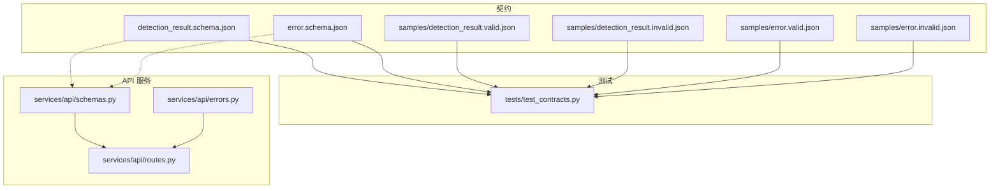
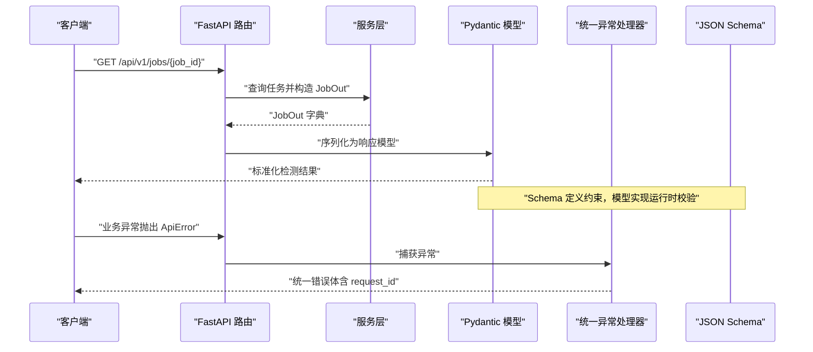
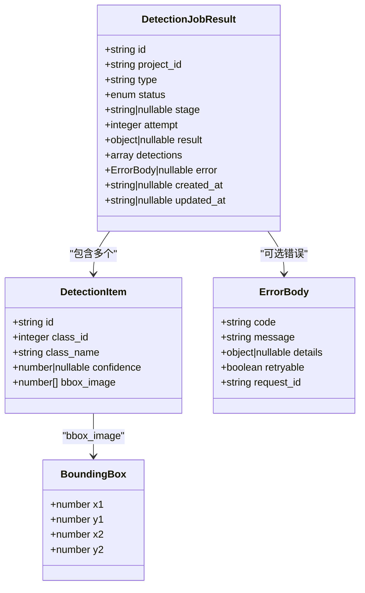
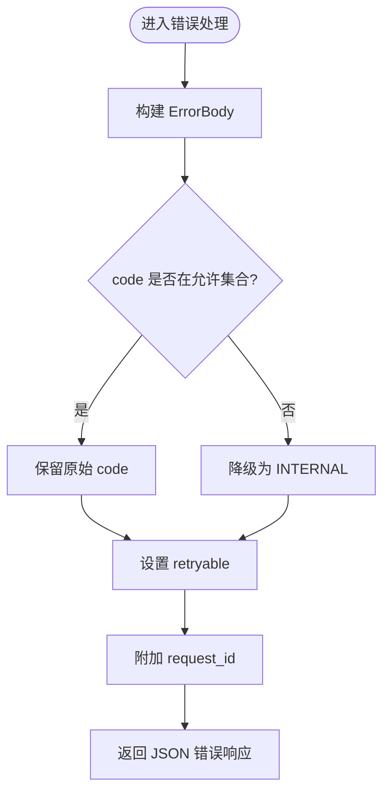
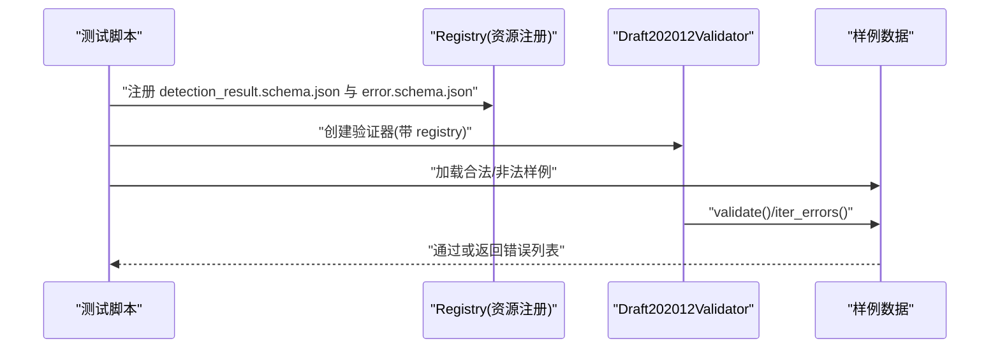
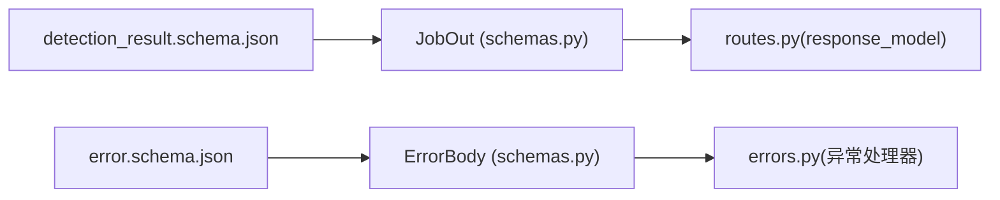

# API 契约

<cite>
**本文引用的文件**   
- [detection_result.schema.json](file://contracts/detection_result.schema.json)
- [error.schema.json](file://contracts/error.schema.json)
- [detection_result.valid.json](file://contracts/samples/detection_result.valid.json)
- [detection_result.invalid.json](file://contracts/samples/detection_result.invalid.json)
- [error.valid.json](file://contracts/samples/error.valid.json)
- [error.invalid.json](file://contracts/samples/error.invalid.json)
- [test_contracts.py](file://tests/test_contracts.py)
- [schemas.py](file://services/api/schemas.py)
- [errors.py](file://services/api/errors.py)
- [routes.py](file://services/api/routes.py)
- [README.md](file://contracts/README.md)
</cite>

## 目录
1. [引言](#引言)
2. [项目结构](#项目结构)
3. [核心组件](#核心组件)
4. [架构总览](#架构总览)
5. [详细组件分析](#详细组件分析)
6. [依赖关系分析](#依赖关系分析)
7. [性能与稳定性考虑](#性能与稳定性考虑)
8. [故障排查指南](#故障排查指南)
9. [结论](#结论)
10. [附录：演进与迁移实践](#附录演进与迁移实践)

## 引言
本文件面向 AstraDesk 的契约驱动开发，聚焦 JSON Schema 契约在前后端协作中的定位、检测结果的契约结构、错误响应的契约设计、样例组织方式、运行时校验机制以及契约演进的最佳实践。目标是让前端、后端、测试与运维围绕同一份“单一事实来源”工作，保证接口一致性、可测试性与可演进性。

## 项目结构
契约相关代码集中在 contracts 目录，测试位于 tests，API 层使用 Pydantic 模型与 FastAPI 路由暴露接口，并通过统一异常处理器输出结构化错误。

**图表来源**
- [detection_result.schema.json:1-65](file://contracts/detection_result.schema.json#L1-L65)
- [error.schema.json:1-24](file://contracts/error.schema.json#L1-L24)
- [test_contracts.py:1-54](file://tests/test_contracts.py#L1-L54)
- [schemas.py:1-84](file://services/api/schemas.py#L1-L84)
- [errors.py:1-56](file://services/api/errors.py#L1-L56)
- [routes.py:1-143](file://services/api/routes.py#L1-L143)

**章节来源**
- [README.md:1-10](file://contracts/README.md#L1-L10)

## 核心组件
- 检测任务结果契约：定义 GET /api/v1/jobs/{id} 返回的检测任务对象结构，包括任务元信息、检测结果数组、运行元数据、错误字段与时间戳。
- 统一错误契约：定义跨接口的错误体结构，包含错误码、消息、详情、是否可重试与请求追踪 ID。
- Pydantic 模型：在服务层实现与 JSON Schema 语义对齐的数据模型，用于请求/响应序列化与校验。
- 测试用例：基于 jsonschema 对合法/非法样例进行断言，确保契约稳定且被正确消费。

**章节来源**
- [detection_result.schema.json:1-65](file://contracts/detection_result.schema.json#L1-L65)
- [error.schema.json:1-24](file://contracts/error.schema.json#L1-L24)
- [schemas.py:1-84](file://services/api/schemas.py#L1-L84)
- [test_contracts.py:1-54](file://tests/test_contracts.py#L1-L54)

## 架构总览
JSON Schema 是契约的权威定义；Pydantic 模型在运行时提供类型安全与快速校验；FastAPI 路由负责协议处理；统一异常处理器将业务异常转换为标准错误体；测试通过 jsonschema 验证样例是否符合契约。

**图表来源**
- [routes.py:130-142](file://services/api/routes.py#L130-L142)
- [schemas.py:19-38](file://services/api/schemas.py#L19-L38)
- [errors.py:35-55](file://services/api/errors.py#L35-L55)
- [detection_result.schema.json:1-65](file://contracts/detection_result.schema.json#L1-L65)
- [error.schema.json:1-24](file://contracts/error.schema.json#L1-L24)

## 详细组件分析

### 检测结果契约：DetectionJobResult
该契约描述检测任务查询结果的结构，重点约束如下：
- 顶层字段
  - id、project_id：非空字符串，用于标识任务与所属项目。
  - type：固定为 detect，表示检测任务。
  - status：枚举状态，包括排队、运行中、成功、部分成功、失败、取消等。
  - stage：可选的阶段字符串或 null。
  - attempt：至少为 1 的整数，表示重试次数。
  - result：可选的运行元信息对象，包含模型名、版本、运行模式、设备、耗时、图像尺寸与检测数量等。
  - detections：检测结果数组，每项遵循 detection 子定义。
  - error：可为 null 或引用统一错误对象。
  - created_at、updated_at：可选的时间字符串。
- 检测项 detection
  - id：非空字符串。
  - class_id：非负整数类别编号。
  - class_name：类别名称字符串。
  - confidence：[0,1] 的可空置信度数值。
  - bbox_image：长度为 4 的归一化坐标数组，元素范围 [0,1]，顺序为 [x1,y1,x2,y2]，左上原点，x 向右、y 向下。
- 边界框 bbox_image
  - 严格长度为 4，每个元素为 [0,1] 的数值，避免越界与歧义。

**图表来源**
- [detection_result.schema.json:1-65](file://contracts/detection_result.schema.json#L1-L65)
- [error.schema.json:1-24](file://contracts/error.schema.json#L1-L24)

**章节来源**
- [detection_result.schema.json:1-65](file://contracts/detection_result.schema.json#L1-L65)

### 错误响应契约：ErrorBody
统一错误对象用于所有接口的错误响应，关键约束如下：
- code：枚举错误码，覆盖输入无效、目标缺失、模型不可用、生成超时、预算超限、内部错误等场景。
- message：人类可读的错误消息。
- details：可选的扩展详情对象或 null。
- retryable：布尔值，指示客户端是否应重试。
- request_id：请求追踪 ID，便于日志关联与排障。

**图表来源**
- [errors.py:35-55](file://services/api/errors.py#L35-L55)
- [error.schema.json:1-24](file://contracts/error.schema.json#L1-L24)

**章节来源**
- [error.schema.json:1-24](file://contracts/error.schema.json#L1-L24)
- [errors.py:1-56](file://services/api/errors.py#L1-L56)

### 样例数据的组织方式
- 合法样例
  - detection_result.valid.json：展示完整的成功任务结果，包含有效的 status、confidence 在 [0,1]、bbox_image 长度为 4 且元素在 [0,1]。
  - error.valid.json：展示合法的错误体，包含允许的 code、message、retryable 布尔值与 request_id。
- 非法样例
  - detection_result.invalid.json：演示非法 status 枚举值、confidence 超出范围、bbox_image 长度不匹配等。
  - error.invalid.json：演示未知 code、缺失 request_id、retryable 类型错误等。

这些样例配合测试脚本，确保契约既可通过正向用例，也能拒绝典型非法输入。

**章节来源**
- [detection_result.valid.json:1-38](file://contracts/samples/detection_result.valid.json#L1-L38)
- [detection_result.invalid.json:1-16](file://contracts/samples/detection_result.invalid.json#L1-L16)
- [error.valid.json:1-8](file://contracts/samples/error.valid.json#L1-L8)
- [error.invalid.json:1-6](file://contracts/samples/error.invalid.json#L1-L6)

### 契约验证的实现机制
- JSON Schema 校验
  - 测试使用 Draft 2020-12 的 jsonschema 验证器，加载两个 schema 并通过 referencing.Registry 注册 $id 引用，从而支持 error 字段对 error.schema.json 的跨文件引用。
  - 针对 detection_result 与 error 分别执行合法样例通过、非法样例拒绝的断言。
- Pydantic 模型绑定
  - schemas.py 定义了 ErrorBody、DetectionOut、JobOut 等模型，与 JSON Schema 语义一致，用于 FastAPI 的请求/响应序列化与运行时校验。
  - routes.py 使用 response_model=JobOut 等声明式约束，确保返回结构与模型一致。
- 自动化测试策略
  - test_contracts.py 通过 iter_errors 收集非法样例的具体错误信息，断言包含关键字段（如 status、confidence、bbox_image 长度），提高回归安全性。

**图表来源**
- [test_contracts.py:17-26](file://tests/test_contracts.py#L17-L26)
- [detection_result.schema.json:34-38](file://contracts/detection_result.schema.json#L34-L38)
- [error.schema.json:1-24](file://contracts/error.schema.json#L1-L24)

**章节来源**
- [test_contracts.py:1-54](file://tests/test_contracts.py#L1-L54)
- [schemas.py:1-84](file://services/api/schemas.py#L1-L84)
- [routes.py:130-142](file://services/api/routes.py#L130-L142)

## 依赖关系分析
- JSON Schema 到 Pydantic 模型
  - detection_result.schema.json 定义检测任务结果结构；schemas.py 中的 JobOut、DetectionOut 与其字段语义对齐。
  - error.schema.json 定义统一错误体；schemas.py 中的 ErrorBody 与其字段语义对齐。
- FastAPI 路由到模型
  - routes.py 使用 response_model=JobOut 等，确保返回数据符合 Pydantic 模型，进而间接符合 JSON Schema 约定。
- 异常处理到错误体
  - errors.py 将 ApiError 与未处理异常映射为 ErrorBody，保证错误响应的一致性。

**图表来源**
- [detection_result.schema.json:1-65](file://contracts/detection_result.schema.json#L1-L65)
- [error.schema.json:1-24](file://contracts/error.schema.json#L1-L24)
- [schemas.py:19-38](file://services/api/schemas.py#L19-L38)
- [routes.py:130-142](file://services/api/routes.py#L130-L142)
- [errors.py:35-55](file://services/api/errors.py#L35-L55)

**章节来源**
- [schemas.py:1-84](file://services/api/schemas.py#L1-L84)
- [routes.py:130-142](file://services/api/routes.py#L130-L142)
- [errors.py:1-56](file://services/api/errors.py#L1-L56)

## 性能与稳定性考虑
- 坐标规范化
  - bbox_image 使用归一化坐标，避免大图像带来的数值溢出与精度问题，同时提升不同分辨率图像的通用性。
- 轻量错误体
  - ErrorBody 仅包含必要字段，减少网络负载与解析开销；details 作为可选扩展，按需填充。
- 异步任务
  - 检测任务采用后台任务执行，接口立即返回 202 与 job 对象，避免长连接阻塞。
- 运行时校验
  - Pydantic 模型在序列化阶段进行类型与范围校验，提前拦截非法数据，降低下游处理成本。

[本节为一般性指导，不涉及具体文件分析]

## 故障排查指南
- 常见契约错误
  - status 不在允许枚举：检查任务状态机，确保只使用已定义的状态值。
  - confidence 超出 [0,1]：检查模型输出后是否做了阈值裁剪与归一化。
  - bbox_image 长度不为 4 或元素越界：检查坐标转换逻辑，确保左上原点与归一化规则。
  - error.code 不在允许集合：核对错误码清单，必要时扩展枚举并在契约中同步更新。
  - request_id 缺失：确认异常处理器是否正确注入 request_id。
- 调试建议
  - 使用 test_contracts.py 的 iter_errors 获取具体错误位置与原因。
  - 在 FastAPI 中开启详细日志，结合 request_id 追踪请求链路。
  - 对比 samples 下的合法/非法样例，快速定位差异点。

**章节来源**
- [test_contracts.py:35-53](file://tests/test_contracts.py#L35-L53)
- [errors.py:31-55](file://services/api/errors.py#L31-L55)

## 结论
AstraDesk 的 API 契约以 JSON Schema 为核心，辅以 Pydantic 模型与 FastAPI 路由，形成从定义到实现的闭环。统一的错误体与严格的坐标规范提升了前后端协作效率与系统稳定性。通过样例与自动化测试，契约具备可验证性与可演进性，适合持续迭代与团队协作。

[本节为总结性内容，不涉及具体文件分析]

## 附录：演进与迁移实践
- 向后兼容性
  - 新增可选字段优先于修改必填字段；保持 additionalProperties=false 的同时谨慎引入新属性。
  - 对枚举值进行追加而非替换，避免破坏既有客户端。
- 废弃字段处理
  - 先标记为 deprecated 并在文档中说明替代字段；在过渡期内兼容旧字段。
  - 逐步在测试中加入弃用警告与迁移用例。
- 迁移指南
  - 发布前运行完整契约测试，确保合法样例仍通过、非法样例仍被拒。
  - 对客户端进行灰度发布，观察错误率与性能指标。
  - 记录变更日志，明确影响面与回滚方案。

[本节为一般性指导，不涉及具体文件分析]