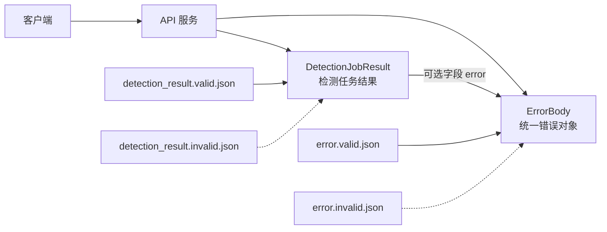
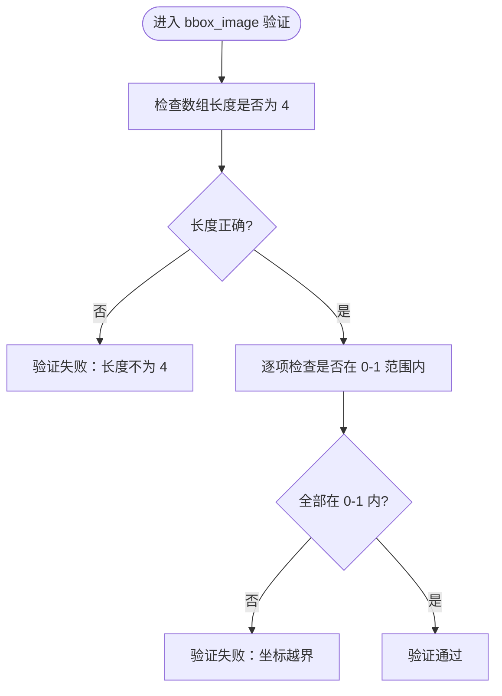
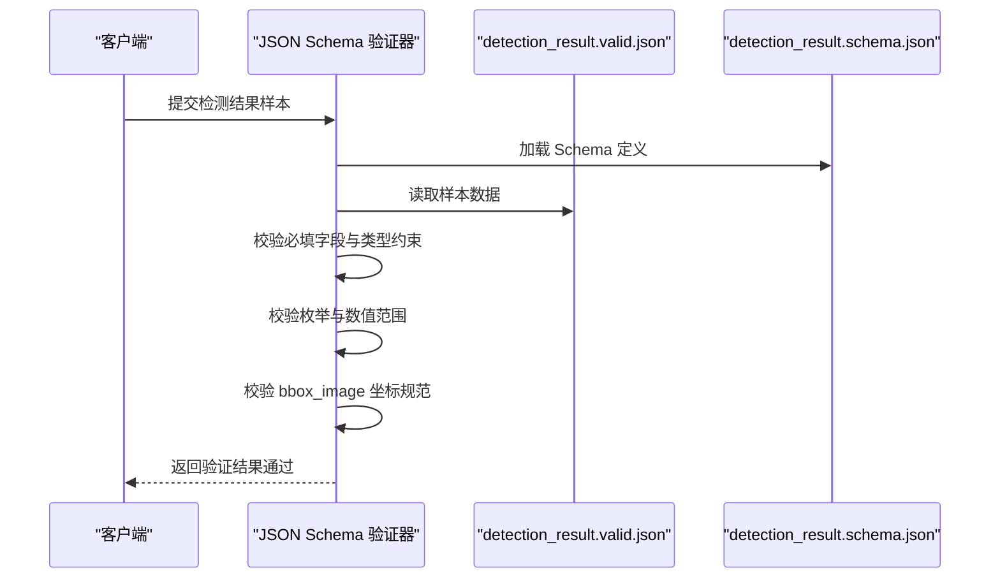
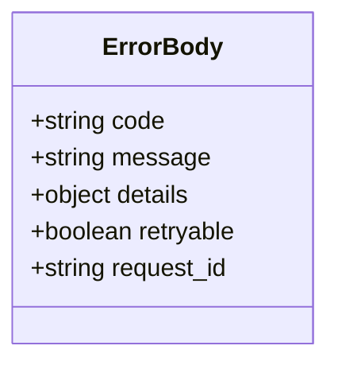
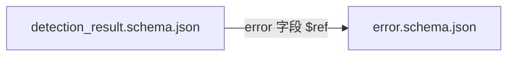

# JSON Schema 定义

<cite>
**本文引用的文件**   
- [contracts/detection_result.schema.json](file://contracts/detection_result.schema.json)
- [contracts/error.schema.json](file://contracts/error.schema.json)
- [contracts/README.md](file://contracts/README.md)
- [contracts/samples/detection_result.valid.json](file://contracts/samples/detection_result.valid.json)
- [contracts/samples/detection_result.invalid.json](file://contracts/samples/detection_result.invalid.json)
- [contracts/samples/error.valid.json](file://contracts/samples/error.valid.json)
- [contracts/samples/error.invalid.json](file://contracts/samples/error.invalid.json)
</cite>

## 目录
1. [引言](#引言)
2. [项目结构](#项目结构)
3. [核心组件](#核心组件)
4. [架构总览](#架构总览)
5. [详细组件分析](#详细组件分析)
6. [依赖关系分析](#依赖关系分析)
7. [性能与验证特性](#性能与验证特性)
8. [故障排查指南](#故障排查指南)
9. [结论](#结论)

## 引言
本文件面向 AstraDesk 的前后端开发者与测试人员，系统化说明检测任务结果与统一错误响应的 JSON Schema 契约。文档重点解释以下方面：
- 元数据字段 `$schema`、`$id`、`title`、`description` 的作用与使用建议。
- 检测结果数据结构：任务基本信息、状态管理、运行结果、检测结果数组。
- 坐标系统规范：归一化坐标、左上原点、0-1 范围约束。
- 错误响应结构：错误码分类、消息格式、调试信息。
- 类型约束、验证规则与引用机制的设计意图。
- 结合合法与非法样例，给出常见验证失败场景与排错建议。

## 项目结构
契约相关代码集中在 `contracts/` 目录，包含两个核心 Schema 与对应样例：
- `detection_result.schema.json`：检测任务查询结果的契约。
- `error.schema.json`：统一错误对象的契约。
- `samples/`：每个 Schema 附带一个合法样例和一个非法样例，用于自动化校验。

```mermaid
graph TB
subgraph "契约目录"
DR["detection_result.schema.json"]
ER["error.schema.json"]
SDR["samples/detection_result.valid.json"]
SIDR["samples/detection_result.invalid.json"]
SER["samples/error.valid.json"]
SEIR["samples/error.invalid.json"]
RMD["contracts/README.md"]
end
DR --> |"引用"| ER
SDR --> |"通过|DR| 校验"
SIDR --> |"拒绝|DR| 校验"
SER --> |"通过|ER| 校验"
SEIR --> |"拒绝|ER| 校验"
RMD --> |"说明"| DR
RMD --> |"说明"| ER
```

**图表来源**
- [contracts/detection_result.schema.json:1-65](file://contracts/detection_result.schema.json#L1-L65)
- [contracts/error.schema.json:1-24](file://contracts/error.schema.json#L1-L24)
- [contracts/README.md:1-10](file://contracts/README.md#L1-L10)

**章节来源**
- [contracts/README.md:1-10](file://contracts/README.md#L1-L10)

## 核心组件
本节概述两个核心 Schema 的职责与边界：
- 检测结果 Schema：描述 GET /api/v1/jobs/{id} 返回的任务结果对象，包括任务标识、状态、运行元信息、检测结果数组以及可选的错误对象。
- 错误对象 Schema：定义统一的错误体结构，包括错误码枚举、人类可读消息、可选详情、是否可重试以及请求追踪 ID。

关键设计要点：
- 使用 `$schema` 声明 JSON Schema Draft 版本，保证跨工具一致性。
- 使用 `$id` 提供稳定可解析的 URI，便于远程引用与缓存。
- 使用 `additionalProperties: false` 限制未知字段，增强契约稳定性。
- 使用 `required` 明确必填字段，减少歧义。
- 使用 `enum`、`const`、数值范围等约束表达业务语义。
- 使用 `$ref` 实现复用与解耦，如检测结果中的错误对象引用错误 Schema。

**章节来源**
- [contracts/detection_result.schema.json:1-65](file://contracts/detection_result.schema.json#L1-L65)
- [contracts/error.schema.json:1-24](file://contracts/error.schema.json#L1-L24)

## 架构总览
下图展示检测结果与错误对象之间的引用关系，以及样例数据如何被 Schema 校验。



**图表来源**
- [contracts/detection_result.schema.json:34-39](file://contracts/detection_result.schema.json#L34-L39)
- [contracts/error.schema.json:1-24](file://contracts/error.schema.json#L1-L24)
- [contracts/samples/detection_result.valid.json:1-38](file://contracts/samples/detection_result.valid.json#L1-L38)
- [contracts/samples/detection_result.invalid.json:1-16](file://contracts/samples/detection_result.invalid.json#L1-L16)
- [contracts/samples/error.valid.json:1-8](file://contracts/samples/error.valid.json#L1-L8)
- [contracts/samples/error.invalid.json:1-6](file://contracts/samples/error.invalid.json#L1-L6)

## 详细组件分析

### 检测结果 Schema（DetectionJobResult）
该 Schema 描述检测任务的查询结果，强调任务标识、状态机、运行元信息与检测结果数组。

#### 元数据字段
- `$schema`：指定 JSON Schema 版本为 2020-12，确保现代验证器行为一致。
- `$id`：唯一标识符，便于远程引用与缓存。
- `title`：人类可读的名称，便于文档生成与调试。
- `description`：说明用途与坐标约定，提示调用方遵循 PRD 5.2 的坐标规范。

#### 顶层结构与必填字段
- `type: object`：根对象。
- `additionalProperties: false`：禁止额外字段，避免隐式扩展破坏契约。
- `required`：强制包含 `id`、`project_id`、`type`、`status`、`detections`。

#### 字段语义与约束
- `id`、`project_id`：字符串且非空，标识任务与所属项目。
- `type`：固定值 `"detect"`，表示检测任务类型。
- `status`：枚举状态，涵盖排队、运行、成功、部分成功、失败、取消等生命周期。
- `stage`：可选的阶段字符串或 null，用于细化执行阶段。
- `attempt`：正整数，表示重试次数或尝试编号。
- `result`：可选的运行元信息对象或 null；当为 mock 模式时显式标注 `run_mode=mock`。
- `detections`：检测结果数组，每项引用内部定义 `detection`。
- `error`：可选的统一错误对象或 null；当存在错误时使用。
- `created_at`、`updated_at`：可选的时间戳字符串或 null。

#### 运行结果对象（result）
- `model_name`、`model_version`：模型名称与版本。
- `run_mode`：枚举 `"real"` 或 `"mock"`，区分真实推理与模拟数据。
- `device`：运行设备标识，例如 GPU 设备名。
- `elapsed_seconds`：耗时秒数，非负数。
- `image_width`、`image_height`：原图宽高，非负整数。
- `count`：检测结果数量，非负整数。

#### 检测结果项（detection）
- `id`：检测项唯一标识。
- `class_id`：类别编号，非负整数。
- `class_name`：类别名称。
- `confidence`：置信度，可选的浮点数或 null，取值范围 0-1。
- `bbox_image`：图像坐标系下的边界框，采用归一化坐标 `[x1, y1, x2, y2]`。

#### 坐标系统规范（bbox_image）
- 数组长度固定为 4。
- 每个元素为 0-1 范围内的数字。
- 坐标系以图像左上角为原点，x 向右增长，y 向下增长。
- 该约定与 PRD 5.2 保持一致，避免像素坐标与归一化坐标混淆。



**图表来源**
- [contracts/detection_result.schema.json:44-50](file://contracts/detection_result.schema.json#L44-L50)

#### 示例数据对照
- 合法样例展示了完整的任务结果、运行元信息、两个检测结果与时间戳。
- 非法样例演示了状态枚举不匹配、置信度越界、边界框维度不足等典型错误。



**图表来源**
- [contracts/samples/detection_result.valid.json:1-38](file://contracts/samples/detection_result.valid.json#L1-L38)
- [contracts/detection_result.schema.json:1-65](file://contracts/detection_result.schema.json#L1-L65)

**章节来源**
- [contracts/detection_result.schema.json:1-65](file://contracts/detection_result.schema.json#L1-L65)
- [contracts/samples/detection_result.valid.json:1-38](file://contracts/samples/detection_result.valid.json#L1-L38)
- [contracts/samples/detection_result.invalid.json:1-16](file://contracts/samples/detection_result.invalid.json#L1-L16)

### 错误对象 Schema（ErrorBody）
该 Schema 定义统一错误体，便于前后端对错误进行一致处理与展示。

#### 元数据字段
- `$schema`：JSON Schema 2020-12。
- `$id`：错误对象的唯一标识符。
- `title`：错误对象的人类可读名称。
- `description`：说明该对象为统一错误体，并关联 PRD 8.3。

#### 顶层结构与必填字段
- `type: object`：根对象。
- `additionalProperties: false`：禁止额外字段。
- `required`：强制包含 `code`、`message`、`retryable`、`request_id`。

#### 字段语义与约束
- `code`：错误码枚举，覆盖输入、资源、模型、预算、超时、内部错误等场景。
- `message`：人类可读的错误消息。
- `details`：可选的详情对象或 null，用于附加调试信息。
- `retryable`：布尔值，指示该错误是否适合客户端重试。
- `request_id`：请求追踪 ID，便于日志定位与问题复现。



**图表来源**
- [contracts/error.schema.json:1-24](file://contracts/error.schema.json#L1-L24)

#### 示例数据对照
- 合法样例展示了模型不可用时的错误体，包含明确的错误码、消息、重试标志与请求 ID。
- 非法样例演示了未知错误码、错误的 `retryable` 类型、缺失 `request_id` 等典型错误。

**章节来源**
- [contracts/error.schema.json:1-24](file://contracts/error.schema.json#L1-L24)
- [contracts/samples/error.valid.json:1-8](file://contracts/samples/error.valid.json#L1-L8)
- [contracts/samples/error.invalid.json:1-6](file://contracts/samples/error.invalid.json#L1-L6)

## 依赖关系分析
检测结果 Schema 引用错误对象 Schema，形成清晰的依赖链：
- 检测结果中的 `error` 字段通过 `$ref` 引用错误对象 Schema，保持错误体结构的一致性。
- 这种设计将错误处理逻辑从业务结果中解耦，便于统一错误处理策略。



**图表来源**
- [contracts/detection_result.schema.json:34-39](file://contracts/detection_result.schema.json#L34-L39)
- [contracts/error.schema.json:1-24](file://contracts/error.schema.json#L1-L24)

**章节来源**
- [contracts/detection_result.schema.json:34-39](file://contracts/detection_result.schema.json#L34-L39)
- [contracts/error.schema.json:1-24](file://contracts/error.schema.json#L1-L24)

## 性能与验证特性
- 使用 `additionalProperties: false` 可减少后续解析与处理的分支判断，提升健壮性。
- 使用 `enum`、`const`、数值范围等强约束，能在早期阶段捕获错误，降低运行时异常概率。
- 使用 `$ref` 复用错误对象定义，避免重复定义与维护成本。
- 使用 `$defs` 局部定义 `bbox_image` 与 `detection`，提高可读性与复用性。
- 建议在服务端与客户端均启用 JSON Schema 验证，确保契约一致性。

[本节为通用指导，不涉及具体文件分析]

## 故障排查指南
常见验证失败场景与修复建议：

- 检测结果状态枚举错误
  - 现象：`status` 使用了不在允许集合中的值。
  - 原因：非法样例中使用了 `"done"`，而 Schema 仅允许特定枚举值。
  - 修复：将状态改为允许的枚举值之一。

- 置信度越界
  - 现象：`confidence` 超出 0-1 范围。
  - 原因：非法样例中置信度大于 1。
  - 修复：将置信度裁剪到 0-1 范围，或修正模型输出。

- 边界框维度不足
  - 现象：`bbox_image` 数组长度不为 4。
  - 原因：非法样例中只提供了三个坐标值。
  - 修复：补全为四个归一化坐标 `[x1, y1, x2, y2]`。

- 错误码未知
  - 现象：`code` 使用了不在枚举集合中的值。
  - 原因：非法样例中使用了自定义错误码。
  - 修复：使用 Schema 定义的推荐错误码集合。

- 重试标志类型错误
  - 现象：`retryable` 不是布尔值。
  - 原因：非法样例中将 `retryable` 写成了字符串。
  - 修复：将 `retryable` 设置为布尔值。

- 缺少请求 ID
  - 现象：错误对象缺少 `request_id`。
  - 原因：非法样例未包含必填字段。
  - 修复：补充 `request_id` 以便日志追踪。

**章节来源**
- [contracts/samples/detection_result.invalid.json:1-16](file://contracts/samples/detection_result.invalid.json#L1-L16)
- [contracts/samples/error.invalid.json:1-6](file://contracts/samples/error.invalid.json#L1-L6)

## 结论
AstraDesk 的 JSON Schema 契约通过严格的类型约束、枚举与范围限制，明确了检测任务结果与统一错误体的结构。检测结果强调任务标识、状态机、运行元信息与检测结果数组，并严格规定归一化坐标规范；错误对象则提供稳定的错误码、消息、详情与重试标志，配合请求 ID 实现可追踪的错误处理。借助合法与非法样例，团队可在前后端两端进行一致的契约校验，降低集成风险并提升可维护性。

[本节为总结性内容，不涉及具体文件分析]