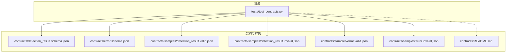
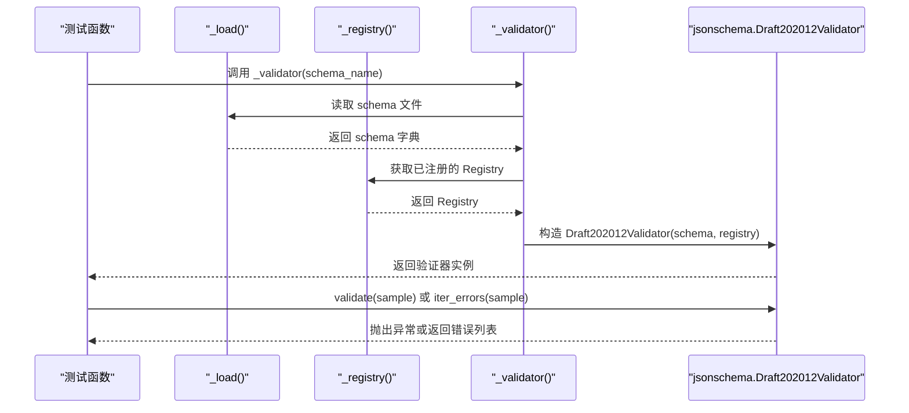
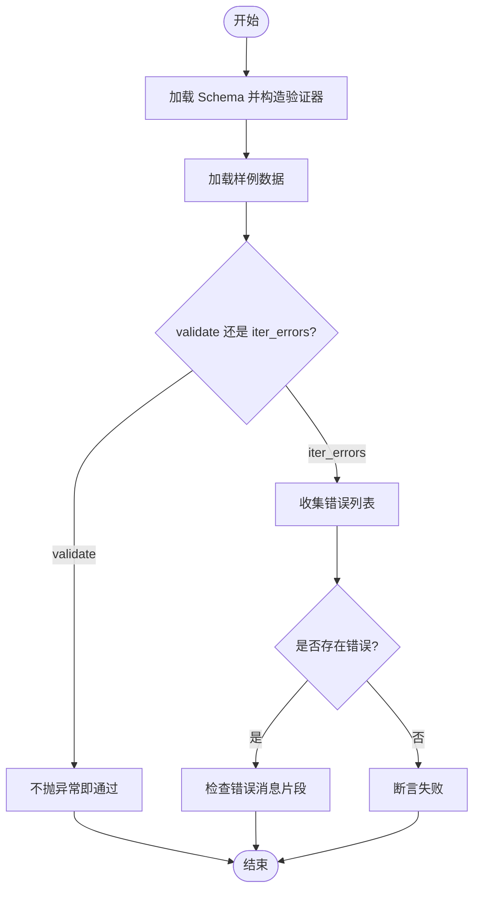
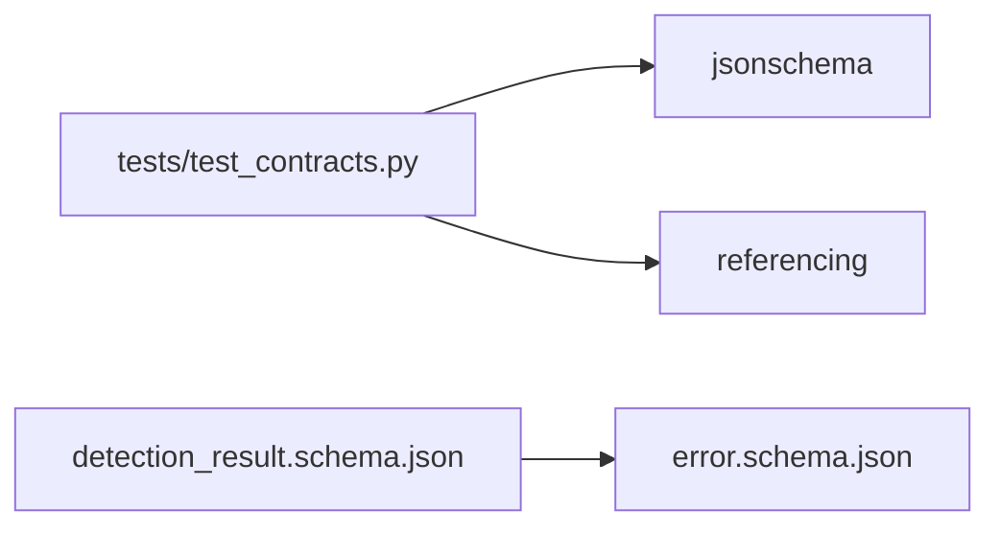

# 契约测试框架

<cite>
**本文引用的文件**   
- [tests/test_contracts.py](file://tests/test_contracts.py)
- [contracts/README.md](file://contracts/README.md)
- [contracts/detection_result.schema.json](file://contracts/detection_result.schema.json)
- [contracts/error.schema.json](file://contracts/error.schema.json)
- [contracts/samples/detection_result.valid.json](file://contracts/samples/detection_result.valid.json)
- [contracts/samples/detection_result.invalid.json](file://contracts/samples/detection_result.invalid.json)
- [contracts/samples/error.valid.json](file://contracts/samples/error.valid.json)
- [contracts/samples/error.invalid.json](file://contracts/samples/error.invalid.json)
</cite>

## 目录
1. [引言](#引言)
2. [项目结构](#项目结构)
3. [核心组件](#核心组件)
4. [架构总览](#架构总览)
5. [详细组件分析](#详细组件分析)
6. [依赖关系分析](#依赖关系分析)
7. [性能与扩展性](#性能与扩展性)
8. [故障排查指南](#故障排查指南)
9. [结论](#结论)

## 引言
本文件面向 AstraDesk 的契约测试框架，聚焦于 tests/test_contracts.py 中的实现逻辑。文档将系统说明：
- JSON Schema 验证器的初始化与注册机制
- 测试用例的组织结构与正向、反向测试策略
- JSON Schema 文件的加载与解析（含本地路径与远程引用）
- Pydantic 模型绑定机制在本项目中的现状与建议
- 断言设计与容差处理
- 测试环境配置、依赖注入与外部服务隔离
- 如何扩展新的契约类型与自定义验证规则
- 覆盖率分析与性能优化建议

## 项目结构
契约相关资源集中在 contracts 目录，测试位于 tests 目录。核心关系如下：
- contracts 目录提供 JSON Schema 定义与合法/非法样例数据
- tests/test_contracts.py 使用 jsonschema 库对样例进行校验
- 测试通过 Registry 注册 Schema，以支持跨 Schema 引用

**图表来源**
- [tests/test_contracts.py:10-26](file://tests/test_contracts.py#L10-L26)
- [contracts/README.md:1-10](file://contracts/README.md#L1-L10)

**章节来源**
- [contracts/README.md:1-10](file://contracts/README.md#L1-L10)

## 核心组件
- 契约定义
  - detection_result.schema.json：检测任务查询结果的结构约束，包含坐标归一化、枚举状态、嵌套检测项等
  - error.schema.json：统一错误对象的结构约束，包含受限的错误码集合、重试标志、请求标识等
- 样例数据
  - detection_result.valid.json / detection_result.invalid.json
  - error.valid.json / error.invalid.json
- 测试驱动
  - tests/test_contracts.py：负责加载 Schema、构建 Registry、创建验证器并执行断言

**章节来源**
- [contracts/detection_result.schema.json:1-65](file://contracts/detection_result.schema.json#L1-L65)
- [contracts/error.schema.json:1-24](file://contracts/error.schema.json#L1-L24)
- [contracts/samples/detection_result.valid.json:1-38](file://contracts/samples/detection_result.valid.json#L1-L38)
- [contracts/samples/detection_result.invalid.json:1-16](file://contracts/samples/detection_result.invalid.json#L1-L16)
- [contracts/samples/error.valid.json:1-8](file://contracts/samples/error.valid.json#L1-L8)
- [contracts/samples/error.invalid.json:1-6](file://contracts/samples/error.invalid.json#L1-L6)
- [tests/test_contracts.py:1-54](file://tests/test_contracts.py#L1-L54)

## 架构总览
下图展示测试运行时的关键流程：从测试函数到 Schema 加载、Registry 注册、验证器创建与断言。

**图表来源**
- [tests/test_contracts.py:13-26](file://tests/test_contracts.py#L13-L26)

## 详细组件分析

### JSON Schema 验证器初始化与注册
- 本地路径加载
  - 通过相对路径常量 CONTRACTS 定位 contracts 目录
  - _load(name) 使用 pathlib 读取 UTF-8 文本并解析为字典
- Registry 注册
  - _registry() 同时加载 detection_result.schema.json 与 error.schema.json
  - 使用 referencing.Registry().with_resources 将每个 Schema 以其 $id 作为键注册
- 验证器构造
  - _validator(schema_name) 根据名称加载对应 Schema，并使用已注册的 Registry 构造 Draft202012Validator

关键点：
- 使用 Draft202012 版本，确保兼容最新 JSON Schema 特性
- 通过 Registry 支持跨 Schema 引用（例如 detection_result 中引用 error.schema）

**章节来源**
- [tests/test_contracts.py:10-26](file://tests/test_contracts.py#L10-L26)
- [contracts/detection_result.schema.json:1-65](file://contracts/detection_result.schema.json#L1-L65)
- [contracts/error.schema.json:1-24](file://contracts/error.schema.json#L1-L24)

### Schema 文件加载与远程 URL 引用
- 本地路径处理
  - 所有 Schema 与样例均位于本地 contracts 目录，由 _load 直接读取
- 远程 URL 引用
  - detection_result.schema.json 在 error 字段中使用 oneOf 与 $ref 引用 https://astradesk.local/contracts/error.schema.json
  - 该远程引用通过 Registry 注册同名 $id 的资源进行解析，从而避免网络访问
- 最佳实践
  - 若未来需要真实远程解析，可在 Registry 基础上添加 fetcher；当前实现通过 with_resources 完全本地化解析，提升稳定性与可重复性

**章节来源**
- [contracts/detection_result.schema.json:34-39](file://contracts/detection_result.schema.json#L34-L39)
- [tests/test_contracts.py:17-26](file://tests/test_contracts.py#L17-L26)

### 测试用例组织与断言策略
- 正向测试（合法样例通过）
  - test_detection_result_valid_passes：加载 valid 样例，调用 validate，不抛异常即通过
  - test_error_valid_passes：同上
- 反向测试（非法样例被拒）
  - test_detection_result_invalid_rejected：加载 invalid 样例，使用 iter_errors 收集错误，断言至少存在一个错误，并通过消息片段检查覆盖关键约束（如 status 枚举、confidence 范围、bbox_image 长度）
  - test_error_invalid_rejected：同样使用 iter_errors 断言错误存在，覆盖未知 code、缺失 request_id、retryable 类型错误等

断言设计要点：
- 正向用例采用“无异常即通过”的简洁断言
- 反向用例通过错误消息片段进行模糊匹配，确保关键约束被覆盖
- 使用 list(iter_errors(...)) 一次性收集全部错误，便于后续扩展更精细的断言

**图表来源**
- [tests/test_contracts.py:29-53](file://tests/test_contracts.py#L29-L53)

**章节来源**
- [tests/test_contracts.py:29-53](file://tests/test_contracts.py#L29-L53)

### Pydantic 模型绑定机制的现状与建议
- 现状
  - 当前契约测试未使用 Pydantic，而是直接使用 jsonschema 对 JSON 数据进行结构校验
  - 因此不存在运行时类型转换、默认值处理等 Pydantic 行为
- 建议
  - 若后端 API 使用 Pydantic 模型，建议在 API 层引入 Pydantic 进行数据绑定与校验
  - 测试侧可并行维护两套校验：
    - 契约层：继续使用 jsonschema 保证前后端共享契约稳定
    - 应用层：使用 Pydantic 进行运行时校验与类型转换
  - 可通过生成 Pydantic 模型（基于 JSON Schema）减少手工维护成本

[本节为概念性建议，不直接分析具体代码文件]

### 测试断言的实现细节
- 结构化比较
  - 当前主要依赖 Schema 的结构约束，而非逐字段相等比较
- 容差处理
  - 数值范围通过 Schema 的 minimum/maximum 控制，无需额外容差
- 模糊匹配
  - 反向测试通过错误消息片段（如 “done”、“status”）进行模糊匹配，确保关键约束被覆盖

**章节来源**
- [tests/test_contracts.py:35-53](file://tests/test_contracts.py#L35-L53)

### 测试环境配置、依赖注入与外部服务隔离
- 依赖注入
  - 通过模块级函数 _registry 与 _validator 集中管理 Schema 注册与验证器构造，便于复用与替换
- 模拟数据生成
  - 使用 samples 目录下的合法/非法样例作为固定输入，确保测试可重复
- 外部服务隔离
  - 所有 Schema 解析均在本地完成，避免网络依赖
  - 远程 $ref 通过 Registry 本地映射，屏蔽外部服务

**章节来源**
- [tests/test_contracts.py:17-26](file://tests/test_contracts.py#L17-L26)
- [contracts/detection_result.schema.json:34-39](file://contracts/detection_result.schema.json#L34-L39)

### 扩展测试用例的指导
- 新增契约类型的步骤
  1. 在 contracts 目录新增 .schema.json 文件，定义 $id 与结构约束
  2. 在 contracts/samples 下新增 *.valid.json 与 *.invalid.json 样例
  3. 在 _registry() 中加载新 Schema 并注册
  4. 新增测试函数，分别覆盖正向与反向场景
- 自定义验证规则的集成
  - 在 Schema 中使用 additionalProperties、pattern、minimum/maximum、enum 等约束表达业务规则
  - 如需复杂逻辑，可在测试层结合 iter_errors 进行更细粒度的断言

**章节来源**
- [tests/test_contracts.py:17-26](file://tests/test_contracts.py#L17-L26)
- [contracts/README.md:1-10](file://contracts/README.md#L1-L10)

## 依赖关系分析
- 测试依赖
  - jsonschema：用于 JSON Schema 校验
  - referencing：用于 Registry 与 Resource 管理，支持跨 Schema 引用
- 契约依赖
  - detection_result.schema.json 依赖 error.schema.json（通过 $ref）

**图表来源**
- [tests/test_contracts.py:7-8](file://tests/test_contracts.py#L7-L8)
- [contracts/detection_result.schema.json:34-39](file://contracts/detection_result.schema.json#L34-L39)

**章节来源**
- [tests/test_contracts.py:7-8](file://tests/test_contracts.py#L7-L8)
- [contracts/detection_result.schema.json:34-39](file://contracts/detection_result.schema.json#L34-L39)

## 性能与扩展性
- 性能考虑
  - 每次测试重新构造验证器，开销较小但可进一步优化：缓存验证器实例
  - Registry 仅注册两个 Schema，开销极低
- 扩展性
  - 通过集中式 _registry 与 _validator，新增 Schema 与测试用例成本低
  - 建议使用参数化测试（如 pytest.mark.parametrize）批量覆盖多组样例

[本节为通用建议，不直接分析具体代码文件]

## 故障排查指南
- 常见问题
  - 远程 $ref 解析失败：确认 Registry 是否已注册对应 $id 的资源
  - 非法样例未被拒绝：检查 iter_errors 是否正确收集错误，并确认断言条件
  - 错误消息片段匹配失败：调整断言中的关键字，确保覆盖关键约束
- 调试建议
  - 打印 iter_errors 的错误消息列表，定位具体失败字段
  - 临时放宽断言条件，逐步缩小问题范围

**章节来源**
- [tests/test_contracts.py:35-53](file://tests/test_contracts.py#L35-L53)

## 结论
AstraDesk 的契约测试框架以 JSON Schema 为核心，通过 jsonschema 与 referencing 实现稳定的契约校验。测试用例清晰区分正向与反向场景，断言策略兼顾简洁性与可维护性。当前实现未使用 Pydantic，建议在 API 层引入 Pydantic 进行运行时校验，并在测试侧保持契约层的独立性与稳定性。通过集中式注册与模块化设计，新增契约类型与自定义验证规则的成本较低，具备良好的扩展性。