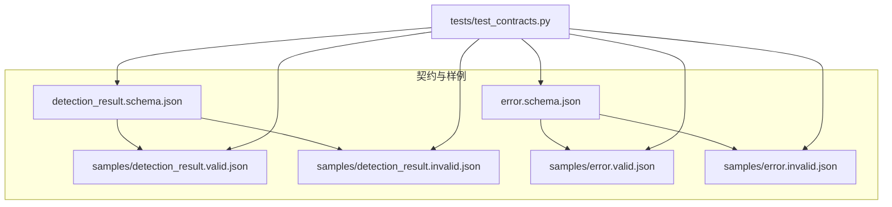
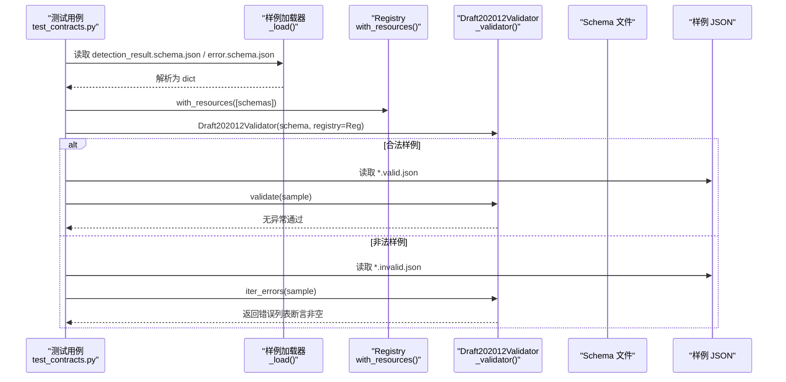
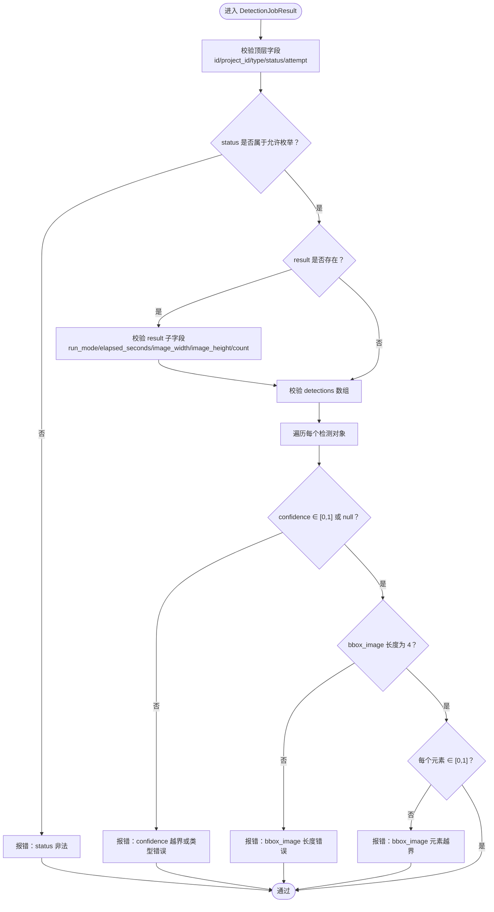
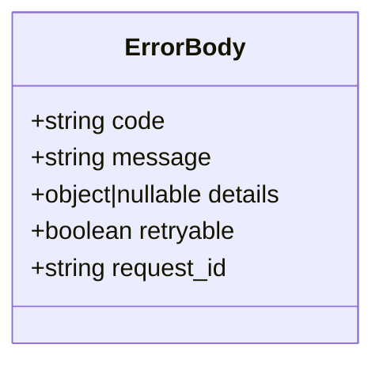
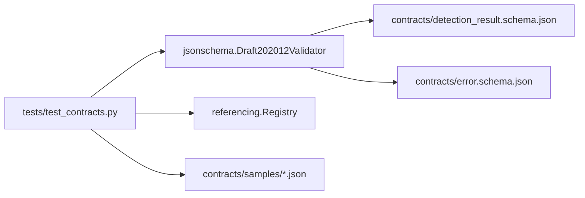

# 样例数据管理

<cite>
**本文引用的文件**   
- [contracts/README.md](file://contracts/README.md)
- [contracts/detection_result.schema.json](file://contracts/detection_result.schema.json)
- [contracts/error.schema.json](file://contracts/error.schema.json)
- [contracts/samples/detection_result.valid.json](file://contracts/samples/detection_result.valid.json)
- [contracts/samples/detection_result.invalid.json](file://contracts/samples/detection_result.invalid.json)
- [contracts/samples/error.valid.json](file://contracts/samples/error.valid.json)
- [contracts/samples/error.invalid.json](file://contracts/samples/error.invalid.json)
- [tests/test_contracts.py](file://tests/test_contracts.py)
</cite>

## 目录
1. [引言](#引言)
2. [项目结构](#项目结构)
3. [核心组件](#核心组件)
4. [架构总览](#架构总览)
5. [详细组件分析](#详细组件分析)
6. [依赖关系分析](#依赖关系分析)
7. [性能与可维护性考虑](#性能与可维护性考虑)
8. [故障排查指南](#故障排查指南)
9. [结论](#结论)
10. [附录：样例字段对照表](#附录样例字段对照表)

## 引言
本文件面向 AstraDesk 的 API 契约样例数据，目标是建立一份“单一事实来源”的说明文档，覆盖样例数据的组织结构、命名规范、合法与非法样例的分类策略，以及它们在自动化测试中的使用方式。重点包括：
- 检测任务响应结构的完整语义与约束（坐标归一化、置信度范围、枚举状态等）。
- 错误对象的统一结构与错误码集合。
- 如何通过 JSON Schema 与 jsonschema 库进行契约验证。
- 如何维护样例与 schema 的一致性，确保接口兼容性与回归测试稳定。

## 项目结构
契约与样例位于 contracts 目录，采用“schema + samples”的组织方式：
- contracts/detection_result.schema.json：检测任务查询结果的 JSON Schema。
- contracts/error.schema.json：统一错误对象的 JSON Schema。
- contracts/samples：每个 schema 对应一个 valid 与一个 invalid 样例。
- tests/test_contracts.py：基于 jsonschema 的契约校验用例。

**图表来源**
- [contracts/detection_result.schema.json:1-65](file://contracts/detection_result.schema.json#L1-L65)
- [contracts/error.schema.json:1-24](file://contracts/error.schema.json#L1-L24)
- [contracts/samples/detection_result.valid.json:1-38](file://contracts/samples/detection_result.valid.json#L1-L38)
- [contracts/samples/detection_result.invalid.json:1-16](file://contracts/samples/detection_result.invalid.json#L1-L16)
- [contracts/samples/error.valid.json:1-8](file://contracts/samples/error.valid.json#L1-L8)
- [contracts/samples/error.invalid.json:1-6](file://contracts/samples/error.invalid.json#L1-L6)
- [tests/test_contracts.py:1-54](file://tests/test_contracts.py#L1-L54)

**章节来源**
- [contracts/README.md:1-10](file://contracts/README.md#L1-L10)

## 核心组件
- 检测任务结果 Schema（DetectionJobResult）：定义 GET /api/v1/jobs/{id} 返回的任务对象结构，包含 id、project_id、type、status、stage、attempt、result、detections、error、created_at、updated_at 等字段。
- 错误对象 Schema（ErrorBody）：定义统一错误体，包含 code、message、details、retryable、request_id。
- 样例数据：
  - detection_result.valid.json：展示合法的检测任务响应，包含有效的检测对象、正确的坐标值、合理的置信度范围。
  - detection_result.invalid.json：展示常见的非法场景，如 status 枚举不合法、confidence 越界、bbox_image 长度不正确等。
  - error.valid.json：展示符合 ErrorBody 的错误对象。
  - error.invalid.json：展示未知 code、缺失 request_id、retryable 类型错误等非法结构。

**章节来源**
- [contracts/detection_result.schema.json:1-65](file://contracts/detection_result.schema.json#L1-L65)
- [contracts/error.schema.json:1-24](file://contracts/error.schema.json#L1-L24)
- [contracts/samples/detection_result.valid.json:1-38](file://contracts/samples/detection_result.valid.json#L1-L38)
- [contracts/samples/detection_result.invalid.json:1-16](file://contracts/samples/detection_result.invalid.json#L1-L16)
- [contracts/samples/error.valid.json:1-8](file://contracts/samples/error.valid.json#L1-L8)
- [contracts/samples/error.invalid.json:1-6](file://contracts/samples/error.invalid.json#L1-L6)

## 架构总览
下图展示了契约校验在测试中的调用流程：测试加载 schema 与样例，构建 Registry 并创建 Draft202012Validator，对合法样例执行 validate（应通过），对非法样例执行 iter_errors（应产生错误）。

**图表来源**
- [tests/test_contracts.py:13-26](file://tests/test_contracts.py#L13-L26)
- [tests/test_contracts.py:29-53](file://tests/test_contracts.py#L29-L53)
- [contracts/detection_result.schema.json:1-65](file://contracts/detection_result.schema.json#L1-L65)
- [contracts/error.schema.json:1-24](file://contracts/error.schema.json#L1-L24)

## 详细组件分析

### 检测任务结果（DetectionJobResult）
- 顶层字段：
  - id、project_id：字符串且非空。
  - type：固定为 detect。
  - status：枚举值，包含 queued、running、succeeded、partial、failed、cancelled。
  - stage：可选字符串或 null。
  - attempt：正整数。
  - result：可为 null；当存在时包含模型元信息（model_name、model_version）、运行模式 run_mode（real/mock）、设备 device、耗时 elapsed_seconds、图像尺寸 image_width/image_height、检测结果数量 count。
  - detections：检测对象数组，每个对象包含 id、class_id、class_name、confidence、bbox_image。
  - error：可为 null 或引用 error.schema.json。
  - created_at、updated_at：时间戳字符串或 null。
- 检测对象（detection）：
  - confidence：number 或 null，取值范围 [0, 1]。
  - bbox_image：长度为 4 的数组，元素为 number，取值范围 [0, 1]，表示归一化的左上原点坐标 [x1,y1,x2,y2]。
- 坐标约定：
  - bbox_image 与 bbox_desk 区分，bbox_desk 由后端从原图框与桌面矩形推导，详见 packages/layout/coordinates.py 与 tests/test_coordinates.py（概念性说明，不在本文件展开）。

**图表来源**
- [contracts/detection_result.schema.json:8-42](file://contracts/detection_result.schema.json#L8-L42)
- [contracts/detection_result.schema.json:44-62](file://contracts/detection_result.schema.json#L44-L62)

**章节来源**
- [contracts/detection_result.schema.json:1-65](file://contracts/detection_result.schema.json#L1-L65)
- [contracts/README.md:5-9](file://contracts/README.md#L5-L9)

#### 合法样例（detection_result.valid.json）
该样例展示了完整的检测任务响应结构：
- 顶层字段齐全，status 为 succeeded，type 为 detect。
- result 包含 model_name、model_version、run_mode、device、elapsed_seconds、image_width、image_height、count。
- detections 包含两个检测对象，每个对象具备 id、class_id、class_name、confidence、bbox_image。
- confidence 在合理范围内（例如 0.94、0.89）。
- bbox_image 为四个元素的数组，元素均在 [0, 1] 区间内。
- error 为 null，created_at/updated_at 为 ISO 时间字符串。

该样例用于验证：
- 所有必填字段存在且类型正确。
- 枚举值合法。
- 数值范围与数组长度约束满足。
- 嵌套对象与引用 schema（error）的结构正确。

**章节来源**
- [contracts/samples/detection_result.valid.json:1-38](file://contracts/samples/detection_result.valid.json#L1-L38)
- [contracts/detection_result.schema.json:8-42](file://contracts/detection_result.schema.json#L8-L42)
- [contracts/detection_result.schema.json:44-62](file://contracts/detection_result.schema.json#L44-L62)

#### 非法样例（detection_result.invalid.json）
该样例故意构造多种非法场景：
- status 使用了不允许的值（例如 done）。
- confidence 超出 [0, 1] 范围（例如 1.7）。
- bbox_image 长度不正确（例如只有三个元素）。
- 缺少部分顶层字段（如 error、created_at、updated_at 等）。

这些错误会被 jsonschema 捕获，测试断言至少包含 status 非法、confidence 越界、bbox_image 长度错误等错误信息。

**章节来源**
- [contracts/samples/detection_result.invalid.json:1-16](file://contracts/samples/detection_result.invalid.json#L1-L16)
- [tests/test_contracts.py:35-43](file://tests/test_contracts.py#L35-L43)

### 错误对象（ErrorBody）
- 必填字段：code、message、retryable、request_id。
- code：限定于建议的错误码集合，包括 INVALID_IMAGE、TOO_MANY_OBJECTS、MODEL_UNAVAILABLE、SCHEMA_INVALID、NO_FEASIBLE_LAYOUT、STALE_REVISION、GENERATION_TIMEOUT、BUDGET_EXCEEDED、PROJECT_NOT_FOUND、ASSET_NOT_FOUND、JOB_NOT_FOUND、INTERNAL。
- message：字符串。
- details：object 或 null。
- retryable：布尔值。
- request_id：字符串。

**图表来源**
- [contracts/error.schema.json:1-24](file://contracts/error.schema.json#L1-L24)

**章节来源**
- [contracts/error.schema.json:1-24](file://contracts/error.schema.json#L1-L24)

#### 合法错误样例（error.valid.json）
该样例展示了符合 ErrorBody 的错误对象：
- code 为允许的枚举值（例如 MODEL_UNAVAILABLE）。
- message 提供可读描述。
- details 为 null。
- retryable 为布尔值 false。
- request_id 为非空字符串。

用于验证：
- code 在允许集合中。
- 所有必填字段存在且类型正确。
- details 可为 null。
- retryable 为布尔类型。

**章节来源**
- [contracts/samples/error.valid.json:1-8](file://contracts/samples/error.valid.json#L1-L8)
- [contracts/error.schema.json:1-24](file://contracts/error.schema.json#L1-L24)

#### 非法错误样例（error.invalid.json）
该样例故意构造以下错误：
- code 为未知值（例如 SOMETHING_WEIRD）。
- 缺失 request_id。
- retryable 类型为字符串而非布尔值。

用于验证：
- code 不在允许集合时报错。
- 缺失必填字段时报错。
- 类型不匹配时报错。

**章节来源**
- [contracts/samples/error.invalid.json:1-6](file://contracts/samples/error.invalid.json#L1-L6)
- [contracts/error.schema.json:1-24](file://contracts/error.schema.json#L1-L24)

## 依赖关系分析
- 测试依赖 jsonschema 与 referencing 库，用于加载和验证 JSON Schema。
- 测试通过 Registry.with_resources 将 detection_result.schema.json 与 error.schema.json 注册为资源，以便在 detection_result.schema.json 中引用 error.schema.json。
- 测试分别对合法样例执行 validate（期望通过），对非法样例执行 iter_errors（期望返回错误列表）。

**图表来源**
- [tests/test_contracts.py:1-54](file://tests/test_contracts.py#L1-L54)
- [contracts/detection_result.schema.json:1-65](file://contracts/detection_result.schema.json#L1-L65)
- [contracts/error.schema.json:1-24](file://contracts/error.schema.json#L1-L24)

**章节来源**
- [tests/test_contracts.py:1-54](file://tests/test_contracts.py#L1-L54)

## 性能与可维护性考虑
- 样例规模较小，jsonschema 验证开销低，适合在 CI 中作为快速回归检查。
- 保持样例与 schema 同步是关键：新增字段或约束时，需同时更新 valid 与 invalid 样例，确保测试覆盖新增分支。
- 建议在新增错误码或业务约束时，先在 error.schema.json 中扩展 enum，再在 error.invalid.json 中加入未覆盖的非法场景。
- 对于检测对象的新增字段，应在 detection_result.schema.json 中定义，并在 detection_result.valid.json 中添加示例值，同时在 detection_result.invalid.json 中添加违反约束的示例。

[本节为通用指导，不直接分析具体文件]

## 故障排查指南
- 若合法样例被拒绝：
  - 检查字段类型是否与 schema 一致（例如 confidence 是否为 number 或 null）。
  - 检查数值范围是否在约束内（例如 confidence ∈ [0, 1]，bbox_image 元素 ∈ [0, 1]）。
  - 检查数组长度是否符合要求（例如 bbox_image 长度为 4）。
  - 检查枚举值是否合法（例如 status 是否属于允许集合）。
- 若非法样例未被拒绝：
  - 确认测试是否正确加载了 schema 与样例。
  - 确认 iter_errors 是否被调用并断言错误列表非空。
  - 检查 schema 是否遗漏了对非法值的约束。

**章节来源**
- [tests/test_contracts.py:29-53](file://tests/test_contracts.py#L29-L53)
- [contracts/detection_result.schema.json:8-42](file://contracts/detection_result.schema.json#L8-L42)
- [contracts/detection_result.schema.json:44-62](file://contracts/detection_result.schema.json#L44-L62)
- [contracts/error.schema.json:1-24](file://contracts/error.schema.json#L1-L24)

## 结论
AstraDesk 的契约样例数据以 JSON Schema 为核心，配合 valid/invalid 样例形成稳定的接口契约基线。通过 jsonschema 的自动化校验，可在开发阶段尽早发现数据结构不一致、类型错误或约束违反等问题，保障前后端接口的兼容性与稳定性。维护时应遵循“schema 先行、样例同步”的原则，持续完善合法与非法样例的覆盖度，确保回归测试的有效性。

[本节为总结性内容，不直接分析具体文件]

## 附录：样例字段对照表
- 检测任务结果（DetectionJobResult）关键字段：
  - id：字符串，非空。
  - project_id：字符串，非空。
  - type：固定为 detect。
  - status：枚举值（queued、running、succeeded、partial、failed、cancelled）。
  - stage：字符串或 null。
  - attempt：正整数。
  - result：对象或 null，包含模型与运行元信息。
  - detections：检测对象数组。
  - error：null 或 ErrorBody。
  - created_at、updated_at：时间字符串或 null。
- 检测对象（detection）关键字段：
  - id：字符串，非空。
  - class_id：非负整数。
  - class_name：字符串。
  - confidence：number 或 null，范围 [0, 1]。
  - bbox_image：长度为 4 的数组，元素为 [0, 1] 的数。
- 错误对象（ErrorBody）关键字段：
  - code：枚举值（INVALID_IMAGE、TOO_MANY_OBJECTS、MODEL_UNAVAILABLE、SCHEMA_INVALID、NO_FEASIBLE_LAYOUT、STALE_REVISION、GENERATION_TIMEOUT、BUDGET_EXCEEDED、PROJECT_NOT_FOUND、ASSET_NOT_FOUND、JOB_NOT_FOUND、INTERNAL）。
  - message：字符串。
  - details：object 或 null。
  - retryable：布尔值。
  - request_id：字符串。

**章节来源**
- [contracts/detection_result.schema.json:8-42](file://contracts/detection_result.schema.json#L8-L42)
- [contracts/detection_result.schema.json:44-62](file://contracts/detection_result.schema.json#L44-L62)
- [contracts/error.schema.json:1-24](file://contracts/error.schema.json#L1-L24)