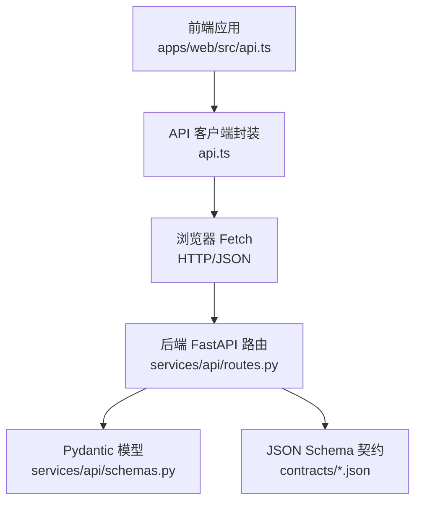
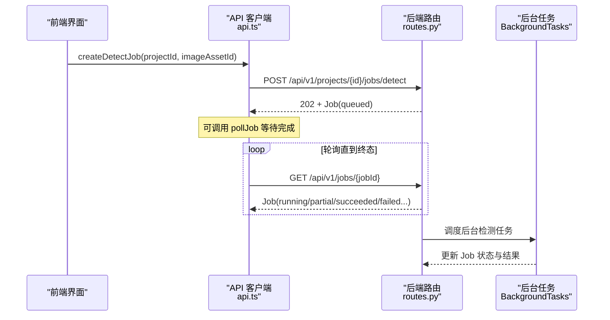
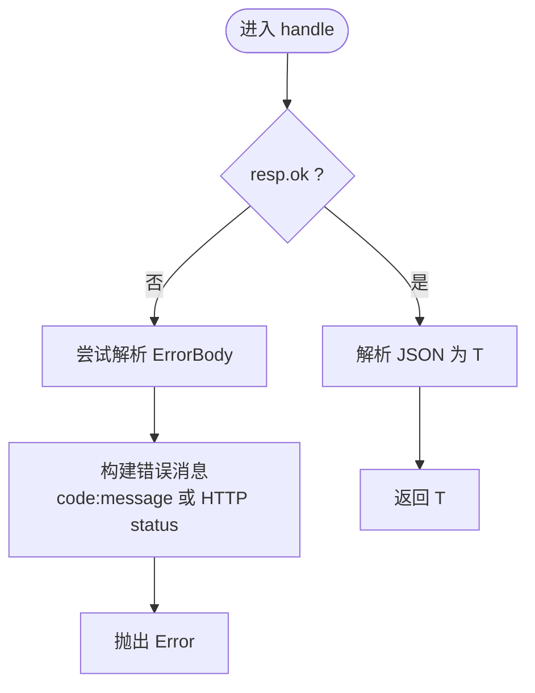
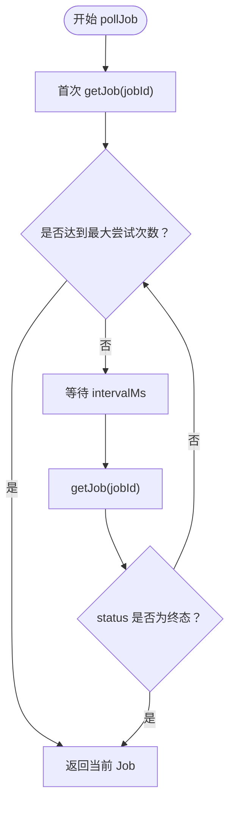
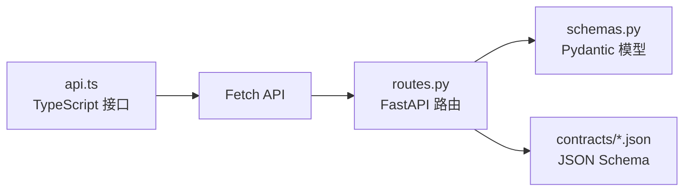
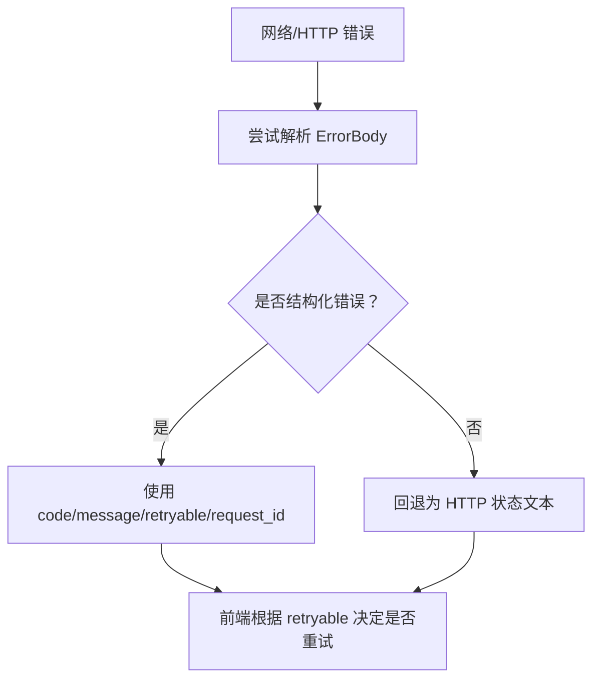
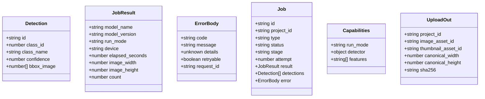

# API 客户端

<cite>
**本文引用的文件**   
- [api.ts](file://apps/web/src/api.ts)
- [routes.py](file://services/api/routes.py)
- [schemas.py](file://services/api/schemas.py)
- [detection_result.schema.json](file://contracts/detection_result.schema.json)
- [error.schema.json](file://contracts/error.schema.json)
</cite>

## 目录
1. [引言](#引言)
2. [项目结构](#项目结构)
3. [核心组件](#核心组件)
4. [架构总览](#架构总览)
5. [详细组件分析](#详细组件分析)
6. [依赖关系分析](#依赖关系分析)
7. [性能与可靠性](#性能与可靠性)
8. [错误处理体系](#错误处理体系)
9. [类型安全设计](#类型安全设计)
10. [使用示例与最佳实践](#使用示例与最佳实践)
11. [故障排查指南](#故障排查指南)
12. [结论](#结论)

## 引言
本文件面向 AstraDesk 前端 API 客户端，聚焦 apps/web/src/api.ts 模块的设计模式与实现细节。文档将系统说明 HTTP 请求封装、错误处理机制、类型定义管理，并逐一解析能力查询、项目创建、图片上传、检测任务创建、任务轮询、资产 URL 生成等 API 函数。同时解释异步任务处理策略（轮询、超时、重试）、错误分类、类型安全设计，以及与后端服务的通信协议和数据格式约定。

## 项目结构
AstraDesk 的前端 API 客户端位于 apps/web/src/api.ts，仅通过 /api/v1 访问后端服务；后端路由在 services/api/routes.py 中定义，数据契约由 Pydantic schemas 和 JSON Schema 共同约束。

**图表来源**
- [api.ts:48-118](file://apps/web/src/api.ts#L48-L118)
- [routes.py:28-143](file://services/api/routes.py#L28-L143)
- [schemas.py:9-84](file://services/api/schemas.py#L9-L84)
- [detection_result.schema.json:1-65](file://contracts/detection_result.schema.json#L1-L65)
- [error.schema.json:1-24](file://contracts/error.schema.json#L1-L24)

**章节来源**
- [api.ts:1-119](file://apps/web/src/api.ts#L1-L119)
- [routes.py:1-143](file://services/api/routes.py#L1-L143)

## 核心组件
- 基础常量与路径前缀：BASE = "/api/v1"，所有接口统一以该前缀访问。
- 通用响应处理器 handle<T>(resp): 对非 ok 响应进行错误体解析并抛出错误；成功时返回 JSON 反序列化的强类型结果。
- 能力查询 getCapabilities：GET /api/v1/capabilities。
- 项目创建 createProject：POST /api/v1/projects。
- 图片上传 uploadImage：POST /api/v1/projects/{projectId}/images，multipart/form-data。
- 检测任务创建 createDetectJob：POST /api/v1/projects/{projectId}/jobs/detect，返回 202 + Job。
- 任务状态查询 getJob：GET /api/v1/jobs/{jobId}。
- 任务轮询 pollJob：基于间隔定时器的简单轮询，支持最大尝试次数控制。
- 资产 URL 生成 assetUrl：拼接 /api/v1/assets/{assetId}。

**章节来源**
- [api.ts:48-118](file://apps/web/src/api.ts#L48-L118)

## 架构总览
前端 API 客户端采用“薄封装 + 强类型”的架构：
- 薄封装：仅暴露业务语义清晰的函数，内部统一走 fetch + handle。
- 强类型：TypeScript 接口与后端 Pydantic/JSON Schema 对齐，确保请求/响应类型安全。
- 异步任务：后端使用 BackgroundTasks 异步执行检测任务，前端通过轮询获取最终状态。

**图表来源**
- [api.ts:93-118](file://apps/web/src/api.ts#L93-L118)
- [routes.py:120-143](file://services/api/routes.py#L120-L143)

## 详细组件分析

### HTTP 请求封装与错误处理
- BASE 常量集中管理路径前缀，避免硬编码分散。
- handle<T>(resp)：
  - 若 resp.ok 为 false，尝试解析 ErrorBody；失败则回退为 HTTP 状态文本。
  - 构造统一错误消息并抛出 Error，便于上层捕获与展示。
  - 成功时直接返回 T 类型的 JSON 对象。

**图表来源**
- [api.ts:50-62](file://apps/web/src/api.ts#L50-L62)

**章节来源**
- [api.ts:48-62](file://apps/web/src/api.ts#L48-L62)

### 能力查询 getCapabilities
- 方法：GET /api/v1/capabilities
- 返回 Capabilities，包含 run_mode、detector 可用性、features 列表。
- 后端根据运行模式与权重加载情况返回 detector 能力信息。

**章节来源**
- [api.ts:64-66](file://apps/web/src/api.ts#L64-L66)
- [routes.py:51-65](file://services/api/routes.py#L51-L65)
- [schemas.py:74-84](file://services/api/schemas.py#L74-L84)

### 项目创建 createProject
- 方法：POST /api/v1/projects
- 请求体：{ title }
- 返回：{ id }
- 后端校验 title 并提供默认值，返回项目基本信息。

**章节来源**
- [api.ts:68-74](file://apps/web/src/api.ts#L68-L74)
- [routes.py:70-74](file://services/api/routes.py#L70-L74)
- [schemas.py:70-72](file://services/api/schemas.py#L70-L72)

### 图片上传 uploadImage
- 方法：POST /api/v1/projects/{projectId}/images
- 内容类型：multipart/form-data，字段 file
- 返回 UploadOut，包含 project_id、image_asset_id、缩略图 ID（可选）、规范宽高、sha256。
- 后端读取二进制流并持久化，返回资源标识与元信息。

**章节来源**
- [api.ts:76-91](file://apps/web/src/api.ts#L76-L91)
- [routes.py:100-105](file://services/api/routes.py#L100-L105)
- [schemas.py:57-64](file://services/api/schemas.py#L57-L64)

### 检测任务创建 createDetectJob
- 方法：POST /api/v1/projects/{projectId}/jobs/detect
- 请求体：{ image_asset_id }
- 返回：Job（初始状态 queued），HTTP 202
- 后端立即返回 Job，并通过 BackgroundTasks 异步执行检测逻辑。

**章节来源**
- [api.ts:93-99](file://apps/web/src/api.ts#L93-L99)
- [routes.py:130-136](file://services/api/routes.py#L130-L136)
- [schemas.py:66-68](file://services/api/schemas.py#L66-L68)

### 任务状态查询 getJob
- 方法：GET /api/v1/jobs/{jobId}
- 返回：Job，包含状态、阶段、检测结果、错误信息等。

**章节来源**
- [api.ts:101-103](file://apps/web/src/api.ts#L101-L103)
- [routes.py:139-143](file://services/api/routes.py#L139-L143)
- [schemas.py:27-39](file://services/api/schemas.py#L27-L39)

### 任务轮询 pollJob
- 参数：jobId、intervalMs（默认 800ms）、maxTries（默认 60）
- 行为：
  - 首次立即查询一次 getJob。
  - 循环最多 maxTries 次，每次等待 intervalMs 后再次查询。
  - 当 job.status 属于终态集合 {succeeded, failed, cancelled, partial} 时停止。
- 返回值：最终 Job 对象。

**图表来源**
- [api.ts:109-118](file://apps/web/src/api.ts#L109-L118)

**章节来源**
- [api.ts:109-118](file://apps/web/src/api.ts#L109-L118)

### 资产 URL 生成 assetUrl
- 输入：assetId
- 输出：/api/v1/assets/{assetId}
- 后端提供静态资源下载接口，按后缀选择媒体类型。

**章节来源**
- [api.ts:105-107](file://apps/web/src/api.ts#L105-L107)
- [routes.py:108-115](file://services/api/routes.py#L108-L115)

## 依赖关系分析
- api.ts 依赖浏览器原生 fetch 与 Promise 机制。
- routes.py 依赖 FastAPI、SQLAlchemy、BackgroundTasks 以及 vision 检测器。
- schemas.py 定义前后端共享的数据契约（部分字段在前端 TypeScript 接口中映射）。
- contracts/*.json 提供严格的 JSON Schema 约束，用于验证检测结果与错误对象。

**图表来源**
- [api.ts:1-119](file://apps/web/src/api.ts#L1-L119)
- [routes.py:1-143](file://services/api/routes.py#L1-L143)
- [schemas.py:1-84](file://services/api/schemas.py#L1-L84)
- [detection_result.schema.json:1-65](file://contracts/detection_result.schema.json#L1-L65)
- [error.schema.json:1-24](file://contracts/error.schema.json#L1-L24)

**章节来源**
- [api.ts:1-119](file://apps/web/src/api.ts#L1-L119)
- [routes.py:1-143](file://services/api/routes.py#L1-L143)

## 性能与可靠性
- 轮询间隔与上限：pollJob 默认 800ms 间隔、最多 60 次尝试，约 48 秒内完成轮询；可根据业务场景调整 intervalMs 与 maxTries。
- 网络重试：当前未内置自动重试；可在上层封装中结合 ErrorBody.retryable 与指数退避策略实现。
- 并发控制：建议对同一项目的多次上传/检测进行队列化，避免资源竞争。
- 缓存策略：capabilities 与 assets 可考虑短期缓存以减少重复请求。

[本节为通用指导，不直接分析具体文件]

## 错误处理体系
- 网络层错误：handle 在非 ok 响应下尝试解析 ErrorBody；若解析失败，回退为 HTTP 状态文本。
- 业务层错误：后端通过 ApiError 抛出结构化错误，前端统一包装为 Error 抛出。
- 数据验证错误：后端 Pydantic 与 JSON Schema 校验失败会返回标准错误体，前端应依据 code 与 retryable 决定提示与重试策略。

**图表来源**
- [api.ts:50-62](file://apps/web/src/api.ts#L50-L62)
- [error.schema.json:1-24](file://contracts/error.schema.json#L1-L24)

**章节来源**
- [api.ts:50-62](file://apps/web/src/api.ts#L50-L62)
- [error.schema.json:1-24](file://contracts/error.schema.json#L1-L24)

## 类型安全设计
- TypeScript 接口：Detection、JobResult、ErrorBody、Job、Capabilities、UploadOut 等与后端数据结构一一对应。
- 泛型使用：handle<T> 保证每个 API 返回值的类型安全。
- 后端契约：
  - Pydantic 模型：JobOut、DetectionOut、ErrorBody、CapabilitiesOut 等。
  - JSON Schema：detection_result.schema.json 与 error.schema.json 严格约束字段、枚举、范围与坐标归一化规则。

**图表来源**
- [api.ts:3-46](file://apps/web/src/api.ts#L3-L46)
- [schemas.py:9-84](file://services/api/schemas.py#L9-L84)
- [detection_result.schema.json:1-65](file://contracts/detection_result.schema.json#L1-L65)
- [error.schema.json:1-24](file://contracts/error.schema.json#L1-L24)

**章节来源**
- [api.ts:3-46](file://apps/web/src/api.ts#L3-L46)
- [schemas.py:9-84](file://services/api/schemas.py#L9-L84)
- [detection_result.schema.json:1-65](file://contracts/detection_result.schema.json#L1-L65)
- [error.schema.json:1-24](file://contracts/error.schema.json#L1-L24)

## 使用示例与最佳实践
- 基本调用流程：
  - 获取能力：调用 getCapabilities 判断运行模式与检测器可用性。
  - 创建项目：调用 createProject 获取项目 ID。
  - 上传图片：调用 uploadImage 获取 image_asset_id。
  - 创建检测任务：调用 createDetectJob 获得 Job。
  - 轮询任务：调用 pollJob 等待任务完成，读取 Job.result 与 detections。
  - 获取资产：使用 assetUrl 拼接 URL 或直接 GET /api/v1/assets/{assetId}。
- 错误处理模式：
  - 捕获 Error，检查 message 是否包含 code 与 message，必要时解析 ErrorBody。
  - 根据 ErrorBody.retryable 决定是否重试，并结合指数退避与最大重试次数。
- 性能优化技巧：
  - 合理设置 pollJob 的 intervalMs 与 maxTries，避免频繁请求。
  - 对 capabilities 与 assets 做短期缓存。
  - 批量操作时使用队列与节流，避免瞬时高并发。

[本节为通用指导，不直接分析具体文件]

## 故障排查指南
- 无法连接后端：检查 BASE 前缀与代理配置，确认 /api/v1 路由可达。
- 上传失败：确认 FormData 字段名为 file，且服务端允许的文件大小限制满足需求。
- 任务长时间 running：检查后端 worker 是否正常运行，查看 Job.stage 与 error 字段定位问题。
- 检测结果异常：核对 detection_result.schema.json 中的坐标归一化与置信度范围。
- 权限或资源缺失：检查 ASSET_NOT_FOUND、PROJECT_NOT_FOUND 等错误码，确认资源存在性与访问路径。

**章节来源**
- [routes.py:108-115](file://services/api/routes.py#L108-L115)
- [detection_result.schema.json:44-61](file://contracts/detection_result.schema.json#L44-L61)
- [error.schema.json:10-21](file://contracts/error.schema.json#L10-L21)

## 结论
AstraDesk 前端 API 客户端以简洁的函数式封装与强类型约束为核心，配合后端 FastAPI 路由与严格的数据契约，实现了稳定可靠的异步检测任务工作流。通过统一的错误处理与类型安全设计，开发者可以专注于业务逻辑，同时具备良好的可维护性与扩展性。建议在现有基础上引入更完善的网络重试、缓存与监控能力，以进一步提升用户体验与系统鲁棒性。