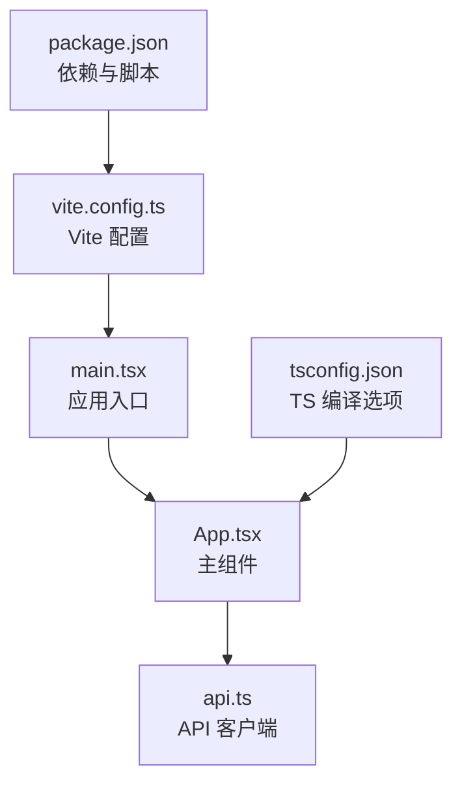
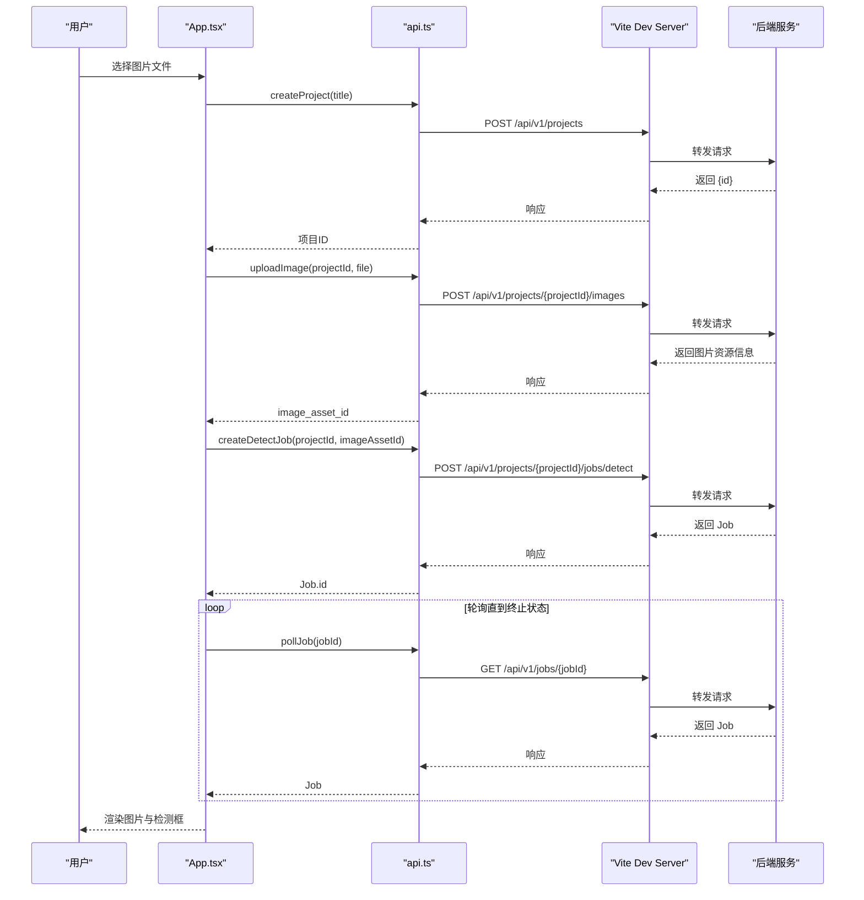
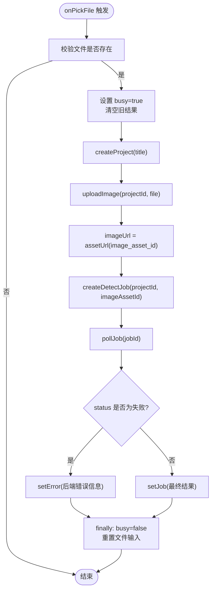
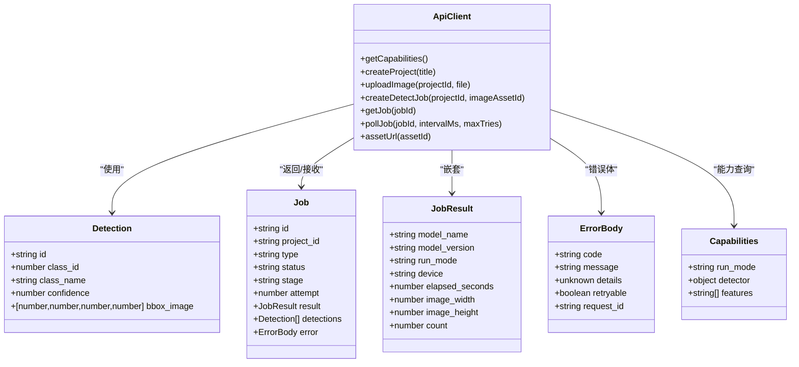
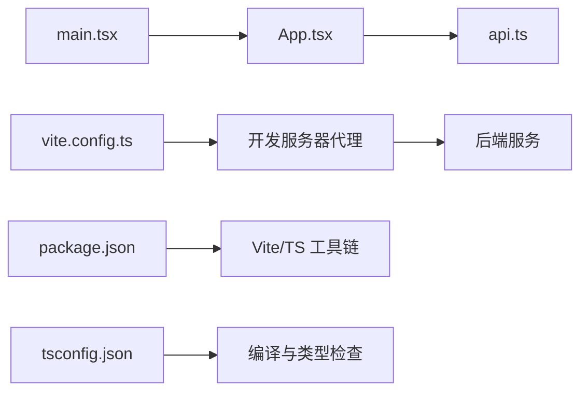

# 前端应用

<cite>
**本文引用的文件**   
- [apps/web/src/App.tsx](file://apps/web/src/App.tsx)
- [apps/web/src/api.ts](file://apps/web/src/api.ts)
- [apps/web/src/main.tsx](file://apps/web/src/main.tsx)
- [apps/web/vite.config.ts](file://apps/web/vite.config.ts)
- [apps/web/package.json](file://apps/web/package.json)
- [apps/web/tsconfig.json](file://apps/web/tsconfig.json)
</cite>

## 目录
1. [简介](#简介)
2. [项目结构](#项目结构)
3. [核心组件](#核心组件)
4. [架构总览](#架构总览)
5. [详细组件分析](#详细组件分析)
6. [依赖关系分析](#依赖关系分析)
7. [性能与可维护性](#性能与可维护性)
8. [故障排查指南](#故障排查指南)
9. [结论](#结论)

## 简介
本文件为 AstraDesk 前端 React 应用的完整技术文档。该前端基于 React + TypeScript + Vite，提供桌面图像上传、检测任务创建与轮询、检测结果可视化等能力。整体采用“单页应用 + 轻量 API 客户端”的架构：App 主组件负责用户交互与状态管理，api.ts 封装所有后端通信，Vite 负责开发服务器代理与构建配置。

## 项目结构
前端位于 apps/web 目录，核心源码在 src 下：
- main.tsx：React 应用入口，挂载根节点并引入全局样式。
- App.tsx：应用主组件，包含文件选择、上传、检测任务流程与结果展示。
- api.ts：HTTP 请求封装、类型定义、错误处理与轮询逻辑。
- vite.config.ts：Vite 开发服务器与插件配置。
- package.json：脚本、依赖与模块类型声明。
- tsconfig.json：TypeScript 编译选项。

图表来源
- [apps/web/src/main.tsx:1-11](file://apps/web/src/main.tsx#L1-L11)
- [apps/web/src/App.tsx:1-134](file://apps/web/src/App.tsx#L1-L134)
- [apps/web/src/api.ts:1-119](file://apps/web/src/api.ts#L1-L119)
- [apps/web/vite.config.ts:1-17](file://apps/web/vite.config.ts#L1-L17)
- [apps/web/package.json:1-23](file://apps/web/package.json#L1-L23)
- [apps/web/tsconfig.json:1-21](file://apps/web/tsconfig.json#L1-L21)

章节来源
- [apps/web/src/main.tsx:1-11](file://apps/web/src/main.tsx#L1-L11)
- [apps/web/src/App.tsx:1-134](file://apps/web/src/App.tsx#L1-L134)
- [apps/web/src/api.ts:1-119](file://apps/web/src/api.ts#L1-L119)
- [apps/web/vite.config.ts:1-17](file://apps/web/vite.config.ts#L1-L17)
- [apps/web/package.json:1-23](file://apps/web/package.json#L1-L23)
- [apps/web/tsconfig.json:1-21](file://apps/web/tsconfig.json#L1-L21)

## 核心组件
- 应用入口 main.tsx：使用 ReactDOM.createRoot 挂载 React 应用，启用 StrictMode，并引入全局样式。
- 主组件 App.tsx：集中管理运行模式、检测器可用性、图片预览、检测任务状态与检测结果列表；实现文件选择、上传、创建检测任务、轮询任务结果与错误提示。
- API 客户端 api.ts：定义 Detection、Job、Capabilities 等类型，封装 getCapabilities、createProject、uploadImage、createDetectJob、getJob、pollJob、assetUrl 等方法，统一错误处理与轮询策略。

章节来源
- [apps/web/src/main.tsx:1-11](file://apps/web/src/main.tsx#L1-L11)
- [apps/web/src/App.tsx:1-134](file://apps/web/src/App.tsx#L1-L134)
- [apps/web/src/api.ts:1-119](file://apps/web/src/api.ts#L1-L119)

## 架构总览
前端通过 Vite 启动开发服务器，将 /api 路径代理到后端服务（默认 http://127.0.0.1:8000）。App 组件调用 api.ts 中的函数发起 HTTP 请求，完成能力查询、项目创建、图片上传、检测任务创建与轮询，最终渲染检测结果。

图表来源
- [apps/web/src/App.tsx:28-50](file://apps/web/src/App.tsx#L28-L50)
- [apps/web/src/api.ts:64-118](file://apps/web/src/api.ts#L64-L118)
- [apps/web/vite.config.ts:7-14](file://apps/web/vite.config.ts#L7-L14)

## 详细组件分析

### App 主组件
职责与行为：
- 初始化能力信息：组件挂载时调用 getCapabilities，获取运行模式与检测器可用性，失败时设置错误消息。
- 文件选择与上传：监听 input[type=file] 变更，依次执行创建项目、上传图片、创建检测任务、轮询任务结果。
- 状态管理：使用 useState 管理运行能力、忙碌状态、图片 URL、检测任务、错误信息；使用 useRef 引用文件输入控件以重置值。
- 结果可视化：根据检测结果绘制相对坐标的检测框，显示类别名称与置信度；侧边栏列出检测结果摘要。
- 交互反馈：上传与检测过程中禁用文件输入并显示提示；完成后清空文件输入值。

关键数据流：
- imageUrl 由 uploadImage 返回的 image_asset_id 经 assetUrl 生成。
- detections 来源于 job.detections，用于绘制检测框与列表。
- error 来自网络或后端业务错误，统一在 handle 中抛出并在 App 中捕获。

图表来源
- [apps/web/src/App.tsx:28-50](file://apps/web/src/App.tsx#L28-L50)
- [apps/web/src/App.tsx:80-129](file://apps/web/src/App.tsx#L80-L129)

章节来源
- [apps/web/src/App.tsx:1-134](file://apps/web/src/App.tsx#L1-L134)

### API 客户端
设计要点：
- 类型定义：Detection、JobResult、ErrorBody、Job、Capabilities、UploadOut 等接口明确前后端数据结构。
- 基础地址：BASE 常量统一前缀 /api/v1，便于开发与生产环境切换。
- 统一错误处理：handle 函数检查 resp.ok，尝试解析 ErrorBody，构造友好错误消息并抛出 Error。
- 功能方法：
  - getCapabilities：获取运行模式与检测器能力。
  - createProject：创建项目，返回项目 ID。
  - uploadImage：上传图像，返回资源信息与尺寸、哈希等元数据。
  - createDetectJob：提交检测任务，返回 Job。
  - getJob：查询任务状态与结果。
  - pollJob：定时轮询任务，直到达到终止状态或最大重试次数。
  - assetUrl：根据资产 ID 生成静态资源访问 URL。

轮询策略：
- 终止状态集合 TERMINAL 包含 succeeded、failed、cancelled、partial。
- 默认间隔 800ms，最大重试 60 次，避免无限轮询。

图表来源
- [apps/web/src/api.ts:3-46](file://apps/web/src/api.ts#L3-L46)
- [apps/web/src/api.ts:48-118](file://apps/web/src/api.ts#L48-L118)

章节来源
- [apps/web/src/api.ts:1-119](file://apps/web/src/api.ts#L1-L119)

### 图像上传与验证
- 文件选择：通过 <input type="file"> accept 限制为 image/png、image/jpeg。
- 大小限制：界面提示 ≤10MB，但当前代码未在前端进行文件大小校验，建议在 onPickFile 中增加 size 判断与用户提示。
- 进度反馈：busy 状态控制按钮禁用与提示文案；实际上传进度可通过 FormData 事件监听实现（当前未实现）。
- 错误处理：上传失败时 setError 显示后端错误或 HTTP 状态。

建议增强点：
- 在 onPickFile 中增加文件大小校验（例如 >10MB 直接拒绝）。
- 添加上传进度条，提升用户体验。
- 对非图片格式进行二次校验（MIME 类型或文件头校验）。

章节来源
- [apps/web/src/App.tsx:28-50](file://apps/web/src/App.tsx#L28-L50)
- [apps/web/src/App.tsx:73-76](file://apps/web/src/App.tsx#L73-L76)
- [apps/web/src/App.tsx:108-109](file://apps/web/src/App.tsx#L108-L109)

### 检测结果可视化
- 检测框绘制：根据 d.bbox_image 的归一化坐标计算 left/top/width/height 百分比，叠加在图片容器上。
- 颜色分配：按索引循环使用 BOX_COLORS 数组，保证不同类别有区分色。
- 置信度显示：在标签内显示 class_name 与 confidence.toFixed(2)。
- 侧边栏面板：展示模型名、运行模式、数量与耗时；无结果时显示占位提示。

注意事项：
- 当 x2 <= x1 或 y2 <= y1 时，宽高可能为负数，代码已用 Math.max 保护。
- 若检测结果为空，仅显示占位文本，不渲染空框。

章节来源
- [apps/web/src/App.tsx:80-129](file://apps/web/src/App.tsx#L80-L129)

### Vite 构建与开发服务器
- 插件：@vitejs/plugin-react 启用 React JSX 支持。
- 开发服务器：端口 5173，将 /api 代理到后端目标（环境变量 VITE_API_TARGET 或默认 http://127.0.0.1:8000），开启 changeOrigin。
- 构建脚本：build 先执行 tsc 再 vite build；preview 用于预览构建产物。

章节来源
- [apps/web/vite.config.ts:1-17](file://apps/web/vite.config.ts#L1-L17)
- [apps/web/package.json:6-10](file://apps/web/package.json#L6-L10)

### TypeScript 编译选项
- target ES2020，lib 包含 DOM 与 DOM.Iterable。
- module ESNext，moduleResolution bundler，启用 isolatedModules、noEmit。
- jsx react-jsx，strict 严格模式，noUnusedLocals、noUnusedParameters、noFallthroughCasesInSwitch。
- include src，确保只编译源码目录。

章节来源
- [apps/web/tsconfig.json:1-21](file://apps/web/tsconfig.json#L1-L21)

## 依赖关系分析
- main.tsx 导入 App 与 styles.css，作为应用入口。
- App.tsx 依赖 api.ts 提供的能力与方法。
- api.ts 通过 fetch 与后端 /api/v1 通信，受 Vite 代理影响。
- package.json 声明 React 运行时与 Vite 工具链。
- tsconfig.json 约束编译行为，确保类型安全与一致性。

图表来源
- [apps/web/src/main.tsx:1-11](file://apps/web/src/main.tsx#L1-L11)
- [apps/web/src/App.tsx:1-134](file://apps/web/src/App.tsx#L1-L134)
- [apps/web/src/api.ts:1-119](file://apps/web/src/api.ts#L1-L119)
- [apps/web/vite.config.ts:1-17](file://apps/web/vite.config.ts#L1-L17)
- [apps/web/package.json:1-23](file://apps/web/package.json#L1-L23)
- [apps/web/tsconfig.json:1-21](file://apps/web/tsconfig.json#L1-L21)

章节来源
- [apps/web/src/main.tsx:1-11](file://apps/web/src/main.tsx#L1-L11)
- [apps/web/src/App.tsx:1-134](file://apps/web/src/App.tsx#L1-L134)
- [apps/web/src/api.ts:1-119](file://apps/web/src/api.ts#L1-L119)
- [apps/web/vite.config.ts:1-17](file://apps/web/vite.config.ts#L1-L17)
- [apps/web/package.json:1-23](file://apps/web/package.json#L1-L23)
- [apps/web/tsconfig.json:1-21](file://apps/web/tsconfig.json#L1-L21)

## 性能与可维护性
- 组件复用：可将文件选择、图片预览、检测框绘制、结果列表拆分为独立子组件，降低 App.tsx 复杂度。
- 状态管理：当前使用 useState 管理局部状态；随着功能扩展，可考虑使用 useReducer 或外部状态库（如 Zustand）统一管理。
- 网络优化：
  - 对 pollJob 的 intervalMs 与 maxTries 可根据后端负载调整。
  - 对大图片上传可增加分片上传与断点续传。
- 渲染优化：
  - 检测框列表可使用 key 稳定标识（当前使用 d.id）。
  - 图片加载时可加入懒加载与占位图。
- 可访问性与国际化：
  - 为交互元素添加 aria 属性。
  - 将文案抽离为 i18n 键值。

## 故障排查指南
常见问题与定位：
- 无法连接后端：
  - 检查 Vite 代理配置是否正确，确认 VITE_API_TARGET 指向正确的后端地址。
  - 查看浏览器控制台的网络请求是否被代理到 /api/v1。
- 上传失败：
  - 检查文件格式与大小是否符合预期；当前未做前端大小校验，需自行补充。
  - 查看后端返回的 ErrorBody，确认 code 与 message。
- 检测任务长时间未完成：
  - 检查 pollJob 的最大重试次数与间隔是否合理。
  - 查看 Job.status 是否进入终止状态（succeeded/failed/cancelled/partial）。
- 检测结果不显示：
  - 确认 job.detections 是否为空。
  - 检查 bbox_image 坐标是否有效（x2>x1, y2>y1）。

章节来源
- [apps/web/src/api.ts:50-62](file://apps/web/src/api.ts#L50-L62)
- [apps/web/src/api.ts:109-118](file://apps/web/src/api.ts#L109-L118)
- [apps/web/src/App.tsx:41-49](file://apps/web/src/App.tsx#L41-L49)
- [apps/web/src/App.tsx:80-129](file://apps/web/src/App.tsx#L80-L129)

## 结论
AstraDesk 前端采用简洁清晰的 React + TypeScript + Vite 架构，App 主组件承担主要交互与状态管理，api.ts 提供统一的 API 客户端与错误处理机制，Vite 代理简化了前后端联调。当前实现已覆盖文件上传、检测任务创建与轮询、结果可视化等核心流程。后续可在组件拆分、状态管理、上传进度与健壮性方面持续优化，以提升可维护性与用户体验。