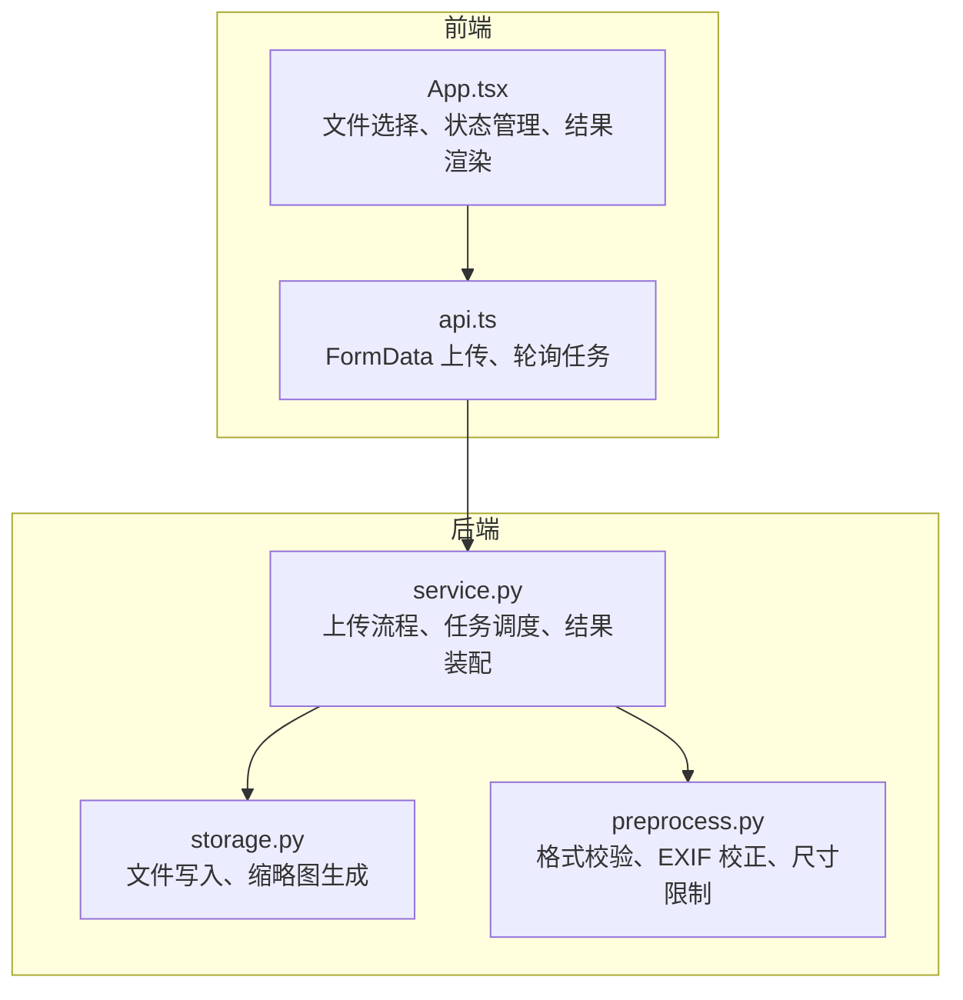
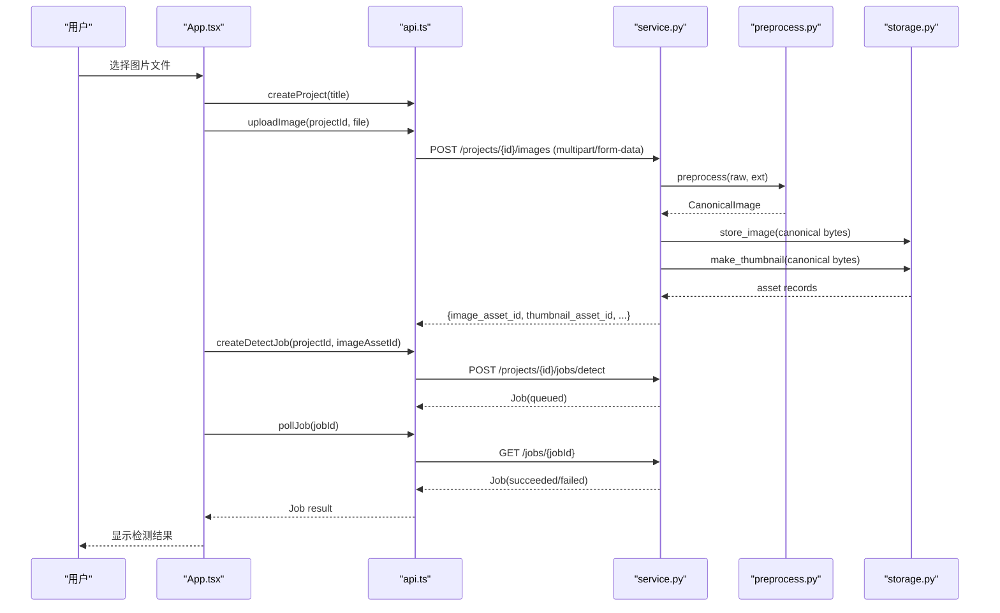
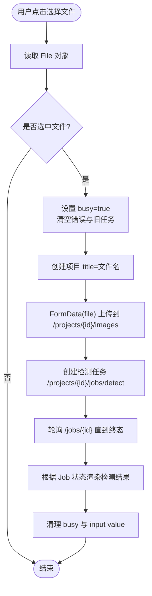
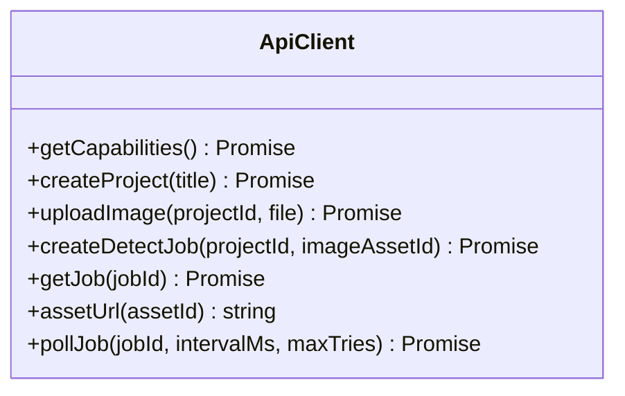
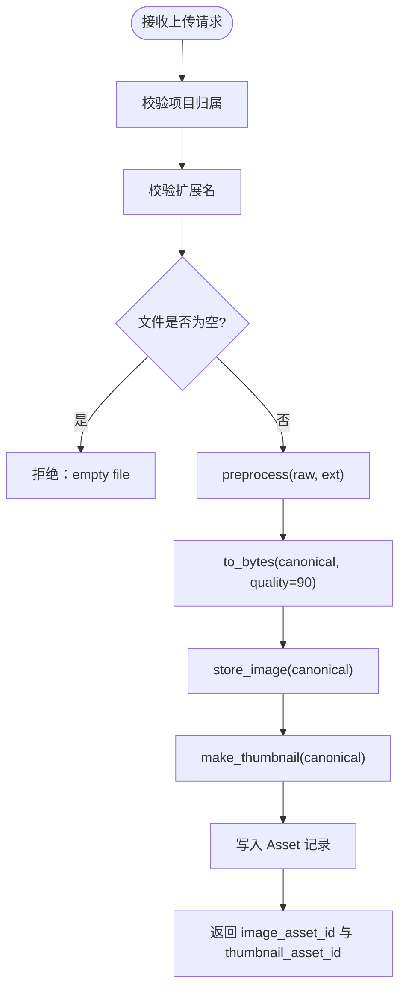
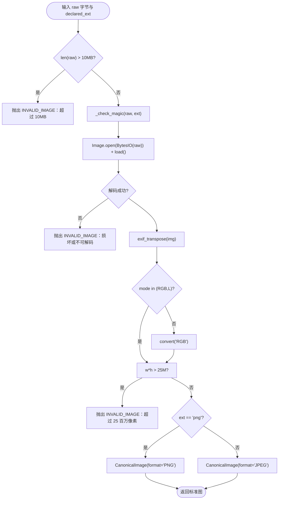
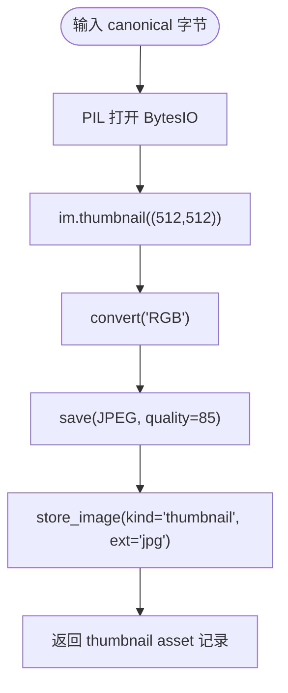
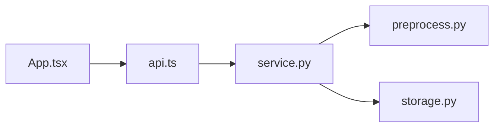

# 图像处理

<cite>
**本文引用的文件**   
- [apps/web/src/App.tsx](file://apps/web/src/App.tsx)
- [apps/web/src/api.ts](file://apps/web/src/api.ts)
- [services/api/service.py](file://services/api/service.py)
- [services/api/storage.py](file://services/api/storage.py)
- [packages/vision/preprocess.py](file://packages/vision/preprocess.py)
</cite>

## 目录
1. [引言](#引言)
2. [项目结构](#项目结构)
3. [核心组件](#核心组件)
4. [架构总览](#架构总览)
5. [详细组件分析](#详细组件分析)
6. [依赖关系分析](#依赖关系分析)
7. [性能与内存优化](#性能与内存优化)
8. [故障排查指南](#故障排查指南)
9. [结论](#结论)

## 引言
本文面向 AstraDesk 前端与后端的图像处理链路，聚焦图像上传、格式校验、预处理、缩略图生成、资产存储以及检测任务调度的完整实现。文档从用户选择图片开始，逐步说明前端如何构造请求、后端如何校验与预处理、如何生成标准图与缩略图、如何持久化并对外提供资源访问接口，最后给出性能优化与常见问题解决方案。

## 项目结构
本仓库的前端位于 `apps/web`，后端 API 位于 `services/api`，图像处理通用逻辑位于 `packages/vision`。与图像处理直接相关的代码分布如下：
- 前端 UI 与交互：`apps/web/src/App.tsx`
- 前端 API 客户端：`apps/web/src/api.ts`
- 后端服务层（业务规则）：`services/api/service.py`
- 后端存储层（文件与缩略图）：`services/api/storage.py`
- 图像预处理（格式校验、EXIF 校正、像素限制）：`packages/vision/preprocess.py`

**图表来源**
- [apps/web/src/App.tsx:16-50](file://apps/web/src/App.tsx#L16-L50)
- [apps/web/src/api.ts:85-91](file://apps/web/src/api.ts#L85-L91)
- [services/api/service.py:73-107](file://services/api/service.py#L73-L107)
- [services/api/storage.py:32-60](file://services/api/storage.py#L32-L60)
- [packages/vision/preprocess.py:54-83](file://packages/vision/preprocess.py#L54-L83)

**章节来源**
- [apps/web/src/App.tsx:16-50](file://apps/web/src/App.tsx#L16-L50)
- [apps/web/src/api.ts:85-91](file://apps/web/src/api.ts#L85-L91)
- [services/api/service.py:73-107](file://services/api/service.py#L73-L107)
- [services/api/storage.py:32-60](file://services/api/storage.py#L32-L60)
- [packages/vision/preprocess.py:54-83](file://packages/vision/preprocess.py#L54-L83)

## 核心组件
- 前端图像上传入口：用户在 `<input type="file">` 中选择图片，触发 `onPickFile`，依次创建项目、上传图片、创建检测任务并轮询结果。
- 前端 API 客户端：封装 `/api/v1` 的 HTTP 调用，包括 `uploadImage`（multipart/form-data）、`createDetectJob`、`pollJob` 等。
- 后端服务层：负责项目归属校验、图像上传处理（调用预处理与存储）、检测任务创建与执行编排。
- 存储层：负责将标准图与缩略图写入文件系统，并返回资产元数据。
- 预处理模块：对原始字节进行扩展名与魔数校验、解码、EXIF 方向校正、像素上限检查，输出标准图对象并可编码为字节。

**章节来源**
- [apps/web/src/App.tsx:28-50](file://apps/web/src/App.tsx#L28-L50)
- [apps/web/src/api.ts:85-118](file://apps/web/src/api.ts#L85-L118)
- [services/api/service.py:73-107](file://services/api/service.py#L73-L107)
- [services/api/storage.py:32-60](file://services/api/storage.py#L32-L60)
- [packages/vision/preprocess.py:54-83](file://packages/vision/preprocess.py#L54-L83)

## 架构总览
下图展示一次完整的“上传 + 检测”端到端流程：前端选择文件 → 构造 FormData 上传 → 后端校验与预处理 → 生成标准图与缩略图 → 创建检测任务 → 后台执行检测 → 前端轮询获取结果。

**图表来源**
- [apps/web/src/App.tsx:28-50](file://apps/web/src/App.tsx#L28-L50)
- [apps/web/src/api.ts:85-118](file://apps/web/src/api.ts#L85-L118)
- [services/api/service.py:73-107](file://services/api/service.py#L73-L107)
- [services/api/service.py:120-179](file://services/api/service.py#L120-L179)
- [services/api/storage.py:32-60](file://services/api/storage.py#L32-L60)
- [packages/vision/preprocess.py:54-83](file://packages/vision/preprocess.py#L54-L83)

## 详细组件分析

### 前端图像上传流程
- 文件选择与基础验证：
  - 使用 `<input type="file" accept="image/png,image/jpeg">` 限制可选类型为 PNG/JPEG。
  - 在 `onPickFile` 中读取 `e.target.files[0]`，若为空则直接返回。
  - 设置 `busy` 状态以禁用控件并提示“上传并检测中…”，同时清空错误与旧任务。
- 大小限制与格式检查：
  - 前端通过 `accept` 属性限制类型；实际大小限制由后端预处理模块统一校验（≤10MB）。
  - 前端未实现本地文件大小判断，建议在前端增加 `file.size <= 10 * 1024 * 1024` 的判断以提升用户体验。
- 进度反馈机制：
  - 当前实现使用 `busy` 状态作为整体忙闲指示，无分片或逐块进度回调。
  - 如需更细粒度进度，可在 `fetch` 中使用 `ReadableStream` 与 `Content-Length` 计算上传进度，但当前仓库未实现。
- 预览与 Base64：
  - 当前实现不直接使用 FileReader 或 Base64 预览，而是上传成功后通过后端提供的 `assetUrl(image_asset_id)` 获取图片地址并在 `` 中显示。
  - 若需本地即时预览，可引入 FileReader 读取为 Data URL，但需注意大图的内存占用。

**图表来源**
- [apps/web/src/App.tsx:28-50](file://apps/web/src/App.tsx#L28-L50)
- [apps/web/src/api.ts:85-118](file://apps/web/src/api.ts#L85-L118)

**章节来源**
- [apps/web/src/App.tsx:28-50](file://apps/web/src/App.tsx#L28-L50)
- [apps/web/src/api.ts:85-118](file://apps/web/src/api.ts#L85-L118)

### 前端 API 客户端与上传协议
- `uploadImage(projectId, file)`：
  - 使用 `new FormData()` 追加 `file` 字段，发送 `POST /api/v1/projects/{projectId}/images`。
  - 响应体包含 `image_asset_id`、`thumbnail_asset_id`、`canonical_width/height`、`sha256` 等字段。
- `createDetectJob(projectId, imageAssetId)`：
  - 发送 JSON `{ image_asset_id }` 到 `/api/v1/projects/{projectId}/jobs/detect`。
- `pollJob(jobId, intervalMs=800, maxTries=60)`：
  - 循环调用 `getJob`，直到任务进入终态（succeeded/failed/cancelled/partial）或达到最大尝试次数。
- 错误处理：
  - `handle(resp)` 统一解析非 2xx 响应，优先解析错误体中的 `code` 与 `message`，否则返回 HTTP 状态码。

**图表来源**
- [apps/web/src/api.ts:64-118](file://apps/web/src/api.ts#L64-L118)

**章节来源**
- [apps/web/src/api.ts:64-118](file://apps/web/src/api.ts#L64-L118)

### 后端图像上传与服务编排
- 路由接收 multipart/form-data 后，调用 `service.upload_image(session, settings, project_id, filename, raw)`。
- `upload_image` 流程：
  - 校验项目存在且未被删除。
  - 校验扩展名（jpg/jpeg/png），空文件拒绝。
  - 调用 `preprocess(raw, ext)` 生成 `CanonicalImage`。
  - 将标准图编码为字节（默认质量 90），按扩展名决定保存为 PNG 或 JPEG。
  - 调用 `storage.store_image` 存储标准图，调用 `storage.make_thumbnail` 生成缩略图。
  - 将 canonical 与 thumbnail 资产记录写入数据库，返回资产 ID 与尺寸信息。

**图表来源**
- [services/api/service.py:73-107](file://services/api/service.py#L73-L107)

**章节来源**
- [services/api/service.py:73-107](file://services/api/service.py#L73-L107)

### 图像预处理逻辑
- 支持格式：JPEG/PNG。
- 大小限制：单张 ≤10MB。
- 像素限制：解码后宽高乘积 ≤2500 万像素。
- 魔数校验：根据扩展名匹配文件头字节，防止伪装格式。
- EXIF 方向校正：使用 `ImageOps.exif_transpose` 修正方向。
- 模式转换：若非 RGB/L，转换为 RGB。
- 标准图输出：保留原图尺寸，格式由声明扩展名决定（PNG 或 JPEG），重存时剥离 EXIF/元数据。

**图表来源**
- [packages/vision/preprocess.py:54-83](file://packages/vision/preprocess.py#L54-L83)

**章节来源**
- [packages/vision/preprocess.py:54-83](file://packages/vision/preprocess.py#L54-L83)

### 缩略图生成与缓存策略
- 缩略图生成：
  - 基于标准图字节，使用 PIL 的 `thumbnail((512, 512))` 生成最长边不超过 512 像素的缩略图。
  - 转换为 RGB 并以 JPEG 格式保存，质量 85。
- 存储路径与命名：
  - 服务端生成 `projects/<project_id>/<kind>_<asset_id>.<ext>`，客户端无法指定路径。
  - kind 为 `canonical` 或 `thumbnail`。
- 缓存与重复文件处理：
  - 当前实现每次上传都会生成新的 asset_id 并写入新文件，未实现基于 sha256 的去重或缓存命中。
  - 可通过 sha256 去重：若已存在相同哈希的标准图，则复用已有 canonical 与 thumbnail，避免重复存储。
- 缓存失效机制：
  - 当前未实现显式失效策略；若需要，可结合版本号或时间戳更新 asset 记录，并清理旧文件。

**图表来源**
- [services/api/storage.py:53-60](file://services/api/storage.py#L53-L60)

**章节来源**
- [services/api/storage.py:32-60](file://services/api/storage.py#L32-L60)

### 图像预览与内存管理
- 当前实现：
  - 不直接使用 FileReader 或 Base64 预览，而是通过后端 `GET /assets/{asset_id}` 获取图片地址并在 `` 标签中加载。
  - 优点：避免前端内存占用大图；缺点：首次显示需等待后端返回。
- 若需本地即时预览：
  - 可使用 FileReader 读取为 Data URL，但应限制预览尺寸（例如 canvas 缩放）以避免内存峰值过高。
  - 注意及时释放引用，避免长时间持有大对象导致垃圾回收延迟。

**章节来源**
- [apps/web/src/App.tsx:80-109](file://apps/web/src/App.tsx#L80-L109)
- [apps/web/src/api.ts:105-107](file://apps/web/src/api.ts#L105-L107)

### 大文件分片上传
- 当前实现：
  - 前端一次性上传整个文件（`FormData.append("file", file)`），后端一次性接收 `raw` 字节。
  - 未实现分片上传、断点续传或并发合并。
- 建议方案：
  - 前端将文件切分为固定大小分片（如 5MB），逐个上传并携带 `chunk_index`、`total_chunks`、`file_hash`。
  - 后端聚合分片至临时目录，全部到达后进行完整性校验与合并，再执行预处理与存储。
  - 失败重试：根据 `chunk_index` 重试缺失分片，完成后清理临时文件。

**章节来源**
- [apps/web/src/api.ts:85-91](file://apps/web/src/api.ts#L85-L91)
- [services/api/service.py:73-107](file://services/api/service.py#L73-L107)

## 依赖关系分析
- 前端依赖后端 API：
  - `App.tsx` 依赖 `api.ts` 提供的函数。
  - `api.ts` 通过 `fetch` 调用 `/api/v1` 下的路由。
- 后端服务依赖：
  - `service.py` 依赖 `preprocess.py` 进行图像校验与标准化。
  - `service.py` 依赖 `storage.py` 进行文件写入与缩略图生成。
  - `service.py` 依赖数据库模型（Project/Asset/Job/Detection）与配置（Settings）。

**图表来源**
- [apps/web/src/App.tsx:1-12](file://apps/web/src/App.tsx#L1-L12)
- [apps/web/src/api.ts:1-118](file://apps/web/src/api.ts#L1-L118)
- [services/api/service.py:1-25](file://services/api/service.py#L1-L25)

**章节来源**
- [apps/web/src/App.tsx:1-12](file://apps/web/src/App.tsx#L1-L12)
- [apps/web/src/api.ts:1-118](file://apps/web/src/api.ts#L1-L118)
- [services/api/service.py:1-25](file://services/api/service.py#L1-L25)

## 性能与内存优化
- 前端优化：
  - 在 `onPickFile` 中增加文件大小判断（≤10MB），提前拒绝超大文件，减少无效网络请求。
  - 如需本地预览，使用 Canvas 缩放后再转为小尺寸 Data URL，避免直接加载原图。
  - 使用 `URL.createObjectURL` 替代 Base64 以减少内存占用，并在不再使用时调用 `URL.revokeObjectURL`。
- 后端优化：
  - 预处理阶段尽早拒绝非法文件（大小、魔数、像素），避免后续昂贵操作。
  - 缩略图生成使用 `thumbnail` 而非全尺寸缩放，降低 CPU 与内存消耗。
  - 考虑基于 sha256 的去重缓存，避免重复存储相同内容。
- 内存泄漏防护：
  - 前端避免长时间持有大对象引用；及时清空 `fileRef.current.value`。
  - 后端在处理大文件时使用流式读取与及时释放中间对象（PIL Image 使用后关闭）。
- 用户体验改进：
  - 在上传与检测过程中提供明确的状态提示（busy、hint、error）。
  - 对轮询间隔与最大尝试次数做可调参数，适应不同网络环境。

[本节为通用指导，不直接分析具体文件]

## 故障排查指南
- 常见错误与定位：
  - “unsupported extension”：前端 `accept` 或后端 `_ext_of` 不支持的文件类型。
  - “file exceeds 10MB”：超出后端预处理大小限制。
  - “corrupt or undecodable image”：文件损坏或格式不一致（魔数校验失败）。
  - “image exceeds 25 megapixels”：解码后像素过多。
  - “empty file”：上传文件为空。
  - “asset not found”：资产不存在或所属项目已被删除。
- 调试建议：
  - 检查前端 `accept` 与后端 `SUPPORTED_EXT` 是否一致。
  - 查看后端日志中的 `ApiError.code` 与 `message`，对应到具体校验步骤。
  - 确认缩略图生成是否成功，检查存储目录是否存在 `thumbnail_*` 文件。
  - 对于检测失败，查看 Job 的 `error` 字段，区分 `MODEL_UNAVAILABLE`、`INTERNAL` 等业务错误。

**章节来源**
- [packages/vision/preprocess.py:54-83](file://packages/vision/preprocess.py#L54-L83)
- [services/api/service.py:73-107](file://services/api/service.py#L73-L107)
- [services/api/service.py:120-179](file://services/api/service.py#L120-L179)

## 结论
AstraDesk 的图像处理链路在前端采用简洁的表单上传与后端异步任务轮询模式，在后端通过严格的预处理与存储策略保证图像质量与一致性。当前实现未包含前端本地预览、分片上传与去重缓存，但这些能力可按需扩展。建议在关键路径上增加前端大小校验、本地预览优化与后端去重缓存，以提升性能与用户体验。