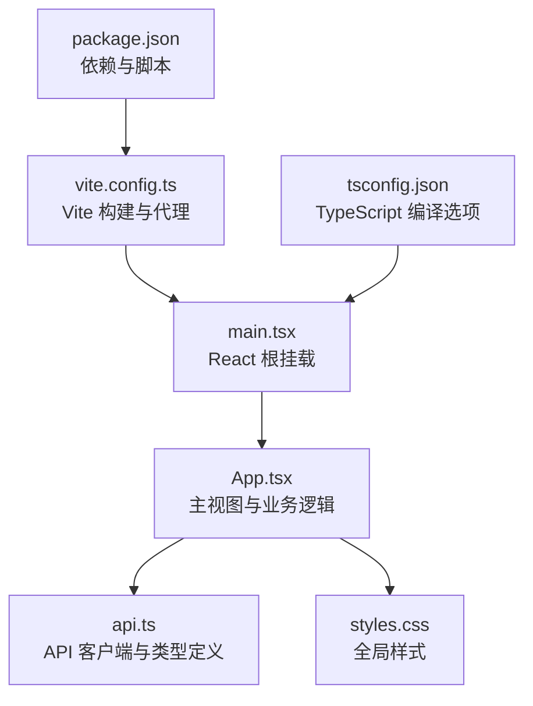
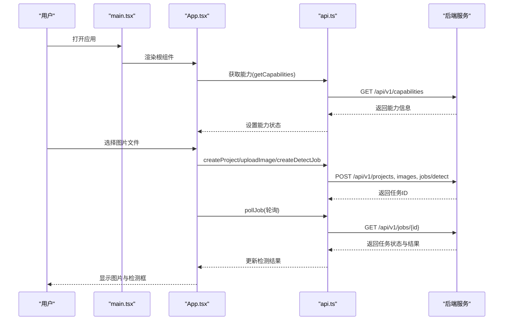
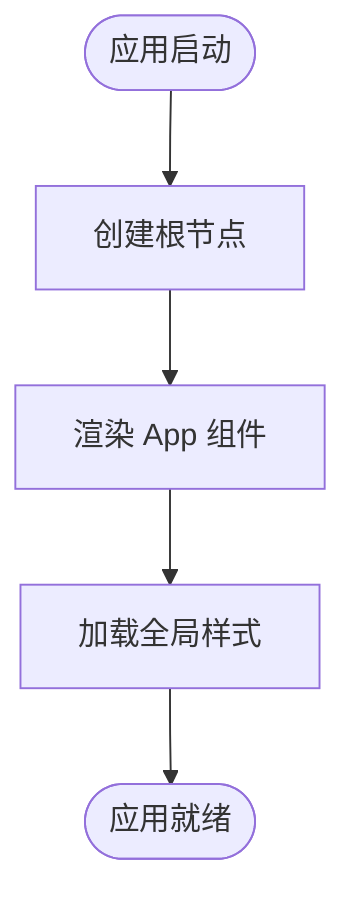
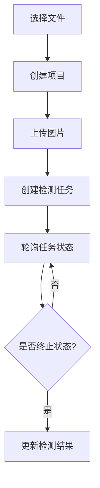
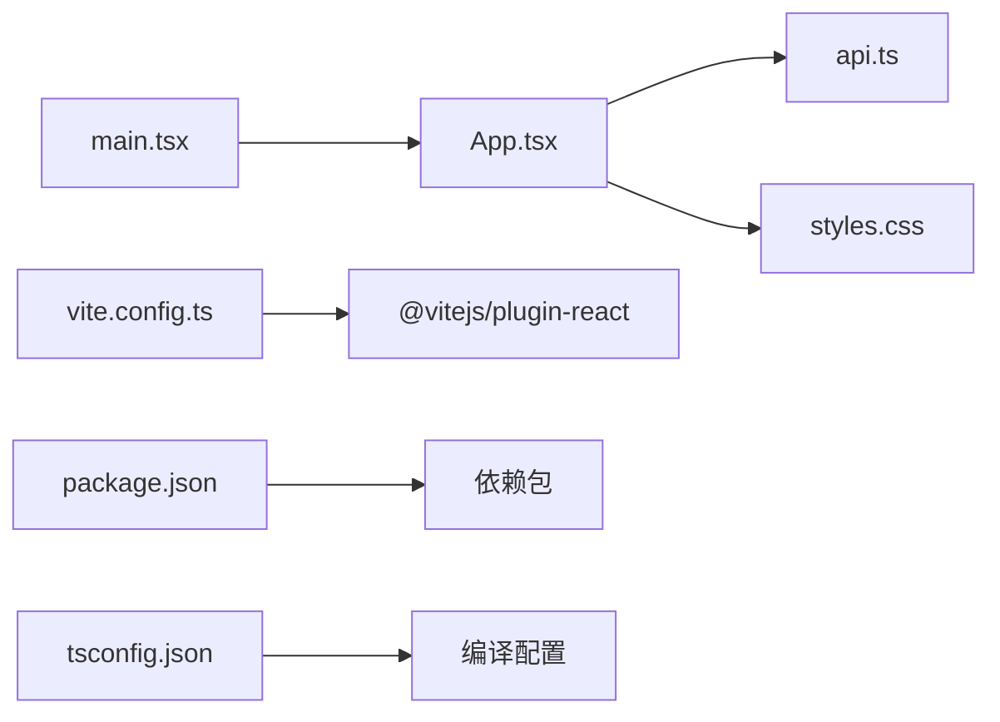

# 应用架构

<cite>
**本文引用的文件**   
- [apps/web/src/main.tsx](file://apps/web/src/main.tsx)
- [apps/web/src/App.tsx](file://apps/web/src/App.tsx)
- [apps/web/src/api.ts](file://apps/web/src/api.ts)
- [apps/web/src/styles.css](file://apps/web/src/styles.css)
- [apps/web/vite.config.ts](file://apps/web/vite.config.ts)
- [apps/web/package.json](file://apps/web/package.json)
- [apps/web/tsconfig.json](file://apps/web/tsconfig.json)
</cite>

## 目录
1. [简介](#简介)
2. [项目结构](#项目结构)
3. [核心组件](#核心组件)
4. [架构总览](#架构总览)
5. [详细组件分析](#详细组件分析)
6. [依赖关系分析](#依赖关系分析)
7. [性能与可维护性考量](#性能与可维护性考量)
8. [故障排查指南](#故障排查指南)
9. [结论](#结论)

## 简介
本文件面向 AstraDesk 前端应用的架构设计，聚焦基于 React + TypeScript + Vite 的技术栈选择原因、整体架构模式以及桌面物品检测的前端实现路径。文档从入口初始化、主组件职责、构建配置、依赖管理到错误处理与性能优化进行系统化说明，帮助读者快速理解代码结构与运行流程，同时为后续扩展提供清晰的参考。

## 项目结构
AstraDesk 的前端位于 apps/web 目录，采用单页应用结构：
- 入口文件 main.tsx 负责挂载 React 根节点并引入全局样式。
- 主视图 App.tsx 承载用户交互、状态管理与检测结果展示。
- api.ts 封装所有后端 API 调用，定义数据模型与轮询逻辑。
- styles.css 提供暗色主题与布局样式。
- vite.config.ts 配置开发服务器代理与插件。
- package.json 声明脚本、运行时依赖与开发依赖。
- tsconfig.json 定义 TypeScript 编译选项。



图表来源
- [apps/web/src/main.tsx:1-11](file://apps/web/src/main.tsx#L1-L11)
- [apps/web/src/App.tsx:1-134](file://apps/web/src/App.tsx#L1-L134)
- [apps/web/src/api.ts:1-119](file://apps/web/src/api.ts#L1-L119)
- [apps/web/src/styles.css:1-152](file://apps/web/src/styles.css#L1-L152)
- [apps/web/vite.config.ts:1-17](file://apps/web/vite.config.ts#L1-L17)
- [apps/web/package.json:1-23](file://apps/web/package.json#L1-L23)
- [apps/web/tsconfig.json:1-21](file://apps/web/tsconfig.json#L1-L21)

章节来源
- [apps/web/src/main.tsx:1-11](file://apps/web/src/main.tsx#L1-L11)
- [apps/web/src/App.tsx:1-134](file://apps/web/src/App.tsx#L1-L134)
- [apps/web/src/api.ts:1-119](file://apps/web/src/api.ts#L1-L119)
- [apps/web/src/styles.css:1-152](file://apps/web/src/styles.css#L1-L152)
- [apps/web/vite.config.ts:1-17](file://apps/web/vite.config.ts#L1-L17)
- [apps/web/package.json:1-23](file://apps/web/package.json#L1-L23)
- [apps/web/tsconfig.json:1-21](file://apps/web/tsconfig.json#L1-L21)

## 核心组件
- 入口组件 main.tsx：使用 ReactDOM.createRoot 创建根节点，并在 StrictMode 中渲染 App 组件；同时引入全局样式 styles.css。
- 主视图组件 App.tsx：集中管理能力信息、上传状态、图片预览、检测任务与结果列表；通过 useEffect 在启动时获取后端能力；通过事件处理器完成文件选择、上传、创建检测任务与轮询结果。
- API 客户端 api.ts：定义 Detection、Job、Capabilities 等类型，封装 getCapabilities、createProject、uploadImage、createDetectJob、getJob、pollJob 等方法，统一错误处理与资源 URL 生成。
- 样式 styles.css：定义暗色主题、页面布局、工具栏、画布与检测框标签等样式。
- 构建配置 vite.config.ts：启用 @vitejs/plugin-react，配置开发服务器端口与 /api 代理到后端服务（默认 8000）。
- 依赖与脚本 package.json：声明 React 18、Vite 5、TypeScript 5 及对应类型包；提供 dev/build/preview 脚本。
- TypeScript 配置 tsconfig.json：目标 ES2020、模块 ESNext、bundler 解析、strict 严格模式、noEmit 由 Vite 编译 JSX。

章节来源
- [apps/web/src/main.tsx:1-11](file://apps/web/src/main.tsx#L1-L11)
- [apps/web/src/App.tsx:1-134](file://apps/web/src/App.tsx#L1-L134)
- [apps/web/src/api.ts:1-119](file://apps/web/src/api.ts#L1-L119)
- [apps/web/src/styles.css:1-152](file://apps/web/src/styles.css#L1-L152)
- [apps/web/vite.config.ts:1-17](file://apps/web/vite.config.ts#L1-L17)
- [apps/web/package.json:1-23](file://apps/web/package.json#L1-L23)
- [apps/web/tsconfig.json:1-21](file://apps/web/tsconfig.json#L1-L21)

## 架构总览
AstraDesk 前端采用“薄视图 + 集中式 API 客户端”的架构模式：
- 视图层（App.tsx）仅负责 UI 状态与用户交互，不直接操作网络请求细节。
- 数据访问层（api.ts）统一封装 HTTP 调用、错误处理与异步任务轮询。
- 构建与开发环境（vite.config.ts、package.json、tsconfig.json）提供现代前端工程化支持。
- 运行时通过 Vite 开发服务器的代理将 /api 请求转发至后端服务，避免跨域问题。



图表来源
- [apps/web/src/main.tsx:6-10](file://apps/web/src/main.tsx#L6-L10)
- [apps/web/src/App.tsx:24-50](file://apps/web/src/App.tsx#L24-L50)
- [apps/web/src/api.ts:64-118](file://apps/web/src/api.ts#L64-L118)
- [apps/web/vite.config.ts:7-15](file://apps/web/vite.config.ts#L7-L15)

## 详细组件分析

### 入口初始化流程（main.tsx）
- 使用 ReactDOM.createRoot 创建根容器，并将 App 组件包裹在 React.StrictMode 中，便于在开发阶段捕获潜在问题。
- 引入 styles.css 以加载全局样式。
- 未显式设置错误边界；如需增强健壮性，可在 App 外层添加自定义错误边界组件。



图表来源
- [apps/web/src/main.tsx:1-11](file://apps/web/src/main.tsx#L1-L11)
- [apps/web/src/styles.css:1-152](file://apps/web/src/styles.css#L1-L152)

章节来源
- [apps/web/src/main.tsx:1-11](file://apps/web/src/main.tsx#L1-L11)
- [apps/web/src/styles.css:1-152](file://apps/web/src/styles.css#L1-L152)

### 主组件职责划分（App.tsx）
- 状态管理策略：
  - 使用 useState 管理能力信息、忙碌状态、图片 URL、检测任务与错误消息。
  - 使用 useRef 引用文件输入控件，用于重置选择值。
- 生命周期管理：
  - 使用 useEffect 在组件挂载后调用 getCapabilities 获取后端能力，失败时记录错误。
- 事件处理机制：
  - onPickFile 处理文件选择：创建项目、上传图片、创建检测任务、轮询任务直至结束，最终设置检测结果或错误。
  - 根据 job.detections 计算检测框位置与颜色，渲染在图片上方。
- 结果展示：
  - 右侧面板显示检测结果摘要与列表，包含类别名称与置信度。

```mermaid
classDiagram
class App {
+caps : Capabilities | null
+busy : boolean
+imageUrl : string
+job : Job | null
+error : string
+onPickFile(e) void
}
class ApiClient {
+getCapabilities() Promise~Capabilities~
+createProject(title) Promise~{id}~
+uploadImage(projectId, file) Promise~UploadOut~
+createDetectJob(projectId, imageAssetId) Promise~Job~
+getJob(jobId) Promise~Job~
+pollJob(jobId, intervalMs, maxTries) Promise~Job~
+assetUrl(assetId) string
}
App --> ApiClient : "调用"
```

图表来源
- [apps/web/src/App.tsx:16-50](file://apps/web/src/App.tsx#L16-L50)
- [apps/web/src/api.ts:48-118](file://apps/web/src/api.ts#L48-L118)

章节来源
- [apps/web/src/App.tsx:1-134](file://apps/web/src/App.tsx#L1-L134)
- [apps/web/src/api.ts:1-119](file://apps/web/src/api.ts#L1-L119)

### API 客户端与数据流（api.ts）
- 类型定义：
  - Detection：表示单个检测对象，包含类别、置信度与图像坐标。
  - JobResult：检测结果元数据，如模型名、运行模式、耗时、图像尺寸与数量。
  - ErrorBody：后端错误体，包含错误码、消息、详情、是否可重试与请求 ID。
  - Job：任务实体，包含状态、阶段、尝试次数、结果与错误。
  - Capabilities：后端能力信息，包括运行模式、检测器可用性与特性列表。
- 请求封装：
  - handle 统一处理非成功响应，尝试解析错误体并抛出错误。
  - getCapabilities、createProject、uploadImage、createDetectJob、getJob 分别对应后端接口。
  - assetUrl 生成静态资源访问地址。
- 轮询逻辑：
  - pollJob 周期性查询任务状态，直到达到终止状态或最大尝试次数。



图表来源
- [apps/web/src/App.tsx:28-50](file://apps/web/src/App.tsx#L28-L50)
- [apps/web/src/api.ts:64-118](file://apps/web/src/api.ts#L64-L118)

章节来源
- [apps/web/src/api.ts:1-119](file://apps/web/src/api.ts#L1-L119)

### 构建与开发配置（vite.config.ts）
- 插件：启用 @vitejs/plugin-react 以支持 JSX 与 React 相关优化。
- 开发服务器：
  - 端口：5173。
  - 代理：将 /api 请求转发到后端服务，默认目标为 http://127.0.0.1:8000，可通过环境变量 VITE_API_TARGET 覆盖。
  - changeOrigin：开启以正确处理 Host 头。
- 该配置确保前端在本地开发时能无缝访问后端 API，无需额外跨域配置。

章节来源
- [apps/web/vite.config.ts:1-17](file://apps/web/vite.config.ts#L1-L17)

### 依赖与脚本（package.json）
- 运行时依赖：react、react-dom（版本 ^18.3.1），提供 React 18 的能力与 DOM 渲染。
- 开发依赖：
  - @types/react、@types/react-dom：React 类型定义。
  - @vitejs/plugin-react：Vite 的 React 插件。
  - typescript：类型检查与编译辅助。
  - vite：构建与开发服务器。
- 脚本：
  - dev：启动 Vite 开发服务器。
  - build：先执行 tsc 类型检查，再构建生产包。
  - preview：预览构建产物。

章节来源
- [apps/web/package.json:1-23](file://apps/web/package.json#L1-L23)

### TypeScript 编译选项（tsconfig.json）
- target：ES2020，兼容现代浏览器。
- lib：包含 ES2020、DOM、DOM.Iterable。
- module：ESNext，配合 bundler 解析。
- moduleResolution：bundler，适配 Vite 的模块解析策略。
- jsx：react-jsx，启用新的 JSX 转换。
- strict：开启严格模式，提升类型安全。
- noEmit：true，交由 Vite 处理编译输出。
- isolatedModules：true，提升增量编译性能。
- include：src，限定编译范围。

章节来源
- [apps/web/tsconfig.json:1-21](file://apps/web/tsconfig.json#L1-L21)

## 依赖关系分析
前端依赖关系如下：
- main.tsx 依赖 App.tsx 与 styles.css。
- App.tsx 依赖 api.ts 的类型与函数。
- api.ts 依赖 fetch API 与后端服务。
- vite.config.ts 依赖 @vitejs/plugin-react 与 Node 环境变量。
- package.json 声明所有依赖与脚本。
- tsconfig.json 影响整个 src 目录的编译行为。



图表来源
- [apps/web/src/main.tsx:1-11](file://apps/web/src/main.tsx#L1-L11)
- [apps/web/src/App.tsx:1-134](file://apps/web/src/App.tsx#L1-L134)
- [apps/web/src/api.ts:1-119](file://apps/web/src/api.ts#L1-L119)
- [apps/web/src/styles.css:1-152](file://apps/web/src/styles.css#L1-L152)
- [apps/web/vite.config.ts:1-17](file://apps/web/vite.config.ts#L1-L17)
- [apps/web/package.json:1-23](file://apps/web/package.json#L1-L23)
- [apps/web/tsconfig.json:1-21](file://apps/web/tsconfig.json#L1-L21)

章节来源
- [apps/web/src/main.tsx:1-11](file://apps/web/src/main.tsx#L1-L11)
- [apps/web/src/App.tsx:1-134](file://apps/web/src/App.tsx#L1-L134)
- [apps/web/src/api.ts:1-119](file://apps/web/src/api.ts#L1-L119)
- [apps/web/src/styles.css:1-152](file://apps/web/src/styles.css#L1-L152)
- [apps/web/vite.config.ts:1-17](file://apps/web/vite.config.ts#L1-L17)
- [apps/web/package.json:1-23](file://apps/web/package.json#L1-L23)
- [apps/web/tsconfig.json:1-21](file://apps/web/tsconfig.json#L1-L21)

## 性能与可维护性考量
- 构建与开发体验：
  - Vite 提供快速的 HMR 与按需编译，适合前端快速迭代。
  - TypeScript 严格模式与 noUnusedLocals/noUnusedParameters 有助于减少冗余代码与潜在错误。
- 运行时性能：
  - 轮询间隔与最大尝试次数在 pollJob 中可调整，平衡实时性与后端压力。
  - 图片上传与预览通过 FormData 与 Blob URL 方式，避免不必要的中间处理。
- 可维护性：
  - API 客户端集中管理，便于统一错误处理与类型校验。
  - 样式与组件分离，便于主题扩展与样式复用。
- 可扩展性：
  - 若需要更复杂的状态管理，可考虑引入轻量级状态库（如 Zustand），但当前简单场景下 useState/useEffect 已足够。
  - 可增加错误边界与日志上报以提升健壮性与可观测性。

[本节为通用指导，不直接分析具体文件]

## 故障排查指南
- 无法连接后端：
  - 检查 VITE_API_TARGET 环境变量是否正确设置。
  - 确认后端服务在指定端口运行且未被防火墙拦截。
- 上传或检测失败：
  - 查看 api.ts 的错误处理逻辑，确认后端返回的错误体格式是否符合预期。
  - 检查浏览器控制台的网络请求，确认 /api/v1 路径被正确代理。
- 检测结果未显示：
  - 确认 job.status 是否为终止状态（succeeded/partial/failed/cancelled）。
  - 检查 detections 数组是否为空或 bbox_image 坐标是否有效。
- 样式异常：
  - 确认 styles.css 已被 main.tsx 引入。
  - 检查 CSS 类名是否与 App.tsx 中的 className 一致。

章节来源
- [apps/web/src/api.ts:50-62](file://apps/web/src/api.ts#L50-L62)
- [apps/web/src/App.tsx:41-49](file://apps/web/src/App.tsx#L41-L49)
- [apps/web/vite.config.ts:7-15](file://apps/web/vite.config.ts#L7-L15)

## 结论
AstraDesk 前端采用 React + TypeScript + Vite 的现代技术栈，具备优秀的开发体验与类型安全保障。入口初始化简洁清晰，主组件职责明确，API 客户端集中封装，构建配置合理。该架构能够有效支撑桌面物品检测的核心功能，并通过轮询机制与错误处理保证用户体验与系统健壮性。未来可根据复杂度增长引入更完善的状态管理与监控体系，进一步提升可维护性与可观测性。