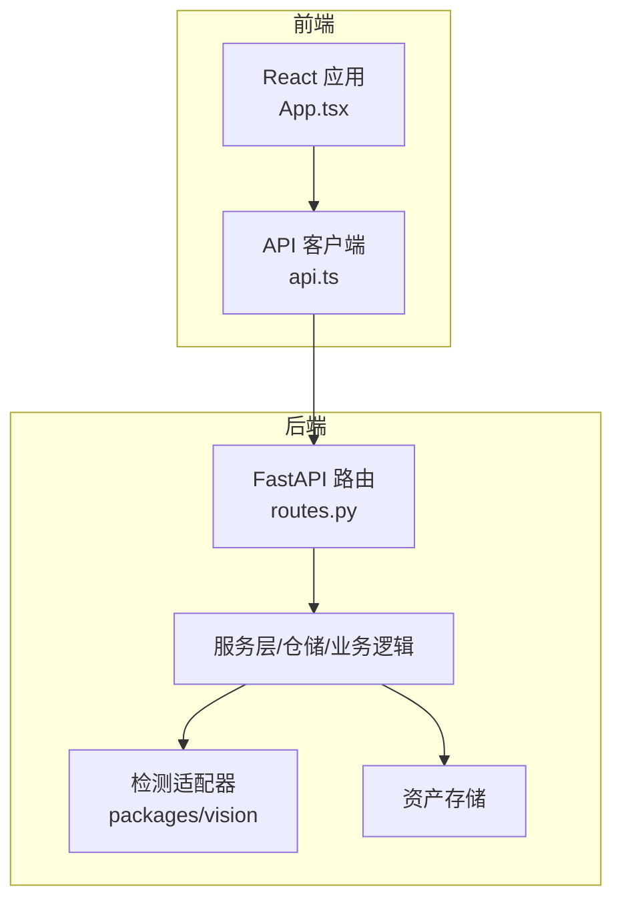
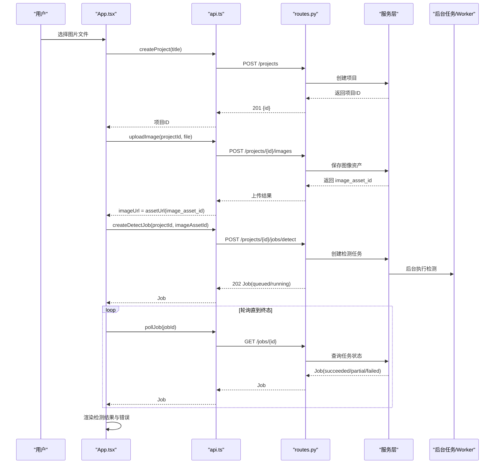
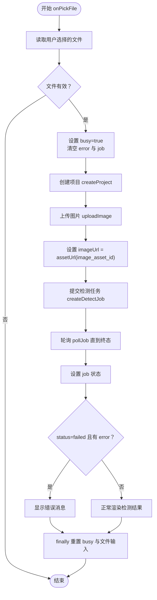
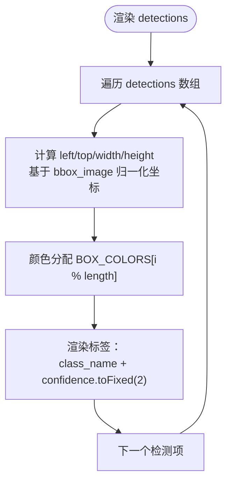
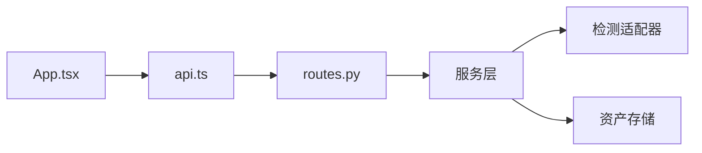

# 核心组件

<cite>
**本文引用的文件**   
- [App.tsx](file://apps/web/src/App.tsx)
- [api.ts](file://apps/web/src/api.ts)
- [routes.py](file://services/api/routes.py)
- [detection_result.schema.json](file://contracts/detection_result.schema.json)
- [README.md](file://README.md)
</cite>

## 目录
1. [引言](#引言)
2. [项目结构](#项目结构)
3. [核心组件](#核心组件)
4. [架构总览](#架构总览)
5. [详细组件分析](#详细组件分析)
6. [依赖关系分析](#依赖关系分析)
7. [性能与可扩展性](#性能与可扩展性)
8. [故障排查指南](#故障排查指南)
9. [结论](#结论)

## 引言
本文面向 AstraDesk 前端核心组件，聚焦 `apps/web/src/App.tsx` 主组件及其与后端 API 的协作方式。文档从系统架构、状态设计、文件选择与处理流程、检测结果可视化渲染、错误处理机制、以及可扩展性六个维度展开，帮助读者快速理解并安全扩展该组件。

## 项目结构
AstraDesk 的前端位于 `apps/web`，采用 React + TypeScript + Vite；后端 API 使用 FastAPI，路由统一前缀 `/api/v1`。检测任务采用异步提交 + 轮询查询的模式：前端创建任务后立即返回任务对象，随后通过轮询接口获取最终结果。

图表来源
- [App.tsx:1-134](file://apps/web/src/App.tsx#L1-L134)
- [api.ts:1-119](file://apps/web/src/api.ts#L1-L119)
- [routes.py:1-143](file://services/api/routes.py#L1-L143)

章节来源
- [README.md:8-24](file://README.md#L8-L24)

## 核心组件
`App.tsx` 是桌面识别的前端入口组件，负责：
- 初始化能力信息（运行模式、检测器可用性）。
- 管理用户交互状态（busy、imageUrl、job、error）。
- 处理文件选择、上传、检测任务提交与结果轮询。
- 将检测结果以检测框叠加在图片上，并在侧边栏列出检测结果。

关键状态变量说明：
- capabilities：后端能力信息，包含运行模式、检测器可用性与模型名称等。
- busy：表示当前是否正在执行上传或检测流程。
- imageUrl：已上传图片的访问地址。
- job：当前检测任务的状态与结果，包括 detections 数组和 error 字段。
- error：用于展示网络请求失败或业务错误的消息。

这些状态在组件生命周期中按以下时机更新：
- 组件挂载时调用能力接口，成功后写入 capabilities，失败则写入 error。
- 用户选择文件后进入 onPickFile，设置 busy=true，清空 error 与 job。
- 成功完成上传与检测后，设置 imageUrl 与 job，并根据 job.status 决定是否显示 error。
- 任何异常都会捕获到 error，并在 finally 中重置 busy 与文件输入控件。

章节来源
- [App.tsx:16-50](file://apps/web/src/App.tsx#L16-L50)
- [App.tsx:52-133](file://apps/web/src/App.tsx#L52-L133)

## 架构总览
前端通过 api.ts 封装 HTTP 请求，后端 routes.py 提供 RESTful 接口，检测任务由后台任务或 worker 异步执行。

图表来源
- [App.tsx:28-50](file://apps/web/src/App.tsx#L28-L50)
- [api.ts:64-118](file://apps/web/src/api.ts#L64-L118)
- [routes.py:70-142](file://services/api/routes.py#L70-L142)

## 详细组件分析

### 文件选择与处理流程（onPickFile）
onPickFile 是文件选择的完整执行路径，包含以下步骤：
1. 读取用户选择的文件，若为空则直接返回。
2. 设置 busy=true，清空 error 与 job，避免旧状态干扰。
3. 调用 createProject 创建项目，获得 project.id。
4. 调用 uploadImage 上传图片，获得 image_asset_id，并通过 assetUrl 生成可访问的图片地址。
5. 调用 createDetectJob 提交检测任务，立即得到 Job 对象。
6. 调用 pollJob 轮询任务状态，直到达到终态（succeeded、partial、failed、cancelled）。
7. 将最终 Job 写入 state，如果 status=failed 且存在 error 字段，则显示错误消息。
8. 在 finally 块中重置 busy 与文件输入控件的值，确保 UI 状态一致。

图表来源
- [App.tsx:28-50](file://apps/web/src/App.tsx#L28-L50)
- [api.ts:68-118](file://apps/web/src/api.ts#L68-L118)

章节来源
- [App.tsx:28-50](file://apps/web/src/App.tsx#L28-L50)

### 检测结果可视化渲染
检测结果通过 detections 数组渲染为覆盖在图片上的检测框。每个检测项包含：
- id：检测项唯一标识。
- class_name：类别名称。
- confidence：置信度（可为 null）。
- bbox_image：归一化坐标 [x1, y1, x2, y2]，范围 0-1，左上原点，x 向右、y 向下。

渲染逻辑要点：
- 检测框容器使用相对定位，内部 div 使用绝对定位。
- left/top 使用 x1*100% 与 y1*100%。
- width/height 使用 (x2-x1)*100% 与 (y2-y1)*100%，并使用 Math.max 保证非负值。
- 颜色分配策略：BOX_COLORS[i % BOX_COLORS.length]，循环使用固定颜色集合。
- 标签文本：class_name 与 confidence.toFixed(2)，当 confidence 为 null 时不显示。

图表来源
- [App.tsx:84-105](file://apps/web/src/App.tsx#L84-L105)
- [detection_result.schema.json:44-62](file://contracts/detection_result.schema.json#L44-L62)

章节来源
- [App.tsx:84-105](file://apps/web/src/App.tsx#L84-L105)
- [detection_result.schema.json:44-62](file://contracts/detection_result.schema.json#L44-L62)

### 用户交互状态管理
- 能力加载：组件挂载时调用 getCapabilities，成功写入 capabilities，失败写入 error。
- 工具栏：文件输入控件受 busy 控制，busy=true 时禁用输入并显示“上传并检测中…”提示。
- 错误展示：error 非空时在页面顶部显示错误信息。
- 占位符：未选择图片时显示引导文案。
- 结果面板：显示模型名、运行模式、检测数量与耗时；无结果且非 busy 时显示“暂无结果”。

章节来源
- [App.tsx:24-26](file://apps/web/src/App.tsx#L24-L26)
- [App.tsx:73-79](file://apps/web/src/App.tsx#L73-L79)
- [App.tsx:111-129](file://apps/web/src/App.tsx#L111-L129)

### 错误处理机制
统一的错误处理分为两层：
- 网络层：api.ts 中的 handle 函数检查响应是否 ok，若非 ok，尝试解析 ErrorBody，否则使用 HTTP 状态码构造错误消息，并抛出 Error。
- 业务层：App.tsx 在 onPickFile 中捕获异常，将其转换为字符串写入 error；同时根据 job.error.code 与 job.error.message 显示具体业务错误。

最佳实践建议：
- 所有 HTTP 请求都应通过 handle 包装，避免分散的错误处理逻辑。
- 对重试友好的错误（retryable=true）可在前端提供重试按钮。
- 对于 MODEL_UNAVAILABLE 等不可恢复错误，应明确告知用户并阻止后续操作。

章节来源
- [api.ts:50-62](file://apps/web/src/api.ts#L50-L62)
- [App.tsx:41-49](file://apps/web/src/App.tsx#L41-L49)

## 依赖关系分析
前端组件与 API 客户端、后端路由之间的依赖关系如下：

图表来源
- [App.tsx:1-12](file://apps/web/src/App.tsx#L1-L12)
- [api.ts:1-119](file://apps/web/src/api.ts#L1-L119)
- [routes.py:1-143](file://services/api/routes.py#L1-L143)

章节来源
- [App.tsx:1-12](file://apps/web/src/App.tsx#L1-L12)
- [api.ts:1-119](file://apps/web/src/api.ts#L1-L119)
- [routes.py:1-143](file://services/api/routes.py#L1-L143)

## 性能与可扩展性

### 性能考虑
- 轮询间隔与最大次数：pollJob 默认 intervalMs=800ms，maxTries=60，可根据后端负载调整。
- 图片尺寸：建议限制上传文件大小（如 ≤10MB），避免前端卡顿与后端处理压力。
- 渲染优化：检测框数量较多时可考虑虚拟列表或按需渲染。

### 可扩展性建议
- 添加新的检测类别：
  - 后端：扩展检测器类别映射，确保返回的 class_name 符合契约。
  - 前端：无需修改颜色分配逻辑，BOX_COLORS 会循环复用。
- 自定义样式主题：
  - 将 BOX_COLORS 提取为配置常量，支持动态主题切换。
  - 将检测框样式类名与颜色分离，便于 CSS 主题管理。
- 扩展交互功能：
  - 增加批量上传：在前端维护文件队列，逐个调用 onPickFile 或封装批量 API。
  - 增加结果导出：将 detections 序列化为 JSON 或 CSV，供用户下载。
  - 增加筛选与排序：根据 class_name 或 confidence 过滤检测结果。

章节来源
- [api.ts:111-118](file://apps/web/src/api.ts#L111-L118)
- [App.tsx:14-14](file://apps/web/src/App.tsx#L14-L14)

## 故障排查指南
常见问题与排查步骤：
- 能力加载失败：
  - 检查后端健康检查与健康状态。
  - 确认运行模式与检测器权重配置正确。
- 图片上传失败：
  - 检查文件格式与大小是否符合要求。
  - 查看后端日志中的资产存储错误。
- 检测任务失败：
  - 查看 job.error.code 与 job.error.message。
  - 确认 MODEL_UNAVAILABLE 是否为真实模式下的权重缺失。
- 检测结果未显示：
  - 检查 detections 数组是否为空。
  - 验证 bbox_image 坐标是否在 0-1 范围内。

章节来源
- [README.md:49-50](file://README.md#L49-L50)
- [App.tsx:41-49](file://apps/web/src/App.tsx#L41-L49)

## 结论
AstraDesk 前端核心组件通过清晰的状态管理与简洁的文件处理流程，实现了从图片上传到检测结果可视化的完整闭环。其错误处理机制统一可靠，检测结果可视化实现直观易懂。通过合理的可扩展性设计，开发者可以方便地添加新类别、自定义主题与扩展交互功能。建议在后续迭代中进一步优化轮询策略与渲染性能，以提升用户体验。