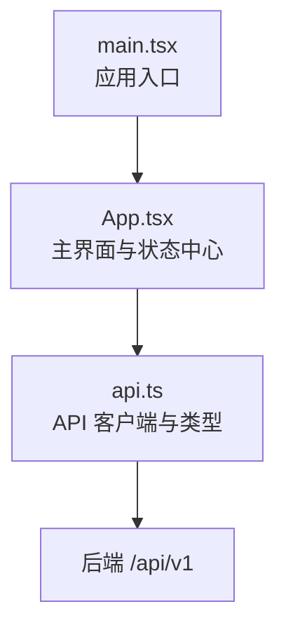
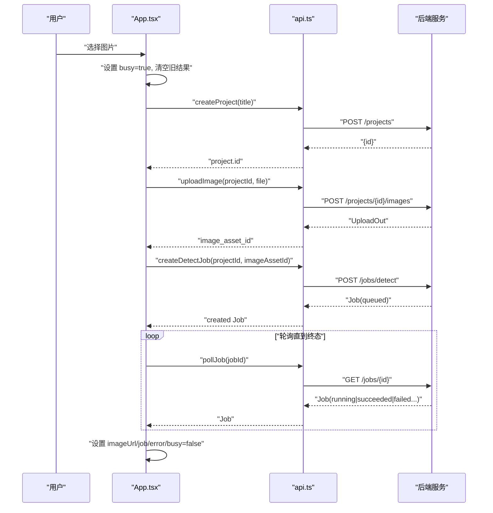
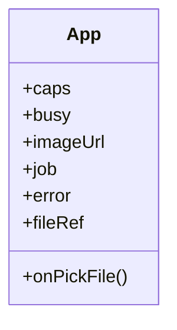
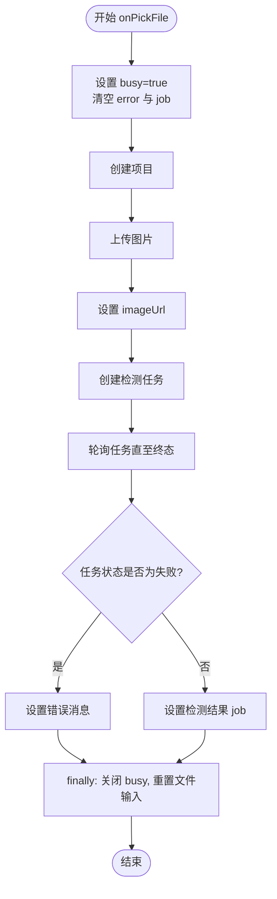

# 状态管理

<cite>
**本文引用的文件**   
- [App.tsx](file://apps/web/src/App.tsx)
- [api.ts](file://apps/web/src/api.ts)
- [main.tsx](file://apps/web/src/main.tsx)
</cite>

## 目录
1. [引言](#引言)
2. [项目结构](#项目结构)
3. [核心组件与职责划分](#核心组件与职责划分)
4. [架构总览](#架构总览)
5. [详细组件分析](#详细组件分析)
6. [依赖关系分析](#依赖关系分析)
7. [性能考虑](#性能考虑)
8. [故障排查指南](#故障排查指南)
9. [结论](#结论)
10. [附录：迁移到集中式状态库的建议](#附录迁移到集中式状态库的建议)

## 引言
本文件面向 AstraDesk 前端的状态管理策略，聚焦当前基于 React Hooks（useState、useRef）的实现模式。文档从状态变量职责、更新时机控制、副作用处理入手，梳理应用状态设计原则（扁平化、派生状态、同步策略）、组件间通信机制、异步状态统一处理模式、持久化考量，并给出避免不必要重渲染、状态提升与复杂状态重构的最佳实践。最后提供从简单 useState/useRef 向 Redux/Zustand 等集中式状态库迁移的评估要点。

## 项目结构
AstraDesk 的前端位于 apps/web/src，采用最小化的单页面结构：
- main.tsx：应用入口，挂载根组件并启用严格模式。
- App.tsx：唯一业务组件，负责能力获取、图片上传、检测任务创建与轮询、结果展示与错误提示。
- api.ts：统一的 API 客户端，封装类型定义、请求封装、错误解析与任务轮询逻辑。

图表来源
- [main.tsx:6-10](file://apps/web/src/main.tsx#L6-L10)
- [App.tsx:16-50](file://apps/web/src/App.tsx#L16-L50)
- [api.ts:48-118](file://apps/web/src/api.ts#L48-L118)

章节来源
- [main.tsx:1-11](file://apps/web/src/main.tsx#L1-L11)
- [App.tsx:1-134](file://apps/web/src/App.tsx#L1-L134)
- [api.ts:1-119](file://apps/web/src/api.ts#L1-L119)

## 核心组件与职责划分
当前实现将全部 UI 状态集中在 App 组件中，属于“单一状态中心”的轻量方案。

- 能力与运行模式状态
  - 用途：显示后端能力、检测器可用性与运行模式。
  - 生命周期：应用启动时通过 useEffect 调用一次能力接口。
- 用户交互与流程状态
  - busy：控制上传/检测流程是否进行中，禁用输入控件并显示提示。
  - imageUrl：已上传图片的预览地址。
  - job：当前检测任务的完整响应对象，包含检测结果与元信息。
  - error：错误消息字符串，用于在界面上展示。
- DOM 引用
  - fileRef：指向文件输入框，用于在流程结束后清空选择值，允许重复选择同一文件。

状态职责边界清晰：UI 层仅持有必要的最小状态；数据获取、错误处理与任务轮询由 api.ts 提供，App 组件组合这些能力完成业务流程。

章节来源
- [App.tsx:16-50](file://apps/web/src/App.tsx#L16-L50)
- [api.ts:64-118](file://apps/web/src/api.ts#L64-L118)

## 架构总览
整体数据流遵循“事件驱动 + 单向数据流”的模式：
- 用户触发文件选择 → App 进入忙碌状态 → 依次调用创建项目、上传图片、创建检测任务、轮询任务 → 根据返回设置 imageUrl、job、error → 结束忙碌状态。
- 能力信息在组件挂载后拉取一次，作为只读上下文使用。

图表来源
- [App.tsx:28-50](file://apps/web/src/App.tsx#L28-L50)
- [api.ts:68-118](file://apps/web/src/api.ts#L68-L118)

## 详细组件分析

### App 组件状态模型
App 组件维护以下关键状态：
- caps：能力信息，初始为 null，加载完成后填充。
- busy：流程忙闲标志。
- imageUrl：图片预览地址。
- job：检测任务对象，包含 detections 与 result。
- error：错误消息。
- fileRef：DOM 引用，用于重置文件输入。

图表来源
- [App.tsx:16-50](file://apps/web/src/App.tsx#L16-L50)

章节来源
- [App.tsx:16-50](file://apps/web/src/App.tsx#L16-L50)

### 异步流程与状态更新时序
文件选择后的异步流程包括：
- 立即设置 busy=true、清空 error 与 job，保证 UI 快速反馈。
- 顺序执行 createProject → uploadImage → createDetectJob → pollJob。
- 成功时设置 imageUrl 与 job；若 job.status 为失败且存在 error 字段，则设置错误消息。
- finally 中关闭 busy 并重置文件输入框。

图表来源
- [App.tsx:28-50](file://apps/web/src/App.tsx#L28-L50)

章节来源
- [App.tsx:28-50](file://apps/web/src/App.tsx#L28-L50)

### 派生状态与计算
- detections：从 job?.detections ?? [] 派生，避免在模板中直接访问可选链，减少空引用风险。
- 列表渲染 key：使用 d.id 作为稳定键，避免不必要的重排。
- 颜色分配：按索引循环选取预定义颜色数组，保持视觉一致性。

章节来源
- [App.tsx:52-105](file://apps/web/src/App.tsx#L52-L105)

### 副作用与清理
- 能力获取：在组件挂载后调用 getCapabilities，捕获异常并转为错误消息。
- 文件输入重置：在 finally 中通过 fileRef.current.value = "" 确保可重复选择相同文件。

章节来源
- [App.tsx:24-26](file://apps/web/src/App.tsx#L24-L26)
- [App.tsx:46-49](file://apps/web/src/App.tsx#L46-L49)

### 组件间通信机制
当前为单组件应用，不存在父子组件传递或事件冒泡场景。如需扩展：
- 建议将“文件选择”“结果显示”“错误提示”拆分为子组件，通过 props 传递 imageUrl、detections、error。
- 回调函数设计：父组件提供 onFileSelect、onClear、onRetry 等回调，子组件仅触发事件而不关心具体流程。

[本节为概念性说明，不直接分析具体文件]

## 依赖关系分析
App 组件依赖 api.ts 提供的能力查询、项目创建、图片上传、任务创建与轮询方法；api.ts 内部封装 fetch 与错误处理，并通过常量 BASE 统一路由前缀。

图表来源
- [App.tsx:1-12](file://apps/web/src/App.tsx#L1-L12)
- [api.ts:48-118](file://apps/web/src/api.ts#L48-L118)

章节来源
- [App.tsx:1-12](file://apps/web/src/App.tsx#L1-L12)
- [api.ts:48-118](file://apps/web/src/api.ts#L48-L118)

## 性能考虑
- 避免不必要的重渲染
  - 将 detections 作为派生值在渲染前计算，避免在 JSX 中重复计算。
  - 使用稳定的 key（d.id）进行列表渲染，降低重排成本。
  - 仅在必要时更新状态（如只在 finally 中关闭 busy），避免中间状态抖动。
- 减少状态粒度
  - 当前状态已足够扁平，无需进一步拆分；若未来增加编辑、撤销等功能，可将 job 拆分为 result 与 detections，便于局部更新。
- 网络请求优化
  - pollJob 默认间隔 800ms、最多 60 次轮询，适合短任务；对长任务可引入指数退避与取消令牌。
- 资源释放
  - 组件卸载时若需要取消轮询，应引入 AbortController 或 ref 标记取消，避免内存泄漏。

[本节为通用指导，不直接分析具体文件]

## 故障排查指南
- 常见错误来源
  - 后端返回非 2xx：api.ts 会尝试解析 ErrorBody，若失败则回退为 HTTP 状态码；App 中将错误消息显示在界面上。
  - 任务失败：当 job.status 为 failed 且存在 error 字段时，App 会拼接 code 与 message 展示给用户。
- 定位步骤
  - 检查浏览器控制台的网络面板，确认 /api/v1 各端点返回体是否符合 contracts 中的 schema。
  - 观察 App 中的 error 状态是否在 finally 之前被覆盖，确保错误路径正确设置。
  - 若轮询未结束，检查 TERMINAL 状态集合与 pollJob 的最大重试次数。

章节来源
- [api.ts:50-62](file://apps/web/src/api.ts#L50-L62)
- [api.ts:109-118](file://apps/web/src/api.ts#L109-L118)
- [App.tsx:41-49](file://apps/web/src/App.tsx#L41-L49)

## 结论
当前 AstraDesk 前端采用简洁的 useState/useRef 方案，将 UI 状态集中于 App 组件，配合 api.ts 的 API 客户端完成数据获取与错误处理。该方案职责清晰、易于理解，适合小型单页应用。随着功能增长，可逐步引入组件拆分、回调抽象与更细粒度的状态管理，并在必要时迁移至集中式状态库以提升可测试性与可维护性。

[本节为总结性内容，不直接分析具体文件]

## 附录：迁移到集中式状态库的建议
- 何时迁移
  - 当状态跨多个组件共享、需要撤销/重做、时间旅行调试、或需要与第三方状态集成（如 DevTools）时。
- 选型建议
  - Redux：生态成熟、工具链完善，适合大型团队与复杂业务。
  - Zustand：轻量、无样板代码，适合中小型项目快速迭代。
- 迁移步骤
  - 识别全局状态：caps、busy、imageUrl、job、error。
  - 抽取 actions：getCapabilities、startUpload、uploadImage、createDetectJob、pollJob、setError、clearBusy。
  - 抽象 store：将 App 中的状态与副作用迁移到 store，组件仅订阅所需切片。
  - 保留现有 API 客户端：api.ts 继续承担网络层职责，store 调用其方法。
- 注意事项
  - 避免将临时 UI 状态（如文件输入值）放入全局 store。
  - 对轮询等副作用引入取消机制，防止组件卸载后继续更新状态。
  - 对大对象（如 job）使用不可变更新策略，结合 selector 减少重渲染。

[本节为概念性说明，不直接分析具体文件]