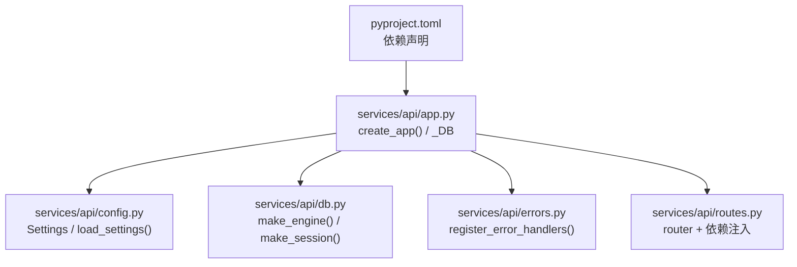
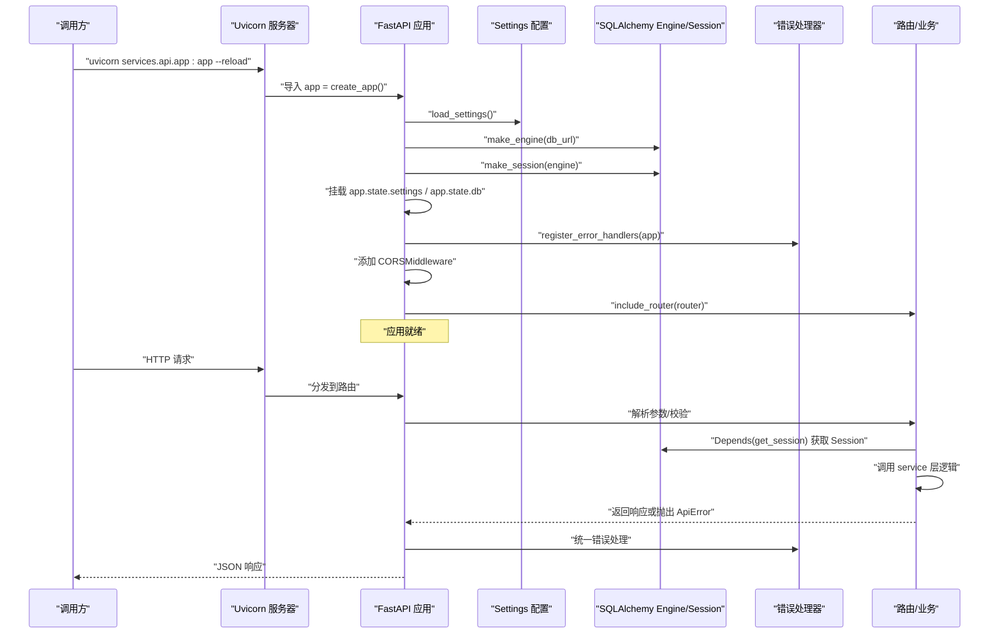
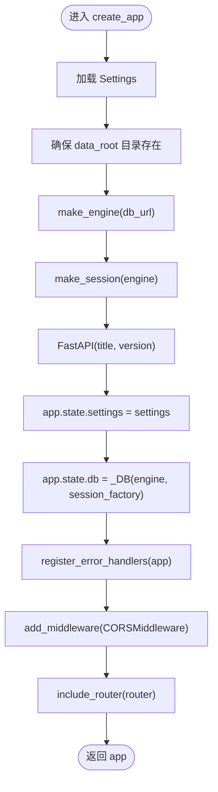
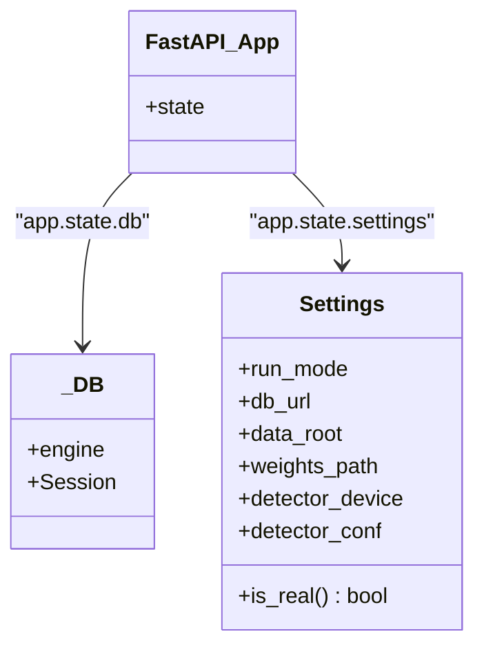
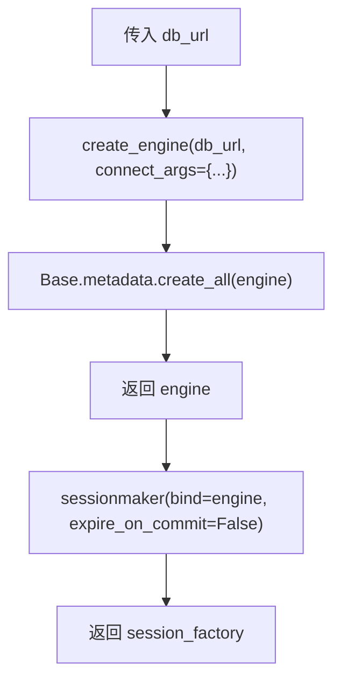
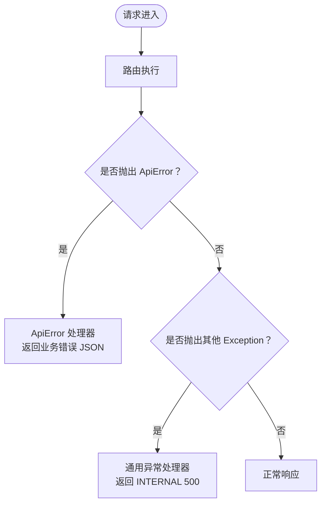
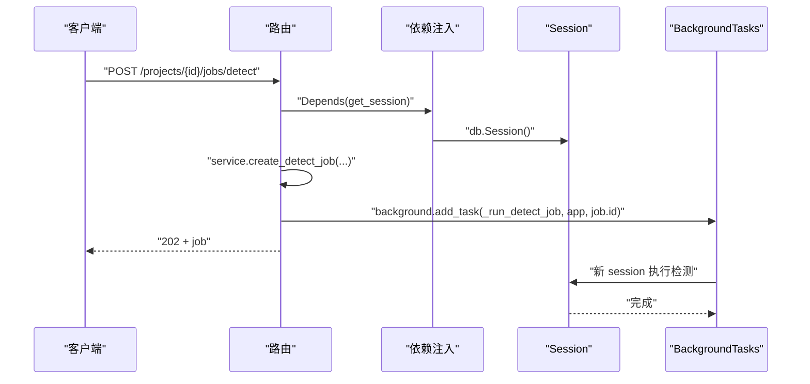
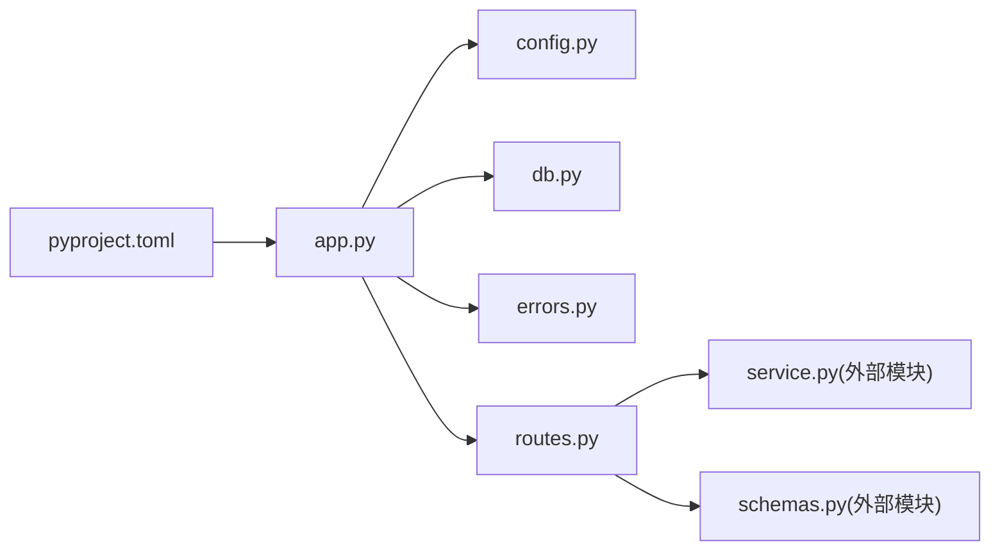

# FastAPI 应用装配

<cite>
**本文引用的文件**   
- [services/api/app.py](file://services/api/app.py)
- [services/api/config.py](file://services/api/config.py)
- [services/api/db.py](file://services/api/db.py)
- [services/api/routes.py](file://services/api/routes.py)
- [services/api/errors.py](file://services/api/errors.py)
- [pyproject.toml](file://pyproject.toml)
</cite>

## 目录
1. [引言](#引言)
2. [项目结构](#项目结构)
3. [核心组件](#核心组件)
4. [架构总览](#架构总览)
5. [详细组件分析](#详细组件分析)
6. [依赖关系分析](#依赖关系分析)
7. [性能与扩展性](#性能与扩展性)
8. [启动方式与环境变量](#启动方式与环境变量)
9. [故障排查指南](#故障排查指南)
10. [结论](#结论)

## 引言
本文面向 FastAPI 后端服务，聚焦“应用装配”这一关键阶段：从配置加载、数据库引擎初始化、会话工厂创建，到错误处理器注册、CORS 中间件配置、路由挂载，以及通过 `app.state` 暴露全局资源。文档同时解释 `_DB` 类的设计动机、engine 与 session_factory 的生命周期管理，并给出开发/生产两种常见启动方式与环境变量配置示例。

## 项目结构
本项目的后端 API 位于 `services/api` 下，核心装配逻辑集中在以下文件：
- `app.py`：FastAPI 应用装配入口，定义 `create_app()` 与 `_DB` 类。
- `config.py`：Settings 数据模型与 `load_settings()` 环境变量装配。
- `db.py`：SQLAlchemy 模型、engine 与 session 工厂构造。
- `routes.py`：路由与依赖注入（Session、Settings）。
- `errors.py`：统一异常类型与 FastAPI 异常处理器注册。
- `pyproject.toml`：Python 包元数据与可选依赖（如 vision）。

**图表来源**
- [services/api/app.py:1-48](file://services/api/app.py#L1-L48)
- [services/api/config.py:1-61](file://services/api/config.py#L1-L61)
- [services/api/db.py:1-92](file://services/api/db.py#L1-L92)
- [services/api/errors.py:1-56](file://services/api/errors.py#L1-L56)
- [services/api/routes.py:1-143](file://services/api/routes.py#L1-L143)
- [pyproject.toml:1-37](file://pyproject.toml#L1-L37)

**章节来源**
- [services/api/app.py:1-48](file://services/api/app.py#L1-L48)
- [services/api/config.py:1-61](file://services/api/config.py#L1-L61)
- [services/api/db.py:1-92](file://services/api/db.py#L1-L92)
- [services/api/routes.py:1-143](file://services/api/routes.py#L1-L143)
- [services/api/errors.py:1-56](file://services/api/errors.py#L1-L56)
- [pyproject.toml:1-37](file://pyproject.toml#L1-L37)

## 核心组件
- Settings 配置对象：集中描述运行模式、数据库连接串、数据根目录、权重路径、检测设备与置信度等。
- 数据库层：基于 SQLAlchemy 的 ORM 模型与 engine/session 工厂。
- 应用装配器：`create_app()` 负责串联上述组件，并将 settings 与 db 挂载到 `app.state`。
- 错误处理：统一业务异常 `ApiError` 与全局未捕获异常处理器。
- CORS 中间件：允许前端本地开发地址跨域访问。
- 路由与依赖注入：通过 `Depends` 获取 Session 与 Settings。

**章节来源**
- [services/api/config.py:20-61](file://services/api/config.py#L20-L61)
- [services/api/db.py:19-92](file://services/api/db.py#L19-L92)
- [services/api/app.py:16-44](file://services/api/app.py#L16-L44)
- [services/api/errors.py:12-56](file://services/api/errors.py#L12-L56)
- [services/api/routes.py:31-42](file://services/api/routes.py#L31-L42)

## 架构总览
下图展示应用启动时的装配顺序与运行时请求处理的关键交互。

**图表来源**
- [services/api/app.py:24-44](file://services/api/app.py#L24-L44)
- [services/api/config.py:39-61](file://services/api/config.py#L39-L61)
- [services/api/db.py:84-92](file://services/api/db.py#L84-L92)
- [services/api/errors.py:35-56](file://services/api/errors.py#L35-L56)
- [services/api/routes.py:31-42](file://services/api/routes.py#L31-L42)

## 详细组件分析

### 应用装配函数 `create_app()`
`create_app()` 是应用装配的核心入口，主要职责包括：
- 加载 Settings；若未传入则调用 `load_settings()`。
- 确保数据根目录存在。
- 创建 SQLAlchemy engine 与 session 工厂。
- 实例化 FastAPI 应用，并将 `settings` 与 `db` 挂载到 `app.state`。
- 注册错误处理器、添加 CORS 中间件、挂载路由。

**图表来源**
- [services/api/app.py:24-44](file://services/api/app.py#L24-L44)

**章节来源**
- [services/api/app.py:24-44](file://services/api/app.py#L24-L44)

### `_DB` 类与 `app.state` 设计模式
- `_DB` 是一个轻量容器，持有 `engine` 与 `session_factory`（即 `Session`），避免在多处重复传递这些对象。
- `app.state` 用于在应用生命周期内共享全局状态。此处挂载两个关键对象：
  - `app.state.settings`：当前运行配置。
  - `app.state.db`：数据库相关资源（engine 与 session 工厂）。
- 路由中通过 `request.app.state.db.Session()` 获取会话，并通过 `request.app.state.settings` 读取配置。

**图表来源**
- [services/api/app.py:16-33](file://services/api/app.py#L16-L33)
- [services/api/config.py:20-32](file://services/api/config.py#L20-L32)
- [services/api/routes.py:31-42](file://services/api/routes.py#L31-L42)

**章节来源**
- [services/api/app.py:16-33](file://services/api/app.py#L16-L33)
- [services/api/routes.py:31-42](file://services/api/routes.py#L31-L42)

### 数据库引擎与会话工厂
- `make_engine(db_url)`：使用 SQLAlchemy 创建 engine，并在 SQLite 场景下设置 `check_same_thread=False`，以支持多线程访问；随后调用 `Base.metadata.create_all(engine)` 自动建表。
- `make_session(engine)`：返回一个 `sessionmaker` 工厂，默认关闭 `expire_on_commit`，便于在事务后继续访问已加载对象。

**图表来源**
- [services/api/db.py:84-92](file://services/api/db.py#L84-L92)

**章节来源**
- [services/api/db.py:84-92](file://services/api/db.py#L84-L92)

### 错误处理器注册
- `ApiError`：业务异常，携带 code、message、status_code、retryable、details 等字段。
- `register_error_handlers(app)`：
  - 为 `ApiError` 注册处理器，返回结构化 JSON 错误体。
  - 为未捕获的 `Exception` 注册兜底处理器，返回统一的 500 错误体。
  - 通过 `x-request-id` 请求头或生成 UUID 作为 request_id，便于追踪。

**图表来源**
- [services/api/errors.py:12-56](file://services/api/errors.py#L12-L56)

**章节来源**
- [services/api/errors.py:12-56](file://services/api/errors.py#L12-L56)

### CORS 中间件配置
- 允许的来源包含本地开发常用地址（Vite 默认端口 5173）。
- 允许凭据与所有方法与头部，便于前后端联调。
- 在生产环境建议收紧 allow_origins 列表，仅放行可信域名。

**章节来源**
- [services/api/app.py:36-42](file://services/api/app.py#L36-L42)

### 路由与依赖注入
- `get_session(request)`：从 `request.app.state.db.Session` 创建会话，并在请求结束后关闭。
- `get_settings(request)`：从 `request.app.state.settings` 读取配置。
- 健康检查 `/health` 与能力查询 `/capabilities` 均通过 `Depends(get_settings)` 获取配置。
- 后台任务 `_run_detect_job` 使用独立 session 执行检测，避免请求 session 关闭导致的问题。

**图表来源**
- [services/api/routes.py:31-42](file://services/api/routes.py#L31-L42)
- [services/api/routes.py:120-136](file://services/api/routes.py#L120-L136)

**章节来源**
- [services/api/routes.py:31-42](file://services/api/routes.py#L31-L42)
- [services/api/routes.py:120-136](file://services/api/routes.py#L120-L136)

## 依赖关系分析
- `app.py` 依赖：
  - `config.Settings` 与 `load_settings()`
  - `db.make_engine()` 与 `db.make_session()`
  - `errors.register_error_handlers()`
  - `routes.router`
- `routes.py` 依赖：
  - `service`（业务逻辑）
  - `config.Settings`
  - `errors.ApiError`
  - `schemas.*`（Pydantic 模型）
- `db.py` 依赖：
  - SQLAlchemy ORM 与 Engine/Session 工厂
- `pyproject.toml` 声明了 FastAPI、Uvicorn、SQLAlchemy、Pydantic 等依赖，并提供可选依赖 `vision`（torch、ultralytics）。

**图表来源**
- [services/api/app.py:1-14](file://services/api/app.py#L1-L14)
- [services/api/routes.py:1-27](file://services/api/routes.py#L1-L27)
- [pyproject.toml:5-21](file://pyproject.toml#L5-L21)

**章节来源**
- [services/api/app.py:1-14](file://services/api/app.py#L1-L14)
- [services/api/routes.py:1-27](file://services/api/routes.py#L1-L27)
- [pyproject.toml:5-21](file://pyproject.toml#L5-L21)

## 性能与扩展性
- SQLite 单文件数据库适合开发与演示；生产环境可切换至 PostgreSQL/MySQL 等，只需修改 `ASTRADESK_DB_URL`。
- `check_same_thread=False` 使 SQLite 可在多线程中使用，但需注意并发写入竞争；高并发场景建议使用支持连接池的数据库。
- `expire_on_commit=False` 减少重复查询开销，适合短事务后多次读取同一对象。
- CORS 在生产环境应限制允许的 origin，避免安全风险。
- 可通过 `ASTRADESK_RUN_MODE=real` 启用真实模型推理；若无 GPU 或未安装依赖，建议在 `/capabilities` 中检测并降级提示。

[本节为通用指导，不直接分析具体文件]

## 启动方式与环境变量

### 启动命令
- 开发模式（热重载）：
  - `uvicorn services.api.app:app --reload`
- 生产模式（推荐 gunicorn + uvicorn workers）：
  - `gunicorn services.api.app:app -w 4 -k uvicorn.workers.UvicornWorker`
- 指定运行模式：
  - `ASTRADESK_RUN_MODE=real uvicorn services.api.app:app --reload`

**章节来源**
- [services/api/app.py:1-4](file://services/api/app.py#L1-L4)
- [pyproject.toml:10-17](file://pyproject.toml#L10-L17)

### 环境变量配置
- `ASTRADESK_RUN_MODE`：运行模式，取值 `real` 或 `mock`；`demo` 等价于 `mock`。
- `ASTRADESK_DATA_ROOT`：数据根目录路径，默认在项目根下的 `data`。
- `ASTRADESK_DB_URL`：数据库连接串，默认 SQLite 文件位于 `data/astradesk.db`。
- `ASTRADESK_YOLO_WEIGHTS`：YOLO 权重文件路径，默认 `weights/yolov10n.pt`。
- `ASTRADESK_DEVICE`：检测设备，空字符串表示由底层自动选择 cuda/cpu。
- `ASTRADESK_DET_CONF`：检测置信度阈值，默认 `0.25`。

**章节来源**
- [services/api/config.py:39-61](file://services/api/config.py#L39-L61)

## 故障排查指南
- 启动时报错“运行模式无效”：
  - 检查 `ASTRADESK_RUN_MODE` 是否为 `real` 或 `mock`；注意 `demo` 会被转换为 `mock`。
- 数据库无法写入或线程报错：
  - 确认 SQLite 使用 `check_same_thread=False`；如需更高并发，切换到支持连接池的数据库。
- 前端跨域失败：
  - 检查 CORS 配置中的 `allow_origins` 是否包含前端地址；生产环境请收紧该列表。
- 接口返回 500 且无业务信息：
  - 查看通用异常处理器返回的 `INTERNAL` 错误体；结合日志定位未捕获异常。
- 模型不可用：
  - 在 `real` 模式下，若缺少权重或依赖，`/capabilities` 会返回 detector 不可用；按提示安装依赖或回退到 `mock` 模式。

**章节来源**
- [services/api/config.py:41-45](file://services/api/config.py#L41-L45)
- [services/api/db.py:84-87](file://services/api/db.py#L84-L87)
- [services/api/app.py:36-42](file://services/api/app.py#L36-L42)
- [services/api/errors.py:47-55](file://services/api/errors.py#L47-L55)
- [services/api/routes.py:51-65](file://services/api/routes.py#L51-L65)

## 结论
`create_app()` 将配置、数据库、错误处理、CORS 与路由有机组合，形成清晰的应用装配流程。通过 `app.state` 暴露 Settings 与 `_DB`，既保持了全局资源的易访问性，又避免了隐式全局变量的滥用。配合环境变量，开发者可以灵活切换运行模式与数据库后端，满足从开发到生产的不同需求。