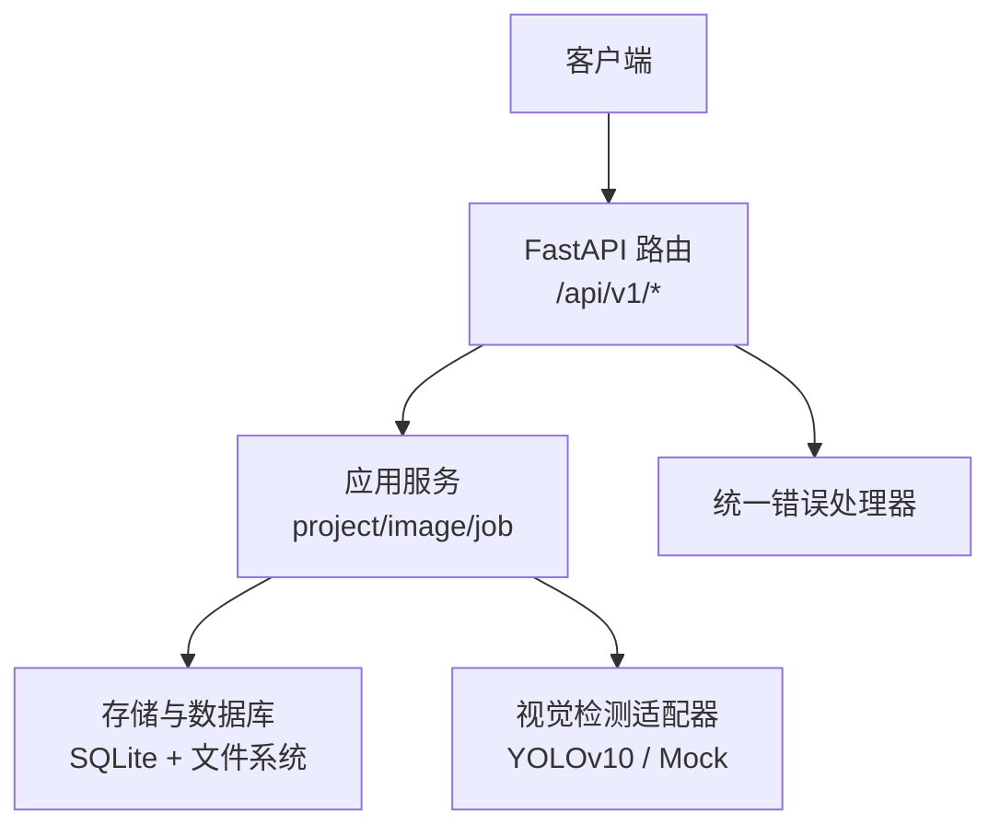
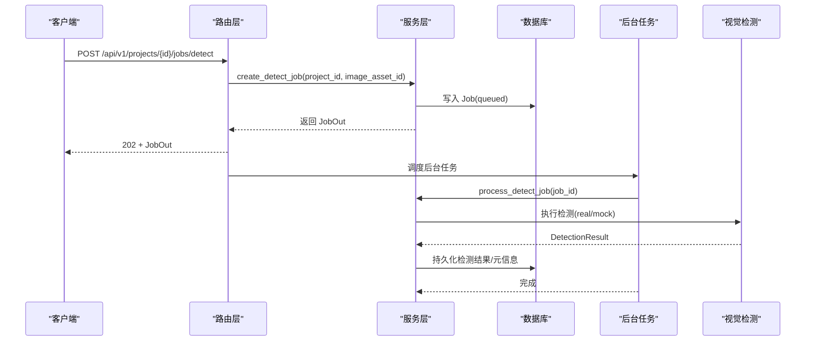

# REST API 端点

<cite>
**本文引用的文件**   
- [routes.py](file://services/api/routes.py)
- [schemas.py](file://services/api/schemas.py)
- [service.py](file://services/api/service.py)
- [errors.py](file://services/api/errors.py)
- [detection_result.schema.json](file://contracts/detection_result.schema.json)
- [error.schema.json](file://contracts/error.schema.json)
- [test_detection_flow.py](file://tests/test_detection_flow.py)
- [README.md](file://README.md)
</cite>

## 目录
1. [简介](#简介)
2. [项目结构](#项目结构)
3. [核心组件](#核心组件)
4. [架构总览](#架构总览)
5. [接口规范](#接口规范)
6. [依赖与版本管理](#依赖与版本管理)
7. [性能与扩展性](#性能与扩展性)
8. [故障排查](#故障排查)
9. [结论](#结论)

## 简介
本文件为 AstraDesk 后端 FastAPI 服务的 RESTful 接口文档，覆盖健康检查、能力查询、项目管理、图像上传、资产获取、检测任务创建与查询等端点。所有接口统一以 `/api/v1` 为前缀，采用异步任务模式处理耗时检测：提交任务返回 202 Accepted，客户端轮询任务状态直至终态。

## 项目结构
后端服务位于 `services/api/`，路由层仅负责协议解析与响应封装，业务逻辑集中在 `service.py`；数据契约由 Pydantic 模型与 JSON Schema 共同约束；错误通过统一异常处理器输出标准错误体。



**图表来源**
- [routes.py:1-143](file://services/api/routes.py#L1-L143)
- [service.py:1-237](file://services/api/service.py#L1-L237)
- [errors.py:1-56](file://services/api/errors.py#L1-L56)

**章节来源**
- [routes.py:1-143](file://services/api/routes.py#L1-L143)
- [service.py:1-237](file://services/api/service.py#L1-L237)
- [errors.py:1-56](file://services/api/errors.py#L1-L56)

## 核心组件
- 路由层：定义 HTTP 端点、参数校验、请求/响应模型绑定。
- 服务层：实现项目、图像、检测任务的领域逻辑与持久化。
- 契约模型：Pydantic 模型与 JSON Schema 共同约束输入输出。
- 错误处理：统一 `ApiError` 与全局异常处理器，输出标准错误对象。

**章节来源**
- [routes.py:1-143](file://services/api/routes.py#L1-L143)
- [schemas.py:1-84](file://services/api/schemas.py#L1-L84)
- [service.py:1-237](file://services/api/service.py#L1-L237)
- [errors.py:1-56](file://services/api/errors.py#L1-L56)

## 架构总览
以下时序图展示“创建检测任务”的端到端流程：客户端提交任务后，服务端立即返回任务信息并后台执行检测，最终可通过任务查询接口获取结果。



**图表来源**
- [routes.py:120-136](file://services/api/routes.py#L120-L136)
- [service.py:120-179](file://services/api/service.py#L120-L179)

## 接口规范

### 通用约定
- 基础路径：`/api/v1`
- 认证：当前未启用鉴权
- 内容类型：JSON（除资产下载）
- 统一错误体：见“错误与状态码”小节

**章节来源**
- [routes.py:1-28](file://services/api/routes.py#L1-L28)
- [schemas.py:9-17](file://services/api/schemas.py#L9-L17)

---

### 健康检查
- 方法：GET
- URL：`/api/v1/health`
- 请求参数：无
- 响应体：
  - `status`: string，固定为 `ok`
  - `run_mode`: string，运行模式 `real` 或 `mock`
- 成功状态码：200
- 失败状态码：500（内部异常）

示例
- curl
  ```bash
  curl -s http://127.0.0.1:8000/api/v1/health | python -m json.tool
  ```
- Python requests
  ```python
  import requests
  r = requests.get("http://127.0.0.1:8000/api/v1/health")
  print(r.status_code, r.json())
  ```

**章节来源**
- [routes.py:46-48](file://services/api/routes.py#L46-L48)

---

### 能力查询
- 方法：GET
- URL：`/api/v1/capabilities`
- 请求参数：无
- 响应体：
  - `run_mode`: string，`real` 或 `mock`
  - `detector`: object
    - `available`: boolean
    - `model_name`: string
    - `model_version`: string
  - `features`: string[]，包含 `detect`
- 成功状态码：200
- 失败状态码：500（内部异常）

示例
- curl
  ```bash
  curl -s http://127.0.0.1:8000/api/v1/capabilities | python -m json.tool
  ```
- Python requests
  ```python
  import requests
  r = requests.get("http://127.0.0.1:8000/api/v1/capabilities")
  print(r.status_code, r.json())
  ```

**章节来源**
- [routes.py:51-65](file://services/api/routes.py#L51-L65)
- [schemas.py:74-84](file://services/api/schemas.py#L74-L84)

---

### 项目管理

#### 创建项目
- 方法：POST
- URL：`/api/v1/projects`
- 请求头：`Content-Type: application/json`
- 请求体：
  - `title`: string，可选，默认值“未命名项目”
- 响应体：
  - `id`: string
  - `title`: string
  - `created_at`: string 或 null（ISO-8601 UTC）
  - `assets`: array，初始为空数组
- 成功状态码：201
- 失败状态码：500（内部异常）

示例
- curl
  ```bash
  curl -s -X POST http://127.0.0.1:8000/api/v1/projects \
    -H "Content-Type: application/json" \
    -d '{"title":"桌面整理项目"}' | python -m json.tool
  ```
- Python requests
  ```python
  import requests
  r = requests.post("http://127.0.0.1:8000/api/v1/projects", json={"title": "桌面整理项目"})
  print(r.status_code, r.json())
  ```

**章节来源**
- [routes.py:70-74](file://services/api/routes.py#L70-L74)
- [schemas.py:50-54](file://services/api/schemas.py#L50-L54)
- [schemas.py:70-72](file://services/api/schemas.py#L70-L72)

#### 列出项目
- 方法：GET
- URL：`/api/v1/projects`
- 请求参数：无
- 响应体：ProjectOut[]，每个元素包含 `id`、`title`、`created_at`、`assets`
- 成功状态码：200
- 失败状态码：500（内部异常）

示例
- curl
  ```bash
  curl -s http://127.0.0.1:8000/api/v1/projects | python -m json.tool
  ```
- Python requests
  ```python
  import requests
  r = requests.get("http://127.0.0.1:8000/api/v1/projects")
  print(r.status_code, r.json())
  ```

**章节来源**
- [routes.py:77-83](file://services/api/routes.py#L77-L83)

#### 获取项目详情
- 方法：GET
- URL：`/api/v1/projects/{project_id}`
- 路径参数：
  - `project_id`: string，必填
- 响应体：ProjectOut，其中 `assets` 列表包含：
  - `id`: string
  - `kind`: string，如 `canonical`、`thumbnail`
  - `url`: string，形如 `/api/v1/assets/{asset_id}`
  - `width`: integer
  - `height`: integer
  - `sha256`: string
- 成功状态码：200
- 失败状态码：
  - 404：项目不存在或已删除
  - 500：内部异常

示例
- curl
  ```bash
  curl -s http://127.0.0.1:8000/api/v1/projects/<project_id> | python -m json.tool
  ```
- Python requests
  ```python
  import requests
  r = requests.get(f"http://127.0.0.1:8000/api/v1/projects/{project_id}")
  print(r.status_code, r.json())
  ```

**章节来源**
- [routes.py:86-95](file://services/api/routes.py#L86-L95)
- [service.py:53-57](file://services/api/service.py#L53-L57)

---

### 图像上传
- 方法：POST
- URL：`/api/v1/projects/{project_id}/images`
- 路径参数：
  - `project_id`: string，必填
- 请求头：`Content-Type: multipart/form-data`
- 表单字段：
  - `file`: file，必填，支持 jpg/jpeg/png，单文件大小与像素上限受预处理限制
- 响应体：
  - `project_id`: string
  - `image_asset_id`: string，主图资源 ID
  - `thumbnail_asset_id`: string 或 null，缩略图资源 ID
  - `canonical_width`: integer
  - `canonical_height`: integer
  - `sha256`: string
- 成功状态码：200
- 失败状态码：
  - 400：空文件或非法图片内容
  - 404：项目不存在或已删除
  - 413：文件过大或像素过多
  - 415：不支持的文件类型
  - 500：内部异常

示例
- curl
  ```bash
  curl -s -X POST http://127.0.0.1:8000/api/v1/projects/<project_id>/images \
    -F "file=@desk.png" | python -m json.tool
  ```
- Python requests
  ```python
  import requests
  with open("desk.png", "rb") as f:
      r = requests.post(
          f"http://127.0.0.1:8000/api/v1/projects/{project_id}/images",
          files={"file": ("desk.png", f, "image/png")}
      )
  print(r.status_code, r.json())
  ```

**章节来源**
- [routes.py:100-105](file://services/api/routes.py#L100-L105)
- [service.py:73-107](file://services/api/service.py#L73-L107)
- [service.py:37-41](file://services/api/service.py#L37-L41)

---

### 资产获取
- 方法：GET
- URL：`/api/v1/assets/{asset_id}`
- 路径参数：
  - `asset_id`: string，必填
- 响应体：二进制图像数据
- Content-Type：`image/png` 或 `image/jpeg`
- 成功状态码：200
- 失败状态码：
  - 404：资源不存在或所属项目已删除
  - 500：内部异常

示例
- curl
  ```bash
  curl -s -O http://127.0.0.1:8000/api/v1/assets/<asset_id>
  ```
- Python requests
  ```python
  import requests
  r = requests.get(f"http://127.0.0.1:8000/api/v1/assets/{asset_id}")
  print(r.status_code, r.headers.get("content-type"))
  ```

**章节来源**
- [routes.py:108-115](file://services/api/routes.py#L108-L115)
- [service.py:110-115](file://services/api/service.py#L110-L115)

---

### 检测任务

#### 创建检测任务
- 方法：POST
- URL：`/api/v1/projects/{project_id}/jobs/detect`
- 路径参数：
  - `project_id`: string，必填
- 请求头：`Content-Type: application/json`
- 请求体：
  - `image_asset_id`: string，必填，必须属于该项目
- 响应体：JobOut
  - `id`: string
  - `project_id`: string
  - `type`: string，固定为 `detect`
  - `status`: string，初始为 `queued`
  - `stage`: string 或 null，如 `detecting`
  - `attempt`: integer，默认 1
  - `result`: object 或 null，完成后填充
  - `detections`: array，完成后填充
  - `error`: object 或 null
  - `created_at`: string 或 null
  - `updated_at`: string 或 null
- 成功状态码：202（接受任务）
- 失败状态码：
  - 404：项目不存在、资源不存在或不属于该项目
  - 500：内部异常

示例
- curl
  ```bash
  curl -s -X POST http://127.0.0.1:8000/api/v1/projects/<project_id>/jobs/detect \
    -H "Content-Type: application/json" \
    -d '{"image_asset_id":"<image_asset_id>"}' | python -m json.tool
  ```
- Python requests
  ```python
  import requests
  r = requests.post(
      f"http://127.0.0.1:8000/api/v1/projects/{project_id}/jobs/detect",
      json={"image_asset_id": image_asset_id}
  )
  print(r.status_code, r.json())
  ```

**章节来源**
- [routes.py:130-136](file://services/api/routes.py#L130-L136)
- [service.py:120-129](file://services/api/service.py#L120-L129)
- [schemas.py:27-38](file://services/api/schemas.py#L27-L38)
- [schemas.py:66-68](file://services/api/schemas.py#L66-L68)

#### 查询检测任务
- 方法：GET
- URL：`/api/v1/jobs/{job_id}`
- 路径参数：
  - `job_id`: string，必填
- 响应体：JobOut，结构与创建时一致，随任务推进更新 `status`、`result`、`detections`、`error`
- 成功状态码：200
- 失败状态码：
  - 404：任务不存在
  - 500：内部异常

示例
- curl
  ```bash
  curl -s http://127.0.0.1:8000/api/v1/jobs/<job_id> | python -m json.tool
  ```
- Python requests
  ```python
  import requests
  r = requests.get(f"http://127.0.0.1:8000/api/v1/jobs/{job_id}")
  print(r.status_code, r.json())
  ```

**章节来源**
- [routes.py:139-142](file://services/api/routes.py#L139-L142)
- [service.py:202-228](file://services/api/service.py#L202-L228)

---

### 错误与状态码
- 统一错误体字段：
  - `code`: string，枚举值见 error.schema.json
  - `message`: string
  - `details`: object 或 null
  - `retryable`: boolean
  - `request_id`: string，来自请求头 `x-request-id` 或自动生成
- 常见状态码：
  - 200：成功
  - 201：创建成功（创建项目）
  - 202：任务已接受（创建检测任务）
  - 400：请求无效（空文件、非法图片内容）
  - 404：资源不存在（项目/资产/任务）
  - 413：负载过大（图片尺寸/大小超限）
  - 415：不支持的文件类型
  - 422：坐标转换非法（后续扩展）
  - 500：内部异常

错误体参考
- [error.schema.json:1-24](file://contracts/error.schema.json#L1-L24)
- [schemas.py:9-17](file://services/api/schemas.py#L9-L17)
- [errors.py:12-55](file://services/api/errors.py#L12-L55)

**章节来源**
- [errors.py:12-55](file://services/api/errors.py#L12-L55)
- [error.schema.json:1-24](file://contracts/error.schema.json#L1-L24)

## 依赖与版本管理
- API 版本策略：所有端点使用统一前缀 `/api/v1`，便于未来演进至 `/api/v2` 而不破坏现有调用方。
- 向后兼容保证：
  - 新增可选字段不会导致旧客户端解析失败
  - 新增枚举值需保持旧值可用
  - 变更必选字段或语义时需发布新版本
- 运行模式：
  - `real`：真实模型推理；权重缺失直接报 `MODEL_UNAVAILABLE`，不静默回退 mock
  - `mock`：确定性 Mock，用于测试与演示
- 环境变量：`ASTRADESK_RUN_MODE`、`ASTRADESK_DB_URL`、`ASTRADESK_DATA_ROOT`、`ASTRADESK_YOLO_WEIGHTS`、`ASTRADESK_DEVICE`、`ASTRADESK_DET_CONF`

**章节来源**
- [README.md:33-50](file://README.md#L33-L50)
- [README.md:71-77](file://README.md#L71-L77)
- [routes.py:1-4](file://services/api/routes.py#L1-L4)

## 性能与扩展性
- 异步任务：检测任务通过后台任务执行，避免阻塞请求线程，提升吞吐。
- 资源缓存：图像预处理生成 canonical 与 thumbnail，减少重复计算。
- 可扩展点：
  - 增加新的检测器适配器
  - 引入队列系统替代内存后台任务
  - 增加分页与过滤参数（项目列表）

[本节为通用指导，不直接分析具体文件]

## 故障排查
- 无法加载模型：
  - 现象：能力查询显示 `detector.available=false`，检测任务失败且 `error.code=MODEL_UNAVAILABLE`
  - 处理：确认 `ASTRADESK_RUN_MODE=real` 与 `ASTRADESK_YOLO_WEIGHTS` 指向有效权重文件
- 图片被拒绝：
  - 现象：上传返回 400/413/415
  - 处理：检查文件类型、大小与像素上限，确保为 jpg/jpeg/png
- 资产不可访问：
  - 现象：获取资产返回 404
  - 处理：确认资产存在且所属项目未被删除
- 任务查询无结果：
  - 现象：查询任务返回 404
  - 处理：确认 job_id 正确，或在 worker 环境中任务是否被执行

**章节来源**
- [test_detection_flow.py:113-126](file://tests/test_detection_flow.py#L113-L126)
- [service.py:158-163](file://services/api/service.py#L158-L163)
- [service.py:110-115](file://services/api/service.py#L110-L115)

## 结论
本 API 提供清晰的项目与资产管理能力，并通过异步任务机制解耦检测流程。统一错误体与 JSON Schema 契约增强了可测试性与可维护性。建议在生产环境启用真实检测模式并配置合适的硬件与权重文件，同时结合前端轮询机制实现友好的用户体验。