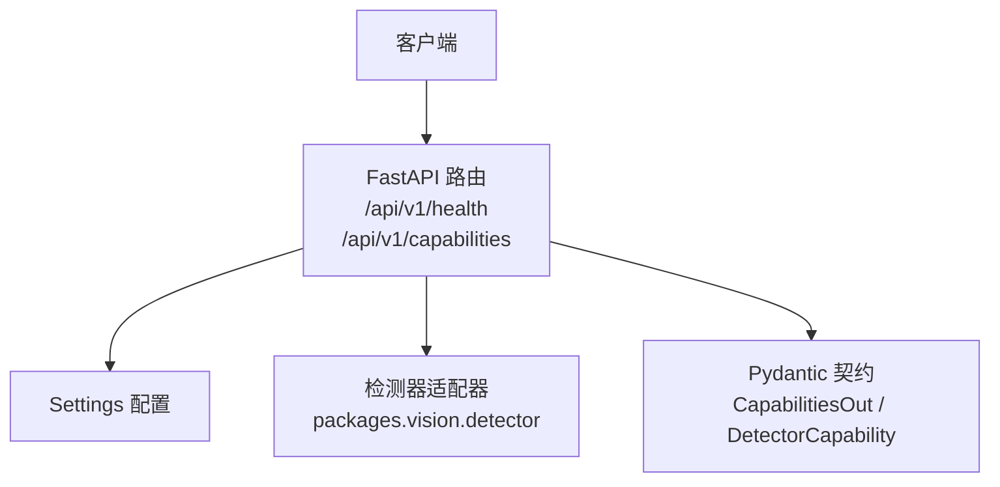
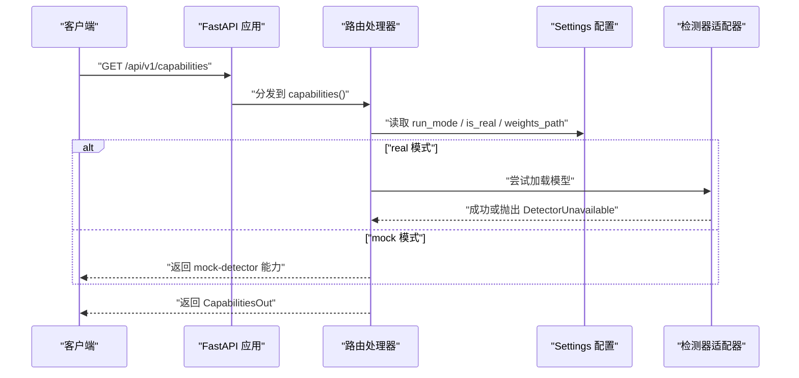
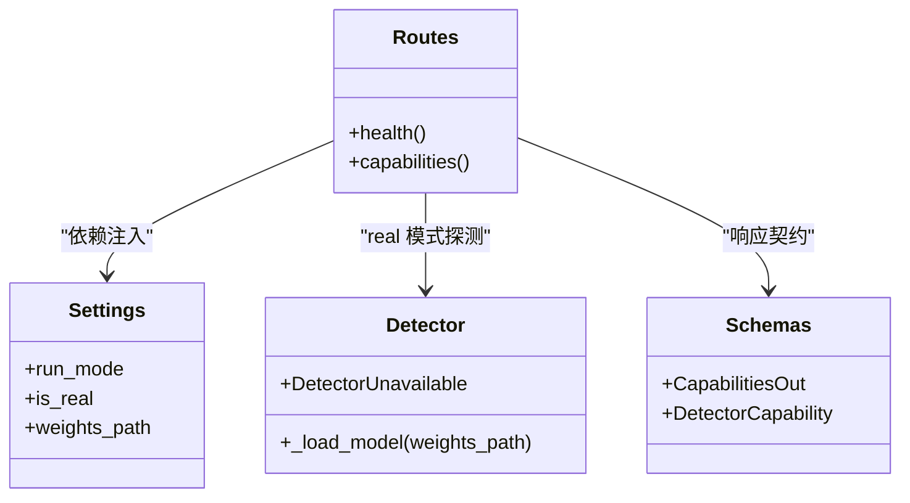

# 健康检查与能力查询接口

<cite>
**本文引用的文件**   
- [services/api/routes.py](file://services/api/routes.py)
- [services/api/app.py](file://services/api/app.py)
- [services/api/schemas.py](file://services/api/schemas.py)
- [services/api/service.py](file://services/api/service.py)
- [README.md](file://README.md)
</cite>

## 目录
1. [简介](#简介)
2. [项目结构定位](#项目结构定位)
3. [核心接口总览](#核心接口总览)
4. [架构概览](#架构概览)
5. [接口详细说明](#接口详细说明)
6. [请求与响应示例](#请求与响应示例)
7. [错误处理机制](#错误处理机制)
8. [客户端调用示例](#客户端调用示例)
9. [依赖关系分析](#依赖关系分析)
10. [性能与运行模式说明](#性能与运行模式说明)
11. [故障排查指南](#故障排查指南)
12. [结论](#结论)

## 简介
本文档面向需要对接 AstraDesk 后端 API 的客户端开发者，聚焦两个运维与探测类接口：
- GET /api/v1/health：服务健康检查，返回运行模式等基础状态。
- GET /api/v1/capabilities：系统能力查询，包括检测器可用性、模型名称与版本、支持的功能特性等。

这两个接口适合在启动流程、部署探针、前端初始化阶段使用，用于判断服务是否可用、当前运行模式以及是否具备真实检测能力。

## 项目结构定位
健康检查与能力查询接口由 FastAPI 路由层直接实现，业务逻辑保持轻量；配置通过 Settings 注入；能力查询在真实模式下会尝试加载检测模型以探测可用性。

**图示来源**
- [services/api/routes.py:44-65](file://services/api/routes.py#L44-L65)
- [services/api/schemas.py:74-84](file://services/api/schemas.py#L74-L84)

**章节来源**
- [services/api/routes.py:1-28](file://services/api/routes.py#L1-L28)
- [services/api/app.py:24-44](file://services/api/app.py#L24-L44)

## 核心接口总览
| 接口 | 方法 | 路径 | 用途 | 典型成功状态码 |
|---|---:|---|---|---:|
| 健康检查 | GET | /api/v1/health | 检查服务是否存活并返回运行模式 | 200 |
| 能力查询 | GET | /api/v1/capabilities | 查询检测器可用性、模型信息、功能特性 | 200 |

**章节来源**
- [services/api/routes.py:46-65](file://services/api/routes.py#L46-L65)
- [README.md:49-50](file://README.md#L49-L50)

## 架构概览
FastAPI 应用装配时注册统一前缀为 /api/v1 的路由，并在 app.state 上挂载 Settings 与数据库连接。健康检查直接读取运行模式；能力查询根据运行模式决定是否尝试加载检测模型，从而给出 detector.available 的真实值。

**图示来源**
- [services/api/routes.py:51-65](file://services/api/routes.py#L51-L65)
- [services/api/app.py:31-43](file://services/api/app.py#L31-L43)

## 接口详细说明

### GET /api/v1/health
- 作用：快速检查服务是否存活，并返回当前运行模式。
- 请求参数：无。
- 响应字段：
  - status：字符串，固定为 ok。
  - run_mode：字符串，表示运行模式，可能值为 real 或 mock。
- 成功状态码：200。
- 失败场景：通常不会因业务逻辑失败；若服务不可用，HTTP 层面可能返回 5xx 或连接错误。

**章节来源**
- [services/api/routes.py:46-48](file://services/api/routes.py#L46-L48)
- [services/api/config.py](file://services/api/config.py)

### GET /api/v1/capabilities
- 作用：查询系统能力，包括运行模式、检测器可用性、模型名称与版本、支持的功能特性列表。
- 请求参数：无。
- 响应字段：
  - run_mode：字符串，real 或 mock。
  - detector：对象，包含：
    - available：布尔值，表示检测器是否可用。
    - model_name：字符串，如 yolov10n 或 mock-detector。
    - model_version：字符串，权重文件名或 mock 版本号。
  - features：字符串数组，当前固定包含 detect。
- 成功状态码：200。
- 行为差异：
  - real 模式：尝试加载权重模型；若失败则 detector.available 为 false，model_version 携带 unavailable 提示。
  - mock 模式：detector.available 为 true，model_name 为 mock-detector，model_version 为 mock-0.1。

**章节来源**
- [services/api/routes.py:51-65](file://services/api/routes.py#L51-L65)
- [services/api/schemas.py:74-84](file://services/api/schemas.py#L74-L84)

## 请求与响应示例

### 健康检查
- 请求
  - 方法：GET
  - URL：http://127.0.0.1:8000/api/v1/health
- 成功响应体（JSON）
  - status：ok
  - run_mode：real 或 mock

### 能力查询
- 请求
  - 方法：GET
  - URL：http://127.0.0.1:8000/api/v1/capabilities
- 成功响应体（JSON）
  - run_mode：real 或 mock
  - detector：
    - available：true 或 false
    - model_name：yolov10n 或 mock-detector
    - model_version：权重文件名或 mock-0.1 或 unavailable 提示
  - features：["detect"]

**章节来源**
- [services/api/routes.py:46-65](file://services/api/routes.py#L46-L65)
- [services/api/schemas.py:74-84](file://services/api/schemas.py#L74-L84)

## 错误处理机制
- HTTP 层：
  - 健康检查与能力查询本身不抛出业务异常；若服务未启动或端口不可达，客户端将收到网络错误或 5xx。
- 业务层：
  - 能力查询在 real 模式下若检测器不可用，不会返回 5xx，而是返回 detector.available=false，并在 model_version 中携带 unavailable 提示。
- 统一错误对象：
  - 其他接口使用 ErrorBody 作为统一错误对象，包含 code、message、details、retryable、request_id。健康与能力接口不使用该结构返回业务错误。

**章节来源**
- [services/api/routes.py:51-65](file://services/api/routes.py#L51-L65)
- [services/api/schemas.py:9-17](file://services/api/schemas.py#L9-L17)

## 客户端调用示例

### curl 示例
- 健康检查
  - curl http://127.0.0.1:8000/api/v1/health
- 能力查询
  - curl http://127.0.0.1:8000/api/v1/capabilities

### Python requests 示例
- 健康检查
  - 使用 requests.get 调用 http://127.0.0.1:8000/api/v1/health，解析返回 JSON 中的 status 与 run_mode。
- 能力查询
  - 使用 requests.get 调用 http://127.0.0.1:8000/api/v1/capabilities，解析 detector.available、detector.model_name、detector.model_version 与 features。

注意：
- 若运行在 WSL 或容器环境，请确保端口映射与防火墙允许访问 8000 端口。
- 前端开发代理默认指向 http://localhost:5173，但后端 API 地址仍为 127.0.0.1:8000。

**章节来源**
- [README.md:49-50](file://README.md#L49-L50)

## 依赖关系分析
- 路由层：
  - health 与 capabilities 定义在 routes.py，使用 Depends 注入 Settings。
- 配置层：
  - Settings 提供 run_mode、is_real、weights_path 等关键属性，决定能力查询的行为。
- 检测器适配层：
  - capabilities 在 real 模式下调用 detector._load_model 以探测模型可用性；若抛出 DetectorUnavailable，则标记 detector.available=false。
- 契约层：
  - CapabilitiesOut 与 DetectorCapability 明确定义了能力查询的响应结构。

**图示来源**
- [services/api/routes.py:46-65](file://services/api/routes.py#L46-L65)
- [services/api/schemas.py:74-84](file://services/api/schemas.py#L74-L84)

**章节来源**
- [services/api/routes.py:1-28](file://services/api/routes.py#L1-L28)
- [services/api/schemas.py:74-84](file://services/api/schemas.py#L74-L84)

## 性能与运行模式说明
- 健康检查：
  - 无 I/O 与模型加载，开销极低，适合高频轮询。
- 能力查询：
  - real 模式首次调用可能触发模型加载，存在短暂延迟；后续调用仅读取已加载状态。
  - mock 模式无模型加载，响应更快且稳定。
- 运行模式：
  - real：真实模型推理，缺权重或依赖时报 MODEL_UNAVAILABLE，不静默回退 mock。
  - mock：确定性 Mock，用于契约测试与演示。

**章节来源**
- [README.md:71-77](file://README.md#L71-L77)
- [services/api/routes.py:51-65](file://services/api/routes.py#L51-L65)

## 故障排查指南
- 无法连接服务：
  - 确认后端已启动，端口 8000 可访问。
  - 检查防火墙与容器端口映射。
- 能力查询显示 detector.available=false：
  - 检查 ASTRADESK_RUN_MODE=real 是否正确设置。
  - 检查 ASTRADESK_YOLO_WEIGHTS 指向的权重文件是否存在且可读。
  - 查看 model_version 字段中的 unavailable 提示，定位具体缺失项。
- 前端跨域问题：
  - 后端已启用 CORS，允许 localhost:5173 与 127.0.0.1:5173。
  - 若前端不在上述地址，需调整 allow_origins。

**章节来源**
- [services/api/routes.py:51-65](file://services/api/routes.py#L51-L65)
- [services/api/app.py:36-42](file://services/api/app.py#L36-L42)
- [README.md:40-47](file://README.md#L40-L47)

## 结论
- /api/v1/health 与 /api/v1/capabilities 是轻量、稳定的运维与探测接口。
- 健康检查适合快速存活检测；能力查询适合部署前能力评估与运行时模式感知。
- 客户端应优先调用 health 判断服务可用性，再调用 capabilities 获取 detector.available 与 features，决定是否继续执行检测任务。