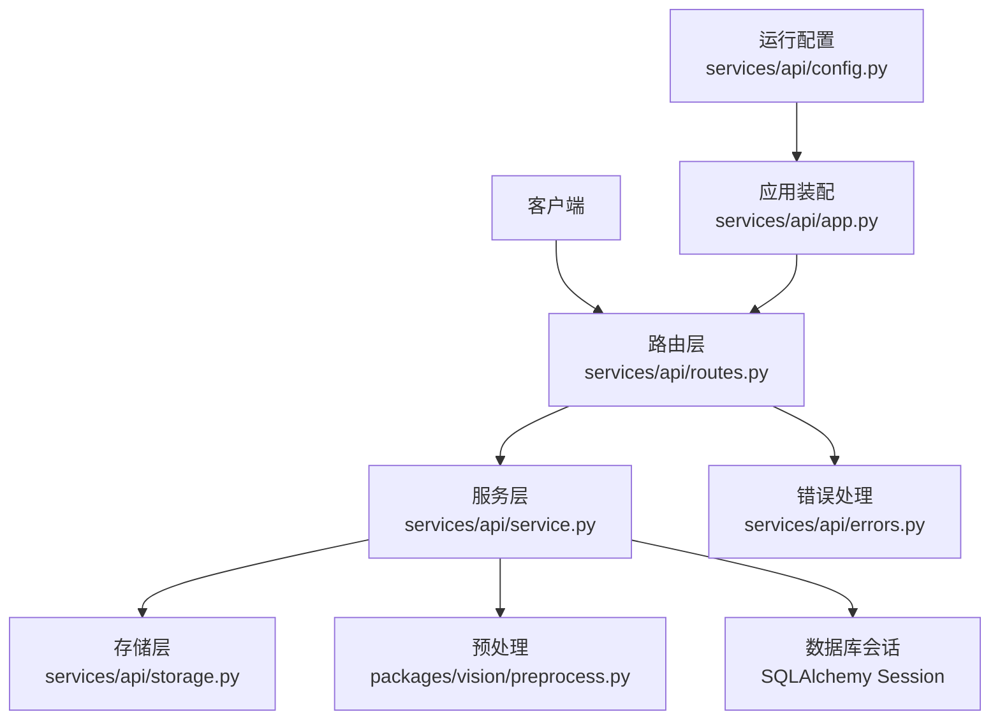
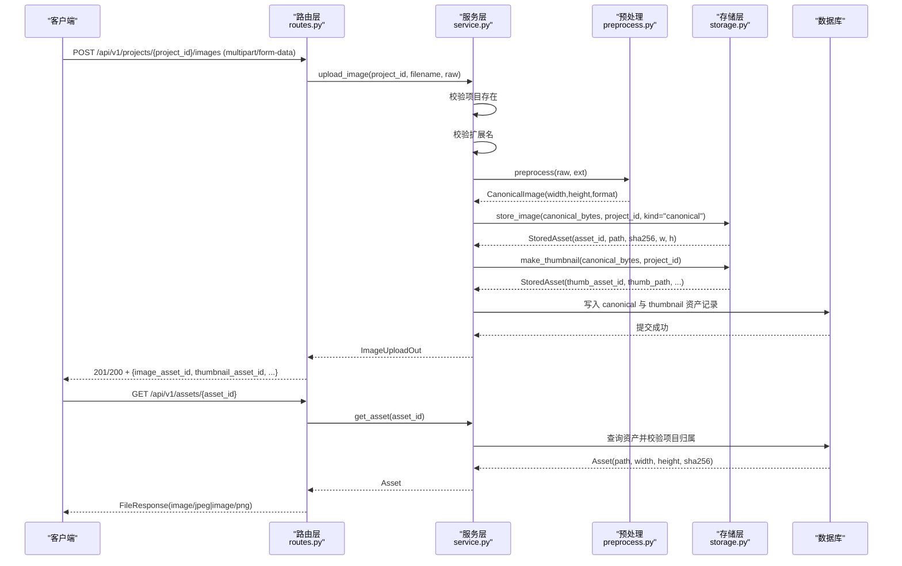
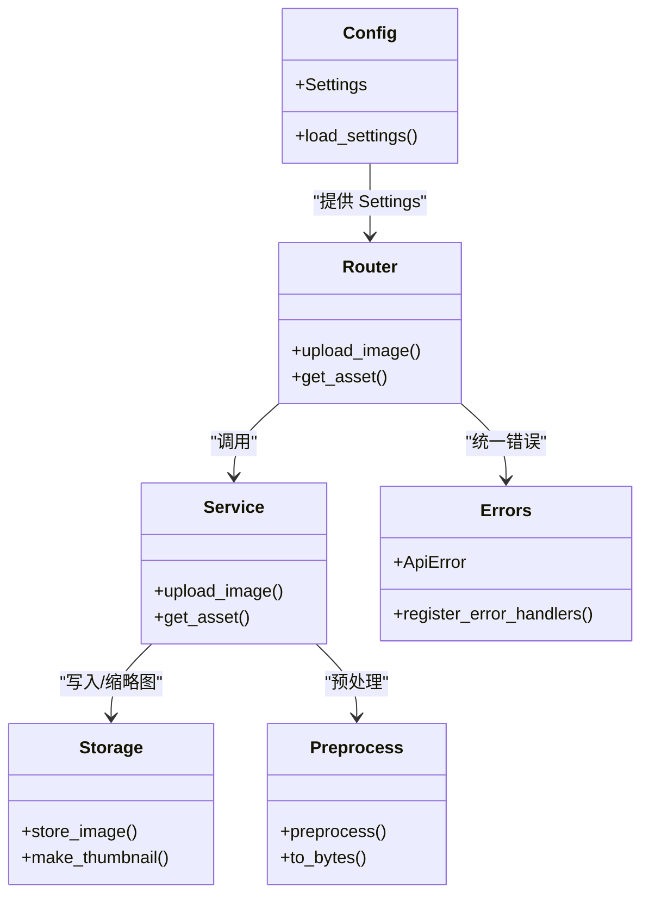

# 图像上传与资产管理接口

<cite>
**本文引用的文件**   
- [routes.py](file://services/api/routes.py)
- [service.py](file://services/api/service.py)
- [storage.py](file://services/api/storage.py)
- [schemas.py](file://services/api/schemas.py)
- [errors.py](file://services/api/errors.py)
- [config.py](file://services/api/config.py)
- [app.py](file://services/api/app.py)
- [preprocess.py](file://packages/vision/preprocess.py)
</cite>

## 目录
1. [简介](#简介)
2. [项目结构](#项目结构)
3. [核心组件](#核心组件)
4. [架构总览](#架构总览)
5. [详细接口说明](#详细接口说明)
6. [依赖关系分析](#依赖关系分析)
7. [性能与并发特性](#性能与并发特性)
8. [故障排查指南](#故障排查指南)
9. [结论](#结论)

## 简介
本文件面向图像上传与资产管理相关接口，重点覆盖：
- POST /api/v1/projects/{project_id}/images：上传图片并生成标准图与缩略图。
- GET /api/v1/assets/{asset_id}：按资产标识获取已存储的图像资源。

文档包含支持的格式、大小限制、图像处理流程、存储策略、错误处理、完整性校验以及异步与并发安全实现要点，帮助开发者快速集成与排障。

## 项目结构
与图像上传和资产管理相关的代码主要位于 services/api 与 packages/vision 下：
- routes.py：FastAPI 路由层，负责协议解析与调用服务层。
- service.py：业务逻辑，包括上传、资产查询、任务编排等。
- storage.py：本地文件存储与缩略图生成。
- schemas.py：请求/响应数据模型。
- errors.py：统一异常与错误处理器。
- config.py：运行配置（数据根路径、权重路径、设备与阈值等）。
- app.py：应用装配与中间件注册。
- preprocess.py：图像预处理（格式校验、尺寸与像素限制、EXIF 校正、去元数据）。

**图表来源**
- [routes.py:1-143](file://services/api/routes.py#L1-L143)
- [service.py:1-237](file://services/api/service.py#L1-L237)
- [storage.py:1-61](file://services/api/storage.py#L1-L61)
- [preprocess.py:1-83](file://packages/vision/preprocess.py#L1-L83)
- [errors.py:1-56](file://services/api/errors.py#L1-L56)
- [app.py:1-48](file://services/api/app.py#L1-L48)
- [config.py:1-61](file://services/api/config.py#L1-L61)

**章节来源**
- [routes.py:1-143](file://services/api/routes.py#L1-L143)
- [service.py:1-237](file://services/api/service.py#L1-L237)
- [storage.py:1-61](file://services/api/storage.py#L1-L61)
- [schemas.py:1-84](file://services/api/schemas.py#L1-L84)
- [errors.py:1-56](file://services/api/errors.py#L1-L56)
- [config.py:1-61](file://services/api/config.py#L1-L61)
- [app.py:1-48](file://services/api/app.py#L1-L48)
- [preprocess.py:1-83](file://packages/vision/preprocess.py#L1-L83)

## 核心组件
- 路由层
  - 提供 /api/v1 前缀的路由，将 HTTP 请求映射到服务层方法。
  - 图像上传使用 FastAPI 的 UploadFile 接收二进制流。
  - 资产读取返回 FileResponse，并根据扩展名设置媒体类型。
- 服务层
  - 校验项目归属、文件格式与大小、执行预处理、持久化资产记录。
  - 生成 canonical 标准图与 thumbnail 缩略图，分别落盘并入库。
- 存储层
  - 服务端生成绝对路径与 asset_id，写入 data_root/projects/<project_id>。
  - 计算 sha256，记录宽高；缩略图最长边固定为 512 像素。
- 预处理模块
  - 支持 JPEG/PNG，拒绝伪装格式与损坏文件。
  - 单张 ≤10MB，解码后 ≤2500 万像素；进行 EXIF 方向校正与去元数据。
- 错误处理
  - 统一 ApiError 与 ErrorBody，携带 code、message、retryable、request_id。
  - 针对文件大小、格式、资源不存在等场景返回明确状态码。

**章节来源**
- [routes.py:98-115](file://services/api/routes.py#L98-L115)
- [service.py:71-116](file://services/api/service.py#L71-L116)
- [storage.py:18-61](file://services/api/storage.py#L18-L61)
- [preprocess.py:14-83](file://packages/vision/preprocess.py#L14-L83)
- [errors.py:12-56](file://services/api/errors.py#L12-L56)

## 架构总览
图像上传与资产读取的整体流程如下：

**图表来源**
- [routes.py:100-115](file://services/api/routes.py#L100-L115)
- [service.py:73-116](file://services/api/service.py#L73-L116)
- [storage.py:32-61](file://services/api/storage.py#L32-L61)
- [preprocess.py:54-83](file://packages/vision/preprocess.py#L54-L83)

## 详细接口说明

### 上传图像
- 端点：POST /api/v1/projects/{project_id}/images
- 用途：将图片上传至指定项目，生成标准图与缩略图，并返回资产标识与尺寸信息。
- 请求
  - 路径参数：project_id（字符串）
  - 请求体：multipart/form-data，字段 file（二进制文件）
  - 文件名用于推断扩展名；若缺失则视为无效扩展名。
- 支持格式
  - JPEG、PNG（扩展名 jpg/jpeg/png）
  - 通过 magic bytes 校验，拒绝伪装格式与损坏文件。
- 大小与像素限制
  - 单张文件 ≤10MB
  - 解码后像素数 ≤2500 万（宽×高）
- 处理流程
  - 校验项目存在与扩展名合法。
  - 预处理：EXIF 方向校正、模式转换、去元数据，得到标准图。
  - 存储标准图 canonical 与缩略图 thumbnail，分别写入文件系统与数据库。
  - 缩略图最长边固定为 512 像素，以 JPEG quality=85 重编码。
- 响应
  - 成功：200/201，返回 image_asset_id、thumbnail_asset_id、canonical_width、canonical_height、sha256。
  - 失败：根据错误类型返回 400/404/413/415 等状态码，并附带统一错误对象。
- 示例
  - 使用 curl 上传 JPEG：
    - curl -X POST -F "file=@photo.jpg" http://localhost:8000/api/v1/projects/{project_id}/images
  - 使用 curl 上传 PNG：
    - curl -X POST -F "file=@photo.png" http://localhost:8000/api/v1/projects/{project_id}/images
- 错误处理
  - 空文件：INVALID_IMAGE，400
  - 不支持的扩展名：INVALID_IMAGE，415
  - 超过 10MB 或超过 2500 万像素：INVALID_IMAGE，413
  - 项目不存在：PROJECT_NOT_FOUND，404
  - 其他内部错误：INTERNAL，500
- 完整性校验
  - 服务端对原始字节计算 sha256，并随响应返回；可用于客户端二次校验。
  - 预处理阶段会校验 magic bytes，防止扩展名与内容不符。

**章节来源**
- [routes.py:100-105](file://services/api/routes.py#L100-L105)
- [service.py:37-41](file://services/api/service.py#L37-L41)
- [service.py:73-107](file://services/api/service.py#L73-L107)
- [storage.py:32-61](file://services/api/storage.py#L32-L61)
- [preprocess.py:14-83](file://packages/vision/preprocess.py#L14-L83)
- [errors.py:12-56](file://services/api/errors.py#L12-L56)

### 获取资产
- 端点：GET /api/v1/assets/{asset_id}
- 用途：根据资产标识下载已存储的图片资源。
- 路径参数：asset_id（字符串）
- 行为
  - 从数据库查询资产记录，并校验其所属项目未被删除。
  - 检查物理文件是否存在；不存在时返回 404。
  - 根据文件扩展名设置 Content-Type：.png → image/png，其余 → image/jpeg。
- 响应
  - 成功：200，直接返回图片二进制流。
  - 失败：404（资产不存在或项目已删除），或 500（未捕获异常）。
- 示例
  - curl -O http://localhost:8000/api/v1/assets/{asset_id}

**章节来源**
- [routes.py:108-115](file://services/api/routes.py#L108-L115)
- [service.py:110-115](file://services/api/service.py#L110-L115)

### 数据模型
- ImageUploadOut
  - project_id：项目标识
  - image_asset_id：标准图资产标识
  - thumbnail_asset_id：缩略图资产标识
  - canonical_width/canonical_height：标准图宽高
  - sha256：标准图内容的哈希值
- AssetOut
  - id/kind/url/width/height/sha256：资产基本信息与访问 URL
- ErrorBody
  - code/message/details/retryable/request_id：统一错误对象

**章节来源**
- [schemas.py:41-64](file://services/api/schemas.py#L41-L64)
- [schemas.py:9-17](file://services/api/schemas.py#L9-L17)

## 依赖关系分析
- 路由层依赖服务层完成业务规则；服务层依赖存储层与预处理模块；错误处理贯穿全链路。
- 配置项 data_root 决定文件落盘位置；默认在项目根目录下的 data 文件夹。
- 数据库会话在路由中注入，服务层用于读写项目、资产与任务记录。

**图表来源**
- [routes.py:1-143](file://services/api/routes.py#L1-L143)
- [service.py:1-237](file://services/api/service.py#L1-L237)
- [storage.py:1-61](file://services/api/storage.py#L1-L61)
- [preprocess.py:1-83](file://packages/vision/preprocess.py#L1-L83)
- [errors.py:1-56](file://services/api/errors.py#L1-L56)
- [config.py:1-61](file://services/api/config.py#L1-L61)

**章节来源**
- [routes.py:1-143](file://services/api/routes.py#L1-L143)
- [service.py:1-237](file://services/api/service.py#L1-L237)
- [storage.py:1-61](file://services/api/storage.py#L1-L61)
- [preprocess.py:1-83](file://packages/vision/preprocess.py#L1-L83)
- [errors.py:1-56](file://services/api/errors.py#L1-L56)
- [config.py:1-61](file://services/api/config.py#L1-L61)

## 性能与并发特性
- 预处理与存储
  - 预处理阶段先做轻量校验（大小、magic bytes），再解码与 EXIF 校正，避免无谓 I/O。
  - 标准图与缩略图分别存储，缩略图体积更小，适合列表预览。
- 并发安全
  - 路由层使用 FastAPI 的异步函数处理上传，I/O 操作（如数据库会话）通过依赖注入管理生命周期。
  - 文件写入采用原子写（write_bytes），缩略图生成在内存缓冲中进行，减少临时文件开销。
  - 数据库事务在服务层 commit，确保资产记录与文件落盘的一致性。
- 性能建议
  - 控制并发上传数量，避免同时大量解码大图像导致内存峰值。
  - 合理设置 worker 进程数与线程池，平衡 CPU（图像处理）与 I/O（磁盘/数据库）。
  - 对于高频缩略图访问，可在前端缓存或通过 CDN 加速静态资源。

[本节为通用指导，不直接分析具体文件]

## 故障排查指南
- 常见错误与定位
  - INVALID_IMAGE（400/413/415）
    - 空文件或扩展名非法：检查请求 multipart 字段是否为 file，且扩展名为 jpg/jpeg/png。
    - 超过 10MB 或超过 2500 万像素：压缩图像或降低分辨率后再上传。
    - 伪装格式或损坏文件：确认文件内容与扩展名一致，尝试用图像查看器打开验证。
  - PROJECT_NOT_FOUND（404）
    - 项目不存在或已被删除：先创建项目，或检查 project_id 是否正确。
  - ASSET_NOT_FOUND（404）
    - 资产不存在或所属项目被删除：确认 asset_id 有效，并检查项目状态。
  - INTERNAL（500）
    - 未捕获异常：查看服务器日志，关注图像处理库或磁盘 I/O 报错。
- 调试建议
  - 启用请求 ID：ErrorBody 中的 request_id 便于追踪日志。
  - 校验 sha256：对比响应中的 sha256 与本地文件哈希，确保一致性。
  - 检查 data_root 权限：确保服务进程对 data 目录有读写权限。

**章节来源**
- [errors.py:12-56](file://services/api/errors.py#L12-L56)
- [service.py:73-116](file://services/api/service.py#L73-L116)
- [preprocess.py:24-83](file://packages/vision/preprocess.py#L24-L83)

## 结论
本接口实现了安全的图像上传与资产管理能力：
- 严格校验格式与大小，拒绝伪装与损坏文件。
- 标准化图像并生成缩略图，兼顾质量与性能。
- 服务端生成路径与资产标识，避免客户端越权访问。
- 统一的错误模型与请求 ID，便于问题定位与重试策略。
- 基于 FastAPI 的异步路由与 SQLAlchemy 会话管理，具备良好的并发处理能力。

[本节为总结性内容，不直接分析具体文件]