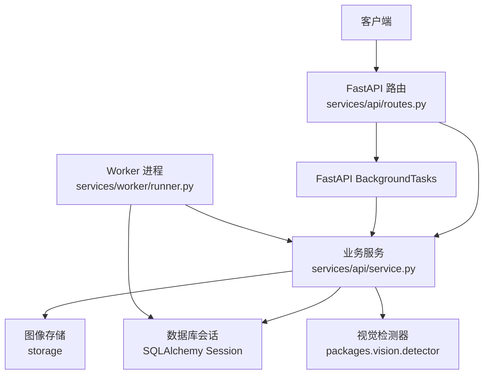
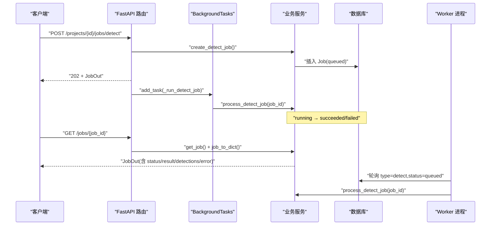
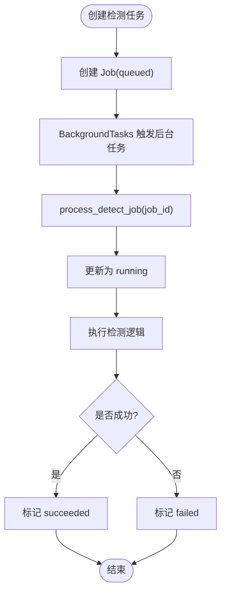
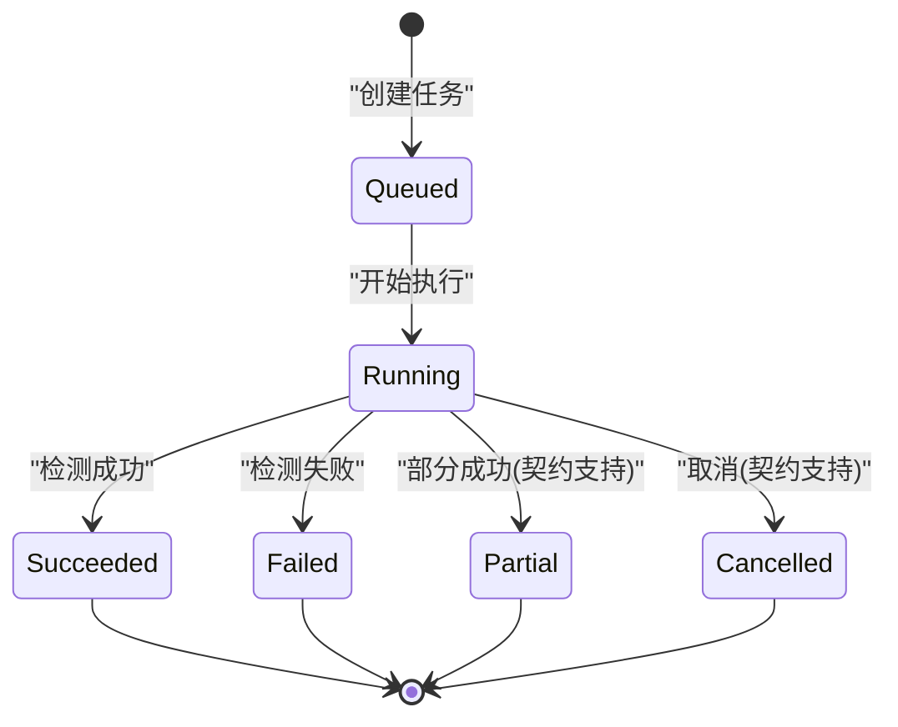
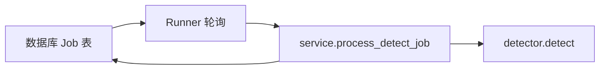
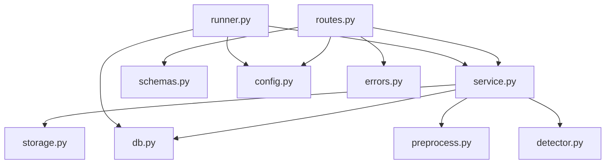

# 检测任务调度接口

<cite>
**本文引用的文件**   
- [routes.py](file://services/api/routes.py)
- [service.py](file://services/api/service.py)
- [schemas.py](file://services/api/schemas.py)
- [runner.py](file://services/worker/runner.py)
- [detection_result.schema.json](file://contracts/detection_result.schema.json)
- [STATUS.md](file://docs/STATUS.md)
</cite>

## 目录
1. [引言](#引言)
2. [项目结构](#项目结构)
3. [核心组件](#核心组件)
4. [架构总览](#架构总览)
5. [详细接口说明](#详细接口说明)
6. [异步任务处理机制](#异步任务处理机制)
7. [任务状态流转](#任务状态流转)
8. [错误与恢复机制](#错误与恢复机制)
9. [批量任务处理方案](#批量任务处理方案)
10. [Worker 进程与队列设计](#worker-进程与队列设计)
11. [依赖关系分析](#依赖关系分析)
12. [性能与扩展建议](#性能与扩展建议)
13. [故障排查指南](#故障排查指南)
14. [结论](#结论)

## 引言
本文件为“检测任务调度接口”的完整技术文档，聚焦以下两个接口：
- POST /api/v1/projects/{project_id}/jobs/detect：创建异步检测任务。
- GET /api/v1/jobs/{job_id}：查询任务状态、检测结果与错误信息。

该能力覆盖 T02 桌面识别端到端流程中的“创建检测任务 → 后台执行 → 结果查询”，并明确异步任务处理机制、任务状态流转、后台执行流程、错误恢复机制、与 worker 进程的通信方式以及任务队列设计。

## 项目结构
检测任务调度相关代码主要分布在以下模块：
- API 路由层：定义 HTTP 接口、参数校验、响应模型。
- 服务层：封装业务规则、数据库持久化、检测执行编排。
- Worker 执行器：提供独立进程轮询并执行 queued 任务。
- 契约模型：Pydantic 模型与 JSON Schema 约束任务输出结构。

**图表来源**
- [routes.py:130-142](file://services/api/routes.py#L130-L142)
- [service.py:120-179](file://services/api/service.py#L120-L179)
- [runner.py:16-43](file://services/worker/runner.py#L16-L43)

**章节来源**
- [routes.py:1-143](file://services/api/routes.py#L1-L143)
- [service.py:1-237](file://services/api/service.py#L1-L237)
- [runner.py:1-43](file://services/worker/runner.py#L1-L43)

## 核心组件
- FastAPI 路由：负责协议处理、请求解析、响应序列化，并在创建检测任务时返回 202 并触发后台执行。
- 业务服务：负责项目与资产校验、任务创建、检测执行、结果持久化、错误封装与查询装配。
- Worker 执行器：提供独立进程入口，轮询数据库中的 queued 任务并调用服务层执行。
- Pydantic 模型：定义 JobOut、DetectJobIn、ErrorBody 等统一数据结构。
- JSON Schema：定义检测任务查询结果的契约，包括状态枚举、坐标规范与字段约束。

**章节来源**
- [schemas.py:9-38](file://services/api/schemas.py#L9-L38)
- [schemas.py:66-68](file://services/api/schemas.py#L66-L68)
- [detection_result.schema.json:1-65](file://contracts/detection_result.schema.json#L1-L65)

## 架构总览
检测任务调度的整体流程如下：
- 客户端调用 POST 创建检测任务，服务端立即返回 202 与 job 对象。
- 服务端通过 BackgroundTasks 在请求进程内启动后台任务，或外部 worker 进程轮询数据库执行。
- 服务层将任务状态从 queued 更新为 running，执行检测逻辑，最终写入 succeeded 或 failed。
- 客户端通过 GET 轮询任务状态，直到终态（succeeded/failed/cancelled）后读取 result 与 detections。

**图表来源**
- [routes.py:120-142](file://services/api/routes.py#L120-L142)
- [service.py:120-179](file://services/api/service.py#L120-L179)
- [runner.py:16-43](file://services/worker/runner.py#L16-L43)

## 详细接口说明

### 创建异步检测任务
- 方法：POST
- 路径：/api/v1/projects/{project_id}/jobs/detect
- 请求体：DetectJobIn，包含 image_asset_id。
- 成功响应：202 Created，返回 JobOut。
- 行为：
  - 校验 project_id 与 image_asset_id 归属。
  - 创建 Job 记录，初始状态 queued。
  - 通过 BackgroundTasks 触发后台执行 process_detect_job。
  - 立即返回 job 对象，不等待检测完成。

**章节来源**
- [routes.py:130-136](file://services/api/routes.py#L130-L136)
- [service.py:120-129](file://services/api/service.py#L120-L129)
- [schemas.py:66-68](file://services/api/schemas.py#L66-L68)

### 查询任务状态与结果
- 方法：GET
- 路径：/api/v1/jobs/{job_id}
- 成功响应：200 OK，返回 JobOut。
- 行为：
  - 根据 job_id 查询 Job 记录。
  - 组装 detections、result、error 等字段。
  - 返回当前状态与已持久化的检测结果。

**章节来源**
- [routes.py:139-142](file://services/api/routes.py#L139-L142)
- [service.py:202-228](file://services/api/service.py#L202-L228)
- [schemas.py:19-38](file://services/api/schemas.py#L19-L38)

### 请求与响应模型
- DetectJobIn：image_asset_id（字符串）。
- JobOut：包含 id、project_id、type、status、stage、attempt、result、detections、error、created_at、updated_at。
- ErrorBody：code、message、details、retryable、request_id。

**章节来源**
- [schemas.py:9-38](file://services/api/schemas.py#L9-L38)
- [schemas.py:66-68](file://services/api/schemas.py#L66-L68)

### 契约约束
- detection_result.schema.json 定义 JobOut 的结构与约束：
  - status 枚举：queued、running、succeeded、partial、failed、cancelled。
  - result 为可选对象，包含 model_name、model_version、run_mode、device、elapsed_seconds、image_width、image_height、count。
  - detections 数组，每个元素包含 id、class_id、class_name、confidence、bbox_image。
  - bbox_image 为归一化坐标 [x1,y1,x2,y2]，范围 0-1，左上原点。

**章节来源**
- [detection_result.schema.json:1-65](file://contracts/detection_result.schema.json#L1-L65)

## 异步任务处理机制
- 请求进程内后台执行：
  - 路由在创建任务后调用 BackgroundTasks.add_task，传入 _run_detect_job。
  - _run_detect_job 使用应用级数据库会话调用 service.process_detect_job。
- Worker 进程轮询执行：
  - runner.run_loop 周期性查询 type=detect 且 status=queued 的任务。
  - 对每个任务调用 service.process_detect_job 执行检测。
- 两种模式可并存：
  - 默认 FastAPI BackgroundTasks 用于轻量场景。
  - Worker 进程用于解耦与可扩展的后台执行。

**图表来源**
- [routes.py:120-136](file://services/api/routes.py#L120-L136)
- [service.py:132-179](file://services/api/service.py#L132-L179)

**章节来源**
- [routes.py:120-136](file://services/api/routes.py#L120-L136)
- [runner.py:16-43](file://services/worker/runner.py#L16-L43)
- [service.py:132-179](file://services/api/service.py#L132-L179)

## 任务状态流转
任务状态遵循以下流转：
- queued：任务已创建，等待执行。
- running：任务正在执行。
- succeeded：检测成功，result 与 detections 已持久化。
- failed：检测失败，error 包含 code、message、retryable。
- cancelled：任务被取消（契约支持，当前实现未显式设置）。
- partial：部分成功（契约支持，当前实现未显式设置）。

**图表来源**
- [service.py:132-179](file://services/api/service.py#L132-L179)
- [detection_result.schema.json:9-15](file://contracts/detection_result.schema.json#L9-L15)

**章节来源**
- [service.py:132-179](file://services/api/service.py#L132-L179)
- [detection_result.schema.json:9-15](file://contracts/detection_result.schema.json#L9-L15)

## 错误与恢复机制
- 错误分类：
  - MODEL_UNAVAILABLE：真实模式下检测器不可用，标记 failed，不静默回退 mock。
  - ApiError：业务错误，携带 code、message、retryable。
  - INTERNAL：未知异常，标记 failed，retryable=True。
- 错误持久化：
  - error_json 保存结构化错误对象。
  - query 接口返回 error 字段供客户端判断是否重试。
- 重试策略：
  - retryable=True 表示可重试；客户端应结合指数退避与最大重试次数。
  - 终态任务不会被重复处理覆盖（约定4）。

**章节来源**
- [service.py:148-186](file://services/api/service.py#L148-L186)
- [schemas.py:9-17](file://services/api/schemas.py#L9-L17)

## 批量任务处理方案
- 批量创建：
  - 客户端循环调用 POST /projects/{project_id}/jobs/detect，每次提交一个 image_asset_id。
  - 服务端为每个请求创建独立的 Job 记录，状态均为 queued。
- 批量轮询：
  - 客户端并行或串行 GET /jobs/{job_id}，直到所有任务进入终态。
  - 建议使用去重与超时控制，避免重复请求与长时间阻塞。
- Worker 批量处理：
  - runner.process_pending_once 一次性取出所有 queued 任务并顺序执行。
  - 可通过调整 poll_seconds 控制轮询频率与吞吐。

**章节来源**
- [routes.py:130-136](file://services/api/routes.py#L130-L136)
- [runner.py:16-27](file://services/worker/runner.py#L16-L27)

## Worker 进程与队列设计
- Worker 入口：
  - python -m services.worker 启动 runner.run_loop。
  - 周期性查询数据库中的 queued 任务并执行。
- 队列设计：
  - 基于数据库 Job 表的 status 字段作为队列状态。
  - 简单轮询实现，尚未实现租约/心跳/过期置 failed（T06–T07 范畴）。
- 与 API 的通信：
  - API 通过 BackgroundTasks 在请求进程内执行检测。
  - Worker 通过直接访问数据库与服务层函数执行检测。
  - 两者共享同一数据库与 service.process_detect_job 逻辑，保证一致性。

**图表来源**
- [runner.py:16-43](file://services/worker/runner.py#L16-L43)
- [service.py:132-179](file://services/api/service.py#L132-L179)

**章节来源**
- [runner.py:1-43](file://services/worker/runner.py#L1-L43)
- [service.py:132-179](file://services/api/service.py#L132-L179)

## 依赖关系分析
- 路由依赖：
  - FastAPI APIRouter、BackgroundTasks、Depends。
  - 服务层 service、配置 config、错误 errors、模型 schemas。
- 服务层依赖：
  - 数据库模型 db（Project、Asset、Job、Detection）。
  - 存储 storage、预处理 preprocess、视觉 detector。
- Worker 依赖：
  - 服务层 service、配置 load_settings、数据库引擎 make_engine/make_session。

**图表来源**
- [routes.py:1-28](file://services/api/routes.py#L1-L28)
- [service.py:1-25](file://services/api/service.py#L1-L25)
- [runner.py:1-14](file://services/worker/runner.py#L1-L14)

**章节来源**
- [routes.py:1-28](file://services/api/routes.py#L1-L28)
- [service.py:1-25](file://services/api/service.py#L1-L25)
- [runner.py:1-14](file://services/worker/runner.py#L1-L14)

## 性能与扩展建议
- 并发控制：
  - BackgroundTasks 适合轻量后台任务；高并发场景建议使用消息队列（如 Redis/RabbitMQ）。
  - Worker 进程可通过多进程或多线程扩展吞吐。
- 资源管理：
  - 检测器加载与 GPU 显存占用需关注；real 模式首次加载耗时较长。
  - 建议缓存模型实例，避免重复加载。
- 重试与幂等：
  - 客户端应实现指数退避与最大重试次数。
  - 服务端应避免重复处理终态任务（已实现）。
- 监控与可观测性：
  - 增加任务执行耗时、错误率、队列长度等指标。
  - 记录关键步骤日志，便于问题定位。

[本节为通用指导，不直接分析具体文件]

## 故障排查指南
- 常见问题：
  - JOB_NOT_FOUND：job_id 不存在或已被删除。
  - ASSET_NOT_FOUND：image_asset_id 不属于项目或文件缺失。
  - MODEL_UNAVAILABLE：真实模式下检测器权重或设备不可用。
  - INTERNAL：未知异常，检查日志与堆栈。
- 排查步骤：
  - 确认 project_id 与 image_asset_id 有效。
  - 检查数据库 Job 记录状态与 error_json。
  - 验证 detector.detect 是否可用（real 模式）。
  - 查看 Worker 日志与轮询频率。

**章节来源**
- [service.py:138-186](file://services/api/service.py#L138-L186)
- [routes.py:139-142](file://services/api/routes.py#L139-L142)

## 结论
检测任务调度接口通过 FastAPI 路由与服务层协作，实现了异步检测任务的创建、执行与查询。任务状态流转清晰，错误处理完善，支持客户端重试与恢复。Worker 进程提供了独立的后台执行入口，便于扩展与解耦。未来可引入消息队列、租约机制与更丰富的监控能力，以进一步提升系统稳定性与吞吐。

[本节为总结性内容，不直接分析具体文件]