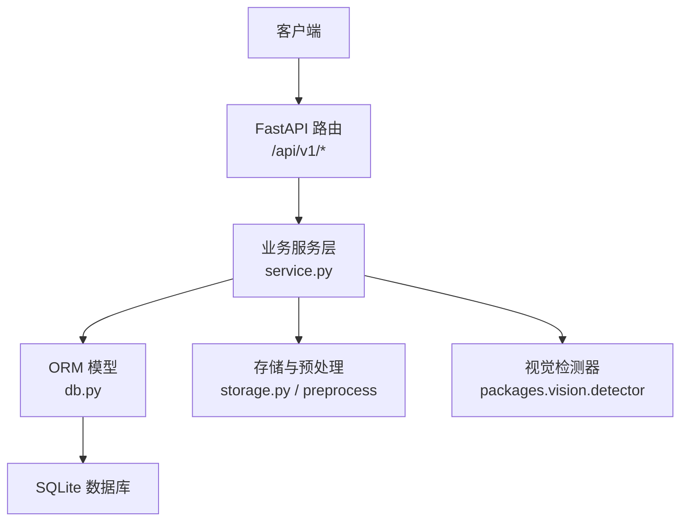
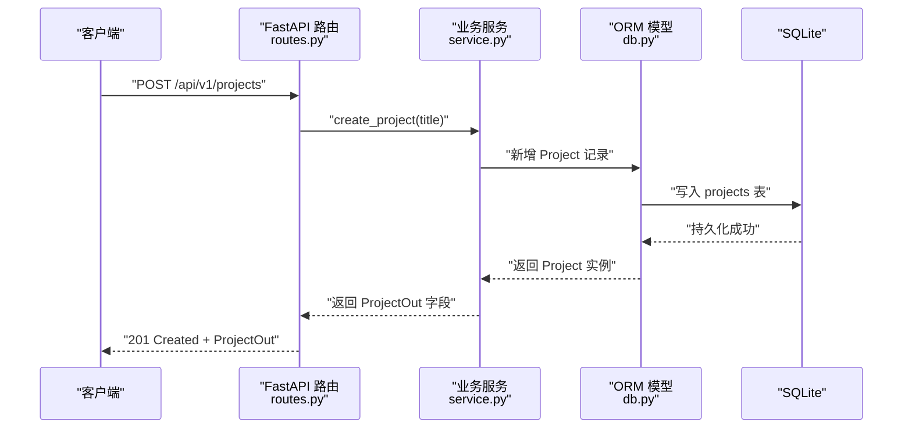
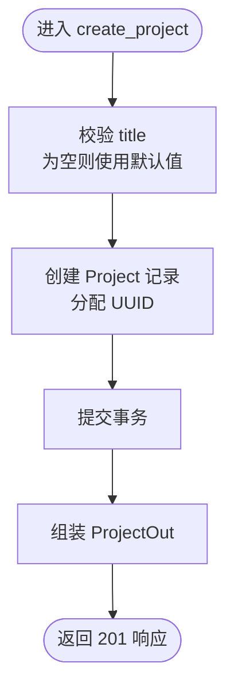
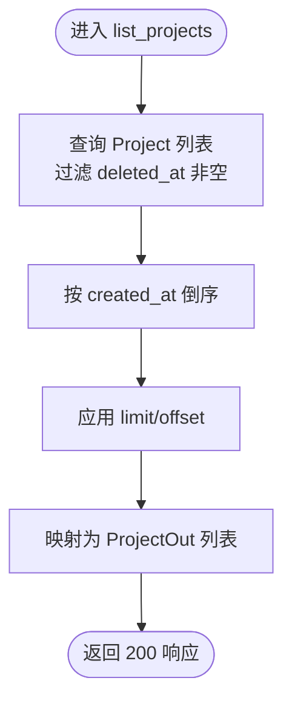
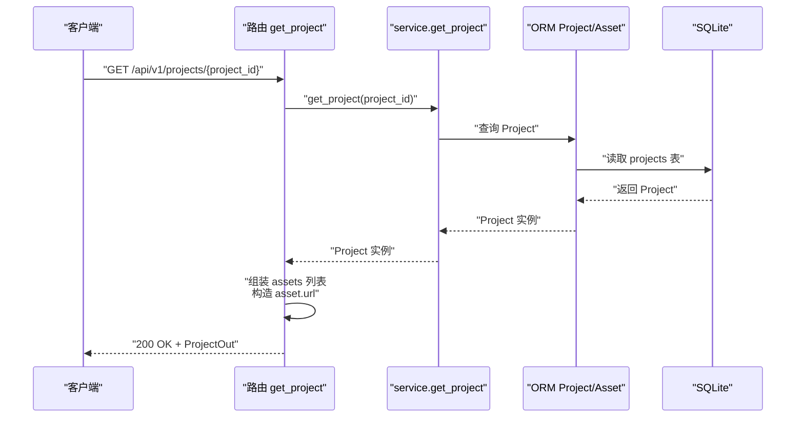
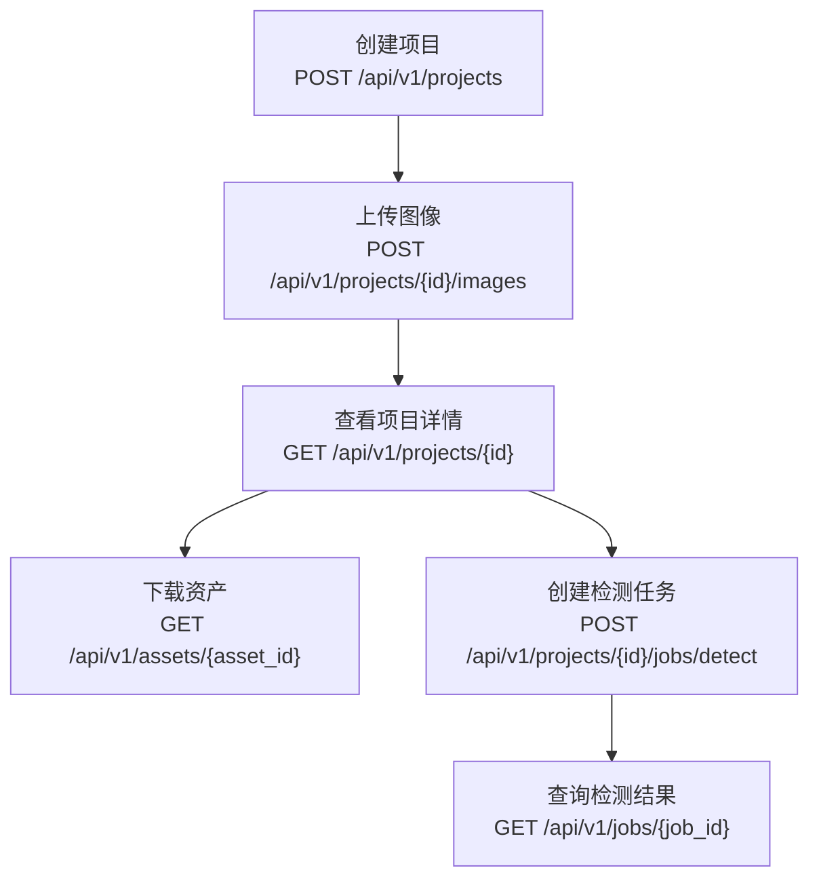
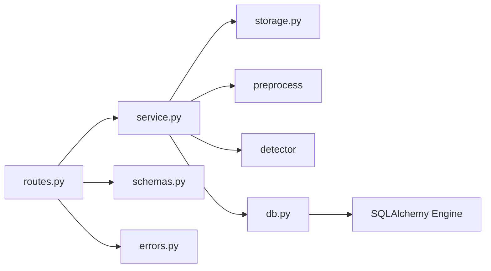

# 项目管理接口

<cite>
**本文引用的文件**   
- [routes.py](file://services/api/routes.py)
- [schemas.py](file://services/api/schemas.py)
- [service.py](file://services/api/service.py)
- [db.py](file://services/api/db.py)
- [errors.py](file://services/api/errors.py)
</cite>

## 目录
1. [简介](#简介)
2. [项目结构](#项目结构)
3. [核心组件](#核心组件)
4. [架构总览](#架构总览)
5. [详细接口说明](#详细接口说明)
6. [依赖关系分析](#依赖关系分析)
7. [性能与扩展性](#性能与扩展性)
8. [故障排查指南](#故障排查指南)
9. [结论](#结论)

## 简介
本文件为项目管理相关接口的完整 API 文档，覆盖以下端点：
- POST /api/v1/projects：创建新项目
- GET /api/v1/projects：获取项目列表
- GET /api/v1/projects/{project_id}：获取特定项目详情

同时给出请求体、响应格式、参数校验规则、业务处理流程、数据流、错误处理与事务管理等技术细节。该服务采用 FastAPI + SQLAlchemy（SQLite）实现，路由层仅负责协议处理，业务逻辑集中在 service 层，模型定义在 db 层，统一错误对象通过 schemas 与 errors 模块提供。

## 项目结构
本项目中与项目管理接口相关的代码主要位于 services/api 目录下：
- routes.py：FastAPI 路由定义，暴露 /api/v1 前缀的 HTTP 接口
- schemas.py：Pydantic 契约模型，包括 ProjectCreateIn、ProjectOut 等
- service.py：业务服务层，包含项目、资产、检测任务等核心逻辑
- db.py：SQLAlchemy ORM 模型，定义 Project、Asset、Job、Detection 等表结构
- errors.py：统一异常 ApiError 与 FastAPI 异常处理器

图表来源
- [routes.py:28-143](file://services/api/routes.py#L28-L143)
- [service.py:44-237](file://services/api/service.py#L44-L237)
- [db.py:26-92](file://services/api/db.py#L26-L92)

章节来源
- [routes.py:1-143](file://services/api/routes.py#L1-L143)
- [schemas.py:1-84](file://services/api/schemas.py#L1-L84)
- [service.py:1-237](file://services/api/service.py#L1-L237)
- [db.py:1-92](file://services/api/db.py#L1-L92)
- [errors.py:1-56](file://services/api/errors.py#L1-L56)

## 核心组件
- 路由层（routes.py）
  - 定义 /api/v1 前缀的路由，将请求参数交给 service 层处理
  - 使用 Depends 注入 Session 与 Settings
  - 返回 Pydantic response_model 或 dict（内部再转为 JSON）
- 服务层（service.py）
  - 项目 CRUD：create_project、get_project、list_projects
  - 图像上传：upload_image（含预处理、存储、缩略图生成）
  - 检测任务：create_detect_job、process_detect_job、job_to_dict
  - 坐标转换：derive_bbox_desk
- 数据模型（db.py）
  - Project、Asset、Job、Detection 四个核心实体
  - 提供 make_engine、make_session 工具函数
- 契约模型（schemas.py）
  - ProjectCreateIn、ProjectOut、AssetOut、ImageUploadOut、DetectJobIn、JobOut、ErrorBody 等
- 错误处理（errors.py）
  - ApiError 统一异常，注册 FastAPI 全局异常处理器，输出 ErrorBody

章节来源
- [routes.py:28-143](file://services/api/routes.py#L28-L143)
- [service.py:44-237](file://services/api/service.py#L44-L237)
- [db.py:26-92](file://services/api/db.py#L26-L92)
- [schemas.py:41-84](file://services/api/schemas.py#L41-L84)
- [errors.py:12-56](file://services/api/errors.py#L12-L56)

## 架构总览
下图展示从客户端到数据库的调用链，以及关键组件之间的职责划分。

图表来源
- [routes.py:70-75](file://services/api/routes.py#L70-L75)
- [service.py:46-50](file://services/api/service.py#L46-L50)
- [db.py:26-35](file://services/api/db.py#L26-L35)

## 详细接口说明

### 创建项目
- 方法：POST
- 路径：/api/v1/projects
- 状态码：201
- 请求体：ProjectCreateIn
  - title：可选字符串，默认值为“未命名项目”
- 响应体：ProjectOut
  - id：项目标识
  - title：项目标题
  - created_at：创建时间（ISO 8601）
  - assets：空数组（初始无资产）
- 参数验证
  - title 为空时自动使用默认值
- 业务逻辑
  - 路由层接收请求并调用 service.create_project
  - service 层生成唯一 ID，写入 Project 记录并提交事务
  - 路由层组装 ProjectOut 返回
- 错误处理
  - 若出现未捕获异常，统一返回 INTERNAL 错误
  - 业务异常通过 ApiError 抛出，携带 code、message、retryable、details

图表来源
- [routes.py:70-75](file://services/api/routes.py#L70-L75)
- [service.py:46-50](file://services/api/service.py#L46-L50)
- [schemas.py:70-72](file://services/api/schemas.py#L70-L72)
- [schemas.py:50-55](file://services/api/schemas.py#L50-L55)

章节来源
- [routes.py:70-75](file://services/api/routes.py#L70-L75)
- [service.py:46-50](file://services/api/service.py#L46-L50)
- [schemas.py:70-72](file://services/api/schemas.py#L70-L72)
- [schemas.py:50-55](file://services/api/schemas.py#L50-L55)
- [errors.py:12-56](file://services/api/errors.py#L12-L56)

### 获取项目列表
- 方法：GET
- 路径：/api/v1/projects
- 状态码：200
- 响应体：ProjectOut[]
  - 每个元素包含 id、title、created_at、assets（空数组）
- 查询行为
  - 过滤已删除的项目（deleted_at 非空）
  - 按 created_at 倒序排序
  - 支持分页参数 limit、offset（默认 limit=50, offset=0）
- 错误处理
  - 正常返回空列表或项目集合
  - 其他异常走统一错误处理器

图表来源
- [routes.py:77-83](file://services/api/routes.py#L77-L83)
- [service.py:60-68](file://services/api/service.py#L60-L68)
- [schemas.py:50-55](file://services/api/schemas.py#L50-L55)

章节来源
- [routes.py:77-83](file://services/api/routes.py#L77-L83)
- [service.py:60-68](file://services/api/service.py#L60-L68)
- [schemas.py:50-55](file://services/api/schemas.py#L50-L55)

### 获取项目详情
- 方法：GET
- 路径：/api/v1/projects/{project_id}
- 状态码：200
- 路径参数
  - project_id：项目标识符
- 响应体：ProjectOut
  - id、title、created_at
  - assets：数组，每项包含 id、kind、url、width、height、sha256
- 业务逻辑
  - 根据 project_id 查询 Project，若不存在或已删除则抛错
  - 遍历关联 Asset，构建 url 为 /api/v1/assets/{asset_id}
- 错误处理
  - 项目不存在或已删除：PROJECT_NOT_FOUND（404）
  - 其他异常：统一错误处理器

图表来源
- [routes.py:86-95](file://services/api/routes.py#L86-L95)
- [service.py:53-57](file://services/api/service.py#L53-L57)
- [db.py:26-35](file://services/api/db.py#L26-L35)
- [db.py:37-48](file://services/api/db.py#L37-L48)

章节来源
- [routes.py:86-95](file://services/api/routes.py#L86-L95)
- [service.py:53-57](file://services/api/service.py#L53-L57)
- [db.py:26-35](file://services/api/db.py#L26-L35)
- [db.py:37-48](file://services/api/db.py#L37-L48)
- [schemas.py:50-55](file://services/api/schemas.py#L50-L55)

### 项目生命周期与资产管理
项目从创建到资产管理的完整生命周期如下：
- 创建项目：POST /api/v1/projects → 写入 Project 表
- 上传图像：POST /api/v1/projects/{project_id}/images → 预处理、存储 canonical 与 thumbnail，写入 Asset 表
- 查看项目详情：GET /api/v1/projects/{project_id} → 返回 ProjectOut 及其 assets
- 下载资产：GET /api/v1/assets/{asset_id} → 返回图片文件
- 创建检测任务：POST /api/v1/projects/{project_id}/jobs/detect → 写入 Job 表，后台执行检测
- 查询检测结果：GET /api/v1/jobs/{job_id} → 返回 JobOut 及 detections

图表来源
- [routes.py:70-143](file://services/api/routes.py#L70-L143)
- [service.py:73-116](file://services/api/service.py#L73-L116)
- [service.py:120-179](file://services/api/service.py#L120-L179)
- [db.py:26-92](file://services/api/db.py#L26-L92)

章节来源
- [routes.py:70-143](file://services/api/routes.py#L70-L143)
- [service.py:73-179](file://services/api/service.py#L73-L179)
- [db.py:26-92](file://services/api/db.py#L26-L92)

## 依赖关系分析
- 路由层依赖
  - FastAPI：APIRouter、Depends、BackgroundTasks、File、UploadFile
  - service：项目、资产、检测任务等业务方法
  - config：Settings 配置注入
  - errors：ApiError 统一异常
  - schemas：ProjectCreateIn、ProjectOut 等契约模型
- 服务层依赖
  - storage：图像存储与缩略图生成
  - preprocess：图像预处理（尺寸、大小、像素限制）
  - detector：视觉检测器（真实/Mock 模式）
  - db：Project、Asset、Job、Detection ORM 模型
- 数据模型依赖
  - SQLAlchemy：Engine、Session、Column、relationship
  - SQLite：本地数据库引擎

图表来源
- [routes.py:1-27](file://services/api/routes.py#L1-L27)
- [service.py:1-25](file://services/api/service.py#L1-L25)
- [db.py:1-25](file://services/api/db.py#L1-L25)

章节来源
- [routes.py:1-27](file://services/api/routes.py#L1-L27)
- [service.py:1-25](file://services/api/service.py#L1-L25)
- [db.py:1-25](file://services/api/db.py#L1-L25)

## 性能与扩展性
- 项目列表查询
  - 默认 limit=50，避免一次性加载过多数据
  - 建议前端按需分页，结合 offset 控制偏移量
- 图像上传
  - 预处理阶段对文件大小与像素数进行限制，防止超大图片导致内存压力
  - 缩略图异步生成，减少主流程开销
- 检测任务
  - 后台任务独立 session 执行，避免阻塞请求线程
  - 终态不可重复处理，保证幂等性与一致性
- 数据库
  - SQLite 适合轻量场景；高并发时可考虑迁移至 PostgreSQL/MySQL
  - 建议在 Project、Asset、Job 上建立必要索引以提升查询性能

[本节为通用指导，不直接分析具体文件]

## 故障排查指南
- 常见错误类型
  - PROJECT_NOT_FOUND：项目不存在或已删除（404）
  - ASSET_NOT_FOUND：资产不存在或不属于该项目（404）
  - INVALID_IMAGE：不支持的文件类型或空文件（400/415）
  - MODEL_UNAVAILABLE：真实模式下检测器不可用（4xx/5xx，取决于实现）
  - INTERNAL：未捕获异常（500）
- 错误响应结构
  - code：错误码
  - message：人类可读消息
  - details：附加信息（可选）
  - retryable：是否可重试
  - request_id：请求追踪 ID
- 排查步骤
  - 检查请求参数是否符合 ProjectCreateIn 契约
  - 确认项目是否存在且未被删除
  - 检查上传文件的类型与大小是否符合约束
  - 查看检测任务状态与 error_json 内容
  - 通过 request_id 在服务日志中定位问题

章节来源
- [errors.py:12-56](file://services/api/errors.py#L12-L56)
- [service.py:53-57](file://services/api/service.py#L53-L57)
- [service.py:73-116](file://services/api/service.py#L73-L116)
- [service.py:132-179](file://services/api/service.py#L132-L179)

## 结论
项目管理接口以清晰的分层架构实现：路由层负责协议处理，服务层封装业务规则，数据模型定义持久化结构，统一错误处理保障稳定性。项目创建、列表查询与详情获取均具备完善的参数校验与错误处理机制。结合图像上传与检测任务，形成从项目创建到资产管理和结果查询的完整生命周期。建议在后续迭代中完善分页参数在前端的传递、增加必要的数据库索引，并根据负载情况评估数据库迁移方案。