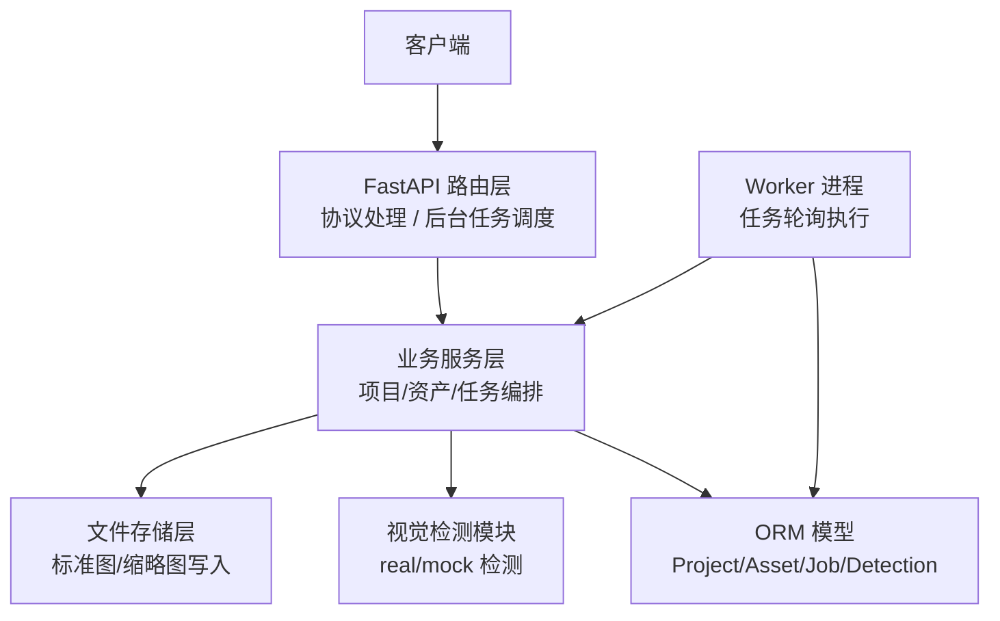
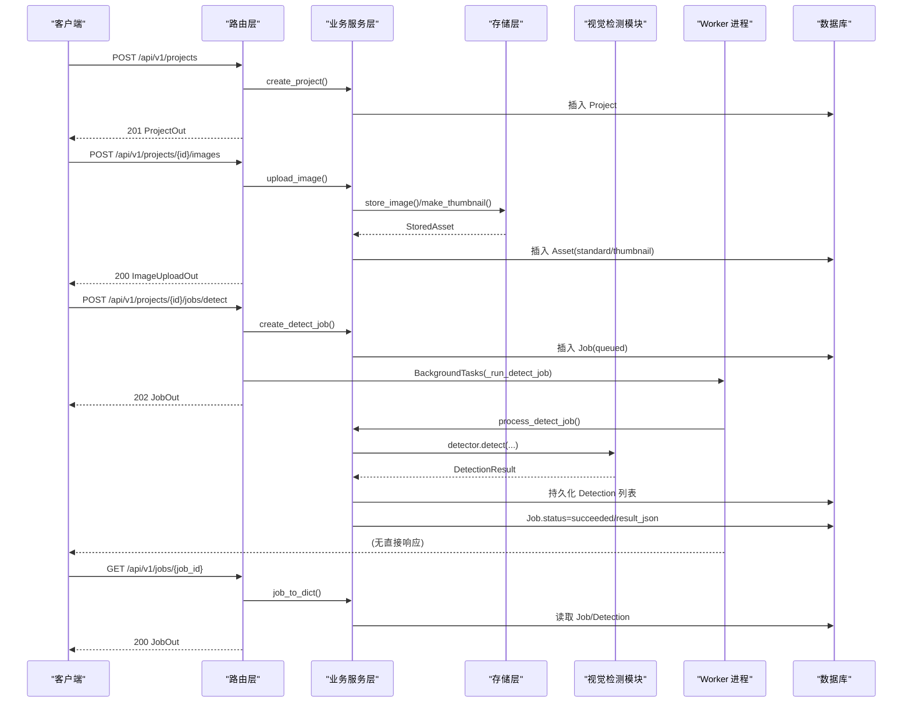
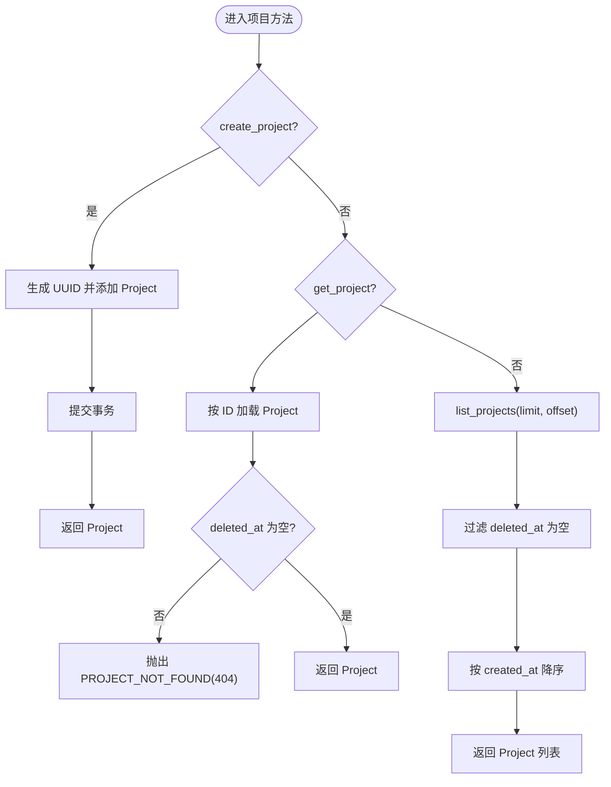
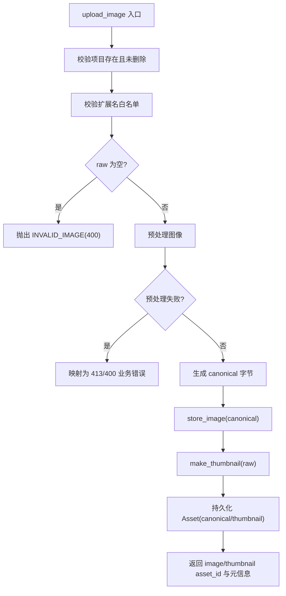
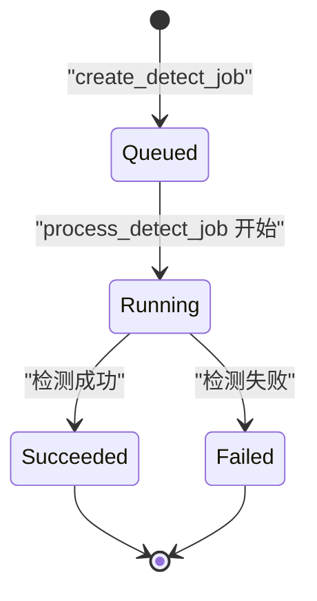
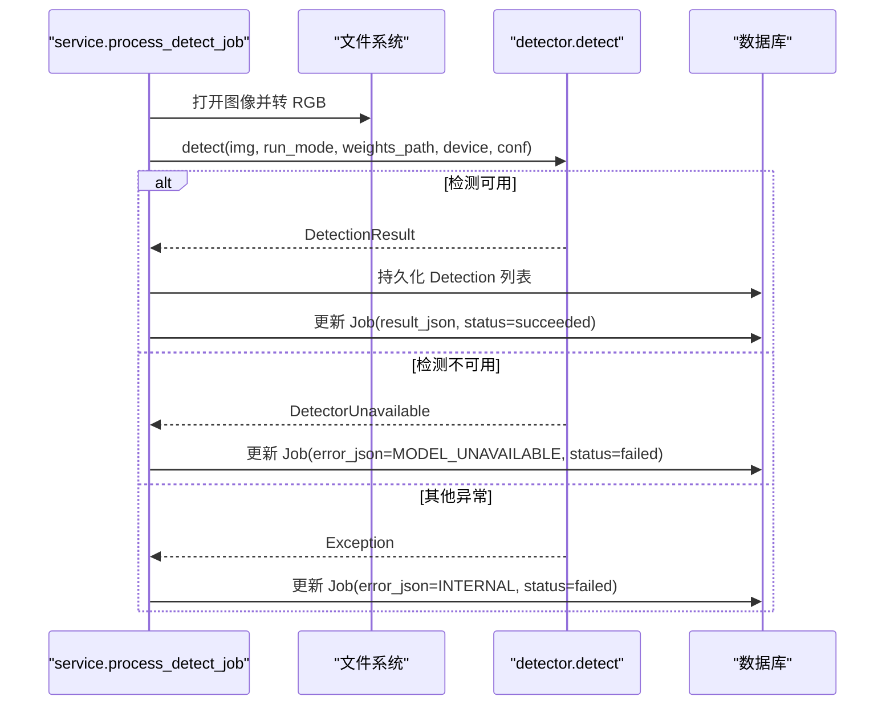
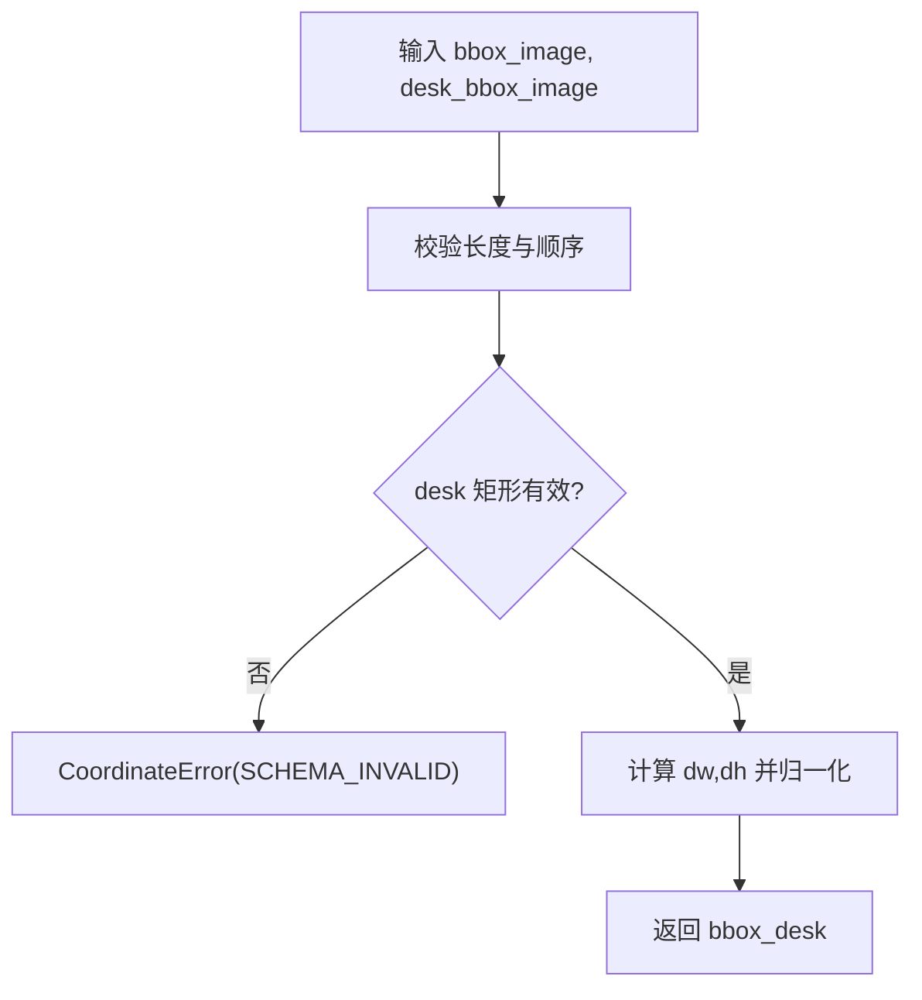
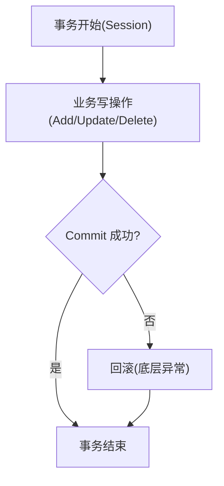
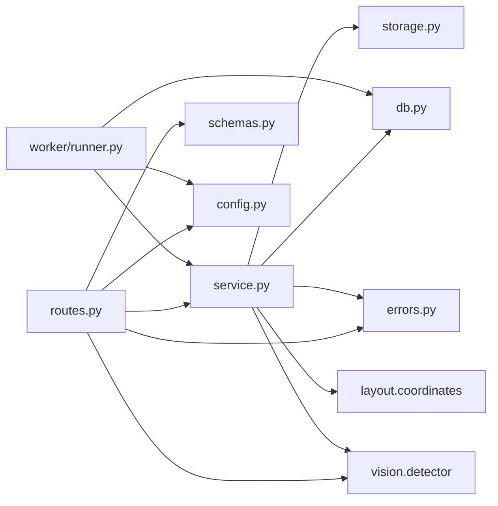

# 业务逻辑层

<cite>
**本文引用的文件**   
- [services/api/service.py](file://services/api/service.py)
- [services/api/routes.py](file://services/api/routes.py)
- [services/api/storage.py](file://services/api/storage.py)
- [services/worker/runner.py](file://services/worker/runner.py)
- [services/api/db.py](file://services/api/db.py)
- [services/api/errors.py](file://services/api/errors.py)
- [services/api/schemas.py](file://services/api/schemas.py)
- [packages/layout/coordinates.py](file://packages/layout/coordinates.py)
</cite>

## 目录
1. [引言](#引言)
2. [项目结构](#项目结构)
3. [核心组件](#核心组件)
4. [架构总览](#架构总览)
5. [详细组件分析](#详细组件分析)
6. [依赖关系分析](#依赖关系分析)
7. [性能与扩展性](#性能与扩展性)
8. [故障排查指南](#故障排查指南)
9. [结论](#结论)

## 引言
本文聚焦业务逻辑层，围绕 Service 类（以模块形式组织）实现的业务规则展开，覆盖以下关键能力：
- 项目生命周期管理：创建、查询、软删除语义。
- 资产存储策略：图像上传、预处理、标准图与缩略图生成、服务端路径管理。
- 异步任务调度：检测任务创建、状态跟踪、后台执行与结果持久化。
- 检测流程编排：与视觉检测模块集成、错误分类与重试标记。
- 坐标转换：原图归一化框到桌面归一化框的推导与校验。
- 事务与一致性：基于 SQLAlchemy Session 的事务边界、终态幂等、对象 ID 守恒。

该文档面向开发者与产品工程师，既提供高层架构视图，也深入到每个业务方法的输入、返回、异常与业务规则，并给出调用示例与最佳实践。

## 项目结构
服务层采用“路由薄 + 业务厚”的分层设计：
- API 路由层负责协议处理、参数绑定、HTTP 响应与后台任务调度。
- 业务服务层封装领域规则、数据访问、外部系统调用与错误映射。
- 存储层负责文件落盘、缩略图生成与路径管理。
- Worker 提供独立进程的任务轮询入口，便于解耦部署。
- ORM 模型定义数据库表结构与关系。
- 错误与 Schema 提供统一错误体与接口契约。

**图表来源**
- [services/api/routes.py:1-143](file://services/api/routes.py#L1-L143)
- [services/api/service.py:1-237](file://services/api/service.py#L1-L237)
- [services/api/storage.py:1-61](file://services/api/storage.py#L1-L61)
- [services/worker/runner.py:1-43](file://services/worker/runner.py#L1-L43)
- [services/api/db.py:1-92](file://services/api/db.py#L1-L92)

**章节来源**
- [services/api/routes.py:1-143](file://services/api/routes.py#L1-L143)
- [services/api/service.py:1-237](file://services/api/service.py#L1-L237)
- [services/api/storage.py:1-61](file://services/api/storage.py#L1-L61)
- [services/worker/runner.py:1-43](file://services/worker/runner.py#L1-L43)
- [services/api/db.py:1-92](file://services/api/db.py#L1-L92)

## 核心组件
- 业务服务模块：集中实现项目、资产、检测任务的领域逻辑，协调存储与视觉检测。
- 路由层：暴露 REST API，将请求转换为服务调用，并处理后台任务。
- 存储模块：按项目隔离存储图片，生成标准图与缩略图，计算 SHA256。
- Worker 执行器：独立进程轮询 queued 任务并调用服务方法执行检测。
- ORM 模型：定义 Project、Asset、Job、Detection 实体及关系。
- 错误与 Schema：统一错误体、接口入出参模型。
- 坐标工具：原图框与桌面框之间的归一化转换与校验。

**章节来源**
- [services/api/service.py:1-237](file://services/api/service.py#L1-L237)
- [services/api/routes.py:1-143](file://services/api/routes.py#L1-L143)
- [services/api/storage.py:1-61](file://services/api/storage.py#L1-L61)
- [services/worker/runner.py:1-43](file://services/worker/runner.py#L1-L43)
- [services/api/db.py:1-92](file://services/api/db.py#L1-L92)
- [services/api/errors.py:1-56](file://services/api/errors.py#L1-L56)
- [services/api/schemas.py:1-84](file://services/api/schemas.py#L1-L84)
- [packages/layout/coordinates.py:1-63](file://packages/layout/coordinates.py#L1-L63)

## 架构总览
下图展示一次完整的“创建项目 → 上传图片 → 创建检测任务 → 后台执行检测 → 查询结果”的流程。

**图表来源**
- [services/api/routes.py:70-143](file://services/api/routes.py#L70-L143)
- [services/api/service.py:46-237](file://services/api/service.py#L46-L237)
- [services/api/storage.py:32-61](file://services/api/storage.py#L32-L61)
- [services/worker/runner.py:16-43](file://services/worker/runner.py#L16-L43)

## 详细组件分析

### 项目生命周期管理
- 创建项目
  - 输入：标题（可选）。
  - 行为：生成 UUID 主键，设置默认标题，持久化 Project。
  - 返回：Project 实体。
  - 异常：无显式业务异常；若数据库不可用则抛出底层异常。
  - 事务：由路由层提供的 Session 包裹，commit 在 service 内完成。
- 查询项目
  - 输入：项目 ID。
  - 行为：按 ID 获取，检查 deleted_at 是否为空。
  - 返回：Project 实体。
  - 异常：未找到或已删除时抛出 ApiError(404)。
- 列出项目
  - 输入：分页 limit/offset。
  - 行为：过滤 deleted_at 为空，按创建时间倒序。
  - 返回：Project 列表。
  - 异常：无显式业务异常。

**图表来源**
- [services/api/service.py:46-68](file://services/api/service.py#L46-L68)

**章节来源**
- [services/api/service.py:46-68](file://services/api/service.py#L46-L68)
- [services/api/db.py:26-35](file://services/api/db.py#L26-L35)

### 资产存储策略（文件上传、缩略图、路径管理）
- 上传图像
  - 输入：project_id、filename、原始字节。
  - 行为：
    - 校验项目存在且未删除。
    - 校验扩展名在白名单（jpg/jpeg/png），空文件拒绝。
    - 预处理图像（尺寸/像素限制），失败时根据消息映射为 413 或 400。
    - 生成标准图 canonical 与缩略图 thumbnail，分别持久化到文件系统。
    - 记录两个 Asset 记录（canonical/thumbnail），包含 sha256、宽高、相对路径。
  - 返回：image_asset_id、thumbnail_asset_id、canonical 宽高、sha256。
  - 异常：非法类型/空文件/预处理失败/项目不存在等，均映射为 ApiError。
- 获取资产
  - 输入：asset_id。
  - 行为：按 ID 加载 Asset，并校验其归属项目未被删除。
  - 返回：Asset 实体。
  - 异常：未找到或归属项目被删时抛出 ApiError(404)。
- 存储路径管理
  - 路径规则：data_root/projects/<project_id>/<kind>_<asset_id>.ext。
  - 服务端生成路径，不信任客户端传入路径。
  - 缩略图最长边 THUMB_MAX=512，JPEG quality=85。

**图表来源**
- [services/api/service.py:73-107](file://services/api/service.py#L73-L107)
- [services/api/storage.py:32-61](file://services/api/storage.py#L32-L61)

**章节来源**
- [services/api/service.py:73-115](file://services/api/service.py#L73-L115)
- [services/api/storage.py:1-61](file://services/api/storage.py#L1-L61)

### 异步任务调度（任务创建、状态跟踪、结果处理）
- 创建检测任务
  - 输入：project_id、image_asset_id。
  - 行为：校验项目与资产归属，创建 Job(status=queued)，立即返回。
  - 返回：Job 实体。
  - 异常：项目或资产不存在时抛出 ApiError(404)。
- 后台执行检测
  - 触发方式：
    - FastAPI BackgroundTasks：在请求进程中执行。
    - Worker 进程：独立进程轮询 queued 任务。
  - 状态机：queued → running → succeeded/failed（终态幂等）。
  - 结果持久化：
    - 成功：写入 result_json（模型名、版本、运行模式、设备、耗时、图像尺寸、检测数量）。
    - 失败：写入 error_json（code/message/retryable）。
  - 异常分类：
    - 视觉检测不可用：MODEL_UNAVAILABLE，不可重试。
    - 业务错误：沿用 ApiError.code/message/retryable。
    - 其他异常：INTERNAL，可重试。
- Worker 轮询
  - 行为：查询所有 detect+queued 任务，逐个调用 process_detect_job。
  - 说明：T02 最小实现，尚未实现租约/心跳/过期恢复等健壮机制。

**图表来源**
- [services/api/service.py:120-186](file://services/api/service.py#L120-L186)
- [services/worker/runner.py:16-43](file://services/worker/runner.py#L16-L43)

**章节来源**
- [services/api/service.py:120-186](file://services/api/service.py#L120-L186)
- [services/worker/runner.py:1-43](file://services/worker/runner.py#L1-L43)

### 检测流程编排（与视觉检测模块集成）
- 输入：图像 Asset.path，settings.run_mode/weights_path/detector_device/detector_conf。
- 行为：
  - 从文件系统打开图像并转为 RGB。
  - 调用 detector.detect(...) 执行真实或 Mock 检测。
  - 捕获 DetectorUnavailable 与 ApiError，以及通用 Exception。
  - 成功后持久化检测结果列表，更新 Job.result_json 与 status。
- 输出：Job 实体（含 result/error）。

**图表来源**
- [services/api/service.py:132-179](file://services/api/service.py#L132-L179)

**章节来源**
- [services/api/service.py:132-179](file://services/api/service.py#L132-L179)

### 坐标转换与业务规则
- 规则：
  - bbox_image：原图归一化框 [x1,y1,x2,y2]，范围 0-1，左上原点，x 向右 y 向下。
  - desk_bbox_image：桌面矩形，同一原图坐标系。
  - bbox_desk：相对桌面归一化，后端推导，客户端不得各自计算并存。
- 实现：
  - image_to_desk：原图框 → 桌面框。
  - desk_to_image：逆运算。
  - clamp01：裁剪到 [0,1] 用于展示。
  - 非法坐标抛出 CoordinateError，Service 层将其包装为 ApiError(422)。

**图表来源**
- [packages/layout/coordinates.py:26-48](file://packages/layout/coordinates.py#L26-L48)
- [services/api/service.py:231-236](file://services/api/service.py#L231-L236)

**章节来源**
- [packages/layout/coordinates.py:1-63](file://packages/layout/coordinates.py#L1-L63)
- [services/api/service.py:231-236](file://services/api/service.py#L231-L236)

### 事务管理与数据一致性
- 事务边界：
  - 路由层通过依赖注入提供 Session，并在请求结束后关闭。
  - Service 方法内部对单条或多条写操作进行 commit。
- 一致性保证：
  - 项目软删除：查询/读取时检查 deleted_at，防止访问已删除资源。
  - 资产归属校验：创建检测任务时校验 image_asset_id 属于 project_id。
  - 任务终态幂等：succeeded/failed/cancelled 不再被重复处理覆盖。
  - 检测结果 ID 守恒：每次成功检测先删除旧 Detection，再批量写入新结果，避免重复写入。
- 错误与重试：
  - MODEL_UNAVAILABLE：不可重试。
  - INTERNAL：可重试。
  - 业务错误：沿用 ApiError.retryable。

**图表来源**
- [services/api/routes.py:31-37](file://services/api/routes.py#L31-L37)
- [services/api/service.py:46-50](file://services/api/service.py#L46-L50)
- [services/api/service.py:92-98](file://services/api/service.py#L92-L98)
- [services/api/service.py:125-129](file://services/api/service.py#L125-L129)
- [services/api/service.py:182-186](file://services/api/service.py#L182-L186)

**章节来源**
- [services/api/routes.py:31-37](file://services/api/routes.py#L31-L37)
- [services/api/service.py:46-50](file://services/api/service.py#L46-L50)
- [services/api/service.py:92-98](file://services/api/service.py#L92-L98)
- [services/api/service.py:125-129](file://services/api/service.py#L125-L129)
- [services/api/service.py:182-186](file://services/api/service.py#L182-L186)

## 依赖关系分析
- 路由层依赖：
  - service：业务规则。
  - schemas：入出参模型。
  - errors：统一错误处理。
  - config：Settings。
  - vision.detector：能力探测。
- 服务层依赖：
  - storage：文件存储。
  - db：ORM 模型。
  - errors：ApiError。
  - packages.vision.detector：检测执行。
  - packages.layout.coordinates：坐标转换。
- Worker 依赖：
  - service：复用 process_detect_job。
  - db：引擎与会话工厂。
  - config：加载 Settings。

**图表来源**
- [services/api/routes.py:1-143](file://services/api/routes.py#L1-L143)
- [services/api/service.py:1-237](file://services/api/service.py#L1-L237)
- [services/worker/runner.py:1-43](file://services/worker/runner.py#L1-L43)

**章节来源**
- [services/api/routes.py:1-143](file://services/api/routes.py#L1-L143)
- [services/api/service.py:1-237](file://services/api/service.py#L1-L237)
- [services/worker/runner.py:1-43](file://services/worker/runner.py#L1-L43)

## 性能与扩展性
- I/O 密集：
  - 图像预处理与缩略图生成使用 PIL，建议在高并发场景下考虑线程池或异步 I/O 优化。
  - 文件存储路径在服务端生成，避免客户端路径注入风险。
- 数据库：
  - SQLite 适合单机与轻量场景；高并发写入需评估连接数与锁竞争。
  - 建议在高频查询字段上建立索引（如 jobs.status、jobs.type、assets.project_id）。
- 任务调度：
  - T02 使用 BackgroundTasks 与简单轮询；生产环境建议引入可靠队列（如 Redis/RabbitMQ）与分布式锁。
  - 增加租约/心跳/过期恢复机制，避免重复执行与僵尸任务。
- 可扩展点：
  - 支持更多图像格式与压缩策略。
  - 多模型并行检测与结果合并。
  - 检测结果缓存与增量更新。

[本节为通用指导，不涉及具体文件分析]

## 故障排查指南
- 常见错误码与含义：
  - INVALID_IMAGE：不支持的文件类型或空文件。
  - PROJECT_NOT_FOUND：项目不存在或已删除。
  - ASSET_NOT_FOUND：资产不存在或不属于项目。
  - JOB_NOT_FOUND：任务不存在。
  - MODEL_UNAVAILABLE：视觉检测不可用。
  - INTERNAL：内部错误，通常可重试。
- 定位步骤：
  - 查看 Job.error_json 中的 code/message/retryable。
  - 确认 data_root 下 projects/<project_id>/ 是否存在对应文件。
  - 检查 settings.run_mode 与 weights_path 配置是否正确。
  - 验证坐标输入是否符合约定（长度、顺序、非退化桌面矩形）。
- 日志与追踪：
  - 使用 ErrorBody.request_id 关联请求链路。
  - Worker 打印轮询与处理数量，便于监控吞吐。

**章节来源**
- [services/api/errors.py:12-56](file://services/api/errors.py#L12-L56)
- [services/api/service.py:158-186](file://services/api/service.py#L158-L186)
- [services/worker/runner.py:30-43](file://services/worker/runner.py#L30-L43)

## 结论
业务逻辑层以 Service 为核心，清晰划分了项目、资产、任务与检测编排的职责，结合路由层的协议处理与 Worker 的解耦执行，形成稳定可靠的端到端流程。通过严格的输入校验、错误分类与事务边界控制，保证了数据一致性与可观测性。未来可在任务调度可靠性、I/O 并发与数据库性能方面持续优化，以满足更高负载与更复杂业务场景。