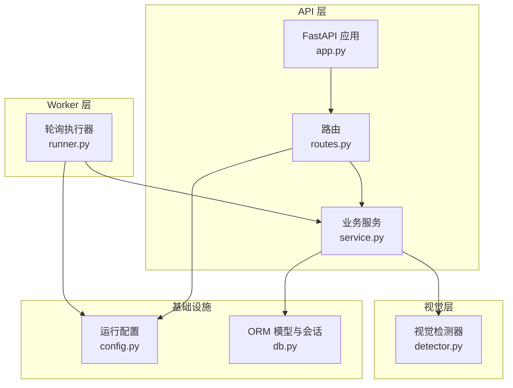
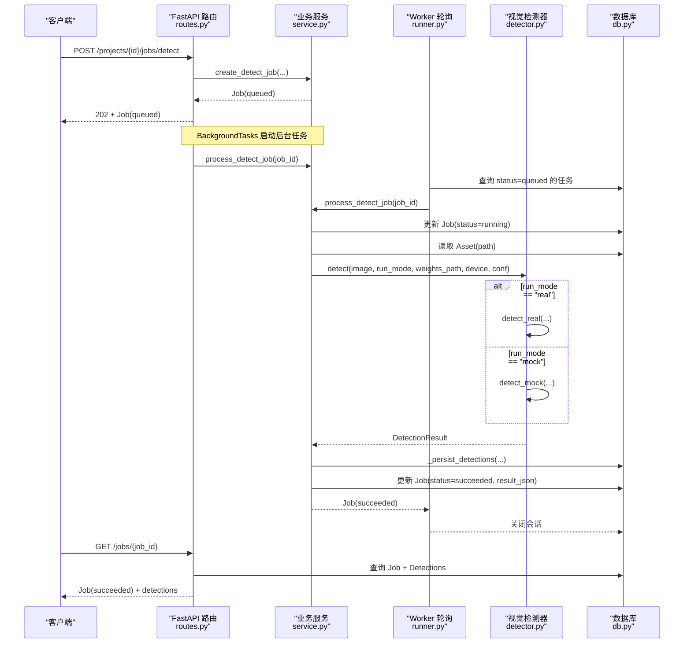
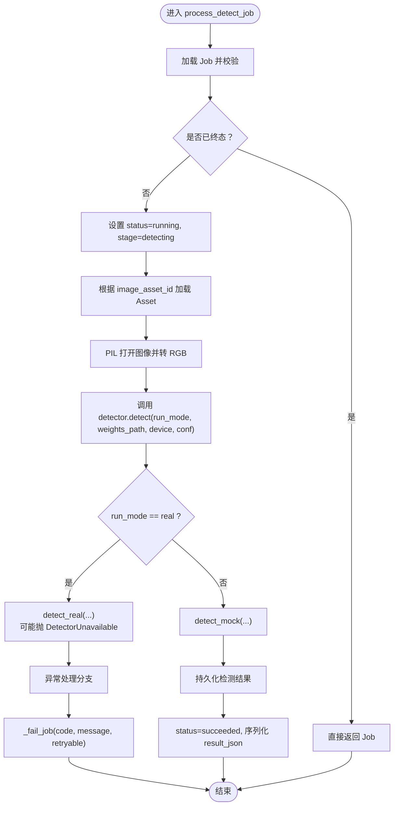
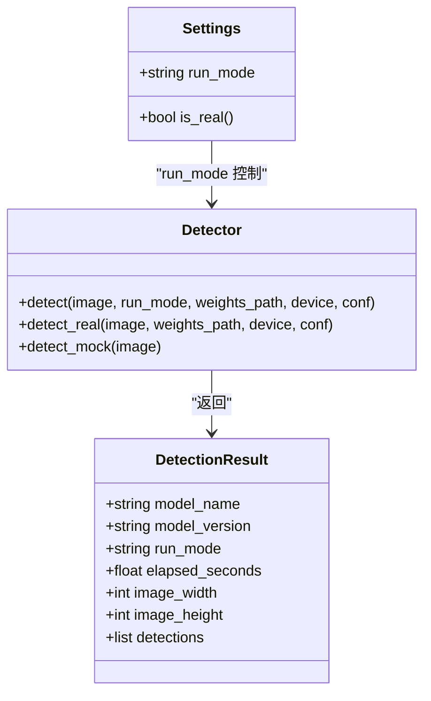
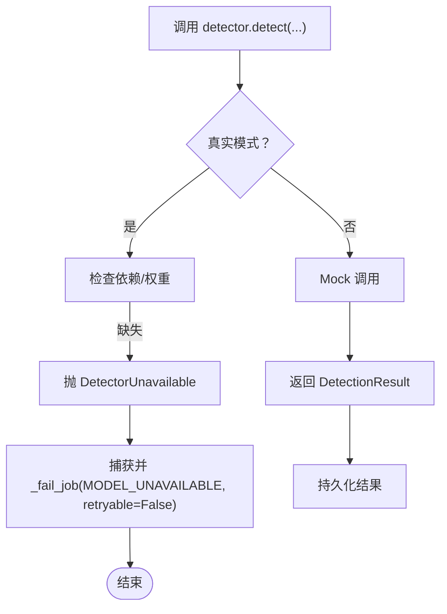
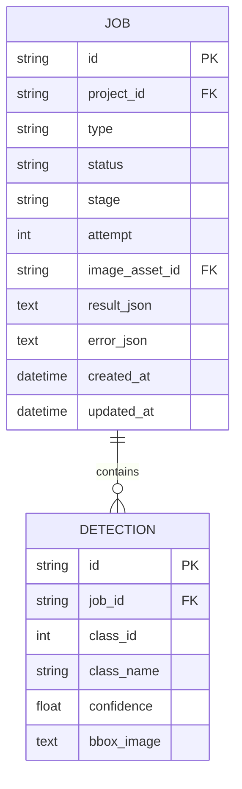
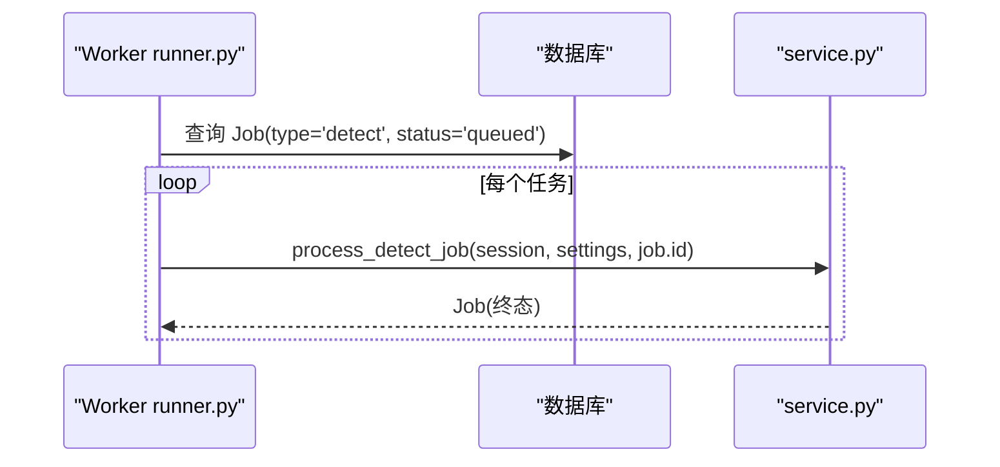
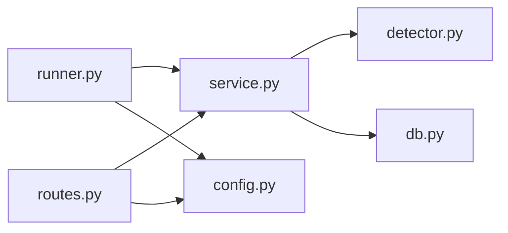

# 任务执行引擎

<cite>
**本文引用的文件**   
- [services/api/service.py](file://services/api/service.py)
- [packages/vision/detector.py](file://packages/vision/detector.py)
- [services/worker/runner.py](file://services/worker/runner.py)
- [services/api/routes.py](file://services/api/routes.py)
- [services/api/config.py](file://services/api/config.py)
- [services/api/db.py](file://services/api/db.py)
- [services/api/app.py](file://services/api/app.py)
- [pyproject.toml](file://pyproject.toml)
- [contracts/detection_result.schema.json](file://contracts/detection_result.schema.json)
- [tests/test_detection_flow.py](file://tests/test_detection_flow.py)
</cite>

## 目录
1. [引言](#引言)
2. [项目结构](#项目结构)
3. [核心组件](#核心组件)
4. [架构总览](#架构总览)
5. [详细组件分析](#详细组件分析)
6. [依赖关系分析](#依赖关系分析)
7. [性能与优化建议](#性能与优化建议)
8. [故障排查指南](#故障排查指南)
9. [结论](#结论)

## 引言
本文围绕任务执行引擎 `process_detect_job` 展开，完整解释从数据库查询待处理任务、加载图像数据、调用视觉检测器到结果持久化的全过程。重点说明真实模式与 Mock 模式的切换逻辑（基于 `settings.run_mode`）、异常处理策略（`DetectorUnavailable`、`ApiError`、通用异常兜底），并提供端到端使用示例与性能优化建议。读者无需深入代码即可理解该引擎在系统中的职责、边界与行为。

## 项目结构
本仓库采用分层组织：API 层负责协议与路由，服务层封装业务规则，视觉包提供检测能力，Worker 提供独立轮询入口，配置与数据库模型分别位于对应模块中。

**图表来源**
- [services/api/app.py:24-44](file://services/api/app.py#L24-L44)
- [services/api/routes.py:120-136](file://services/api/routes.py#L120-L136)
- [services/api/service.py:120-179](file://services/api/service.py#L120-L179)
- [packages/vision/detector.py:124-128](file://packages/vision/detector.py#L124-L128)
- [services/worker/runner.py:16-27](file://services/worker/runner.py#L16-L27)
- [services/api/config.py:39-60](file://services/api/config.py#L39-L60)
- [services/api/db.py:50-77](file://services/api/db.py#L50-L77)

**章节来源**
- [services/api/app.py:24-44](file://services/api/app.py#L24-L44)
- [services/api/routes.py:120-136](file://services/api/routes.py#L120-L136)
- [services/api/service.py:120-179](file://services/api/service.py#L120-L179)
- [packages/vision/detector.py:124-128](file://packages/vision/detector.py#L124-L128)
- [services/worker/runner.py:16-27](file://services/worker/runner.py#L16-L27)
- [services/api/config.py:39-60](file://services/api/config.py#L39-L60)
- [services/api/db.py:50-77](file://services/api/db.py#L50-L77)

## 核心组件
- **服务层 service.py**：定义 `create_detect_job` 与 `process_detect_job`，实现任务状态机、图像读取、检测调用、结果持久化与错误落库。
- **视觉层 detector.py**：统一入口 `detect`，按 `run_mode` 分派至 `detect_real` 或 `detect_mock`；真实模式缺依赖/权重抛 `DetectorUnavailable`。
- **Worker runner.py**：独立进程轮询 `queued` 任务并调用 `service.process_detect_job`。
- **API routes.py**：创建检测任务后通过后台任务异步执行；对外暴露健康检查与能力接口。
- **配置 config.py**：从环境变量装配 `Settings`，默认 `mock`，支持 `real`。
- **数据库 db.py**：SQLAlchemy ORM 模型，包含 Project、Asset、Job、Detection 等表结构。

**章节来源**
- [services/api/service.py:120-179](file://services/api/service.py#L120-L179)
- [packages/vision/detector.py:22-48](file://packages/vision/detector.py#L22-L48)
- [services/worker/runner.py:16-27](file://services/worker/runner.py#L16-L27)
- [services/api/routes.py:120-136](file://services/api/routes.py#L120-L136)
- [services/api/config.py:20-60](file://services/api/config.py#L20-L60)
- [services/api/db.py:50-77](file://services/api/db.py#L50-L77)

## 架构总览
下图展示一次检测任务的端到端流程：前端发起请求 → API 创建任务并异步执行 → Worker 轮询处理 → 视觉检测器推理 → 结果写入数据库 → 前端轮询获取终态。

**图表来源**
- [services/api/routes.py:120-136](file://services/api/routes.py#L120-L136)
- [services/api/service.py:120-179](file://services/api/service.py#L120-L179)
- [services/worker/runner.py:16-27](file://services/worker/runner.py#L16-L27)
- [packages/vision/detector.py:124-128](file://packages/vision/detector.py#L124-L128)
- [services/api/db.py:50-77](file://services/api/db.py#L50-L77)

## 详细组件分析

### 任务执行引擎 process_detect_job
`process_detect_job` 是任务执行的核心方法，承担以下职责：
- 校验任务存在且非终态，避免重复处理。
- 将任务状态置为 running，并记录阶段 detecting。
- 根据 image_asset_id 读取图像文件，转换为 RGB。
- 调用视觉检测器 `detector.detect`，传入运行模式与权重路径、设备、置信度。
- 捕获三类异常：
  - `DetectorUnavailable`：真实模式检测不可用，标记失败并记录 `MODEL_UNAVAILABLE`，不静默回退 mock。
  - `ApiError`：分类错误码与消息，保留 retryable 标志。
  - 通用 Exception：兜底失败，记录 INTERNAL 错误，标记可重试。
- 成功时持久化检测结果，设置 succeeded 状态，序列化元信息（模型名、版本、设备、耗时、图像尺寸、检测数量）。

**图表来源**
- [services/api/service.py:132-179](file://services/api/service.py#L132-L179)
- [packages/vision/detector.py:124-128](file://packages/vision/detector.py#L124-L128)

**章节来源**
- [services/api/service.py:132-179](file://services/api/service.py#L132-L179)

### 真实模式与 Mock 模式切换逻辑
- 配置来源：`ASTRADESK_RUN_MODE` 环境变量，默认 `mock`；`demo` 等价 `mock`。
- 运行时选择：`detector.detect` 根据 `run_mode` 分派：
  - `real`：调用 `detect_real`，需要 ultralytics 与权重文件，否则抛 `DetectorUnavailable`。
  - `mock`：返回确定性 Mock 结果，标注 `run_mode=mock`。
- 能力探测：`/capabilities` 接口尝试加载模型以报告可用性，并在 mock 模式下返回 mock-detector 能力。

**图表来源**
- [services/api/config.py:20-60](file://services/api/config.py#L20-L60)
- [packages/vision/detector.py:124-128](file://packages/vision/detector.py#L124-L128)
- [packages/vision/detector.py:68-121](file://packages/vision/detector.py#L68-L121)

**章节来源**
- [services/api/config.py:39-60](file://services/api/config.py#L39-L60)
- [packages/vision/detector.py:124-128](file://packages/vision/detector.py#L124-L128)
- [services/api/routes.py:51-65](file://services/api/routes.py#L51-L65)

### 异常处理策略
- `DetectorUnavailable`：当真实模式缺少依赖或权重时抛出，`process_detect_job` 捕获后标记失败，错误码 `MODEL_UNAVAILABLE`，不可重试。
- `ApiError`：业务层抛出的结构化错误，携带 code、message、retryable；`process_detect_job` 将其映射为失败任务。
- 通用 Exception：兜底捕获，标记失败，错误码 `INTERNAL`，可重试。

**图表来源**
- [services/api/service.py:148-163](file://services/api/service.py#L148-L163)
- [packages/vision/detector.py:50-65](file://packages/vision/detector.py#L50-L65)

**章节来源**
- [services/api/service.py:148-163](file://services/api/service.py#L148-L163)
- [packages/vision/detector.py:22-24](file://packages/vision/detector.py#L22-L24)

### 结果持久化与查询装配
- 检测结果持久化 `_persist_detections`：删除旧检测记录，逐条插入新检测框，坐标归一化并保留六位小数。
- 查询装配 `job_to_dict`：组装 Job 与 Detections，解析 error/result JSON，时间戳标准化。
- 契约约束：`detection_result.schema.json` 规定字段结构与枚举值，确保 API 输出一致性。

**图表来源**
- [services/api/db.py:50-77](file://services/api/db.py#L50-L77)
- [services/api/service.py:189-197](file://services/api/service.py#L189-L197)
- [services/api/service.py:202-221](file://services/api/service.py#L202-L221)
- [contracts/detection_result.schema.json:1-29](file://contracts/detection_result.schema.json#L1-L29)

**章节来源**
- [services/api/service.py:189-221](file://services/api/service.py#L189-L221)
- [services/api/db.py:50-77](file://services/api/db.py#L50-L77)
- [contracts/detection_result.schema.json:1-29](file://contracts/detection_result.schema.json#L1-L29)

### Worker 轮询与 API 后台任务
- Worker：独立进程通过 `python -m services.worker` 启动，循环查询 `queued` 任务并调用 `service.process_detect_job`。
- API 后台任务：路由创建任务后通过 FastAPI `BackgroundTasks` 在请求进程内执行检测，便于快速响应；Worker 提供解耦运行入口。

**图表来源**
- [services/worker/runner.py:16-27](file://services/worker/runner.py#L16-L27)
- [services/api/routes.py:120-136](file://services/api/routes.py#L120-L136)

**章节来源**
- [services/worker/runner.py:16-27](file://services/worker/runner.py#L16-L27)
- [services/api/routes.py:120-136](file://services/api/routes.py#L120-L136)

## 依赖关系分析
- 服务层依赖视觉检测器与数据库模型。
- Worker 依赖服务层与配置。
- API 路由依赖服务层、配置与视觉检测器（能力探测）。
- 配置与环境变量驱动运行模式与资源路径。

**图表来源**
- [services/api/service.py:1-25](file://services/api/service.py#L1-L25)
- [packages/vision/detector.py:1-20](file://packages/vision/detector.py#L1-L20)
- [services/api/db.py:1-18](file://services/api/db.py#L1-L18)
- [services/worker/runner.py:1-14](file://services/worker/runner.py#L1-L14)
- [services/api/routes.py:1-18](file://services/api/routes.py#L1-L18)
- [services/api/config.py:1-18](file://services/api/config.py#L1-L18)

**章节来源**
- [services/api/service.py:1-25](file://services/api/service.py#L1-L25)
- [packages/vision/detector.py:1-20](file://packages/vision/detector.py#L1-L20)
- [services/api/db.py:1-18](file://services/api/db.py#L1-L18)
- [services/worker/runner.py:1-14](file://services/worker/runner.py#L1-L14)
- [services/api/routes.py:1-18](file://services/api/routes.py#L1-L18)
- [services/api/config.py:1-18](file://services/api/config.py#L1-L18)

## 性能与优化建议
- 模型懒加载与缓存：`detector._load_model` 使用进程级缓存 `_MODEL`，避免每次推理重载模型，显著降低启动开销。
- 图像预处理：上传阶段进行规范化与缩略图生成，减少推理输入尺寸与存储冗余。
- 批量持久化：检测结果逐条插入，建议在大批量场景下使用 SQLAlchemy 的 `bulk_insert_mappings` 或事务批提交以降低 IO 压力。
- 并发控制：Worker 当前顺序处理 queued 任务，可在高吞吐场景引入并发池或队列系统（如 Celery/RQ）提升并行度。
- 设备选择：通过 `ASTRADESK_DEVICE` 指定 GPU/CPU，合理分配硬件资源；未设置时由 ultralytics 自动选择。
- 阈值调优：`ASTRADESK_DET_CONF` 调整检测置信度阈值，平衡召回率与误检率。

[本节为通用指导，不直接分析具体文件]

## 故障排查指南
- 检测不可用：
  - 现象：任务失败，错误码 `MODEL_UNAVAILABLE`。
  - 原因：真实模式缺少 ultralytics 或权重文件。
  - 处理：安装可选依赖 `vision`，放置权重文件，确认 `ASTRADESK_YOLO_WEIGHTS` 路径正确。
- 资产缺失：
  - 现象：任务失败，错误码 `ASSET_NOT_FOUND`。
  - 原因：图像资产不存在或所属项目被删除。
  - 处理：确认上传成功且项目未被软删除。
- 内部错误：
  - 现象：任务失败，错误码 `INTERNAL`，可重试。
  - 原因：视觉检测器或其他依赖抛出未预期异常。
  - 处理：查看日志中的异常堆栈，定位底层依赖问题。
- 模式配置错误：
  - 现象：启动时报错或能力接口返回 mock-detector。
  - 原因：`ASTRADESK_RUN_MODE` 配置无效或为 demo。
  - 处理：设置为 `real` 或 `mock`，并确保依赖齐全。

**章节来源**
- [services/api/service.py:148-163](file://services/api/service.py#L148-L163)
- [packages/vision/detector.py:50-65](file://packages/vision/detector.py#L50-L65)
- [services/api/config.py:39-60](file://services/api/config.py#L39-L60)

## 结论
`process_detect_job` 作为任务执行引擎，串联了数据库、图像 I/O、视觉检测与结果持久化，实现了清晰的状态机与稳健的异常处理。通过 `settings.run_mode` 灵活切换真实与 Mock 模式，既满足生产环境的高精度推理，也支持无 GPU 环境的契约测试与演示。结合 Worker 轮询与 API 后台任务，系统具备可扩展性与可观测性。未来可在并发、批处理与监控方面进一步优化，以提升吞吐与稳定性。

[本节为总结性内容，不直接分析具体文件]