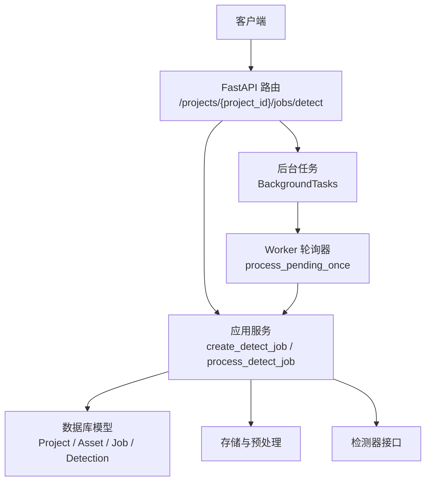
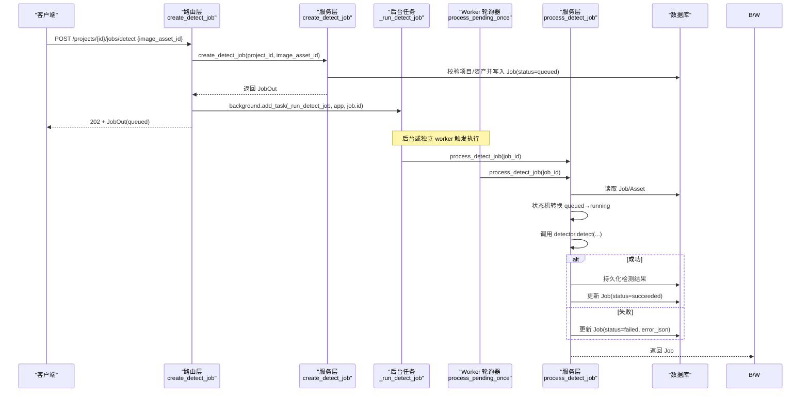
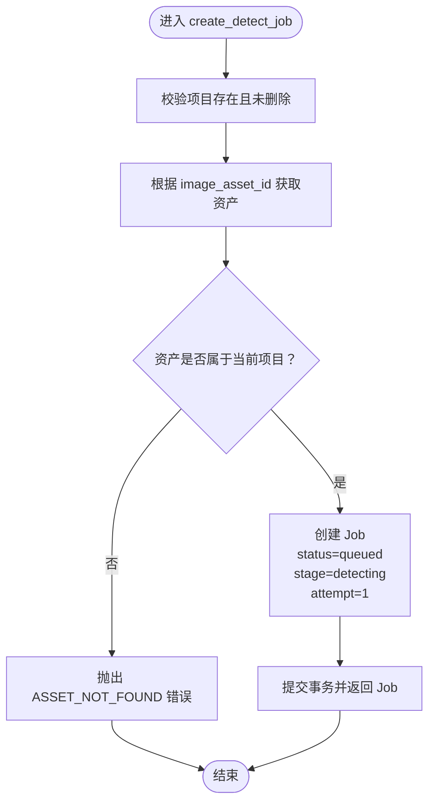
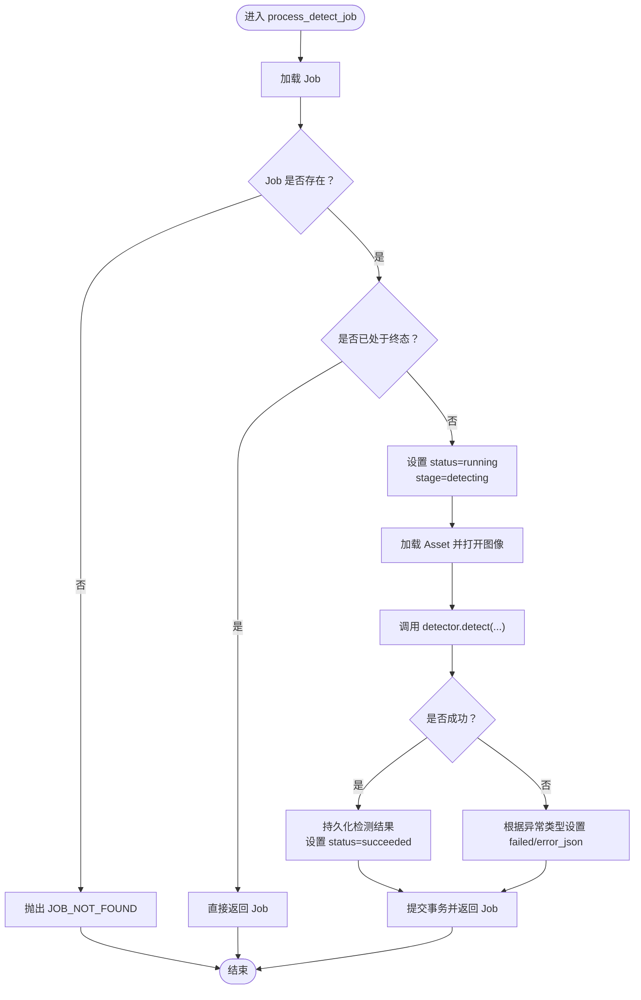
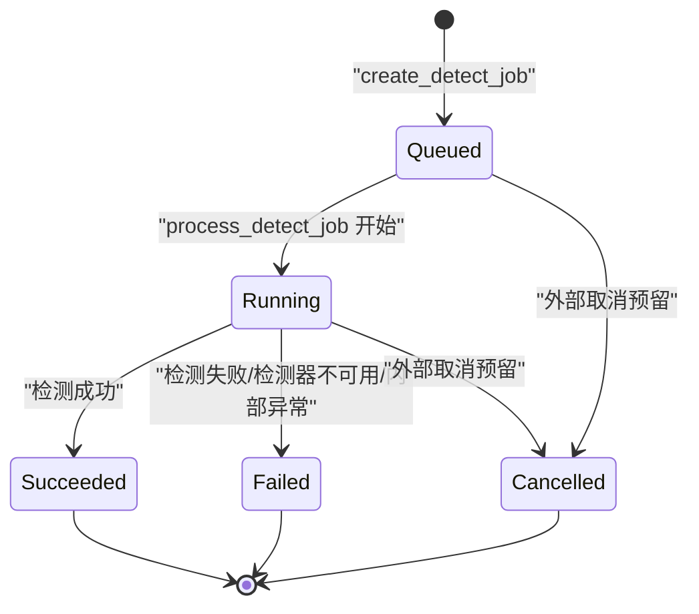
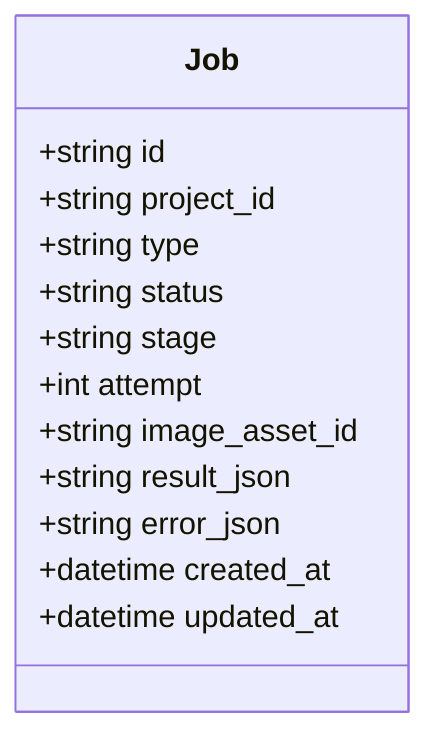
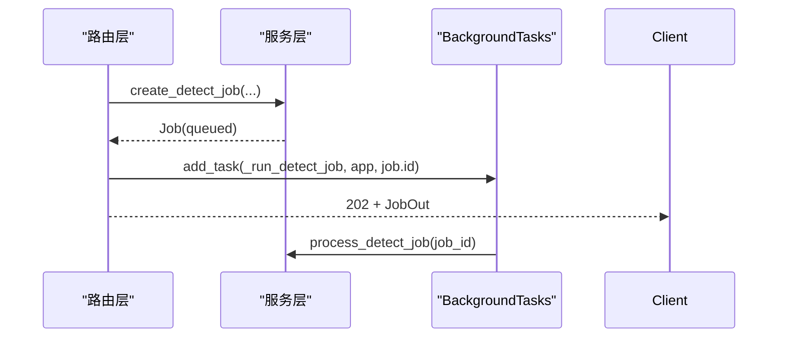
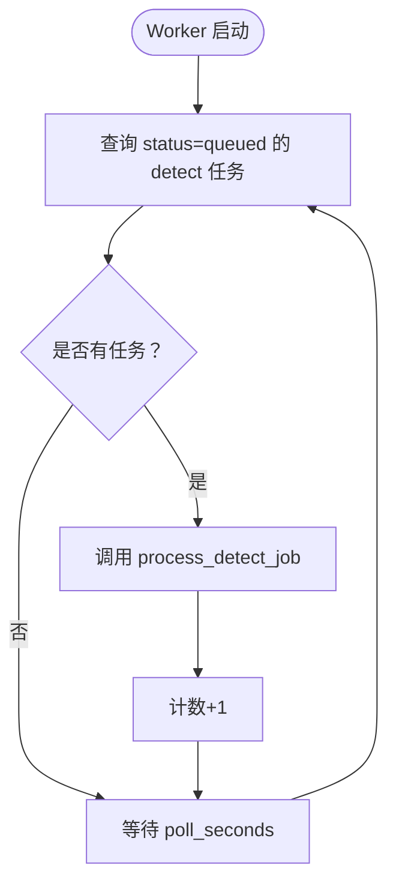
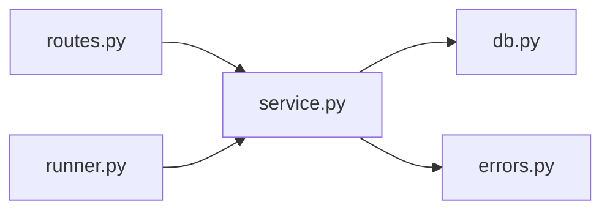

# 任务生命周期管理

<cite>
**本文引用的文件**   
- [routes.py](file://services/api/routes.py)
- [service.py](file://services/api/service.py)
- [db.py](file://services/api/db.py)
- [errors.py](file://services/api/errors.py)
- [runner.py](file://services/worker/runner.py)
- [test_detection_flow.py](file://tests/test_detection_flow.py)
</cite>

## 目录
1. [引言](#引言)
2. [项目结构](#项目结构)
3. [核心组件](#核心组件)
4. [架构总览](#架构总览)
5. [详细组件分析](#详细组件分析)
6. [依赖关系分析](#依赖关系分析)
7. [性能与可靠性考虑](#性能与可靠性考虑)
8. [故障排查指南](#故障排查指南)
9. [结论](#结论)
10. [附录：最佳实践与示例](#附录最佳实践与示例)

## 引言
本文围绕检测任务的完整生命周期展开，重点解析 `create_detect_job` 的实现细节、任务状态机设计、重试计数机制 `attempt` 与执行阶段标识 `stage` 的语义，以及从请求入口到后台执行的端到端流程。文档同时给出错误处理策略、边界情况与最佳实践，帮助读者在理解代码的同时掌握可落地的使用方式。

## 项目结构
本仓库采用“路由层 + 服务层 + 数据模型”的分层组织：
- 路由层负责协议处理与异步任务调度；
- 服务层封装业务规则（项目归属校验、资产关联检查、任务创建与执行）；
- 数据模型定义持久化实体；
- Worker 提供独立进程的任务轮询入口；
- 测试覆盖端到端流程与契约一致性。

**图表来源**
- [routes.py:130-136](file://services/api/routes.py#L130-L136)
- [service.py:120-179](file://services/api/service.py#L120-L179)
- [db.py:26-77](file://services/api/db.py#L26-L77)
- [runner.py:16-27](file://services/worker/runner.py#L16-L27)

**章节来源**
- [routes.py:1-143](file://services/api/routes.py#L1-L143)
- [service.py:1-237](file://services/api/service.py#L1-L237)
- [db.py:1-92](file://services/api/db.py#L1-L92)
- [runner.py:1-43](file://services/worker/runner.py#L1-L43)

## 核心组件
- 路由层：暴露 `/api/v1/projects/{project_id}/jobs/detect` 接口，返回 202 并启动后台任务。
- 服务层：实现 `create_detect_job`（创建任务）、`process_detect_job`（执行任务）、`job_to_dict`（查询装配）。
- 数据模型：Job 表包含 status、stage、attempt 等关键字段。
- Worker：可选的独立进程轮询 queued 任务并调用服务层执行。
- 错误体系：统一 ApiError 异常与 FastAPI 处理器，输出结构化错误体。

**章节来源**
- [routes.py:130-136](file://services/api/routes.py#L130-L136)
- [service.py:120-228](file://services/api/service.py#L120-L228)
- [db.py:50-66](file://services/api/db.py#L50-L66)
- [errors.py:12-55](file://services/api/errors.py#L12-L55)

## 架构总览
下图展示一次检测任务从创建到终态的完整时序：

**图表来源**
- [routes.py:120-136](file://services/api/routes.py#L120-L136)
- [service.py:120-179](file://services/api/service.py#L120-L179)
- [runner.py:16-27](file://services/worker/runner.py#L16-L27)

## 详细组件分析

### 任务创建：`create_detect_job`
该函数是任务生命周期的起点，完成以下关键步骤：
- 项目归属验证：通过 `get_project(session, project_id)` 确保项目存在且未删除。
- 资产关联检查：通过 `get_asset(session, image_asset_id)` 获取资产，并校验其属于当前项目。
- 任务状态初始化：新建 Job，设置 `status="queued"`、`stage="detecting"`、`attempt=1`，并持久化。

**图表来源**
- [service.py:120-129](file://services/api/service.py#L120-L129)
- [service.py:53-57](file://services/api/service.py#L53-L57)
- [service.py:110-115](file://services/api/service.py#L110-L115)

**章节来源**
- [service.py:120-129](file://services/api/service.py#L120-L129)
- [service.py:53-57](file://services/api/service.py#L53-L57)
- [service.py:110-115](file://services/api/service.py#L110-L115)

### 任务执行：`process_detect_job`
该函数负责将排队中的任务推进至运行中并最终到达终态：
- 状态机前置检查：若 Job 不存在则报错；若已是终态（succeeded/failed/cancelled）则直接返回，避免重复处理。
- 状态推进：将 status 设为 running，stage 设为 detecting，并提交变更。
- 资源加载：按 image_asset_id 加载图像并转换为 RGB。
- 检测执行：调用 detector.detect，支持 real/mock 模式与设备参数。
- 结果持久化：成功后保存检测结果，并将 status 置为 succeeded。
- 错误处理：
  - 检测器不可用：记录 MODEL_UNAVAILABLE，不静默回退 mock。
  - 业务错误：记录对应 code 与 message，并标记 retryable。
  - 其他异常：记录 INTERNAL 错误，标记 retryable。

**图表来源**
- [service.py:132-179](file://services/api/service.py#L132-L179)

**章节来源**
- [service.py:132-179](file://services/api/service.py#L132-L179)

### 任务状态机设计
任务状态机遵循以下转换规则：
- 初始状态：queued（排队中），由 `create_detect_job` 创建时设定。
- 运行状态：running（运行中），由 `process_detect_job` 在进入执行前设定。
- 终态：succeeded（成功）、failed（失败）、cancelled（取消）。
- 防重入保护：若 Job 已是终态，则直接返回，避免重复处理覆盖结果。

**图表来源**
- [service.py:120-129](file://services/api/service.py#L120-L129)
- [service.py:132-179](file://services/api/service.py#L132-L179)

**章节来源**
- [service.py:120-129](file://services/api/service.py#L120-L129)
- [service.py:132-179](file://services/api/service.py#L132-L179)

### 字段语义：attempt 与 stage
- attempt（重试计数）：
  - 在 `create_detect_job` 中初始化为 1。
  - 当前实现未在失败路径自动递增；如需重试，可在上层重试逻辑中递增并重新提交任务。
- stage（执行阶段）：
  - 创建时为 detecting；
  - 执行过程中保持 detecting；
  - 成功时仍为 detecting（当前实现未区分更细粒度阶段）。

**图表来源**
- [db.py:50-66](file://services/api/db.py#L50-L66)

**章节来源**
- [db.py:50-66](file://services/api/db.py#L50-L66)
- [service.py:120-129](file://services/api/service.py#L120-L129)
- [service.py:132-179](file://services/api/service.py#L132-L179)

### 路由与后台任务调度
- 路由 `POST /projects/{project_id}/jobs/detect`：
  - 调用 `service.create_detect_job` 创建任务；
  - 使用 FastAPI `BackgroundTasks` 添加 `_run_detect_job` 后台任务；
  - 立即返回 202 与 JobOut。
- 后台任务 `_run_detect_job`：
  - 使用独立 session 调用 `service.process_detect_job` 执行检测。

**图表来源**
- [routes.py:130-136](file://services/api/routes.py#L130-L136)
- [routes.py:120-127](file://services/api/routes.py#L120-L127)

**章节来源**
- [routes.py:130-136](file://services/api/routes.py#L130-L136)
- [routes.py:120-127](file://services/api/routes.py#L120-L127)

### Worker 轮询器（可选）
Worker 提供独立进程入口，轮询所有 queued 的检测任务并调用服务层执行：
- `process_pending_once`：查询所有 detect 且 status=queued 的 Job，逐个调用 `process_detect_job`。
- `run_loop`：周期性轮询，打印处理数量。

**图表来源**
- [runner.py:16-27](file://services/worker/runner.py#L16-L27)
- [runner.py:30-43](file://services/worker/runner.py#L30-L43)

**章节来源**
- [runner.py:16-27](file://services/worker/runner.py#L16-L27)
- [runner.py:30-43](file://services/worker/runner.py#L30-L43)

## 依赖关系分析
- 路由层依赖服务层进行业务处理，并通过 BackgroundTasks 解耦执行。
- 服务层依赖数据模型（Project/Asset/Job/Detection）与存储、检测器接口。
- Worker 依赖服务层与数据库会话工厂。
- 错误体系贯穿路由与服务层，统一输出结构化错误体。

**图表来源**
- [routes.py:1-143](file://services/api/routes.py#L1-L143)
- [service.py:1-237](file://services/api/service.py#L1-L237)
- [db.py:1-92](file://services/api/db.py#L1-L92)
- [errors.py:1-56](file://services/api/errors.py#L1-L56)
- [runner.py:1-43](file://services/worker/runner.py#L1-L43)

**章节来源**
- [routes.py:1-143](file://services/api/routes.py#L1-L143)
- [service.py:1-237](file://services/api/service.py#L1-L237)
- [db.py:1-92](file://services/api/db.py#L1-L92)
- [errors.py:1-56](file://services/api/errors.py#L1-L56)
- [runner.py:1-43](file://services/worker/runner.py#L1-L43)

## 性能与可靠性考虑
- 异步执行：通过 BackgroundTasks 将检测任务从请求线程中剥离，提升接口响应速度。
- 幂等性：对终态 Job 不做重复处理，避免覆盖已有结果。
- 错误分类：区分检测器不可用、业务错误与内部异常，便于上层重试与监控。
- 可扩展性：Worker 轮询器可作为独立进程扩展吞吐能力。

[本节为通用指导，不涉及具体文件分析]

## 故障排查指南
- 项目不存在或已删除：
  - 现象：创建任务时报 PROJECT_NOT_FOUND。
  - 排查：确认 project_id 有效且未被软删除。
- 资产不属于项目：
  - 现象：创建任务时报 ASSET_NOT_FOUND（资产归属校验失败）。
  - 排查：确认 image_asset_id 属于当前 project_id。
- 资产文件缺失：
  - 现象：执行任务时报 ASSET_NOT_FOUND。
  - 排查：确认资产文件路径存在且可读。
- 检测器不可用：
  - 现象：任务失败，error.code=MODEL_UNAVAILABLE。
  - 排查：检查权重路径与设备配置；real 模式下不会静默回退 mock。
- 内部异常：
  - 现象：任务失败，error.code=INTERNAL，retryable=true。
  - 排查：查看日志定位底层异常原因。

**章节来源**
- [service.py:53-57](file://services/api/service.py#L53-L57)
- [service.py:110-115](file://services/api/service.py#L110-L115)
- [service.py:148-163](file://services/api/service.py#L148-L163)
- [errors.py:12-55](file://services/api/errors.py#L12-L55)

## 结论
`create_detect_job` 作为检测任务的生命周期起点，严格完成了项目归属与资产关联校验，并以 queued 状态初始化任务。`process_detect_job` 实现了稳健的状态机推进与错误分类，保证终态不被覆盖。结合路由层的异步调度与 Worker 的轮询执行，系统具备良好的可扩展性与可靠性。建议在需要重试的场景中显式维护 attempt 字段，并在未来细化 stage 以表达更丰富的执行阶段。

[本节为总结性内容，不涉及具体文件分析]

## 附录：最佳实践与示例

### 任务创建最佳实践
- 先上传图像并获取 canonical 图像的 asset_id，再调用检测任务接口。
- 确保 image_asset_id 属于目标 project_id，避免归属校验失败。
- 接收 202 响应后轮询任务状态，直到达到终态（succeeded/failed/cancelled）。
- 对于 real 模式，提前检查 capabilities 以判断检测器可用性。

**章节来源**
- [test_detection_flow.py:55-79](file://tests/test_detection_flow.py#L55-L79)
- [test_detection_flow.py:113-126](file://tests/test_detection_flow.py#L113-L126)

### 错误处理与边界情况
- 空文件或非法扩展名：上传阶段会拒绝并返回 INVALID_IMAGE。
- 伪装图像：预处理阶段会拒绝并返回 INVALID_IMAGE。
- 检测器不可用：任务失败并记录 MODEL_UNAVAILABLE，不静默产出 mock 结果。
- 内部异常：任务失败并记录 INTERNAL，标记 retryable，便于上层重试。

**章节来源**
- [test_detection_flow.py:91-110](file://tests/test_detection_flow.py#L91-L110)
- [test_detection_flow.py:113-126](file://tests/test_detection_flow.py#L113-L126)
- [service.py:73-107](file://services/api/service.py#L73-L107)
- [service.py:158-163](file://services/api/service.py#L158-L163)