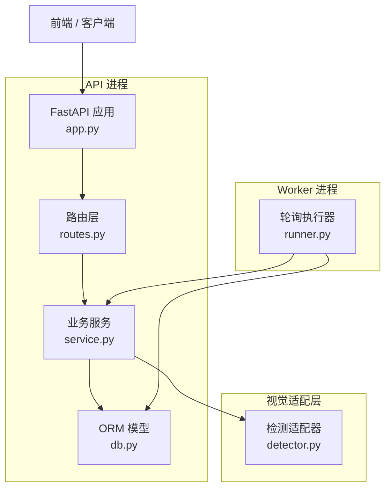
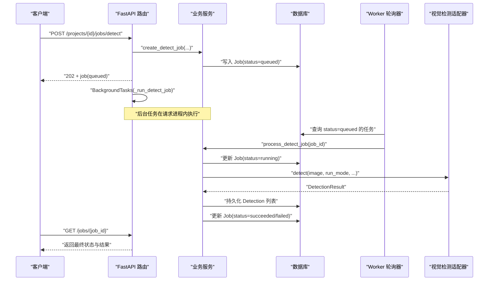
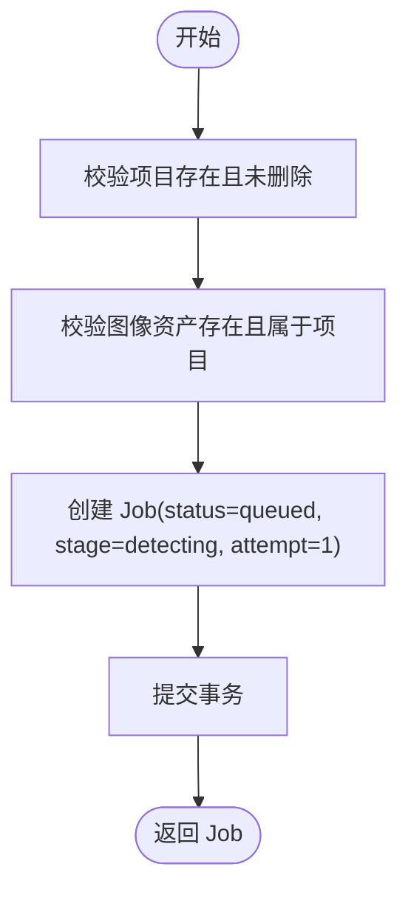
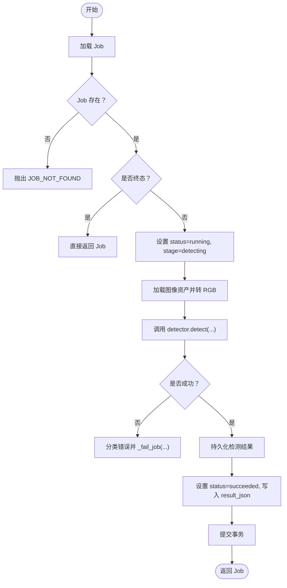
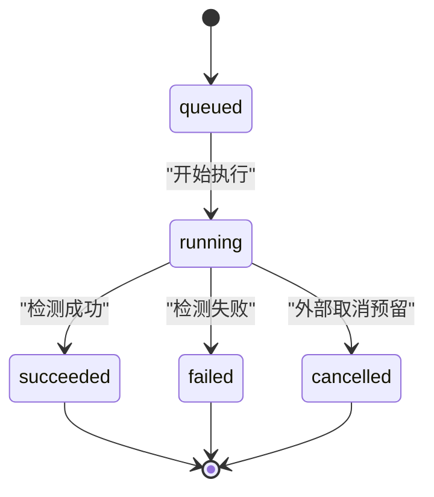
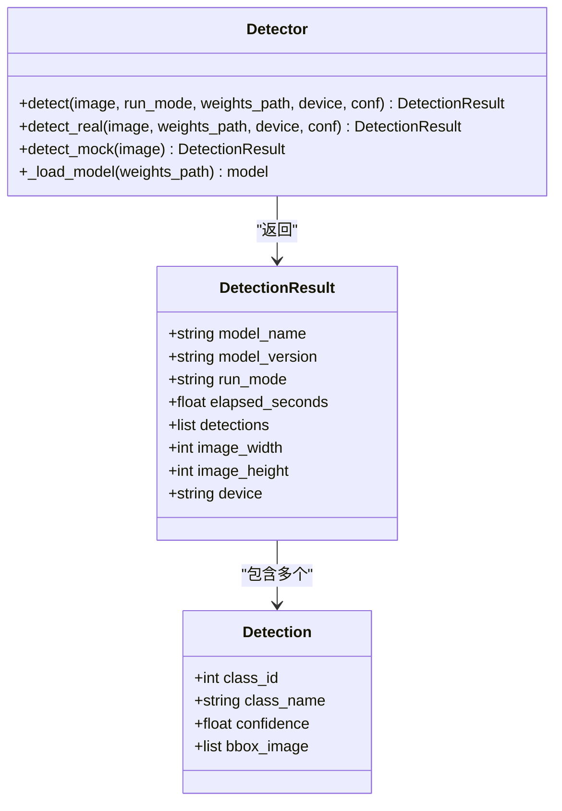
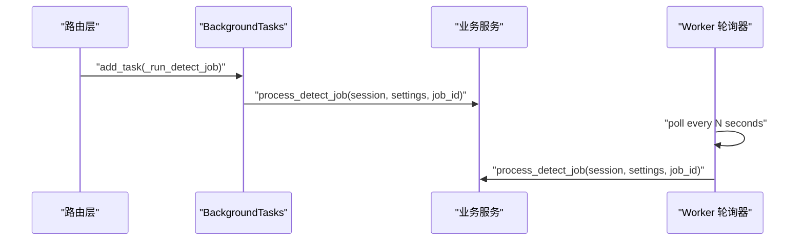
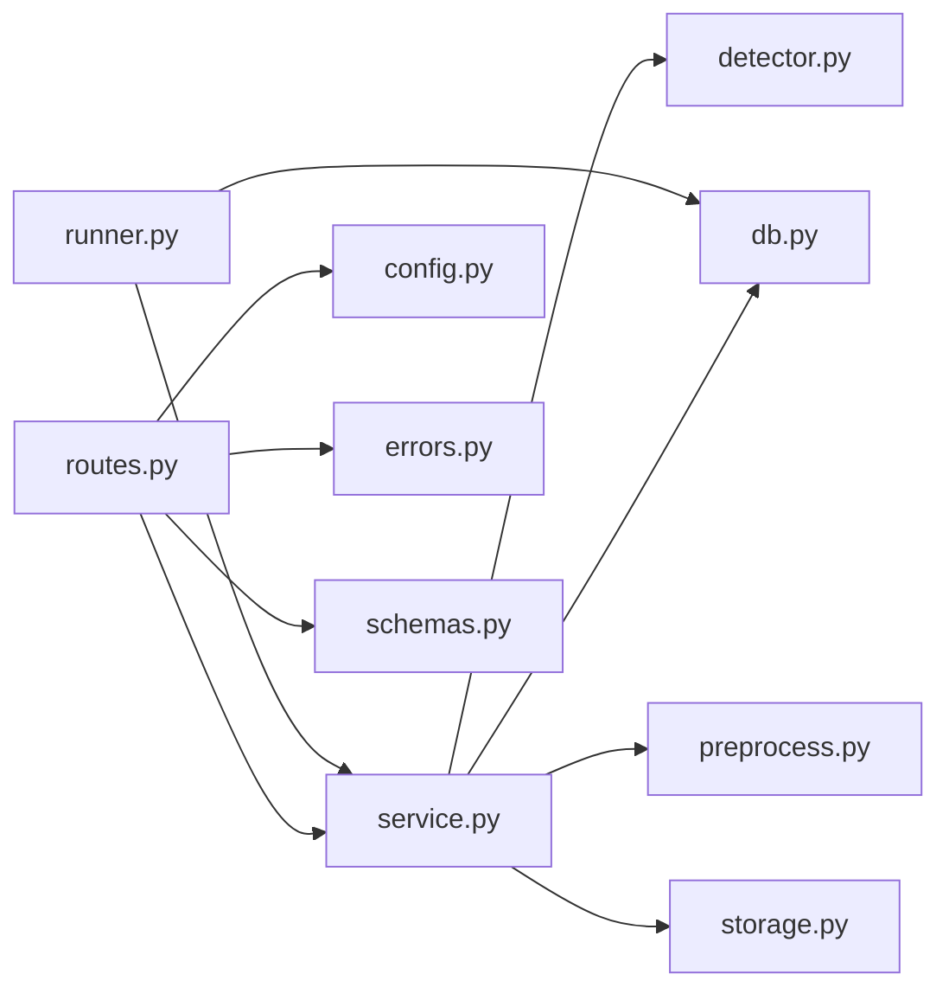

# 任务调度

<cite>
**本文引用的文件**   
- [README.md](file://README.md)
- [services/api/app.py](file://services/api/app.py)
- [services/api/routes.py](file://services/api/routes.py)
- [services/api/service.py](file://services/api/service.py)
- [services/api/db.py](file://services/api/db.py)
- [services/worker/runner.py](file://services/worker/runner.py)
- [packages/vision/detector.py](file://packages/vision/detector.py)
- [contracts/detection_result.schema.json](file://contracts/detection_result.schema.json)
- [tests/test_detection_flow.py](file://tests/test_detection_flow.py)
</cite>

## 目录
1. [引言](#引言)
2. [项目结构](#项目结构)
3. [核心组件](#核心组件)
4. [架构总览](#架构总览)
5. [详细组件分析](#详细组件分析)
6. [依赖关系分析](#依赖关系分析)
7. [性能与扩展性](#性能与扩展性)
8. [故障排查指南](#故障排查指南)
9. [结论](#结论)
10. [附录：最佳实践与示例](#附录最佳实践与示例)

## 引言
本文面向异步任务调度系统，聚焦检测任务的完整生命周期管理。重点解释以下能力：
- 任务创建：`create_detect_job` 的职责、校验与持久化。
- 任务执行：`process_detect_job` 的状态机、错误分类、重试语义与结果落库。
- 状态机设计：queued → running → succeeded / failed（含 partial / cancelled 等契约态）。
- 重试机制：当前实现中的可重试标记与前端轮询策略。
- 视觉检测集成：真实模式与 Mock 模式的切换逻辑、不可用时的失败策略。
- 调度入口：FastAPI BackgroundTasks 与独立 worker 轮询两种运行方式。

## 项目结构
本仓库采用“服务层 + 路由层 + 数据模型 + 适配器”的分层组织：
- `services/api`：FastAPI 应用装配、路由、业务服务、数据库模型、配置与存储。
- `services/worker`：独立 worker 进程，轮询并执行 queued 检测任务。
- `packages/vision`：视觉检测适配器，统一入口按运行模式分派到真实 YOLOv10 或 Mock。
- `contracts`：JSON Schema 契约，约束检测结果输出格式。
- `tests`：端到端测试，覆盖 mock 流程、契约校验、真实模式权重缺失行为。

**图表来源**
- [services/api/app.py:24-47](file://services/api/app.py#L24-L47)
- [services/api/routes.py:130-142](file://services/api/routes.py#L130-L142)
- [services/api/service.py:120-179](file://services/api/service.py#L120-L179)
- [services/api/db.py:50-77](file://services/api/db.py#L50-L77)
- [services/worker/runner.py:16-42](file://services/worker/runner.py#L16-L42)
- [packages/vision/detector.py:124-128](file://packages/vision/detector.py#L124-L128)

**章节来源**
- [README.md:8-24](file://README.md#L8-L24)

## 核心组件
- 路由层：负责协议处理、参数解析、返回响应，并在创建检测任务时通过 FastAPI 的 BackgroundTasks 启动后台执行。
- 业务服务层：封装检测任务创建、执行、结果持久化、查询装配等核心规则。
- 数据模型层：定义 Project、Asset、Job、Detection 等实体及 SQLite 引擎与会话工厂。
- Worker 执行器：独立进程，周期性从数据库拉取 queued 任务并调用服务层执行。
- 视觉检测适配器：提供统一 detect 入口，根据运行模式选择真实推理或 Mock。

**章节来源**
- [services/api/routes.py:1-28](file://services/api/routes.py#L1-L28)
- [services/api/service.py:1-25](file://services/api/service.py#L1-L25)
- [services/api/db.py:1-18](file://services/api/db.py#L1-L18)
- [services/worker/runner.py:1-14](file://services/worker/runner.py#L1-L14)
- [packages/vision/detector.py:1-10](file://packages/vision/detector.py#L1-L10)

## 架构总览
检测任务的生命周期由 API 与 worker 共同驱动：
- 前端发起 POST `/api/v1/projects/{project_id}/jobs/detect`，路由层创建任务并立即返回 202。
- 后台任务在请求进程内执行检测；也可使用独立 worker 轮询执行。
- 任务状态从 queued 进入 running，最终变为 succeeded 或 failed。
- 前端通过 GET `/api/v1/jobs/{job_id}` 轮询直至终态。

**图表来源**
- [services/api/routes.py:120-136](file://services/api/routes.py#L120-L136)
- [services/api/service.py:120-179](file://services/api/service.py#L120-L179)
- [services/worker/runner.py:16-27](file://services/worker/runner.py#L16-L27)
- [packages/vision/detector.py:124-128](file://packages/vision/detector.py#L124-L128)

## 详细组件分析

### 任务创建：`create_detect_job`
职责与流程：
- 校验项目存在且未删除。
- 校验图像资产存在且属于该项目。
- 生成 Job 记录，初始状态为 queued，阶段为 detecting，attempt 初始为 1。
- 提交事务并返回 Job。

关键点：
- 资源归属校验防止跨项目误用图片。
- 任务创建后立即返回 202，不阻塞等待检测完成。

**图表来源**
- [services/api/service.py:120-129](file://services/api/service.py#L120-L129)

**章节来源**
- [services/api/service.py:120-129](file://services/api/service.py#L120-L129)

### 任务执行：`process_detect_job`
职责与流程：
- 加载 Job，若不存在则抛 404。
- 若 Job 已是终态（succeeded / failed / cancelled），直接返回，避免重复覆盖。
- 将 Job 状态置为 running，阶段设为 detecting，并提交。
- 读取图像资产，转换为 RGB 图像。
- 调用视觉检测适配器进行推理。
- 捕获三类异常：
  - 检测器不可用：记录 MODEL_UNAVAILABLE，retryable=False。
  - 业务 ApiError：透传 code 与 retryable。
  - 其他异常：记录 INTERNAL，retryable=True。
- 成功路径：持久化检测结果，设置 result_json，状态置为 succeeded。

**图表来源**
- [services/api/service.py:132-179](file://services/api/service.py#L132-L179)

**章节来源**
- [services/api/service.py:132-179](file://services/api/service.py#L132-L179)

### 状态机设计
契约中允许的状态包括：queued、running、succeeded、partial、failed、cancelled。当前实现主要使用：
- queued：任务已创建，等待执行。
- running：任务正在执行。
- succeeded：检测成功，结果已持久化。
- failed：检测失败，错误信息已记录。
- partial / cancelled：契约预留态，当前代码未显式写入。

**图表来源**
- [contracts/detection_result.schema.json:1-29](file://contracts/detection_result.schema.json#L1-L29)
- [services/api/service.py:132-179](file://services/api/service.py#L132-L179)

**章节来源**
- [contracts/detection_result.schema.json:1-29](file://contracts/detection_result.schema.json#L1-L29)
- [services/api/service.py:132-179](file://services/api/service.py#L132-L179)

### 重试机制与错误分类
- 错误分类：
  - MODEL_UNAVAILABLE：检测器不可用（缺依赖/权重/GPU），retryable=False。
  - ApiError.code：业务错误码，携带 retryable 标志。
  - INTERNAL：未知异常，retryable=True。
- 重试语义：
  - 当前 service 层不自动重试，仅标记 retryable。
  - 前端 pollJob 会持续轮询直到终态，但不会基于 retryable 自动重发请求。
  - Worker 每次轮询都会尝试处理 queued 任务；若任务已处于终态，会被跳过。

建议：
- 可在 worker 层增加指数退避重试，针对 retryable=True 的错误进行有限次数重试。
- 对 MODEL_UNAVAILABLE 应明确提示用户检查权重与环境，不进行静默重试。

**章节来源**
- [services/api/service.py:158-163](file://services/api/service.py#L158-L163)
- [apps/web/src/api.ts:109-118](file://apps/web/src/api.ts#L109-L118)
- [services/worker/runner.py:16-27](file://services/worker/runner.py#L16-L27)

### 与视觉检测模块的集成
- 统一入口：`detector.detect(image, run_mode, weights_path, device, conf)`。
- 模式切换：
  - real：调用 `detect_real`，加载 YOLOv10 模型，缺依赖或权重抛 DetectorUnavailable。
  - mock：调用 `detect_mock`，返回确定性结果，model_name 标注为 mock-detector。
- 不可用处理：
  - 路由 capabilities 接口如实报告 detector.available。
  - 任务执行时捕获 DetectorUnavailable，记录 MODEL_UNAVAILABLE，不静默回退 mock。

**图表来源**
- [packages/vision/detector.py:26-48](file://packages/vision/detector.py#L26-L48)
- [packages/vision/detector.py:50-101](file://packages/vision/detector.py#L50-L101)
- [packages/vision/detector.py:104-128](file://packages/vision/detector.py#L104-L128)

**章节来源**
- [packages/vision/detector.py:1-128](file://packages/vision/detector.py#L1-L128)
- [services/api/routes.py:51-65](file://services/api/routes.py#L51-L65)
- [services/api/service.py:155-159](file://services/api/service.py#L155-L159)

### 调度入口与执行路径
- 请求内后台执行：
  - 路由层创建任务后，通过 BackgroundTasks 调用 `_run_detect_job`，使用独立 session 执行检测。
- 独立 worker：
  - runner.run_loop 周期性查询 queued 任务并调用 service.process_detect_job。
  - 适用于解耦部署，避免请求进程阻塞。

**图表来源**
- [services/api/routes.py:120-136](file://services/api/routes.py#L120-L136)
- [services/worker/runner.py:30-42](file://services/worker/runner.py#L30-L42)

**章节来源**
- [services/api/routes.py:120-136](file://services/api/routes.py#L120-L136)
- [services/worker/runner.py:16-42](file://services/worker/runner.py#L16-L42)

## 依赖关系分析
- 路由层依赖服务层与配置、错误处理、Schema。
- 服务层依赖 ORM 模型、视觉检测适配器、预处理模块、存储模块。
- Worker 依赖服务层与数据库模型。
- 视觉检测适配器依赖 ultralytics（real 模式）或返回 Mock 结果。

**图表来源**
- [services/api/routes.py:1-28](file://services/api/routes.py#L1-L28)
- [services/api/service.py:1-25](file://services/api/service.py#L1-L25)
- [services/worker/runner.py:1-14](file://services/worker/runner.py#L1-L14)

**章节来源**
- [services/api/routes.py:1-28](file://services/api/routes.py#L1-L28)
- [services/api/service.py:1-25](file://services/api/service.py#L1-L25)
- [services/worker/runner.py:1-14](file://services/worker/runner.py#L1-L14)

## 性能与扩展性
- 模型缓存：detector._MODEL 进程内懒加载，避免重复初始化。
- 图像预处理：上传时生成 canonical 与 thumbnail，减少重复处理。
- 并发执行：
  - BackgroundTasks 在请求进程内执行，适合轻量场景。
  - 独立 worker 支持多实例轮询，便于横向扩展。
- 可扩展点：
  - 引入租约与心跳，避免重复领取与僵尸任务。
  - 增加重试队列与死信队列，提升健壮性。
  - 支持优先级队列与速率限制。

[本节为通用指导，不直接分析具体文件]

## 故障排查指南
常见问题与定位方法：
- 任务始终停留在 running：
  - 检查 worker 是否启动并轮询。
  - 查看数据库中 Job.status 与 error_json。
- 真实模式报 MODEL_UNAVAILABLE：
  - 确认 ASTRADESK_RUN_MODE=real 且权重文件存在。
  - 检查 capabilities 接口是否报告 detector.available=false。
- 检测结果为空或不符合预期：
  - 核对输入图像是否有效，预处理是否成功。
  - 检查置信度阈值 conf 与设备配置 device。
- 前端轮询超时：
  - 调整 pollJob 的 intervalMs 与 maxTries。
  - 确认后端健康检查与健康状态。

**章节来源**
- [services/api/service.py:158-163](file://services/api/service.py#L158-L163)
- [services/api/routes.py:51-65](file://services/api/routes.py#L51-L65)
- [tests/test_detection_flow.py:113-126](file://tests/test_detection_flow.py#L113-L126)

## 结论
该异步任务调度系统以 FastAPI 路由层与业务服务层为核心，结合独立 worker 轮询，实现了检测任务的创建、执行与结果持久化。状态机清晰，错误分类明确，真实模式与 Mock 模式切换逻辑严谨。未来可通过租约、心跳、重试队列与死信队列进一步增强健壮性与可观测性。

[本节为总结性内容，不直接分析具体文件]

## 附录：最佳实践与示例

### 推荐调用流程
- 前端：
  - 上传图像后获取 image_asset_id。
  - 调用 POST `/projects/{id}/jobs/detect`，接收 202 与 job.id。
  - 轮询 GET `/jobs/{job_id}` 直至 status 为 succeeded / failed / cancelled。
- 后端：
  - 路由层创建任务并启动后台执行。
  - Worker 周期性处理 queued 任务。
  - 服务层确保状态机与错误分类正确。

**章节来源**
- [apps/web/src/api.ts:94-118](file://apps/web/src/api.ts#L94-L118)
- [services/api/routes.py:130-142](file://services/api/routes.py#L130-L142)
- [services/worker/runner.py:30-42](file://services/worker/runner.py#L30-L42)

### 环境变量与运行模式
- ASTRADESK_RUN_MODE：real 或 mock。
- ASTRADESK_DB_URL：SQLite 连接串。
- ASTRADESK_DATA_ROOT：数据存储根目录。
- ASTRADESK_YOLO_WEIGHTS：YOLO 权重路径。
- ASTRADESK_DEVICE：推理设备。
- ASTRADESK_DET_CONF：检测置信度阈值。

**章节来源**
- [README.md:71-77](file://README.md#L71-L77)

### 契约与结果校验
- 检测结果需符合 detection_result.schema.json。
- 错误对象需符合 error.schema.json。
- 测试用例验证契约一致性、ID 守恒与真实模式不可用行为。

**章节来源**
- [contracts/detection_result.schema.json:1-29](file://contracts/detection_result.schema.json#L1-L29)
- [tests/test_detection_flow.py:55-79](file://tests/test_detection_flow.py#L55-L79)
- [tests/test_detection_flow.py:113-126](file://tests/test_detection_flow.py#L113-L126)