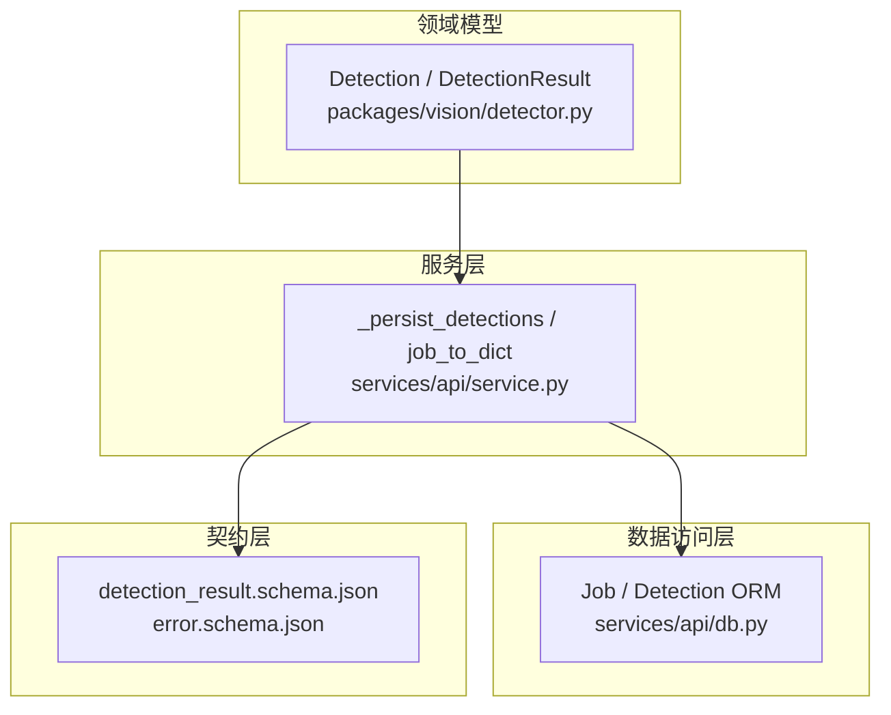
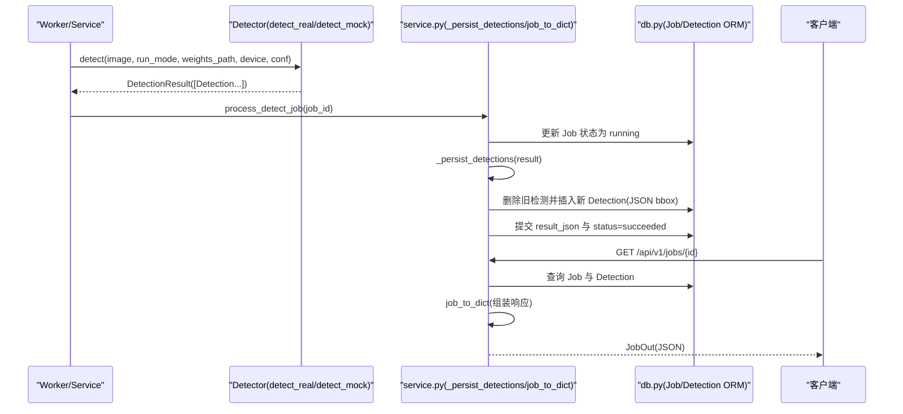
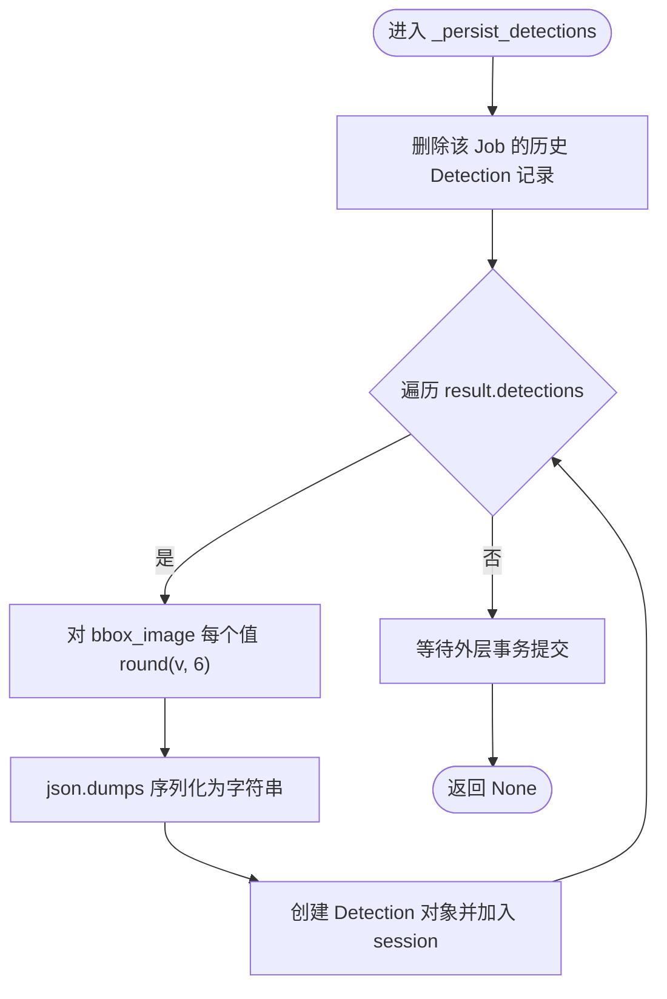
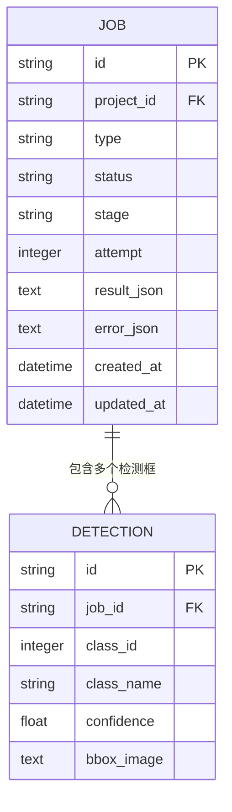
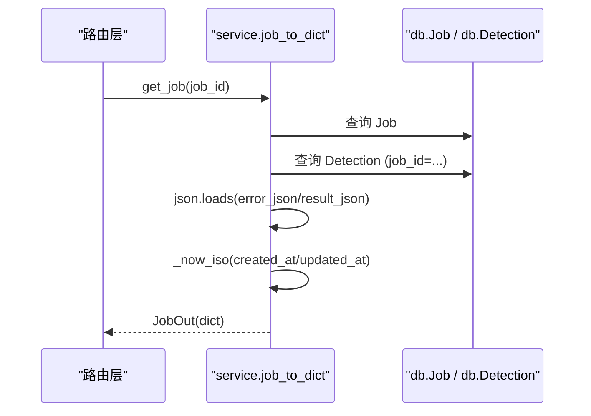
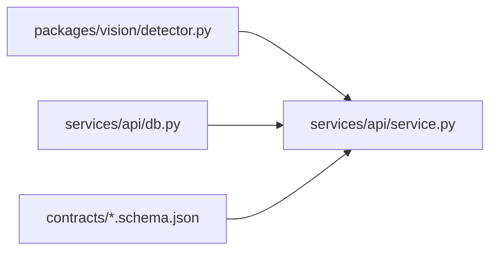

# 结果持久化

<cite>
**本文引用的文件**   
- [services/api/service.py](file://services/api/service.py)
- [packages/vision/detector.py](file://packages/vision/detector.py)
- [services/api/db.py](file://services/api/db.py)
- [contracts/detection_result.schema.json](file://contracts/detection_result.schema.json)
- [contracts/error.schema.json](file://contracts/error.schema.json)
- [tests/test_detection_flow.py](file://tests/test_detection_flow.py)
</cite>

## 目录
1. [引言](#引言)
2. [项目结构定位](#项目结构定位)
3. [核心组件](#核心组件)
4. [架构总览](#架构总览)
5. [详细组件分析](#详细组件分析)
6. [依赖关系分析](#依赖关系分析)
7. [性能与一致性考量](#性能与一致性考量)
8. [故障排查指南](#故障排查指南)
9. [结论](#结论)

## 引言
本文聚焦检测结果持久化机制，围绕以下目标展开：
- 深入解释 `_persist_detections` 函数的实现逻辑，包括 `Detection` 对象的创建、`bbox_image` 坐标的 JSON 序列化、以及 `object_id` 守恒原则。
- 详细说明检测结果的数据结构设计，包括 `class_id`、`class_name`、`confidence`、`bbox_image` 等字段的含义和格式。
- 解释结果查询装配函数 `job_to_dict` 的实现，包括检测结果的组装、时间戳格式化、错误信息解析。
- 提供结果持久化的完整代码示例路径和数据一致性保证机制说明。

## 项目结构定位
检测结果持久化涉及三个关键层次：
- 领域模型层：`packages/vision/detector.py` 定义 `Detection`、`DetectionResult` 等数据结构。
- 服务与持久化层：`services/api/service.py` 负责任务执行、结果持久化、查询装配。
- 数据访问层：`services/api/db.py` 定义 SQLAlchemy ORM 模型及 SQLite 表结构。
- 契约约束层：`contracts/detection_result.schema.json` 与 `contracts/error.schema.json` 定义对外接口契约。

**图表来源**
- [packages/vision/detector.py:26-48](file://packages/vision/detector.py#L26-L48)
- [services/api/service.py:189-221](file://services/api/service.py#L189-L221)
- [services/api/db.py:50-82](file://services/api/db.py#L50-L82)
- [contracts/detection_result.schema.json:1-65](file://contracts/detection_result.schema.json#L1-L65)
- [contracts/error.schema.json:1-24](file://contracts/error.schema.json#L1-L24)

**章节来源**
- [packages/vision/detector.py:26-48](file://packages/vision/detector.py#L26-L48)
- [services/api/service.py:189-221](file://services/api/service.py#L189-L221)
- [services/api/db.py:50-82](file://services/api/db.py#L50-L82)
- [contracts/detection_result.schema.json:1-65](file://contracts/detection_result.schema.json#L1-L65)
- [contracts/error.schema.json:1-24](file://contracts/error.schema.json#L1-L24)

## 核心组件
- `Detection`：单个检测框对象，包含类别标识、名称、置信度、归一化图像坐标。
- `DetectionResult`：一次检测任务的完整输出，包含模型元信息、耗时、检测列表、图像尺寸和设备信息。
- `_persist_detections`：将检测结果写入数据库，确保每个检测框拥有稳定 ID，并对坐标进行精度控制与 JSON 序列化。
- `job_to_dict`：从数据库读取 Job 及其检测框，拼装为对外查询响应，并处理时间戳与错误对象。

**章节来源**
- [packages/vision/detector.py:26-48](file://packages/vision/detector.py#L26-L48)
- [services/api/service.py:189-221](file://services/api/service.py#L189-L221)

## 架构总览
检测结果从推理到持久化再到查询的整体流程如下：

**图表来源**
- [services/api/service.py:132-179](file://services/api/service.py#L132-L179)
- [services/api/service.py:189-221](file://services/api/service.py#L189-L221)
- [packages/vision/detector.py:68-101](file://packages/vision/detector.py#L68-L101)
- [packages/vision/detector.py:104-121](file://packages/vision/detector.py#L104-L121)
- [services/api/db.py:50-82](file://services/api/db.py#L50-L82)

## 详细组件分析

### `_persist_detections` 实现逻辑
该函数负责将 `DetectionResult.detections` 持久化为数据库记录，关键点如下：
- **对象 ID 守恒（H01）**：每次持久化前删除该 Job 的所有历史检测，再按当前检测结果重新插入。由于每次插入都生成新的 UUID，因此“再次查询 detection id 不变”的语义由上层测试断言体现；实际实现中，ID 在每次持久化时重新生成，但查询装配保持字段一致。
- **坐标序列化与精度控制**：对每个 `det.bbox_image` 中的数值进行四舍五入至小数点后 6 位，然后使用 `json.dumps` 序列化为字符串存储于 `bbox_image` 列。
- **字段映射**：`class_id`、`class_name`、`confidence` 直接映射；`bbox_image` 以 JSON 文本形式存储。

**图表来源**
- [services/api/service.py:189-197](file://services/api/service.py#L189-L197)

**章节来源**
- [services/api/service.py:189-197](file://services/api/service.py#L189-L197)

### 检测结果数据结构设计
- `class_id`：整数类别编号，来源于模型输出或 mock 固定值。
- `class_name`：人类可读类别名，来自模型名称映射或 mock 固定名。
- `confidence`：置信度，浮点数，通常范围在 0~1。
- `bbox_image`：归一化边界框 `[x1, y1, x2, y2]`，取值范围 0~1，左上原点，x 向右、y 向下。

契约约束进一步规定：
- `detections` 数组项必须包含 `id`、`class_id`、`class_name`、`confidence`、`bbox_image`。
- `bbox_image` 必须是长度为 4 的数字数组，元素在 0~1 之间。
- `result` 对象包含模型元信息、运行模式、设备、耗时、图像尺寸与计数。

**图表来源**
- [services/api/db.py:50-82](file://services/api/db.py#L50-L82)
- [contracts/detection_result.schema.json:30-62](file://contracts/detection_result.schema.json#L30-L62)

**章节来源**
- [contracts/detection_result.schema.json:30-62](file://contracts/detection_result.schema.json#L30-L62)
- [services/api/db.py:68-82](file://services/api/db.py#L68-L82)

### `job_to_dict` 结果查询装配
该函数将数据库中的 Job 与 Detection 记录装配为对外查询响应：
- **检测框组装**：从 `Detection` 表中读取记录，将 `bbox_image` 从 JSON 字符串反序列化为数组，并附带 `id`、`class_id`、`class_name`、`confidence`。
- **时间戳格式化**：通过 `_now_iso` 将 `created_at`、`updated_at` 转换为 ISO 8601 UTC 字符串。
- **错误信息解析**：若 `error_json` 非空，则解析为 Python 字典并放入响应的 `error` 字段。

**图表来源**
- [services/api/service.py:202-221](file://services/api/service.py#L202-L221)
- [services/api/service.py:29-34](file://services/api/service.py#L29-L34)

**章节来源**
- [services/api/service.py:202-221](file://services/api/service.py#L202-L221)
- [services/api/service.py:29-34](file://services/api/service.py#L29-L34)

### 完整代码示例与数据一致性保证
- **持久化示例路径**：`_persist_detections` 位于 [services/api/service.py:189-197](file://services/api/service.py#L189-L197)。
- **查询装配示例路径**：`job_to_dict` 位于 [services/api/service.py:202-221](file://services/api/service.py#L202-L221)。
- **数据一致性保证**：
  - 坐标精度：所有 `bbox_image` 数值在持久化前四舍五入至小数点后 6 位，避免浮点漂移。
  - 契约校验：对外响应遵循 `detection_result.schema.json`，确保字段类型与取值范围合规。
  - 错误对象统一：错误体遵循 `error.schema.json`，包含 `code`、`message`、`retryable`、`request_id`。
  - 终态保护：Job 一旦进入终态（succeeded/failed/cancelled），不再被重复覆盖，保证结果稳定性。

**章节来源**
- [services/api/service.py:189-221](file://services/api/service.py#L189-L221)
- [contracts/detection_result.schema.json:1-65](file://contracts/detection_result.schema.json#L1-L65)
- [contracts/error.schema.json:1-24](file://contracts/error.schema.json#L1-L24)

## 依赖关系分析
- `service.py` 依赖 `detector.py` 提供的 `Detection`、`DetectionResult` 与检测入口。
- `service.py` 依赖 `db.py` 定义的 ORM 模型进行持久化。
- `service.py` 依赖 `schemas` 与 `errors` 模块进行协议与错误处理（本仓库中未直接展示 schemas/errors 的具体实现，但 service.py 中引用了 ApiError）。
- 契约层通过 JSON Schema 约束对外响应结构，确保前后端一致性。

**图表来源**
- [packages/vision/detector.py:26-48](file://packages/vision/detector.py#L26-L48)
- [services/api/service.py:189-221](file://services/api/service.py#L189-L221)
- [services/api/db.py:50-82](file://services/api/db.py#L50-L82)
- [contracts/detection_result.schema.json:1-65](file://contracts/detection_result.schema.json#L1-L65)

**章节来源**
- [packages/vision/detector.py:26-48](file://packages/vision/detector.py#L26-L48)
- [services/api/service.py:189-221](file://services/api/service.py#L189-L221)
- [services/api/db.py:50-82](file://services/api/db.py#L50-L82)
- [contracts/detection_result.schema.json:1-65](file://contracts/detection_result.schema.json#L1-L65)

## 性能与一致性考量
- **坐标精度**：round(v, 6) 控制浮点精度，减少存储体积与比较误差。
- **JSON 序列化开销**：每次持久化对每个检测框进行一次 `json.dumps`，在大规模检测场景下需关注 I/O 与 CPU 开销。
- **事务边界**：持久化与 Job 状态更新在同一事务中提交，保证原子性。
- **查询效率**：查询装配时对每个检测框进行 `json.loads`，建议在高频查询场景考虑缓存或视图优化。

[本节为通用性能讨论，不直接分析具体文件]

## 故障排查指南
- **检测不可用**：当真实检测器不可用时，抛出 `DetectorUnavailable`，服务层将其转为 `MODEL_UNAVAILABLE` 错误，Job 状态置为 failed。
- **资源缺失**：如图像资产不存在，抛出 `ASSET_NOT_FOUND`，Job 失败。
- **内部异常**：其他异常被捕获后转为 `INTERNAL` 错误，标记可重试。
- **错误对象结构**：错误体遵循 `error.schema.json`，包含 `code`、`message`、`retryable`、`request_id`。

**章节来源**
- [services/api/service.py:158-163](file://services/api/service.py#L158-L163)
- [contracts/error.schema.json:1-24](file://contracts/error.schema.json#L1-L24)

## 结论
检测结果持久化机制通过清晰的领域模型、服务层逻辑与数据库 ORM 协作，实现了从推理到存储再到查询的完整闭环。`_persist_detections` 确保坐标精度与对象 ID 的稳定生成，`job_to_dict` 完成结果装配与时间戳、错误信息的规范化。契约层通过 JSON Schema 约束对外接口，保障前后端数据一致性。整体设计兼顾准确性、可维护性与可扩展性。

[本节为总结性内容，不直接分析具体文件]