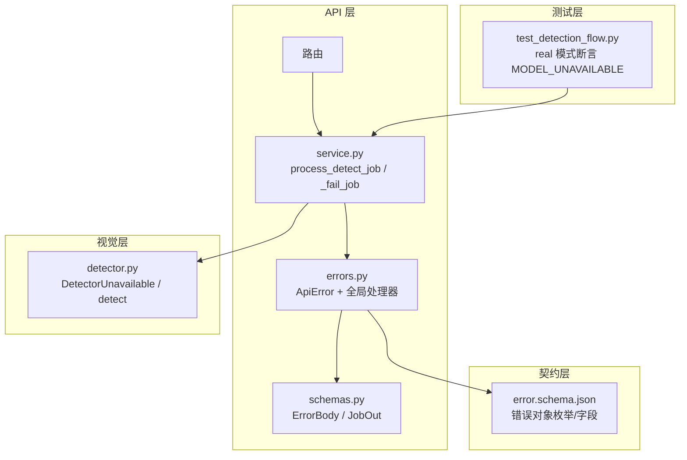
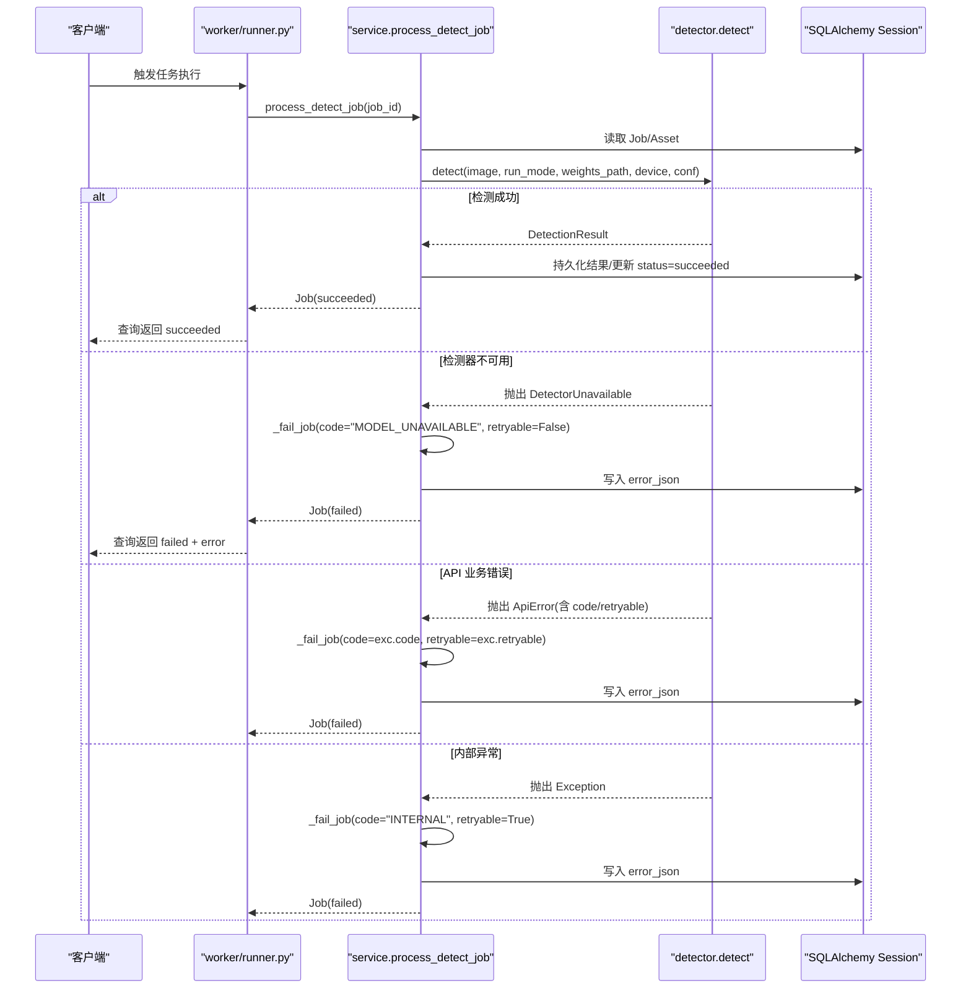
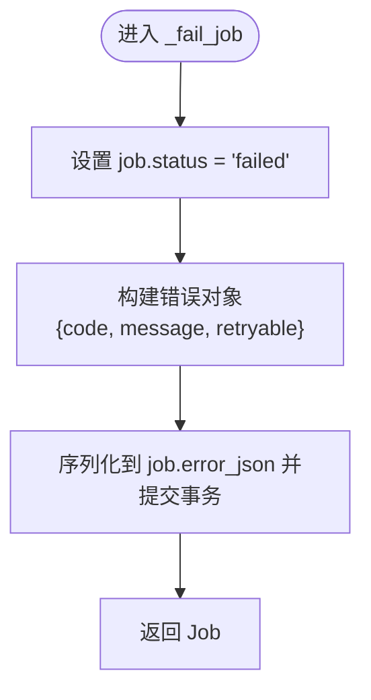
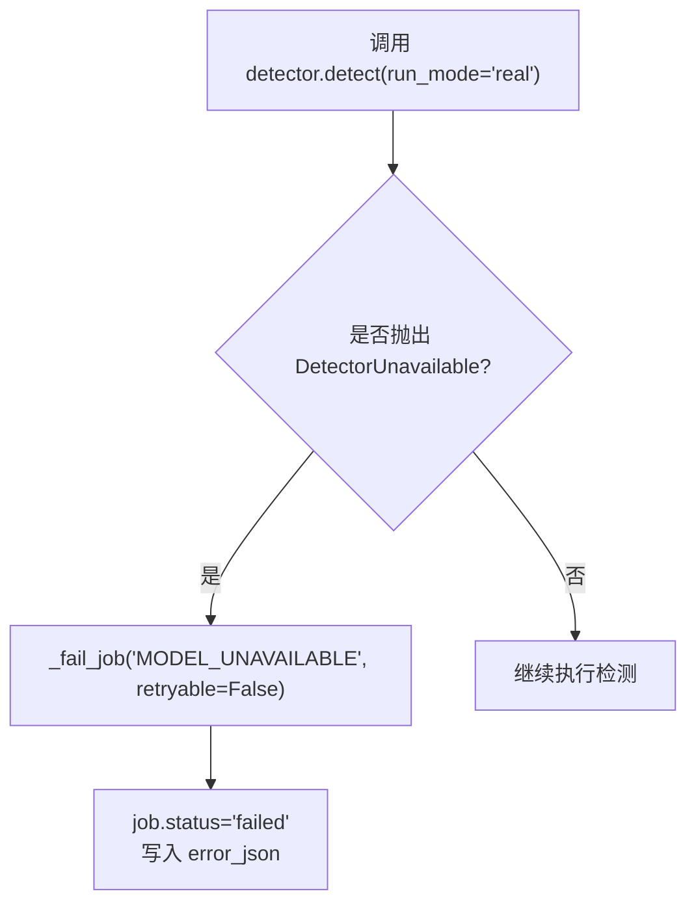
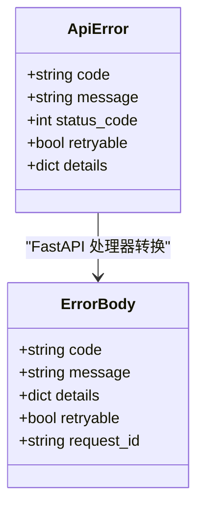
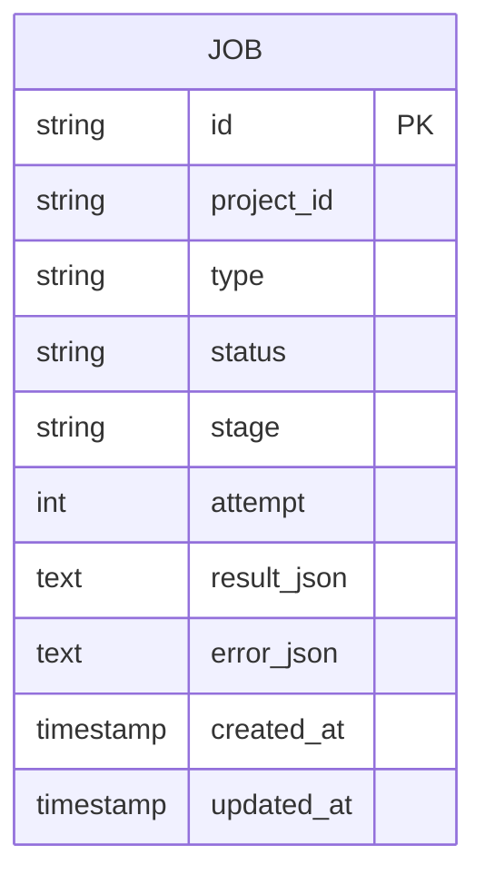
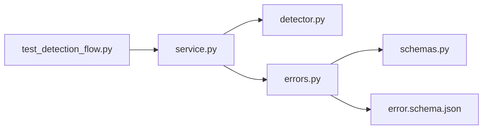

# 错误处理机制

<cite>
**本文引用的文件**   
- [services/api/service.py](file://services/api/service.py)
- [services/api/errors.py](file://services/api/errors.py)
- [services/api/schemas.py](file://services/api/schemas.py)
- [packages/vision/detector.py](file://packages/vision/detector.py)
- [contracts/error.schema.json](file://contracts/error.schema.json)
- [tests/test_detection_flow.py](file://tests/test_detection_flow.py)
</cite>

## 目录
1. [引言](#引言)
2. [项目结构](#项目结构)
3. [核心组件](#核心组件)
4. [架构总览](#架构总览)
5. [详细组件分析](#详细组件分析)
6. [依赖关系分析](#依赖关系分析)
7. [性能与可靠性考虑](#性能与可靠性考虑)
8. [故障排查指南](#故障排查指南)
9. [结论](#结论)

## 引言
本文聚焦任务调度中的错误处理机制，重点解析 _fail_job 函数的实现逻辑、错误码分类（如 MODEL_UNAVAILABLE、INTERNAL）、错误消息格式化规则、retryable 标志的设置策略，以及不同异常类型的处理路径：检测器不可用时的降级策略、API 错误的分类处理、内部错误的重试机制。同时说明错误信息的持久化存储格式、查询方式，并提供完整的代码示例定位与排障建议。

## 项目结构
本仓库采用服务分层组织：
- services/api：HTTP API、业务服务、数据库模型、统一错误处理与 Schema 契约。
- packages/vision：视觉检测适配器，封装真实与 Mock 检测逻辑。
- contracts：JSON Schema 契约，约束错误对象与检测结果的结构。
- tests：端到端流程测试，覆盖 real 模式下权重缺失的错误分支。

**图表来源**
- [services/api/service.py:132-186](file://services/api/service.py#L132-L186)
- [services/api/errors.py:12-55](file://services/api/errors.py#L12-L55)
- [services/api/schemas.py:9-16](file://services/api/schemas.py#L9-L16)
- [packages/vision/detector.py:22-24](file://packages/vision/detector.py#L22-L24)
- [contracts/error.schema.json:1-24](file://contracts/error.schema.json#L1-L24)
- [tests/test_detection_flow.py:113-126](file://tests/test_detection_flow.py#L113-L126)

**章节来源**
- [services/api/service.py:1-237](file://services/api/service.py#L1-L237)
- [services/api/errors.py:1-56](file://services/api/errors.py#L1-L56)
- [services/api/schemas.py:1-84](file://services/api/schemas.py#L1-L84)
- [packages/vision/detector.py:1-129](file://packages/vision/detector.py#L1-L129)
- [contracts/error.schema.json:1-24](file://contracts/error.schema.json#L1-L24)
- [tests/test_detection_flow.py:1-126](file://tests/test_detection_flow.py#L1-L126)

## 核心组件
- process_detect_job：任务执行主流程，负责状态迁移、调用检测器、捕获异常并落库失败信息。
- _fail_job：统一的失败落库函数，设置 job.status=failed，写入 error_json，包含 code/message/retryable。
- ApiError：统一业务异常，携带 code、message、status_code、retryable、details，被 FastAPI 全局处理器转换为 ErrorBody。
- DetectorUnavailable：检测器不可用异常，用于 real 模式下缺依赖/权重/GPU 等场景。
- ErrorBody：Pydantic 模型，定义对外错误对象结构；error.schema.json 约束其字段与 code 枚举。

关键职责边界：
- service.py 负责“任务生命周期”和“失败落库”。
- errors.py 负责“HTTP 层错误响应”。
- detector.py 负责“检测能力探测与异常抛出”。
- schemas.py + error.schema.json 负责“错误对象的契约校验”。

**章节来源**
- [services/api/service.py:132-186](file://services/api/service.py#L132-L186)
- [services/api/errors.py:12-55](file://services/api/errors.py#L12-L55)
- [packages/vision/detector.py:22-24](file://packages/vision/detector.py#L22-L24)
- [services/api/schemas.py:9-16](file://services/api/schemas.py#L9-L16)
- [contracts/error.schema.json:1-24](file://contracts/error.schema.json#L1-L24)

## 架构总览
下图展示一次检测任务的错误处理时序，包括正常成功与三类典型错误路径。

**图表来源**
- [services/api/service.py:132-186](file://services/api/service.py#L132-L186)
- [packages/vision/detector.py:124-128](file://packages/vision/detector.py#L124-L128)
- [services/worker/runner.py:16-27](file://services/worker/runner.py#L16-L27)

## 详细组件分析

### _fail_job 函数与错误落库
_fail_job 是任务失败的统一落库入口，核心行为：
- 将 job.status 置为 failed。
- 将错误信息以 JSON 字符串写入 job.error_json，结构包含 code、message、retryable。
- 提交事务并返回 Job。

该函数被 process_detect_job 在三种异常分支中调用：
- 检测器不可用：code="MODEL_UNAVAILABLE"，retryable=False。
- API 业务错误：使用 ApiError 的 code 与 message，并透传其 retryable。
- 其他内部异常：code="INTERNAL"，retryable=True。

**图表来源**
- [services/api/service.py:182-186](file://services/api/service.py#L182-L186)

**章节来源**
- [services/api/service.py:182-186](file://services/api/service.py#L182-L186)

### 错误码分类与 retryable 规则
- MODEL_UNAVAILABLE：当 detector.DetectorUnavailable 被捕获时设置，表示真实检测环境不可用（缺少 ultralytics/权重/GPU）。retryable=False，因为这是环境配置问题，不应自动重试。
- INTERNAL：捕获所有未预期异常时设置，表示内部错误。retryable=True，允许上层重试或告警后重试。
- ApiError 自定义错误码：由上游业务逻辑抛出，例如 INVALID_IMAGE、ASSET_NOT_FOUND、JOB_NOT_FOUND 等。retryable 取决于具体错误语义，通常可重试的错误（如资源暂时不可用）会显式设置 retryable=True。

错误码枚举与契约约束见 error.schema.json，其中包含 MODEL_UNAVAILABLE、INTERNAL 等合法值。

**章节来源**
- [services/api/service.py:158-163](file://services/api/service.py#L158-L163)
- [contracts/error.schema.json:10-16](file://contracts/error.schema.json#L10-L16)

### 异常类型处理策略

#### 检测器不可用时的降级处理
- 检测器在 real 模式下若无法加载（缺少依赖、权重不存在、GPU 不可用），会抛出 DetectorUnavailable。
- process_detect_job 捕获该异常，调用 _fail_job 记录 MODEL_UNAVAILABLE，并将 job 标记为 failed。
- 不静默回退到 mock 模式，确保错误可见性，便于运维与用户感知。

**图表来源**
- [services/api/service.py:158-159](file://services/api/service.py#L158-L159)
- [packages/vision/detector.py:22-24](file://packages/vision/detector.py#L22-L24)

**章节来源**
- [services/api/service.py:158-159](file://services/api/service.py#L158-L159)
- [packages/vision/detector.py:22-24](file://packages/vision/detector.py#L22-L24)

#### API 错误的分类处理
- ApiError 是统一业务异常，携带 code、message、status_code、retryable、details。
- process_detect_job 捕获 ApiError，将其 code 与 message 原样传递给 _fail_job，并透传 retryable。
- FastAPI 全局异常处理器会将 ApiError 转换为 ErrorBody 响应，包含 request_id 与 retryable 字段。

**图表来源**
- [services/api/errors.py:12-45](file://services/api/errors.py#L12-L45)
- [services/api/schemas.py:9-16](file://services/api/schemas.py#L9-L16)

**章节来源**
- [services/api/errors.py:12-55](file://services/api/errors.py#L12-L55)
- [services/api/schemas.py:9-16](file://services/api/schemas.py#L9-L16)

#### 内部错误的重试机制
- 对于非 ApiError 且非 DetectorUnavailable 的异常，process_detect_job 捕获为通用 Exception，设置 code="INTERNAL"，retryable=True。
- 这表示内部错误具备可重试性，上层调度器可根据 retryable 决定是否重试或进行指数退避。

**章节来源**
- [services/api/service.py:162-163](file://services/api/service.py#L162-L163)

### 错误信息的持久化存储格式与查询方式
- 存储位置：Job.error_json 字段，值为 JSON 字符串。
- 存储结构：{code, message, retryable}。
- 查询方式：job_to_dict 在装配 Job 输出时，从 job.error_json 反序列化为 Python 字典，并在 JobOut 中以 error 字段暴露给接口层。

**图表来源**
- [services/api/service.py:202-221](file://services/api/service.py#L202-L221)

**章节来源**
- [services/api/service.py:202-221](file://services/api/service.py#L202-L221)

### 完整代码示例定位
- 任务执行与失败落库：[services/api/service.py:132-186](file://services/api/service.py#L132-L186)
- 统一错误异常与 FastAPI 处理器：[services/api/errors.py:12-55](file://services/api/errors.py#L12-L55)
- 错误对象 Schema 与契约：[services/api/schemas.py:9-16](file://services/api/schemas.py#L9-L16)、[contracts/error.schema.json:1-24](file://contracts/error.schema.json#L1-L24)
- 检测器不可用异常定义：[packages/vision/detector.py:22-24](file://packages/vision/detector.py#L22-L24)
- 端到端测试验证 real 模式错误分支：[tests/test_detection_flow.py:113-126](file://tests/test_detection_flow.py#L113-L126)

## 依赖关系分析
- service.process_detect_job 依赖 detector.detect 执行检测，依赖 SQLAlchemy Session 读写 Job/Asset/Detection。
- service._fail_job 依赖 json 模块序列化错误对象。
- errors.ApiError 被 FastAPI 全局处理器转换为 ErrorBody，后者受 error.schema.json 约束。
- tests 通过 HTTP 客户端验证 real 模式下 MODEL_UNAVAILABLE 的错误分支。

**图表来源**
- [services/api/service.py:132-186](file://services/api/service.py#L132-L186)
- [services/api/errors.py:12-55](file://services/api/errors.py#L12-L55)
- [services/api/schemas.py:9-16](file://services/api/schemas.py#L9-L16)
- [contracts/error.schema.json:1-24](file://contracts/error.schema.json#L1-L24)
- [tests/test_detection_flow.py:113-126](file://tests/test_detection_flow.py#L113-L126)

**章节来源**
- [services/api/service.py:132-186](file://services/api/service.py#L132-L186)
- [services/api/errors.py:12-55](file://services/api/errors.py#L12-L55)
- [services/api/schemas.py:9-16](file://services/api/schemas.py#L9-L16)
- [contracts/error.schema.json:1-24](file://contracts/error.schema.json#L1-L24)
- [tests/test_detection_flow.py:113-126](file://tests/test_detection_flow.py#L113-L126)

## 性能与可靠性考虑
- 避免重复处理终态任务：process_detect_job 对已处于 succeeded/failed/cancelled 的任务直接返回，防止覆盖与重复落库。
- 检测器懒加载：detector._load_model 缓存模型实例，减少重复初始化开销。
- 错误可重试性：INTERNAL 错误标记 retryable=True，适合配合外部调度器的重试策略；MODEL_UNAVAILABLE 标记 retryable=False，避免无效重试。
- 数据一致性：_persist_detections 在成功路径先删除旧检测框再写入新结果，保证 object_id 守恒与结果一致性。

**章节来源**
- [services/api/service.py:141-146](file://services/api/service.py#L141-L146)
- [packages/vision/detector.py:50-65](file://packages/vision/detector.py#L50-L65)
- [services/api/service.py:189-198](file://services/api/service.py#L189-L198)

## 故障排查指南

### 常见问题与定位
- 现象：real 模式下检测任务失败，返回 MODEL_UNAVAILABLE。
  - 可能原因：缺少 ultralytics 依赖、权重文件不存在、GPU 不可用。
  - 定位路径：查看 job.error_json 中的 code 是否为 MODEL_UNAVAILABLE，检查 detector._load_model 抛出的 DetectorUnavailable 信息。
  - 参考文件：
    - [services/api/service.py:158-159](file://services/api/service.py#L158-L159)
    - [packages/vision/detector.py:50-65](file://packages/vision/detector.py#L50-L65)
    - [tests/test_detection_flow.py:113-126](file://tests/test_detection_flow.py#L113-L126)

- 现象：任务失败但错误码为 INTERNAL。
  - 可能原因：检测过程中出现未预期异常（如图像处理、IO 错误）。
  - 定位路径：检查 job.error_json.message 中的异常堆栈信息，确认是否为内部错误。
  - 参考文件：
    - [services/api/service.py:162-163](file://services/api/service.py#L162-L163)

- 现象：上传图像被拒绝，返回 INVALID_IMAGE。
  - 可能原因：不支持的文件扩展名或空文件。
  - 定位路径：检查 upload_image 中对扩展名与文件大小的校验逻辑。
  - 参考文件：
    - [services/api/service.py:37-41](file://services/api/service.py#L37-L41)
    - [services/api/service.py:73-85](file://services/api/service.py#L73-L85)
    - [tests/test_detection_flow.py:91-110](file://tests/test_detection_flow.py#L91-L110)

### 错误对象结构与查询
- 错误对象结构：
  - code：错误码，需符合 error.schema.json 枚举。
  - message：人类可读的错误描述。
  - retryable：布尔值，指示是否可重试。
  - request_id：请求追踪 ID（HTTP 层）。
- 查询方式：
  - 通过 JobOut.error 字段获取反序列化后的错误对象。
  - 参考文件：
    - [services/api/schemas.py:9-16](file://services/api/schemas.py#L9-L16)
    - [services/api/service.py:202-221](file://services/api/service.py#L202-L221)
    - [contracts/error.schema.json:1-24](file://contracts/error.schema.json#L1-L24)

### 重试策略建议
- 对 retryable=True 的错误（如 INTERNAL），建议结合外部调度器实施指数退避重试，并限制最大重试次数。
- 对 retryable=False 的错误（如 MODEL_UNAVAILABLE），应提示用户修复环境或配置，而不是自动重试。

**章节来源**
- [services/api/service.py:158-163](file://services/api/service.py#L158-L163)
- [services/api/service.py:202-221](file://services/api/service.py#L202-L221)
- [contracts/error.schema.json:1-24](file://contracts/error.schema.json#L1-L24)
- [tests/test_detection_flow.py:91-126](file://tests/test_detection_flow.py#L91-L126)

## 结论
_fail_job 作为任务失败的统一落库入口，确保了错误信息的一致性与可观测性。通过区分 MODEL_UNAVAILABLE 与 INTERNAL 两类错误，并结合 retryable 标志，系统能够向调度层传递明确的恢复策略。配合 FastAPI 的统一错误处理器与 JSON Schema 契约，错误对象在 HTTP 层与持久化层保持一致，便于前端展示与后端诊断。建议在调度层根据 retryable 实现智能重试，并对 MODEL_UNAVAILABLE 提供明确的环境自检与修复指引。