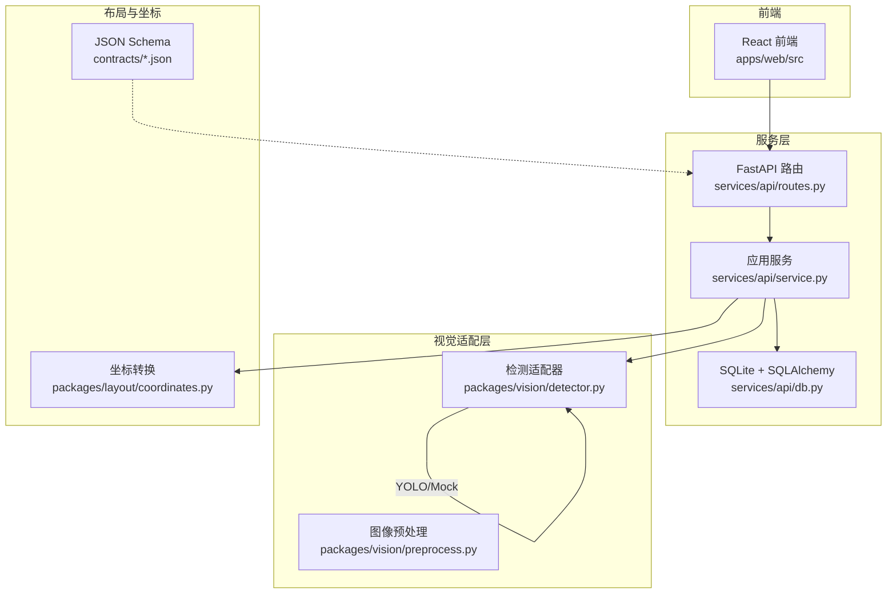
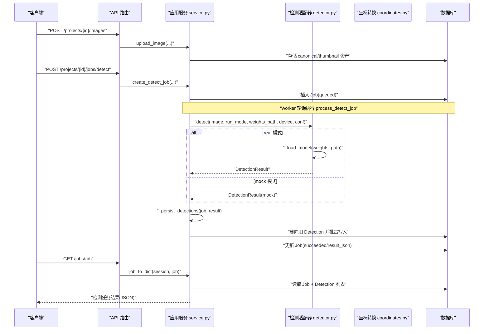
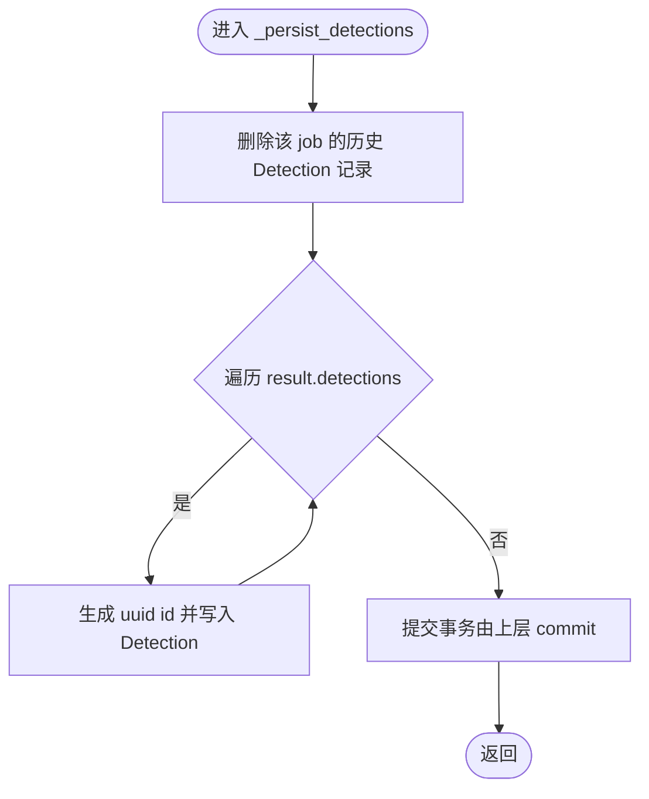
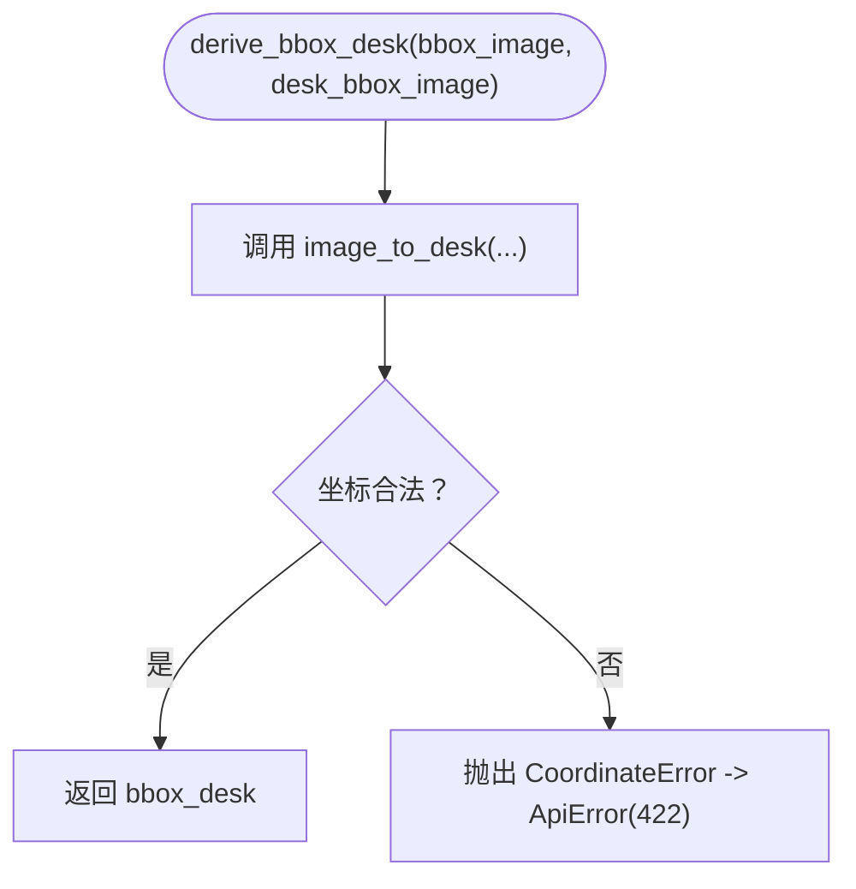
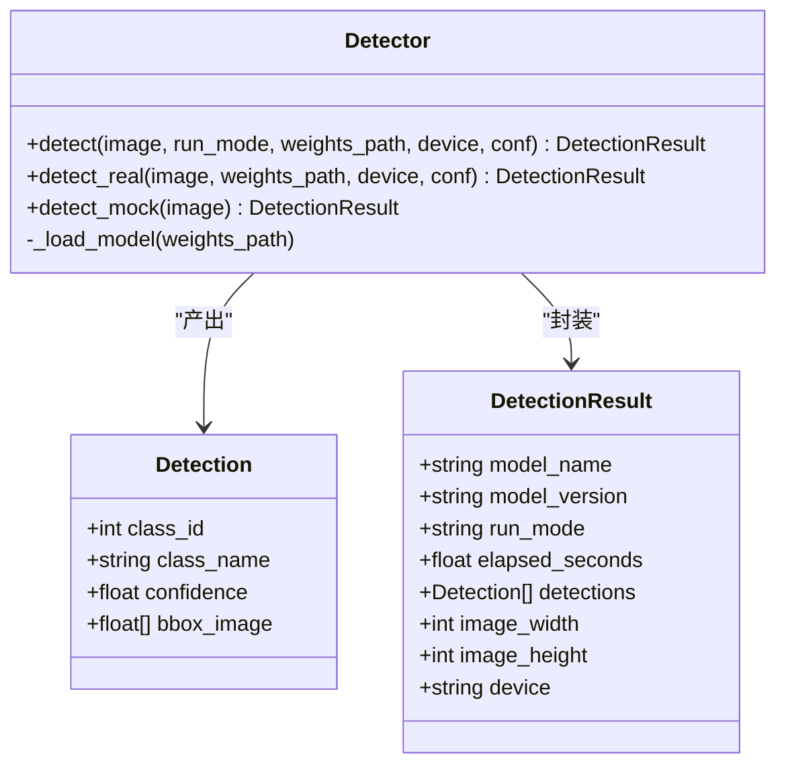
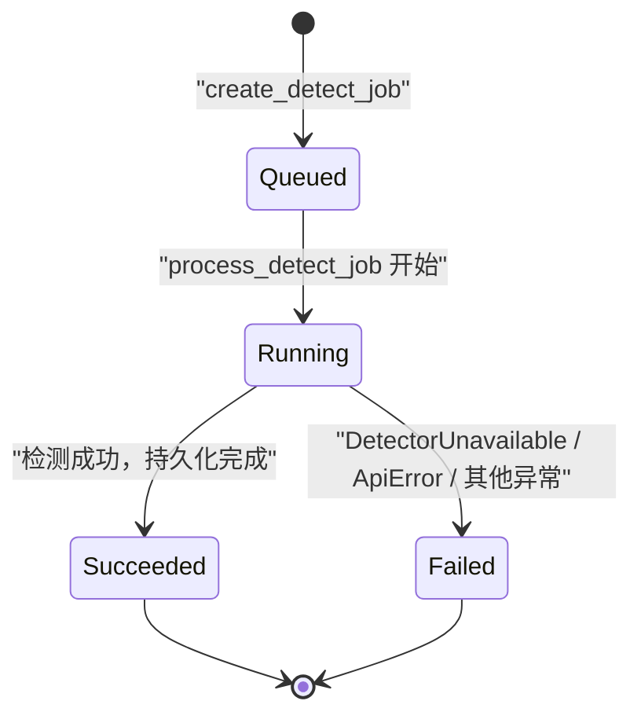
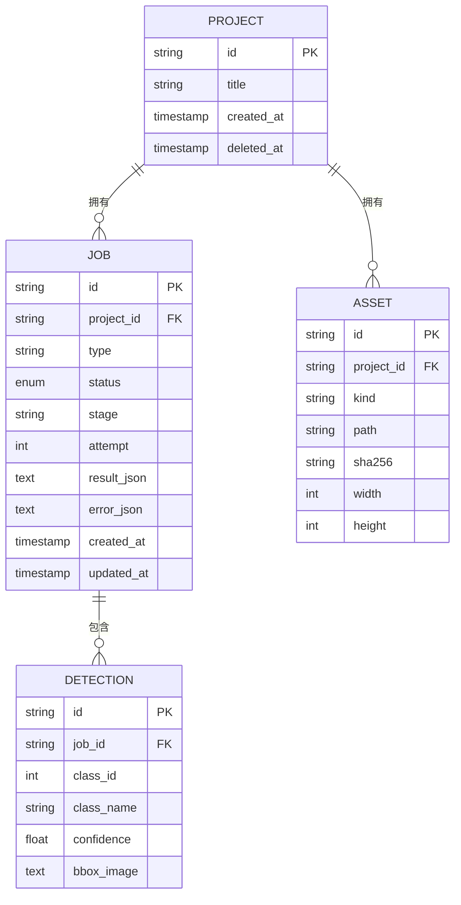
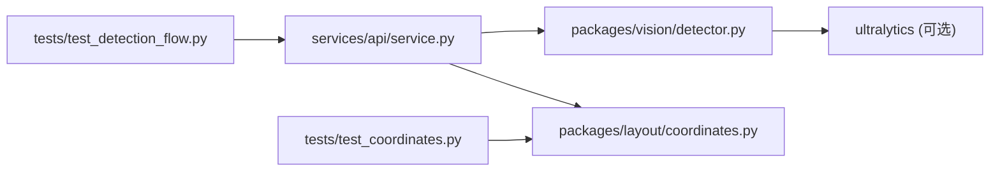

# 检测流程编排

<cite>
**本文引用的文件**   
- [README.md](file://README.md)
- [service.py](file://services/api/service.py)
- [detector.py](file://packages/vision/detector.py)
- [coordinates.py](file://packages/layout/coordinates.py)
- [detection_result.schema.json](file://contracts/detection_result.schema.json)
- [test_detection_flow.py](file://tests/test_detection_flow.py)
- [test_coordinates.py](file://tests/test_coordinates.py)
</cite>

## 目录
1. [引言](#引言)
2. [项目结构](#项目结构)
3. [核心组件](#核心组件)
4. [架构总览](#架构总览)
5. [详细组件分析](#详细组件分析)
6. [依赖关系分析](#依赖关系分析)
7. [性能考虑](#性能考虑)
8. [故障排查指南](#故障排查指南)
9. [结论](#结论)

## 引言
本文面向“桌面智能整理”项目的检测流程编排，聚焦从图像上传到检测结果持久化、坐标转换与查询返回的完整链路。重点解释以下实现要点：
- 检测结果持久化 `_persist_detections`：对象 ID 守恒策略、数据库写入与序列化细节。
- 坐标转换 `derive_bbox_desk` 与底层 `image_to_desk` / `desk_to_image`：原图归一化框与桌面归一化框之间的双向映射。
- 数据结构设计：`Detection` / `DetectionResult`、JSON Schema 契约、数据库模型字段。
- 运行模式与错误处理：real/mock 分派、权重缺失不静默回退、非法坐标统一错误。
- 集成方式与测试覆盖：端到端测试、坐标往返一致性测试。

## 项目结构
本项目后端以 FastAPI 服务为核心，检测任务由 worker 执行；视觉检测通过适配器封装 YOLOv10 或 Mock；坐标转换独立为 layout 包；契约定义在 contracts 下。

**图表来源**
- [service.py:1-25](file://services/api/service.py#L1-L25)
- [detector.py:1-10](file://packages/vision/detector.py#L1-L10)
- [coordinates.py:1-9](file://packages/layout/coordinates.py#L1-L9)
- [detection_result.schema.json:1-8](file://contracts/detection_result.schema.json#L1-L8)

**章节来源**
- [README.md:8-24](file://README.md#L8-L24)

## 核心组件
- 检测适配器（packages/vision/detector.py）：提供 detect_real / detect_mock / detect 统一入口，输出 DetectionResult，包含 detections 列表与元信息（模型名、设备、耗时等）。
- 坐标转换（packages/layout/coordinates.py）：实现 image_to_desk / desk_to_image / clamp01，并定义 CoordinateError。
- 应用服务（services/api/service.py）：编排检测任务生命周期、持久化检测结果、导出 job_to_dict、提供 derive_bbox_desk。
- 契约（contracts/detection_result.schema.json）：约束检测任务返回结构、bbox_image 归一化约定、error 结构。

**章节来源**
- [detector.py:26-48](file://packages/vision/detector.py#L26-L48)
- [coordinates.py:14-24](file://packages/layout/coordinates.py#L14-L24)
- [service.py:189-237](file://services/api/service.py#L189-L237)
- [detection_result.schema.json:30-62](file://contracts/detection_result.schema.json#L30-L62)

## 架构总览
下图展示一次检测任务的端到端调用链：前端发起请求 → API 路由 → 服务层创建/处理任务 → 调用检测适配器 → 持久化结果 → 查询装配返回。

**图表来源**
- [service.py:120-179](file://services/api/service.py#L120-L179)
- [service.py:189-221](file://services/api/service.py#L189-L221)
- [detector.py:124-129](file://packages/vision/detector.py#L124-L129)

## 详细组件分析

### 检测结果持久化 _persist_detections
职责与行为：
- 对每个检测任务，先清空该 job_id 下的历史 Detection 记录，再按 DetectionResult.detections 顺序写入新记录。
- 为每个 Detection 生成稳定 id（uuid），确保同一任务多次查询时 detection id 不变（H01 接口层体现）。
- bbox_image 序列化为保留 6 位小数的 JSON 数组，避免浮点精度差异导致比较不稳定。

数据流与复杂度：
- 时间复杂度 O(n)，n 为检测结果数量；空间复杂度 O(n) 用于构建待插入对象列表。
- 若 result.detections 为空，仅执行删除操作，保持干净状态。

错误处理：
- 该函数本身不捕获异常；上层 process_detect_job 已用 try/except 包裹检测阶段，失败路径走 _fail_job。

**图表来源**
- [service.py:189-198](file://services/api/service.py#L189-L198)

**章节来源**
- [service.py:189-198](file://services/api/service.py#L189-L198)
- [test_detection_flow.py:75-79](file://tests/test_detection_flow.py#L75-L79)

### 坐标系统转换算法 derive_bbox_desk 与底层实现
职责与行为：
- derive_bbox_desk 作为服务层对外暴露的便捷方法，将 bbox_image（原图归一化框）与 desk_bbox_image（桌面矩形）转换为 bbox_desk（桌面归一化框）。
- 内部委托给 layout.coordinates.image_to_desk，CoordinateError 被转换为 ApiError（HTTP 422）。

坐标约定：
- bbox_image = [x1, y1, x2, y2]，相对整张原图归一化 0-1，左上原点，x 向右、y 向下。
- desk_bbox_image = [dx1, dy1, dx2, dy2]，使用同一原图坐标。
- bbox_desk：相对桌面矩形归一化；x_desk = (x_image - dx1) / (dx2 - dx1)，y 同理。

算法细节：
- _check_bbox 校验长度与方向性（x2 >= x1, y2 >= y1）。
- _desk_wh 计算桌面宽高 dw, dh，拒绝退化矩形（dw <= 0 或 dh <= 0）。
- image_to_desk 做平移+缩放；desk_to_image 为其逆运算。
- clamp01 用于展示裁剪，不参与业务逻辑转换。

往返一致性：
- desk_to_image(image_to_desk(b, d), d) == b 需成立；测试用例覆盖全桌面与子桌面两种场景。

**图表来源**
- [service.py:231-237](file://services/api/service.py#L231-L237)
- [coordinates.py:26-48](file://packages/layout/coordinates.py#L26-L48)

**章节来源**
- [service.py:231-237](file://services/api/service.py#L231-L237)
- [coordinates.py:1-63](file://packages/layout/coordinates.py#L1-L63)
- [test_coordinates.py:14-48](file://tests/test_coordinates.py#L14-L48)

### 检测适配器与运行模式
职责与行为：
- detect_real：加载 YOLOv10 模型，推理后归一化坐标，填充 DetectionResult。
- detect_mock：确定性 Mock，固定两个检测结果，model_name 显式标注 mock-detector。
- detect：根据 run_mode 分派到 real 或 mock。

模型缓存：
- 进程内全局变量 _MODEL 与 _MODEL_KEY 实现懒加载与缓存，避免 worker 每次调用重载模型。

错误处理：
- 缺 ultralytics 依赖或权重文件时抛 DetectorUnavailable；上层将其转为 MODEL_UNAVAILABLE 错误，不静默回退 mock。

**图表来源**
- [detector.py:26-48](file://packages/vision/detector.py#L26-L48)
- [detector.py:50-65](file://packages/vision/detector.py#L50-L65)
- [detector.py:68-101](file://packages/vision/detector.py#L68-L101)
- [detector.py:104-129](file://packages/vision/detector.py#L104-L129)

**章节来源**
- [detector.py:1-129](file://packages/vision/detector.py#L1-L129)

### 检测任务编排与错误处理
职责与行为：
- create_detect_job：创建 Job（queued），绑定 image_asset_id。
- process_detect_job：状态机流转 queued → running → succeeded/failed；捕获 DetectorUnavailable、ApiError 与其他异常，分别标记失败原因与是否可重试。
- _persist_detections：持久化检测结果。
- job_to_dict：装配查询响应，包括 result 元信息与 detections 列表。

错误分类：
- MODEL_UNAVAILABLE：真实检测不可用（缺依赖/权重/GPU）。
- INVALID_IMAGE：图像类型不支持或空文件。
- INTERNAL：未预期异常，标记为可重试。

**图表来源**
- [service.py:120-179](file://services/api/service.py#L120-L179)
- [service.py:182-186](file://services/api/service.py#L182-L186)

**章节来源**
- [service.py:120-179](file://services/api/service.py#L120-L179)
- [service.py:182-186](file://services/api/service.py#L182-L186)

### 数据结构设计与契约
- DetectionResult（内存对象）：包含模型元信息、耗时、设备、detections 列表。
- Detection（内存对象）：单个检测框，含 class_id/class_name/confidence/bbox_image。
- JSON Schema（detection_result.schema.json）：约束任务返回结构，bbox_image 必须为长度为 4 的归一化数组，confidence 范围 [0,1]。
- 数据库模型（db.py 中 Asset/Detection/Job/Project）：持久化 Job 状态、result_json、error_json；Detection 表存储 class_id/class_name/confidence/bbox_image（JSON 字符串）。

**图表来源**
- [detection_result.schema.json:1-65](file://contracts/detection_result.schema.json#L1-L65)
- [service.py:202-221](file://services/api/service.py#L202-L221)

**章节来源**
- [detection_result.schema.json:1-65](file://contracts/detection_result.schema.json#L1-L65)
- [service.py:202-221](file://services/api/service.py#L202-L221)

## 依赖关系分析
- services.api.service 依赖 packages.vision.detector 与 packages.layout.coordinates。
- detector 模块内部依赖 ultralytics（可选），并在缺失时抛出 DetectorUnavailable。
- coordinates 模块无外部依赖，纯数学转换。
- tests 覆盖端到端流程与坐标往返一致性。

**图表来源**
- [service.py:17-24](file://services/api/service.py#L17-L24)
- [detector.py:50-65](file://packages/vision/detector.py#L50-L65)
- [test_detection_flow.py:1-8](file://tests/test_detection_flow.py#L1-L8)
- [test_coordinates.py:1-11](file://tests/test_coordinates.py#L1-L11)

**章节来源**
- [service.py:17-24](file://services/api/service.py#L17-L24)
- [detector.py:50-65](file://packages/vision/detector.py#L50-L65)
- [test_detection_flow.py:1-8](file://tests/test_detection_flow.py#L1-L8)
- [test_coordinates.py:1-11](file://tests/test_coordinates.py#L1-L11)

## 性能考虑
- 模型懒加载与进程内缓存：_MODEL 与 _MODEL_KEY 避免重复初始化，降低 worker 启动开销。
- 推理参数优化：verbose=False，关闭遥测同步 settings.update({"sync": False})，减少网络请求。
- 坐标序列化精度：bbox_image 保留 6 位小数，平衡精度与存储体积。
- 批量写入：_persist_detections 一次性删除旧记录并批量添加新记录，减少事务次数。
- 建议：
  - 在高并发场景下，考虑为 DetectionResult 增加轻量级缓存键（如 image_sha256 + model_version + conf），避免重复推理。
  - 对大图像进行预处理降采样（在 preprocess 层控制分辨率上限），降低推理成本。
  - 使用连接池与异步 I/O（如 asyncpg）提升数据库吞吐（当前 SQLite 适合开发/小规模）。

[本节为通用指导，不直接分析具体文件]

## 故障排查指南
常见问题与定位步骤：
- 真实模式权重缺失：
  - 现象：任务状态 failed，error.code=MODEL_UNAVAILABLE，detections 为空。
  - 定位：检查 ASTRADESK_YOLO_WEIGHTS 指向的文件是否存在；查看 detector._load_model 抛出的 DetectorUnavailable。
  - 参考：[detector.py:50-65](file://packages/vision/detector.py#L50-L65)、[service.py:158-159](file://services/api/service.py#L158-L159)、[test_detection_flow.py:113-126](file://tests/test_detection_flow.py#L113-L126)。
- 非法坐标输入：
  - 现象：derive_bbox_desk 返回 422，error.code=SCHEMA_INVALID。
  - 定位：检查 bbox_image 与 desk_bbox_image 的长度与方向性；确认 desk_bbox_image 非退化矩形。
  - 参考：[coordinates.py:26-48](file://packages/layout/coordinates.py#L26-L48)、[service.py:231-237](file://services/api/service.py#L231-L237)、[test_coordinates.py:31-40](file://tests/test_coordinates.py#L31-L40)。
- 检测结果 ID 不一致：
  - 现象：多次查询同一 job，detection.id 变化。
  - 定位：确认 _persist_detections 是否被重复调用且未先删除旧记录；检查 job_to_dict 是否正确组装。
  - 参考：[service.py:189-198](file://services/api/service.py#L189-L198)、[test_detection_flow.py:75-79](file://tests/test_detection_flow.py#L75-L79)。
- 图像上传失败：
  - 现象：INVALID_IMAGE（400/415），可能因空文件或扩展名不支持。
  - 定位：检查 _ext_of 与 preprocess 的错误分支。
  - 参考：[service.py:37-41](file://services/api/service.py#L37-L41)、[service.py:73-85](file://services/api/service.py#L73-L85)、[test_detection_flow.py:91-110](file://tests/test_detection_flow.py#L91-L110)。

**章节来源**
- [detector.py:50-65](file://packages/vision/detector.py#L50-L65)
- [service.py:158-159](file://services/api/service.py#L158-L159)
- [service.py:189-198](file://services/api/service.py#L189-L198)
- [service.py:231-237](file://services/api/service.py#L231-L237)
- [coordinates.py:26-48](file://packages/layout/coordinates.py#L26-L48)
- [test_detection_flow.py:75-79](file://tests/test_detection_flow.py#L75-L79)
- [test_detection_flow.py:91-126](file://tests/test_detection_flow.py#L91-L126)
- [test_coordinates.py:31-48](file://tests/test_coordinates.py#L31-L48)

## 结论
本实现通过清晰的层次划分与契约约束，完成了从图像上传、检测推理、坐标转换到结果持久化的完整编排。关键点包括：
- 检测适配器统一入口与运行模式分派，保证 real/mock 行为明确且不静默回退。
- 坐标转换模块提供稳定的双向映射与严格的输入校验，保障几何一致性。
- 检测结果持久化采用“先删后写”策略与稳定 id 生成，满足 H01 对象 ID 守恒要求。
- 错误处理分层清晰，便于定位与恢复。
建议在后续迭代中引入更完善的缓存机制与异步 I/O，进一步提升吞吐与可扩展性。

[本节为总结性内容，不直接分析具体文件]