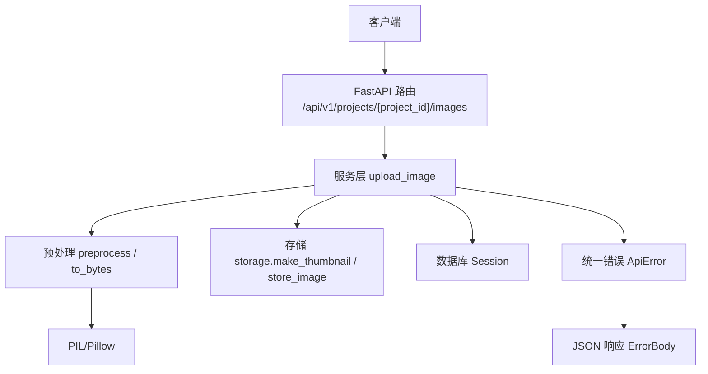
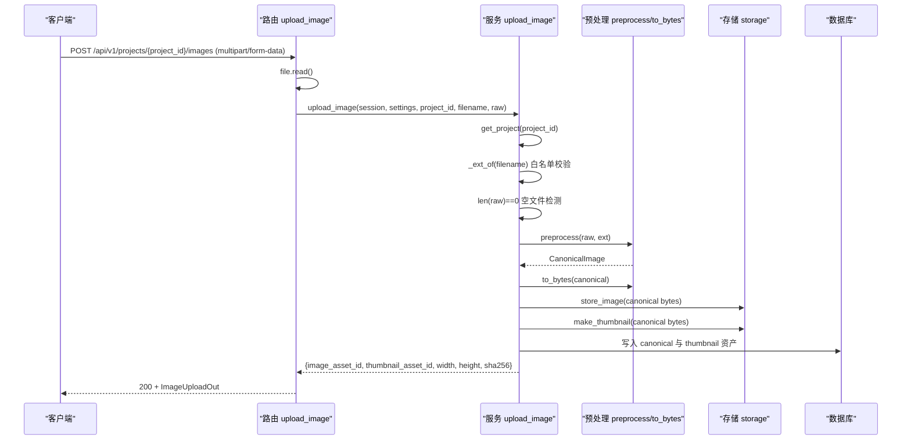
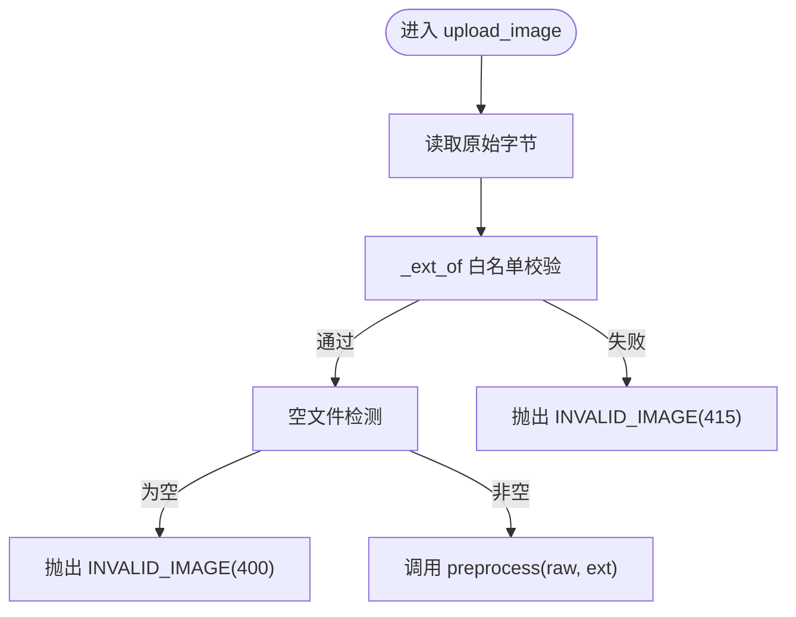
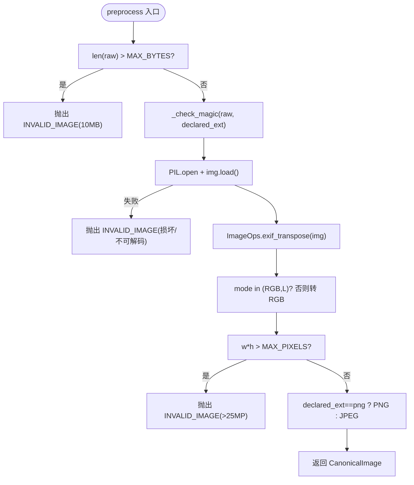
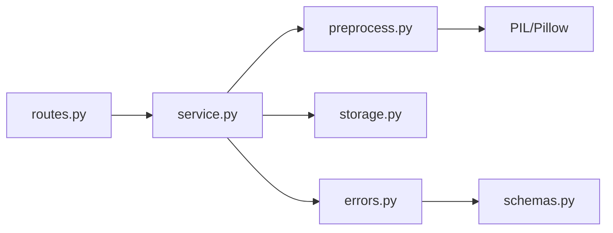

# 图像上传与预处理

<cite>
**本文引用的文件**   
- [packages/vision/preprocess.py](file://packages/vision/preprocess.py)
- [services/api/service.py](file://services/api/service.py)
- [services/api/routes.py](file://services/api/routes.py)
- [services/api/errors.py](file://services/api/errors.py)
- [services/api/schemas.py](file://services/api/schemas.py)
- [contracts/error.schema.json](file://contracts/error.schema.json)
- [tests/test_detection_flow.py](file://tests/test_detection_flow.py)
</cite>

## 目录
1. [引言](#引言)
2. [项目结构](#项目结构)
3. [核心组件](#核心组件)
4. [架构总览](#架构总览)
5. [详细组件分析](#详细组件分析)
6. [依赖关系分析](#依赖关系分析)
7. [性能考虑](#性能考虑)
8. [故障排查指南](#故障排查指南)
9. [结论](#结论)

## 引言
本文围绕“图像上传与预处理”能力，系统性说明从 HTTP 请求进入、文件类型白名单校验、文件大小限制、图像格式验证与转换，到生成标准图 canonical 与缩略图的完整流程。重点解释：
- `upload_image` 方法的端到端实现路径与错误映射；
- `preprocess` 函数的图像处理逻辑（EXIF 方向校正、模式标准化、像素数量检查等）；
- `PreprocessError` 异常及其与统一业务错误 `ApiError` 的映射关系；
- 常见错误场景与解决方案，以及面向不同输入格式的调用示例思路。

## 项目结构
与图像上传和预处理直接相关的代码分布在以下模块：
- 路由层：接收 HTTP 请求并调用服务层方法；
- 服务层：负责业务规则、存储与异常映射；
- 预处理库：负责图像格式校验、解码、标准化与编码；
- 错误体系：定义统一错误对象与 FastAPI 异常处理器；
- 契约与测试：约束错误码枚举，覆盖非法图片场景。

**图表来源**
- [services/api/routes.py:100-105](file://services/api/routes.py#L100-L105)
- [services/api/service.py:73-107](file://services/api/service.py#L73-L107)
- [packages/vision/preprocess.py:54-83](file://packages/vision/preprocess.py#L54-L83)
- [services/api/errors.py:35-45](file://services/api/errors.py#L35-L45)

**章节来源**
- [services/api/routes.py:1-143](file://services/api/routes.py#L1-L143)
- [services/api/service.py:1-237](file://services/api/service.py#L1-L237)
- [packages/vision/preprocess.py:1-84](file://packages/vision/preprocess.py#L1-L84)

## 核心组件
- 路由层 `routes.upload_image`：读取上传文件字节，委托服务层处理。
- 服务层 `service.upload_image`：执行项目归属校验、扩展名白名单校验、空文件检测、调用预处理、生成标准图与缩略图、持久化资产并返回结果。
- 预处理库 `preprocess.preprocess` 与 `to_bytes`：完成大小限制、魔数校验、解码、EXIF 方向校正、模式标准化、像素数量检查、输出标准图对象与字节流。
- 错误体系 `errors.ApiError` 与 `schemas.ErrorBody`：将业务异常转换为统一 JSON 错误体，包含 code、message、retryable、request_id 等字段。
- 契约 `contracts/error.schema.json`：限定错误码枚举，包括 `INVALID_IMAGE` 等。

**章节来源**
- [services/api/routes.py:100-105](file://services/api/routes.py#L100-L105)
- [services/api/service.py:26-41](file://services/api/service.py#L26-L41)
- [services/api/service.py:73-107](file://services/api/service.py#L73-L107)
- [packages/vision/preprocess.py:14-21](file://packages/vision/preprocess.py#L14-L21)
- [packages/vision/preprocess.py:24-41](file://packages/vision/preprocess.py#L24-L41)
- [packages/vision/preprocess.py:54-83](file://packages/vision/preprocess.py#L54-L83)
- [services/api/errors.py:12-28](file://services/api/errors.py#L12-L28)
- [services/api/schemas.py:9-16](file://services/api/schemas.py#L9-L16)
- [contracts/error.schema.json:1-23](file://contracts/error.schema.json#L1-L23)

## 架构总览
下图展示一次图像上传请求的完整时序：从路由读取文件，到服务层进行白名单校验与预处理，再到存储标准图与缩略图，最终返回资产信息。

**图表来源**
- [services/api/routes.py:100-105](file://services/api/routes.py#L100-L105)
- [services/api/service.py:73-107](file://services/api/service.py#L73-L107)
- [packages/vision/preprocess.py:54-83](file://packages/vision/preprocess.py#L54-L83)

## 详细组件分析

### 上传入口与白名单校验
- 路由 `routes.upload_image` 通过 FastAPI 的 `UploadFile` 读取原始字节，并将文件名与字节传给服务层。
- 服务层 `service._ext_of` 使用 `SUPPORTED_EXT = {"jpg", "jpeg", "png"}` 对扩展名进行白名单校验，若不在白名单则抛出 `ApiError("INVALID_IMAGE", ...)`，HTTP 状态为 415。
- 服务层还检查空文件，抛 `ApiError("INVALID_IMAGE", "empty file")`，状态为 400。

**图表来源**
- [services/api/routes.py:100-105](file://services/api/routes.py#L100-L105)
- [services/api/service.py:26-41](file://services/api/service.py#L26-L41)
- [services/api/service.py:73-85](file://services/api/service.py#L73-L85)

**章节来源**
- [services/api/routes.py:100-105](file://services/api/routes.py#L100-L105)
- [services/api/service.py:26-41](file://services/api/service.py#L26-L41)
- [services/api/service.py:73-85](file://services/api/service.py#L73-L85)

### 预处理函数 preprocess 的完整逻辑
`preprocess(raw, declared_ext)` 是图像预处理的核心，按顺序执行以下校验与转换：
1. 文件大小限制：超过 10MB 抛出 `PreprocessError("INVALID_IMAGE", "file exceeds 10MB")`。
2. 魔数校验 `_check_magic`：根据声明扩展名匹配文件头魔数字节，拒绝伪装格式或未知扩展名。
3. 解码与加载：使用 PIL 打开并强制 load，捕获 `UnidentifiedImageError` 与 `OSError`，抛出 `PreprocessError("INVALID_IMAGE", "corrupt or undecodable image: ...")`。
4. EXIF 方向校正：使用 `ImageOps.exif_transpose` 校正方向，同时去除部分元数据。
5. 模式标准化：若非 RGB/L，转为 RGB。
6. 像素数量检查：宽高乘积不得超过 2500 万像素，否则抛出 `PreprocessError("INVALID_IMAGE", "image exceeds 25 megapixels")`。
7. 格式选择：PNG 扩展名对应 PNG 格式，其他为 JPEG。
8. 返回 `CanonicalImage(image, width, height, format)`。

**图表来源**
- [packages/vision/preprocess.py:14-21](file://packages/vision/preprocess.py#L14-L21)
- [packages/vision/preprocess.py:43-51](file://packages/vision/preprocess.py#L43-L51)
- [packages/vision/preprocess.py:54-76](file://packages/vision/preprocess.py#L54-L76)

**章节来源**
- [packages/vision/preprocess.py:14-21](file://packages/vision/preprocess.py#L14-L21)
- [packages/vision/preprocess.py:24-41](file://packages/vision/preprocess.py#L24-L41)
- [packages/vision/preprocess.py:43-51](file://packages/vision/preprocess.py#L43-L51)
- [packages/vision/preprocess.py:54-76](file://packages/vision/preprocess.py#L54-L76)

### 标准图编码与存储
- `to_bytes(canonical, quality=90)` 将标准图编码为字节，重存即剥离 EXIF/元数据。
- 服务层根据 `canonical.format` 决定保存扩展名（PNG/JPEG），调用 `storage.store_image` 保存标准图，再调用 `storage.make_thumbnail` 生成缩略图。
- 将 canonical 与 thumbnail 资产写入数据库，返回 `image_asset_id`、`thumbnail_asset_id`、尺寸与哈希。

**图表来源**
- [packages/vision/preprocess.py:79-83](file://packages/vision/preprocess.py#L79-L83)
- [services/api/service.py:87-107](file://services/api/service.py#L87-L107)

**章节来源**
- [packages/vision/preprocess.py:79-83](file://packages/vision/preprocess.py#L79-L83)
- [services/api/service.py:87-107](file://services/api/service.py#L87-L107)

### 异常处理机制与错误码映射
- 预处理层抛出 `PreprocessError(code="INVALID_IMAGE", message=...)`。
- 服务层捕获 `PreprocessError`，根据消息内容判断 HTTP 状态：
  - 包含 “10MB” 或 “megapixel” → 413 Payload Too Large；
  - 其他情况 → 400 Bad Request。
- 服务层再将 `PreprocessError` 包装为 `ApiError(exc.code, exc.message, status_code=status)`。
- 统一错误处理器将 `ApiError` 转换为 `ErrorBody` JSON 响应，包含 code、message、retryable、request_id。
- 契约 `error.schema.json` 限定错误码枚举，`INVALID_IMAGE` 是合法值之一。

**图表来源**
- [packages/vision/preprocess.py:24-31](file://packages/vision/preprocess.py#L24-L31)
- [services/api/service.py:81-85](file://services/api/service.py#L81-L85)
- [services/api/errors.py:12-28](file://services/api/errors.py#L12-L28)
- [services/api/errors.py:35-45](file://services/api/errors.py#L35-L45)
- [services/api/schemas.py:9-16](file://services/api/schemas.py#L9-L16)
- [contracts/error.schema.json:1-23](file://contracts/error.schema.json#L1-L23)

**章节来源**
- [packages/vision/preprocess.py:24-31](file://packages/vision/preprocess.py#L24-L31)
- [services/api/service.py:81-85](file://services/api/service.py#L81-L85)
- [services/api/errors.py:12-28](file://services/api/errors.py#L12-L28)
- [services/api/errors.py:35-45](file://services/api/errors.py#L35-L45)
- [services/api/schemas.py:9-16](file://services/api/schemas.py#L9-L16)
- [contracts/error.schema.json:1-23](file://contracts/error.schema.json#L1-L23)

### 不同格式图像的输入处理示例思路
以下为面向开发者的调用示例思路（不直接粘贴代码）：
- 上传 JPEG 图片：
  - 构造 multipart/form-data，字段名为 `file`，文件名后缀为 `.jpg` 或 `.jpeg`；
  - 服务端白名单校验通过后进入预处理；
  - 预处理阶段魔数校验 JPEG 头，解码后 EXIF 校正、模式标准化；
  - 返回 canonical 与 thumbnail 资产 ID。
- 上传 PNG 图片：
  - 文件名后缀为 `.png`；
  - 预处理阶段魔数校验 PNG 头；
  - 输出格式为 PNG，保留透明通道（如适用）。
- 上传非支持格式（例如 `.txt`）：
  - 路由层 `_ext_of` 抛出 `ApiError("INVALID_IMAGE", ...)`，HTTP 415；
  - 测试用例断言响应码为 415，错误码为 `INVALID_IMAGE`。

参考测试断言：
- 非法文件类型返回 415 且 code 为 `INVALID_IMAGE`。

**章节来源**
- [tests/test_detection_flow.py:107-110](file://tests/test_detection_flow.py#L107-L110)
- [services/api/service.py:37-41](file://services/api/service.py#L37-L41)
- [packages/vision/preprocess.py:17-21](file://packages/vision/preprocess.py#L17-L21)

## 依赖关系分析
- 路由层依赖服务层与配置；
- 服务层依赖预处理库、存储模块、数据库模型与错误模块；
- 预处理库依赖 PIL/Pillow；
- 错误体系贯穿路由与服务层，统一对外暴露 `ErrorBody`。

**图表来源**
- [services/api/routes.py:1-27](file://services/api/routes.py#L1-L27)
- [services/api/service.py:1-24](file://services/api/service.py#L1-L24)
- [packages/vision/preprocess.py:7-12](file://packages/vision/preprocess.py#L7-L12)
- [services/api/errors.py:1-10](file://services/api/errors.py#L1-L10)
- [services/api/schemas.py:1-7](file://services/api/schemas.py#L1-L7)

**章节来源**
- [services/api/routes.py:1-27](file://services/api/routes.py#L1-L27)
- [services/api/service.py:1-24](file://services/api/service.py#L1-L24)
- [packages/vision/preprocess.py:7-12](file://packages/vision/preprocess.py#L7-L12)
- [services/api/errors.py:1-10](file://services/api/errors.py#L1-L10)
- [services/api/schemas.py:1-7](file://services/api/schemas.py#L1-L7)

## 性能考虑
- 文件大小限制在内存中先做长度判断，避免后续解码开销；
- 像素数量限制在解码后进行，防止超大图像导致内存压力；
- EXIF 方向校正与模式转换在内存中进行，随后立即编码为标准图，减少中间态；
- 缩略图生成基于标准图字节，避免重复解码原图；
- 建议在生产环境结合存储后端与缓存策略优化大图像传输与缩略图复用。

[本节为通用性能建议，不直接分析具体文件]

## 故障排查指南
常见问题与定位要点：
- 非法文件类型（扩展名不在白名单）：
  - 现象：HTTP 415，code 为 `INVALID_IMAGE`；
  - 排查：确认文件名后缀是否为 jpg/jpeg/png；
  - 依据：`_ext_of` 白名单校验。
- 空文件上传：
  - 现象：HTTP 400，code 为 `INVALID_IMAGE`；
  - 排查：确认 multipart 表单字段是否包含有效字节；
  - 依据：空文件检测逻辑。
- 文件大小超限（>10MB）：
  - 现象：HTTP 413，code 为 `INVALID_IMAGE`；
  - 排查：压缩图像或分片上传；
  - 依据：`MAX_BYTES` 限制与状态映射。
- 魔数不匹配（伪装格式）：
  - 现象：HTTP 400，code 为 `INVALID_IMAGE`；
  - 排查：确认文件头与扩展名一致；
  - 依据：`_check_magic` 魔数校验。
- 损坏或不可解码图像：
  - 现象：HTTP 400，code 为 `INVALID_IMAGE`；
  - 排查：用图像查看器打开确认完整性；
  - 依据：PIL 解码异常捕获。
- 像素数量超限（>25MP）：
  - 现象：HTTP 413，code 为 `INVALID_IMAGE`；
  - 排查：降低分辨率或裁剪图像；
  - 依据：`MAX_PIXELS` 限制与状态映射。

**章节来源**
- [services/api/service.py:37-41](file://services/api/service.py#L37-L41)
- [services/api/service.py:73-85](file://services/api/service.py#L73-L85)
- [packages/vision/preprocess.py:54-76](file://packages/vision/preprocess.py#L54-L76)
- [tests/test_detection_flow.py:107-110](file://tests/test_detection_flow.py#L107-L110)

## 结论
本系统通过路由层与服务层的清晰分层，配合预处理库的严格校验与标准化流程，实现了安全、可控的图像上传与预处理能力。关键保障点包括：
- 扩展名白名单与魔数双重校验，抵御伪装格式；
- 文件大小与像素数量双重限制，保护服务器资源；
- EXIF 方向校正与模式标准化，确保下游检测一致性；
- 统一的异常与错误码体系，便于前端与运维快速定位问题。

在实际使用中，请确保上传文件的扩展名与内容一致，控制文件大小与分辨率，并在出现 `INVALID_IMAGE` 时根据错误消息采取相应修复措施。