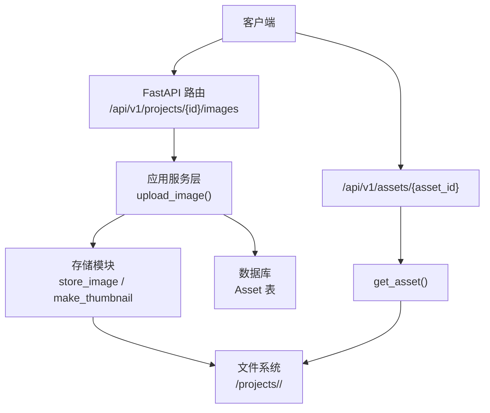
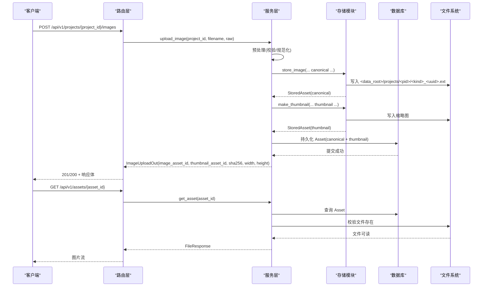
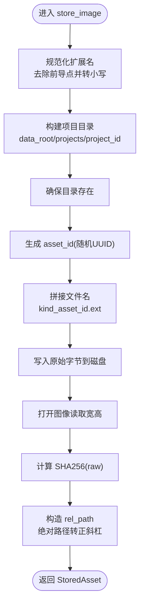
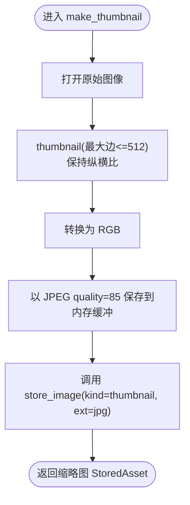
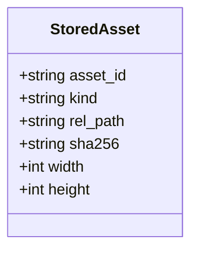
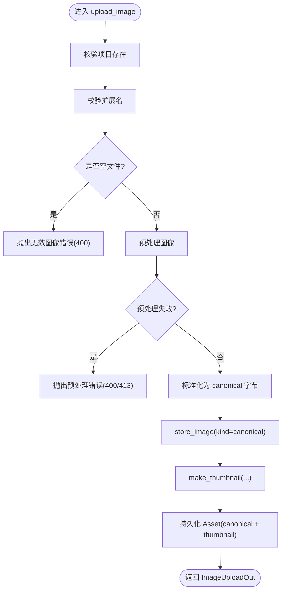
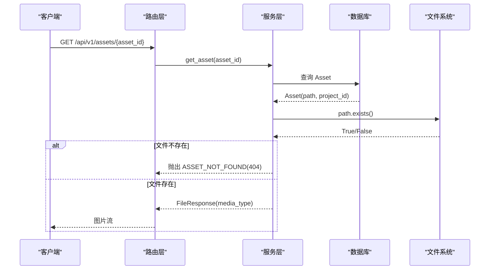
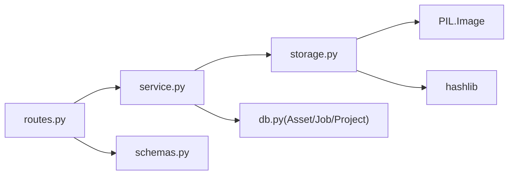
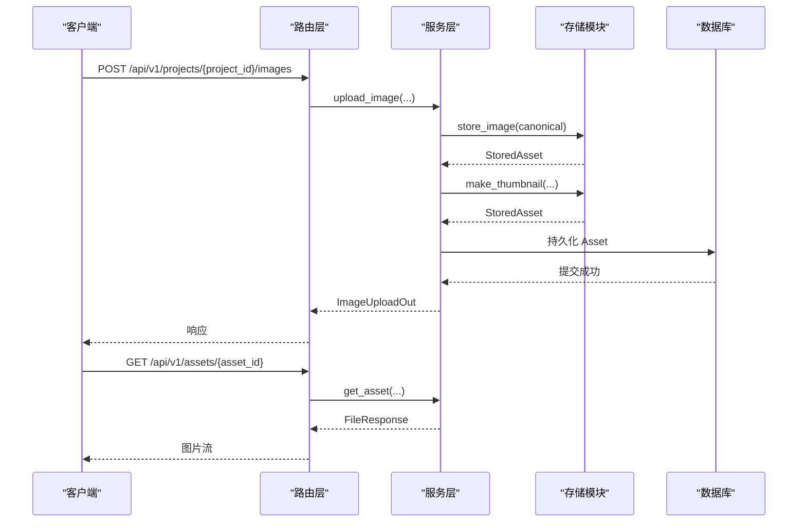

# 文件存储管理

<cite>
**本文引用的文件**   
- [services/api/storage.py](file://services/api/storage.py)
- [services/api/service.py](file://services/api/service.py)
- [services/api/routes.py](file://services/api/routes.py)
- [services/api/schemas.py](file://services/api/schemas.py)
</cite>

## 目录
1. [引言](#引言)
2. [项目结构](#项目结构)
3. [核心组件](#核心组件)
4. [架构总览](#架构总览)
5. [详细组件分析](#详细组件分析)
6. [依赖关系分析](#依赖关系分析)
7. [性能与扩展性](#性能与扩展性)
8. [故障排查指南](#故障排查指南)
9. [结论](#结论)
10. [附录：完整调用示例与扩展点](#附录完整调用示例与扩展点)

## 引言
本文件围绕“文件存储管理”能力，重点说明以下实现细节：
- `storage.store_image` 的目录组织、命名策略、SHA256 校验计算与路径生成规则。
- `storage.make_thumbnail` 的缩略图生成逻辑：尺寸调整算法、格式选择与质量优化。
- `StoredAsset` 数据结构设计与 `rel_path` 相对路径管理机制。
- 从 HTTP 上传到落盘、数据库持久化与资源访问的完整流程。
- 如何基于现有接口扩展自定义存储策略。

该功能遵循“服务端生成路径、客户端仅持有资产标识”的安全设计原则，避免客户端直接指定或猜测文件路径。

## 项目结构
与文件存储相关的代码主要位于服务层的 API 模块中：
- `services/api/storage.py`：文件落盘、缩略图生成与资产记录模型。
- `services/api/service.py`：业务编排（预处理、标准图与缩略图写入、数据库持久化）。
- `services/api/routes.py`：HTTP 路由（上传、读取资产）。
- `services/api/schemas.py`：对外响应契约（包含图像上传返回字段）。

**图表来源**
- [services/api/routes.py:100-115](file://services/api/routes.py#L100-L115)
- [services/api/service.py:73-107](file://services/api/service.py#L73-L107)
- [services/api/storage.py:32-60](file://services/api/storage.py#L32-L60)

**章节来源**
- [services/api/storage.py:1-60](file://services/api/storage.py#L1-L60)
- [services/api/service.py:73-107](file://services/api/service.py#L73-L107)
- [services/api/routes.py:100-115](file://services/api/routes.py#L100-L115)

## 核心组件
- `StoredAsset`：描述已存储资产的轻量数据类，包含资产标识、类型、相对路径、哈希、宽高等元信息。
- `store_image(data_root, project_id, kind, raw, ext)`：将原始字节写入磁盘并返回 `StoredAsset`。
- `make_thumbnail(data_root, raw, project_id)`：对原图生成缩略图并调用 `store_image` 持久化。
- 业务层 `service.upload_image`：协调预处理、标准图与缩略图存储，并将结果持久化到数据库。

**章节来源**
- [services/api/storage.py:18-60](file://services/api/storage.py#L18-L60)
- [services/api/service.py:73-107](file://services/api/service.py#L73-L107)

## 架构总览
下图展示一次图片上传的端到端流程：客户端上传图片 → 路由接收 → 服务层预处理与存储 → 数据库持久化 → 返回资产标识与元信息；随后通过资产 ID 读取文件。

**图表来源**
- [services/api/routes.py:100-115](file://services/api/routes.py#L100-L115)
- [services/api/service.py:73-107](file://services/api/service.py#L73-L107)
- [services/api/storage.py:32-60](file://services/api/storage.py#L32-L60)

## 详细组件分析

### `store_image`：目录结构、命名策略、SHA256 与路径生成
- 目录结构
  - 目标根目录由 `data_root` 决定。
  - 每个项目独立子目录：`<data_root>/projects/<project_id>/`。
  - 首次写入时自动创建目录（含父目录）。
- 文件命名策略
  - 文件名格式：`{kind}_{asset_id}.{ext}`。
  - `kind` 表示资产类型，例如 `canonical`（标准图）或 `thumbnail`（缩略图）。
  - `asset_id` 为随机生成的十六进制 UUID，保证唯一性。
  - `ext` 会去除前导点并统一小写，如 `.JPG` → `jpg`。
- SHA256 校验
  - 对原始输入字节 `raw` 计算 SHA256 十六进制摘要，用于完整性校验与去重参考。
- 路径生成与返回
  - 使用绝对路径写入后，转换为跨平台兼容的正斜杠字符串作为 `rel_path`。
  - 同时解析图像宽高，便于前端展示与后续处理。

**图表来源**
- [services/api/storage.py:32-50](file://services/api/storage.py#L32-L50)

**章节来源**
- [services/api/storage.py:28-50](file://services/api/storage.py#L28-L50)

### `make_thumbnail`：缩略图生成逻辑
- 尺寸调整算法
  - 使用 PIL 的 `thumbnail((THUMB_MAX, THUMB_MAX))`，在保持纵横比的前提下，使最长边不超过 `THUMB_MAX`（默认 512）。
- 格式选择
  - 缩略图统一转为 RGB 模式并以 JPEG 格式保存。
- 质量优化
  - JPEG 质量参数设为 85，平衡体积与清晰度。
- 存储
  - 将压缩后的字节再次调用 `store_image`，以 `kind=thumbnail` 和 `ext="jpg"` 持久化。

**图表来源**
- [services/api/storage.py:53-60](file://services/api/storage.py#L53-L60)

**章节来源**
- [services/api/storage.py:15-60](file://services/api/storage.py#L15-L60)

### `StoredAsset` 数据结构与 `rel_path` 机制
- 字段含义
  - `asset_id`：唯一资产标识（UUID 十六进制）。
  - `kind`：资产类型（如 `canonical`、`thumbnail`）。
  - `rel_path`：相对于 `data_root` 的文件路径，统一使用正斜杠分隔，便于跨平台一致性与 URL 拼接。
  - `sha256`：原始输入字节的 SHA256 摘要。
  - `width`、`height`：图像宽高像素值。
- 相对路径管理
  - 内部使用绝对路径进行文件操作，但对外暴露 `rel_path`，隐藏底层目录布局。
  - 对外 API 不直接返回物理路径，而是通过 `/api/v1/assets/{asset_id}` 提供受控访问，并在读取时校验归属。

**图表来源**
- [services/api/storage.py:18-25](file://services/api/storage.py#L18-L25)

**章节来源**
- [services/api/storage.py:18-25](file://services/api/storage.py#L18-L25)

### 业务编排：`service.upload_image`
- 输入校验
  - 校验项目是否存在。
  - 校验扩展名是否在支持集合内（jpg/jpeg/png），否则返回 415。
  - 空文件返回 400。
- 预处理
  - 调用预处理模块对图像进行规范化（如尺寸、色彩空间等），失败时根据错误语义返回 400 或 413。
- 标准图与缩略图
  - 将预处理后的图像保存为标准图（canonical），并根据其格式选择 PNG 或 JPG。
  - 对预处理后的图像生成缩略图（thumbnail）。
- 数据库持久化
  - 将标准图与缩略图的 `StoredAsset` 映射为 `Asset` 实体并写入数据库。
- 返回结构
  - 返回 `ImageUploadOut` 契约对象，包含 `image_asset_id`、`thumbnail_asset_id`、`canonical_width`、`canonical_height`、`sha256`。

**图表来源**
- [services/api/service.py:73-107](file://services/api/service.py#L73-L107)

**章节来源**
- [services/api/service.py:26-41](file://services/api/service.py#L26-L41)
- [services/api/service.py:73-107](file://services/api/service.py#L73-L107)

### HTTP 路由与资产读取
- 上传路由
  - `POST /api/v1/projects/{project_id}/images`：接收 `UploadFile`，读取原始字节后交由 `service.upload_image` 处理。
- 资产读取路由
  - `GET /api/v1/assets/{asset_id}`：根据资产 ID 查询数据库，校验文件存在后以 `FileResponse` 返回图片流，媒体类型按后缀判断为 `image/png` 或 `image/jpeg`。

**图表来源**
- [services/api/routes.py:108-115](file://services/api/routes.py#L108-L115)

**章节来源**
- [services/api/routes.py:100-115](file://services/api/routes.py#L100-L115)

## 依赖关系分析
- 模块耦合
  - `routes.py` 依赖 `service.py` 与 `schemas.py`，仅负责协议处理。
  - `service.py` 依赖 `storage.py` 完成文件落盘与缩略图生成，并依赖数据库模型持久化。
  - `storage.py` 依赖 PIL 进行图像读写与缩略图生成，依赖 hashlib 计算 SHA256。
- 外部依赖
  - FastAPI、SQLAlchemy、PIL、hashlib、uuid、pathlib。

**图表来源**
- [services/api/routes.py:1-27](file://services/api/routes.py#L1-L27)
- [services/api/service.py:1-24](file://services/api/service.py#L1-L24)
- [services/api/storage.py:1-15](file://services/api/storage.py#L1-L15)
- [services/api/schemas.py:1-8](file://services/api/schemas.py#L1-L8)

**章节来源**
- [services/api/routes.py:1-27](file://services/api/routes.py#L1-L27)
- [services/api/service.py:1-24](file://services/api/service.py#L1-L24)
- [services/api/storage.py:1-15](file://services/api/storage.py#L1-L15)
- [services/api/schemas.py:1-8](file://services/api/schemas.py#L1-L8)

## 性能与扩展性
- 性能要点
  - 缩略图生成使用内存缓冲，避免临时文件 IO。
  - JPEG 质量 85 在体积与画质之间取得平衡。
  - 标准图与缩略图分别持久化，减少重复解码与编码。
- 可扩展点
  - 自定义存储策略：可封装 `store_image` 的行为，替换为对象存储（如 S3/OSS），并保持 `StoredAsset` 接口不变。
  - 缩略图策略：可在 `make_thumbnail` 中增加多种尺寸档位或不同格式输出。
  - 校验策略：可在 `store_image` 中增加内容去重（基于 SHA256）或二次校验。

[本节为通用指导，不直接分析具体文件]

## 故障排查指南
- 常见错误与定位
  - 不支持的文件类型：检查扩展名是否在支持集合内（jpg/jpeg/png），否则会返回 415。
  - 空文件：上传为空时会返回 400。
  - 预处理失败：根据错误消息区分 400（格式/尺寸问题）或 413（过大/超像素）。
  - 资产不存在：读取资产时若数据库记录存在但文件缺失，会返回 404。
- 建议排查步骤
  - 确认 `settings.data_root` 配置正确且可写。
  - 检查项目目录权限与磁盘空间。
  - 核对 `Asset.path` 与文件系统实际路径一致性。
  - 查看日志中的错误码与消息，结合路由与服务层抛错位置定位。

**章节来源**
- [services/api/service.py:37-41](file://services/api/service.py#L37-L41)
- [services/api/service.py:73-107](file://services/api/service.py#L73-L107)
- [services/api/routes.py:108-115](file://services/api/routes.py#L108-L115)

## 结论
本文件存储管理方案通过“服务端生成路径 + 资产标识访问”的设计，实现了安全可控的文件存取。`store_image` 提供了稳定的目录组织与命名规范，`make_thumbnail` 提供了高效的缩略图生成，`StoredAsset` 抽象了资产元数据，配合业务层与路由层形成完整的上传、存储、持久化与读取闭环。系统具备良好的扩展性，可平滑替换存储后端或增强图像处理策略。

[本节为总结性内容，不直接分析具体文件]

## 附录：完整调用示例与扩展点

### 完整调用示例（概念流程）
- 上传图像
  - 客户端向 `/api/v1/projects/{project_id}/images` 发送 multipart/form-data，字段包含图片文件。
  - 服务端执行预处理、标准图与缩略图存储，并返回 `ImageUploadOut`，包含 `image_asset_id`、`thumbnail_asset_id`、`sha256`、宽高。
- 读取资产
  - 客户端通过 `/api/v1/assets/{asset_id}` 获取图片流，服务端校验资产归属与文件存在性。

**图表来源**
- [services/api/routes.py:100-115](file://services/api/routes.py#L100-L115)
- [services/api/service.py:73-107](file://services/api/service.py#L73-L107)
- [services/api/storage.py:32-60](file://services/api/storage.py#L32-L60)

### 自定义存储策略的实现方式
- 保留 `StoredAsset` 接口：确保上层业务无需感知底层存储差异。
- 替换 `store_image` 行为：
  - 本地磁盘：保持当前实现。
  - 对象存储：将 `rel_path` 改为对象键（Object Key），并返回可访问的 URL 或签名链接。
- 扩展缩略图策略：
  - 多尺寸缩略图：在 `make_thumbnail` 中循环生成多种尺寸并批量存储。
  - 多格式输出：除 JPEG 外，增加 WebP/AVIF 等现代格式。
- 校验与去重：
  - 基于 `sha256` 做内容去重，避免重复存储相同内容。
  - 可选二次校验：下载后比对 SHA256，确保完整性。

[本节为通用指导，不直接分析具体文件]