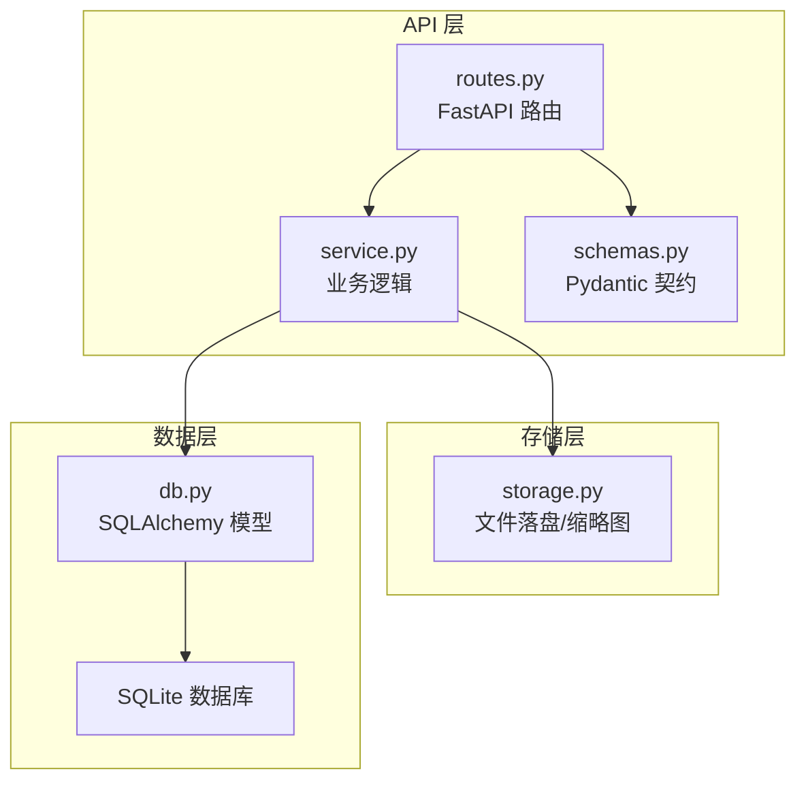
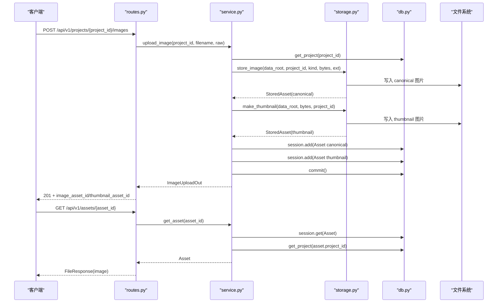
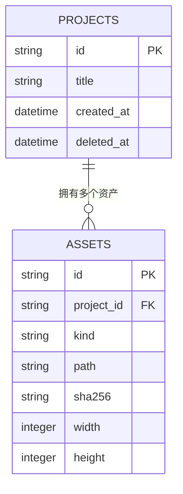
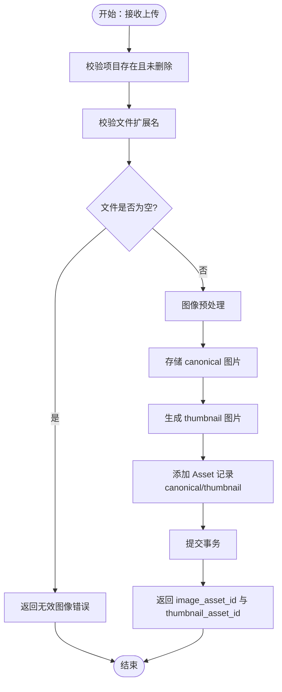
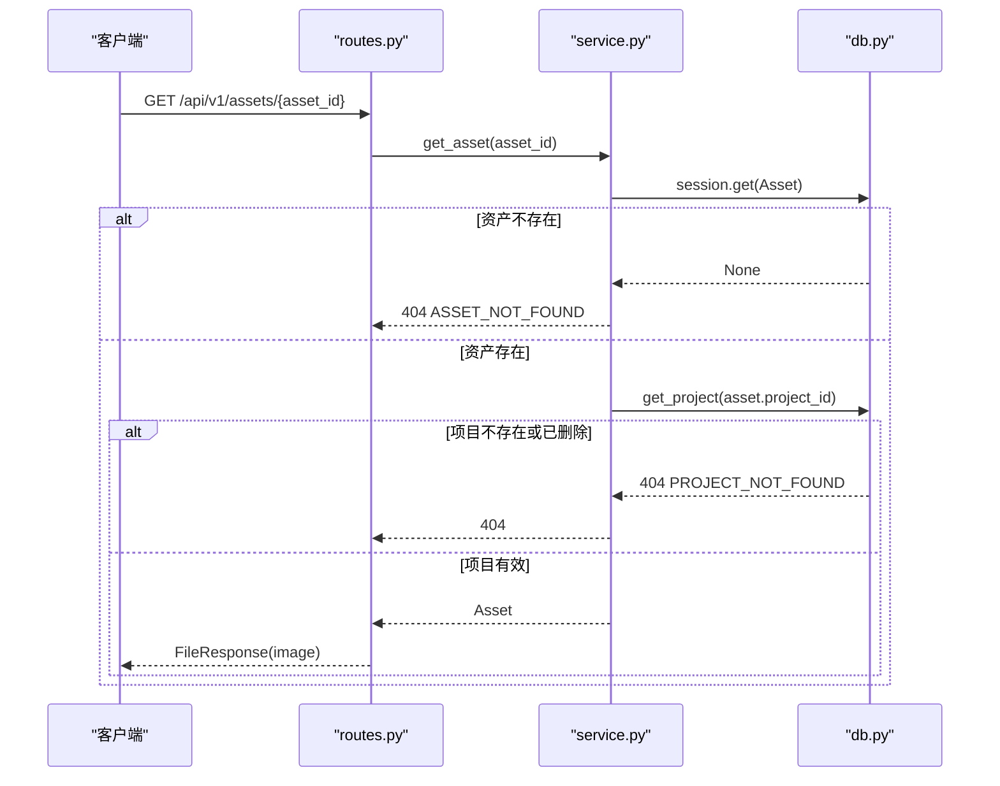
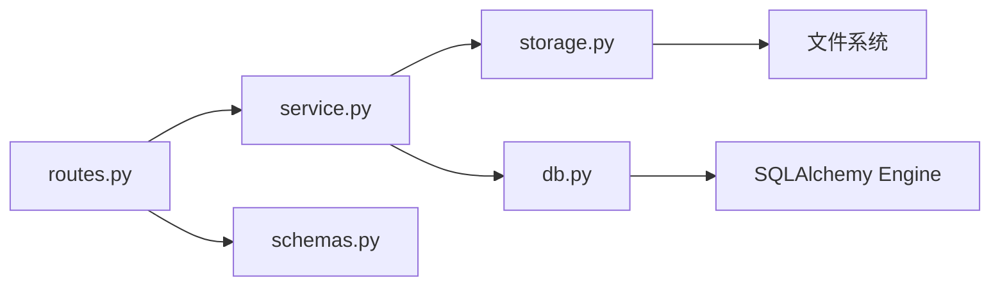

# 资产模型设计

<cite>
**本文引用的文件**   
- [services/api/db.py](file://services/api/db.py)
- [services/api/service.py](file://services/api/service.py)
- [services/api/routes.py](file://services/api/routes.py)
- [services/api/storage.py](file://services/api/storage.py)
- [services/api/schemas.py](file://services/api/schemas.py)
</cite>

## 目录
1. [引言](#引言)
2. [项目结构](#项目结构)
3. [核心组件](#核心组件)
4. [架构总览](#架构总览)
5. [详细组件分析](#详细组件分析)
6. [依赖关系分析](#依赖关系分析)
7. [性能与扩展建议](#性能与扩展建议)
8. [故障排查指南](#故障排查指南)
9. [结论](#结论)

## 引言
本文围绕“资产数据模型”展开，重点解释 assets 数据库表结构设计、字段类型与约束、资产生命周期（上传到持久化）、资产状态与删除策略、get_asset 的权限控制与项目归属校验，并给出查询、关联处理与性能优化实践。读者无需深入代码即可理解资产在系统中的角色与行为。

## 项目结构
本仓库采用服务分层组织：路由层负责协议解析，服务层封装业务规则，存储层负责文件系统写入，ORM 层定义 SQLite 持久化模型。资产模型位于 ORM 层，贯穿上传、读取、检测任务等流程。

**图表来源**
- [services/api/routes.py:100-115](file://services/api/routes.py#L100-L115)
- [services/api/service.py:73-115](file://services/api/service.py#L73-L115)
- [services/api/storage.py:32-50](file://services/api/storage.py#L32-L50)
- [services/api/db.py:37-47](file://services/api/db.py#L37-L47)

**章节来源**
- [services/api/routes.py:1-143](file://services/api/routes.py#L1-L143)
- [services/api/service.py:1-237](file://services/api/service.py#L1-L237)
- [services/api/storage.py:1-52](file://services/api/storage.py#L1-L52)
- [services/api/db.py:1-92](file://services/api/db.py#L1-L92)
- [services/api/schemas.py:1-84](file://services/api/schemas.py#L1-L84)

## 核心组件
- Asset 模型：assets 表的 ORM 映射，承载资产元数据与项目关联。
- Project 模型：projects 表，作为资产的项目归属实体。
- storage 模块：服务端生成路径、计算 sha256、提取宽高、写磁盘与生成缩略图。
- service 模块：上传、读取、检测任务等业务编排。
- routes 模块：HTTP 接口入口，调用 service 并返回响应。
- schemas 模块：对外 JSON 契约，如 AssetOut、ProjectOut、ImageUploadOut。

**章节来源**
- [services/api/db.py:26-47](file://services/api/db.py#L26-L47)
- [services/api/storage.py:18-50](file://services/api/storage.py#L18-L50)
- [services/api/service.py:73-115](file://services/api/service.py#L73-L115)
- [services/api/routes.py:100-115](file://services/api/routes.py#L100-L115)
- [services/api/schemas.py:41-63](file://services/api/schemas.py#L41-L63)

## 架构总览
资产从客户端上传到最终可被安全访问的完整链路如下：

**图表来源**
- [services/api/routes.py:100-115](file://services/api/routes.py#L100-L115)
- [services/api/service.py:73-115](file://services/api/service.py#L73-L115)
- [services/api/storage.py:32-50](file://services/api/storage.py#L32-L50)
- [services/api/db.py:37-47](file://services/api/db.py#L37-L47)

## 详细组件分析

### 资产数据库表结构与字段语义
assets 表由 Asset 类映射，关键字段与约束如下：

- id：主键，字符串类型，用于唯一标识资产。
- project_id：外键，指向 projects.id，非空；确保资产属于某个项目。
- kind：字符串，非空；表示资产种类，例如 canonical（标准图）或 thumbnail（缩略图）。
- path：字符串，非空；服务端生成的相对路径，用于定位磁盘上的实际文件。
- sha256：字符串，非空；文件内容摘要，用于完整性校验与去重。
- width：整数，非空；图像宽度。
- height：整数，非空；图像高度。

数据类型选择说明：
- id/project_id/path/sha256/kind 使用字符串，便于兼容 UUID、文件名与哈希值。
- width/height 使用整数，避免浮点误差，且满足图像尺寸语义。
- 所有关键元数据均设为非空，保证资产记录具备最小可用信息。

约束条件说明：
- 主键约束：id 唯一且非空。
- 外键约束：project_id 引用 projects.id，防止孤儿资产。
- NOT NULL：除 id 外的所有字段均为必填，保障数据一致性。

**图表来源**
- [services/api/db.py:26-47](file://services/api/db.py#L26-L47)

**章节来源**
- [services/api/db.py:37-47](file://services/api/db.py#L37-L47)

### 资产生命周期管理

#### 上传与持久化流程
- 路由接收上传请求，将原始字节与文件名交给服务层。
- 服务层先校验项目归属，再对图像进行预处理（格式标准化、尺寸限制等），失败时抛出统一错误。
- 存储层在服务端生成 asset_id 与路径，写入 canonical 图片，并生成 thumbnail 图片。
- 服务层创建两条 Asset 记录（canonical 与 thumbnail），提交事务。
- 返回 image_asset_id 与 thumbnail_asset_id，供前端后续访问与展示。

**图表来源**
- [services/api/service.py:73-107](file://services/api/service.py#L73-L107)
- [services/api/storage.py:32-50](file://services/api/storage.py#L32-L50)

**章节来源**
- [services/api/routes.py:100-105](file://services/api/routes.py#L100-L105)
- [services/api/service.py:73-107](file://services/api/service.py#L73-L107)
- [services/api/storage.py:32-50](file://services/api/storage.py#L32-L50)

#### 资产状态变更
- 当前实现中，Asset 本身没有显式状态字段；其“状态”通过是否存在以及所属项目的 deleted_at 来间接表达。
- 当项目被软删除（deleted_at 不为空）时，资产不可被读取（见 get_asset 的项目归属校验）。
- 若需要更细粒度的资产状态（如 processing、ready、archived），可在 Asset 表增加 status 字段并在上传/处理流程中更新。

#### 删除策略
- 项目删除为软删除（deleted_at 设置时间戳），资产不级联删除。
- 资产文件仍保留在文件系统，但通过 get_asset 的项目归属校验阻止访问。
- 如需物理删除资产文件，应提供清理任务扫描已删除项目的资产并删除对应 path 文件。

**章节来源**
- [services/api/service.py:53-57](file://services/api/service.py#L53-L57)
- [services/api/service.py:110-115](file://services/api/service.py#L110-L115)

### get_asset 方法的权限控制与项目归属验证
- 路由层 GET /api/v1/assets/{asset_id} 调用 service.get_asset。
- service.get_asset 先从数据库获取 Asset，若不存在则返回 404。
- 随后再次调用 get_project 校验资产所属项目是否存在且未被软删除；若项目不存在或被删除，则拒绝访问。
- 校验通过后，路由层根据 path 后缀判断媒体类型并返回文件流。

**图表来源**
- [services/api/routes.py:108-115](file://services/api/routes.py#L108-L115)
- [services/api/service.py:110-115](file://services/api/service.py#L110-L115)
- [services/api/service.py:53-57](file://services/api/service.py#L53-L57)

**章节来源**
- [services/api/routes.py:108-115](file://services/api/routes.py#L108-L115)
- [services/api/service.py:110-115](file://services/api/service.py#L110-L115)

### 资产模型的完整使用示例

#### 查询操作
- 列出项目及其资产：GET /api/v1/projects/{project_id} 返回项目信息与资产列表，包含 id、kind、url、width、height、sha256。
- 直接读取资产：GET /api/v1/assets/{asset_id} 返回图像文件流，前提是资产存在且所属项目未被删除。

参考路径：
- [services/api/routes.py:86-95](file://services/api/routes.py#L86-L95)
- [services/api/routes.py:108-115](file://services/api/routes.py#L108-L115)

#### 关联关系处理
- 项目与资产为一对多关系：Project.assets 反向关联 Asset.project。
- 在查询项目详情时，可直接遍历 proj.assets 获取资产集合，避免额外 N+1 查询。
- 在创建检测任务时，需校验 image_asset_id 是否属于当前 project_id，否则返回 404。

参考路径：
- [services/api/db.py:33-47](file://services/api/db.py#L33-L47)
- [services/api/service.py:120-129](file://services/api/service.py#L120-L129)

#### 性能优化建议
- 批量加载资产：在项目详情接口中，尽量一次性加载 assets 列表，避免逐条查询。
- 索引建议：
  - 对 project_id 建立索引以加速按项目筛选资产。
  - 对 sha256 建立唯一索引以实现快速去重与重复上传检测。
  - 对 kind 建立索引以支持按资产种类过滤（如仅 canonical）。
- 缓存策略：
  - 对频繁访问的 canonical 资产可考虑 CDN 或本地缓存。
  - 对缩略图可基于 sha256 与尺寸做缓存键，减少重复生成。
- 大文件处理：
  - 上传前校验文件大小与像素上限，避免内存溢出。
  - 异步生成缩略图与转码结果，降低主流程延迟。

[本节为通用指导，不直接分析具体文件]

## 依赖关系分析
资产相关模块之间的依赖关系如下：

**图表来源**
- [services/api/routes.py:1-27](file://services/api/routes.py#L1-L27)
- [services/api/service.py:1-24](file://services/api/service.py#L1-L24)
- [services/api/storage.py:1-14](file://services/api/storage.py#L1-L14)
- [services/api/db.py:1-17](file://services/api/db.py#L1-L17)

**章节来源**
- [services/api/routes.py:1-27](file://services/api/routes.py#L1-L27)
- [services/api/service.py:1-24](file://services/api/service.py#L1-L24)
- [services/api/storage.py:1-14](file://services/api/storage.py#L1-L14)
- [services/api/db.py:1-17](file://services/api/db.py#L1-L17)

## 性能与扩展建议
- 数据库层面：
  - 为 assets.project_id、assets.sha256、assets.kind 建立合适索引。
  - 对 assets.path 可考虑全文检索或对象存储索引，提升定位效率。
- 应用层面：
  - 上传流程引入队列，将缩略图生成与转码异步化。
  - 对检测任务的结果缓存，避免重复计算。
- 存储层面：
  - 将静态资源迁移至对象存储（如 S3/OSS），配合 CDN 加速。
  - 定期清理孤立文件与过期缩略图。

[本节为通用指导，不直接分析具体文件]

## 故障排查指南
- 404 资产不存在：
  - 检查 asset_id 是否正确，确认上传流程是否成功提交 Asset 记录。
  - 参考路径：[services/api/service.py:110-115](file://services/api/service.py#L110-L115)
- 404 项目不存在或已删除：
  - 资产所属项目被软删除后，资产不可读取。
  - 参考路径：[services/api/service.py:53-57](file://services/api/service.py#L53-L57)
- 415 不支持的文件类型：
  - 检查上传文件的扩展名是否在支持列表中。
  - 参考路径：[services/api/service.py:37-41](file://services/api/service.py#L37-L41)
- 413 文件过大或像素过多：
  - 预处理阶段会校验大小与像素上限，超出范围返回 413。
  - 参考路径：[services/api/service.py:81-85](file://services/api/service.py#L81-L85)
- 资产文件缺失：
  - 路由层在返回文件前检查 path 是否存在，缺失则返回 404。
  - 参考路径：[services/api/routes.py:111-114](file://services/api/routes.py#L111-L114)

**章节来源**
- [services/api/service.py:37-41](file://services/api/service.py#L37-L41)
- [services/api/service.py:81-85](file://services/api/service.py#L81-L85)
- [services/api/service.py:110-115](file://services/api/service.py#L110-L115)
- [services/api/routes.py:111-114](file://services/api/routes.py#L111-L114)

## 结论
资产模型以简洁的 assets 表为核心，结合项目归属、服务端路径生成与 sha256 校验，构建了稳定可靠的图像资产管理能力。上传流程清晰、权限控制严格，适合桌面识别场景下的图像与缩略图管理。未来可通过索引优化、异步处理与对象存储集成进一步提升性能与可扩展性。