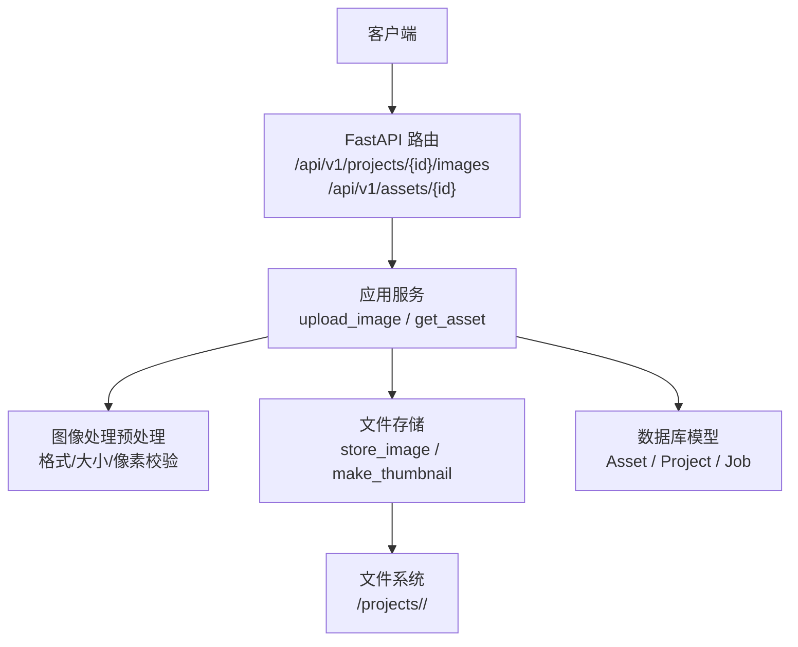
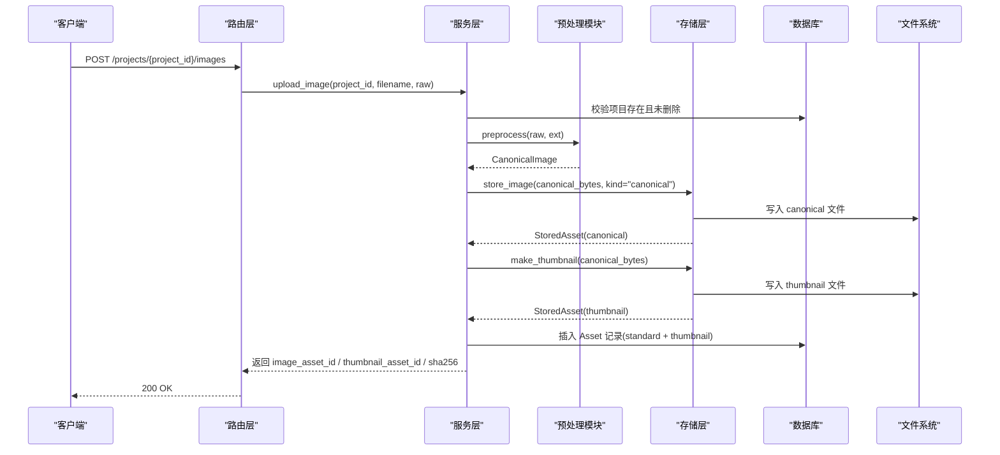
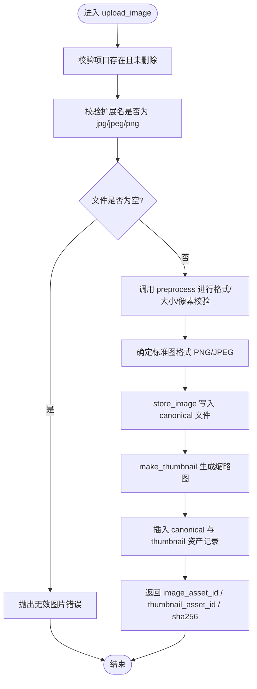
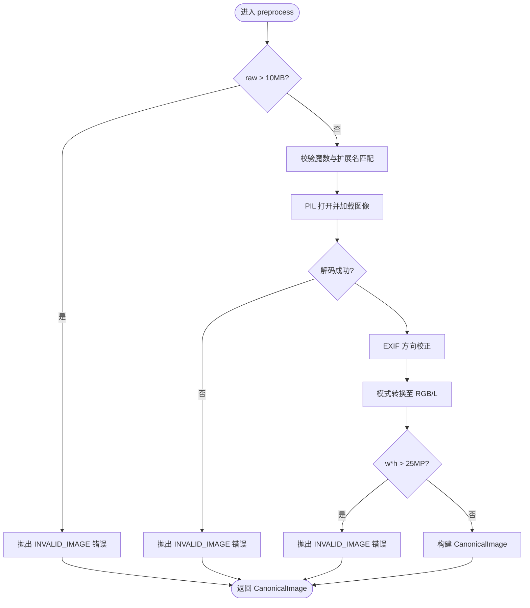
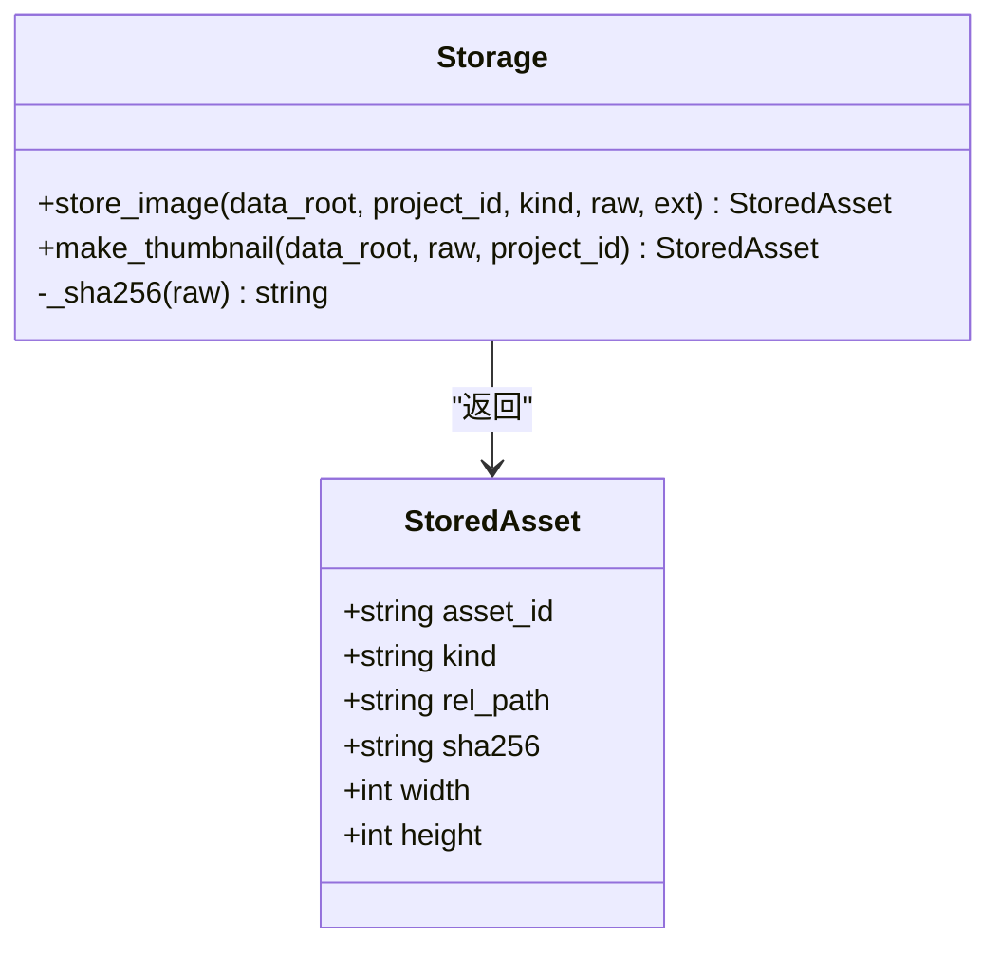
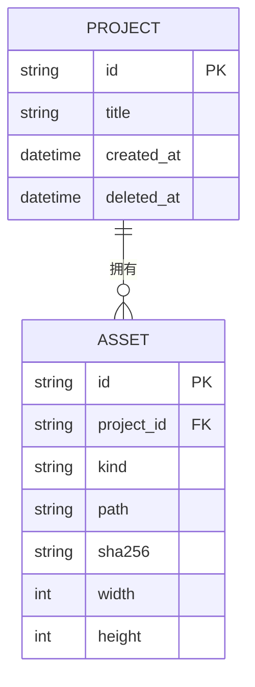
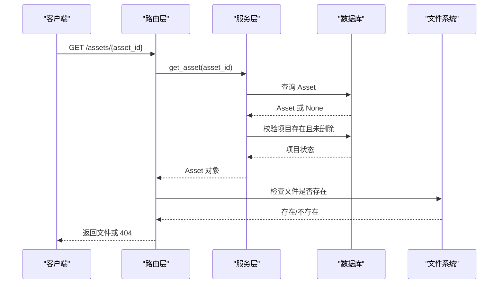
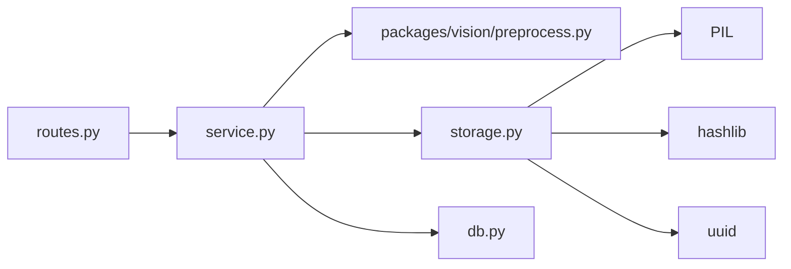

# 资产管理

<cite>
**本文引用的文件**   
- [services/api/storage.py](file://services/api/storage.py)
- [services/api/service.py](file://services/api/service.py)
- [services/api/routes.py](file://services/api/routes.py)
- [services/api/db.py](file://services/api/db.py)
- [packages/vision/preprocess.py](file://packages/vision/preprocess.py)
</cite>

## 目录
1. [引言](#引言)
2. [项目结构](#项目结构)
3. [核心组件](#核心组件)
4. [架构总览](#架构总览)
5. [详细组件分析](#详细组件分析)
6. [依赖关系分析](#依赖关系分析)
7. [性能与容量特性](#性能与容量特性)
8. [故障排查指南](#故障排查指南)
9. [结论](#结论)

## 引言
本文件面向资产管理功能，重点说明图像上传、预处理、标准图与缩略图生成、文件存储策略、资产模型设计、路径管理、SHA256 校验机制，以及 get_asset 的权限控制与项目归属验证。文档同时给出关键流程的时序图、流程图和类图，帮助读者从业务到实现逐层理解。

## 项目结构
资产管理相关代码主要分布在以下模块：
- 路由层：接收 HTTP 请求，负责协议处理与参数绑定
- 服务层：承载业务规则（上传、校验、归属校验、任务编排）
- 存储层：负责文件写入、缩略图生成、路径与 SHA256 计算
- 数据模型层：定义数据库表结构与关系
- 图像处理层：提供格式校验、EXIF 校正、尺寸/像素限制等预处理能力

图表来源
- [services/api/routes.py:100-115](file://services/api/routes.py#L100-L115)
- [services/api/service.py:73-115](file://services/api/service.py#L73-L115)
- [packages/vision/preprocess.py:54-76](file://packages/vision/preprocess.py#L54-L76)
- [services/api/storage.py:32-60](file://services/api/storage.py#L32-L60)
- [services/api/db.py:37-48](file://services/api/db.py#L37-L48)

章节来源
- [services/api/routes.py:1-143](file://services/api/routes.py#L1-L143)
- [services/api/service.py:1-237](file://services/api/service.py#L1-L237)
- [services/api/storage.py:1-61](file://services/api/storage.py#L1-L61)
- [services/api/db.py:1-92](file://services/api/db.py#L1-L92)
- [packages/vision/preprocess.py:1-84](file://packages/vision/preprocess.py#L1-L84)

## 核心组件
- 路由层
  - POST /api/v1/projects/{project_id}/images：读取上传文件字节，委托 service.upload_image
  - GET /api/v1/assets/{asset_id}：通过 service.get_asset 校验后返回文件
- 服务层
  - upload_image：项目存在性校验、扩展名校验、空文件检查、预处理、标准图与缩略图存储、资产记录入库
  - get_asset：按 asset_id 查询资产，并再次校验项目是否被删除
- 存储层
  - store_image：在服务端生成绝对路径，写入文件，计算 SHA256，读取宽高
  - make_thumbnail：基于标准图生成缩略图并存储
- 数据模型层
  - Asset：资产主键、所属项目、类型、路径、SHA256、宽高
- 图像处理层
  - preprocess：支持 JPEG/PNG，拒绝伪装格式、损坏图、超限图；EXIF 方向校正；输出 CanonicalImage

章节来源
- [services/api/routes.py:100-115](file://services/api/routes.py#L100-L115)
- [services/api/service.py:73-115](file://services/api/service.py#L73-L115)
- [services/api/storage.py:18-60](file://services/api/storage.py#L18-L60)
- [services/api/db.py:37-48](file://services/api/db.py#L37-L48)
- [packages/vision/preprocess.py:14-76](file://packages/vision/preprocess.py#L14-L76)

## 架构总览
下图展示一次图像上传的端到端调用链：路由接收请求 → 服务层执行校验与业务逻辑 → 预处理模块进行格式/大小/像素校验 → 存储层写入标准图与缩略图 → 数据库持久化资产记录。

图表来源
- [services/api/routes.py:100-105](file://services/api/routes.py#L100-L105)
- [services/api/service.py:73-107](file://services/api/service.py#L73-L107)
- [packages/vision/preprocess.py:54-76](file://packages/vision/preprocess.py#L54-L76)
- [services/api/storage.py:32-60](file://services/api/storage.py#L32-L60)
- [services/api/db.py:37-48](file://services/api/db.py#L37-L48)

## 详细组件分析

### 图像上传与处理流程（upload_image）
upload_image 的职责是完成“项目归属校验 → 扩展名与空文件校验 → 预处理 → 标准图与缩略图存储 → 资产入库”的完整链路。

- 项目归属校验
  - 通过 get_project 确保 project_id 存在且未被软删除
- 扩展名与空文件校验
  - 仅允许 jpg/jpeg/png；空文件直接报错
- 预处理
  - 调用 preprocess 进行魔数校验、解码、EXIF 方向校正、像素上限校验
  - 根据 declared_ext 决定标准图格式（PNG 或 JPEG）
- 标准图与缩略图存储
  - store_image 写入 canonical 文件，计算 SHA256，读取宽高
  - make_thumbnail 对标准图做最长边 512 缩放，转 RGB，保存为 JPEG
- 资产入库
  - 分别以 kind="canonical" 与 kind="thumbnail" 插入两条 Asset 记录
- 返回值
  - 包含 project_id、image_asset_id、thumbnail_asset_id、canonical_width/height、sha256

图表来源
- [services/api/service.py:73-107](file://services/api/service.py#L73-L107)
- [packages/vision/preprocess.py:54-76](file://packages/vision/preprocess.py#L54-L76)
- [services/api/storage.py:32-60](file://services/api/storage.py#L32-L60)

章节来源
- [services/api/service.py:73-107](file://services/api/service.py#L73-L107)
- [packages/vision/preprocess.py:54-76](file://packages/vision/preprocess.py#L54-L76)
- [services/api/storage.py:32-60](file://services/api/storage.py#L32-L60)

### 图像预处理（preprocess）
- 支持的输入格式
  - JPEG、PNG；其他扩展名直接拒绝
- 文件大小限制
  - 单张不超过 10MB
- 魔数校验
  - 校验文件头字节是否与声明扩展名一致，防止伪装格式
- 解码与 EXIF 校正
  - 使用 PIL 打开并加载图像，若无法识别或损坏则拒绝
  - 使用 ImageOps.exif_transpose 校正方向
  - 将非 RGB/L 模式转换为 RGB
- 像素上限
  - 宽×高不超过 2500 万像素
- 输出
  - CanonicalImage：包含图像对象、宽高、格式（JPEG 或 PNG）

图表来源
- [packages/vision/preprocess.py:14-76](file://packages/vision/preprocess.py#L14-L76)

章节来源
- [packages/vision/preprocess.py:14-76](file://packages/vision/preprocess.py#L14-L76)

### 文件存储策略与路径管理（storage）
- 路径生成规则
  - 服务端生成路径，不接受客户端指定路径
  - 路径结构：<data_root>/projects/<project_id>/<kind>_<asset_id>.<ext>
  - 相对路径统一使用正斜杠
- 标准图与缩略图
  - canonical：由预处理后的标准图字节写入
  - thumbnail：最长边 512，RGB，JPEG quality=85
- SHA256 校验
  - 对原始字节计算 SHA256，作为资产的完整性指纹
- 宽高读取
  - 使用 PIL 读取图像尺寸，避免依赖文件名推断

图表来源
- [services/api/storage.py:18-60](file://services/api/storage.py#L18-L60)

章节来源
- [services/api/storage.py:1-61](file://services/api/storage.py#L1-L61)

### 资产模型设计（Asset 表结构）
- 字段说明
  - id：主键，字符串
  - project_id：外键，关联 projects.id
  - kind：资产类型，如 canonical、thumbnail
  - path：服务端生成的相对路径
  - sha256：文件内容的 SHA256 摘要
  - width：图像宽度
  - height：图像高度
- 关系
  - 与 Project 一对多（一个项目可包含多个资产）

图表来源
- [services/api/db.py:26-48](file://services/api/db.py#L26-L48)

章节来源
- [services/api/db.py:26-48](file://services/api/db.py#L26-L48)

### get_asset 方法与权限控制
- 基本流程
  - 根据 asset_id 查询 Asset
  - 若不存在，返回 404
  - 通过 asset.project_id 再次调用 get_project，确保项目未被删除
- 路由层行为
  - 在 service.get_asset 通过后，检查文件是否存在于文件系统
  - 根据后缀设置正确的媒体类型（image/png 或 image/jpeg）
- 安全要点
  - 客户端不能直接猜测路径，必须通过 API 获取
  - 项目删除后，其资产不可再访问

图表来源
- [services/api/routes.py:108-115](file://services/api/routes.py#L108-L115)
- [services/api/service.py:110-115](file://services/api/service.py#L110-L115)

章节来源
- [services/api/routes.py:108-115](file://services/api/routes.py#L108-L115)
- [services/api/service.py:110-115](file://services/api/service.py#L110-L115)

### 异常处理模式
- 预处理阶段
  - 文件大小超过 10MB：抛出 PreprocessError，service 将其转为 ApiError，HTTP 413
  - 魔数不匹配或损坏图：抛出 PreprocessError，service 转为 ApiError，HTTP 400
  - 像素超过 25MP：抛出 PreprocessError，service 转为 ApiError，HTTP 413
- 项目与资产查找
  - 项目不存在或被删除：ApiError，HTTP 404
  - 资产不存在：ApiError，HTTP 404
- 文件缺失
  - 路由层在 get_asset 中检测文件不存在时，返回 404

章节来源
- [packages/vision/preprocess.py:24-76](file://packages/vision/preprocess.py#L24-L76)
- [services/api/service.py:73-115](file://services/api/service.py#L73-L115)
- [services/api/routes.py:108-115](file://services/api/routes.py#L108-L115)

## 依赖关系分析
- 路由层依赖服务层与配置
- 服务层依赖：
  - 预处理模块（packages/vision/preprocess）
  - 存储模块（services/api/storage）
  - 数据库模型（services/api/db）
- 存储层依赖：
  - PIL（用于图像尺寸读取与缩略图生成）
  - hashlib（SHA256）
  - uuid（资产 ID）
- 数据模型层定义实体关系，供服务层与路由层使用

图表来源
- [services/api/routes.py:1-143](file://services/api/routes.py#L1-L143)
- [services/api/service.py:1-237](file://services/api/service.py#L1-L237)
- [services/api/storage.py:1-61](file://services/api/storage.py#L1-L61)
- [services/api/db.py:1-92](file://services/api/db.py#L1-L92)
- [packages/vision/preprocess.py:1-84](file://packages/vision/preprocess.py#L1-L84)

章节来源
- [services/api/routes.py:1-143](file://services/api/routes.py#L1-L143)
- [services/api/service.py:1-237](file://services/api/service.py#L1-L237)
- [services/api/storage.py:1-61](file://services/api/storage.py#L1-L61)
- [services/api/db.py:1-92](file://services/api/db.py#L1-L92)
- [packages/vision/preprocess.py:1-84](file://packages/vision/preprocess.py#L1-L84)

## 性能与容量特性
- 文件大小限制
  - 单张图像不超过 10MB，超出即拒绝
- 像素上限
  - 宽×高不超过 2500 万像素，超出即拒绝
- 缩略图尺寸
  - 最长边 512 像素，JPEG quality=85，兼顾清晰度与体积
- 标准图格式
  - 根据 declared_ext 选择 PNG 或 JPEG；PNG 保留无损但体积较大，JPEG 更压缩
- I/O 与 CPU
  - 预处理阶段需要解码与 EXIF 校正，可能带来 CPU 开销
  - 存储层需两次磁盘写入（canonical 与 thumbnail），注意磁盘 I/O 瓶颈

[本节为通用性能讨论，不直接分析具体文件]

## 故障排查指南
- 上传失败（413/400）
  - 检查文件大小是否超过 10MB
  - 检查魔数与扩展名是否一致
  - 检查图像是否损坏或无法解码
  - 检查像素是否超过 25MP
- 资产访问失败（404）
  - 确认 asset_id 是否正确
  - 确认所属项目未被删除
  - 确认文件仍存在于文件系统路径
- 缩略图问题
  - 确认预处理后的标准图可被 PIL 正确读取
  - 确认缩略图生成过程中格式转换正常

章节来源
- [packages/vision/preprocess.py:24-76](file://packages/vision/preprocess.py#L24-L76)
- [services/api/service.py:73-115](file://services/api/service.py#L73-L115)
- [services/api/routes.py:108-115](file://services/api/routes.py#L108-L115)

## 结论
资产管理功能通过清晰的分层架构实现了安全的图像上传与处理：路由层负责协议，服务层承载业务规则，存储层负责文件与 SHA256，数据模型层定义实体关系，预处理模块保障图像质量与安全。upload_image 方法完成了完整的校验与处理链路，get_asset 方法确保了权限与项目归属的安全控制。该设计在保证安全性的同时，兼顾了性能与可扩展性。