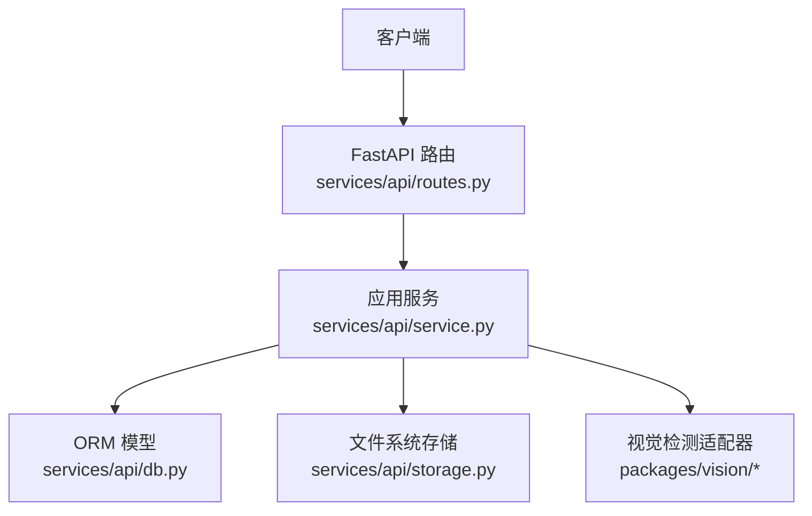
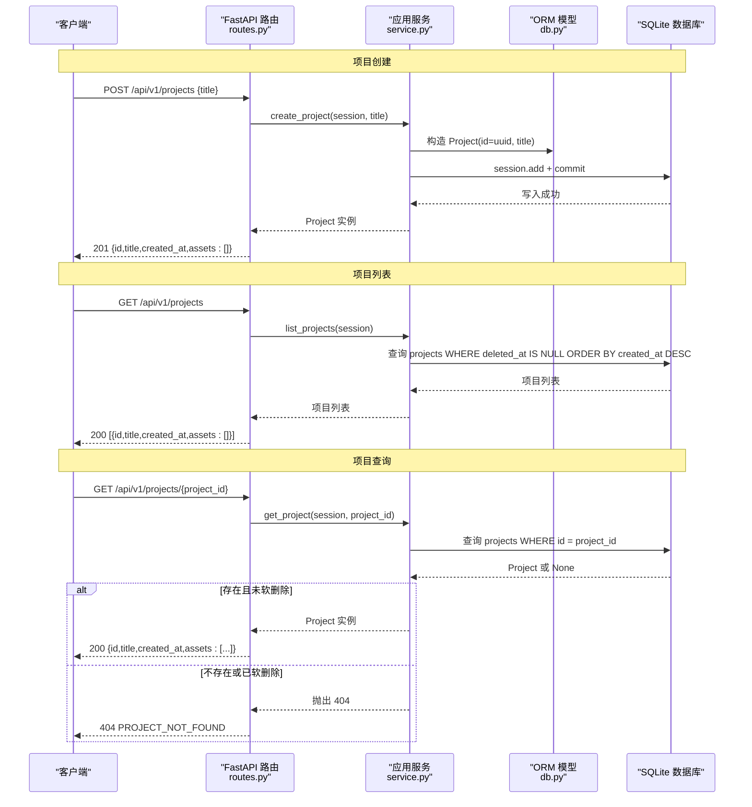
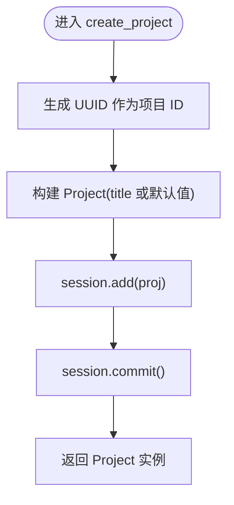
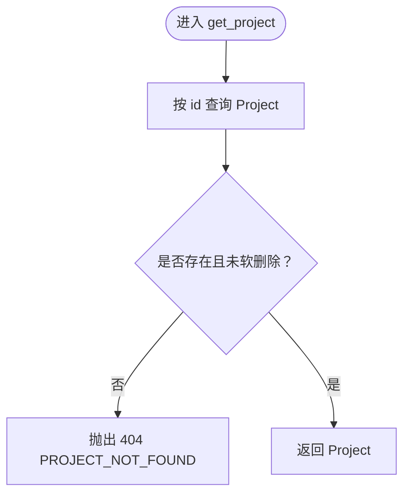
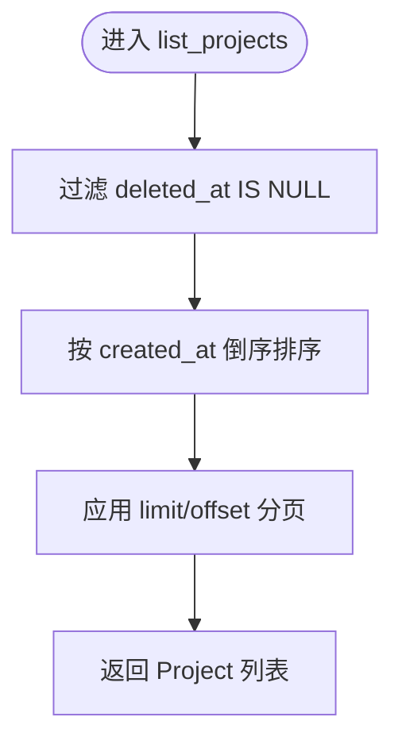
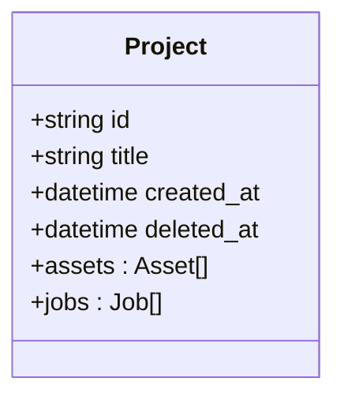
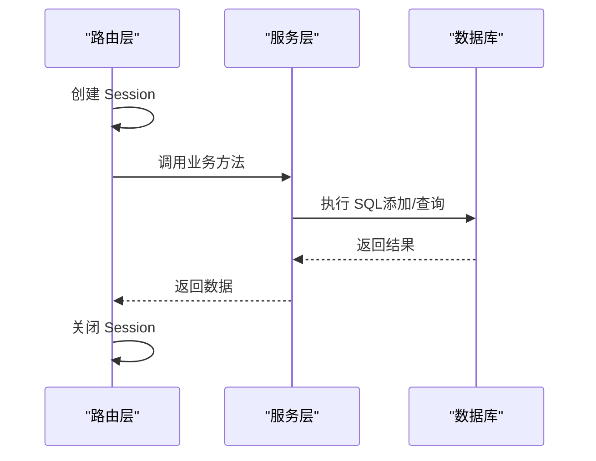
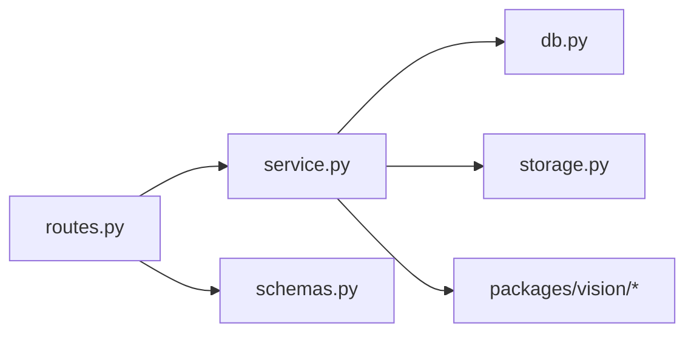

# 项目管理

<cite>
**本文引用的文件**   
- [services/api/routes.py](file://services/api/routes.py)
- [services/api/service.py](file://services/api/service.py)
- [services/api/schemas.py](file://services/api/schemas.py)
- [services/api/db.py](file://services/api/db.py)
- [README.md](file://README.md)
</cite>

## 目录
1. [引言](#引言)
2. [项目结构](#项目结构)
3. [核心组件](#核心组件)
4. [架构总览](#架构总览)
5. [详细组件分析](#详细组件分析)
6. [依赖关系分析](#依赖关系分析)
7. [性能与一致性](#性能与一致性)
8. [故障排查指南](#故障排查指南)
9. [结论](#结论)

## 引言
本文聚焦“项目管理”功能的实现文档，围绕以下目标展开：
- 深入解释项目生命周期管理的核心方法：create_project（创建）、get_project（查询）、list_projects（列表）。
- 说明软删除机制（deleted_at 字段）的工作原理。
- 说明项目 ID 生成策略（UUID）。
- 梳理数据验证与业务规则。
- 解释事务管理机制和数据一致性保证。
- 提供面向调用方的完整代码示例路径与错误处理模式。

本项目的后端采用 FastAPI + SQLAlchemy + SQLite，路由层仅负责协议处理，业务逻辑集中在 service 层；数据模型定义在 db 模块中，Pydantic 契约用于输入输出校验。

**章节来源**
- [README.md:1-83](file://README.md#L1-L83)

## 项目结构
与项目管理相关的核心文件如下：
- services/api/routes.py：FastAPI 路由，暴露 /api/v1/projects 相关接口。
- services/api/service.py：应用服务层，封装项目、图像、检测任务等业务逻辑。
- services/api/schemas.py：Pydantic 请求/响应模型与统一错误对象。
- services/api/db.py：SQLAlchemy ORM 模型与数据库引擎/会话工厂。

**图表来源**
- [services/api/routes.py:1-143](file://services/api/routes.py#L1-L143)
- [services/api/service.py:1-237](file://services/api/service.py#L1-L237)
- [services/api/db.py:1-92](file://services/api/db.py#L1-L92)

**章节来源**
- [services/api/routes.py:1-143](file://services/api/routes.py#L1-L143)
- [services/api/service.py:1-237](file://services/api/service.py#L1-L237)
- [services/api/schemas.py:1-84](file://services/api/schemas.py#L1-L84)
- [services/api/db.py:1-92](file://services/api/db.py#L1-L92)

## 核心组件
- 路由层（routes.py）
  - POST /api/v1/projects：创建项目，返回项目基本信息。
  - GET /api/v1/projects：列出未删除的项目。
  - GET /api/v1/projects/{project_id}：获取项目详情，包含资产列表。
- 服务层（service.py）
  - create_project：生成 UUID 作为项目 ID，持久化并返回。
  - get_project：按 ID 查询项目，若不存在或已软删除则抛出 404。
  - list_projects：过滤 deleted_at 为空的项目，按创建时间倒序分页。
- 数据模型（db.py）
  - Project：包含 id、title、created_at、deleted_at 等字段，支持一对多关联 assets/jobs。
- 契约模型（schemas.py）
  - ProjectCreateIn、ProjectOut：约束项目创建输入与对外输出结构。

**章节来源**
- [services/api/routes.py:68-95](file://services/api/routes.py#L68-L95)
- [services/api/service.py:44-68](file://services/api/service.py#L44-L68)
- [services/api/db.py:26-35](file://services/api/db.py#L26-L35)
- [services/api/schemas.py:50-72](file://services/api/schemas.py#L50-L72)

## 架构总览
下图展示从 HTTP 请求到数据落库的端到端流程，重点覆盖项目创建、查询与列表。

**图表来源**
- [services/api/routes.py:70-95](file://services/api/routes.py#L70-L95)
- [services/api/service.py:46-68](file://services/api/service.py#L46-L68)
- [services/api/db.py:26-35](file://services/api/db.py#L26-L35)

## 详细组件分析

### 项目创建：create_project
- 功能要点
  - 使用 uuid.uuid4().hex 生成唯一项目 ID。
  - 将 Project 实例加入会话并提交事务。
  - 默认标题为“未命名项目”，传入空值时回退。
- 输入/输出
  - 输入：Session、title（可选）。
  - 输出：Project 实例。
- 错误处理
  - 当前实现未显式捕获异常；底层 SQLAlchemy 异常会向上传播，由 FastAPI 转为 5xx。
- 事务与一致性
  - 通过 session.add + session.commit 确保原子写入。
- 业务规则
  - 项目 ID 全局唯一（基于 UUID）。
  - 项目标题允许为空，自动填充默认值。

**图表来源**
- [services/api/service.py:46-50](file://services/api/service.py#L46-L50)

**章节来源**
- [services/api/service.py:46-50](file://services/api/service.py#L46-L50)
- [services/api/routes.py:70-74](file://services/api/routes.py#L70-L74)

### 项目查询：get_project
- 功能要点
  - 根据 project_id 查询项目。
  - 若记录不存在或已软删除（deleted_at 非空），抛出 404。
- 输入/输出
  - 输入：Session、project_id。
  - 输出：Project 实例。
- 错误处理
  - 抛出 ApiError("PROJECT_NOT_FOUND", ..., status_code=404)。
- 业务规则
  - 软删除的项目不可被读取。

**图表来源**
- [services/api/service.py:53-57](file://services/api/service.py#L53-L57)

**章节来源**
- [services/api/service.py:53-57](file://services/api/service.py#L53-L57)
- [services/api/routes.py:86-95](file://services/api/routes.py#L86-L95)

### 项目列表：list_projects
- 功能要点
  - 仅返回未软删除的项目（deleted_at IS NULL）。
  - 按 created_at 倒序排列，支持 limit/offset 分页。
- 输入/输出
  - 输入：Session、limit（默认 50）、offset（默认 0）。
  - 输出：Project 列表。
- 业务规则
  - 列表不包含已删除项目，保障数据可见性一致。

**图表来源**
- [services/api/service.py:60-68](file://services/api/service.py#L60-L68)

**章节来源**
- [services/api/service.py:60-68](file://services/api/service.py#L60-L68)
- [services/api/routes.py:77-83](file://services/api/routes.py#L77-L83)

### 软删除机制（deleted_at）
- 设计要点
  - Project 表包含 deleted_at 字段，类型为 DateTime，可为空。
  - 查询列表时强制过滤 deleted_at IS NULL。
  - 单条查询 get_project 对 deleted_at 非空视为不存在，返回 404。
- 影响范围
  - 列表接口不显示已删除项目。
  - 单条查询拒绝访问已删除项目。
  - 其他关联操作（如资产读取）通过归属校验间接保护项目有效性。

**图表来源**
- [services/api/db.py:26-35](file://services/api/db.py#L26-L35)

**章节来源**
- [services/api/db.py:26-35](file://services/api/db.py#L26-L35)
- [services/api/service.py:53-68](file://services/api/service.py#L53-L68)

### 项目 ID 生成策略（UUID）
- 实现方式
  - 使用 Python 标准库 uuid.uuid4().hex 生成 32 位十六进制字符串作为主键。
- 优点
  - 分布式友好、冲突概率极低。
  - 无需自增序列，避免热点竞争。
- 注意
  - 前端需接受字符串类型 ID。

**章节来源**
- [services/api/service.py:46-50](file://services/api/service.py#L46-L50)

### 数据验证与业务规则
- 输入契约
  - ProjectCreateIn：title 可选，默认“未命名项目”。
  - ProjectOut：对外返回 id、title、created_at、assets。
- 业务规则
  - 项目标题为空时自动填充默认值。
  - 列表仅返回未删除项目。
  - 单条查询拒绝已删除项目。
- 扩展点
  - 可在此层增加标题长度限制、非法字符校验等规则。

**章节来源**
- [services/api/schemas.py:50-72](file://services/api/schemas.py#L50-L72)
- [services/api/service.py:46-68](file://services/api/service.py#L46-L68)

### 事务管理与数据一致性
- 会话管理
  - 路由层通过 Depends(get_session) 注入 Session，并在请求结束后关闭。
- 事务边界
  - create_project：session.add + session.commit 一次提交。
  - list_projects/get_project：只读查询，无写事务。
- 一致性保证
  - 单条写入原子提交，避免部分写入。
  - 列表与单查均基于同一 ORM 模型，保证视图一致。

**图表来源**
- [services/api/routes.py:31-37](file://services/api/routes.py#L31-L37)
- [services/api/service.py:46-68](file://services/api/service.py#L46-L68)

**章节来源**
- [services/api/routes.py:31-37](file://services/api/routes.py#L31-L37)
- [services/api/service.py:46-68](file://services/api/service.py#L46-L68)

## 依赖关系分析
- 路由依赖服务层：routes.py 调用 service.py 的业务方法。
- 服务层依赖 ORM 模型：service.py 通过 db.py 中的 Project/Asset/Job/Detection 进行数据访问。
- 服务层依赖外部能力：vision 检测器、storage 文件存储。
- 契约模型独立：schemas.py 定义输入输出结构，供路由与服务层共同使用。

**图表来源**
- [services/api/routes.py:1-143](file://services/api/routes.py#L1-L143)
- [services/api/service.py:1-237](file://services/api/service.py#L1-L237)
- [services/api/db.py:1-92](file://services/api/db.py#L1-L92)
- [services/api/schemas.py:1-84](file://services/api/schemas.py#L1-L84)

**章节来源**
- [services/api/routes.py:1-143](file://services/api/routes.py#L1-L143)
- [services/api/service.py:1-237](file://services/api/service.py#L1-L237)
- [services/api/db.py:1-92](file://services/api/db.py#L1-L92)
- [services/api/schemas.py:1-84](file://services/api/schemas.py#L1-L84)

## 性能与一致性
- 性能
  - 列表查询使用 limit/offset 分页，避免一次性加载大量数据。
  - 按 created_at 倒序排序，适合最近项目优先的场景。
- 一致性
  - 单条写入使用事务提交，保证原子性。
  - 软删除通过条件过滤保证列表与单查的一致性。
- 可扩展性
  - 可在列表查询中加入索引优化（如 created_at、deleted_at）。
  - 可增加并发控制或读写分离以应对高负载。

[本节为通用指导，不直接分析具体文件]

## 故障排查指南
- 常见错误
  - PROJECT_NOT_FOUND：项目不存在或已软删除。
  - ASSET_NOT_FOUND：资产不存在或不属于该项目。
  - INVALID_IMAGE：不支持的文件类型或空文件。
- 定位步骤
  - 检查路由参数是否正确传递 project_id。
  - 确认项目中是否已软删除（deleted_at 是否为空）。
  - 核对资产归属与项目 ID 是否匹配。
- 日志与调试
  - 查看 FastAPI 返回的错误码与消息。
  - 检查数据库记录是否存在且状态符合预期。

**章节来源**
- [services/api/service.py:53-57](file://services/api/service.py#L53-L57)
- [services/api/service.py:73-115](file://services/api/service.py#L73-L115)

## 结论
本项目的项目管理功能通过清晰的分层架构实现了稳定的 CRUD 能力：
- 路由层专注协议处理，服务层封装业务规则，ORM 层负责数据持久化。
- 软删除机制通过 deleted_at 字段与查询过滤保证数据可见性与一致性。
- UUID 作为项目 ID 生成策略，具备分布式友好与低冲突特性。
- 事务管理确保写入原子性，列表分页提升查询性能。
未来可在输入校验、索引优化与并发控制方面进一步增强健壮性与扩展性。

[本节为总结性内容，不直接分析具体文件]