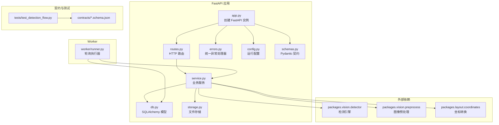
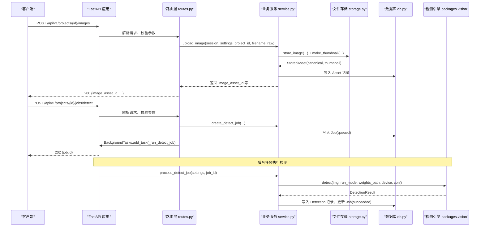
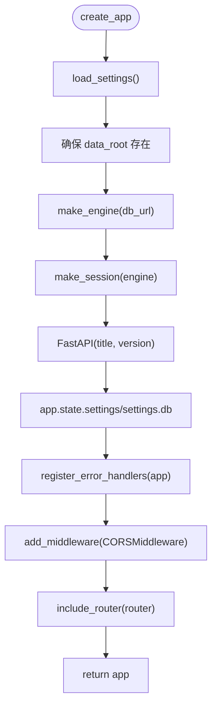
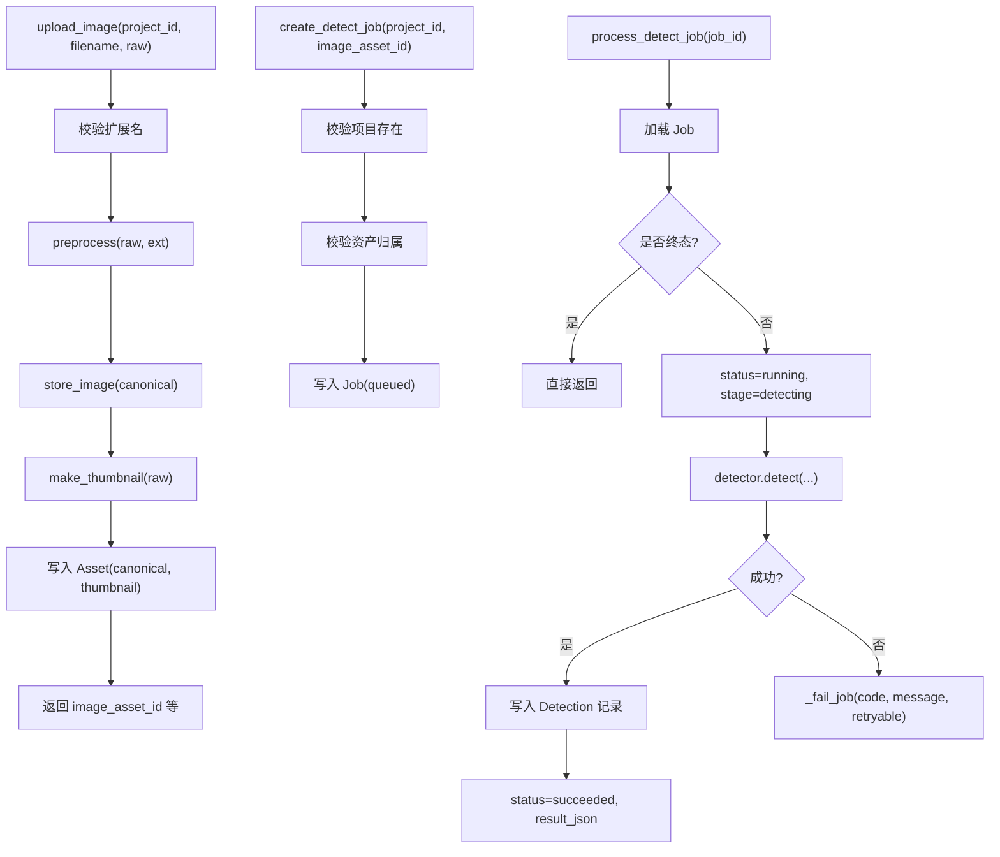
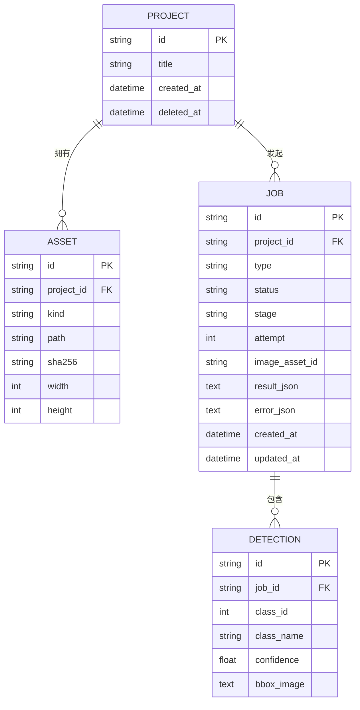
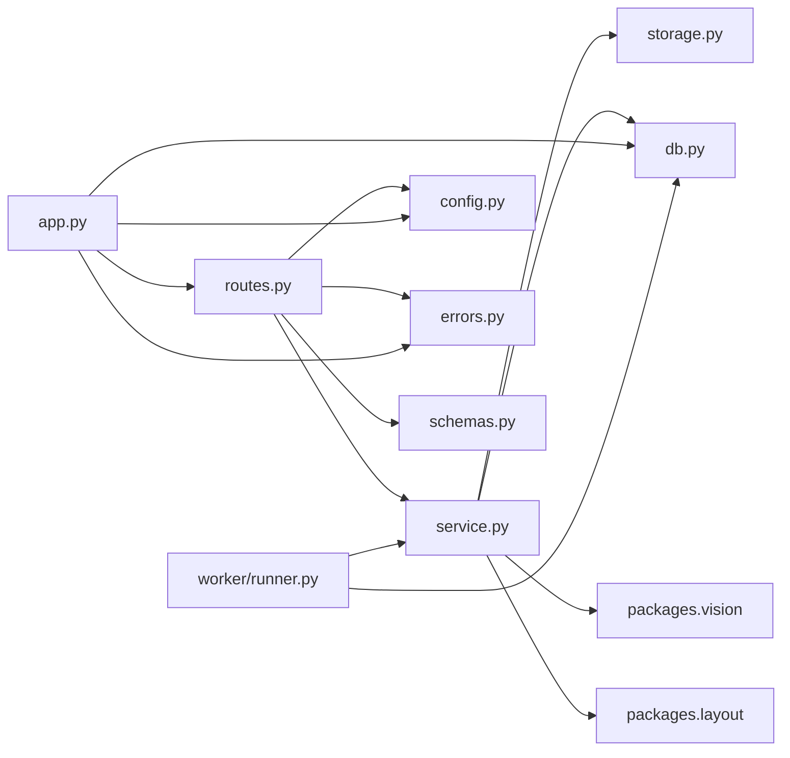

# 后端服务

<cite>
**本文引用的文件**   
- [services/api/app.py](file://services/api/app.py)
- [services/api/routes.py](file://services/api/routes.py)
- [services/api/service.py](file://services/api/service.py)
- [services/api/db.py](file://services/api/db.py)
- [services/api/schemas.py](file://services/api/schemas.py)
- [services/api/errors.py](file://services/api/errors.py)
- [services/api/storage.py](file://services/api/storage.py)
- [services/api/config.py](file://services/api/config.py)
- [services/worker/runner.py](file://services/worker/runner.py)
- [contracts/detection_result.schema.json](file://contracts/detection_result.schema.json)
- [contracts/error.schema.json](file://contracts/error.schema.json)
- [tests/test_detection_flow.py](file://tests/test_detection_flow.py)
</cite>

## 目录
1. [简介](#简介)
2. [项目结构](#项目结构)
3. [核心组件](#核心组件)
4. [架构总览](#架构总览)
5. [详细组件分析](#详细组件分析)
6. [依赖关系分析](#依赖关系分析)
7. [性能与可扩展性](#性能与可扩展性)
8. [故障排查指南](#故障排查指南)
9. [结论](#结论)
10. [附录：API 契约与调用示例](#附录api-契约与调用示例)

## 简介
本文件为 AstraDesk 后端 FastAPI 服务的完整技术文档。内容覆盖应用装配、中间件与 CORS、数据库连接管理、错误处理机制；分层架构中路由层、业务服务层、数据访问层的职责划分与数据流向；RESTful API 端点设计（健康检查、能力查询、项目管理、图像上传、资产获取、检测任务）；业务逻辑实现（项目生命周期、资产存储策略、异步任务调度、检测流程编排）；JSON Schema 契约驱动开发模式；数据库 ORM 模型与索引策略；以及实际调用示例和错误处理最佳实践。

## 项目结构
后端代码位于 `services/api`，提供 FastAPI 应用、路由、业务服务、ORM 模型、配置、错误处理和文件存储；`services/worker` 提供可选的后台 worker 执行器；`contracts` 定义 JSON Schema 契约；`tests` 包含端到端测试，验证契约一致性、ID 守恒、非法输入拒绝与 real 模式下不静默回退 mock。



**图表来源**
- [services/api/app.py:24-47](file://services/api/app.py#L24-L47)
- [services/api/routes.py:28-143](file://services/api/routes.py#L28-L143)
- [services/api/service.py:44-237](file://services/api/service.py#L44-L237)
- [services/api/db.py:26-92](file://services/api/db.py#L26-L92)
- [services/api/errors.py:12-56](file://services/api/errors.py#L12-L56)
- [services/api/config.py:20-61](file://services/api/config.py#L20-L61)
- [services/api/schemas.py:9-84](file://services/api/schemas.py#L9-L84)
- [services/api/storage.py:18-61](file://services/api/storage.py#L18-L61)
- [services/worker/runner.py:16-43](file://services/worker/runner.py#L16-L43)
- [contracts/detection_result.schema.json:1-65](file://contracts/detection_result.schema.json#L1-L65)
- [contracts/error.schema.json:1-24](file://contracts/error.schema.json#L1-L24)
- [tests/test_detection_flow.py:1-126](file://tests/test_detection_flow.py#L1-L126)

**章节来源**
- [services/api/app.py:1-48](file://services/api/app.py#L1-L48)
- [services/api/routes.py:1-143](file://services/api/routes.py#L1-L143)
- [services/api/service.py:1-237](file://services/api/service.py#L1-L237)
- [services/api/db.py:1-92](file://services/api/db.py#L1-L92)
- [services/api/schemas.py:1-84](file://services/api/schemas.py#L1-L84)
- [services/api/errors.py:1-56](file://services/api/errors.py#L1-L56)
- [services/api/storage.py:1-61](file://services/api/storage.py#L1-L61)
- [services/api/config.py:1-61](file://services/api/config.py#L1-L61)
- [services/worker/runner.py:1-43](file://services/worker/runner.py#L1-L43)
- [contracts/detection_result.schema.json:1-65](file://contracts/detection_result.schema.json#L1-L65)
- [contracts/error.schema.json:1-24](file://contracts/error.schema.json#L1-L24)
- [tests/test_detection_flow.py:1-126](file://tests/test_detection_flow.py#L1-L126)

## 核心组件
- 应用装配与中间件：创建 FastAPI 实例、挂载 CORS、注册错误处理器、注入 Settings 与数据库连接。
- 路由层：统一前缀 `/api/v1`，仅做协议解析与参数校验，委托 service 层执行业务。
- 业务服务层：项目 CRUD、图像上传与预处理、检测任务创建与执行、结果持久化与查询装配。
- 数据访问层：SQLAlchemy ORM 模型（Project、Asset、Job、Detection），SQLite 引擎与会话工厂。
- 配置中心：从环境变量加载运行模式、数据库 URL、权重路径、设备与置信度等。
- 错误处理：统一 ApiError 异常与 FastAPI 异常处理器，返回 ErrorBody。
- 文件存储：服务端生成路径、计算 sha256、生成缩略图。
- Worker：可选的后台轮询执行器，拉取 queued 任务并执行。

**章节来源**
- [services/api/app.py:24-47](file://services/api/app.py#L24-L47)
- [services/api/routes.py:28-143](file://services/api/routes.py#L28-L143)
- [services/api/service.py:44-237](file://services/api/service.py#L44-L237)
- [services/api/db.py:26-92](file://services/api/db.py#L26-L92)
- [services/api/config.py:20-61](file://services/api/config.py#L20-L61)
- [services/api/errors.py:12-56](file://services/api/errors.py#L12-L56)
- [services/api/storage.py:18-61](file://services/api/storage.py#L18-L61)
- [services/worker/runner.py:16-43](file://services/worker/runner.py#L16-L43)

## 架构总览
FastAPI 应用启动时加载配置、创建 SQLite 引擎与会话工厂，将 Settings 与数据库对象挂到 app.state，注册错误处理器，启用 CORS，并挂载路由。请求进入路由层后，通过依赖注入获取 Session 与 Settings，再调用 service 层完成业务逻辑。service 层负责数据校验、持久化、文件存储、调用检测引擎，并将检测结果持久化为 Detection 记录。异步检测通过 BackgroundTasks 在请求进程内执行，也可由 worker 轮询执行 queued 任务。



**图表来源**
- [services/api/app.py:24-47](file://services/api/app.py#L24-L47)
- [services/api/routes.py:100-143](file://services/api/routes.py#L100-L143)
- [services/api/service.py:73-179](file://services/api/service.py#L73-L179)
- [services/api/storage.py:32-61](file://services/api/storage.py#L32-L61)
- [services/api/db.py:26-92](file://services/api/db.py#L26-L92)

## 详细组件分析

### 应用装配与中间件
- 创建 FastAPI 实例，设置 title 与 version。
- 加载 Settings，确保 data_root 存在。
- 创建 SQLAlchemy Engine 与 Session 工厂，挂载到 app.state.db。
- 注册统一错误处理器。
- 添加 CORS 中间件，允许前端本地开发地址。
- 挂载路由。



**图表来源**
- [services/api/app.py:24-47](file://services/api/app.py#L24-L47)
- [services/api/config.py:39-61](file://services/api/config.py#L39-L61)
- [services/api/db.py:84-92](file://services/api/db.py#L84-L92)
- [services/api/errors.py:35-56](file://services/api/errors.py#L35-L56)

**章节来源**
- [services/api/app.py:24-47](file://services/api/app.py#L24-L47)
- [services/api/config.py:39-61](file://services/api/config.py#L39-L61)
- [services/api/db.py:84-92](file://services/api/db.py#L84-L92)
- [services/api/errors.py:35-56](file://services/api/errors.py#L35-L56)

### 路由层（routes.py）
- 统一前缀 `/api/v1`。
- 健康检查与健康状态返回运行模式。
- 能力查询根据运行模式探测检测器可用性。
- 项目管理：创建、列表、详情。
- 图像上传：读取二进制、委托 service 层处理。
- 资产获取：按 asset_id 返回图片文件。
- 检测任务：创建异步任务（202），查询任务状态与结果。
- 依赖注入：get_session 提供 Session，get_settings 提供 Settings。

```mermaid
classDiagram
class Router {
+"/health" GET
+"/capabilities" GET
+"/projects" POST
+"/projects" GET
+"/projects/{project_id}" GET
+"/projects/{project_id}/images" POST
+"/assets/{asset_id}" GET
+"/projects/{project_id}/jobs/detect" POST
+"/jobs/{job_id}" GET
-get_session(request)
-get_settings(request)
}
```

**图表来源**
- [services/api/routes.py:28-143](file://services/api/routes.py#L28-L143)

**章节来源**
- [services/api/routes.py:28-143](file://services/api/routes.py#L28-L143)

### 业务服务层（service.py）
- 项目生命周期：创建、查询、列表，支持软删除字段 deleted_at。
- 图像上传：扩展名校验、空文件校验、预处理、标准图与缩略图存储、写入 Asset。
- 检测任务：创建 Job（queued）、后台执行 process_detect_job（running → succeeded/failed）、持久化 Detection。
- 查询装配：job_to_dict 组装检测结果与错误信息。
- 坐标推导：derive_bbox_desk 将图像坐标转换为桌面坐标。



**图表来源**
- [services/api/service.py:73-179](file://services/api/service.py#L73-L179)
- [services/api/service.py:189-221](file://services/api/service.py#L189-L221)

**章节来源**
- [services/api/service.py:44-237](file://services/api/service.py#L44-L237)

### 数据访问层（db.py）
- ORM 模型：Project、Asset、Job、Detection。
- 表关系：Project 1→N Asset，Project 1→N Job，Job 1→N Detection。
- 时间戳：created_at、updated_at 使用 UTC。
- 引擎与会话：make_engine 创建 SQLite 引擎并自动建表；make_session 返回会话工厂。



**图表来源**
- [services/api/db.py:26-92](file://services/api/db.py#L26-L92)

**章节来源**
- [services/api/db.py:26-92](file://services/api/db.py#L26-L92)

### 配置与运行模式（config.py）
- 运行模式：real（真实推理）、mock（确定性 Mock）。demo 等价于 mock。
- 环境变量：ASTRADESK_RUN_MODE、ASTRADESK_DATA_ROOT、ASTRADESK_DB_URL、ASTRADESK_YOLO_WEIGHTS、ASTRADESK_DEVICE、ASTRADESK_DET_CONF。
- 默认值：避免未配置时误触发真实模型或收费后端。

**章节来源**
- [services/api/config.py:1-61](file://services/api/config.py#L1-L61)

### 错误处理（errors.py）
- ApiError：携带 code、message、status_code、retryable、details。
- 统一处理器：将 ApiError 映射为 JSONResponse，填充 request_id。
- 全局异常：捕获未处理异常，返回 INTERNAL 错误。

**章节来源**
- [services/api/errors.py:12-56](file://services/api/errors.py#L12-L56)

### 文件存储（storage.py）
- 服务端生成路径：`<data_root>/projects/<project_id>/<kind>_<asset_id>.ext`。
- 计算 sha256、宽高。
- 缩略图：最长边 THUMB_MAX，JPEG quality=85。

**章节来源**
- [services/api/storage.py:18-61](file://services/api/storage.py#L18-L61)

### Worker 执行器（worker/runner.py）
- 轮询 queued 任务，调用 service.process_detect_job。
- 提供 python -m services.worker 入口。
- 当前实现为最小可用版本，健壮性增强（租约/心跳/重启恢复）属于后续迭代。

**章节来源**
- [services/worker/runner.py:1-43](file://services/worker/runner.py#L1-L43)

## 依赖关系分析
- 路由层依赖 service、config、errors、schemas。
- service 层依赖 storage、config、db、vision.detector、vision.preprocess、layout.coordinates。
- app 装配依赖 config、db、errors、routes。
- worker 依赖 service、config、db。



**图表来源**
- [services/api/routes.py:1-27](file://services/api/routes.py#L1-L27)
- [services/api/service.py:1-25](file://services/api/service.py#L1-L25)
- [services/api/app.py:1-14](file://services/api/app.py#L1-L14)
- [services/worker/runner.py:1-14](file://services/worker/runner.py#L1-L14)

**章节来源**
- [services/api/routes.py:1-27](file://services/api/routes.py#L1-L27)
- [services/api/service.py:1-25](file://services/api/service.py#L1-L25)
- [services/api/app.py:1-14](file://services/api/app.py#L1-L14)
- [services/worker/runner.py:1-14](file://services/worker/runner.py#L1-L14)

## 性能与可扩展性
- 异步任务：使用 BackgroundTasks 在请求进程内执行检测，避免阻塞主线程；适合轻量级部署。
- 可替换为独立 worker：worker/runner.py 提供轮询执行入口，便于横向扩展与解耦。
- 数据库：SQLite 适用于单机与演示场景；生产环境建议迁移至 PostgreSQL/MySQL，并增加索引（如 jobs.status、jobs.project_id、assets.project_id）。
- 图像处理：预处理与缩略图生成在内存中进行，注意大图像时的内存占用；可引入队列与限流。
- 检测引擎：real 模式下权重缺失会失败，避免静默回退 mock，保证契约一致性。

[本节为通用指导，不直接分析具体文件]

## 故障排查指南
- 健康检查失败：确认 ASTRADESK_RUN_MODE 与端口可达。
- 能力查询不可用：real 模式下检查权重路径与依赖；mock 模式应返回 mock-detector。
- 图像上传失败：
  - 不支持扩展名：返回 415 INVALID_IMAGE。
  - 空文件或伪装图像：返回 400 INVALID_IMAGE。
  - 过大或超像素：返回 413 INVALID_IMAGE。
- 资产获取 404：资产不存在或所属项目已删除。
- 检测任务失败：
  - MODEL_UNAVAILABLE：real 模式权重缺失或依赖不可用。
  - INTERNAL：检测过程异常，标记 retryable=True。
- 统一错误体：所有错误响应包含 code、message、retryable、request_id。

**章节来源**
- [services/api/routes.py:46-65](file://services/api/routes.py#L46-L65)
- [services/api/service.py:73-116](file://services/api/service.py#L73-L116)
- [services/api/service.py:132-186](file://services/api/service.py#L132-L186)
- [services/api/errors.py:12-56](file://services/api/errors.py#L12-L56)
- [tests/test_detection_flow.py:91-126](file://tests/test_detection_flow.py#L91-L126)

## 结论
AstraDesk 后端采用清晰的三层架构：路由层负责协议处理，服务层封装业务规则与流程编排，数据访问层提供 ORM 模型与持久化。通过 Pydantic 与 JSON Schema 契约驱动开发，确保接口一致性与可测试性。异步任务与可选 worker 提供了灵活的执行模型。错误处理统一且可重试，便于前端与自动化测试。建议在生产环境中升级数据库、增加索引与监控，并考虑将检测任务迁移至独立队列系统以提升可扩展性。

[本节为总结性内容，不直接分析具体文件]

## 附录：API 契约与调用示例

### RESTful API 端点总览
- 健康检查：GET /api/v1/health
- 能力查询：GET /api/v1/capabilities
- 项目管理：POST /api/v1/projects、GET /api/v1/projects、GET /api/v1/projects/{project_id}
- 图像上传：POST /api/v1/projects/{project_id}/images
- 资产获取：GET /api/v1/assets/{asset_id}
- 检测任务：POST /api/v1/projects/{project_id}/jobs/detect、GET /api/v1/jobs/{job_id}

**章节来源**
- [services/api/routes.py:46-143](file://services/api/routes.py#L46-L143)

### 请求与响应规范
- 健康检查：返回 status 与 run_mode。
- 能力查询：返回 run_mode、detector（available、model_name、model_version）、features。
- 项目创建：返回 ProjectOut（id、title、created_at、assets）。
- 项目列表：返回 ProjectOut 数组。
- 项目详情：返回 ProjectOut，含 assets 列表（id、kind、url、width、height、sha256）。
- 图像上传：返回 ImageUploadOut（project_id、image_asset_id、thumbnail_asset_id、canonical_width、canonical_height、sha256）。
- 资产获取：返回图片二进制，Content-Type 为 image/png 或 image/jpeg。
- 检测任务创建：返回 JobOut（id、project_id、type、status、stage、attempt、result、detections、error、created_at、updated_at），状态码 202。
- 检测任务查询：返回 JobOut，状态码 200。

**章节来源**
- [services/api/routes.py:46-143](file://services/api/routes.py#L46-L143)
- [services/api/schemas.py:19-84](file://services/api/schemas.py#L19-L84)

### 错误码定义
- INVALID_IMAGE：图像无效或类型不支持。
- TOO_MANY_OBJECTS：对象数量超限。
- MODEL_UNAVAILABLE：检测模型不可用。
- SCHEMA_INVALID：请求体不符合契约。
- NO_FEASIBLE_LAYOUT：布局不可行。
- STALE_REVISION：版本过旧。
- GENERATION_TIMEOUT：生成超时。
- BUDGET_EXCEEDED：预算超限。
- PROJECT_NOT_FOUND：项目不存在。
- ASSET_NOT_FOUND：资产不存在。
- JOB_NOT_FOUND：任务不存在。
- INTERNAL：内部错误。

**章节来源**
- [contracts/error.schema.json:1-24](file://contracts/error.schema.json#L1-L24)
- [services/api/errors.py:12-56](file://services/api/errors.py#L12-L56)

### JSON Schema 契约
- 检测任务结果契约：detection_result.schema.json 定义 JobOut 的结构、状态枚举、result 元信息、detections 数组与 bbox_image 归一化坐标。
- 错误对象契约：error.schema.json 定义 ErrorBody 的 code 枚举、message、details、retryable、request_id。

**章节来源**
- [contracts/detection_result.schema.json:1-65](file://contracts/detection_result.schema.json#L1-L65)
- [contracts/error.schema.json:1-24](file://contracts/error.schema.json#L1-L24)

### 实际调用示例（基于测试）
- 健康检查与能力查询：
  - GET /api/v1/health → 200 {"status":"ok","run_mode":"mock"}
  - GET /api/v1/capabilities → 200 {"run_mode":"mock","detector":{"available":true,"model_name":"mock-detector","model_version":"mock-0.1"},"features":["detect"]}
- 创建项目与上传图像：
  - POST /api/v1/projects → 201 {"id":"...","title":"测试项目","created_at":"...","assets":[]}
  - POST /api/v1/projects/{id}/images (multipart file) → 200 {"project_id":"...","image_asset_id":"...","thumbnail_asset_id":"...","canonical_width":64,"canonical_height":...,"sha256":"..."}
- 创建检测任务与查询结果：
  - POST /api/v1/projects/{id}/jobs/detect → 202 {"id":"...","project_id":"...","type":"detect","status":"queued",...}
  - GET /api/v1/jobs/{job_id} → 200 {"id":"...","status":"succeeded","result":{"run_mode":"mock",...},"detections":[...]}
- 资产获取：
  - GET /api/v1/assets/{asset_id} → 200 图片二进制，Content-Type 为 image/png 或 image/jpeg
- 非法图像拒绝：
  - POST /api/v1/projects/{id}/images (fake.png with non-image bytes) → 400 {"code":"INVALID_IMAGE","message":"...","retryable":false,"request_id":"..."}
- 不支持扩展名拒绝：
  - POST /api/v1/projects/{id}/images (note.txt) → 415 {"code":"INVALID_IMAGE","message":"...","retryable":false,"request_id":"..."}
- Real 模式权重缺失：
  - GET /api/v1/capabilities → detector.available=false
  - POST /api/v1/projects/{id}/jobs/detect → 202，最终 job.status="failed"，job.error.code="MODEL_UNAVAILABLE"

**章节来源**
- [tests/test_detection_flow.py:46-126](file://tests/test_detection_flow.py#L46-L126)

### 最佳实践
- 始终使用统一错误体 ErrorBody，并在前端根据 retryable 决定是否重试。
- 在 real 模式下，若 detector.available=false，应避免发起检测任务或提示用户安装权重。
- 上传图像前进行客户端校验（扩展名、大小），减少 4xx 错误。
- 对检测任务进行轮询查询，直到达到终态（succeeded/failed/cancelled）。
- 使用 request_id 进行链路追踪与日志关联。

[本节为通用指导，不直接分析具体文件]