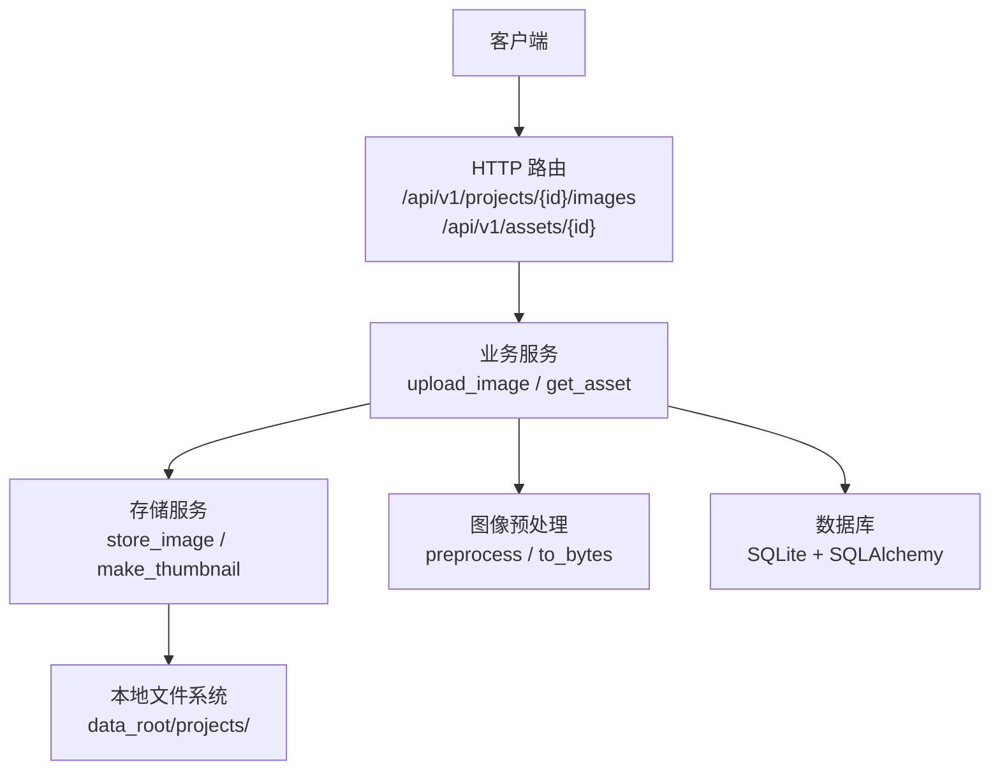
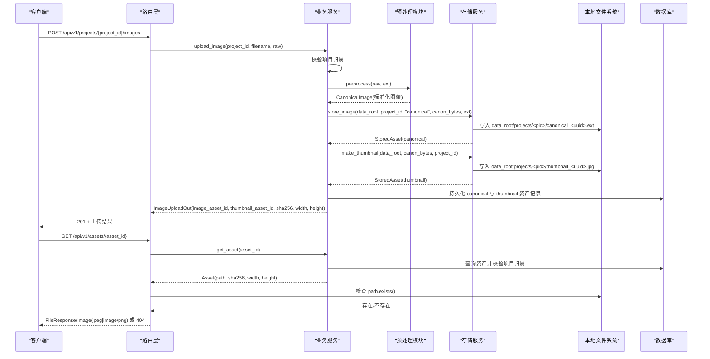
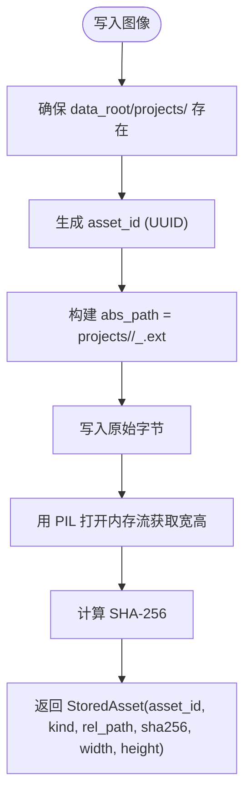
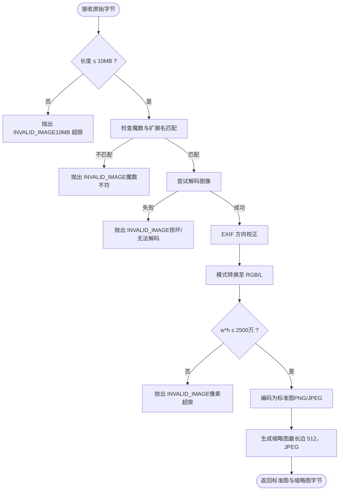
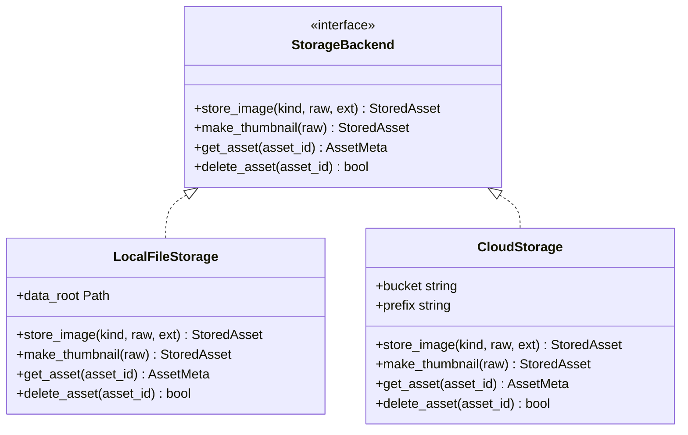
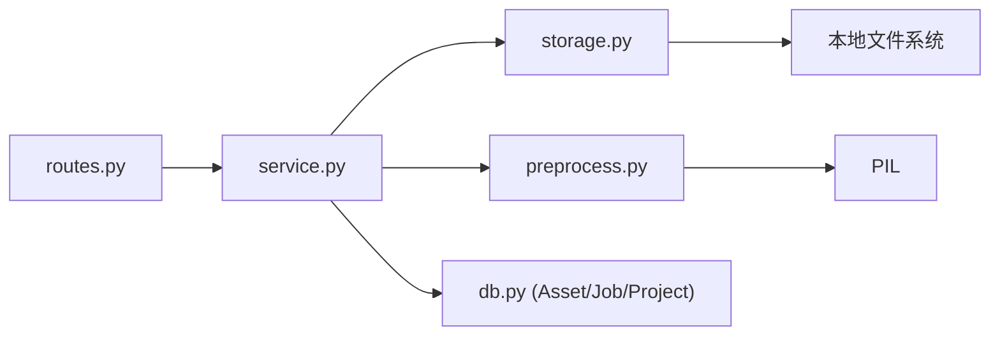

# 存储系统

<cite>
**本文引用的文件**   
- [services/api/storage.py](file://services/api/storage.py)
- [services/api/service.py](file://services/api/service.py)
- [services/api/config.py](file://services/api/config.py)
- [services/api/routes.py](file://services/api/routes.py)
- [services/api/schemas.py](file://services/api/schemas.py)
- [services/api/errors.py](file://services/api/errors.py)
- [packages/vision/preprocess.py](file://packages/vision/preprocess.py)
</cite>

## 目录
1. [引言](#引言)
2. [项目结构](#项目结构)
3. [核心组件](#核心组件)
4. [架构总览](#架构总览)
5. [详细组件分析](#详细组件分析)
6. [依赖关系分析](#依赖关系分析)
7. [性能与容量考虑](#性能与容量考虑)
8. [故障排查指南](#故障排查指南)
9. [结论](#结论)
10. [附录：配置项与扩展接口](#附录配置项与扩展接口)

## 引言
本技术文档聚焦于该项目的文件存储系统，重点说明本地文件系统存储的实现方案、图像上传处理流程、路径与命名策略、完整性校验、缩略图生成、访问权限控制、错误恢复机制，以及可扩展的存储后端设计。该系统遵循“服务端生成路径”的原则，客户端仅通过资产标识符访问资源，避免客户端直接指定或猜测存储路径，从而提升安全性与可维护性。

## 项目结构
与存储相关的代码主要分布在以下模块：
- 存储服务实现：`services/api/storage.py`
- 业务服务编排（含上传流程）：`services/api/service.py`
- 运行配置（数据根目录等）：`services/api/config.py`
- HTTP 路由（上传与读取）：`services/api/routes.py`
- 数据契约模型：`services/api/schemas.py`
- 统一错误处理：`services/api/errors.py`
- 图像预处理（格式/大小/像素限制）：`packages/vision/preprocess.py`

**图表来源**
- [services/api/routes.py:100-115](file://services/api/routes.py#L100-L115)
- [services/api/service.py:73-107](file://services/api/service.py#L73-L107)
- [services/api/storage.py:32-60](file://services/api/storage.py#L32-L60)
- [packages/vision/preprocess.py:54-83](file://packages/vision/preprocess.py#L54-L83)

**章节来源**
- [services/api/storage.py:1-61](file://services/api/storage.py#L1-L61)
- [services/api/service.py:71-107](file://services/api/service.py#L71-L107)
- [services/api/config.py:39-60](file://services/api/config.py#L39-L60)
- [services/api/routes.py:100-115](file://services/api/routes.py#L100-L115)
- [packages/vision/preprocess.py:1-83](file://packages/vision/preprocess.py#L1-L83)

## 核心组件
- 存储服务 `storage.py`：负责将图像字节写入本地文件系统，生成缩略图，并返回资产元信息（标识、类型、相对路径、哈希、尺寸）。
- 业务服务 `service.py`：协调上传流程，调用预处理模块进行格式/大小/像素校验，再调用存储服务持久化标准图与缩略图，并在数据库中记录资产。
- 配置模块 `config.py`：提供 `data_root` 等运行时参数，默认指向项目根下的 `data` 目录。
- 路由层 `routes.py`：暴露 `/api/v1/projects/{project_id}/images` 上传接口与 `/api/v1/assets/{asset_id}` 读取接口。
- 预处理模块 `packages/vision/preprocess.py`：执行严格的图像格式验证、魔数检查、EXIF 方向校正、去元数据、大小与像素上限限制。
- 错误处理 `errors.py`：统一业务异常与 HTTP 响应体结构。

**章节来源**
- [services/api/storage.py:18-60](file://services/api/storage.py#L18-L60)
- [services/api/service.py:26-107](file://services/api/service.py#L26-L107)
- [services/api/config.py:20-60](file://services/api/config.py#L20-L60)
- [services/api/routes.py:100-115](file://services/api/routes.py#L100-L115)
- [packages/vision/preprocess.py:14-83](file://packages/vision/preprocess.py#L14-L83)
- [services/api/errors.py:12-55](file://services/api/errors.py#L12-L55)

## 架构总览
下图展示从客户端上传到文件落盘与缩略图生成的端到端流程，以及读取时的归属校验与文件存在性检查。

**图表来源**
- [services/api/routes.py:100-115](file://services/api/routes.py#L100-L115)
- [services/api/service.py:73-107](file://services/api/service.py#L73-L107)
- [services/api/storage.py:32-60](file://services/api/storage.py#L32-L60)
- [packages/vision/preprocess.py:54-83](file://packages/vision/preprocess.py#L54-L83)

## 详细组件分析

### 本地文件系统存储实现
- 目录结构
  - 所有资产位于 `data_root/projects/<project_id>/` 下。
  - 每个项目一个子目录，便于隔离不同项目的数据。
- 文件命名策略
  - 标准图：`canonical_<uuid>.<ext>`，其中 `<ext>` 由预处理决定（PNG 或 JPEG）。
  - 缩略图：`thumbnail_<uuid>.jpg`，固定为 JPEG。
  - 使用 UUID 作为唯一后缀，避免同项目内冲突。
- 路径管理
  - 路径在服务端生成，客户端不可控；读取时通过资产 ID 反查路径。
  - 返回给前端的相对路径已规范化为正斜杠，跨平台兼容。
- 完整性校验
  - 计算 SHA-256 哈希，随资产记录持久化，可用于后续一致性校验。
- 缩略图生成
  - 最长边限制为 512 像素，转换为 RGB 后以质量 85 保存为 JPEG。

**图表来源**
- [services/api/storage.py:32-50](file://services/api/storage.py#L32-L50)

**章节来源**
- [services/api/storage.py:18-60](file://services/api/storage.py#L18-L60)

### 图像文件处理流程
- 支持的扩展名：`jpg`、`jpeg`、`png`。
- 文件大小限制：单张不超过 10MB。
- 像素上限：解码后不超过 2500 万像素。
- 魔数校验：根据扩展名检查文件头签名，拒绝伪装格式。
- EXIF 方向校正与去元数据：保证标准图方向正确且不含敏感元数据。
- 输出格式：PNG 输入保持 PNG，其他转为 JPEG。
- 缩略图：在标准图基础上生成，JPEG 格式，最长边 512。

**图表来源**
- [packages/vision/preprocess.py:43-83](file://packages/vision/preprocess.py#L43-L83)
- [services/api/service.py:73-107](file://services/api/service.py#L73-L107)

**章节来源**
- [packages/vision/preprocess.py:14-83](file://packages/vision/preprocess.py#L14-L83)
- [services/api/service.py:26-107](file://services/api/service.py#L26-L107)

### 存储路径动态生成与冲突解决
- 动态生成
  - 路径基于 `data_root`、`project_id`、`kind`（canonical/thumbnail）、UUID 与扩展名组合。
  - 目录按需创建，支持多级路径自动创建。
- 冲突解决
  - 使用 UUID 保证文件名唯一，避免同项目内重复。
  - 若发生极端并发写入，建议引入分布式锁或原子写入（当前实现未包含）。
- 路径规范化
  - 返回的相对路径统一使用正斜杠，避免 Windows 反斜杠问题。

**章节来源**
- [services/api/storage.py:32-50](file://services/api/storage.py#L32-L50)

### 文件访问权限控制与安全性
- 服务端生成路径：客户端无法直接构造或猜测文件路径，只能通过资产 ID 访问。
- 归属校验：
  - 上传前校验项目是否存在且未被删除。
  - 读取资产时再次校验项目归属，防止删除后的资产被访问。
- 文件存在性检查：读取时检查物理文件是否存在，缺失则返回 404。
- 内容类型推断：根据扩展名选择 `image/png` 或 `image/jpeg`。
- 密钥与环境变量：
  - 配置中的密钥仅从环境变量读取，不写入仓库、日志或前端。
- 建议增强：
  - 对 `data_root` 设置最小权限（仅应用进程用户可读写）。
  - 对外暴露的资产 URL 增加短期令牌或鉴权中间件。
  - 对上传请求增加速率限制与恶意文件检测（如递归解压、脚本伪装）。

**章节来源**
- [services/api/routes.py:108-115](file://services/api/routes.py#L108-L115)
- [services/api/service.py:73-115](file://services/api/service.py#L73-L115)
- [services/api/config.py:1-8](file://services/api/config.py#L1-L8)

### 存储配置选项
- `ASTRADESK_RUN_MODE`：运行模式，`real` 或 `mock`（`demo` 等价 `mock`）。
- `ASTRADESK_DATA_ROOT`：数据根目录，默认项目根下的 `data`。
- `ASTRADESK_DB_URL`：数据库连接字符串，默认 SQLite 位于 `data/astradesk.db`。
- `ASTRADESK_YOLO_WEIGHTS`：权重文件路径。
- `ASTRADESK_DEVICE`：检测设备（空表示自动选择）。
- `ASTRADESK_DET_CONF`：检测置信度阈值。

**章节来源**
- [services/api/config.py:39-60](file://services/api/config.py#L39-L60)

### 扩展存储后端接口设计
当前实现以 `storage.py` 为本地文件系统后端。为支持云存储或其他后端，建议抽象出统一的存储接口：

- 接口方法约定
  - `store_image`：接受 `kind`（canonical/thumbnail）、原始字节、扩展名，返回资产元信息（ID、类型、路径/URL、哈希、尺寸）。
  - `make_thumbnail`：生成缩略图并存储，返回缩略图资产元信息。
  - `get_asset`：根据资产 ID 返回元信息（用于路由层校验与响应）。
  - `delete_asset`：可选，用于清理废弃资产。
- 替换方式
  - 在 `service.py` 中注入 `StorageBackend` 实例，而非直接依赖 `storage.LocalFileStorage`。
  - 通过配置切换后端实现（本地/云存储），保持上传与读取逻辑不变。

**图表来源**
- [services/api/storage.py:18-60](file://services/api/storage.py#L18-L60)

**章节来源**
- [services/api/storage.py:18-60](file://services/api/storage.py#L18-L60)

## 依赖关系分析
- 路由层依赖业务服务与配置。
- 业务服务依赖预处理模块、存储服务与数据库模型。
- 存储服务依赖 PIL 与本地文件系统。
- 预处理模块依赖 PIL 与图像标准库。

**图表来源**
- [services/api/routes.py:1-27](file://services/api/routes.py#L1-L27)
- [services/api/service.py:1-25](file://services/api/service.py#L1-L25)
- [services/api/storage.py:1-15](file://services/api/storage.py#L1-L15)
- [packages/vision/preprocess.py:1-15](file://packages/vision/preprocess.py#L1-L15)

**章节来源**
- [services/api/routes.py:1-27](file://services/api/routes.py#L1-L27)
- [services/api/service.py:1-25](file://services/api/service.py#L1-L25)
- [services/api/storage.py:1-15](file://services/api/storage.py#L1-L15)
- [packages/vision/preprocess.py:1-15](file://packages/vision/preprocess.py#L1-L15)

## 性能与容量考虑
- 上传阶段
  - 先进行轻量级校验（大小、魔数），再解码与 EXIF 校正，避免无效 IO。
  - 标准图与缩略图分别编码，注意内存占用（建议使用流式处理以降低峰值内存）。
- 缩略图生成
  - 最长边 512，质量 85，平衡清晰度与体积。
- 存储布局
  - 按项目分目录，便于备份与迁移；但单目录下文件过多会影响文件系统性能，建议未来引入二级分片（如按 hash 前缀）。
- 并发写入
  - 当前未加锁，高并发场景可能产生竞争条件；建议引入文件级锁或原子写入（临时文件 + 重命名）。
- 缓存与 CDN
  - 对只读资产可启用静态文件缓存或 CDN，减轻 API 压力。

[本节为通用指导，不直接分析具体文件]

## 故障排查指南
- 上传失败
  - 不支持的文件类型：检查扩展名是否在 `{jpg, jpeg, png}`。
  - 文件为空：检查客户端是否发送有效载荷。
  - 超过 10MB 或像素超限：调整客户端压缩或分辨率。
  - 魔数不匹配：确认文件头与扩展名一致，避免伪装格式。
  - 损坏或无法解码：检查图像完整性。
- 资产读取失败
  - 404：资产不存在或所属项目已被删除；检查数据库记录与物理文件是否存在。
  - 内容类型错误：确认扩展名与 MIME 类型匹配。
- 任务执行失败
  - MODEL_UNAVAILABLE：真实模式下权重或依赖缺失；检查权重路径与设备配置。
  - INTERNAL：内部错误；查看 worker 日志与堆栈。
- 错误响应结构
  - 统一错误体包含 `code`、`message`、`details`、`retryable`、`request_id`，便于前端重试与追踪。

**章节来源**
- [services/api/service.py:73-107](file://services/api/service.py#L73-L107)
- [services/api/routes.py:108-115](file://services/api/routes.py#L108-L115)
- [services/api/errors.py:12-55](file://services/api/errors.py#L12-L55)
- [packages/vision/preprocess.py:43-83](file://packages/vision/preprocess.py#L43-L83)

## 结论
该存储系统以“服务端生成路径”为核心安全原则，结合严格的图像预处理与缩略图生成，提供了稳定可靠的本地文件存储能力。通过模块化设计，易于扩展到其他存储后端。建议在后续版本中增强并发安全、权限控制与监控告警，以提升系统的健壮性与可观测性。

[本节为总结性内容，不直接分析具体文件]

## 附录：配置项与扩展接口
- 配置项
  - `ASTRADESK_RUN_MODE`：`real` 或 `mock`（`demo` 等价 `mock`）。
  - `ASTRADESK_DATA_ROOT`：数据根目录，默认 `data`。
  - `ASTRADESK_DB_URL`：数据库连接字符串。
  - `ASTRADESK_YOLO_WEIGHTS`：YOLO 权重路径。
  - `ASTRADESK_DEVICE`：检测设备。
  - `ASTRADESK_DET_CONF`：检测置信度阈值。
- 扩展接口
  - 定义 `StorageBackend` 接口，实现 `store_image`、`make_thumbnail`、`get_asset`、`delete_asset`。
  - 在业务服务中注入后端实例，通过配置切换实现。
  - 保持路由与协议不变，仅替换存储实现。

**章节来源**
- [services/api/config.py:39-60](file://services/api/config.py#L39-L60)
- [services/api/storage.py:18-60](file://services/api/storage.py#L18-L60)