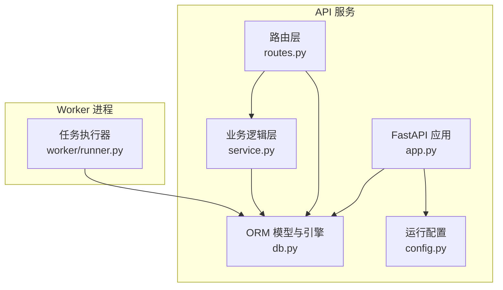
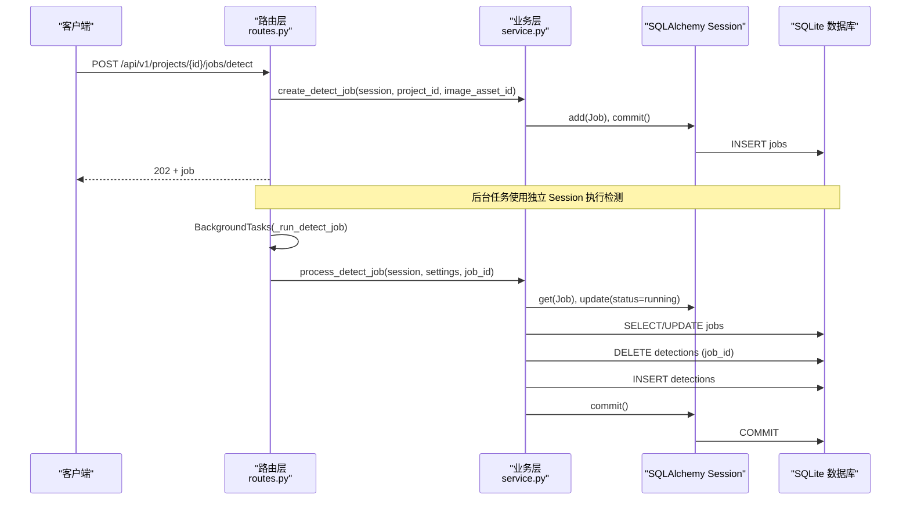
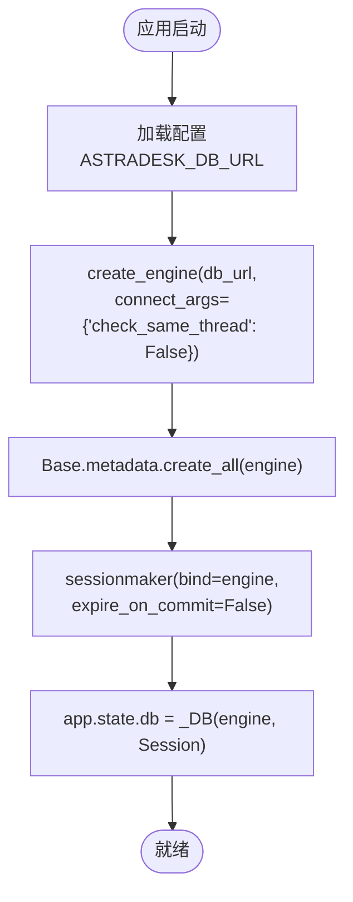
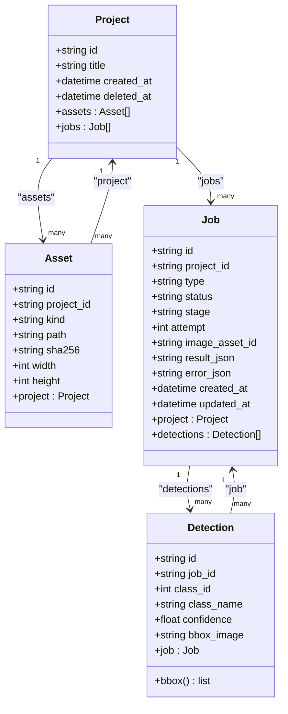
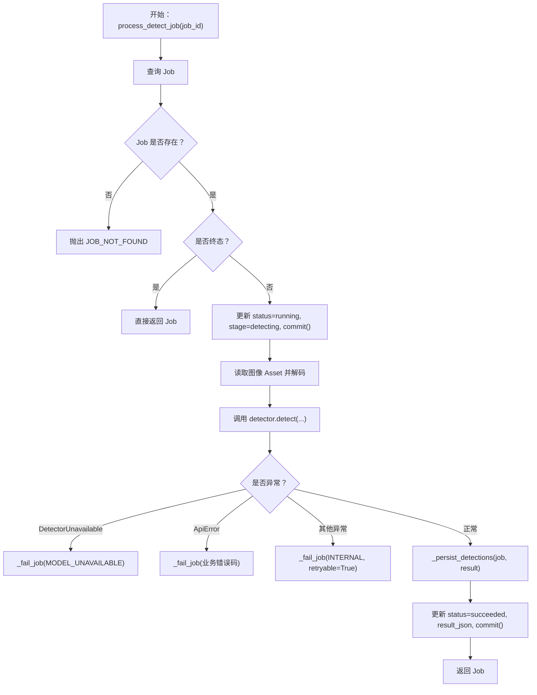
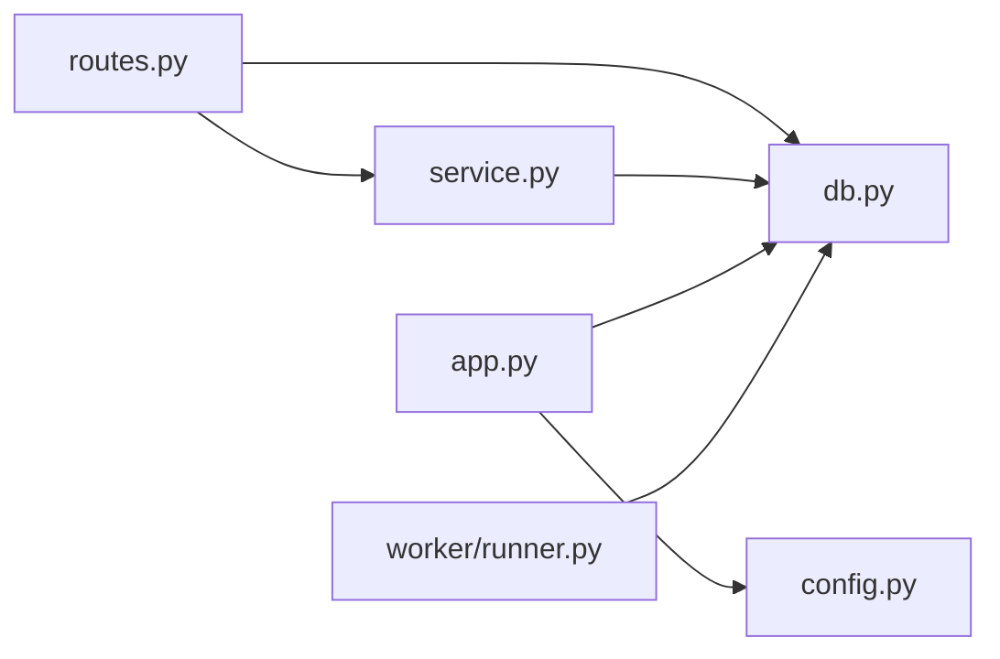

# 数据库管理

<cite>
**本文引用的文件**   
- [services/api/db.py](file://services/api/db.py)
- [services/api/config.py](file://services/api/config.py)
- [services/api/app.py](file://services/api/app.py)
- [services/api/routes.py](file://services/api/routes.py)
- [services/api/service.py](file://services/api/service.py)
- [services/worker/runner.py](file://services/worker/runner.py)
</cite>

## 目录
1. [简介](#简介)
2. [项目结构](#项目结构)
3. [核心组件](#核心组件)
4. [架构总览](#架构总览)
5. [详细组件分析](#详细组件分析)
6. [依赖关系分析](#依赖关系分析)
7. [性能与优化](#性能与优化)
8. [连接配置示例](#连接配置示例)
9. [故障排查](#故障排查)
10. [结论](#结论)

## 简介
本技术文档聚焦于项目的数据库管理模块，围绕 SQLAlchemy ORM 的配置、连接管理、数据模型设计、查询与事务处理、以及迁移与版本管理策略展开。当前实现基于 SQLite，通过 FastAPI 的依赖注入提供 Session，并在后台任务与独立 worker 中复用同一套引擎与会话工厂。文档同时给出索引与批量操作优化建议、常见连接问题及解决方案，帮助读者在保持现有稳定性的基础上进行扩展与调优。

## 项目结构
数据库相关代码集中在 services/api 与 services/worker 两个子系统中：
- services/api/db.py：定义 ORM Base、实体类（Project、Asset、Job、Detection）、引擎与会话工厂。
- services/api/config.py：从环境变量加载运行模式、数据库 URL、数据根路径等设置。
- services/api/app.py：创建 FastAPI 应用，装配 engine 与 session 工厂到 app.state。
- services/api/routes.py：FastAPI 路由层，通过依赖注入获取 Session，并触发后台检测任务。
- services/api/service.py：业务逻辑层，封装项目、资产、检测任务的增删改查与状态流转。
- services/worker/runner.py：独立 worker，使用相同的 make_engine/make_session 执行待处理任务。

**图示来源**
- [services/api/app.py:24-44](file://services/api/app.py#L24-L44)
- [services/api/routes.py:31-37](file://services/api/routes.py#L31-L37)
- [services/api/service.py:46-68](file://services/api/service.py#L46-L68)
- [services/api/db.py:19-91](file://services/api/db.py#L19-L91)
- [services/api/config.py:39-60](file://services/api/config.py#L39-L60)
- [services/worker/runner.py:13-37](file://services/worker/runner.py#L13-L37)

**章节来源**
- [services/api/app.py:24-44](file://services/api/app.py#L24-L44)
- [services/api/config.py:39-60](file://services/api/config.py#L39-L60)

## 核心组件
- 引擎与会话工厂：
  - make_engine：根据 db_url 创建 SQLAlchemy Engine，并为 SQLite 开启跨线程访问参数；启动时自动建表。
  - make_session：绑定 Engine 生成 Session 工厂，关闭 commit 后自动过期行为以支持后续属性访问。
- 数据模型：
  - Project：项目主键 id、标题、创建时间、软删除标记；一对多关联 Asset 与 Job。
  - Asset：资源主键 id、所属项目、类型（original/canonical/thumbnail）、相对路径、哈希、宽高；反向关联 Project。
  - Job：任务主键 id、所属项目、类型（detect/plan/generate）、状态、阶段、重试次数、图像资源 id、结果与错误 JSON、创建/更新时间；关联 Project 与 Detection。
  - Detection：检测框主键 id、所属任务、类别 id/name、置信度、归一化边界框 JSON；反向关联 Job，并提供 bbox 属性解析。
- 配置：
  - Settings：包含运行模式、数据库 URL、数据根路径、权重路径、设备与阈值；db_url 默认指向 data/astradesk.db。

**章节来源**
- [services/api/db.py:26-91](file://services/api/db.py#L26-L91)
- [services/api/config.py:20-60](file://services/api/config.py#L20-L60)

## 架构总览
下图展示 API 请求如何经由路由层进入业务层，再通过 SQLAlchemy Session 访问 SQLite 数据库；后台任务与 worker 使用独立的 Session 执行检测任务。

**图示来源**
- [services/api/routes.py:130-136](file://services/api/routes.py#L130-L136)
- [services/api/routes.py:120-127](file://services/api/routes.py#L120-L127)
- [services/api/service.py:120-179](file://services/api/service.py#L120-L179)
- [services/api/service.py:189-198](file://services/api/service.py#L189-L198)

## 详细组件分析

### 引擎与连接管理
- 引擎创建：
  - 使用 create_engine(db_url, connect_args={"check_same_thread": False}) 创建 SQLite 引擎，允许跨线程访问，避免多线程写入时报错。
  - 启动时调用 Base.metadata.create_all(engine) 确保表存在。
- 会话工厂：
  - sessionmaker(bind=engine, expire_on_commit=False) 提供 Session 工厂，commit 后不立即失效对象属性，便于后续读取。
- 应用装配：
  - FastAPI 应用将 engine 与 Session 工厂挂载到 app.state.db，供依赖注入使用。
- Worker 复用：
  - worker/runner.py 同样调用 make_engine/make_session，保证 API 与 worker 共享同一数据库实例。

**图示来源**
- [services/api/db.py:84-91](file://services/api/db.py#L84-L91)
- [services/api/app.py:24-33](file://services/api/app.py#L24-L33)
- [services/api/config.py:47-49](file://services/api/config.py#L47-L49)
- [services/worker/runner.py:32-37](file://services/worker/runner.py#L32-L37)

**章节来源**
- [services/api/db.py:84-91](file://services/api/db.py#L84-L91)
- [services/api/app.py:24-33](file://services/api/app.py#L24-L33)
- [services/worker/runner.py:32-37](file://services/worker/runner.py#L32-L37)

### 数据模型设计与关系映射
- Project：
  - 字段：id（字符串主键）、title（非空，默认“未命名项目”）、created_at（UTC 默认值）、deleted_at（软删除）。
  - 关系：assets（一对多）、jobs（一对多）。
- Asset：
  - 字段：id（字符串主键）、project_id（外键）、kind（original/canonical/thumbnail）、path（相对路径）、sha256、width、height。
  - 关系：project（多对一）。
- Job：
  - 字段：id（字符串主键）、project_id（外键）、type（detect/plan/generate）、status（queued/running/succeeded/partial/failed/cancelled）、stage、attempt、image_asset_id、result_json、error_json、created_at、updated_at（onupdate）。
  - 关系：project（多对一）、detections（一对多）。
- Detection：
  - 字段：id（字符串主键）、job_id（外键）、class_id、class_name、confidence、bbox_image（JSON 字符串）。
  - 关系：job（多对一），提供 bbox 属性返回解析后的列表。

**图示来源**
- [services/api/db.py:26-81](file://services/api/db.py#L26-L81)

**章节来源**
- [services/api/db.py:26-81](file://services/api/db.py#L26-L81)

### 查询与事务处理
- 项目查询：
  - list_projects：过滤 deleted_at 为空，按 created_at 降序分页。
  - get_project：校验存在且未删除。
- 资产上传：
  - upload_image：预处理图片，存储 canonical 与 thumbnail，插入两条 Asset 记录并提交事务。
- 检测任务：
  - create_detect_job：校验项目与资产归属，插入 Job 并提交。
  - process_detect_job：状态机流转 queued → running → succeeded/failed；失败分支记录 error_json；成功分支持久化 Detection 列表。
  - _persist_detections：先删除该 job 下所有 Detection，再批量插入新检测结果，保证 object_id 守恒。
- 查询装配：
  - job_to_dict：组装 Job 及其 Detection 列表为响应结构。

**图示来源**
- [services/api/service.py:132-179](file://services/api/service.py#L132-L179)
- [services/api/service.py:182-198](file://services/api/service.py#L182-L198)

**章节来源**
- [services/api/service.py:46-68](file://services/api/service.py#L46-L68)
- [services/api/service.py:73-115](file://services/api/service.py#L73-L115)
- [services/api/service.py:120-179](file://services/api/service.py#L120-L179)
- [services/api/service.py:189-228](file://services/api/service.py#L189-L228)

### 数据库迁移策略与版本管理
- 当前实现采用 Base.metadata.create_all(engine) 在引擎创建时自动建表，未引入 Alembic 或显式迁移脚本。
- 建议：
  - 引入 Alembic 初始化迁移目录，将 Base.metadata 作为目标元数据。
  - 每次变更模型字段或新增表时，生成迁移脚本并评审合并。
  - 在生产环境启动前执行 alembic upgrade head，确保数据库结构与代码一致。
  - 对破坏性变更（如字段类型变化）编写 down_revision 回滚脚本，保障可逆升级。

[本节为概念性指导，不涉及具体源码行]

## 依赖关系分析
- 模块耦合：
  - routes.py 依赖 service.py 与 db.py；service.py 依赖 db.py 中的实体类。
  - app.py 依赖 config.py 与 db.py，并将 engine 与 Session 工厂注入到 app.state。
  - worker/runner.py 复用 db.py 的 make_engine/make_session，与 API 共享数据库。
- 外部依赖：
  - SQLAlchemy（ORM、Engine、Session）。
  - FastAPI（路由、依赖注入、BackgroundTasks）。
  - PIL/Pillow（图像处理）。
  - ultralytics（YOLO 检测器，受 Settings 控制）。

**图示来源**
- [services/api/routes.py:1-27](file://services/api/routes.py#L1-L27)
- [services/api/service.py:1-24](file://services/api/service.py#L1-L24)
- [services/api/app.py:10-13](file://services/api/app.py#L10-L13)
- [services/worker/runner.py:13-16](file://services/worker/runner.py#L13-L16)

**章节来源**
- [services/api/routes.py:1-27](file://services/api/routes.py#L1-L27)
- [services/api/service.py:1-24](file://services/api/service.py#L1-L24)
- [services/api/app.py:10-13](file://services/api/app.py#L10-L13)
- [services/worker/runner.py:13-16](file://services/worker/runner.py#L13-L16)

## 性能与优化
- 索引设计建议：
  - projects.deleted_at：用于 list_projects 的过滤条件，建议建立索引以提升软删除过滤性能。
  - jobs.project_id：频繁按项目筛选任务，建议建立索引。
  - jobs.status：用于队列拉取与状态查询，建议建立索引。
  - assets.project_id：按项目检索资源，建议建立索引。
  - detections.job_id：查询任务检测结果，建议建立索引。
- 查询性能调优：
  - 使用 session.query(...).with_entities(...) 仅选择必要字段，减少序列化开销。
  - 对大结果集使用分页（limit/offset）与游标式分页（基于 created_at/id）。
  - 避免在循环中多次 commit，尽量批量写入后统一提交。
- 批量操作优化：
  - _persist_detections 已采用先删后插的方式保证一致性；对于大量检测框，可考虑使用 bulk_insert_mappings 或 executemany 提升写入吞吐。
  - 对高频读场景启用只读副本或缓存层（如 Redis）以减少数据库压力。
- 连接池与并发：
  - SQLite 不支持连接池；当前通过 check_same_thread=False 允许多线程访问，但需注意写竞争。
  - 若迁移至 PostgreSQL/MySQL，应配置 pool_size、max_overflow、pool_recycle 等参数，并根据负载调整。

[本节为通用优化建议，不涉及具体源码行]

## 连接配置示例
- 环境变量：
  - ASTRADESK_RUN_MODE：real 或 mock，决定推理模式。
  - ASTRADESK_DATA_ROOT：数据根目录，默认项目根下的 data。
  - ASTRADESK_DB_URL：数据库 URL，默认 sqlite:///data/astradesk.db。
  - ASTRADESK_YOLO_WEIGHTS：YOLO 权重路径。
  - ASTRADESK_DEVICE：设备标识（空则自动选择）。
  - ASTRADESK_DET_CONF：检测置信度阈值。
- 默认行为：
  - 未设置 ASTRADESK_DB_URL 时，使用 data/astradesk.db。
  - 未设置 ASTRADESK_RUN_MODE 时，默认为 mock，避免误触真实模型。

**章节来源**
- [services/api/config.py:39-60](file://services/api/config.py#L39-L60)

## 故障排查
- SQLite 多线程写入报错：
  - 现象：多线程并发写入时报数据库锁定或线程安全错误。
  - 原因：SQLite 默认不允许跨线程访问。
  - 解决：已在 make_engine 中设置 connect_args={"check_same_thread": False}；若仍出现锁竞争，需限制并发写入或使用 WAL 模式。
- 数据库文件缺失或权限不足：
  - 现象：启动时报无法打开数据库文件或权限错误。
  - 解决：确保 ASTRADESK_DATA_ROOT 存在且有写权限；检查 ASTRADESK_DB_URL 指向的路径正确。
- 模型变更未生效：
  - 现象：新增字段或表未出现在数据库中。
  - 解决：确认 Base.metadata.create_all(engine) 在引擎创建时被调用；生产环境建议使用 Alembic 迁移。
- 检测任务失败：
  - 现象：Job 状态变为 failed，error_json 包含错误信息。
  - 解决：查看 error_json 中的 code 与 message；MODEL_UNAVAILABLE 表示权重或依赖不可用；INTERNAL 表示内部异常，可重试。

**章节来源**
- [services/api/db.py:84-86](file://services/api/db.py#L84-L86)
- [services/api/service.py:158-163](file://services/api/service.py#L158-L163)

## 结论
本项目数据库管理模块以 SQLAlchemy ORM 为核心，结合 FastAPI 的依赖注入提供了清晰的连接与会话生命周期管理。数据模型围绕 Project、Asset、Job、Detection 构建，满足 T02 桌面识别的核心流程。当前实现简洁实用，适合单机与轻量部署；若需更高并发与可靠性，建议引入 Alembic 进行迁移管理，并评估迁移至 PostgreSQL/MySQL 以启用连接池与高级特性。同时，针对热点查询与批量写入进行索引与批处理优化，可显著提升系统整体性能与稳定性。