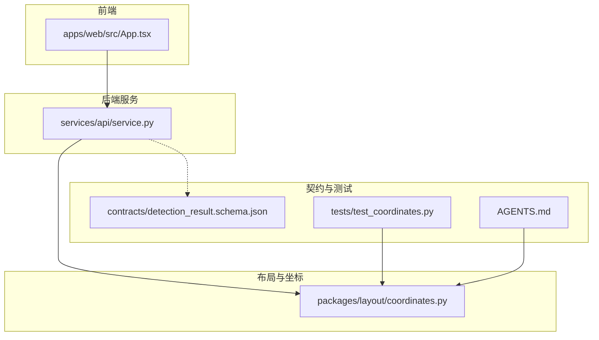
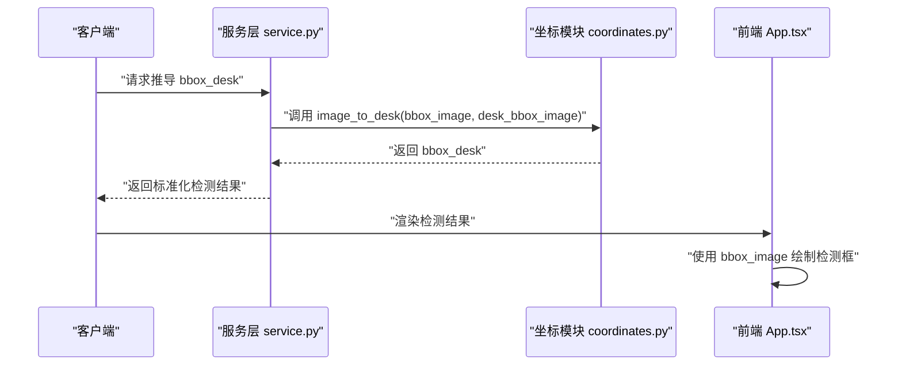
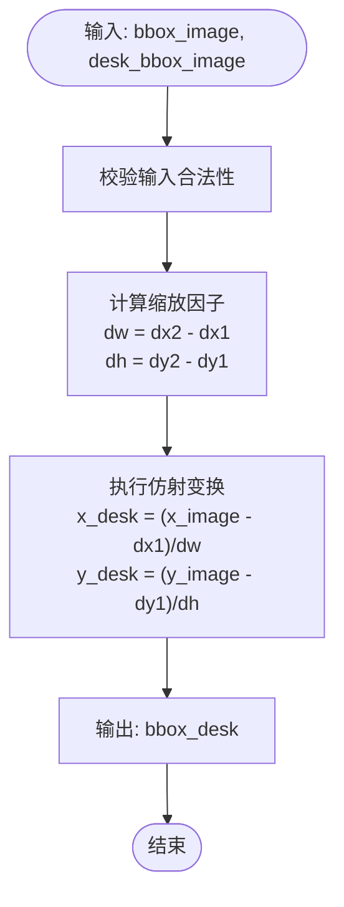
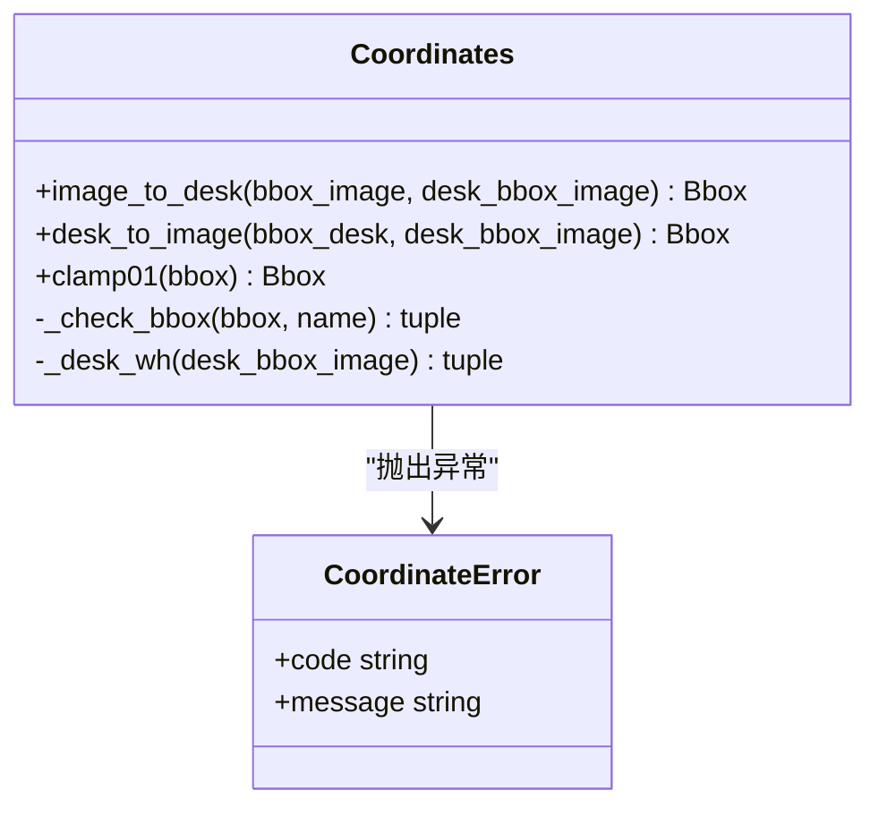
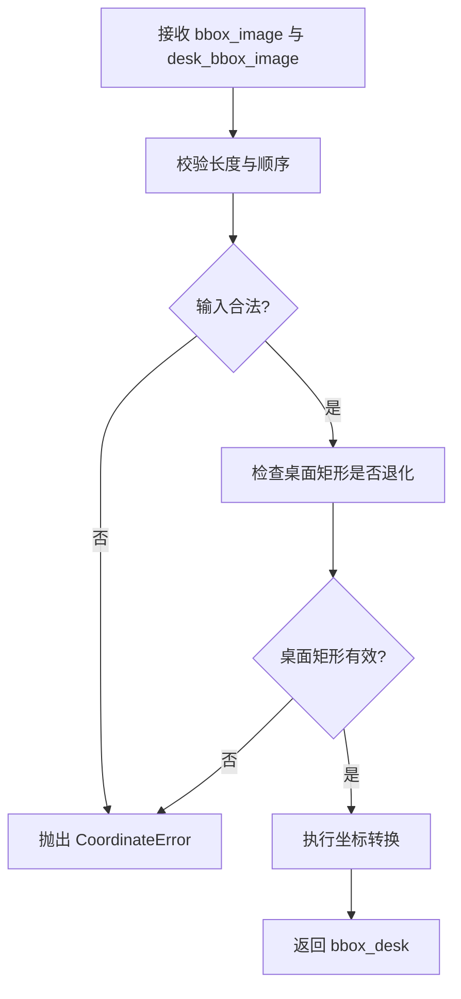
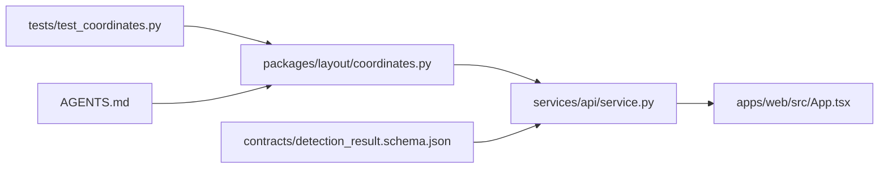

# 坐标转换系统

<cite>
**本文引用的文件**   
- [packages/layout/coordinates.py](file://packages/layout/coordinates.py)
- [tests/test_coordinates.py](file://tests/test_coordinates.py)
- [services/api/service.py](file://services/api/service.py)
- [contracts/detection_result.schema.json](file://contracts/detection_result.schema.json)
- [apps/web/src/App.tsx](file://apps/web/src/App.tsx)
- [AGENTS.md](file://AGENTS.md)
</cite>

## 目录
1. [引言](#引言)
2. [项目结构](#项目结构)
3. [核心组件](#核心组件)
4. [架构总览](#架构总览)
5. [详细组件分析](#详细组件分析)
6. [依赖关系分析](#依赖关系分析)
7. [性能与精度考虑](#性能与精度考虑)
8. [故障排查指南](#故障排查指南)
9. [结论](#结论)
10. [附录：计算示例与边界情况](#附录计算示例与边界情况)

## 引言
本技术文档聚焦 AstraDesk 的坐标转换系统，目标是帮助开发者准确理解并正确使用“图像坐标系”和“桌面坐标系”，掌握归一化坐标的概念、转换算法、容错机制与实际应用场景。该系统将检测模型输出的原图归一化框 `bbox_image` 转换为相对桌面区域的归一化框 `bbox_desk`，并提供逆转换能力，确保检测结果可视化、用户交互定位以及多显示器场景下的坐标一致性。

## 项目结构
坐标转换相关代码集中在布局包中，并通过服务层对外暴露；前端仅消费归一化的检测结果，不直接参与坐标推导。

**图表来源**
- [apps/web/src/App.tsx:80-105](file://apps/web/src/App.tsx#L80-L105)
- [services/api/service.py:17-17](file://services/api/service.py#L17-L17)
- [packages/layout/coordinates.py:1-63](file://packages/layout/coordinates.py#L1-L63)
- [contracts/detection_result.schema.json:44-50](file://contracts/detection_result.schema.json#L44-L50)
- [tests/test_coordinates.py:1-48](file://tests/test_coordinates.py#L1-L48)
- [AGENTS.md:17-17](file://AGENTS.md#L17-L17)

**章节来源**
- [packages/layout/coordinates.py:1-63](file://packages/layout/coordinates.py#L1-L63)
- [services/api/service.py:17-17](file://services/api/service.py#L17-L17)
- [apps/web/src/App.tsx:80-105](file://apps/web/src/App.tsx#L80-L105)
- [contracts/detection_result.schema.json:44-50](file://contracts/detection_result.schema.json#L44-L50)
- [tests/test_coordinates.py:1-48](file://tests/test_coordinates.py#L1-L48)
- [AGENTS.md:17-17](file://AGENTS.md#L17-L17)

## 核心组件
- 坐标契约定义：明确 `bbox_image` 与 `bbox_desk` 的原点、方向、单位与范围。
- 坐标转换函数：提供 `image_to_desk` 与 `desk_to_image` 的双向转换。
- 边界检查与错误类型：统一抛出 `CoordinateError`，携带错误码与消息。
- 归一化裁剪工具：提供 `clamp01` 用于展示与越界辅助。
- 服务层集成：通过 `derive_bbox_desk` 将坐标转换封装为 API 可复用的业务方法。
- 前端可视化：基于 `bbox_image` 在画布上绘制检测框。

**章节来源**
- [packages/layout/coordinates.py:1-63](file://packages/layout/coordinates.py#L1-L63)
- [services/api/service.py:231-237](file://services/api/service.py#L231-L237)
- [apps/web/src/App.tsx:80-105](file://apps/web/src/App.tsx#L80-L105)

## 架构总览
坐标转换系统的调用链从服务层发起，进入布局层的坐标模块，最终返回标准化的归一化结果。前端根据归一化坐标进行可视化渲染。

**图表来源**
- [services/api/service.py:231-237](file://services/api/service.py#L231-L237)
- [packages/layout/coordinates.py:44-55](file://packages/layout/coordinates.py#L44-L55)
- [apps/web/src/App.tsx:80-105](file://apps/web/src/App.tsx#L80-L105)

## 详细组件分析

### 坐标系统与数学原理
- 图像坐标系：以左上角为原点，x 轴向右为正，y 轴向下为正；`bbox_image = [x1, y1, x2, y2]` 是相对于整张原图的归一化坐标，取值范围通常为 `[0, 1]`。
- 桌面坐标系：以桌面矩形 `desk_bbox_image = [dx1, dy1, dx2, dy2]` 为参考，`bbox_desk` 是相对桌面矩形的归一化坐标；计算公式为：
  - `x_desk = (x_image - dx1) / (dx2 - dx1)`
  - `y_desk = (y_image - dy1) / (dy2 - dy1)`
- 仿射变换与比例缩放：上述公式本质上是线性缩放加偏移校正，属于二维仿射变换的特例（无旋转、无剪切）。
- 逆转换：`desk_to_image` 将桌面归一化坐标还原到原图归一化坐标，实现往返一致性。

**图表来源**
- [packages/layout/coordinates.py:44-55](file://packages/layout/coordinates.py#L44-L55)

**章节来源**
- [packages/layout/coordinates.py:1-63](file://packages/layout/coordinates.py#L1-L63)

### 双向转换函数
- `image_to_desk(bbox_image, desk_bbox_image)`：将原图归一化框转换为桌面归一化框。允许结果超出 `[0, 1]`，因为物体可能部分位于桌面外。
- `desk_to_image(bbox_desk, desk_bbox_image)`：将桌面归一化框还原为原图归一化框，作为 `image_to_desk` 的逆运算。
- 两者均依赖内部校验逻辑 `_check_bbox` 与 `_desk_wh`，确保输入合法且桌面矩形非退化。

**图表来源**
- [packages/layout/coordinates.py:17-63](file://packages/layout/coordinates.py#L17-L63)

**章节来源**
- [packages/layout/coordinates.py:26-55](file://packages/layout/coordinates.py#L26-L55)

### 边界检查与错误处理
- 输入长度校验：要求每个框必须包含 4 个浮点数。
- 坐标顺序校验：要求 `x2 >= x1` 且 `y2 >= y1`。
- 桌面矩形退化校验：要求 `dx2 > dx1` 且 `dy2 > dy1`。
- 错误类型：统一抛出 `CoordinateError`，附带错误码 `"SCHEMA_INVALID"` 与描述性消息。
- 服务层封装：`derive_bbox_desk` 捕获 `CoordinateError` 并转换为 API 错误，状态码为 422。

**图表来源**
- [packages/layout/coordinates.py:26-41](file://packages/layout/coordinates.py#L26-L41)
- [services/api/service.py:231-237](file://services/api/service.py#L231-L237)

**章节来源**
- [packages/layout/coordinates.py:26-41](file://packages/layout/coordinates.py#L26-L41)
- [services/api/service.py:231-237](file://services/api/service.py#L231-L237)

### 归一化坐标的重要性
- 坐标范围标准化：所有坐标统一映射到 `[0, 1]`，便于跨分辨率兼容。
- 精度控制：检测结果中的 `bbox_image` 值通常保留至小数点后若干位，避免累积误差。
- 跨分辨率兼容性：归一化坐标不依赖具体像素尺寸，可在不同显示设备或缩放比例下保持一致语义。
- 前端可视化：前端直接使用 `bbox_image` 百分比定位，无需关心原始图像尺寸。

**章节来源**
- [contracts/detection_result.schema.json:44-50](file://contracts/detection_result.schema.json#L44-L50)
- [apps/web/src/App.tsx:80-105](file://apps/web/src/App.tsx#L80-L105)

### 坐标验证与容错处理
- 越界检测：`image_to_desk` 不裁剪结果，允许负值或大于 1 的值，由上层决定如何处理越界。
- 异常值处理：非法输入直接抛出 `CoordinateError`，阻止后续无效计算。
- 调试信息：错误消息包含具体字段名与输入值，便于快速定位问题。
- 单元测试覆盖：往返转换、子桌面区域、越界对象等场景均有测试用例。

**章节来源**
- [packages/layout/coordinates.py:44-62](file://packages/layout/coordinates.py#L44-L62)
- [tests/test_coordinates.py:14-48](file://tests/test_coordinates.py#L14-L48)

## 依赖关系分析
坐标转换模块被服务层引用，前端不直接依赖该模块；契约文件定义了数据格式，测试文件验证转换正确性。

**图表来源**
- [services/api/service.py:17-17](file://services/api/service.py#L17-L17)
- [apps/web/src/App.tsx:80-105](file://apps/web/src/App.tsx#L80-L105)
- [contracts/detection_result.schema.json:44-50](file://contracts/detection_result.schema.json#L44-L50)
- [tests/test_coordinates.py:1-48](file://tests/test_coordinates.py#L1-L48)
- [AGENTS.md:17-17](file://AGENTS.md#L17-L17)

**章节来源**
- [services/api/service.py:17-17](file://services/api/service.py#L17-L17)
- [apps/web/src/App.tsx:80-105](file://apps/web/src/App.tsx#L80-L105)
- [contracts/detection_result.schema.json:44-50](file://contracts/detection_result.schema.json#L44-L50)
- [tests/test_coordinates.py:1-48](file://tests/test_coordinates.py#L1-L48)
- [AGENTS.md:17-17](file://AGENTS.md#L17-L17)

## 性能与精度考虑
- 时间复杂度：坐标转换是常数时间操作，对大量检测结果影响极小。
- 浮点精度：建议使用稳定的浮点比较方式（如近似相等）进行往返验证。
- 内存占用：坐标数组为固定长度，内存开销可忽略。
- 前端渲染：百分比定位避免重复计算图像尺寸，提升渲染性能。

[本节为通用性能指导，不直接分析具体文件]

## 故障排查指南
- 常见错误码：`SCHEMA_INVALID` 表示输入格式或数值不合法。
- 排查步骤：
  1. 检查 `bbox_image` 是否为四元组且顺序正确。
  2. 检查 `desk_bbox_image` 是否为有效矩形（宽度与高度大于零）。
  3. 若结果为负值或大于 1，确认是否期望越界；必要时使用 `clamp01` 进行展示裁剪。
  4. 在服务层查看是否抛出 422 状态码，对应坐标推导失败。
- 日志建议：记录输入框、桌面矩形、转换结果与错误消息，便于复现问题。

**章节来源**
- [packages/layout/coordinates.py:17-41](file://packages/layout/coordinates.py#L17-L41)
- [services/api/service.py:231-237](file://services/api/service.py#L231-L237)

## 结论
AstraDesk 的坐标转换系统通过明确的契约定义、严格的输入校验、稳定的双向转换函数与服务层封装，确保了检测结果在不同坐标系间的一致性与可靠性。归一化坐标的设计使系统具备跨分辨率兼容性，而边界检查与错误处理机制提升了鲁棒性。前端基于归一化坐标进行可视化，简化了渲染逻辑。整体架构清晰、职责分离，便于扩展与维护。

[本节为总结性内容，不直接分析具体文件]

## 附录：计算示例与边界情况

### 示例一：完整桌面区域
- 输入：`desk = [0.0, 0.0, 1.0, 1.0]`, `bbox = [0.12, 0.3, 0.55, 0.78]`
- 预期：`image_to_desk(bbox, desk)` 应近似等于 `bbox`，且 `desk_to_image(image_to_desk(bbox, desk), desk)` 应近似等于 `bbox`。

**章节来源**
- [tests/test_coordinates.py:14-18](file://tests/test_coordinates.py#L14-L18)

### 示例二：子桌面区域
- 输入：`desk = [0.1, 0.1, 0.9, 0.9]`, `bbox = [0.18, 0.26, 0.34, 0.5]`
- 预期：`d[0]` 应近似等于 `(0.18 - 0.1) / 0.8`，`d[2]` 应近似等于 `(0.34 - 0.1) / 0.8`，且往返转换一致。

**章节来源**
- [tests/test_coordinates.py:21-28](file://tests/test_coordinates.py#L21-L28)

### 示例三：非法输入
- 输入：长度不足、`x2 < x1`、桌面宽度退化
- 预期：抛出 `CoordinateError`，错误码为 `"SCHEMA_INVALID"`

**章节来源**
- [tests/test_coordinates.py:31-39](file://tests/test_coordinates.py#L31-L39)

### 示例四：对象位于桌面外
- 输入：`desk = [0.2, 0.2, 0.8, 0.8]`, `bbox = [0.1, 0.1, 0.5, 0.5]`
- 预期：`d[0]` 与 `d[1]` 为负值，`clamp01(d)[0]` 为 `0.0`

**章节来源**
- [tests/test_coordinates.py:42-48](file://tests/test_coordinates.py#L42-L48)