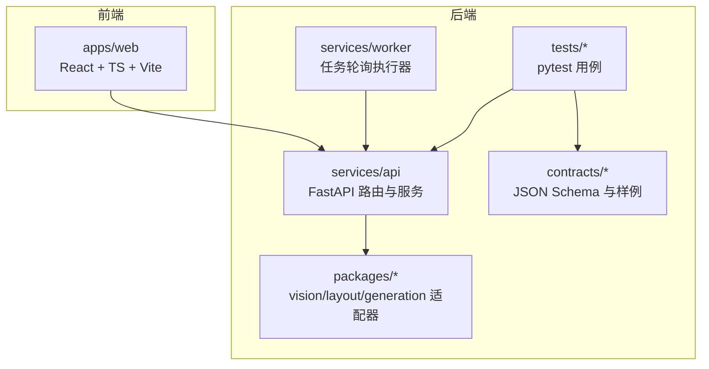
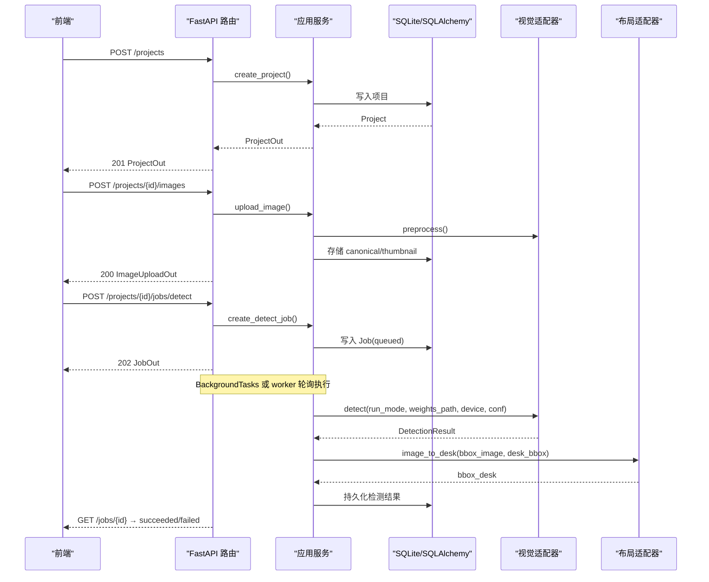
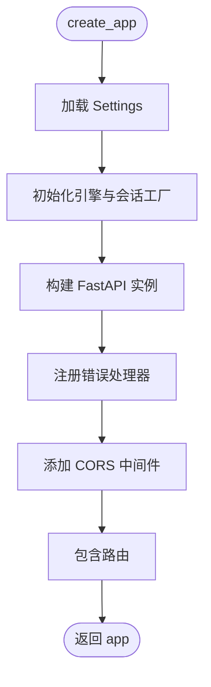
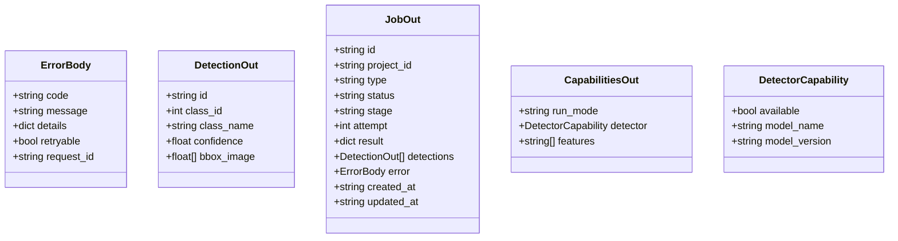
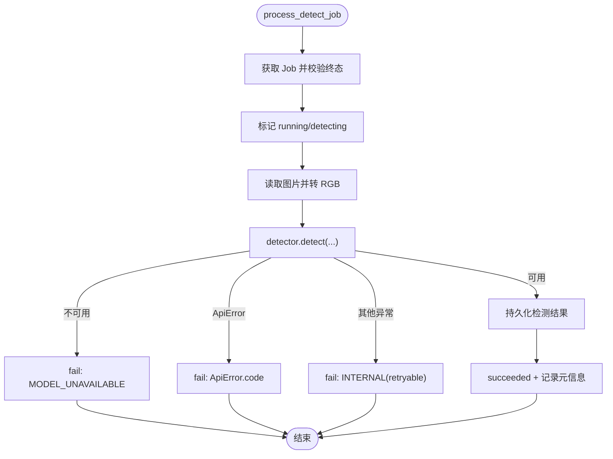

# 开发指南

<cite>
**本文引用的文件**   
- [README.md](file://README.md)
- [AGENTS.md](file://AGENTS.md)
- [pyproject.toml](file://pyproject.toml)
- [DATASET.md](file://docs/DATASET.md)
- [contracts/README.md](file://contracts/README.md)
- [services/api/app.py](file://services/api/app.py)
- [services/api/routes.py](file://services/api/routes.py)
- [services/api/schemas.py](file://services/api/schemas.py)
- [services/api/service.py](file://services/api/service.py)
- [services/worker/runner.py](file://services/worker/runner.py)
- [tests/test_detection_flow.py](file://tests/test_detection_flow.py)
</cite>

## 目录
1. [引言](#引言)
2. [项目结构](#项目结构)
3. [核心组件](#核心组件)
4. [架构总览](#架构总览)
5. [详细组件分析](#详细组件分析)
6. [依赖关系分析](#依赖关系分析)
7. [性能与调试](#性能与调试)
8. [贡献流程与规范](#贡献流程与规范)
9. [常见问题与陷阱](#常见问题与陷阱)
10. [结论](#结论)

## 引言
AstraDesk 是一个桌面智能整理系统：用户上传桌面照片，系统进行物品检测、布局规划与生成可编辑的整理方案。仓库采用前后端分离与多包模块化设计，后端基于 FastAPI，前端基于 React + TypeScript + Vite；算法能力通过适配器暴露，契约通过 JSON Schema 集中管理，测试覆盖契约、坐标往返与端到端流程。

本开发指南面向贡献者，说明编码规范、架构决策、数据集使用、版本管理、新功能开发流程、调试与性能优化方法，以及社区贡献流程与常见陷阱。

**章节来源**
- [README.md:1-83](file://README.md#L1-L83)

## 项目结构
仓库按职责分层组织：
- apps/web：前端应用（React + TS + Vite）
- services/api：FastAPI 服务（路由、应用服务、存储、Schema、配置）
- services/worker：任务执行入口与轮询器
- packages/vision|layout|generation：算法适配器与工具
- contracts：JSON Schema 与合法/非法样例
- tests：pytest 测试集
- artifacts/docs/data/weights/locks：运行证据、文档、本地数据与权重、依赖锁



**图表来源**
- [README.md:8-24](file://README.md#L8-L24)
- [pyproject.toml:23-32](file://pyproject.toml#L23-L32)

**章节来源**
- [README.md:8-24](file://README.md#L8-L24)
- [pyproject.toml:23-32](file://pyproject.toml#L23-L32)

## 核心组件
- 应用装配与中间件：创建 FastAPI 实例、挂载 CORS、注册错误处理器、包含路由。
- 路由层：仅做协议处理，统一前缀 /api/v1，异步任务返回 202，查询状态与结果。
- 应用服务：业务规则与持久化，涵盖项目、图像上传、检测任务编排、结果装配。
- 视觉适配器：检测与预处理，支持 real/mock 模式。
- 布局适配器：坐标契约转换（bbox_image ↔ bbox_desk）。
- 契约：detection_result.schema.json、error.schema.json 及合法/非法样例。
- Worker：轮询 queued 任务并调用服务执行。

**章节来源**
- [services/api/app.py:1-48](file://services/api/app.py#L1-L48)
- [services/api/routes.py:1-143](file://services/api/routes.py#L1-L143)
- [services/api/service.py:1-237](file://services/api/service.py#L1-L237)
- [contracts/README.md:1-10](file://contracts/README.md#L1-L10)
- [services/worker/runner.py:1-43](file://services/worker/runner.py#L1-L43)

## 架构总览
系统遵循“路由只做协议处理，业务在 service”的分层原则，并通过适配器隔离模型实现，契约驱动前后端交互。



**图表来源**
- [services/api/routes.py:44-143](file://services/api/routes.py#L44-L143)
- [services/api/service.py:73-179](file://services/api/service.py#L73-L179)
- [services/worker/runner.py:16-43](file://services/worker/runner.py#L16-L43)

## 详细组件分析

### 后端应用装配与中间件
- 负责创建 FastAPI 应用、挂载 CORS、注入 Settings 与数据库连接、注册错误处理器、包含路由。
- 提供 create_app(settings) 以便测试替换配置。



**图表来源**
- [services/api/app.py:24-47](file://services/api/app.py#L24-L47)

**章节来源**
- [services/api/app.py:1-48](file://services/api/app.py#L1-L48)

### 路由层与接口契约
- 健康检查与健康态返回运行模式。
- 能力接口探测 detector 可用性，real 模式尝试加载权重，mock 模式如实标注 mock-detector。
- 项目 CRUD、图像上传、资产读取、检测任务创建与查询。
- 所有请求/响应类型由 Pydantic 模型定义，并与 JSON Schema 保持一致。



**图表来源**
- [services/api/schemas.py:9-84](file://services/api/schemas.py#L9-L84)

**章节来源**
- [services/api/routes.py:44-143](file://services/api/routes.py#L44-L143)
- [services/api/schemas.py:1-84](file://services/api/schemas.py#L1-L84)

### 应用服务与业务流程
- 项目：创建、查询、列表，软删除保护。
- 图像上传：校验扩展名、空文件、尺寸/大小限制；预处理后存储 canonical 与缩略图；记录宽高与 sha256。
- 检测任务：创建 queued 任务；后台执行 process_detect_job；真实模式不可用时报 MODEL_UNAVAILABLE，不静默回退 mock；异常统一落库 failed；成功时持久化检测结果并记录元信息。
- 查询装配：将检测结果与错误对象组装为 JobOut。



**图表来源**
- [services/api/service.py:132-186](file://services/api/service.py#L132-L186)

**章节来源**
- [services/api/service.py:44-237](file://services/api/service.py#L44-L237)

### Worker 轮询执行器
- 提供 python -m services.worker 入口。
- 轮询 queued 任务，调用 service.process_detect_job 执行。
- 当前未实现租约/心跳等健壮领取机制，注释明确标注 T06–T07 范围。

**章节来源**
- [services/worker/runner.py:1-43](file://services/worker/runner.py#L1-L43)

### 契约与样例
- contracts/README 明确 detection_result.schema.json 与 error.schema.json 是 G1 契约稳定的单一来源。
- 坐标约定：bbox_image 归一化 0-1、左上原点；bbox_desk 由后端推导，需往返测试。
- samples/ 下每个 schema 附 valid/invalid 样例，测试断言合法样例通过、非法样例被拒。

**章节来源**
- [contracts/README.md:1-10](file://contracts/README.md#L1-L10)

### 端到端测试
- 覆盖健康检查、能力接口、mock 检测流程、契约一致性、ID 守恒、伪装/不支持格式拒绝、real 模式缺权重报 MODEL_UNAVAILABLE 且不静默回退。
- 使用 jsonschema 与 referencing 注册 Schema 资源进行校验。

**章节来源**
- [tests/test_detection_flow.py:1-126](file://tests/test_detection_flow.py#L1-L126)

## 依赖关系分析
- Python 依赖：FastAPI、uvicorn、pydantic、sqlalchemy、pillow；可选 dev 与 vision 依赖。
- 包结构：services、packages.vision/layout/generation 均纳入 setuptools 打包。
- 测试依赖：pytest、httpx、jsonschema。

```mermaid
graph LR
PYPROJECT["pyproject.toml"] --> FASTAPI["fastapi"]
PYPROJECT --> UVICORN["uvicorn"]
PYPROJECT --> PYDANTIC["pydantic"]
PYPROJECT --> SQLALCHEMY["sqlalchemy"]
PYPROJECT --> PILLOW["pillow"]
PYPROJECT -.optional.dev.-> PYTEST["pytest"]
PYPROJECT -.optional.dev.-> HTTPX["httpx"]
PYPROJECT -.optional.dev.-> JSONSCHEMA["jsonschema"]
PYPROJECT -.optional.vision.-> TORCH["torch"]
PYPROJECT -.optional.vision.-> ULTRALYTICS["ultralytics"]
```

**图表来源**
- [pyproject.toml:1-37](file://pyproject.toml#L1-L37)

**章节来源**
- [pyproject.toml:1-37](file://pyproject.toml#L1-L37)

## 性能与调试
- 运行模式：real 与 mock 通过环境变量 ASTRADESK_RUN_MODE 控制；real 模式权重缺失直接报错，不静默回退。
- 健康检查与能力接口用于快速定位运行模式与 detector 可用性。
- 日志与错误：统一错误对象包含 code、message、retryable、request_id；失败任务在数据库中保留错误信息。
- 调试建议：
  - 使用 /api/v1/health 与 /api/v1/capabilities 确认环境与能力。
  - 查看 Job 的 error_json 与 result_json 定位失败原因与推理元信息。
  - 在 real 模式下确保 ASTRADESK_YOLO_WEIGHTS 指向有效权重路径。
  - 前端代理到 127.0.0.1:8000，便于联调。

**章节来源**
- [README.md:33-50](file://README.md#L33-L50)
- [services/api/routes.py:44-65](file://services/api/routes.py#L44-L65)
- [services/api/service.py:148-179](file://services/api/service.py#L148-L179)

## 贡献流程与规范

### 编码规范与设计原则
- 分层清晰：路由只做协议处理，业务规则放在应用服务与 packages/layout。
- 适配器模式：所有模型调用经过适配器（Detector/SceneInterpreter/LayoutPlanner/ImageGenerator/ResultEvaluator），返回值必须通过 Schema 校验后才能进入下一步。
- 契约驱动：前后端共用 JSON Schema，变更需同步 contracts/ 与测试。
- 版本化配置：规则权重、类别映射、提示词存放 configs/prompts，不硬编码。
- 真实性红线：mock/fixture 仅用于 demo 与测试且显式标识；真实模式模型不可用必须报错或降级，禁止静默回退 mock。

**章节来源**
- [AGENTS.md:13-37](file://AGENTS.md#L13-L37)
- [contracts/README.md:1-10](file://contracts/README.md#L1-L10)

### Git 提交与分支策略
- 以 PRD/WORKFLOW/STATUS 为准绳推进任务，变更记录需同步至 docs/DECISIONS.md 与 docs/STATUS.md。
- 提交不包含密钥和用户隐私照片；阶段验收按 G0–G5 门槛逐项区分通过/失败/未执行/外部阻塞。
- 分支命名建议：feature/<任务编号>-<简述>、fix/<问题简述>、chore/<维护事项>；发布分支 release/vX.Y.Z。
- 合并前确保：契约校验通过、端到端测试通过、相关文档更新。

**章节来源**
- [AGENTS.md:23-52](file://AGENTS.md#L23-L52)

### 代码审查流程
- 审查重点：
  - 是否违反真实性红线（静默回退 mock、伪造结果）。
  - 是否破坏坐标契约与 ID 守恒。
  - 是否引入新的硬编码配置或绕过 Schema 校验。
  - 是否新增敏感信息（密钥、用户照片）入仓。
- 审查清单：
  - 变更影响面评估（路由/服务/适配器/契约/测试）。
  - 向后兼容性保证（接口字段新增默认值、弃用旧字段）。
  - 错误码与重试语义一致（retryable 标志）。
  - 性能回归（大图上传、重复 IO、内存占用）。

[本节为通用流程说明，不直接分析具体文件]

### 数据集使用规范（YOLO-DeskDataset）
- 许可要求：CC BY 4.0，使用时须署名作者 hhh134 与仓库链接、许可证；派生数据集/权重需继承署名。
- 实测内容：实际图片数量、划分比例、标注格式与类别数以实测为准，不得沿用宣传值。
- 类别映射：产品词表 10 类与数据集 80 类需建立显式映射，写入版本化配置，原始 class_id 保留于 source/元数据中。
- 验收集：该数据集不直接充当 PRD 固定 20 场景验收集，需单独构建并冻结划分。

**章节来源**
- [docs/DATASET.md:1-86](file://docs/DATASET.md#L1-L86)

### 新功能开发指导
- 需求分析：从 PRD/WORKFLOW 提取需求，必要时更新 STATUS 与 DECISIONS。
- 设计文档：明确模块边界、适配器实现、契约变更、错误码与重试策略。
- 实现步骤：
  - 先改契约（contracts/），再改服务（services/api/service.py），最后适配路由（services/api/routes.py）。
  - 新增适配器需在 packages/* 中实现 Mock 与 Real 双实现，并通过运行模式选择。
  - 编写测试（tests/*），覆盖契约、边界条件与失败路径。
- 测试要求：
  - 契约合法/非法样例校验。
  - 坐标往返一致性。
  - 端到端流程（mock/real 模式）。
  - 失败降级与错误码正确性。

**章节来源**
- [AGENTS.md:23-37](file://AGENTS.md#L23-L37)
- [tests/test_detection_flow.py:1-126](file://tests/test_detection_flow.py#L1-L126)

### 社区贡献流程
- Issue 报告：描述环境（WSL/Windows）、运行模式、复现步骤、期望行为与实际行为、错误码与日志片段。
- Pull Request：小步提交、附带测试与文档更新；避免无关改动；不提交密钥与隐私数据。
- 文档更新：变更需求/契约/工作流时同步 docs/PRD.md、docs/WORKFLOW.md、docs/STATUS.md、docs/DECISIONS.md。

[本节为通用流程说明，不直接分析具体文件]

## 常见问题与陷阱
- 真实模式缺权重：会返回 MODEL_UNAVAILABLE，不会静默回退 mock；请检查 ASTRADESK_YOLO_WEIGHTS 与环境变量。
- 伪装/不支持格式图片：上传会被拒绝，错误码 INVALID_IMAGE；请确保文件扩展名与内容一致。
- 坐标契约不一致：bbox_image 与 bbox_desk 必须严格区分，后端推导需通过往返测试。
- 结果 ID 不守恒：同一任务多次查询应返回相同 detection id；若变化需排查 _persist_detections 逻辑。
- 密钥泄露：密钥仅从服务端环境变量读取，不入前端/仓库/日志；部署时注意 .env 与 secrets 管理。

**章节来源**
- [tests/test_detection_flow.py:91-126](file://tests/test_detection_flow.py#L91-L126)
- [services/api/service.py:189-237](file://services/api/service.py#L189-L237)
- [AGENTS.md:13-22](file://AGENTS.md#L13-L22)

## 结论
AstraDesk 通过清晰的层次划分、适配器模式与契约驱动开发，确保了系统的可维护性与可扩展性。贡献者应严格遵守真实性红线、坐标契约与错误处理规范，结合数据集许可要求与版本化管理策略，稳步推进功能迭代。建议在每次交付时同步 STATUS 与 DECISIONS，保持团队认知一致，降低协作成本。