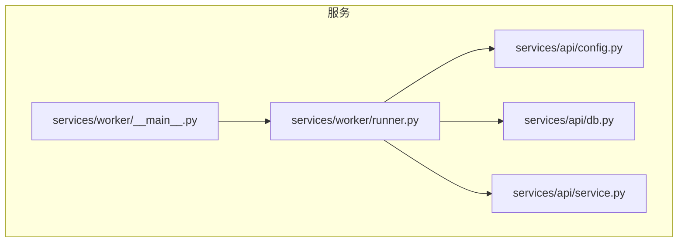
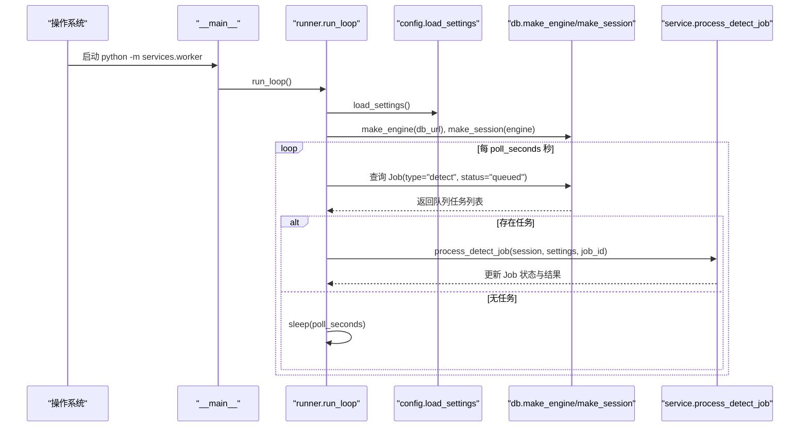
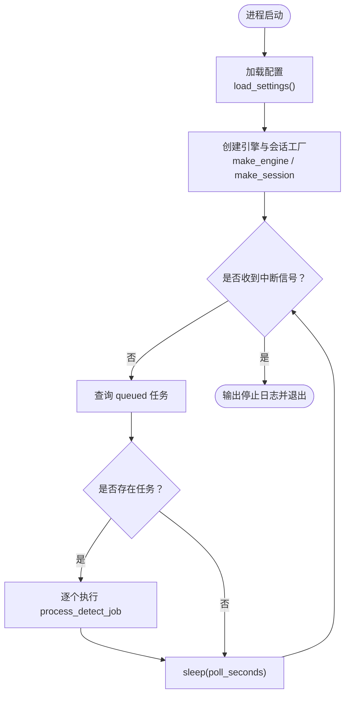
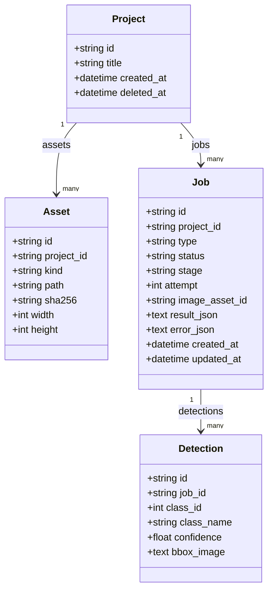
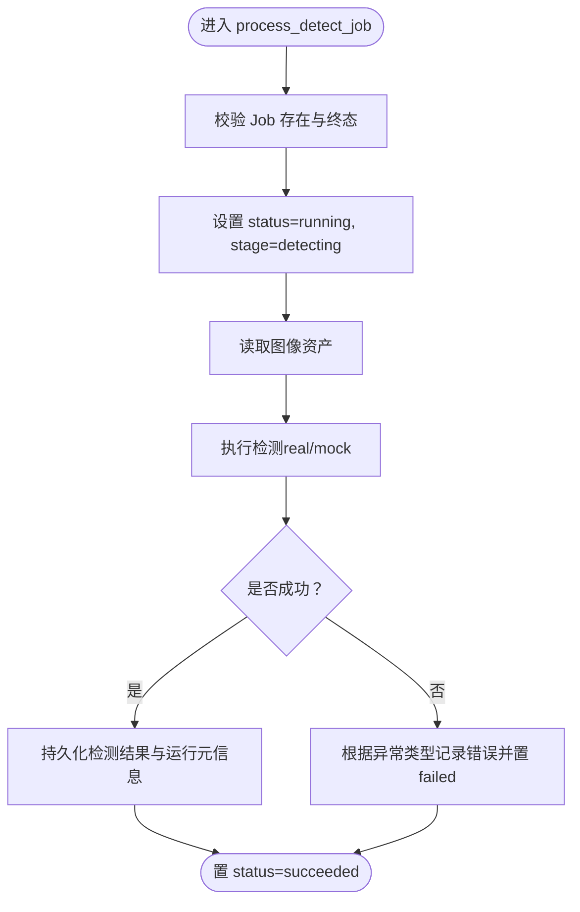
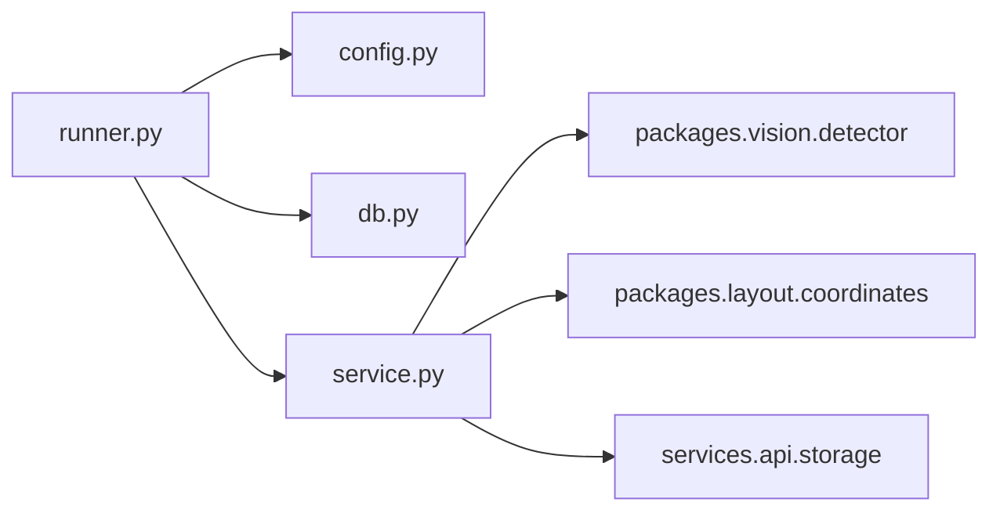

# Worker 进程调度

<cite>
**本文引用的文件**   
- [services/worker/__main__.py](file://services/worker/__main__.py)
- [services/worker/runner.py](file://services/worker/runner.py)
- [services/api/config.py](file://services/api/config.py)
- [services/api/db.py](file://services/api/db.py)
- [services/api/service.py](file://services/api/service.py)
- [README.md](file://README.md)
</cite>

## 目录
1. [简介](#简介)
2. [项目结构](#项目结构)
3. [核心组件](#核心组件)
4. [架构总览](#架构总览)
5. [详细组件分析](#详细组件分析)
6. [依赖关系分析](#依赖关系分析)
7. [性能与资源管理](#性能与资源管理)
8. [错误恢复与可观测性](#错误恢复与可观测性)
9. [配置选项与调优建议](#配置选项与调优建议)
10. [多 Worker 协作模式](#多-worker-协作模式)
11. [故障排查指南](#故障排查指南)
12. [结论](#结论)

## 简介
本文面向 AstraDesk 的 Worker 进程调度系统，聚焦以下目标：
- Worker 进程的启动与初始化流程（命令行入口、配置加载、数据库连接）。
- 任务轮询机制的实现原理（定时策略、任务获取、并发控制）。
- Worker 的资源管理（内存、数据库连接、文件句柄）。
- 错误恢复机制（异常捕获、日志记录、重启策略）。
- 配置项说明与调优建议。
- 多 Worker 协作模式（负载均衡、故障转移、状态同步）的设计与演进方向。

当前实现为 T02 的最小可用版本：Worker 以固定间隔轮询数据库中的 queued 检测任务，逐个调用服务层执行真实或 Mock 检测，并将结果持久化到 SQLite。

## 项目结构
AstraDesk 的后端服务位于 services 目录，其中 worker 子包提供独立的任务执行入口；API 子包提供路由、应用服务、数据模型与配置。Worker 通过复用 API 的服务与数据模型，避免重复业务逻辑。

图示来源
- [services/worker/__main__.py:1-8](file://services/worker/__main__.py#L1-L8)
- [services/worker/runner.py:1-43](file://services/worker/runner.py#L1-L43)
- [services/api/config.py:1-61](file://services/api/config.py#L1-L61)
- [services/api/db.py:1-92](file://services/api/db.py#L1-L92)
- [services/api/service.py:1-237](file://services/api/service.py#L1-L237)

章节来源
- [README.md:8-24](file://README.md#L8-L24)

## 核心组件
- 进程入口：提供 `python -m services.worker` 的可执行入口，直接调用运行循环。
- 运行循环：加载配置、创建数据库引擎与会话工厂，按固定间隔轮询并处理 queued 任务。
- 配置模块：从环境变量装配 Settings，包含运行模式、数据库 URL、权重路径、设备与置信度等。
- 数据模型：定义 Project、Asset、Job、Detection 等 ORM 实体，并提供引擎与会话工厂。
- 应用服务：封装业务规则，包括任务创建、检测执行、结果持久化与错误处理。

章节来源
- [services/worker/__main__.py:1-8](file://services/worker/__main__.py#L1-L8)
- [services/worker/runner.py:1-43](file://services/worker/runner.py#L1-L43)
- [services/api/config.py:1-61](file://services/api/config.py#L1-L61)
- [services/api/db.py:1-92](file://services/api/db.py#L1-L92)
- [services/api/service.py:1-237](file://services/api/service.py#L1-L237)

## 架构总览
Worker 的运行时交互如下：
- 进程启动后读取环境变量生成 Settings。
- 使用 SQLAlchemy 创建 Engine 与 SessionFactory。
- 进入无限循环：每次查询所有 type=detect 且 status=queued 的任务，逐一交给 service.process_detect_job 处理。
- 服务层将 Job 状态由 queued → running → succeeded/failed，并持久化检测结果或错误信息。

图示来源
- [services/worker/__main__.py:1-8](file://services/worker/__main__.py#L1-L8)
- [services/worker/runner.py:16-43](file://services/worker/runner.py#L16-L43)
- [services/api/config.py:39-61](file://services/api/config.py#L39-L61)
- [services/api/db.py:84-92](file://services/api/db.py#L84-L92)
- [services/api/service.py:132-179](file://services/api/service.py#L132-L179)

## 详细组件分析

### 进程入口与运行循环
- 入口文件仅负责导入并调用运行循环，保持职责单一。
- 运行循环：
  - 加载配置并打印运行模式与轮询间隔。
  - 创建数据库引擎与会话工厂。
  - 在 while True 中周期性调用 process_pending_once。
  - 捕获 KeyboardInterrupt 输出停止日志。

图示来源
- [services/worker/runner.py:30-43](file://services/worker/runner.py#L30-L43)

章节来源
- [services/worker/__main__.py:1-8](file://services/worker/__main__.py#L1-L8)
- [services/worker/runner.py:16-43](file://services/worker/runner.py#L16-L43)

### 配置加载与环境变量
Settings 数据类集中承载运行参数：
- run_mode：real 或 mock，决定真实推理或 Mock。
- db_url：SQLite 数据库地址。
- data_root：数据根目录。
- weights_path：YOLO 权重路径。
- detector_device：设备选择（空字符串表示自动）。
- detector_conf：检测置信度阈值。

关键行为：
- ASTRADESK_RUN_MODE 支持 real/mock/demo（demo 等价 mock）。
- 未设置时默认 mock，避免误触发真实模型或收费后端。
- 其他参数均有合理默认值，便于本地开发。

章节来源
- [services/api/config.py:20-61](file://services/api/config.py#L20-L61)
- [README.md:71-77](file://README.md#L71-L77)

### 数据库模型与会话管理
- 模型：Project、Asset、Job、Detection，采用 SQLAlchemy declarative_base。
- Job 关键字段：type、status、stage、attempt、image_asset_id、result_json、error_json、时间戳。
- 引擎与会话工厂：
  - create_engine 指定 connect_args={"check_same_thread": False}，适配多线程访问 SQLite。
  - sessionmaker 绑定引擎，expire_on_commit=False 减少会话刷新开销。

图示来源
- [services/api/db.py:26-78](file://services/api/db.py#L26-L78)

章节来源
- [services/api/db.py:1-92](file://services/api/db.py#L1-L92)

### 任务处理与服务层
process_detect_job 的职责：
- 校验 Job 存在性与终态保护（succeeded/failed/cancelled 不重复处理）。
- 将 Job 置为 running，并写入 stage。
- 读取图像资产，进行预处理与检测（真实或 Mock）。
- 捕获 DetectorUnavailable、ApiError 与通用异常，分别标记失败原因与是否可重试。
- 成功时持久化检测结果，序列化运行元信息，最终置为 succeeded。

图示来源
- [services/api/service.py:132-179](file://services/api/service.py#L132-L179)

章节来源
- [services/api/service.py:120-179](file://services/api/service.py#L120-L179)

## 依赖关系分析
- runner 依赖 config 与 db 完成环境装配与数据库访问。
- runner 复用 service 的业务逻辑，避免重复实现检测流程。
- service 依赖 packages.vision.detector 与 packages.layout.coordinates，以及 storage 模块。
- db 提供统一的 ORM 模型与引擎/会话工厂，被 API 与 Worker 共享。

图示来源
- [services/worker/runner.py:1-43](file://services/worker/runner.py#L1-L43)
- [services/api/service.py:1-237](file://services/api/service.py#L1-L237)

章节来源
- [services/worker/runner.py:1-43](file://services/worker/runner.py#L1-L43)
- [services/api/service.py:1-237](file://services/api/service.py#L1-L237)

## 性能与资源管理
- 轮询策略：固定间隔 time.sleep(poll_seconds)，简单可靠但缺乏自适应退避与背压。
- 任务获取算法：一次性查询所有 queued 任务，顺序处理；无分页、无并发限制。
- 数据库连接：每个轮询周期创建一个 Session，并在 finally 中关闭，避免连接泄漏。
- 内存与 I/O：
  - 图像读取使用 PIL，注意大图像可能占用较多内存；建议在后续引入尺寸与像素上限校验。
  - 检测结果 JSON 序列化与存储，需关注大结果集对磁盘与网络的影响。
- 优化建议：
  - 引入最大并发数与任务批大小，避免单轮次处理过多任务导致阻塞。
  - 使用指数退避与抖动策略降低数据库压力。
  - 考虑连接池与长生命周期 Session（需谨慎事务边界）。
  - 对图像与检测结果进行流式处理与压缩，减少内存峰值。

章节来源
- [services/worker/runner.py:16-43](file://services/worker/runner.py#L16-L43)
- [services/api/db.py:84-92](file://services/api/db.py#L84-L92)
- [services/api/service.py:148-179](file://services/api/service.py#L148-L179)

## 错误恢复与可观测性
- 异常捕获：
  - DetectorUnavailable：标记 MODEL_UNAVAILABLE，不可重试。
  - ApiError：按业务错误码与消息记录，依据 retryable 决定是否可重试。
  - 通用 Exception：记录 INTERNAL 错误，标记可重试。
- 状态机：
  - queued → running → succeeded/failed（终态保护）。
- 可观测性：
  - 标准输出打印轮询间隔、已处理任务数量与停止信号。
  - 错误详情与重试标志持久化至 Job.error_json。
- 进程重启：
  - 当前未实现租约/心跳与过期 running 任务清理；属于 T06–T07 规划范围。
  - 建议引入分布式锁或数据库级行级锁，确保多 Worker 安全领取任务。

章节来源
- [services/api/service.py:132-186](file://services/api/service.py#L132-L186)
- [services/worker/runner.py:30-43](file://services/worker/runner.py#L30-L43)

## 配置选项与调优建议
- ASTRADESK_RUN_MODE：
  - real：真实模型推理；缺权重或依赖时报错，不回退 mock。
  - mock：确定性 Mock，用于测试与演示。
  - demo：等价 mock。
- ASTRADESK_DB_URL：SQLite 数据库地址，默认 data/astradesk.db。
- ASTRADESK_DATA_ROOT：数据根目录，默认项目根下的 data。
- ASTRADESK_YOLO_WEIGHTS：YOLO 权重路径，默认 weights/yolov10n.pt。
- ASTRADESK_DEVICE：设备选择，空字符串表示自动选择 CUDA/CPU。
- ASTRADESK_DET_CONF：检测置信度阈值，默认 0.25。

调优建议：
- 在 GPU 环境下设置 ASTRADESK_RUN_MODE=real 并指定 ASTRADESK_YOLO_WEIGHTS。
- 调整 ASTRADESK_DET_CONF 平衡召回率与误检率。
- 生产环境建议使用外部数据库与连接池，替换 SQLite。
- 结合进程管理器（systemd/supervisor）实现自动重启与健康检查。

章节来源
- [services/api/config.py:39-61](file://services/api/config.py#L39-L61)
- [README.md:40-47](file://README.md#L40-L47)
- [README.md:71-77](file://README.md#L71-L77)

## 多 Worker 协作模式
当前实现为单 Worker 顺序处理 queued 任务，尚未实现：
- 负载均衡：多个 Worker 同时消费队列，避免单点瓶颈。
- 故障转移：Worker 崩溃后任务重新分配。
- 状态同步：跨进程的任务进度与结果一致性。

设计建议：
- 基于数据库的行级锁或乐观锁实现任务领取（如 UPDATE ... WHERE status='queued' AND id IN (...) RETURNING ...）。
- 引入租约与心跳机制，防止长时间 running 任务卡死。
- 使用幂等处理与重试策略，保证任务至少一次语义。
- 对外暴露健康检查与能力接口，便于编排器发现与调度。

章节来源
- [services/worker/runner.py:1-6](file://services/worker/runner.py#L1-L6)
- [services/api/service.py:132-179](file://services/api/service.py#L132-L179)

## 故障排查指南
- 无法启动 Worker：
  - 检查环境变量 ASTRADESK_RUN_MODE、ASTRADESK_DB_URL、ASTRADESK_YOLO_WEIGHTS 是否正确。
  - 确认 SQLite 数据库文件路径可写。
- 任务一直 queued：
  - 确认 Worker 进程正在运行并轮询。
  - 检查数据库中是否存在 type=detect 且 status=queued 的记录。
- 任务失败：
  - 查看 Job.error_json 中的 code 与 message，判断是否为 MODEL_UNAVAILABLE 或内部错误。
  - 在 real 模式下确认权重文件存在且依赖安装完整。
- 性能问题：
  - 调整轮询间隔与并发策略。
  - 监控数据库负载与磁盘 I/O，必要时升级存储或迁移至高性能数据库。

章节来源
- [services/api/service.py:158-186](file://services/api/service.py#L158-L186)
- [services/worker/runner.py:30-43](file://services/worker/runner.py#L30-L43)

## 结论
AstraDesk 的 Worker 进程调度系统在当前阶段提供了最小可用的任务轮询与执行能力，具备清晰的配置加载、数据库连接与错误处理机制。未来可在并发控制、负载均衡、故障转移与可观测性方面持续演进，以满足生产环境的稳定性与扩展性需求。