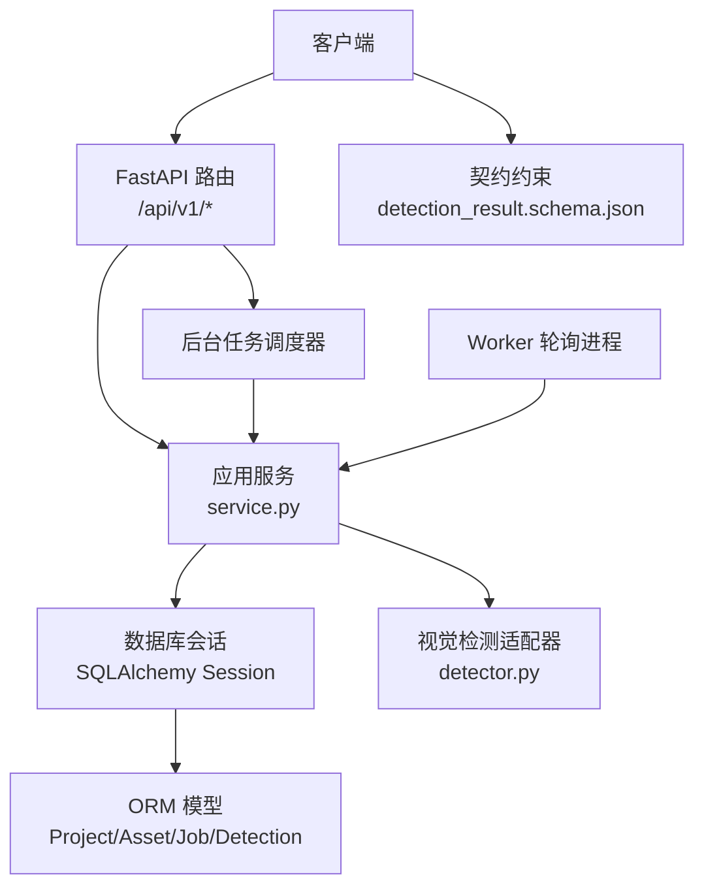
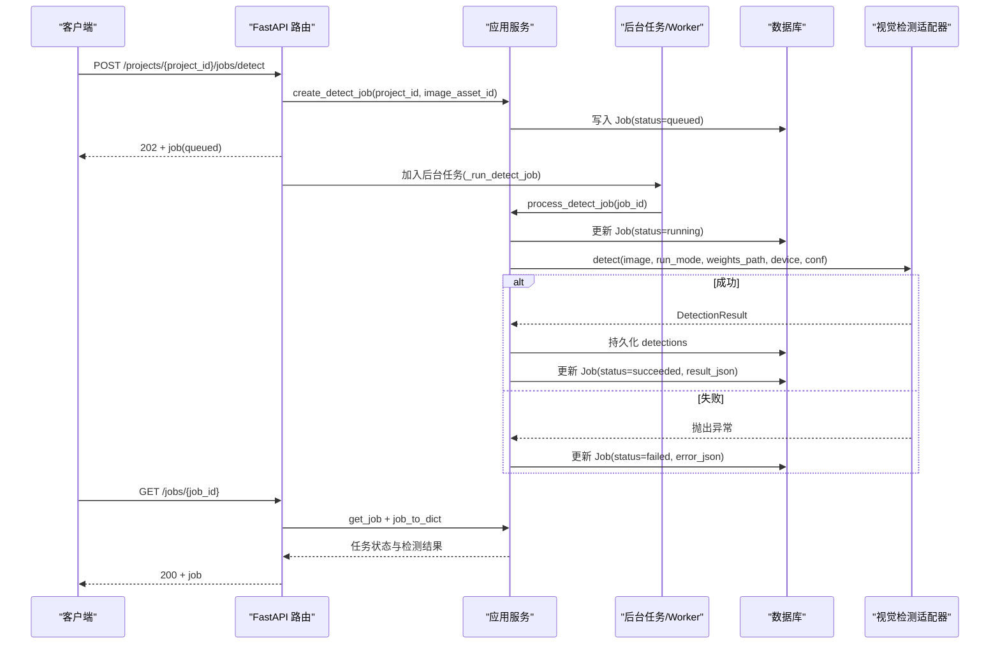
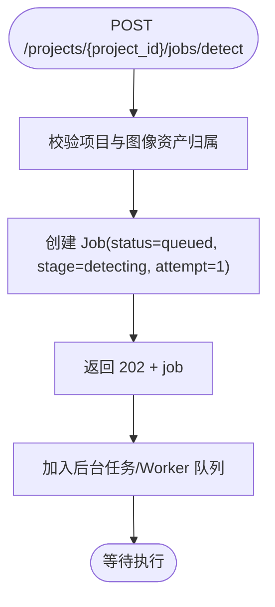
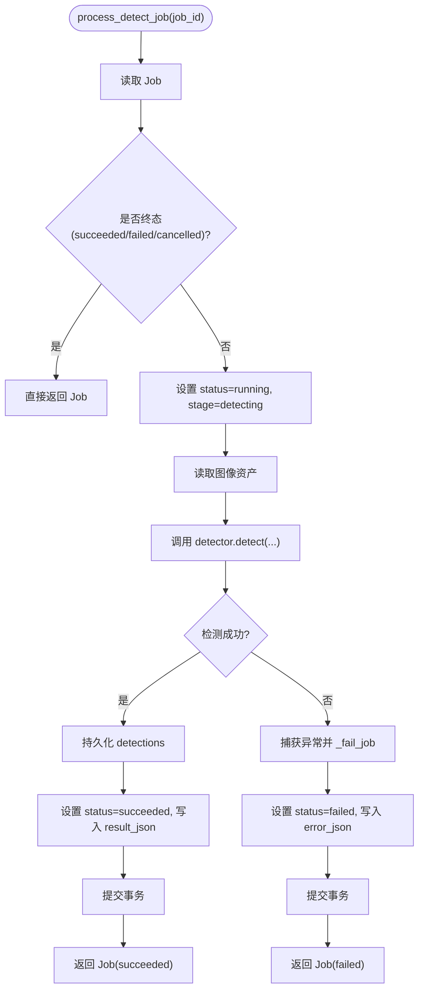
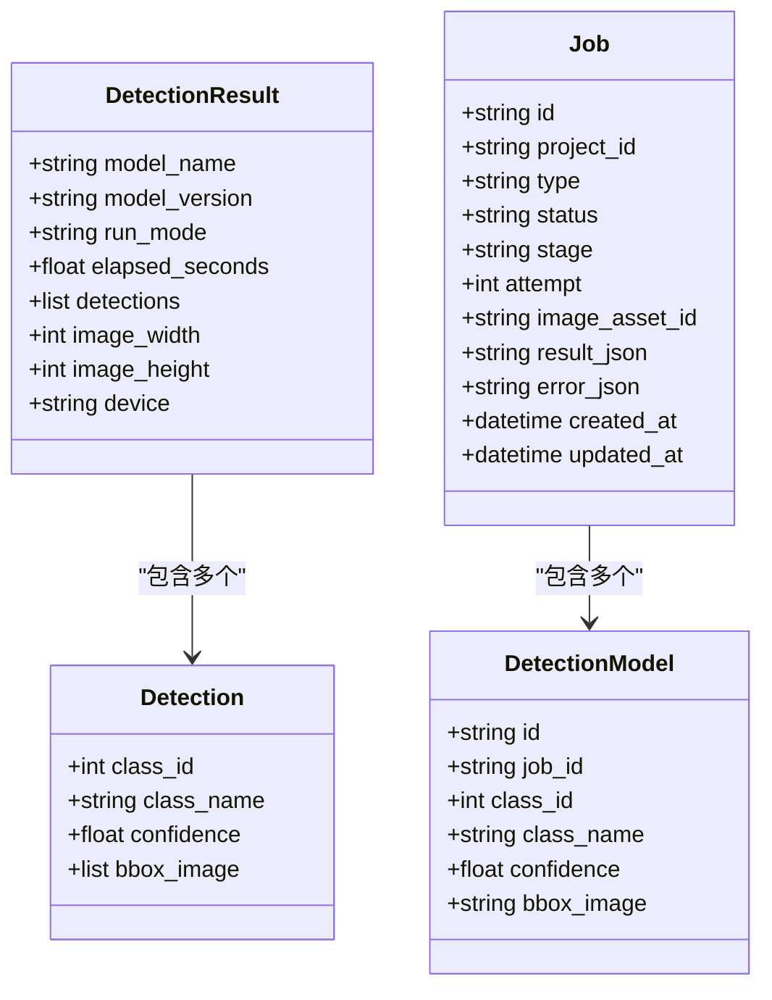
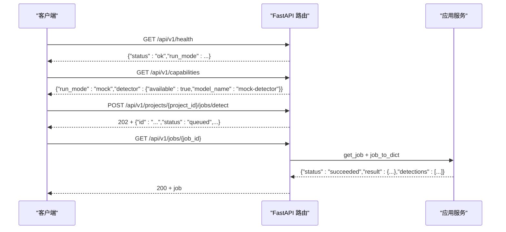
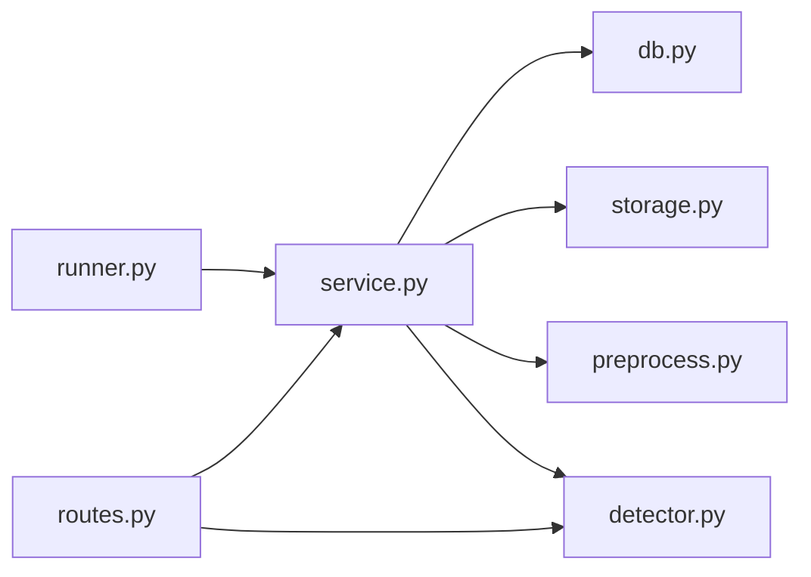

# 任务生命周期管理

<cite>
**本文引用的文件**   
- [services/api/routes.py](file://services/api/routes.py)
- [services/api/service.py](file://services/api/service.py)
- [services/worker/runner.py](file://services/worker/runner.py)
- [services/api/db.py](file://services/api/db.py)
- [packages/vision/detector.py](file://packages/vision/detector.py)
- [contracts/detection_result.schema.json](file://contracts/detection_result.schema.json)
- [tests/test_detection_flow.py](file://tests/test_detection_flow.py)
- [docs/STATUS.md](file://docs/STATUS.md)
</cite>

## 目录
1. [引言](#引言)
2. [项目结构](#项目结构)
3. [核心组件](#核心组件)
4. [架构总览](#架构总览)
5. [详细组件分析](#详细组件分析)
6. [依赖关系分析](#依赖关系分析)
7. [性能与可扩展性](#性能与可扩展性)
8. [故障排查指南](#故障排查指南)
9. [结论](#结论)

## 引言
本文围绕 AstraDesk 的检测任务生命周期，系统化说明从任务创建、状态流转（queued → running → succeeded/failed）、执行过程到结果查询的完整流程。文档同时解释状态转换条件、触发机制、异常处理策略，并给出面向使用者的 API 能力边界与后续扩展建议。当前实现中，检测任务可通过 FastAPI 后台任务在请求进程内执行，也可通过 worker 轮询独立进程执行；T02 阶段已覆盖 mock 与 real 两种运行模式，并在 real 模式下对模型不可用进行明确失败，不静默回退。

## 项目结构
AstraDesk 的任务生命周期主要涉及以下模块：
- API 层：路由负责协议处理、参数校验与异步调度。
- 服务层：业务规则、持久化、检测结果持久化与查询装配。
- Worker 层：可选的独立进程轮询执行 queued 任务。
- 数据层：SQLite + SQLAlchemy 定义 Project、Asset、Job、Detection 等实体。
- 视觉层：统一检测入口，支持 real/mock 模式与模型加载。
- 契约层：JSON Schema 约束任务查询返回结构。

**图表来源**
- [services/api/routes.py:120-142](file://services/api/routes.py#L120-L142)
- [services/api/service.py:120-186](file://services/api/service.py#L120-L186)
- [services/worker/runner.py:16-43](file://services/worker/runner.py#L16-L43)
- [services/api/db.py:26-92](file://services/api/db.py#L26-L92)
- [packages/vision/detector.py:50-129](file://packages/vision/detector.py#L50-L129)
- [contracts/detection_result.schema.json:1-65](file://contracts/detection_result.schema.json#L1-L65)

**章节来源**
- [services/api/routes.py:1-143](file://services/api/routes.py#L1-L143)
- [services/api/service.py:1-237](file://services/api/service.py#L1-L237)
- [services/worker/runner.py:1-43](file://services/worker/runner.py#L1-L43)
- [services/api/db.py:1-92](file://services/api/db.py#L1-L92)
- [packages/vision/detector.py:1-129](file://packages/vision/detector.py#L1-L129)
- [contracts/detection_result.schema.json:1-65](file://contracts/detection_result.schema.json#L1-L65)

## 核心组件
- 路由层：提供健康检查、能力探测、项目管理、图像上传、检测任务创建与查询接口。检测任务创建返回 202，并通过后台任务或 worker 异步执行。
- 服务层：封装业务逻辑，包括项目与资产校验、任务创建、任务执行、错误封装、检测结果持久化与查询装配。
- Worker 层：提供独立进程轮询执行 queued 任务的入口，便于解耦部署。
- 数据层：定义 Job 实体及其关联 Detection，记录 status、stage、attempt、result_json、error_json 等字段。
- 视觉层：统一 detect 入口，按 run_mode 分派到 real/mock；real 模式缺依赖或权重时抛出 DetectorUnavailable。
- 契约层：约束 GET /jobs/{id} 返回的结构，包含 status、stage、attempt、result、detections、error 等字段。

**章节来源**
- [services/api/routes.py:44-142](file://services/api/routes.py#L44-L142)
- [services/api/service.py:44-237](file://services/api/service.py#L44-L237)
- [services/worker/runner.py:1-43](file://services/worker/runner.py#L1-L43)
- [services/api/db.py:50-92](file://services/api/db.py#L50-L92)
- [packages/vision/detector.py:22-129](file://packages/vision/detector.py#L22-L129)
- [contracts/detection_result.schema.json:1-65](file://contracts/detection_result.schema.json#L1-L65)

## 架构总览
检测任务的生命周期由 API 路由与服务层共同驱动，worker 作为可选执行器。整体流程如下：

**图表来源**
- [services/api/routes.py:120-142](file://services/api/routes.py#L120-L142)
- [services/api/service.py:120-186](file://services/api/service.py#L120-L186)
- [services/worker/runner.py:16-43](file://services/worker/runner.py#L16-L43)
- [packages/vision/detector.py:124-129](file://packages/vision/detector.py#L124-L129)

## 详细组件分析

### 任务创建与初始状态
- 创建检测任务时，服务层校验项目与图像资产归属，生成 Job 并写入数据库，初始状态为 queued，stage 为 detecting，attempt 为 1。
- 路由返回 202 并立即返回 job，随后将后台任务加入调度队列。

**图表来源**
- [services/api/routes.py:130-136](file://services/api/routes.py#L130-L136)
- [services/api/service.py:120-129](file://services/api/service.py#L120-L129)

**章节来源**
- [services/api/routes.py:130-136](file://services/api/routes.py#L130-L136)
- [services/api/service.py:120-129](file://services/api/service.py#L120-L129)

### 状态流转与执行逻辑
- 进入 running：process_detect_job 将 Job 状态更新为 running，stage 保持 detecting，并提交事务。
- 成功：视觉检测返回 DetectionResult，服务层持久化检测结果，并将 Job 状态更新为 succeeded，写入 result_json。
- 失败：捕获 DetectorUnavailable、ApiError 或其他异常，调用 _fail_job 将 Job 状态更新为 failed，写入 error_json，并标记是否可重试。

**图表来源**
- [services/api/service.py:132-186](file://services/api/service.py#L132-L186)
- [packages/vision/detector.py:124-129](file://packages/vision/detector.py#L124-L129)

**章节来源**
- [services/api/service.py:132-186](file://services/api/service.py#L132-L186)
- [packages/vision/detector.py:50-129](file://packages/vision/detector.py#L50-L129)

### 任务执行与结果处理
- 真实模式：detector.detect_real 使用 ultralytics YOLOv10 推理，计算耗时、设备信息，并将坐标归一化为 [x1,y1,x2,y2]。
- Mock 模式：detector.detect_mock 返回确定性结果，model_name 显式标注 mock。
- 结果持久化：_persist_detections 删除旧检测结果后写入新框，确保 object_id 守恒（H01）。
- 查询装配：job_to_dict 组装 detections、error、result 等字段，供 GET /jobs/{job_id} 返回。

**图表来源**
- [packages/vision/detector.py:26-48](file://packages/vision/detector.py#L26-L48)
- [services/api/db.py:50-82](file://services/api/db.py#L50-L82)

**章节来源**
- [packages/vision/detector.py:68-129](file://packages/vision/detector.py#L68-L129)
- [services/api/service.py:189-221](file://services/api/service.py#L189-L221)

### 任务状态查询与管理 API
- 健康检查：GET /api/v1/health 返回运行模式。
- 能力探测：GET /api/v1/capabilities 返回 detector 可用性、模型名称与版本。
- 任务创建：POST /api/v1/projects/{project_id}/jobs/detect 返回 202 + job。
- 任务查询：GET /api/v1/jobs/{job_id} 返回任务状态、检测结果与错误信息。
- 图像上传：POST /api/v1/projects/{project_id}/images 返回 canonical 与 thumbnail 资产信息。
- 资产读取：GET /api/v1/assets/{asset_id} 返回图片二进制流。

**图表来源**
- [services/api/routes.py:46-65](file://services/api/routes.py#L46-L65)
- [services/api/routes.py:130-142](file://services/api/routes.py#L130-L142)
- [services/api/service.py:202-228](file://services/api/service.py#L202-L228)

**章节来源**
- [services/api/routes.py:46-65](file://services/api/routes.py#L46-L65)
- [services/api/routes.py:130-142](file://services/api/routes.py#L130-L142)
- [services/api/service.py:202-228](file://services/api/service.py#L202-L228)

### 生命周期钩子与监控点
当前实现未引入显式的“开始/结束”钩子系统，但存在明确的监控点：
- 预处理：图像上传时进行预处理与存储，失败抛 ApiError。
- 执行前：process_detect_job 将 Job 置为 running 并记录 stage。
- 执行中：detector.detect 内部计时 elapsed_seconds，记录设备信息。
- 完成后：持久化 detections，写入 result_json，状态置为 succeeded。
- 失败后：写入 error_json，包含 code、message、retryable。

这些监控点可用于扩展日志、指标采集与告警。

**章节来源**
- [services/api/service.py:73-107](file://services/api/service.py#L73-L107)
- [services/api/service.py:132-186](file://services/api/service.py#L132-L186)
- [packages/vision/detector.py:68-101](file://packages/vision/detector.py#L68-L101)

### 任务重试、取消与幂等性
- 重试：_fail_job 的 retryable 字段指示是否可重试；当前未实现自动重试逻辑，可在上层根据 error.retryable 决定是否再次提交任务。
- 取消：Job.status 支持 cancelled，但当前路由与服务层未暴露取消接口；可在未来扩展取消端点与状态机保护。
- 幂等性：process_detect_job 对终态（succeeded/failed/cancelled）直接返回，避免重复处理覆盖结果。

**章节来源**
- [services/api/service.py:132-186](file://services/api/service.py#L132-L186)
- [contracts/detection_result.schema.json:13-15](file://contracts/detection_result.schema.json#L13-L15)

## 依赖关系分析
- 路由依赖 service 与 detector，但不直接执行业务逻辑。
- service 依赖 db 模型、storage、preprocess 与 detector。
- worker 复用 service 的业务逻辑，仅改变执行上下文（独立进程轮询）。
- detector 在 real 模式下依赖 ultralytics 与权重文件，缺失则抛 DetectorUnavailable。

**图表来源**
- [services/api/routes.py:1-28](file://services/api/routes.py#L1-L28)
- [services/api/service.py:1-25](file://services/api/service.py#L1-L25)
- [services/worker/runner.py:11-14](file://services/worker/runner.py#L11-L14)
- [packages/vision/detector.py:1-20](file://packages/vision/detector.py#L1-L20)

**章节来源**
- [services/api/routes.py:1-28](file://services/api/routes.py#L1-L28)
- [services/api/service.py:1-25](file://services/api/service.py#L1-L25)
- [services/worker/runner.py:11-14](file://services/worker/runner.py#L11-L14)
- [packages/vision/detector.py:1-20](file://packages/vision/detector.py#L1-L20)

## 性能与可扩展性
- 模型懒加载：detector._load_model 缓存模型实例，避免每次推理重载。
- 后台执行：FastAPI BackgroundTasks 与 worker 轮询均支持异步执行，避免阻塞请求线程。
- 资源限制：real 模式受 GPU 显存与权重文件大小影响；mock 模式无外部依赖。
- 可扩展点：
  - 增加超时控制：在 process_detect_job 中引入超时机制，避免长时间占用资源。
  - 增加重试队列：基于 error.retryable 与 attempt 字段实现有限次重试。
  - 增加取消接口：暴露 DELETE /jobs/{job_id} 并更新 status=cancelled。
  - 增强监控：在关键节点输出结构化日志与指标（如 elapsed_seconds、device、memory usage）。

[本节为通用指导，不直接分析具体文件]

## 故障排查指南
常见异常与处理策略：
- 模型不可用：real 模式缺少 ultralytics 或权重文件时抛 DetectorUnavailable，服务层将其转为 failed，error.code=MODEL_UNAVAILABLE，不静默回退 mock。
- 图像无效：上传时若为空文件或格式不支持，抛 INVALID_IMAGE，状态码 400 或 415。
- 资产缺失：读取图像资产不存在时抛 ASSET_NOT_FOUND，状态码 404。
- 内部错误：其他异常被捕获并转为 INTERNAL，error.retryable=True，便于上层重试。

验证方式：
- 使用测试用例验证 mock 与 real 模式的端到端流程，包括契约校验与 ID 守恒。
- 通过 /capabilities 判断 detector 可用性，结合 /jobs/{id} 的 error 字段定位失败原因。

**章节来源**
- [services/api/service.py:73-107](file://services/api/service.py#L73-L107)
- [services/api/service.py:132-186](file://services/api/service.py#L132-L186)
- [tests/test_detection_flow.py:91-126](file://tests/test_detection_flow.py#L91-L126)

## 结论
AstraDesk 的检测任务生命周期在当前 T02 阶段已具备完整的创建、执行、结果持久化与查询能力。状态机以 queued → running → succeeded/failed 为主轴，辅以 cancelled 与 partial 等契约字段预留扩展空间。real 模式严格遵循“不可用时失败且不静默回退”的约定，保障系统行为可预测。未来可在超时控制、重试队列、取消接口与监控告警方面进一步增强健壮性与可观测性。

[本节为总结性内容，不直接分析具体文件]