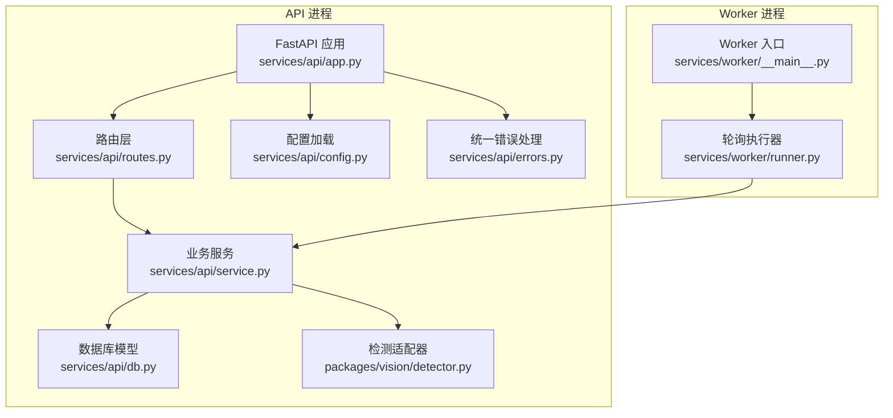
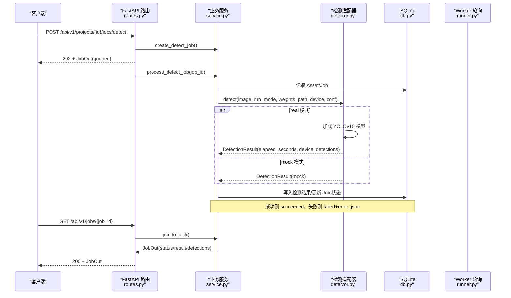
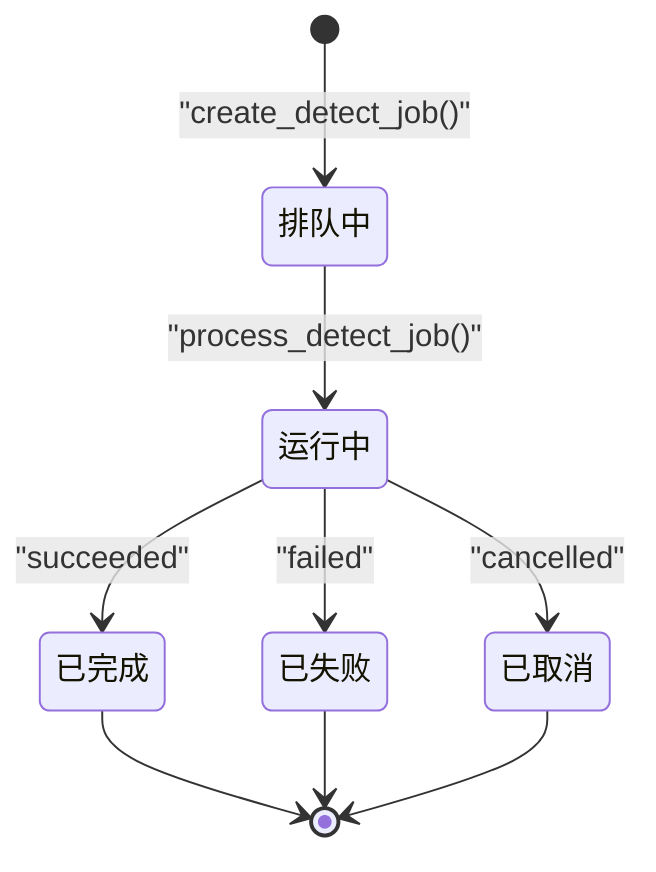
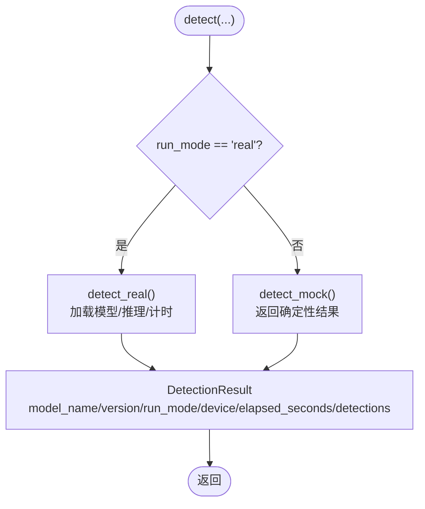
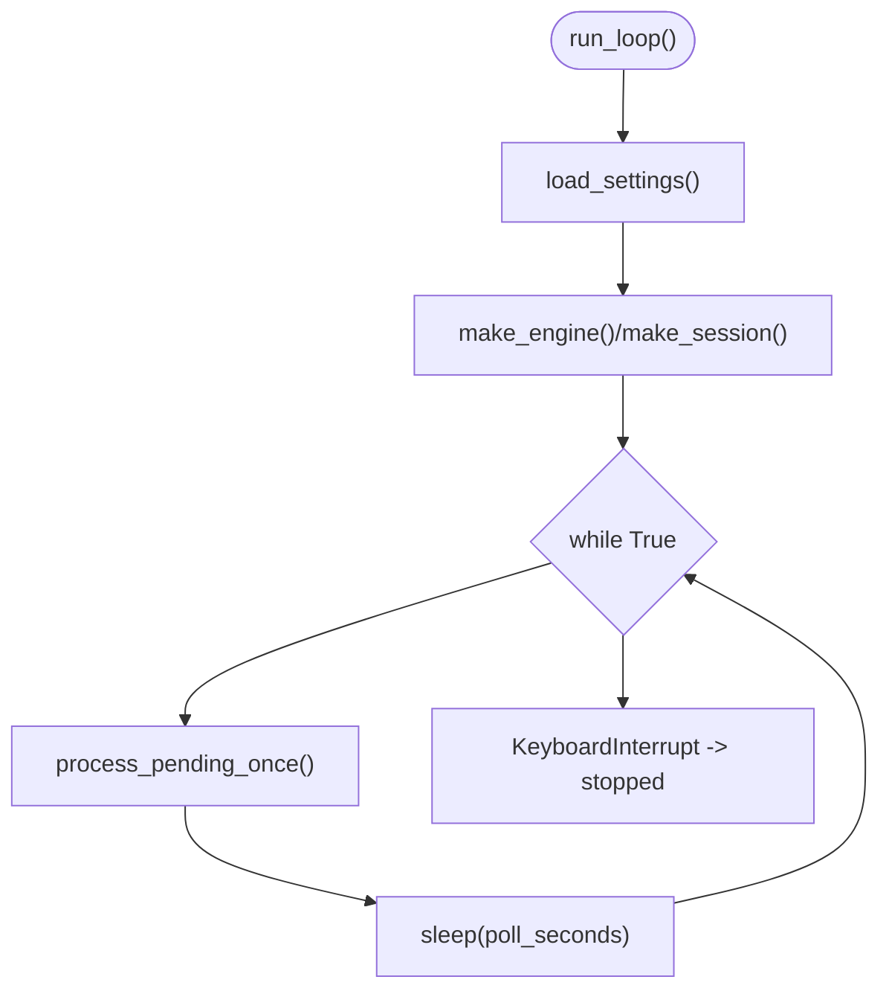
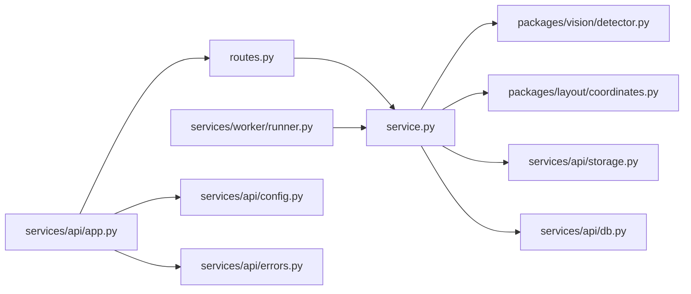

# 任务监控与日志

<cite>
**本文引用的文件**   
- [services/api/app.py](file://services/api/app.py)
- [services/api/routes.py](file://services/api/routes.py)
- [services/api/service.py](file://services/api/service.py)
- [services/api/config.py](file://services/api/config.py)
- [services/api/db.py](file://services/api/db.py)
- [services/api/errors.py](file://services/api/errors.py)
- [packages/vision/detector.py](file://packages/vision/detector.py)
- [services/worker/__main__.py](file://services/worker/__main__.py)
- [services/worker/runner.py](file://services/worker/runner.py)
- [contracts/detection_result.schema.json](file://contracts/detection_result.schema.json)
- [contracts/samples/detection_result.valid.json](file://contracts/samples/detection_result.valid.json)
- [README.md](file://README.md)
- [docs/ENVIRONMENT.md](file://docs/ENVIRONMENT.md)
- [tests/test_detection_flow.py](file://tests/test_detection_flow.py)
</cite>

## 目录
1. [引言](#引言)
2. [项目结构](#项目结构)
3. [核心组件](#核心组件)
4. [架构总览](#架构总览)
5. [详细组件分析](#详细组件分析)
6. [依赖关系分析](#依赖关系分析)
7. [性能与监控指标](#性能与监控指标)
8. [日志机制](#日志机制)
9. [告警机制](#告警机制)
10. [监控数据查询与分析接口](#监控数据查询与分析接口)
11. [扩展性设计](#扩展性设计)
12. [故障排查指南](#故障排查指南)
13. [结论](#结论)

## 引言
本文面向 AstraDesk 的任务执行与检测流水线，聚焦“任务监控与日志”能力。当前仓库实现了基于 FastAPI 的 API、SQLite 持久化、YOLOv10 真实检测与 Mock 检测、后台任务执行以及独立 Worker 轮询执行器。文档将说明：
- 任务执行的监控指标（执行时间、设备信息、检测结果数量等）
- 日志记录机制（结构化错误体、请求追踪、Worker 控制台输出）
- 性能监控实现（耗时统计、队列长度、Worker 健康检查）
- 告警机制（模型不可用、业务异常、系统异常）
- 监控数据的查询与分析接口（任务状态、结果元信息、能力探测）
- 扩展性设计（可配置运行模式、可扩展的错误码与重试策略）

## 项目结构
AstraDesk 后端以 services 为边界，API 服务负责协议与编排，service 层承载业务规则，db 层定义 SQLite 模型，vision 包封装检测适配器，worker 提供解耦执行入口。

**图表来源**
- [services/api/app.py:24-47](file://services/api/app.py#L24-L47)
- [services/api/routes.py:44-65](file://services/api/routes.py#L44-L65)
- [services/api/service.py:120-179](file://services/api/service.py#L120-L179)
- [services/api/db.py:26-77](file://services/api/db.py#L26-L77)
- [services/api/config.py:20-60](file://services/api/config.py#L20-L60)
- [services/api/errors.py:12-55](file://services/api/errors.py#L12-L55)
- [packages/vision/detector.py:26-48](file://packages/vision/detector.py#L26-L48)
- [services/worker/__main__.py:1-8](file://services/worker/__main__.py#L1-L8)
- [services/worker/runner.py:16-42](file://services/worker/runner.py#L16-L42)

**章节来源**
- [README.md:33-47](file://README.md#L33-L47)
- [services/api/app.py:24-47](file://services/api/app.py#L24-L47)

## 核心组件
- API 应用装配：创建 FastAPI 实例、挂载 CORS、注册错误处理器、注入 Settings 与 DB 工厂、包含路由。
- 路由层：暴露健康检查、能力探测、项目与图像上传、检测任务创建与查询。
- 业务服务：项目与资产 CRUD、检测任务创建与执行、检测结果持久化、任务字典装配。
- 数据库模型：Project、Asset、Job、Detection 实体及 SQLAlchemy 引擎与会话工厂。
- 检测适配器：统一 detect 入口，按 run_mode 分派到 real/mock；real 模式使用 YOLOv10，mock 模式返回确定性结果。
- Worker 执行器：轮询 queued 任务并调用 service.process_detect_job 执行。
- 配置加载：从环境变量装配 Settings，默认 mock，支持 real/mode 切换。
- 错误处理：统一 ApiError 与 FastAPI 异常处理器，返回结构化错误体。

**章节来源**
- [services/api/app.py:24-47](file://services/api/app.py#L24-L47)
- [services/api/routes.py:44-142](file://services/api/routes.py#L44-L142)
- [services/api/service.py:46-237](file://services/api/service.py#L46-L237)
- [services/api/db.py:26-91](file://services/api/db.py#L26-L91)
- [packages/vision/detector.py:26-129](file://packages/vision/detector.py#L26-L129)
- [services/worker/runner.py:16-42](file://services/worker/runner.py#L16-L42)
- [services/api/config.py:20-60](file://services/api/config.py#L20-L60)
- [services/api/errors.py:12-55](file://services/api/errors.py#L12-L55)

## 架构总览
下图展示一次检测任务的端到端流程：前端或调用方提交检测任务，API 在后台线程中执行检测，或将任务交由 Worker 轮询执行；最终通过任务查询接口获取状态与结果。

**图表来源**
- [services/api/routes.py:120-142](file://services/api/routes.py#L120-L142)
- [services/api/service.py:120-179](file://services/api/service.py#L120-L179)
- [packages/vision/detector.py:68-129](file://packages/vision/detector.py#L68-L129)
- [services/api/db.py:50-77](file://services/api/db.py#L50-L77)
- [services/worker/runner.py:16-42](file://services/worker/runner.py#L16-L42)

## 详细组件分析

### 任务执行与状态机
- 任务状态：queued → running → succeeded/failed/cancelled。
- 终态保护：已处于终态的任务不会被重复覆盖。
- 阶段字段：stage 用于标识当前子阶段（如 detecting）。
- 尝试次数：attempt 记录重试次数（当前创建时初始化为 1）。

**图表来源**
- [services/api/service.py:120-179](file://services/api/service.py#L120-L179)
- [services/api/db.py:50-66](file://services/api/db.py#L50-L66)

**章节来源**
- [services/api/service.py:120-179](file://services/api/service.py#L120-L179)
- [services/api/db.py:50-66](file://services/api/db.py#L50-L66)

### 检测适配器与运行模式
- 统一入口 detect(run_mode, ...) 根据运行模式分派。
- real 模式：加载 YOLOv10，测量推理耗时 elapsed_seconds，返回设备信息与归一化坐标框。
- mock 模式：返回确定性检测结果，run_mode=mock，elapsed_seconds=0。
- DetectorUnavailable：当缺少 ultralytics、权重文件或 GPU 环境异常时抛出，供上层转为 MODEL_UNAVAILABLE。

**图表来源**
- [packages/vision/detector.py:68-129](file://packages/vision/detector.py#L68-L129)

**章节来源**
- [packages/vision/detector.py:26-129](file://packages/vision/detector.py#L26-L129)

### Worker 轮询执行器
- 启动方式：python -m services.worker。
- 轮询逻辑：周期性查询 Job.type="detect" 且 status="queued" 的任务，逐个调用 service.process_detect_job。
- 控制台输出：打印运行模式与轮询间隔，处理任务数量与停止信号。

**图表来源**
- [services/worker/runner.py:30-42](file://services/worker/runner.py#L30-L42)
- [services/worker/__main__.py:1-8](file://services/worker/__main__.py#L1-L8)

**章节来源**
- [services/worker/runner.py:16-42](file://services/worker/runner.py#L16-L42)
- [services/worker/__main__.py:1-8](file://services/worker/__main__.py#L1-L8)

### 配置与环境
- Settings 数据类：包含 run_mode、db_url、data_root、weights_path、detector_device、detector_conf。
- 环境变量：ASTRADESK_RUN_MODE、ASTRADESK_DB_URL、ASTRADESK_DATA_ROOT、ASTRADESK_YOLO_WEIGHTS、ASTRADESK_DEVICE、ASTRADESK_DET_CONF。
- 默认行为：未设置时默认为 mock，避免误触发真实模型或远端服务。

**章节来源**
- [services/api/config.py:20-60](file://services/api/config.py#L20-L60)

### 错误处理与结构化错误体
- ApiError：携带 code、message、status_code、retryable、details。
- 全局异常处理器：将 ApiError 映射为 JSONResponse，未捕获异常统一返回 INTERNAL。
- 请求追踪：从请求头 x-request-id 提取，缺失则生成 UUID。

**章节来源**
- [services/api/errors.py:12-55](file://services/api/errors.py#L12-L55)

## 依赖关系分析
- API 层依赖：FastAPI、SQLAlchemy、Pillow、路径与类型工具。
- 业务层依赖：packages.vision.detector、packages.layout.coordinates、storage 模块。
- Worker 层依赖：services.api.service、services.api.config、services.api.db。
- 外部依赖：ultralytics（YOLOv10）、PyTorch/CUDA（真实模式）。

**图表来源**
- [services/api/routes.py:1-27](file://services/api/routes.py#L1-L27)
- [services/api/service.py:1-25](file://services/api/service.py#L1-L25)
- [packages/vision/detector.py:1-18](file://packages/vision/detector.py#L1-L18)
- [services/worker/runner.py:1-14](file://services/worker/runner.py#L1-L14)
- [services/api/app.py:1-14](file://services/api/app.py#L1-L14)

**章节来源**
- [services/api/routes.py:1-27](file://services/api/routes.py#L1-L27)
- [services/api/service.py:1-25](file://services/api/service.py#L1-L25)
- [packages/vision/detector.py:1-18](file://packages/vision/detector.py#L1-L18)
- [services/worker/runner.py:1-14](file://services/worker/runner.py#L1-L14)
- [services/api/app.py:1-14](file://services/api/app.py#L1-L14)

## 性能与监控指标
当前代码已内置以下可观测指标，可通过任务结果与能力接口进行观察与分析：

- 任务执行耗时
  - 指标：result.elapsed_seconds（秒），由 detector.detect_real 使用 time.perf_counter 计算。
  - 用途：评估单次检测耗时，辅助容量规划与瓶颈定位。
  - 数据来源：[packages/vision/detector.py:75-77](file://packages/vision/detector.py#L75-L77)、[services/api/service.py:168-177](file://services/api/service.py#L168-L177)。

- 设备与运行模式
  - 指标：result.device、result.run_mode、result.model_name、result.model_version。
  - 用途：区分 real/mock 模式，确认 GPU/CPU 使用情况。
  - 数据来源：[packages/vision/detector.py:92-101](file://packages/vision/detector.py#L92-L101)、[services/api/service.py:168-177](file://services/api/service.py#L168-L177)。

- 检测结果规模
  - 指标：result.count（检测框数量）、detections 数组长度。
  - 用途：评估模型输出规模，辅助存储与渲染性能优化。
  - 数据来源：[services/api/service.py:168-177](file://services/api/service.py#L168-L177)、[contracts/detection_result.schema.json:16-29](file://contracts/detection_result.schema.json#L16-L29)。

- 队列长度监控
  - 指标：Job.status="queued" 的数量。
  - 用途：衡量积压情况，指导 Worker 并发与轮询频率调整。
  - 数据来源：[services/worker/runner.py:21](file://services/worker/runner.py#L21)、[services/api/db.py:50-66](file://services/api/db.py#L50-L66)。

- Worker 健康检查
  - 指标：Worker 控制台输出（run_mode、polling interval、processed count、stopped）。
  - 用途：确认 Worker 是否存活与正常轮询。
  - 数据来源：[services/worker/runner.py:34-42](file://services/worker/runner.py#L34-L42)。

- 系统资源探针（参考）
  - 指标：GPU 显存总量、已分配显存、峰值显存（来自 artifacts/probe_torch_cuda.py 与 ENVIRONMENT.md）。
  - 用途：验证 6GB 显存硬边界与模型可行性。
  - 数据来源：[docs/ENVIRONMENT.md:13-14](file://docs/ENVIRONMENT.md#L13-L14)、[artifacts/probe_torch_cuda.py:15-22](file://artifacts/probe_torch_cuda.py#L15-L22)。

注意：当前代码未直接采集 CPU 占用率与内存使用率（Python 进程级），但可通过外部工具（如 top、htop、nvidia-smi）结合上述指标进行分析。

**章节来源**
- [packages/vision/detector.py:75-101](file://packages/vision/detector.py#L75-L101)
- [services/api/service.py:168-177](file://services/api/service.py#L168-L177)
- [contracts/detection_result.schema.json:16-29](file://contracts/detection_result.schema.json#L16-L29)
- [services/worker/runner.py:21](file://services/worker/runner.py#L21)
- [services/worker/runner.py:34-42](file://services/worker/runner.py#L34-L42)
- [docs/ENVIRONMENT.md:13-14](file://docs/ENVIRONMENT.md#L13-L14)

## 日志机制
当前仓库未引入第三方日志框架（如 logging、structlog），而是采用以下结构化输出与错误体：

- 结构化错误体
  - 所有业务异常通过 ApiError 抛出，并由全局异常处理器转换为 JSONResponse，包含 code、message、details、retryable、request_id。
  - 适用于请求链路追踪与问题定位。
  - 数据来源：[services/api/errors.py:12-55](file://services/api/errors.py#L12-L55)。

- 任务结果中的结构化元信息
  - result 字段包含 model_name、model_version、run_mode、device、elapsed_seconds、image_width、image_height、count。
  - error 字段包含 code、message、retryable。
  - 数据来源：[services/api/service.py:168-177](file://services/api/service.py#L168-L177)、[contracts/detection_result.schema.json:16-29](file://contracts/detection_result.schema.json#L16-L29)。

- Worker 控制台日志
  - 打印 run_mode、轮询间隔、处理任务数量、停止信号。
  - 数据来源：[services/worker/runner.py:34-42](file://services/worker/runner.py#L34-L42)。

- 建议的日志级别分类（扩展建议）
  - INFO：任务创建、完成、Worker 轮询摘要。
  - WARN：重试提示、资源不足、模型加载慢。
  - ERROR：业务异常、检测失败、IO 错误。
  - DEBUG：模型加载细节、推理中间变量（谨慎开启）。

**章节来源**
- [services/api/errors.py:12-55](file://services/api/errors.py#L12-L55)
- [services/api/service.py:168-177](file://services/api/service.py#L168-L177)
- [contracts/detection_result.schema.json:16-29](file://contracts/detection_result.schema.json#L16-L29)
- [services/worker/runner.py:34-42](file://services/worker/runner.py#L34-L42)

## 告警机制
当前仓库未实现独立的告警子系统，但可通过以下机制实现告警：

- 任务执行超时告警
  - 依据：result.elapsed_seconds 与外部阈值比较。
  - 实现建议：定时任务聚合 Job.result.elapsed_seconds，超过阈值触发告警。
  - 数据来源：[packages/vision/detector.py:75-77](file://packages/vision/detector.py#L75-L77)、[services/api/service.py:168-177](file://services/api/service.py#L168-L177)。

- 资源使用异常告警
  - 依据：GPU 显存峰值（参考 artifacts/probe_torch_cuda.py）与 ENVIRONMENT.md 记录。
  - 实现建议：集成 nvidia-smi 或 PyTorch CUDA 探针，超阈值告警。
  - 数据来源：[docs/ENVIRONMENT.md:13-14](file://docs/ENVIRONMENT.md#L13-L14)、[artifacts/probe_torch_cuda.py:15-22](file://artifacts/probe_torch_cuda.py#L15-L22)。

- 系统故障告警
  - 依据：ApiError.code 与 HTTP 状态码（如 INTERNAL、MODEL_UNAVAILABLE）。
  - 实现建议：监控错误率与特定错误码占比，达到阈值触发告警。
  - 数据来源：[services/api/errors.py:12-55](file://services/api/errors.py#L12-L55)、[services/api/service.py:158-163](file://services/api/service.py#L158-L163)。

- 模型不可用告警
  - 依据：capabilities 接口中 detector.available=false。
  - 实现建议：周期性探测 /api/v1/capabilities，available=false 时告警。
  - 数据来源：[services/api/routes.py:51-65](file://services/api/routes.py#L51-L65)。

**章节来源**
- [packages/vision/detector.py:75-77](file://packages/vision/detector.py#L75-L77)
- [services/api/service.py:158-163](file://services/api/service.py#L158-L163)
- [services/api/errors.py:12-55](file://services/api/errors.py#L12-L55)
- [services/api/routes.py:51-65](file://services/api/routes.py#L51-L65)
- [docs/ENVIRONMENT.md:13-14](file://docs/ENVIRONMENT.md#L13-L14)
- [artifacts/probe_torch_cuda.py:15-22](file://artifacts/probe_torch_cuda.py#L15-L22)

## 监控数据查询与分析接口
- 健康检查
  - 接口：GET /api/v1/health
  - 返回：status、run_mode
  - 用途：快速判断服务可用性与运行模式。
  - 数据来源：[services/api/routes.py:46-48](file://services/api/routes.py#L46-L48)、[README.md:49-50](file://README.md#L49-L50)。

- 能力探测
  - 接口：GET /api/v1/capabilities
  - 返回：run_mode、detector.available/model_name/model_version、features
  - 用途：检测模型可用性，辅助前端降级与告警。
  - 数据来源：[services/api/routes.py:51-65](file://services/api/routes.py#L51-L65)。

- 任务查询
  - 接口：GET /api/v1/jobs/{job_id}
  - 返回：JobOut（含 id、project_id、type、status、stage、attempt、result、detections、error、created_at、updated_at）
  - 用途：获取任务状态、耗时、设备、检测结果数量等监控指标。
  - 数据来源：[services/api/routes.py:139-142](file://services/api/routes.py#L139-L142)、[services/api/service.py:202-221](file://services/api/service.py#L202-L221)、[contracts/detection_result.schema.json:1-29](file://contracts/detection_result.schema.json#L1-L29)。

- 历史任务统计（扩展建议）
  - 依据：Job 表字段（status、result_json、error_json、created_at、updated_at）。
  - 实现建议：新增聚合接口，按时间段统计 succeeded/failed 比例、平均耗时、P95/P99 耗时。
  - 数据来源：[services/api/db.py:50-77](file://services/api/db.py#L50-L77)。

- 性能趋势分析（扩展建议）
  - 依据：result.elapsed_seconds、result.device、result.run_mode。
  - 实现建议：按天/周聚合耗时分布，对比不同设备与运行模式的性能差异。
  - 数据来源：[packages/vision/detector.py:92-101](file://packages/vision/detector.py#L92-L101)、[services/api/service.py:168-177](file://services/api/service.py#L168-L177)。

- 瓶颈识别工具（扩展建议）
  - 依据：队列长度（queued 数量）、Worker 轮询间隔、模型加载耗时。
  - 实现建议：监控 queued 数量增长速率与 Worker 处理能力，定位 I/O 或模型加载瓶颈。
  - 数据来源：[services/worker/runner.py:21](file://services/worker/runner.py#L21)、[packages/vision/detector.py:50-65](file://packages/vision/detector.py#L50-L65)。

**章节来源**
- [services/api/routes.py:46-65](file://services/api/routes.py#L46-L65)
- [services/api/routes.py:139-142](file://services/api/routes.py#L139-L142)
- [services/api/service.py:202-221](file://services/api/service.py#L202-L221)
- [contracts/detection_result.schema.json:1-29](file://contracts/detection_result.schema.json#L1-L29)
- [services/api/db.py:50-77](file://services/api/db.py#L50-L77)
- [packages/vision/detector.py:50-65](file://packages/vision/detector.py#L50-L65)
- [services/worker/runner.py:21](file://services/worker/runner.py#L21)

## 扩展性设计
- 自定义监控指标
  - 建议在 service.process_detect_job 中增加指标收集点（如模型加载耗时、推理前预处理耗时、I/O 耗时）。
  - 通过 result 扩展字段或独立指标表记录，便于后续聚合分析。
  - 参考现有字段：result.elapsed_seconds、result.device、result.run_mode。
  - 数据来源：[services/api/service.py:168-177](file://services/api/service.py#L168-L177)、[packages/vision/detector.py:75-101](file://packages/vision/detector.py#L75-L101)。

- 自定义告警规则
  - 基于 ApiError.code 与 retryable 字段，结合外部监控系统（如 Prometheus + Alertmanager）实现阈值告警。
  - 参考错误体结构：code、message、details、retryable、request_id。
  - 数据来源：[services/api/errors.py:12-55](file://services/api/errors.py#L12-L55)。

- 可配置的运行模式与参数
  - 通过 Settings 与环境变量控制 run_mode、weights_path、detector_device、detector_conf。
  - 便于在不同环境（开发/测试/生产）切换真实与 Mock 模式。
  - 数据来源：[services/api/config.py:20-60](file://services/api/config.py#L20-L60)。

- 可扩展的检测适配器
  - detector.detect 作为统一入口，便于接入新的检测后端（如其他模型或服务）。
  - 保持 DetectionResult 结构稳定，确保下游兼容。
  - 数据来源：[packages/vision/detector.py:124-129](file://packages/vision/detector.py#L124-L129)。

**章节来源**
- [services/api/service.py:168-177](file://services/api/service.py#L168-L177)
- [packages/vision/detector.py:75-101](file://packages/vision/detector.py#L75-L101)
- [services/api/errors.py:12-55](file://services/api/errors.py#L12-L55)
- [services/api/config.py:20-60](file://services/api/config.py#L20-L60)
- [packages/vision/detector.py:124-129](file://packages/vision/detector.py#L124-L129)

## 故障排查指南
- 模型不可用
  - 现象：capabilities.detector.available=false；任务失败，error.code=MODEL_UNAVAILABLE。
  - 排查：检查 ASTRADESK_RUN_MODE、ASTRADESK_YOLO_WEIGHTS、ultralytics 安装与 GPU 环境。
  - 验证：参考测试用例对真实模式缺权重的断言。
  - 数据来源：[services/api/routes.py:51-65](file://services/api/routes.py#L51-L65)、[services/api/service.py:158-163](file://services/api/service.py#L158-L163)、[tests/test_detection_flow.py:113-125](file://tests/test_detection_flow.py#L113-L125)。

- 任务失败
  - 现象：Job.status=failed，error.message 包含具体原因。
  - 排查：查看 error_json 中的 code 与 message，确认是否为 ASSET_NOT_FOUND、INTERNAL 等。
  - 数据来源：[services/api/service.py:182-186](file://services/api/service.py#L182-L186)、[services/api/service.py:160-163](file://services/api/service.py#L160-L163)。

- Worker 不工作
  - 现象：queued 任务不减少，控制台无输出。
  - 排查：确认 Worker 进程是否启动，轮询间隔是否正常，数据库连接是否可用。
  - 数据来源：[services/worker/runner.py:30-42](file://services/worker/runner.py#L30-L42)。

- 健康检查失败
  - 现象：/api/v1/health 返回非 200 或 run_mode 不符合预期。
  - 排查：检查 API 进程是否启动，环境变量是否正确。
  - 数据来源：[services/api/routes.py:46-48](file://services/api/routes.py#L46-L48)、[README.md:49-50](file://README.md#L49-L50)。

**章节来源**
- [services/api/routes.py:51-65](file://services/api/routes.py#L51-L65)
- [services/api/service.py:158-186](file://services/api/service.py#L158-L186)
- [tests/test_detection_flow.py:113-125](file://tests/test_detection_flow.py#L113-L125)
- [services/worker/runner.py:30-42](file://services/worker/runner.py#L30-L42)
- [services/api/routes.py:46-48](file://services/api/routes.py#L46-L48)
- [README.md:49-50](file://README.md#L49-L50)

## 结论
AstraDesk 当前实现了检测任务的完整生命周期管理，并通过 result 字段与错误体提供了基础的可观测性。虽然尚未引入统一的日志框架与告警子系统，但已有数据结构与接口为扩展监控与告警奠定了良好基础。建议优先补充：
- 结构化日志框架与分级日志
- 指标采集与聚合（耗时、队列长度、错误率）
- 告警规则与通知渠道
- 性能趋势分析与瓶颈识别工具

这些扩展将显著提升系统的可运维性与稳定性，满足生产环境的监控需求。