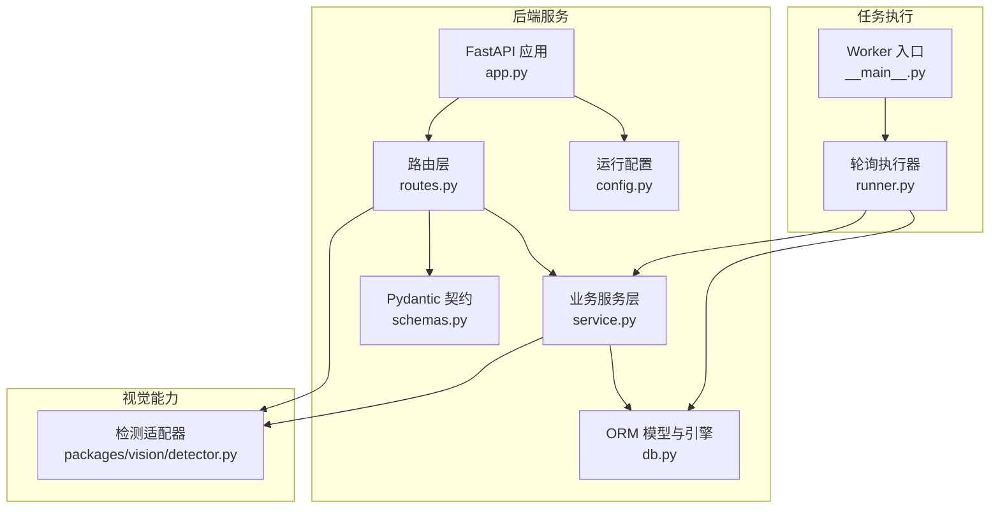
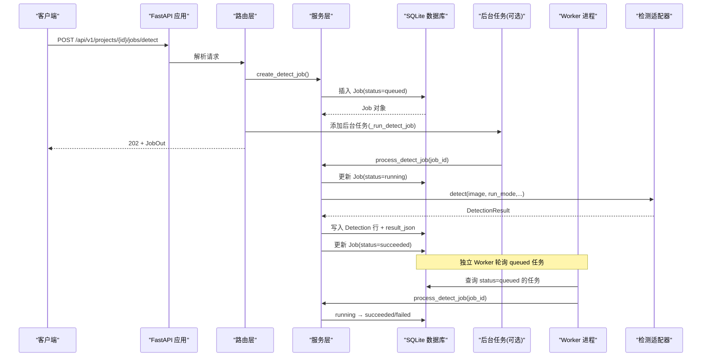
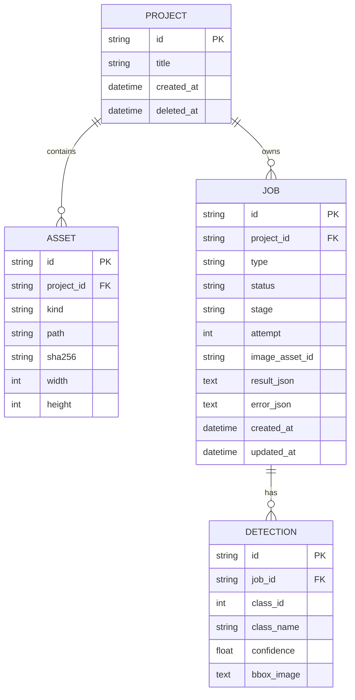
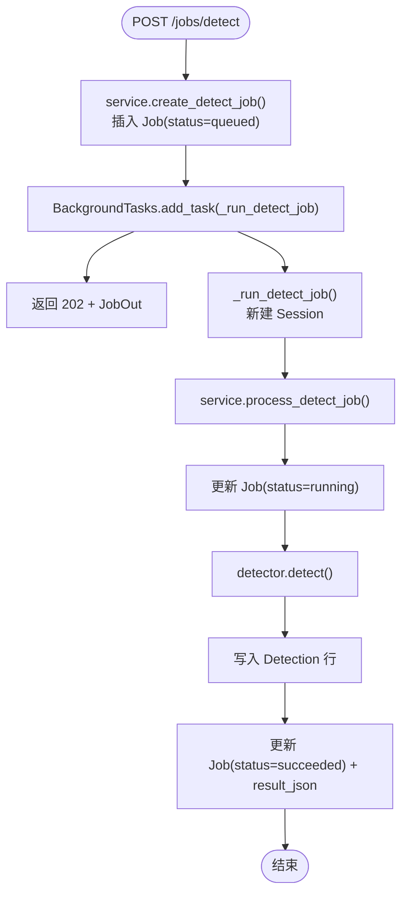
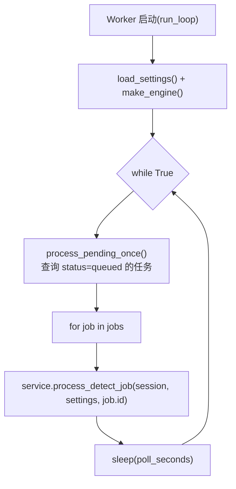
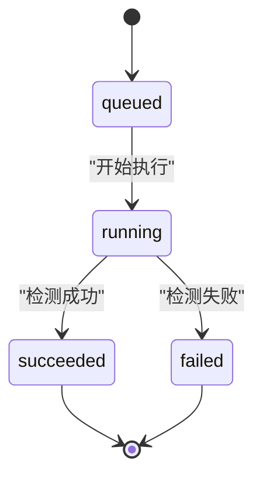
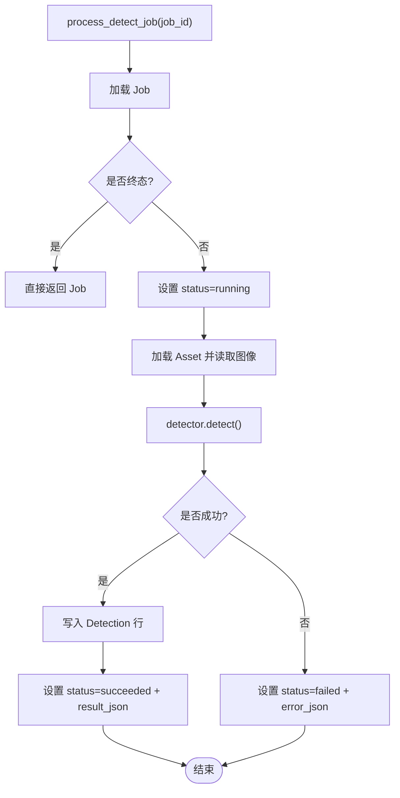
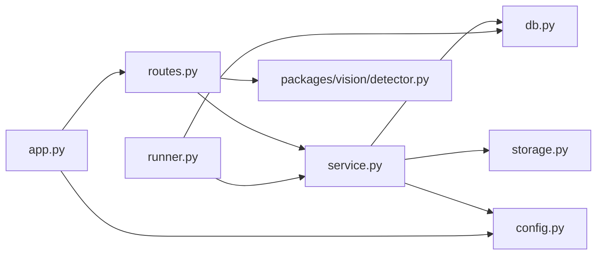

# 异步任务系统

<cite>
**本文引用的文件**   
- [README.md](file://README.md)
- [services/api/app.py](file://services/api/app.py)
- [services/api/routes.py](file://services/api/routes.py)
- [services/api/service.py](file://services/api/service.py)
- [services/api/db.py](file://services/api/db.py)
- [services/api/config.py](file://services/api/config.py)
- [services/api/schemas.py](file://services/api/schemas.py)
- [packages/vision/detector.py](file://packages/vision/detector.py)
- [services/worker/runner.py](file://services/worker/runner.py)
- [services/worker/__main__.py](file://services/worker/__main__.py)
- [tests/test_detection_flow.py](file://tests/test_detection_flow.py)
</cite>

## 目录
1. [引言](#引言)
2. [项目结构](#项目结构)
3. [核心组件](#核心组件)
4. [架构总览](#架构总览)
5. [详细组件分析](#详细组件分析)
6. [依赖关系分析](#依赖关系分析)
7. [性能与扩展性](#性能与扩展性)
8. [监控与日志](#监控与日志)
9. [故障排查指南](#故障排查指南)
10. [结论](#结论)

## 引言
本技术文档聚焦 AstraDesk 的异步任务系统，围绕检测任务的完整生命周期展开：从前端或外部调用创建任务、进入队列、Worker 轮询执行、结果持久化到数据库，再到状态查询与结果返回。当前实现采用 FastAPI + SQLAlchemy + SQLite 的轻量方案，并提供两种执行路径：
- API 进程内后台任务（BackgroundTasks）：请求后立即排队并在同一进程内执行。
- 独立 Worker 进程：通过 `python -m services.worker` 轮询数据库中的 queued 任务并执行。

该设计满足 T02 桌面识别端到端流程，同时为后续扩展更多任务类型（如 plan、generate）预留了数据模型与调度入口。

## 项目结构
AstraDesk 的后端以 services 分层组织：
- services/api：FastAPI 应用、路由、服务层、数据库模型、配置与 Schema。
- services/worker：独立 Worker 进程入口与轮询执行器。
- packages/vision：检测适配器（YOLOv10 真实模式与 Mock）。
- contracts：契约 JSON Schema，用于校验检测结果与错误对象。
- tests：端到端测试，覆盖 mock 与 real 模式行为。

**图表来源**
- [services/api/app.py:24-47](file://services/api/app.py#L24-L47)
- [services/api/routes.py:120-142](file://services/api/routes.py#L120-L142)
- [services/api/service.py:120-179](file://services/api/service.py#L120-L179)
- [services/api/db.py:26-91](file://services/api/db.py#L26-L91)
- [services/api/config.py:20-60](file://services/api/config.py#L20-L60)
- [services/api/schemas.py:27-38](file://services/api/schemas.py#L27-L38)
- [packages/vision/detector.py:50-128](file://packages/vision/detector.py#L50-L128)
- [services/worker/__main__.py:1-8](file://services/worker/__main__.py#L1-L8)
- [services/worker/runner.py:16-43](file://services/worker/runner.py#L16-L43)

**章节来源**
- [README.md:8-24](file://README.md#L8-L24)

## 核心组件
- 应用装配与中间件：FastAPI 应用初始化、CORS、错误处理器、路由挂载。
- 路由层：健康检查、能力探测、项目与图像上传、检测任务创建与查询。
- 服务层：项目与资产 CRUD、检测任务创建与执行、结果持久化、查询装配。
- 数据库模型：Project、Asset、Job、Detection；SQLite 引擎与会话工厂。
- 配置模块：运行模式、数据库 URL、权重路径、设备与置信度等环境变量装配。
- 检测适配器：统一 detect 入口，支持 real/mock 模式，返回标准化 DetectionResult。
- Worker 执行器：轮询 queued 任务，调用 service.process_detect_job 执行。
- 契约与 Schema：Pydantic 模型定义 JobOut、ErrorBody 等接口契约。

**章节来源**
- [services/api/app.py:24-47](file://services/api/app.py#L24-L47)
- [services/api/routes.py:44-142](file://services/api/routes.py#L44-L142)
- [services/api/service.py:44-237](file://services/api/service.py#L44-L237)
- [services/api/db.py:26-91](file://services/api/db.py#L26-L91)
- [services/api/config.py:20-60](file://services/api/config.py#L20-L60)
- [packages/vision/detector.py:26-128](file://packages/vision/detector.py#L26-L128)
- [services/worker/runner.py:16-43](file://services/worker/runner.py#L16-L43)
- [services/api/schemas.py:9-38](file://services/api/schemas.py#L9-L38)

## 架构总览
异步任务系统由“API 进程”和“Worker 进程”两部分组成，共享 SQLite 数据库作为任务队列与状态存储。API 负责协议处理与业务编排，Worker 负责解耦执行耗时任务。

**图表来源**
- [services/api/routes.py:120-142](file://services/api/routes.py#L120-L142)
- [services/api/service.py:120-179](file://services/api/service.py#L120-L179)
- [services/api/db.py:50-66](file://services/api/db.py#L50-L66)
- [packages/vision/detector.py:124-128](file://packages/vision/detector.py#L124-L128)
- [services/worker/runner.py:16-43](file://services/worker/runner.py#L16-L43)

## 详细组件分析

### 任务队列与状态模型
- Job 表字段包括 id、project_id、type、status、stage、attempt、image_asset_id、result_json、error_json、created_at、updated_at。
- status 默认 queued，支持 running、succeeded、failed、cancelled。
- stage 表示当前阶段（如 detecting），attempt 记录重试次数（当前未自动重试）。
- Detection 表保存每个检测框的 class_id、class_name、confidence、bbox_image（归一化坐标）。

**图表来源**
- [services/api/db.py:26-91](file://services/api/db.py#L26-L91)

**章节来源**
- [services/api/db.py:50-77](file://services/api/db.py#L50-L77)

### 任务创建与后台执行
- 路由 `/projects/{project_id}/jobs/detect` 接收 DetectJobIn，调用 service.create_detect_job 创建 Job（status=queued）。
- 使用 FastAPI BackgroundTasks 在请求进程内异步执行 `_run_detect_job`，避免阻塞响应。
- 后台任务内部重新获取 Session，调用 service.process_detect_job 完成实际检测逻辑。

**图表来源**
- [services/api/routes.py:120-142](file://services/api/routes.py#L120-L142)
- [services/api/service.py:120-179](file://services/api/service.py#L120-L179)

**章节来源**
- [services/api/routes.py:120-142](file://services/api/routes.py#L120-L142)
- [services/api/service.py:120-179](file://services/api/service.py#L120-L179)

### Worker 进程轮询机制
- Worker 入口 `__main__.py` 调用 runner.run_loop。
- runner.run_loop 加载 Settings，创建 Engine 与 Session 工厂，按 poll_seconds 周期轮询。
- process_pending_once 查询所有 status=queued 且 type=detect 的任务，逐个调用 service.process_detect_job。
- 当前实现无租约/心跳/过期恢复机制，属于 T06–T07 持久化任务范畴，尚未实现。

**图表来源**
- [services/worker/__main__.py:1-8](file://services/worker/__main__.py#L1-L8)
- [services/worker/runner.py:16-43](file://services/worker/runner.py#L16-L43)

**章节来源**
- [services/worker/runner.py:16-43](file://services/worker/runner.py#L16-L43)
- [services/worker/__main__.py:1-8](file://services/worker/__main__.py#L1-L8)

### 任务状态流转
- 初始状态：queued（创建时设置）。
- 开始执行：running（process_detect_job 中设置）。
- 成功：succeeded（检测完成后写入 result_json 并更新状态）。
- 失败：failed（异常分支设置 error_json，包含 code、message、retryable）。
- 终态保护：若 job.status 已是 succeeded/failed/cancelled，直接返回，避免重复处理。

**图表来源**
- [services/api/service.py:132-186](file://services/api/service.py#L132-L186)

**章节来源**
- [services/api/service.py:132-186](file://services/api/service.py#L132-L186)

### 检测执行与结果持久化
- process_detect_job 读取 Asset，打开 PIL 图像，调用 detector.detect。
- 根据 run_mode 选择 detect_real 或 detect_mock。
- 成功后写入 Detection 行，并序列化 result_json（包含 model_name、elapsed_seconds、count 等）。
- 失败时写入 error_json（包含 code、message、retryable）。

**图表来源**
- [services/api/service.py:132-186](file://services/api/service.py#L132-L186)
- [packages/vision/detector.py:124-128](file://packages/vision/detector.py#L124-L128)

**章节来源**
- [services/api/service.py:132-186](file://services/api/service.py#L132-L186)
- [packages/vision/detector.py:50-128](file://packages/vision/detector.py#L50-L128)

### 查询与契约
- JobOut 定义任务查询返回结构，包含 detections 列表与 error 对象。
- ErrorBody 提供统一错误对象，含 code、message、details、retryable、request_id。
- 测试用例验证契约一致性（G1）与 ID 守恒（H01）。

**章节来源**
- [services/api/schemas.py:9-38](file://services/api/schemas.py#L9-L38)
- [tests/test_detection_flow.py:55-79](file://tests/test_detection_flow.py#L55-L79)

## 依赖关系分析
- API 层依赖 service 层进行业务编排，service 层依赖 db 层进行持久化。
- routes 层直接依赖 detector 进行能力探测（capabilities），但实际检测逻辑在 service 层。
- Worker 层复用 service 层与 db 层，形成对任务执行的解耦。
- config 层为 API 与 Worker 提供统一的 Settings。

**图表来源**
- [services/api/routes.py:1-27](file://services/api/routes.py#L1-L27)
- [services/api/service.py:1-25](file://services/api/service.py#L1-L25)
- [services/api/db.py:1-18](file://services/api/db.py#L1-L18)
- [services/api/config.py:1-14](file://services/api/config.py#L1-L14)
- [services/worker/runner.py:1-14](file://services/worker/runner.py#L1-L14)
- [services/api/app.py:1-14](file://services/api/app.py#L1-L14)

**章节来源**
- [services/api/routes.py:1-27](file://services/api/routes.py#L1-L27)
- [services/api/service.py:1-25](file://services/api/service.py#L1-L25)
- [services/api/db.py:1-18](file://services/api/db.py#L1-L18)
- [services/api/config.py:1-14](file://services/api/config.py#L1-L14)
- [services/worker/runner.py:1-14](file://services/worker/runner.py#L1-L14)
- [services/api/app.py:1-14](file://services/api/app.py#L1-L14)

## 性能与扩展性

### 并发控制与资源隔离
- 当前 API 使用 FastAPI BackgroundTasks 在同一进程内执行检测，适合低并发场景。
- Worker 进程通过轮询数据库执行任务，可水平扩展多个 Worker 实例，但需注意 SQLite 的并发限制。
- 建议在高并发场景迁移至消息队列（如 Redis/RabbitMQ）与分布式 Worker，结合连接池与事务边界优化吞吐。

### 故障转移策略
- 当前 Worker 无租约/心跳机制，重启后无法自动恢复 running 任务。
- 建议引入任务租约与超时机制，将长时间未完成的 running 任务回退为 queued 或 failed，并触发告警。

### 新任务类型注册
- Job.type 支持 extend（detect/plan/generate），可在 service 层新增对应处理函数。
- 路由层可扩展新的任务创建端点，复用 BackgroundTasks 或 Worker 轮询机制。

### 自定义执行器
- detector.detect 已抽象为统一入口，可按 run_mode 分派不同实现。
- 可新增执行器（如 plan/generate），在 service.process_*_job 中接入。

**章节来源**
- [services/api/routes.py:120-142](file://services/api/routes.py#L120-L142)
- [services/api/service.py:120-179](file://services/api/service.py#L120-L179)
- [services/worker/runner.py:16-43](file://services/worker/runner.py#L16-L43)

## 监控与日志
- 执行时间统计：DetectionResult.elapsed_seconds 被序列化到 result_json，可用于性能分析。
- 内存使用监控：当前未显式采集，建议在 Worker 层集成 psutil 或类似库，定期记录进程内存。
- 异常堆栈追踪：error_json 包含 code 与 message，但未包含完整堆栈；建议在 _fail_job 中追加 traceback 信息。
- 日志输出：Worker 打印处理数量与运行模式，建议结构化日志（JSON）并接入集中式日志系统。

**章节来源**
- [services/api/service.py:168-178](file://services/api/service.py#L168-L178)
- [services/api/service.py:182-186](file://services/api/service.py#L182-L186)
- [services/worker/runner.py:30-43](file://services/worker/runner.py#L30-L43)

## 故障排查指南
- 模型不可用：real 模式下缺失权重或依赖会抛出 DetectorUnavailable，最终 job.status=failed，error.code=MODEL_UNAVAILABLE。
- 资产不存在：process_detect_job 中若 asset 缺失，返回 ASSET_NOT_FOUND。
- 非法图像：upload_image 校验扩展名与内容，非法时返回 INVALID_IMAGE。
- 任务未执行：检查 Worker 是否启动，确认数据库中存在 status=queued 的任务。

**章节来源**
- [packages/vision/detector.py:50-65](file://packages/vision/detector.py#L50-L65)
- [services/api/service.py:148-163](file://services/api/service.py#L148-L163)
- [services/api/service.py:73-107](file://services/api/service.py#L73-L107)
- [services/worker/runner.py:16-27](file://services/worker/runner.py#L16-L27)

## 结论
AstraDesk 的异步任务系统在当前版本实现了检测任务的完整生命周期管理，并通过 API 后台任务与独立 Worker 两种方式提供执行能力。数据模型清晰，状态流转明确，契约校验完备。未来可重点增强以下方面：
- 引入消息队列与分布式 Worker，提升并发与可靠性。
- 完善任务租约与心跳机制，支持故障恢复与重试策略。
- 增强监控与日志，提供执行时间、内存占用与异常堆栈的可视化。
- 扩展任务类型与自定义执行器，支撑更复杂的业务流程。