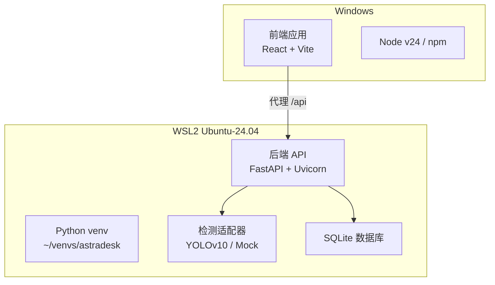
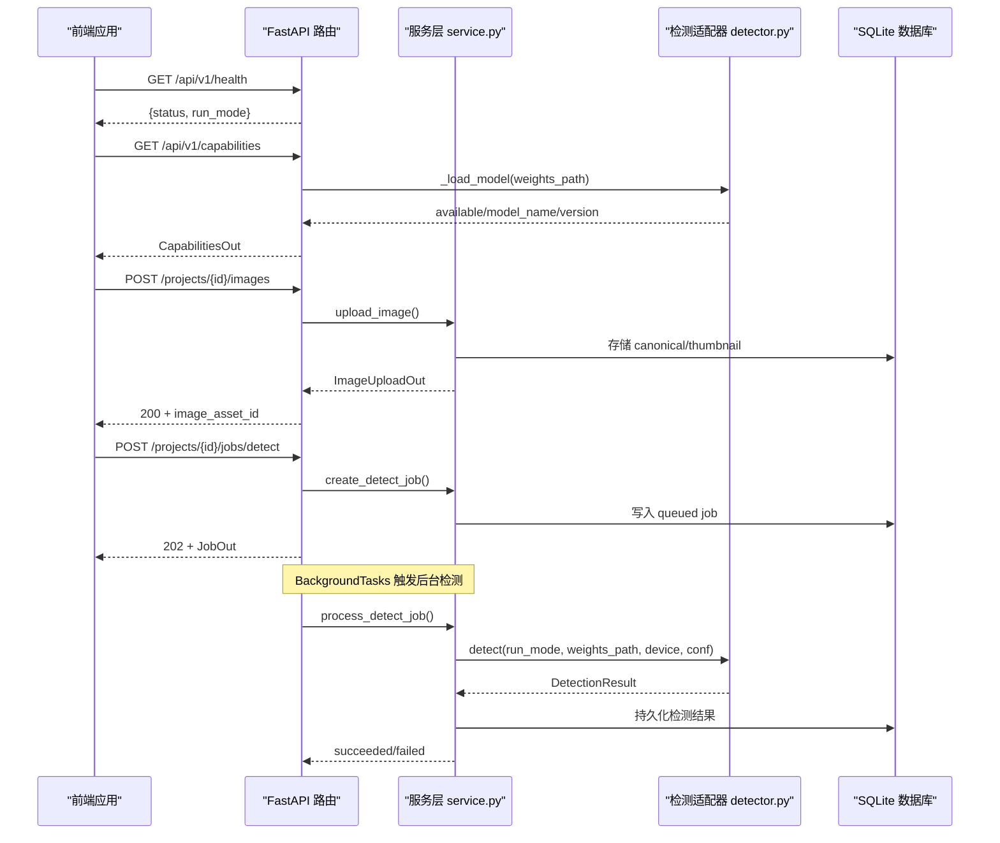
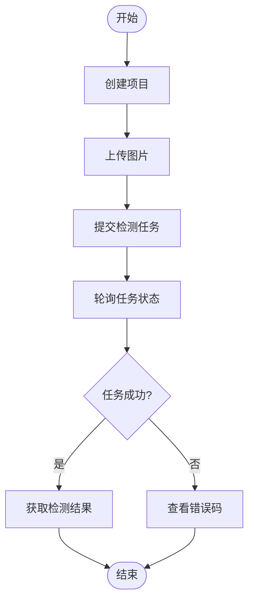
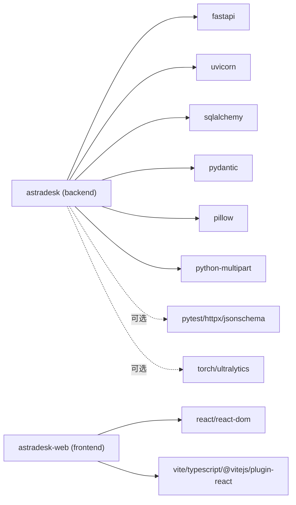

# 快速开始

<cite>
**本文引用的文件**   
- [README.md](file://README.md)
- [ENVIRONMENT.md](file://docs/ENVIRONMENT.md)
- [pyproject.toml](file://pyproject.toml)
- [apps/web/package.json](file://apps/web/package.json)
- [apps/web/vite.config.ts](file://apps/web/vite.config.ts)
- [services/api/config.py](file://services/api/config.py)
- [services/api/app.py](file://services/api/app.py)
- [services/api/routes.py](file://services/api/routes.py)
- [services/api/service.py](file://services/api/service.py)
- [packages/vision/detector.py](file://packages/vision/detector.py)
- [tests/test_detection_flow.py](file://tests/test_detection_flow.py)
- [artifacts/probe_T00_2026-10-11.txt](file://artifacts/probe_T00_2026-10-11.txt)
- [artifacts/run_t02_api.sh](file://artifacts/run_t02_api.sh)
</cite>

## 目录
1. [简介](#简介)
2. [项目结构](#项目结构)
3. [核心组件](#核心组件)
4. [架构总览](#架构总览)
5. [详细组件分析](#详细组件分析)
6. [依赖关系分析](#依赖关系分析)
7. [性能注意事项](#性能注意事项)
8. [故障排查指南](#故障排查指南)
9. [结论](#结论)
10. [附录：命令速查](#附录命令速查)

## 简介
本快速开始指南面向 Windows + WSL2 Ubuntu-24.04 环境，帮助你在最短时间内完成 AstraDesk 的开发环境搭建、后端 API 启动与前端开发服务器运行，并给出健康检查与能力查询的验证命令。文档同时覆盖 Python venv 虚拟环境、Node.js 版本要求、后端依赖锁与可选依赖安装、API 的 mock/real 模式切换、关键环境变量配置，以及常见环境问题（GPU/CUDA、端口冲突等）的排查方法。

## 项目结构
AstraDesk 采用前后端分离结构：
- 前端位于 apps/web，基于 React + TypeScript + Vite，在 Windows 侧使用 Node v24 运行。
- 后端位于 services/api，基于 FastAPI + Uvicorn，在 WSL2 Ubuntu-24.04 中运行；检测逻辑封装在 packages/vision。
- 契约与样例位于 contracts，测试位于 tests，权重与数据目录 weights/data 默认不入库。

图表来源
- [apps/web/vite.config.ts:5-16](file://apps/web/vite.config.ts#L5-L16)
- [services/api/app.py:24-47](file://services/api/app.py#L24-L47)
- [services/api/routes.py:28-65](file://services/api/routes.py#L28-L65)
- [packages/vision/detector.py:1-129](file://packages/vision/detector.py#L1-L129)

章节来源
- [README.md:8-24](file://README.md#L8-L24)

## 核心组件
- 后端 API：提供健康检查、能力查询、项目管理、图像上传、异步检测任务与结果查询。
- 检测适配器：支持 real（YOLOv10）与 mock（确定性返回）两种模式，real 模式下缺失依赖或权重直接报错，不静默回退。
- 前端应用：开发时通过 Vite 代理将 /api 请求转发到后端默认地址。

章节来源
- [services/api/routes.py:44-65](file://services/api/routes.py#L44-L65)
- [packages/vision/detector.py:1-129](file://packages/vision/detector.py#L1-L129)
- [apps/web/vite.config.ts:5-16](file://apps/web/vite.config.ts#L5-L16)

## 架构总览
下图展示从前端发起请求到后端处理检测任务的完整流程，包括健康检查与能力查询接口。

图表来源
- [services/api/routes.py:44-143](file://services/api/routes.py#L44-L143)
- [services/api/service.py:120-179](file://services/api/service.py#L120-L179)
- [packages/vision/detector.py:50-129](file://packages/vision/detector.py#L50-L129)

## 详细组件分析

### 环境与依赖准备
- 宿主机：Windows 25H2；WSL2 发行版：Ubuntu 24.04.4 LTS。
- Python：WSL 内 Python 3.12.3；venv 路径 ~/venvs/astradesk（WSL 原生 ext4）。
- Node：Windows 侧 Node v24（前端开发运行）。
- GPU：RTX 4050 Laptop，驱动 592.00；PyTorch 2.6.0+cu124 已验证可用。

章节来源
- [ENVIRONMENT.md:5-24](file://docs/ENVIRONMENT.md#L5-L24)
- [artifacts/probe_T00_2026-10-11.txt:6-31](file://artifacts/probe_T00_2026-10-11.txt#L6-L31)

### 后端安装步骤（WSL）
- 创建并使用 venv：
  - 在 WSL 中执行：python3 -m venv ~/venvs/astradesk
  - 激活：source ~/venvs/astradesk/bin/activate
- 安装后端基础依赖（editable 安装）：
  - pip install -e '.[dev]'
- 如需真实检测（YOLOv10），额外安装 vision 可选依赖：
  - pip install -e '.[vision]'
- 依赖说明：
  - 基础依赖包含 fastapi、uvicorn、sqlalchemy、pydantic、pillow、python-multipart。
  - dev 依赖包含 pytest、httpx、jsonschema。
  - vision 依赖包含 torch>=2.2、ultralytics>=8.2。

章节来源
- [pyproject.toml:1-37](file://pyproject.toml#L1-L37)
- [README.md:33-47](file://README.md#L33-L47)

### 启动 API 服务（mock 与 real 模式）
- 默认 mock 模式启动：
  - ~/venvs/astradesk/bin/python -m uvicorn services.api.app:app --host 127.0.0.1 --port 8000
- real 模式启动（需设置 ASTRADESK_RUN_MODE=real 与 ASTRADESK_YOLO_WEIGHTS）：
  - ASTRADESK_RUN_MODE=real ASTRADESK_YOLO_WEIGHTS=weights/yolov10n.pt ~/venvs/astradesk/bin/python -m uvicorn services.api.app:app --host 127.0.0.1 --port 8000
- 关键环境变量：
  - ASTRADESK_RUN_MODE：real 或 mock（demo 等价于 mock）。
  - ASTRADESK_DB_URL：数据库连接字符串（默认 SQLite）。
  - ASTRADESK_DATA_ROOT：数据存储根目录。
  - ASTRADESK_YOLO_WEIGHTS：YOLO 权重路径。
  - ASTRADESK_DEVICE：设备选择（空则自动）。
  - ASTRADESK_DET_CONF：检测置信度阈值（默认 0.25）。

章节来源
- [services/api/config.py:17-60](file://services/api/config.py#L17-L60)
- [services/api/app.py:24-47](file://services/api/app.py#L24-L47)
- [README.md:40-47](file://README.md#L40-L47)

### 前端安装与启动（Windows）
- 进入前端目录：cd apps\web
- 安装依赖：npm install
- 启动开发服务器：npm run dev（默认 http://localhost:5173，/api 代理到 127.0.0.1:8000）
- 构建产物：npm run build（产出 dist/）

章节来源
- [apps/web/package.json:1-23](file://apps/web/package.json#L1-L23)
- [apps/web/vite.config.ts:5-16](file://apps/web/vite.config.ts#L5-L16)
- [README.md:52-59](file://README.md#L52-L59)

### 健康检查与能力查询测试
- 健康检查：
  - curl http://127.0.0.1:8000/api/v1/health
  - 预期输出包含 status=ok 与当前 run_mode。
- 能力查询：
  - curl http://127.0.0.1:8000/api/v1/capabilities
  - mock 模式：detector.model_name=mock-detector，available=true。
  - real 模式：detector.model_name=yolov10n，available 取决于权重与依赖是否可用。

章节来源
- [services/api/routes.py:44-65](file://services/api/routes.py#L44-L65)
- [artifacts/run_t02_api.sh:1-25](file://artifacts/run_t02_api.sh#L1-L25)

### 端到端检测流程（mock）
- 创建项目 → 上传图片 → 提交检测任务 → 轮询任务状态 → 获取检测结果。
- mock 模式下，检测结果固定包含 laptop 与 mouse 两个框，run_mode=mock。

图表来源
- [tests/test_detection_flow.py:29-79](file://tests/test_detection_flow.py#L29-L79)
- [services/api/service.py:120-179](file://services/api/service.py#L120-L179)

章节来源
- [tests/test_detection_flow.py:1-126](file://tests/test_detection_flow.py#L1-L126)

## 依赖关系分析
- 后端依赖：
  - FastAPI、Uvicorn、SQLAlchemy、Pydantic、Pillow、python-multipart。
  - 可选 dev：pytest、httpx、jsonschema。
  - 可选 vision：torch、ultralytics。
- 前端依赖：
  - React、react-dom。
  - 开发依赖：@vitejs/plugin-react、typescript、vite。

图表来源
- [pyproject.toml:10-21](file://pyproject.toml#L10-L21)
- [apps/web/package.json:11-21](file://apps/web/package.json#L11-L21)

章节来源
- [pyproject.toml:1-37](file://pyproject.toml#L1-L37)
- [apps/web/package.json:1-23](file://apps/web/package.json#L1-L23)

## 性能注意事项
- 真实检测模式建议使用 CUDA 加速（torch cu124 已验证可用）。
- 权重加载为进程内懒加载并缓存，避免重复加载开销。
- 检测任务通过 BackgroundTasks 异步执行，避免阻塞请求线程。
- 前端开发服务器通过 Vite 代理减少跨域问题，提升本地调试效率。

章节来源
- [packages/vision/detector.py:50-65](file://packages/vision/detector.py#L50-L65)
- [services/api/routes.py:120-136](file://services/api/routes.py#L120-L136)
- [apps/web/vite.config.ts:5-16](file://apps/web/vite.config.ts#L5-L16)

## 故障排查指南
- GPU 驱动未正确直通：
  - 现象：WSL 内 nvidia-smi 不可用或无法识别 GPU。
  - 解决：确认宿主 NVIDIA 驱动已安装且 WSL2 GPU 直通启用；参考 ENVIRONMENT 记录中的驱动与显存信息。
- CUDA 版本不兼容：
  - 现象：torch.cuda.is_available() 返回 false 或导入失败。
  - 解决：确保使用匹配的 torch cu124 轮子；必要时重装 torch 与 torchvision。
- 端口冲突：
  - 现象：启动 uvicorn 时报端口占用。
  - 解决：更换端口（如 8123），并确保前端 VITE_API_TARGET 指向新端口。
- 权重文件缺失：
  - 现象：real 模式下 capabilities.available=false，检测任务报 MODEL_UNAVAILABLE。
  - 解决：下载 yolov10n.pt 至 weights/，并通过 ASTRADESK_YOLO_WEIGHTS 指定路径。
- 前端代理配置错误：
  - 现象：浏览器控制台出现跨域或 404。
  - 解决：确认 vite.config.ts 中 /api 代理目标为后端地址（默认 http://127.0.0.1:8000）。

章节来源
- [ENVIRONMENT.md:26-35](file://docs/ENVIRONMENT.md#L26-L35)
- [services/api/routes.py:51-65](file://services/api/routes.py#L51-L65)
- [services/api/service.py:158-163](file://services/api/service.py#L158-L163)
- [apps/web/vite.config.ts:5-16](file://apps/web/vite.config.ts#L5-L16)

## 结论
按照本指南完成环境准备、依赖安装与服务启动后，你可以在 WSL2 中运行 AstraDesk 后端 API，并在 Windows 侧启动前端开发服务器。通过健康检查与能力查询接口可快速验证服务状态；在 mock 模式下可端到端验证检测流程，在 real 模式下结合 YOLOv10 进行真实推理。遇到问题时，可参考故障排查指南定位 GPU、CUDA、端口与权重相关的问题。

## 附录：命令速查
- 后端启动（mock）：
  - ~/venvs/astradesk/bin/python -m uvicorn services.api.app:app --host 127.0.0.1 --port 8000
- 后端启动（real）：
  - ASTRADESK_RUN_MODE=real ASTRADESK_YOLO_WEIGHTS=weights/yolov10n.pt ~/venvs/astradesk/bin/python -m uvicorn services.api.app:app --host 127.0.0.1 --port 8000
- 健康检查：
  - curl http://127.0.0.1:8000/api/v1/health
- 能力查询：
  - curl http://127.0.0.1:8000/api/v1/capabilities
- 前端启动：
  - cd apps\web && npm install && npm run dev

章节来源
- [README.md:33-59](file://README.md#L33-L59)
- [artifacts/run_t02_api.sh:1-25](file://artifacts/run_t02_api.sh#L1-L25)