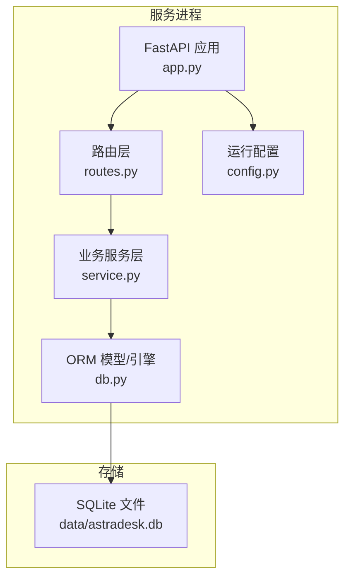
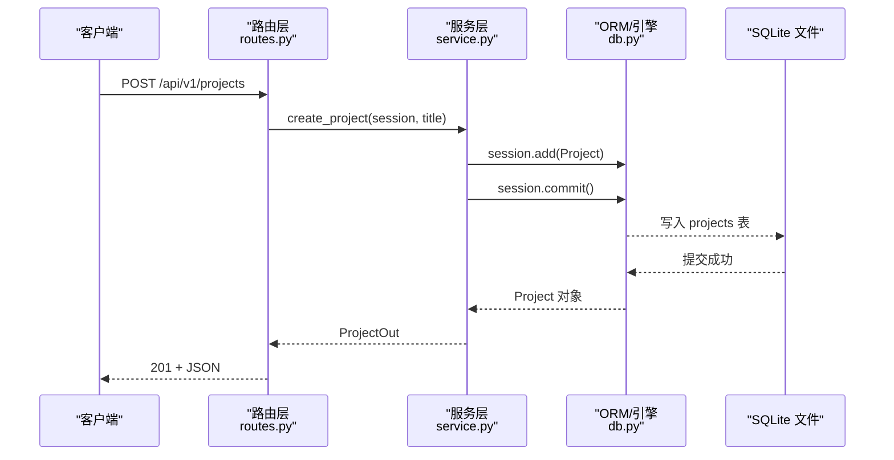
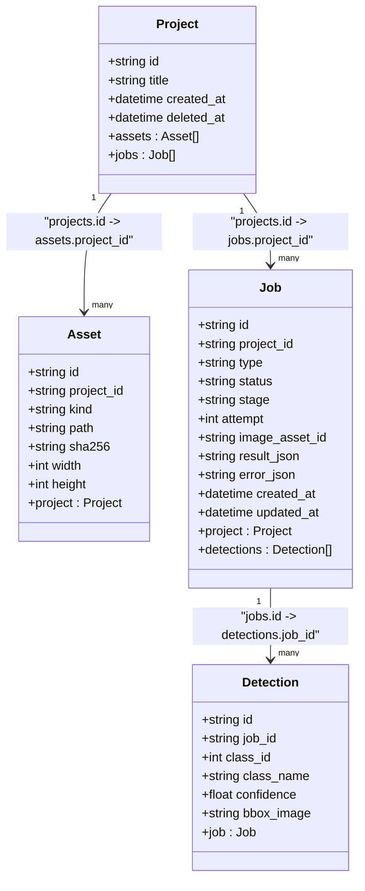
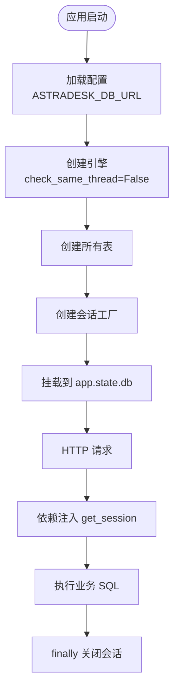
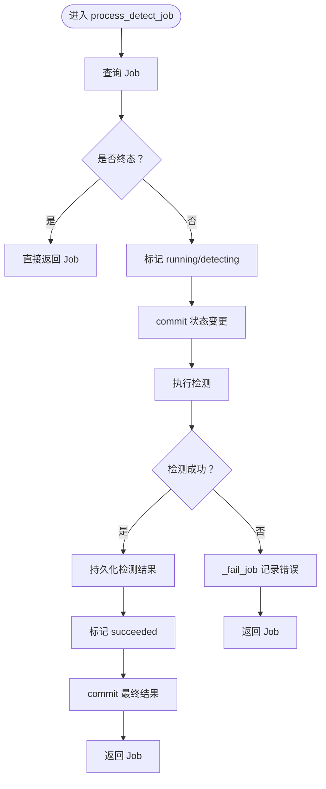
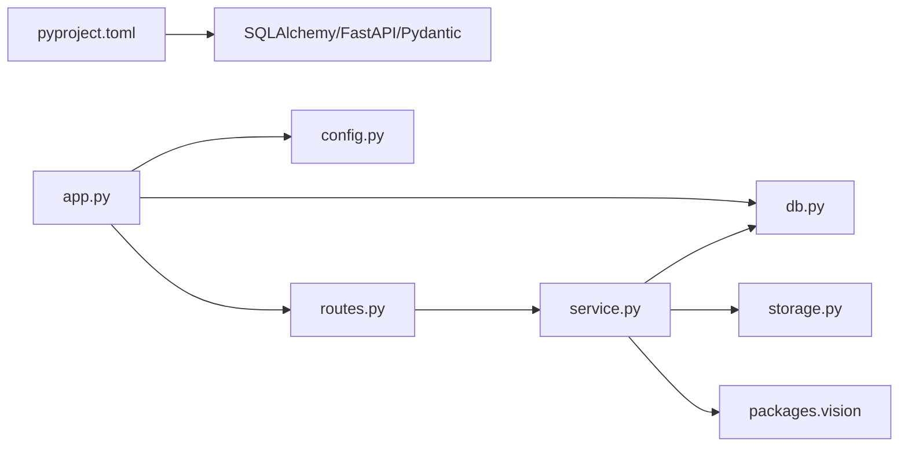

# 数据库设计

<cite>
**本文引用的文件**   
- [services/api/db.py](file://services/api/db.py)
- [services/api/config.py](file://services/api/config.py)
- [services/api/app.py](file://services/api/app.py)
- [services/api/routes.py](file://services/api/routes.py)
- [services/api/service.py](file://services/api/service.py)
- [services/api/schemas.py](file://services/api/schemas.py)
- [pyproject.toml](file://pyproject.toml)
</cite>

## 目录
1. [引言](#引言)
2. [项目结构](#项目结构)
3. [核心组件](#核心组件)
4. [架构总览](#架构总览)
5. [详细组件分析](#详细组件分析)
6. [依赖关系分析](#依赖关系分析)
7. [性能与索引策略](#性能与索引策略)
8. [数据迁移与版本管理](#数据迁移与版本管理)
9. [数据访问最佳实践](#数据访问最佳实践)
10. [数据库维护指南](#数据库维护指南)
11. [故障排查](#故障排查)
12. [结论](#结论)

## 引言
本文件为 AstraDesk 的数据库设计文档，聚焦基于 SQLite 的轻量级持久化方案。系统使用 SQLAlchemy ORM 定义 Project（项目）、Asset（资产）、Job（任务）、Detection（检测结果）等核心实体，并通过 FastAPI 路由与服务层完成业务编排。本文从架构、模型、关系、索引、迁移、访问模式与维护等方面给出完整说明，帮助开发者在保持轻量化的同时获得可维护、可扩展的数据层。

## 项目结构
AstraDesk 后端以 FastAPI 应用为核心，数据库相关代码集中在 services/api 模块：
- db.py：ORM 模型、引擎与会话工厂
- config.py：运行配置，包括数据库 URL 与环境变量装配
- app.py：FastAPI 应用装配，挂载 engine 与 session 工厂
- routes.py：HTTP 路由，负责协议处理与依赖注入会话
- service.py：业务逻辑与仓储封装，包含事务边界与错误处理
- schemas.py：Pydantic 输入输出契约

**图表来源**
- [services/api/app.py:24-47](file://services/api/app.py#L24-L47)
- [services/api/routes.py:31-41](file://services/api/routes.py#L31-L41)
- [services/api/service.py:1-25](file://services/api/service.py#L1-L25)
- [services/api/db.py:84-91](file://services/api/db.py#L84-L91)
- [services/api/config.py:39-60](file://services/api/config.py#L39-L60)

**章节来源**
- [services/api/app.py:1-48](file://services/api/app.py#L1-L48)
- [services/api/config.py:1-61](file://services/api/config.py#L1-L61)
- [services/api/db.py:1-92](file://services/api/db.py#L1-L92)

## 核心组件
本节概述数据库相关的核心组件及其职责：
- ORM 模型：Project、Asset、Job、Detection，定义表结构与关系
- 引擎与会话：make_engine 创建 SQLAlchemy Engine；make_session 返回 Session 工厂
- 配置：Settings 提供 db_url 等运行时参数，默认指向 data/astradesk.db
- 应用装配：create_app 初始化 engine 与 session 工厂，并挂到 app.state
- 路由依赖：get_session 为每个请求提供独立 Session，并在 finally 中关闭

关键实现位置：
- 模型与引擎/会话工厂：[services/api/db.py:26-91](file://services/api/db.py#L26-L91)
- 配置加载：[services/api/config.py:39-60](file://services/api/config.py#L39-L60)
- 应用装配：[services/api/app.py:24-47](file://services/api/app.py#L24-L47)
- 会话依赖注入：[services/api/routes.py:31-41](file://services/api/routes.py#L31-L41)

**章节来源**
- [services/api/db.py:26-91](file://services/api/db.py#L26-L91)
- [services/api/config.py:39-60](file://services/api/config.py#L39-L60)
- [services/api/app.py:24-47](file://services/api/app.py#L24-L47)
- [services/api/routes.py:31-41](file://services/api/routes.py#L31-L41)

## 架构总览
下图展示从 HTTP 请求到数据库写入的端到端流程，突出会话生命周期与事务边界。

**图表来源**
- [services/api/routes.py:70-74](file://services/api/routes.py#L70-L74)
- [services/api/service.py:46-50](file://services/api/service.py#L46-L50)
- [services/api/db.py:26-35](file://services/api/db.py#L26-L35)

**章节来源**
- [services/api/routes.py:70-74](file://services/api/routes.py#L70-L74)
- [services/api/service.py:46-50](file://services/api/service.py#L46-L50)
- [services/api/db.py:26-35](file://services/api/db.py#L26-L35)

## 详细组件分析

### ORM 模型与关系设计
- Project（项目）
  - 主键 id（字符串）
  - 标题 title（非空，默认“未命名项目”）
  - 时间戳 created_at（UTC 默认）
  - 软删除 deleted_at（可空）
  - 一对多关系 assets、jobs

- Asset（资产）
  - 主键 id（字符串）
  - 外键 project_id（关联 projects.id）
  - kind（original/canonical/thumbnail）
  - path（相对路径）
  - sha256（哈希）
  - width、height（整数）

- Job（任务）
  - 主键 id（字符串）
  - 外键 project_id（关联 projects.id）
  - type（detect/plan/generate）
  - status（queued/running/succeeded/failed/cancelled）
  - stage（阶段）
  - attempt（重试次数）
  - image_asset_id（关联图像资产）
  - result_json、error_json（JSON 文本）
  - created_at、updated_at（时间戳）
  - 一对多关系 detections

- Detection（检测结果）
  - 主键 id（字符串）
  - 外键 job_id（关联 jobs.id）
  - class_id、class_name、confidence
  - bbox_image（JSON 文本，归一化坐标）

**图表来源**
- [services/api/db.py:26-78](file://services/api/db.py#L26-L78)

**章节来源**
- [services/api/db.py:26-78](file://services/api/db.py#L26-L78)

### 连接与会话管理
- 引擎创建：make_engine 使用 create_engine，针对 SQLite 设置 connect_args.check_same_thread=False，允许跨线程访问
- 表结构初始化：Base.metadata.create_all(engine) 自动建表
- 会话工厂：make_session 返回 sessionmaker(bind=engine, expire_on_commit=False)，避免提交后属性失效
- 应用装配：create_app 将 engine 与 Session 工厂挂在 app.state.db，供依赖注入使用
- 请求级会话：get_session 在每个请求中创建 Session，finally 中关闭，确保资源释放

**图表来源**
- [services/api/db.py:84-91](file://services/api/db.py#L84-L91)
- [services/api/app.py:24-47](file://services/api/app.py#L24-L47)
- [services/api/routes.py:31-41](file://services/api/routes.py#L31-L41)
- [services/api/config.py:47-48](file://services/api/config.py#L47-L48)

**章节来源**
- [services/api/db.py:84-91](file://services/api/db.py#L84-L91)
- [services/api/app.py:24-47](file://services/api/app.py#L24-L47)
- [services/api/routes.py:31-41](file://services/api/routes.py#L31-L41)
- [services/api/config.py:47-48](file://services/api/config.py#L47-L48)

### 事务处理与错误恢复
- 写操作采用显式 session.commit()，如创建项目、上传图像、创建检测任务
- 后台任务使用独立 Session，避免与请求会话冲突
- 检测任务状态机：queued → running → succeeded/failed，终态不可被重复覆盖
- 失败分支统一通过 _fail_job 记录 error_json，区分可重试与不可重试错误

**图表来源**
- [services/api/service.py:132-186](file://services/api/service.py#L132-L186)

**章节来源**
- [services/api/service.py:132-186](file://services/api/service.py#L132-L186)

### 数据契约与序列化
- Pydantic 模型定义 API 输入输出契约，如 JobOut、ProjectOut、ImageUploadOut、DetectJobIn
- 检测结果 bbox_image 在 ORM 中以 JSON 文本存储，在 service 层进行 json.loads/json.dumps 转换
- 时间字段统一转换为 UTC ISO 字符串，便于前端显示

**章节来源**
- [services/api/schemas.py:1-84](file://services/api/schemas.py#L1-L84)
- [services/api/service.py:202-221](file://services/api/service.py#L202-L221)

## 依赖关系分析
- 外部依赖：SQLAlchemy >= 2.0（见 pyproject.toml），FastAPI、Pydantic 用于 API 层
- 模块耦合：
  - routes 依赖 service 与 config
  - service 依赖 db 模型、storage、vision 包
  - app 依赖 config、db、errors、routes
  - config 提供 Settings，含 db_url

**图表来源**
- [pyproject.toml:10-17](file://pyproject.toml#L10-L17)
- [services/api/app.py:10-13](file://services/api/app.py#L10-L13)
- [services/api/routes.py:15-18](file://services/api/routes.py#L15-L18)
- [services/api/service.py:17-24](file://services/api/service.py#L17-L24)

**章节来源**
- [pyproject.toml:10-17](file://pyproject.toml#L10-L17)
- [services/api/app.py:10-13](file://services/api/app.py#L10-L13)
- [services/api/routes.py:15-18](file://services/api/routes.py#L15-L18)
- [services/api/service.py:17-24](file://services/api/service.py#L17-L24)

## 性能与索引策略
当前模型未显式定义索引或唯一约束，主要依赖主键与外键。建议如下：
- 查询优化
  - 对 jobs.status、jobs.project_id 建立复合索引，加速按项目与状态筛选
  - 对 assets.project_id 建立索引，加速项目下资产列表
  - 对 detections.job_id 建立索引，加速任务结果查询
- 唯一性约束
  - 若需要防止重复资产，可为 assets 增加 (project_id, sha256) 唯一约束
  - 若需要防止重复检测框，可为 detections 增加 (job_id, class_id, bbox_image) 唯一约束
- 批量操作
  - 使用 session.bulk_insert_mappings 或 executemany 提升批量插入效率
  - 对检测结果持久化时，先清空再批量插入，避免 N+1 问题
- 连接池
  - SQLite 单文件场景下，连接池意义有限；如需并发写入，考虑 WAL 模式与 PRAGMA journal_mode=WAL
  - 注意 check_same_thread=False 已启用，但仍应避免多线程共享同一 Session

**章节来源**
- [services/api/db.py:26-78](file://services/api/db.py#L26-L78)
- [services/api/service.py:189-198](file://services/api/service.py#L189-L198)

## 数据迁移与版本管理
当前未引入 Alembic 等迁移工具，表结构由 Base.metadata.create_all 自动创建。建议：
- 引入 Alembic
  - 初始化 alembic init，生成初始迁移脚本
  - 每次模型变更后执行 alembic revision --autogenerate 生成迁移
  - 部署时执行 alembic upgrade head 升级结构
- 数据备份与恢复
  - 定期 cp data/astradesk.db 到备份目录
  - 恢复时替换文件并重启服务
- 回滚策略
  - 保留历史迁移脚本，必要时执行 alembic downgrade 回滚
  - 对破坏性变更（删列/改类型）前执行数据导出与校验

**章节来源**
- [services/api/db.py:84-87](file://services/api/db.py#L84-L87)

## 数据访问最佳实践
- 避免 N+1 查询
  - 获取项目详情时，使用 joinedload 预加载 assets/jobs，减少额外查询
  - 查询任务结果时，使用 selectinload 预加载 detections
- 批量操作优化
  - 上传图像时，批量添加 Asset 记录后再 commit
  - 检测结果持久化时，先 delete 再 bulk insert
- 缓存策略
  - 对静态能力信息（capabilities）做短期缓存
  - 对热门项目的资产列表做内存缓存（注意失效策略）
- 事务边界
  - 每个写操作明确 commit，失败时 rollback
  - 后台任务使用独立 Session，避免与请求会话混用

**章节来源**
- [services/api/service.py:92-98](file://services/api/service.py#L92-L98)
- [services/api/service.py:189-198](file://services/api/service.py#L189-L198)
- [services/api/routes.py:31-41](file://services/api/routes.py#L31-L41)

## 数据库维护指南
- 定期清理
  - 清理已删除项目（deleted_at 不为空）对应的资产与任务
  - 归档已完成且无后续查询的历史任务
- 空间管理
  - 监控 data/astradesk.db 文件大小，必要时压缩或分库
  - 清理缩略图与临时文件
- 性能监控
  - 开启 SQLite 日志或使用 EXPLAIN ANALYZE 分析慢查询
  - 监控连接数与锁等待情况

**章节来源**
- [services/api/db.py:26-35](file://services/api/db.py#L26-L35)

## 故障排查
- 常见问题
  - 资产文件缺失：路由层检查 path.exists()，不存在则返回 404
  - 项目已删除：读取资产时再次校验项目存在性
  - 检测器不可用：real 模式下抛出 DetectorUnavailable，记录 MODEL_UNAVAILABLE
- 错误处理
  - 统一 ApiError 包装，包含 code、message、retryable
  - 后台任务异常捕获并落库 failed 状态

**章节来源**
- [services/api/routes.py:108-115](file://services/api/routes.py#L108-L115)
- [services/api/service.py:110-115](file://services/api/service.py#L110-L115)
- [services/api/service.py:158-163](file://services/api/service.py#L158-L163)

## 结论
AstraDesk 的数据库设计以 SQLite 为基础，结合 SQLAlchemy ORM 提供了简洁、易用的数据层。通过清晰的实体关系、明确的会话与事务管理，以及统一的错误处理机制，系统在 MVP 阶段具备良好的可维护性与扩展性。未来可通过引入 Alembic 迁移、完善索引策略与缓存机制，进一步提升性能与可运维性。