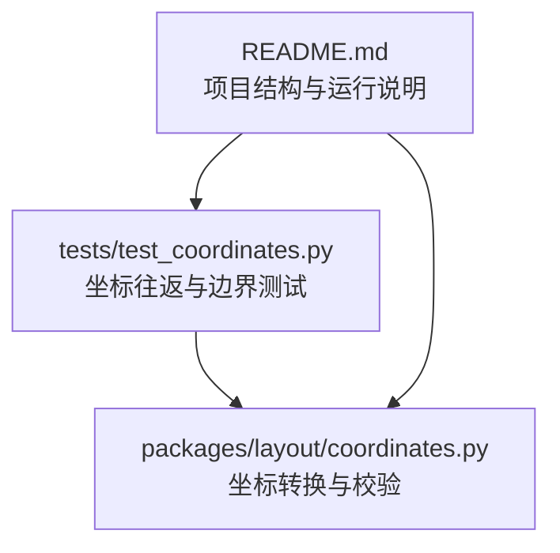
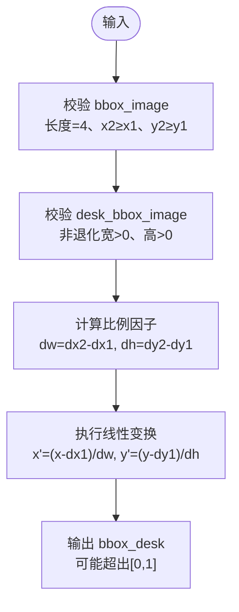
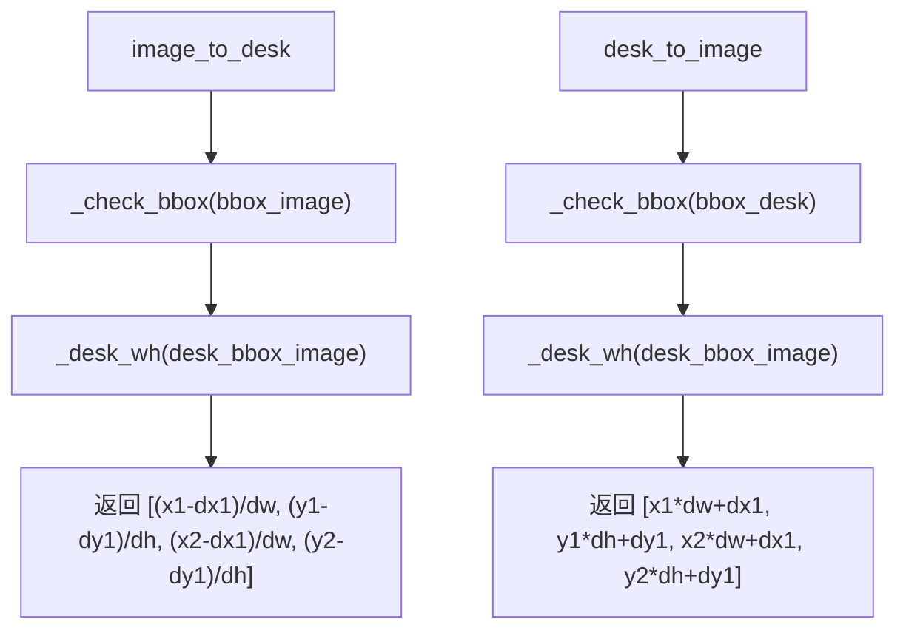
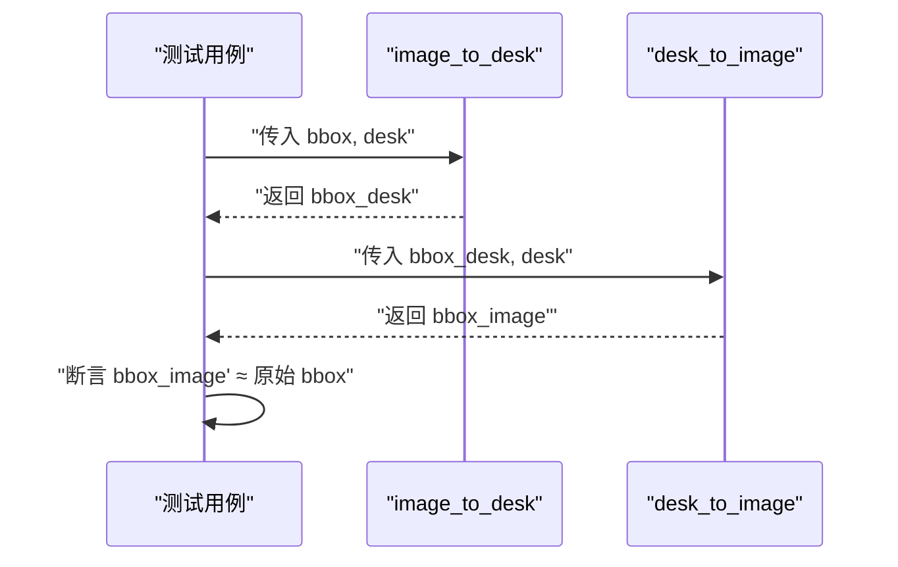
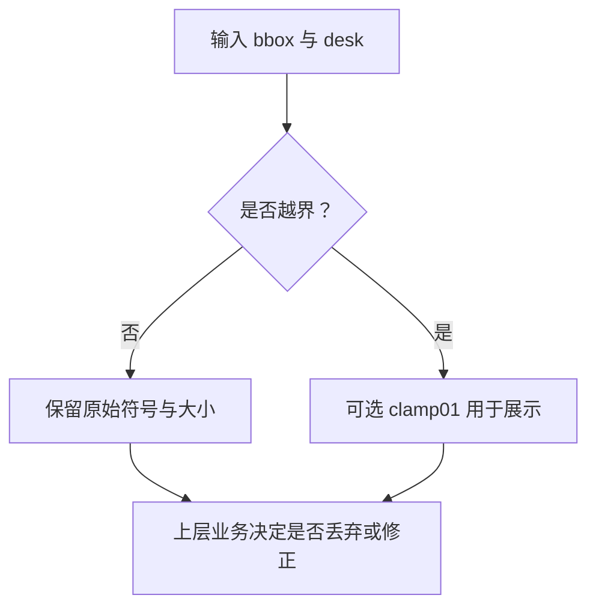
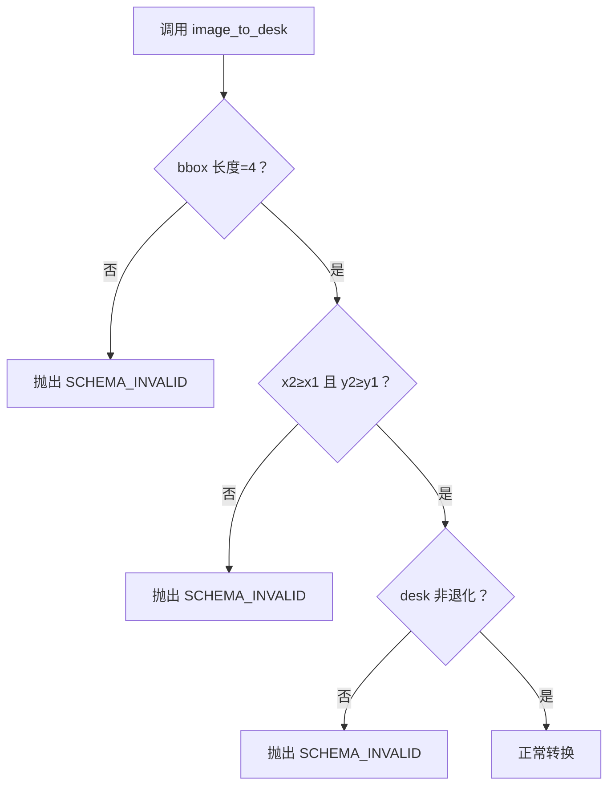
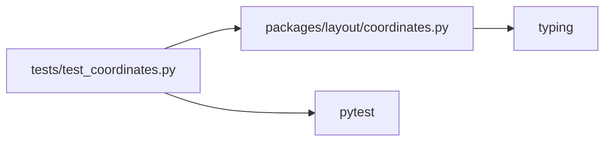

# 坐标转换测试

<cite>
**本文引用的文件**   
- [test_coordinates.py](file://tests/test_coordinates.py)
- [coordinates.py](file://packages/layout/coordinates.py)
- [README.md](file://README.md)
</cite>

## 目录
1. [引言](#引言)
2. [项目结构定位](#项目结构定位)
3. [核心组件](#核心组件)
4. [架构总览](#架构总览)
5. [详细组件分析](#详细组件分析)
6. [依赖关系分析](#依赖关系分析)
7. [性能与精度考虑](#性能与精度考虑)
8. [测试扩展指南](#测试扩展指南)
9. [故障排查指南](#故障排查指南)
10. [结论](#结论)

## 引言
本文面向 AstraDesk 的“图像坐标系 ↔ 桌面坐标系”转换测试，目标是帮助读者理解：
- 归一化坐标的含义、计算方法与边界语义。
- `test_coordinates.py` 中往返一致性、边界条件、异常输入等测试用例的设计意图。
- `coordinates.py` 中核心函数的职责、数学基础与错误处理。
- 如何扩展新的转换场景、编写性能基准与异常输入测试。
- 常见坐标问题的调试方法与解决方案。

本说明尽量以通俗语言解释技术细节，同时提供精确的文件与行号引用，便于深入源码验证。

## 项目结构定位
AstraDesk 将坐标契约转换逻辑放在 `packages/layout/coordinates.py`，相关单元测试位于 `tests/test_coordinates.py`。项目 README 明确了 layout 包负责“坐标契约转换（bbox_image ↔ bbox_desk）”，并强调客户端传值需校验、必须覆盖往返一致性。

**图表来源**
- [test_coordinates.py:1-48](file://tests/test_coordinates.py#L1-L48)
- [coordinates.py:1-63](file://packages/layout/coordinates.py#L1-L63)
- [README.md:8-24](file://README.md#L8-L24)

**章节来源**
- [README.md:8-24](file://README.md#L8-L24)

## 核心组件
- 坐标类型定义与错误类：
  - `Bbox`：浮点列表 `[x1, y1, x2, y2]`。
  - `CoordinateError`：带错误码的自定义异常，用于非法输入或退化矩形。
- 内部校验工具：
  - `_check_bbox`：检查长度为 4、可转为浮点数、且满足 `x2 ≥ x1`、`y2 ≥ y1`。
  - `_desk_wh`：基于 desk 框计算宽高，拒绝零宽或零高。
- 对外转换函数：
  - `image_to_desk`：原图归一化框 → 桌面归一化框。
  - `desk_to_image`：桌面归一化框 → 原图归一化框。
  - `clamp01`：将归一化坐标裁剪到 `[0,1]`，用于展示与越界辅助。

**章节来源**
- [coordinates.py:14-63](file://packages/layout/coordinates.py#L14-L63)

## 架构总览
坐标转换遵循“原图归一化框”和“桌面归一化框”两套坐标系：
- 原图归一化框 `bbox_image = [x1, y1, x2, y2]`，取值范围通常为 `[0,1]`，左上为原点，x 向右、y 向下。
- 桌面矩形 `desk_bbox_image = [dx1, dy1, dx2, dy2]`，同样基于原图坐标。
- 桌面归一化框 `bbox_desk` 表示目标框在桌面矩形内的相对位置，计算公式为：
  - `x_desk = (x_image - dx1) / (dx2 - dx1)`，y 同理。

**图表来源**
- [coordinates.py:26-55](file://packages/layout/coordinates.py#L26-L55)

**章节来源**
- [coordinates.py:1-9](file://packages/layout/coordinates.py#L1-L9)
- [coordinates.py:26-55](file://packages/layout/coordinates.py#L26-L55)

## 详细组件分析

### 坐标系统数学基础
- 比例因子：
  - `dw = dx2 - dx1`，`dh = dy2 - dy1`。
  - 若 `dw ≤ 0` 或 `dh ≤ 0`，视为退化桌面矩形，抛出 `CoordinateError("SCHEMA_INVALID", ...)`。
- 偏移量处理：
  - 先减去桌面左上角偏移 `(dx1, dy1)`，再除以宽高得到相对坐标。
- 坐标有效性检查：
  - 所有输入框均要求长度为 4，且满足 `x2 ≥ x1`、`y2 ≥ y1`。
  - 转换结果不自动裁剪；越界由上层业务决定如何处理。
- 逆运算：
  - `desk_to_image` 是 `image_to_desk` 的严格逆运算，保证往返一致性。

**图表来源**
- [coordinates.py:44-55](file://packages/layout/coordinates.py#L44-L55)

**章节来源**
- [coordinates.py:26-55](file://packages/layout/coordinates.py#L26-L55)

### 核心函数职责与行为
- `image_to_desk`
  - 输入：`bbox_image`（原图归一化框）、`desk_bbox_image`（桌面矩形）。
  - 行为：线性映射到桌面坐标系，允许结果超出 `[0,1]`。
  - 异常：输入非法或桌面矩形退化时抛出 `CoordinateError`。
- `desk_to_image`
  - 输入：`bbox_desk`（桌面归一化框）、`desk_bbox_image`。
  - 行为：执行逆变换，恢复原图归一化坐标。
  - 异常：同 `image_to_desk`。
- `clamp01`
  - 作用：将任意归一化坐标裁剪到 `[0,1]`，常用于可视化或越界检查辅助。
  - 注意：它不是转换函数，不会改变业务语义，仅做数值裁剪。

**章节来源**
- [coordinates.py:44-62](file://packages/layout/coordinates.py#L44-L62)

### 测试用例设计解析

#### 往返一致性验证
- 全桌面场景：当桌面矩形等于整张图 `[0,0,1,1]` 时，`image_to_desk` 与 `desk_to_image` 应近似恒等。
- 子桌面场景：当桌面矩形为 `[0.1,0.1,0.9,0.9]` 时，手动核对 PRD 公式，确保 `x_desk = (x_image - dx1)/(dx2 - dx1)` 成立，并验证往返后与原框一致。

**图表来源**
- [test_coordinates.py:14-28](file://tests/test_coordinates.py#L14-L28)
- [coordinates.py:44-55](file://packages/layout/coordinates.py#L44-L55)

**章节来源**
- [test_coordinates.py:14-28](file://tests/test_coordinates.py#L14-L28)

#### 边界条件测试
- 边缘坐标：使用接近边界的归一化值，验证转换是否保持顺序与比例。
- 零尺寸图像：通过桌面矩形退化（如宽度为 0）触发异常路径，确保不静默失败。
- 对象部分在桌面外：转换保留负值或大于 1 的值，交由上层进行越界处理；可用 `clamp01` 做展示级裁剪。

**图表来源**
- [test_coordinates.py:42-47](file://tests/test_coordinates.py#L42-L47)
- [coordinates.py:58-62](file://packages/layout/coordinates.py#L58-L62)

**章节来源**
- [test_coordinates.py:31-47](file://tests/test_coordinates.py#L31-L47)

#### 异常输入处理测试
- 长度不足：`bbox` 长度不为 4。
- 顺序错误：`x2 < x1` 或 `y2 < y1`。
- 桌面退化：桌面矩形宽度或高度为零。
- 期望行为：抛出 `CoordinateError`，错误码为 `"SCHEMA_INVALID"`。

**图表来源**
- [test_coordinates.py:31-39](file://tests/test_coordinates.py#L31-L39)
- [coordinates.py:26-41](file://packages/layout/coordinates.py#L26-L41)

**章节来源**
- [test_coordinates.py:31-39](file://tests/test_coordinates.py#L31-L39)
- [coordinates.py:26-41](file://packages/layout/coordinates.py#L26-L41)

### 精度误差容忍范围
- 测试使用 `pytest.approx` 比较浮点结果，体现对浮点误差的容忍。
- 建议：
  - 对于纯线性变换，默认容差通常足够；如需更严格，可在关键断言处指定 `rel` 或 `abs` 容差。
  - 避免对极端缩放（极小 dw/dh）做绝对相等断言，优先使用近似比较。

**章节来源**
- [test_coordinates.py:14-28](file://tests/test_coordinates.py#L14-L28)

## 依赖关系分析
- 测试模块依赖：
  - `test_coordinates.py` 导入 `CoordinateError`、`clamp01`、`desk_to_image`、`image_to_desk`。
- 实现模块暴露：
  - `coordinates.py` 暴露上述接口供测试与上层服务使用。
- 外部依赖：
  - 测试框架 pytest（用于参数化与近似断言）。
  - Python 标准库 typing（类型提示）。

**图表来源**
- [test_coordinates.py:1-11](file://tests/test_coordinates.py#L1-L11)
- [coordinates.py:10-14](file://packages/layout/coordinates.py#L10-L14)

**章节来源**
- [test_coordinates.py:1-11](file://tests/test_coordinates.py#L1-L11)
- [coordinates.py:10-14](file://packages/layout/coordinates.py#L10-L14)

## 性能与精度考虑
- 时间复杂度：
  - 每次转换仅进行常数次算术运算，时间复杂度 O(1)。
- 空间复杂度：
  - 仅创建少量临时变量与列表，空间复杂度 O(1)。
- 数值稳定性：
  - 避免对极小 dw/dh 做除法；已通过退化检测提前报错。
  - 建议使用 `pytest.approx` 处理浮点误差。
- 可扩展性：
  - 新增转换场景时，优先复用 `_check_bbox` 与 `_desk_wh`，保证校验一致性。

**章节来源**
- [coordinates.py:26-55](file://packages/layout/coordinates.py#L26-L55)

## 测试扩展指南

### 新增转换场景的测试用例
- 典型场景：
  - 桌面矩形贴近图像边缘（例如 `[0.9,0.9,1.0,1.0]`），验证缩放与偏移。
  - 目标框完全在桌面外（例如全部坐标小于桌面左上角），验证结果为负值。
  - 目标框部分在桌面外，验证部分坐标越界但顺序正确。
- 断言建议：
  - 使用 `pytest.approx` 比较浮点结果。
  - 对越界情况分别断言符号与范围，必要时配合 `clamp01` 做展示级校验。

### 性能基准测试
- 方法：
  - 使用 pytest-benchmark 或 timeit 对 `image_to_desk` 与 `desk_to_image` 进行循环调用。
  - 构造不同规模的输入（大量随机 bbox 与 desk），观察平均耗时与方差。
- 关注点：
  - 异常路径不应成为热点；确保异常快速抛出。
  - 避免在热路径中进行不必要的类型转换或重复校验。

### 异常输入处理测试
- 建议覆盖：
  - 非数字元素、NaN、Inf。
  - 空列表、单元素列表、多余元素。
  - 桌面矩形退化（宽或高为 0 或负数）。
  - 目标框顺序颠倒（`x2 < x1` 或 `y2 < y1`）。
- 断言：
  - 统一断言异常类型为 `CoordinateError`，错误码为 `"SCHEMA_INVALID"`。

**章节来源**
- [coordinates.py:17-41](file://packages/layout/coordinates.py#L17-L41)
- [test_coordinates.py:31-39](file://tests/test_coordinates.py#L31-L39)

## 故障排查指南

### 常见问题与定位
- 现象：往返不一致
  - 可能原因：浮点误差未用近似断言；或 desk 矩形退化导致数值不稳定。
  - 排查步骤：
    - 确认使用 `pytest.approx`。
    - 打印 dw/dh，确认非退化。
- 现象：抛出 `CoordinateError`
  - 可能原因：输入长度不为 4；顺序错误；桌面矩形退化。
  - 排查步骤：
    - 检查输入 bbox 与 desk 的长度与顺序。
    - 打印 desk 的宽高，确认 > 0。
- 现象：显示越界
  - 可能原因：目标框部分在桌面外，转换结果超出 `[0,1]`。
  - 处理建议：
    - 业务层决定是否丢弃或修正。
    - 展示层使用 `clamp01` 裁剪。

### 调试技巧
- 打印中间值：
  - 打印 `dw`、`dh`、`(x1-dx1)/dw` 等中间结果，确认比例与偏移正确。
- 最小复现：
  - 构造最小 desk 与 bbox，逐步增加复杂度，定位问题边界。
- 断言细化：
  - 对每个坐标单独断言，便于定位具体维度问题。

**章节来源**
- [coordinates.py:26-62](file://packages/layout/coordinates.py#L26-L62)
- [test_coordinates.py:31-47](file://tests/test_coordinates.py#L31-L47)

## 结论
AstraDesk 的坐标转换测试围绕“归一化坐标”的线性变换展开，核心在于：
- 严格的输入校验与退化检测。
- 明确的数学定义与逆运算。
- 完善的往返一致性、边界条件与异常输入测试。
- 清晰的越界语义与展示级裁剪工具。

遵循本文的扩展与排查建议，可稳定地维护坐标转换的正确性与鲁棒性，并为后续布局与生成模块提供可靠的坐标契约基础。