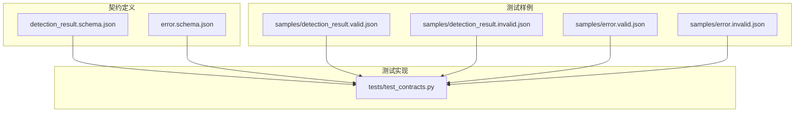
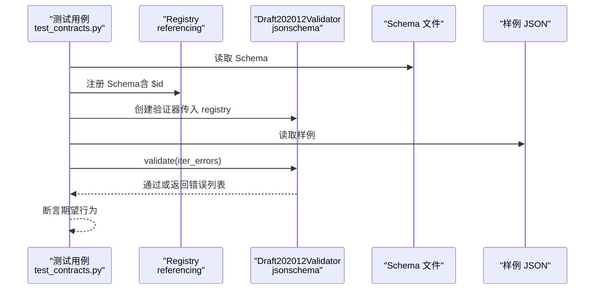
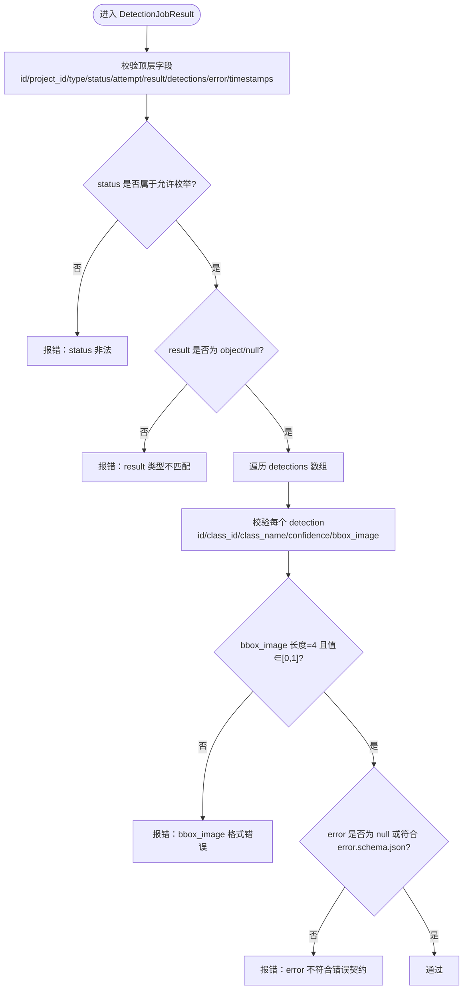
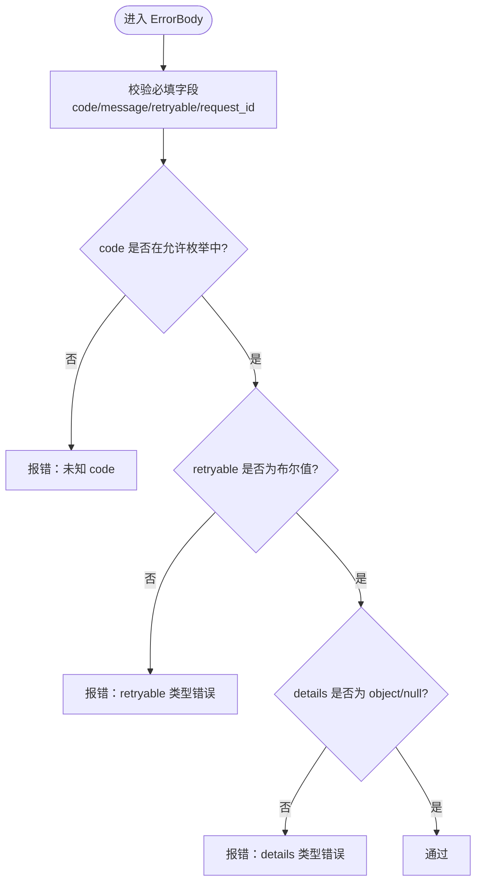
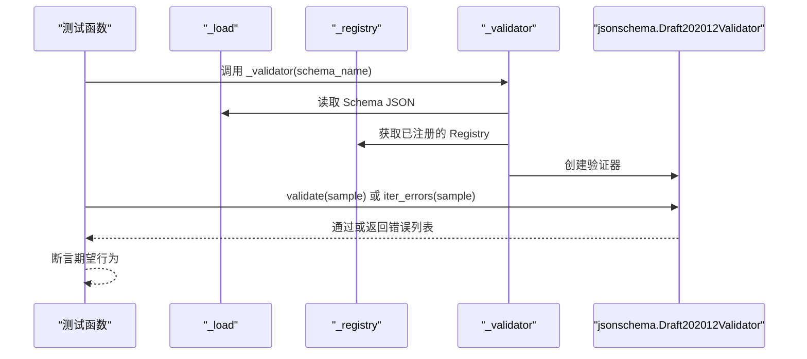
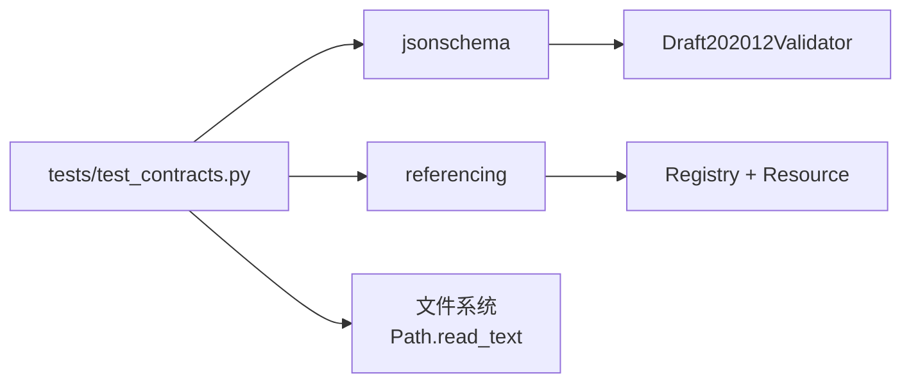

# 契约测试

<cite>
**本文引用的文件**   
- [test_contracts.py](file://tests/test_contracts.py)
- [detection_result.schema.json](file://contracts/detection_result.schema.json)
- [error.schema.json](file://contracts/error.schema.json)
- [detection_result.valid.json](file://contracts/samples/detection_result.valid.json)
- [detection_result.invalid.json](file://contracts/samples/detection_result.invalid.json)
- [error.valid.json](file://contracts/samples/error.valid.json)
- [error.invalid.json](file://contracts/samples/error.invalid.json)
- [README.md](file://contracts/README.md)
</cite>

## 目录
1. [引言](#引言)
2. [项目结构](#项目结构)
3. [核心组件](#核心组件)
4. [架构总览](#架构总览)
5. [详细组件分析](#详细组件分析)
6. [依赖关系分析](#依赖关系分析)
7. [性能考虑](#性能考虑)
8. [故障排查指南](#故障排查指南)
9. [结论](#结论)
10. [附录：最佳实践与扩展指南](#附录最佳实践与扩展指南)

## 引言
本文件面向 AstraDesk 的契约测试，重点解释 JSON Schema 验证在前后端契约稳定性中的作用，并围绕检测结果显示契约与错误响应契约的设计原理、测试实现、样例数据以及 jsonschema 库的使用进行系统化说明。目标是帮助开发者理解如何维护稳定的 API 契约、如何通过测试快速发现破坏性变更，以及如何安全地扩展新的契约类型。

## 项目结构
契约相关代码集中在 contracts 目录，测试位于 tests 目录。关键组织方式如下：
- contracts：存放 JSON Schema 定义与合法/非法样例
- tests：包含基于 jsonschema 的契约测试用例

**图表来源**
- [detection_result.schema.json:1-65](file://contracts/detection_result.schema.json#L1-L65)
- [error.schema.json:1-24](file://contracts/error.schema.json#L1-L24)
- [detection_result.valid.json:1-38](file://contracts/samples/detection_result.valid.json#L1-L38)
- [detection_result.invalid.json:1-16](file://contracts/samples/detection_result.invalid.json#L1-L16)
- [error.valid.json:1-8](file://contracts/samples/error.valid.json#L1-L8)
- [error.invalid.json:1-6](file://contracts/samples/error.invalid.json#L1-L6)
- [test_contracts.py:1-54](file://tests/test_contracts.py#L1-L54)

**章节来源**
- [README.md:1-10](file://contracts/README.md#L1-L10)

## 核心组件
- 契约 Schema 定义
  - detection_result.schema.json：描述检测任务查询结果的数据结构与约束
  - error.schema.json：描述统一错误对象的结构与枚举值限制
- 测试样例
  - samples/detection_result.valid.json 与 samples/detection_result.invalid.json
  - samples/error.valid.json 与 samples/error.invalid.json
- 测试实现
  - tests/test_contracts.py：使用 jsonschema 与 referencing.Registry 完成注册与验证

这些组件共同构成“契约稳定”的单一来源，确保前后端对数据结构的一致性理解。

**章节来源**
- [detection_result.schema.json:1-65](file://contracts/detection_result.schema.json#L1-L65)
- [error.schema.json:1-24](file://contracts/error.schema.json#L1-L24)
- [detection_result.valid.json:1-38](file://contracts/samples/detection_result.valid.json#L1-L38)
- [detection_result.invalid.json:1-16](file://contracts/samples/detection_result.invalid.json#L1-L16)
- [error.valid.json:1-8](file://contracts/samples/error.valid.json#L1-L8)
- [error.invalid.json:1-6](file://contracts/samples/error.invalid.json#L1-L6)
- [test_contracts.py:1-54](file://tests/test_contracts.py#L1-L54)

## 架构总览
契约测试的整体流程如下：
- 加载 Schema 与样例
- 通过 Registry 注册所有 Schema（支持跨 Schema 引用）
- 使用 Draft202012Validator 对样例进行验证
- 断言合法样例通过、非法样例被拒绝

**图表来源**
- [test_contracts.py:17-26](file://tests/test_contracts.py#L17-L26)
- [test_contracts.py:29-53](file://tests/test_contracts.py#L29-L53)
- [detection_result.schema.json:1-65](file://contracts/detection_result.schema.json#L1-L65)
- [error.schema.json:1-24](file://contracts/error.schema.json#L1-L24)

## 详细组件分析

### 检测结果显示契约（DetectionJobResult）
该契约用于 GET /api/v1/jobs/{id} 的结果结构，核心要点包括：
- 顶层字段约束
  - id、project_id：非空字符串
  - type：固定为 detect
  - status：限定枚举值（queued、running、succeeded、partial、failed、cancelled）
  - stage：可选字符串或 null
  - attempt：整数且至少为 1
  - result：对象或 null，包含模型、设备、耗时等元信息；run_mode 限 real/mock
  - detections：数组，每项引用内部定义 detection
  - error：null 或引用 error.schema.json
  - created_at、updated_at：可选时间字符串或 null
- 坐标约定
  - bbox_image：长度为 4 的数组，元素为 0-1 归一化数值，左上原点，x 向右 y 向下
- 嵌套定义
  - detection：包含 id、class_id、class_name、confidence（0-1 或 null）、bbox_image

**图表来源**
- [detection_result.schema.json:9-42](file://contracts/detection_result.schema.json#L9-L42)
- [detection_result.schema.json:44-62](file://contracts/detection_result.schema.json#L44-L62)

**章节来源**
- [detection_result.schema.json:1-65](file://contracts/detection_result.schema.json#L1-L65)

### 错误响应契约（ErrorBody）
该契约用于统一错误对象，核心要点包括：
- 必填字段
  - code：字符串，限定建议的错误码集合
  - message：字符串
  - retryable：布尔值
  - request_id：字符串
- 可选字段
  - details：对象或 null
- 错误码枚举
  - INVALID_IMAGE、TOO_MANY_OBJECTS、MODEL_UNAVAILABLE、SCHEMA_INVALID、NO_FEASIBLE_LAYOUT、STALE_REVISION、GENERATION_TIMEOUT、BUDGET_EXCEEDED、PROJECT_NOT_FOUND、ASSET_NOT_FOUND、JOB_NOT_FOUND、INTERNAL

**图表来源**
- [error.schema.json:6-22](file://contracts/error.schema.json#L6-L22)

**章节来源**
- [error.schema.json:1-24](file://contracts/error.schema.json#L1-L24)

### 测试实现（test_contracts.py）
测试模块的职责：
- 加载 Schema 与样例
- 构建 Registry 注册表，注册所有 Schema（支持跨 Schema 引用）
- 创建 Draft202012Validator 验证器
- 对合法样例执行 validate，断言不抛异常
- 对非法样例执行 iter_errors，断言存在错误并覆盖关键约束点

关键函数与流程：
- _load：从 contracts 目录读取 JSON
- _registry：加载 detection_result.schema.json 与 error.schema.json，并通过 referencing.Resource.from_contents 注册到 Registry
- _validator：根据 schema_name 加载 Schema，并使用 Draft202012Validator 创建验证器
- test_detection_result_valid_passes：验证合法检测结果为通过
- test_detection_result_invalid_rejected：验证非法检测结果被拒绝，并检查错误消息覆盖 status 枚举、confidence 范围、bbox_image 长度
- test_error_valid_passes：验证合法错误对象通过
- test_error_invalid_rejected：验证非法错误对象被拒绝，检查未知 code、缺失 request_id、retryable 类型错误

**图表来源**
- [test_contracts.py:13-26](file://tests/test_contracts.py#L13-L26)
- [test_contracts.py:29-53](file://tests/test_contracts.py#L29-L53)

**章节来源**
- [test_contracts.py:1-54](file://tests/test_contracts.py#L1-L54)

### 测试样例（samples 目录）
- detection_result.valid.json：提供合法的检测任务结果样例，包含有效的 status、confidence 范围、bbox_image 长度与值域、完整的 result 元信息等
- detection_result.invalid.json：提供非法的检测任务结果样例，故意违反 status 枚举、confidence 范围、bbox_image 长度等约束，以驱动错误路径
- error.valid.json：提供合法的错误对象样例，包含允许的 code、布尔型 retryable、存在的 request_id
- error.invalid.json：提供非法的错误对象样例，包含未知 code、缺失 request_id、错误的 retryable 类型

这些样例用于断言“合法样例通过、非法样例被拒”，并确保关键约束被测试覆盖。

**章节来源**
- [detection_result.valid.json:1-38](file://contracts/samples/detection_result.valid.json#L1-L38)
- [detection_result.invalid.json:1-16](file://contracts/samples/detection_result.invalid.json#L1-L16)
- [error.valid.json:1-8](file://contracts/samples/error.valid.json#L1-L8)
- [error.invalid.json:1-6](file://contracts/samples/error.invalid.json#L1-L6)

## 依赖关系分析
- jsonschema：提供 Draft202012Validator 与验证接口
- referencing：提供 Registry 与 Resource，用于跨 Schema 引用（如 detection_result.schema.json 引用 error.schema.json）
- pathlib/json：用于读取本地文件与解析 JSON

**图表来源**
- [test_contracts.py:4-8](file://tests/test_contracts.py#L4-L8)
- [test_contracts.py:17-26](file://tests/test_contracts.py#L17-L26)

**章节来源**
- [test_contracts.py:1-54](file://tests/test_contracts.py#L1-L54)

## 性能考虑
- 验证器创建开销：每次测试都创建新的 Draft202012Validator，适合小规模测试集；若测试规模扩大，可考虑复用验证器实例或缓存 Registry
- 样例数量增长：随着样例增多，iter_errors 的遍历成本线性增长；可通过分组测试减少重复初始化
- Schema 引用解析：Registry 一次性注册多个 Schema，避免重复解析，提升多次验证效率

[本节为通用指导，不涉及具体文件分析]

## 故障排查指南
常见问题与定位方法：
- 合法样例意外失败
  - 检查样例字段是否符合 Schema 的 required、type、enum、minimum/maximum 等约束
  - 确认 Registry 是否正确注册了所有 Schema（尤其是跨 Schema 引用）
- 非法样例未触发错误
  - 检查 invalid 样例是否确实违反了约束（例如 status 不在枚举、confidence 超出范围、bbox_image 长度不为 4）
  - 使用 iter_errors 收集错误消息，确认断言条件是否覆盖了关键错误点
- 跨 Schema 引用失败
  - 确认 error.schema.json 的 $id 与 detection_result.schema.json 中的引用一致
  - 检查 Registry.with_resources 是否正确将 Resource.from_contents 加入注册表

**章节来源**
- [test_contracts.py:29-53](file://tests/test_contracts.py#L29-L53)
- [detection_result.schema.json:34-38](file://contracts/detection_result.schema.json#L34-L38)
- [error.schema.json:1-24](file://contracts/error.schema.json#L1-L24)

## 结论
AstraDesk 的契约测试通过 JSON Schema 与 jsonschema 库实现了稳定的前后端数据契约保障。检测结果显示契约与错误响应契约分别定义了严格的数据结构与约束，配合合法/非法样例，确保 API 输出的一致性与可预测性。测试实现清晰、可维护，便于扩展新的契约类型与维护向后兼容性。

[本节为总结性内容，不涉及具体文件分析]

## 附录：最佳实践与扩展指南

### 添加新的契约类型
- 新增 Schema 文件
  - 在 contracts 目录下新增 .schema.json，明确 $id、$schema、title、description、type、required、properties、$defs 等
  - 如需引用其他 Schema，确保 $id 与引用路径一致
- 新增测试样例
  - 在 contracts/samples 下新增 *.valid.json 与 *.invalid.json
  - valid 样例应满足所有约束；invalid 样例应故意违反关键约束（枚举、类型、范围、长度等）
- 更新测试实现
  - 在 _registry 中注册新 Schema
  - 新增测试函数，分别断言合法样例通过、非法样例被拒绝
  - 使用 iter_errors 收集错误消息，确保覆盖关键约束点

**章节来源**
- [test_contracts.py:17-26](file://tests/test_contracts.py#L17-L26)
- [test_contracts.py:29-53](file://tests/test_contracts.py#L29-L53)

### 维护测试样例
- 保持样例与 Schema 同步更新
  - 当 Schema 增加新字段或修改约束时，及时更新 valid/invalid 样例
- 覆盖边界条件
  - 针对 minimum/maximum、enum、array length、nullable 等约束设计样例
- 错误消息断言
  - 使用 iter_errors 收集错误消息，断言关键错误点被检测到

**章节来源**
- [detection_result.invalid.json:1-16](file://contracts/samples/detection_result.invalid.json#L1-L16)
- [error.invalid.json:1-6](file://contracts/samples/error.invalid.json#L1-L6)
- [test_contracts.py:35-53](file://tests/test_contracts.py#L35-L53)

### 向后兼容性测试
- 保留历史有效样例
  - 在 samples 目录中保留历史版本的 valid 样例，确保旧数据仍能被新 Schema 接受
- 谨慎放宽约束
  - 仅在必要时放宽约束（例如将 enum 改为更宽泛的类型），并补充 invalid 样例防止误用
- 回归测试
  - 运行全部契约测试，确保新增变更不会破坏既有契约

[本节为通用指导，不涉及具体文件分析]