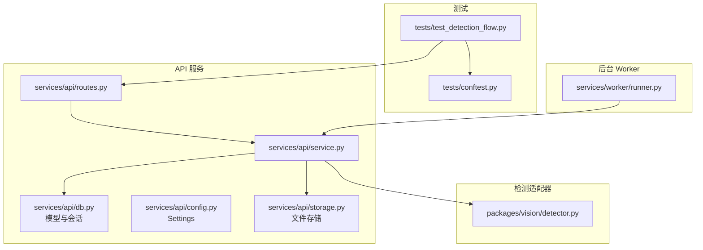
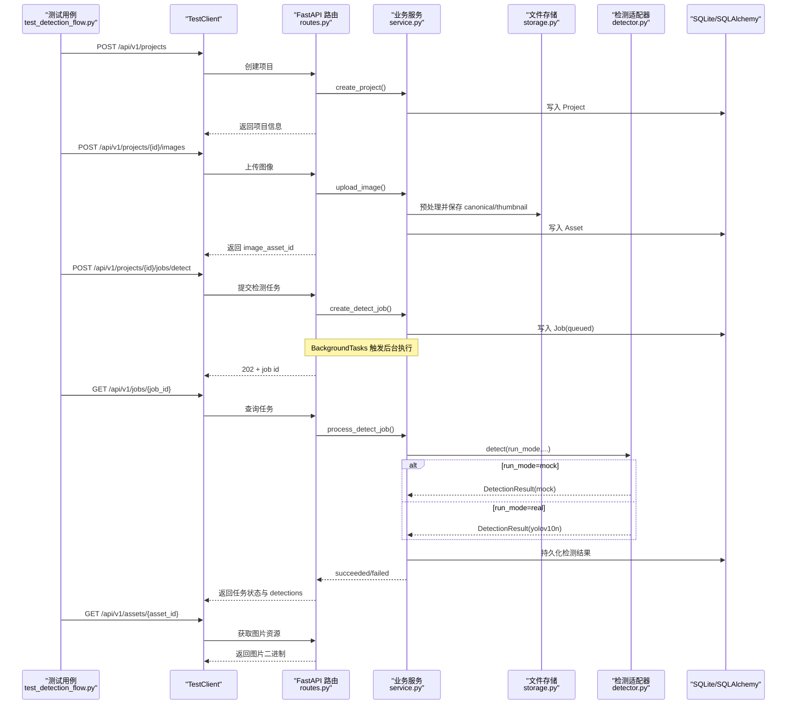
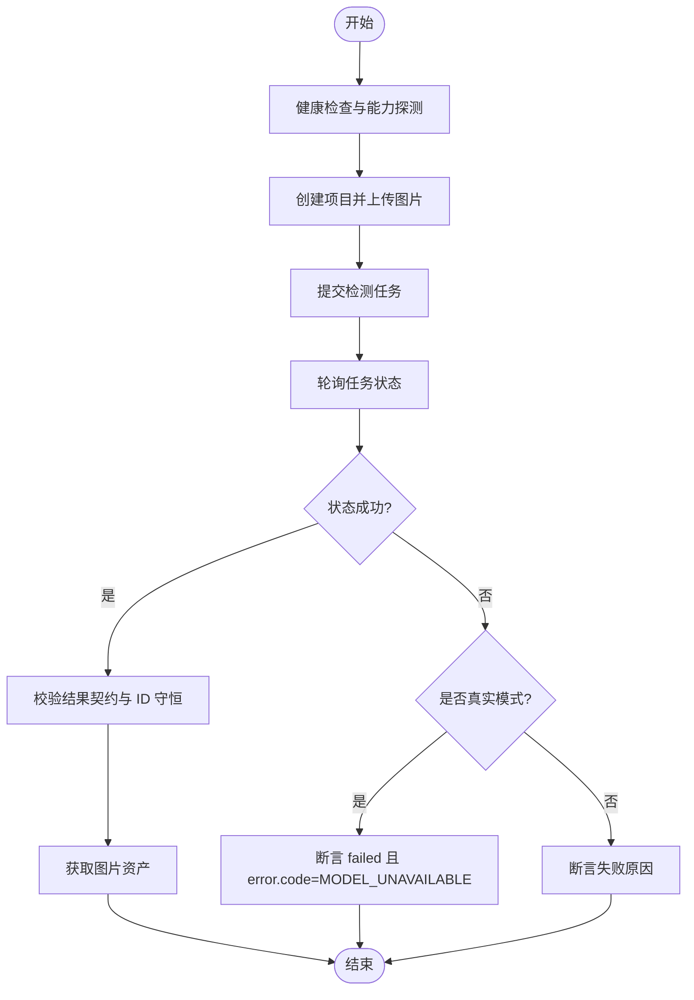
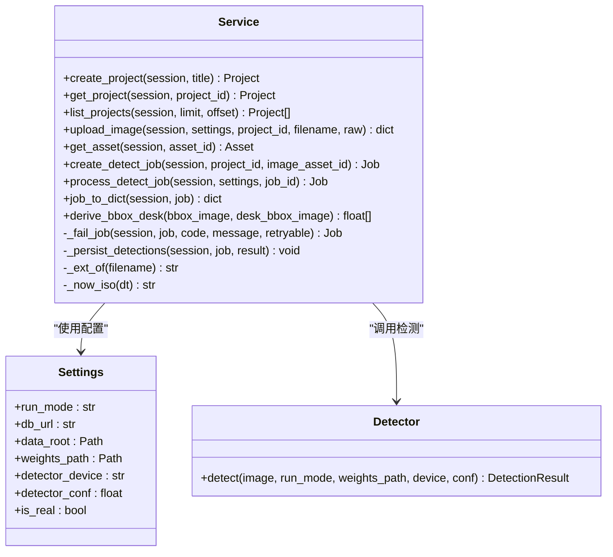
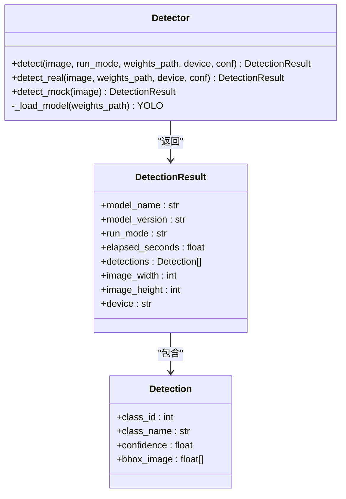
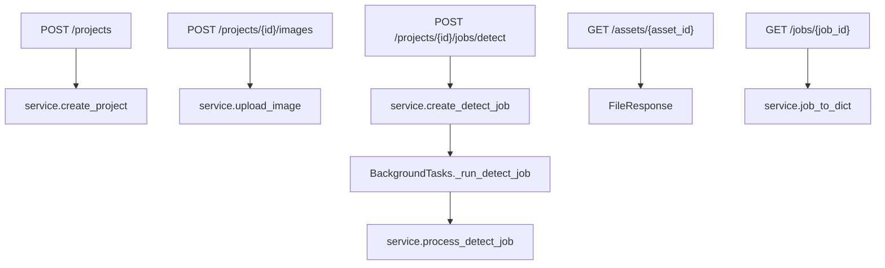
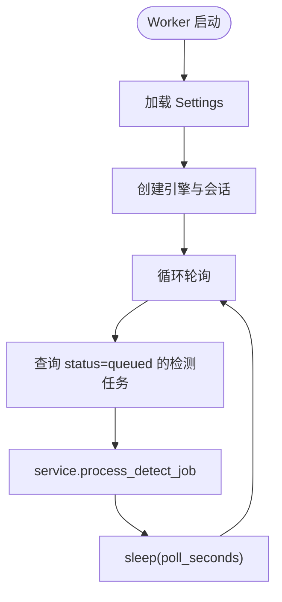
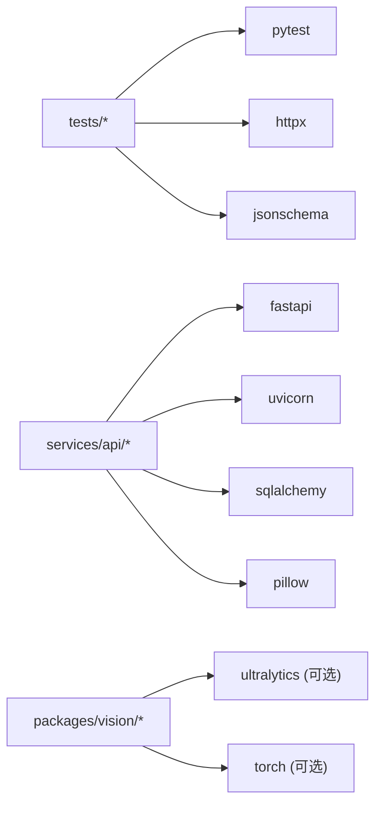

# 检测流程测试

<cite>
**本文引用的文件**   
- [test_detection_flow.py](file://tests/test_detection_flow.py)
- [conftest.py](file://tests/conftest.py)
- [service.py](file://services/api/service.py)
- [routes.py](file://services/api/routes.py)
- [runner.py](file://services/worker/runner.py)
- [detector.py](file://packages/vision/detector.py)
- [README.md](file://README.md)
- [pyproject.toml](file://pyproject.toml)
</cite>

## 目录
1. [引言](#引言)
2. [项目结构](#项目结构)
3. [核心组件](#核心组件)
4. [架构总览](#架构总览)
5. [详细组件分析](#详细组件分析)
6. [依赖关系分析](#依赖关系分析)
7. [性能与扩展指南](#性能与扩展指南)
8. [故障排查](#故障排查)
9. [结论](#结论)

## 引言
本文面向 AstraDesk 的“桌面识别端到端检测流程”测试，目标是帮助读者理解从图像上传、任务调度、真实或 Mock 检测执行，到结果查询与可视化的完整测试策略。文档重点覆盖：
- 端到端测试场景设计（mock 模式、真实 YOLOv10 集成、异步任务状态流转）
- 服务层业务逻辑测试（项目创建、图像处理、任务调度、结果存储）
- 检测器测试策略（MockDetector、YOLODetector 集成、异常处理与错误恢复）
- 测试环境搭建（数据库初始化、文件存储模拟、外部依赖隔离）
- 扩展指南（新增检测算法适配、性能基准与压力测试）
- 常见问题与优化建议

## 项目结构
AstraDesk 后端采用 FastAPI 路由 + 应用服务 + 仓储模型的分层结构；检测能力通过 packages/vision 提供统一接口；测试位于 tests 目录，使用 pytest 与 httpx TestClient 进行端到端验证。

**图表来源**
- [test_detection_flow.py:1-126](file://tests/test_detection_flow.py#L1-L126)
- [conftest.py:1-58](file://tests/conftest.py#L1-L58)
- [routes.py:1-143](file://services/api/routes.py#L1-L143)
- [service.py:1-237](file://services/api/service.py#L1-L237)
- [detector.py:1-129](file://packages/vision/detector.py#L1-L129)
- [runner.py:1-43](file://services/worker/runner.py#L1-L43)

**章节来源**
- [README.md:8-24](file://README.md#L8-L24)
- [pyproject.toml:1-37](file://pyproject.toml#L1-L37)

## 核心组件
- 端到端测试入口：tests/test_detection_flow.py
- 测试夹具与环境：tests/conftest.py
- API 路由层：services/api/routes.py
- 业务服务层：services/api/service.py
- 检测适配器：packages/vision/detector.py
- 后台任务轮询：services/worker/runner.py

这些组件共同构成“上传 → 建任务 → 异步检测 → 查询结果”的闭环，并通过 JSON Schema 契约校验确保输出一致性。

**章节来源**
- [test_detection_flow.py:1-126](file://tests/test_detection_flow.py#L1-L126)
- [conftest.py:1-58](file://tests/conftest.py#L1-L58)
- [routes.py:1-143](file://services/api/routes.py#L1-L143)
- [service.py:1-237](file://services/api/service.py#L1-L237)
- [detector.py:1-129](file://packages/vision/detector.py#L1-L129)
- [runner.py:1-43](file://services/worker/runner.py#L1-L43)

## 架构总览
下图展示端到端检测流程在测试中的调用链与数据流向：

**图表来源**
- [routes.py:100-143](file://services/api/routes.py#L100-L143)
- [service.py:73-179](file://services/api/service.py#L73-L179)
- [detector.py:68-129](file://packages/vision/detector.py#L68-L129)
- [test_detection_flow.py:29-126](file://tests/test_detection_flow.py#L29-L126)

## 详细组件分析

### 端到端测试：test_detection_flow.py
该文件定义了完整的桌面识别端到端测试场景，覆盖健康检查、能力探测、Mock 模式全流程、资产访问、非法输入拒绝、以及真实模式下权重缺失的错误路径。

关键测试点：
- 健康检查与能力接口：验证运行模式为 mock，检测器名称为 mock-detector，features 包含 detect。
- Mock 模式检测流程：
  - 创建项目 → 上传图片 → 获得 image_asset_id
  - 提交检测任务 → 轮询任务状态至 succeeded
  - 校验结果契约（JSON Schema G1）
  - 同一任务多次查询 detection id 守恒（H01）
- 资产访问：验证图片可被正确读取且 content-type 合法。
- 非法输入拒绝：
  - 伪装非图像内容 → 400 INVALID_IMAGE
  - 不支持的文件类型 → 415 INVALID_IMAGE
- 真实模式权重缺失：
  - capabilities 中 detector.available=False
  - 检测任务失败，error.code=MODEL_UNAVAILABLE，detections 为空，不静默回退 mock

**图表来源**
- [test_detection_flow.py:46-126](file://tests/test_detection_flow.py#L46-L126)

**章节来源**
- [test_detection_flow.py:1-126](file://tests/test_detection_flow.py#L1-L126)

### 服务层业务逻辑：service.py
service.py 承担核心业务规则，包括项目 CRUD、图像上传与预处理、检测任务创建与执行、结果持久化与查询装配。

重点功能与测试关注点：
- 项目创建与查询：
  - create_project：生成唯一 id，默认标题
  - get_project/list_projects：软删除过滤、分页排序
- 图像上传：
  - upload_image：校验扩展名、空文件、尺寸/大小限制；预处理后存储 canonical 与 thumbnail；记录宽高与 sha256
  - 错误映射：PreprocessError 映射为 ApiError（413/400）
- 检测任务：
  - create_detect_job：校验项目与资产归属，新建 Job(queued)
  - process_detect_job：状态机 queued→running→succeeded/failed；真实模式不可用时报 MODEL_UNAVAILABLE；终态幂等保护
  - _persist_detections：对象级 id 稳定（H01），清空旧结果后批量写入
  - job_to_dict：组装 detections、result、error、时间戳
- 坐标转换：
  - derive_bbox_desk：将图像坐标转换为桌面坐标，非法坐标抛出 ApiError(422)

**图表来源**
- [service.py:46-237](file://services/api/service.py#L46-L237)
- [detector.py:124-129](file://packages/vision/detector.py#L124-L129)

**章节来源**
- [service.py:1-237](file://services/api/service.py#L1-L237)

### 检测器适配器：detector.py
detector.py 提供统一的检测入口，支持 real 与 mock 两种运行模式：
- detect_real：基于 ultralytics YOLOv10，懒加载模型，缺依赖或权重抛 DetectorUnavailable；归一化坐标输出
- detect_mock：确定性 Mock，固定两个检测框（laptop、mouse），标注 run_mode=mock
- detect：按 run_mode 分派

**图表来源**
- [detector.py:22-129](file://packages/vision/detector.py#L22-L129)

**章节来源**
- [detector.py:1-129](file://packages/vision/detector.py#L1-L129)

### API 路由层：routes.py
路由层负责协议处理与请求分发，业务逻辑下沉到 service.py：
- 健康检查与健康能力：capabilities 探测真实检测可用性
- 项目与资产：创建、列表、详情、图片资源下载
- 检测任务：POST 创建任务（202），BackgroundTasks 触发后台执行；GET 查询任务状态

**图表来源**
- [routes.py:46-143](file://services/api/routes.py#L46-L143)

**章节来源**
- [routes.py:1-143](file://services/api/routes.py#L1-L143)

### 后台任务轮询：runner.py
runner.py 提供独立 worker 的轮询执行入口，当前最小实现仅轮询 queued 任务并调用 service.process_detect_job。T02 下 API 已通过 BackgroundTasks 执行检测，worker 作为解耦运行入口保留。

**图表来源**
- [runner.py:16-43](file://services/worker/runner.py#L16-L43)

**章节来源**
- [runner.py:1-43](file://services/worker/runner.py#L1-L43)

## 依赖关系分析
- 测试依赖：pytest、httpx、jsonschema
- 运行时依赖：fastapi、uvicorn、sqlalchemy、pillow、python-multipart
- 可选依赖：torch、ultralytics（真实检测）

**图表来源**
- [pyproject.toml:1-37](file://pyproject.toml#L1-L37)

**章节来源**
- [pyproject.toml:1-37](file://pyproject.toml#L1-L37)

## 性能与扩展指南

### 新增检测算法的测试适配
- 在 detector.py 中新增 detect_xxx 函数，并在 detect 入口根据 run_mode 或新标志位分派
- 保持 Detection/DetectionResult 数据结构不变，确保 service.py 与 routes.py 无需改动
- 在 conftest.py 中增加对应 fixture（如 x_detector_client），设置环境变量或 Settings.run_mode
- 在 test_detection_flow.py 中新增测试场景：
  - 能力探测：capabilities.detector.model_name/version 正确
  - 契约校验：结果符合 detection_result.schema.json
  - 异常路径：不可用时报错且不静默回退 mock

### 性能基准测试
- 针对 detect_real 增加耗时统计（已内置 elapsed_seconds），可在测试中断言阈值
- 使用不同分辨率与数量样本，评估吞吐与延迟
- 对比 mock 与 real 模式的差异，确保基准回归

### 压力测试场景设计
- 并发上传与检测：多客户端同时 POST images 与 jobs/detect，观察队列堆积与状态一致性
- 大文件与高分辨率：验证 413 错误路径与内存占用
- 长尾任务：长时间 running 的任务中断恢复（结合 worker 心跳/租约，后续迭代）

[本节为通用指导，不直接分析具体文件]

## 故障排查

常见错误与定位方法：
- 415 INVALID_IMAGE：文件扩展名不在支持集合（jpg/jpeg/png）
  - 检查上传文件名与 Content-Type
  - 参考 [service.py:37-41](file://services/api/service.py#L37-L41)
- 400 INVALID_IMAGE：空文件或预处理失败（尺寸/像素超限）
  - 检查文件大小与分辨率
  - 参考 [service.py:78-85](file://services/api/service.py#L78-L85)
- 413 过大文件：PreprocessError 映射为 413
  - 调整输入或服务端限制
  - 参考 [service.py:81-85](file://services/api/service.py#L81-L85)
- MODEL_UNAVAILABLE：真实模式缺少 ultralytics 或权重文件
  - 确认 ASTRADESK_RUN_MODE=real 时设置了 ASTRADESK_YOLO_WEIGHTS 且文件存在
  - 参考 [detector.py:50-65](file://packages/vision/detector.py#L50-L65)
- JOB_NOT_FOUND/ASSET_NOT_FOUND：ID 不存在或不属于项目
  - 检查前端传递的 job_id/image_asset_id/project_id
  - 参考 [service.py:120-129](file://services/api/service.py#L120-L129)、[service.py:149-157](file://services/api/service.py#L149-L157)
- 422 坐标非法：derive_bbox_desk 抛出 CoordinateError
  - 检查 bbox_image 与 desk_bbox_image 合法性
  - 参考 [service.py:231-237](file://services/api/service.py#L231-L237)

**章节来源**
- [service.py:37-41](file://services/api/service.py#L37-L41)
- [service.py:78-85](file://services/api/service.py#L78-L85)
- [service.py:120-129](file://services/api/service.py#L120-L129)
- [service.py:149-157](file://services/api/service.py#L149-L157)
- [service.py:231-237](file://services/api/service.py#L231-L237)
- [detector.py:50-65](file://packages/vision/detector.py#L50-L65)

## 结论
AstraDesk 的检测流程端到端测试以 test_detection_flow.py 为核心，结合 conftest.py 提供的隔离环境，覆盖了从图像上传、任务调度、检测执行到结果查询的全链路。service.py 明确划分了业务规则与错误处理，detector.py 提供了统一检测入口与明确的运行模式语义。通过 JSON Schema 契约校验与能力探测，确保了输出一致性与环境透明性。未来可扩展新的检测算法并保持向后兼容，同时引入性能基准与压力测试以提升系统稳定性与可观测性。