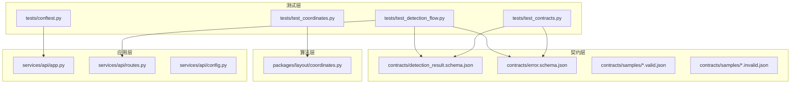
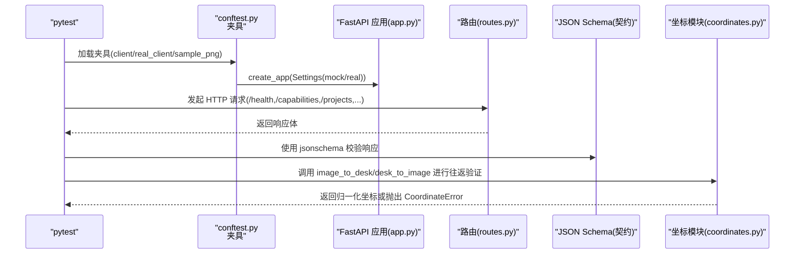
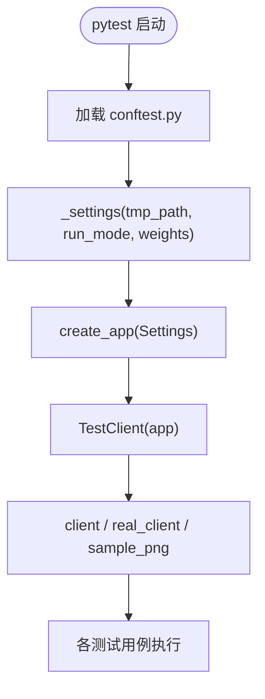
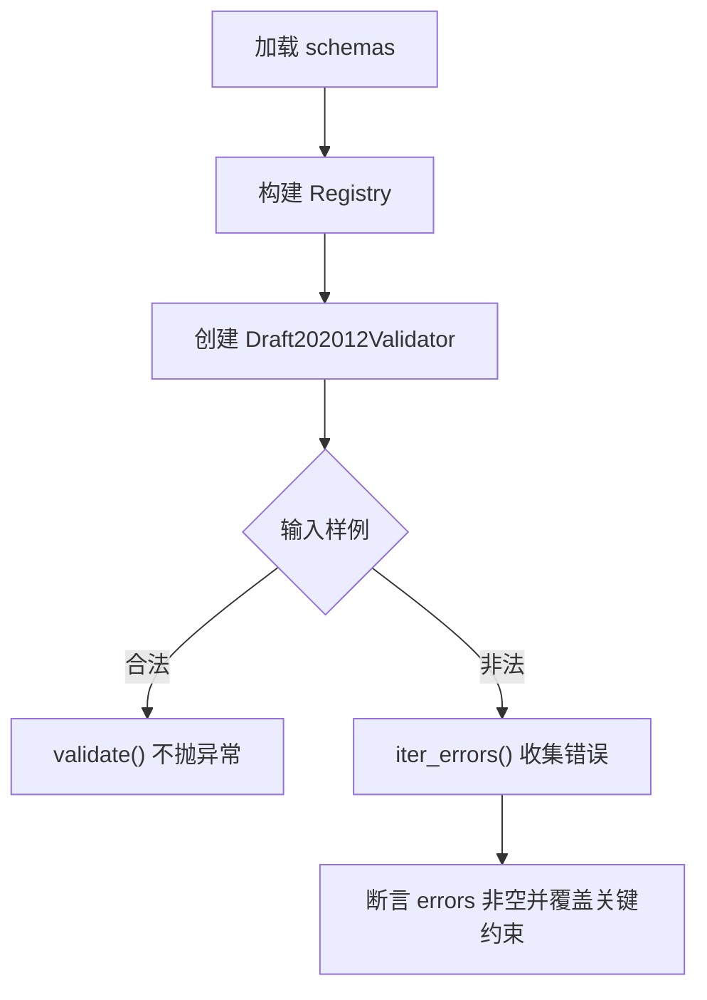
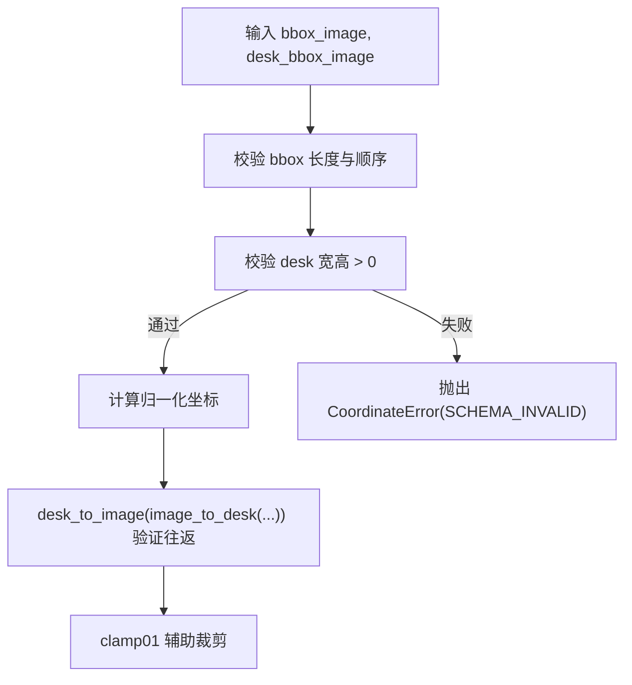
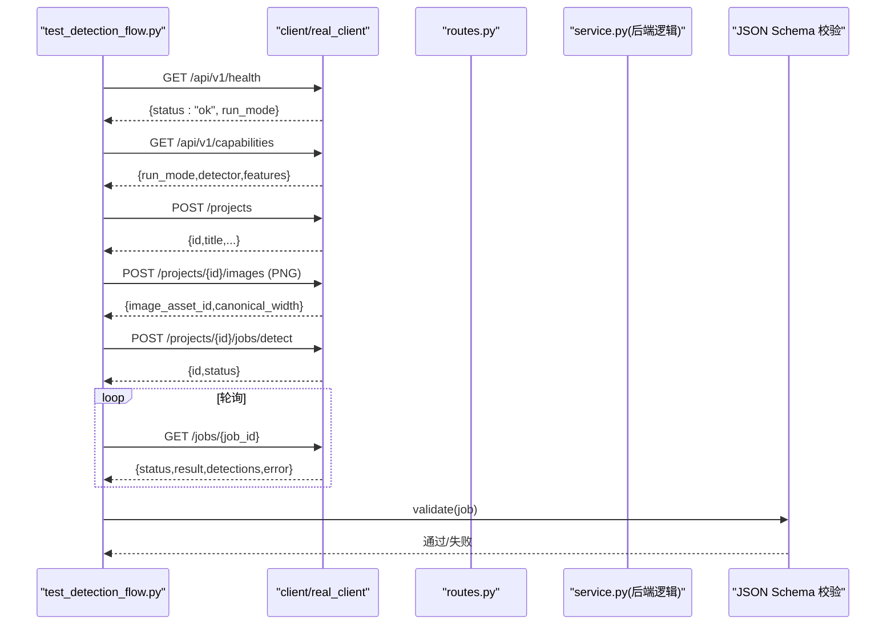
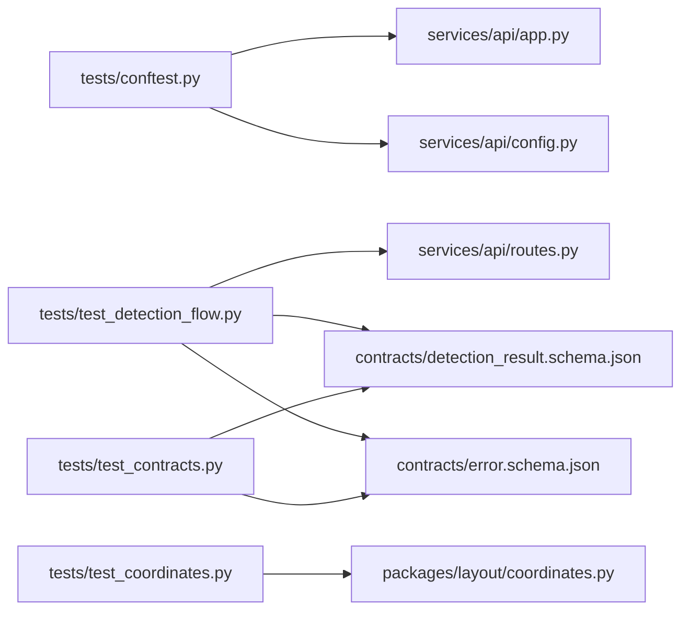

# 测试策略

<cite>
**本文引用的文件**   
- [pyproject.toml](file://pyproject.toml)
- [conftest.py](file://tests/conftest.py)
- [test_contracts.py](file://tests/test_contracts.py)
- [test_coordinates.py](file://tests/test_coordinates.py)
- [test_detection_flow.py](file://tests/test_detection_flow.py)
- [detection_result.schema.json](file://contracts/detection_result.schema.json)
- [error.schema.json](file://contracts/error.schema.json)
- [detection_result.valid.json](file://contracts/samples/detection_result.valid.json)
- [detection_result.invalid.json](file://contracts/samples/detection_result.invalid.json)
- [error.valid.json](file://contracts/samples/error.valid.json)
- [error.invalid.json](file://contracts/samples/error.invalid.json)
- [app.py](file://services/api/app.py)
- [config.py](file://services/api/config.py)
- [routes.py](file://services/api/routes.py)
- [coordinates.py](file://packages/layout/coordinates.py)
</cite>

## 目录
1. [引言](#引言)
2. [项目结构](#项目结构)
3. [核心组件](#核心组件)
4. [架构总览](#架构总览)
5. [详细组件分析](#详细组件分析)
6. [依赖关系分析](#依赖关系分析)
7. [性能考虑](#性能考虑)
8. [故障排查指南](#故障排查指南)
9. [结论](#结论)
10. [附录](#附录)

## 引言
本文件为 AstraDesk 的测试策略文档，围绕 pytest 框架配置、契约测试、坐标转换测试与端到端检测流程测试展开，覆盖夹具设计、数据组织、覆盖率要求、持续集成建议、最佳实践与调试方法。目标是在无 GPU 环境下也能稳定运行全部测试，并通过 JSON Schema 保证 API 响应格式一致性。

## 项目结构
测试相关代码集中在 tests 目录，契约定义在 contracts 目录，被测服务位于 services.api，坐标转换逻辑位于 packages.layout.coordinates。pytest 通过 pyproject.toml 启用，默认仅输出简要结果。

**图表来源**
- [conftest.py:1-58](file://tests/conftest.py#L1-L58)
- [test_contracts.py:1-54](file://tests/test_contracts.py#L1-L54)
- [test_coordinates.py:1-48](file://tests/test_coordinates.py#L1-L48)
- [test_detection_flow.py:1-126](file://tests/test_detection_flow.py#L1-L126)
- [detection_result.schema.json:1-65](file://contracts/detection_result.schema.json#L1-L65)
- [error.schema.json:1-24](file://contracts/error.schema.json#L1-L24)
- [app.py:1-48](file://services/api/app.py#L1-L48)
- [routes.py:1-143](file://services/api/routes.py#L1-L143)
- [config.py:1-61](file://services/api/config.py#L1-L61)
- [coordinates.py:1-63](file://packages/layout/coordinates.py#L1-L63)

**章节来源**
- [pyproject.toml:34-37](file://pyproject.toml#L34-L37)

## 核心组件
- pytest 配置：通过 pyproject.toml 指定测试路径与选项，便于直接运行 pytest。
- 共享夹具：conftest.py 提供 client、real_client、sample_png 等夹具，隔离临时数据目录与数据库，支持 mock 与 real 模式。
- 契约测试：基于 jsonschema + referencing 校验 detection_result 与 error 两类响应，确保合法样例通过、非法样例被拒。
- 坐标转换测试：验证 image_to_desk / desk_to_image 往返一致性与边界条件，并断言错误码。
- 端到端流程测试：以 TestClient 驱动 FastAPI 应用，覆盖健康检查、能力查询、上传、异步检测、资产返回、异常拒绝与 real 模式权重缺失场景。

**章节来源**
- [pyproject.toml:19-21](file://pyproject.toml#L19-L21)
- [pyproject.toml:34-37](file://pyproject.toml#L34-L37)
- [conftest.py:1-58](file://tests/conftest.py#L1-L58)
- [test_contracts.py:1-54](file://tests/test_contracts.py#L1-L54)
- [test_coordinates.py:1-48](file://tests/test_coordinates.py#L1-L48)
- [test_detection_flow.py:1-126](file://tests/test_detection_flow.py#L1-L126)

## 架构总览
下图展示测试如何驱动应用与契约校验：

**图表来源**
- [conftest.py:21-47](file://tests/conftest.py#L21-L47)
- [app.py:24-44](file://services/api/app.py#L24-L44)
- [routes.py:46-65](file://services/api/routes.py#L46-L65)
- [routes.py:100-142](file://services/api/routes.py#L100-L142)
- [test_contracts.py:17-26](file://tests/test_contracts.py#L17-L26)
- [test_coordinates.py:6-11](file://tests/test_coordinates.py#L6-L11)

## 详细组件分析

### pytest 配置与夹具设计
- 配置要点
  - 测试路径：tests
  - 可选依赖：pytest、httpx、jsonschema
  - 启动参数：-q（简洁输出）
- 夹具职责
  - client：构造 mock 模式的 FastAPI TestClient，使用临时 data_root 与 sqlite 数据库，避免污染宿主环境。
  - real_client：构造 real 模式但权重缺失的应用，用于验证 MODEL_UNAVAILABLE 行为且不静默回退到 mock。
  - sample_png：生成固定尺寸的 PNG 字节流，用于上传与资产读取测试。
- 设置装配
  - Settings 包含 run_mode、db_url、data_root、weights_path、detector_device、detector_conf；测试通过 _settings 注入临时路径与权重占位。

**图表来源**
- [conftest.py:21-47](file://tests/conftest.py#L21-L47)
- [app.py:24-44](file://services/api/app.py#L24-L44)
- [config.py:20-60](file://services/api/config.py#L20-L60)

**章节来源**
- [pyproject.toml:19-21](file://pyproject.toml#L19-L21)
- [pyproject.toml:34-37](file://pyproject.toml#L34-L37)
- [conftest.py:1-58](file://tests/conftest.py#L1-L58)
- [config.py:20-60](file://services/api/config.py#L20-L60)

### 契约测试（JSON Schema 验证）
- 目标
  - 合法样例通过：detection_result.valid.json、error.valid.json
  - 非法样例被拒：detection_result.invalid.json、error.invalid.json
- 实现要点
  - 使用 Draft202012Validator 与 referencing.Registry 注册本地 schema 引用。
  - 对非法样例至少断言存在错误，并覆盖关键字段约束（如 status 枚举、confidence 范围、bbox 长度）。
- 关键约束
  - detection_result：status 枚举、result.run_mode、detections 数组项字段、bbox_image 归一化范围。
  - error：code 枚举、message、retryable、request_id 必填。

**图表来源**
- [test_contracts.py:17-26](file://tests/test_contracts.py#L17-L26)
- [detection_result.schema.json:1-65](file://contracts/detection_result.schema.json#L1-L65)
- [error.schema.json:1-24](file://contracts/error.schema.json#L1-L24)

**章节来源**
- [test_contracts.py:1-54](file://tests/test_contracts.py#L1-L54)
- [detection_result.schema.json:1-65](file://contracts/detection_result.schema.json#L1-L65)
- [error.schema.json:1-24](file://contracts/error.schema.json#L1-L24)
- [detection_result.valid.json:1-38](file://contracts/samples/detection_result.valid.json#L1-L38)
- [detection_result.invalid.json:1-16](file://contracts/samples/detection_result.invalid.json#L1-L16)
- [error.valid.json:1-8](file://contracts/samples/error.valid.json#L1-L8)
- [error.invalid.json:1-6](file://contracts/samples/error.invalid.json#L1-L6)

### 坐标转换测试
- 目标
  - 往返一致性：image_to_desk 与 desk_to_image 互为逆运算。
  - 边界条件：桌面退化、bbox 长度不足、x2<x1 等非法输入应抛出 CoordinateError。
  - 越界处理：对象超出桌面时转换保留负值，由上层负责裁剪与校验；clamp01 用于辅助裁剪。
- 关键点
  - 使用 pytest.approx 容忍浮点误差。
  - 断言错误码 SCHEMA_INVALID。

**图表来源**
- [coordinates.py:26-63](file://packages/layout/coordinates.py#L26-L63)
- [test_coordinates.py:14-48](file://tests/test_coordinates.py#L14-L48)

**章节来源**
- [coordinates.py:1-63](file://packages/layout/coordinates.py#L1-L63)
- [test_coordinates.py:1-48](file://tests/test_coordinates.py#L1-L48)

### 端到端检测流程测试
- 目标
  - 在 mock 模式下跑通完整流程：创建项目 → 上传图片 → 提交检测任务 → 轮询任务状态 → 获取检测结果。
  - 契约一致性：检测结果需通过 detection_result.schema.json 校验。
  - ID 守恒：同一任务多次查询，detection id 列表不变且唯一（接口层体现 H01）。
  - 异常场景：伪装图像、不支持扩展名应被拒绝；real 模式权重缺失应报 MODEL_UNAVAILABLE 且不静默回退 mock。
- 关键步骤
  - 健康检查与能力查询：确认 run_mode 与 detector 能力。
  - 上传与资产返回：验证 canonical_width、content-type 与二进制内容。
  - 异步任务：后台任务完成后轮询 job 状态，断言 result.run_mode 与 detections 数量。
  - 错误处理：统一错误对象含 request_id，错误码符合 error.schema.json。

**图表来源**
- [test_detection_flow.py:29-43](file://tests/test_detection_flow.py#L29-L43)
- [test_detection_flow.py:46-126](file://tests/test_detection_flow.py#L46-L126)
- [routes.py:46-65](file://services/api/routes.py#L46-L65)
- [routes.py:100-142](file://services/api/routes.py#L100-L142)

**章节来源**
- [test_detection_flow.py:1-126](file://tests/test_detection_flow.py#L1-L126)
- [routes.py:46-65](file://services/api/routes.py#L46-L65)
- [routes.py:100-142](file://services/api/routes.py#L100-L142)

## 依赖关系分析
- 测试与应用的耦合
  - conftest.py 依赖 services.api.app.create_app 与 services.api.config.Settings，用于构造不同运行模式的 TestClient。
  - test_detection_flow.py 依赖 routes.py 暴露的 REST 接口与 JSON Schema 契约。
  - test_contracts.py 与 test_coordinates.py 分别依赖 contracts 与 packages.layout.coordinates，属于纯函数/数据契约测试，低耦合。
- 外部依赖
  - fastapi.testclient.TestClient 用于无网络 HTTP 测试。
  - jsonschema + referencing 用于契约校验。
  - Pillow 用于生成测试图片。

**图表来源**
- [conftest.py:15-18](file://tests/conftest.py#L15-L18)
- [test_detection_flow.py:14-16](file://tests/test_detection_flow.py#L14-L16)
- [test_contracts.py:7-8](file://tests/test_contracts.py#L7-L8)
- [test_coordinates.py:6-11](file://tests/test_coordinates.py#L6-L11)

**章节来源**
- [conftest.py:1-58](file://tests/conftest.py#L1-L58)
- [test_detection_flow.py:1-126](file://tests/test_detection_flow.py#L1-L126)
- [test_contracts.py:1-54](file://tests/test_contracts.py#L1-L54)
- [test_coordinates.py:1-48](file://tests/test_coordinates.py#L1-L48)

## 性能考虑
- 基准测试建议
  - 对检测任务耗时增加轻量级计时断言（例如在 mock 模式下期望极低延迟），可作为回归基线。
  - 对坐标转换函数进行批量输入的性能采样，确保无显著退化。
- 资源隔离
  - 所有测试使用 tmp_path 作为 data_root，避免磁盘 I/O 竞争。
  - SQLite 内存或临时文件数据库减少锁竞争。
- 并发与异步
  - 使用 TestClient 同步访问异步路由，避免额外线程开销。
  - 轮询任务时使用有限重试次数，防止测试长时间阻塞。

[本节为通用指导，不涉及具体文件分析]

## 故障排查指南
- 常见问题
  - 权重缺失导致 real 模式失败：确认 real_client 夹具传入的权重路径不存在，断言 error.code == "MODEL_UNAVAILABLE" 且 detections 为空。
  - 非法图像被拒：断言响应 code 为 "INVALID_IMAGE" 且包含 request_id。
  - 坐标转换报错：CoordinateError.code 应为 "SCHEMA_INVALID"，检查输入 bbox 长度与顺序。
- 调试技巧
  - 打印中间响应体与 job 状态，定位是上传、任务创建还是轮询阶段失败。
  - 使用 jsonschema.iter_errors 收集所有错误信息，快速定位字段问题。
  - 在 conftest.py 中调整 _settings 的参数（如 detector_conf、run_mode）复现特定分支。

**章节来源**
- [test_detection_flow.py:91-126](file://tests/test_detection_flow.py#L91-L126)
- [test_coordinates.py:31-48](file://tests/test_coordinates.py#L31-L48)
- [coordinates.py:17-23](file://packages/layout/coordinates.py#L17-L23)

## 结论
AstraDesk 的测试体系以 pytest 为核心，结合 JSON Schema 契约校验与端到端流程测试，在保证 API 格式一致性的同时，覆盖了坐标转换的正确性、异常场景与 real 模式行为。通过 conftest.py 的夹具设计与临时数据隔离，测试具备高可重复性与稳定性。建议在后续迭代中补充性能基准与覆盖率统计，以进一步提升质量保障能力。

[本节为总结性内容，不涉及具体文件分析]

## 附录

### 测试目录结构与职责
- tests/conftest.py：共享夹具与测试应用装配。
- tests/test_contracts.py：契约样例校验。
- tests/test_coordinates.py：坐标转换单元测试。
- tests/test_detection_flow.py：端到端流程测试。

**章节来源**
- [conftest.py:1-58](file://tests/conftest.py#L1-L58)
- [test_contracts.py:1-54](file://tests/test_contracts.py#L1-L54)
- [test_coordinates.py:1-48](file://tests/test_coordinates.py#L1-L48)
- [test_detection_flow.py:1-126](file://tests/test_detection_flow.py#L1-L126)

### 测试数据与模拟对象管理
- 契约样例：contracts/samples 下的 valid/invalid 文件，配合 schema 进行双向校验。
- 模拟图片：conftest.py 中的 png_bytes 与 sample_png 夹具，提供固定尺寸 PNG 字节流。
- 临时数据：tmp_path 作为 data_root 与 db_url，确保每次测试独立环境。

**章节来源**
- [detection_result.valid.json:1-38](file://contracts/samples/detection_result.valid.json#L1-L38)
- [detection_result.invalid.json:1-16](file://contracts/samples/detection_result.invalid.json#L1-L16)
- [error.valid.json:1-8](file://contracts/samples/error.valid.json#L1-L8)
- [error.invalid.json:1-6](file://contracts/samples/error.invalid.json#L1-L6)
- [conftest.py:49-57](file://tests/conftest.py#L49-L57)

### 测试覆盖率与持续集成建议
- 覆盖率采集
  - 使用 pytest-cov 插件，分别统计单元测试（coordinates、contracts）与集成测试（detection flow）的覆盖率。
  - 设定阈值：单元测试 ≥ 90%，集成测试 ≥ 80%。
- 持续集成
  - 在 CI 中安装 dev 依赖（pytest、httpx、jsonschema），运行 pytest -q --cov=packages --cov=services --cov-report=term-missing。
  - 缓存第三方依赖加速构建，隔离环境变量（ASTRADESK_RUN_MODE=mock）。

[本节为通用指导，不涉及具体文件分析]

### 测试最佳实践
- 命名规范
  - 测试函数以 test_ 开头，描述业务意图（如 test_roundtrip_full_desk、test_detect_flow_mock）。
- 断言策略
  - 优先断言业务语义（状态码、错误码、字段存在性），再断言数值精度（pytest.approx）。
- 异步测试处理
  - 使用 TestClient 同步访问异步路由；轮询任务时使用有限重试次数，避免超时。
- 环境隔离
  - 所有持久化写入均指向 tmp_path；数据库使用 sqlite 临时文件。

**章节来源**
- [test_coordinates.py:14-48](file://tests/test_coordinates.py#L14-L48)
- [test_detection_flow.py:46-126](file://tests/test_detection_flow.py#L46-L126)
- [conftest.py:21-47](file://tests/conftest.py#L21-L47)