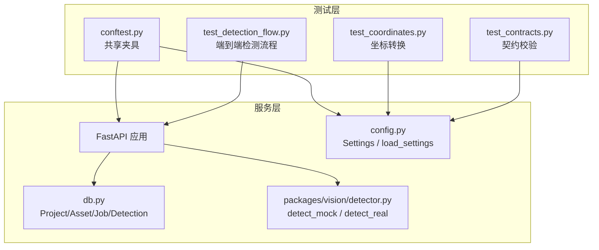
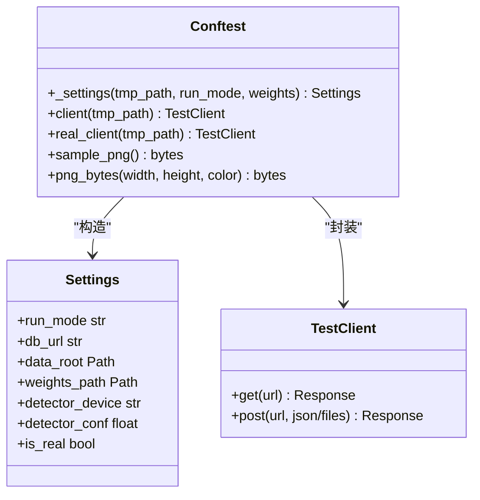
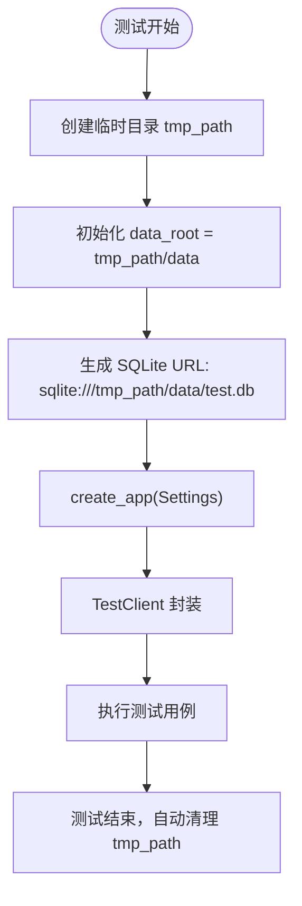
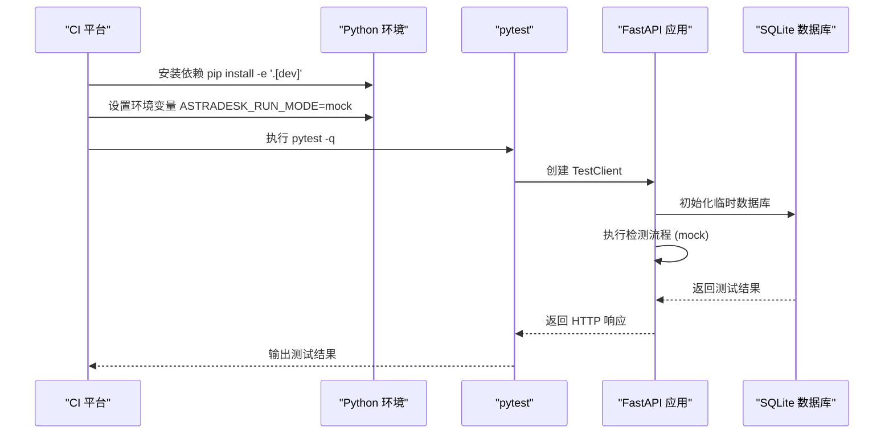
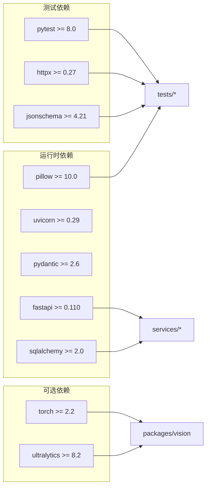

# 测试配置与环境

<cite>
**本文引用的文件**   
- [pyproject.toml](file://pyproject.toml)
- [conftest.py](file://tests/conftest.py)
- [test_contracts.py](file://tests/test_contracts.py)
- [test_coordinates.py](file://tests/test_coordinates.py)
- [test_detection_flow.py](file://tests/test_detection_flow.py)
- [config.py](file://services/api/config.py)
- [db.py](file://services/api/db.py)
- [detector.py](file://packages/vision/detector.py)
- [README.md](file://README.md)
- [.gitignore](file://.gitignore)
</cite>

## 目录
1. [引言](#引言)
2. [项目结构与测试定位](#项目结构与测试定位)
3. [pytest 框架与测试发现规则](#pytest-框架与测试发现规则)
4. [全局夹具设计：conftest.py](#全局夹具设计conftestpy)
5. [测试环境隔离机制](#测试环境隔离机制)
6. [测试数据管理策略](#测试数据管理策略)
7. [测试运行、过滤与调试技巧](#测试运行过滤与调试技巧)
8. [持续集成中的测试配置建议](#持续集成中的测试配置建议)
9. [依赖关系与架构总览](#依赖关系与架构总览)
10. [常见问题排查](#常见问题排查)
11. [结论](#结论)

## 引言
本文面向 AstraDesk 的测试配置与环境管理，重点说明 pytest 的配置选项、测试发现规则、共享夹具设计、测试环境隔离、测试数据策略、运行与调试方法，以及如何在持续集成中稳定执行这些测试。文档同时解释后端运行模式、数据库模型、检测器 mock 实现如何共同支撑可重复、可隔离、可审计的测试流程。

## 项目结构与测试定位
AstraDesk 的测试位于 `tests/` 目录，主要覆盖三类场景：
- 契约校验：验证 JSON Schema 对合法/非法样例的处理。
- 坐标转换：验证桌面坐标与图像坐标往返一致性、边界错误处理。
- 端到端检测流程：通过 FastAPI TestClient 模拟 HTTP 请求，验证项目创建、图片上传、检测任务、结果查询、错误分支与 real 模式下权重缺失行为。



**图表来源**
- [conftest.py:1-58](file://tests/conftest.py#L1-L58)
- [test_contracts.py:1-54](file://tests/test_contracts.py#L1-L54)
- [test_coordinates.py:1-48](file://tests/test_coordinates.py#L1-L48)
- [test_detection_flow.py:1-126](file://tests/test_detection_flow.py#L1-L126)
- [config.py:1-61](file://services/api/config.py#L1-L61)
- [db.py:1-92](file://services/api/db.py#L1-L92)
- [detector.py:104-128](file://packages/vision/detector.py#L104-L128)

**章节来源**
- [README.md:8-24](file://README.md#L8-L24)
- [README.md:61-77](file://README.md#L61-L77)

## pytest 框架与测试发现规则
当前项目的 pytest 配置集中在 `pyproject.toml` 中，核心要点如下：
- 测试路径：`testpaths = ["tests"]`，pytest 仅扫描 `tests/` 目录下的测试模块。
- 默认参数：`addopts = "-q"`，默认使用简洁输出模式，减少控制台噪音。
- 开发依赖：`[project.optional-dependencies] dev` 包含 `pytest>=8.0`、`httpx>=0.27`、`jsonschema>=4.21`，用于契约校验和 API 测试。

这意味着：
- 测试发现规则由 pytest 默认约定决定：文件名以 `test_*.py` 或 `*_test.py` 开头，函数以 `test_` 开头。
- 可通过命令行覆盖默认参数，例如增加详细日志、并行执行、覆盖率统计等（见后文“测试运行、过滤与调试技巧”）。

**章节来源**
- [pyproject.toml:19-37](file://pyproject.toml#L19-L37)
- [README.md:61-69](file://README.md#L61-L69)

## 全局夹具设计：conftest.py
`tests/conftest.py` 提供跨测试模块共享的夹具，核心职责包括：
- 构造测试用 Settings：基于临时目录生成 SQLite 数据库 URL 和数据根目录，避免污染真实数据。
- 提供 FastAPI TestClient：封装 `create_app` 与 `TestClient` 生命周期，确保每个测试拥有独立应用实例。
- 提供 sample_png：使用 PIL 生成固定尺寸的 PNG 字节流，作为上传图片输入。
- 支持 mock 与 real 两种客户端：`client` 为 mock 模式；`real_client` 为 real 模式但权重不存在，用于验证 MODEL_UNAVAILABLE 行为。



**图表来源**
- [conftest.py:21-57](file://tests/conftest.py#L21-L57)
- [config.py:20-31](file://services/api/config.py#L20-L31)

关键设计点：
- 临时目录隔离：所有测试数据写入 `tmp_path/data`，测试结束后自动清理。
- 数据库隔离：SQLite 数据库 URL 指向临时目录，避免并发冲突。
- Mock 模式优先：默认使用 mock-detector，保证无 GPU 环境下仍可稳定运行。
- Real 模式断言：通过缺失权重触发失败分支，验证错误码与空检测结果。

**章节来源**
- [conftest.py:1-58](file://tests/conftest.py#L1-L58)
- [config.py:20-31](file://services/api/config.py#L20-L31)

## 测试环境隔离机制
AstraDesk 的测试环境隔离体现在三个层面：

### 临时目录管理
- 每个测试用例通过 `tmp_path` 夹具获得独立临时目录。
- 所有数据文件、图片资产、SQLite 数据库均写入该目录，测试结束自动清理。
- `.gitignore` 排除 `data/*`、`weights/*`、`*.db`、`*.sqlite*`，防止敏感或大文件入库。

### 数据库会话管理
- 测试使用 SQLite，连接参数 `check_same_thread=False` 允许单进程内多线程访问。
- `make_engine` 在启动时创建表结构，`make_session` 提供会话工厂。
- 测试通过临时数据库 URL 隔离不同测试的数据状态。

### 外部服务模拟
- 检测器分为 `detect_mock` 与 `detect_real`：mock 返回确定性结果，real 调用 YOLOv10。
- 测试通过 `run_mode` 控制检测器行为，无需真实 GPU 即可验证完整流程。
- 环境变量 `ASTRADESK_RUN_MODE`、`ASTRADESK_YOLO_WEIGHTS` 等控制运行时行为。



**图表来源**
- [conftest.py:21-38](file://tests/conftest.py#L21-L38)
- [db.py:84-91](file://services/api/db.py#L84-L91)
- [.gitignore:17-49](file://.gitignore#L17-L49)

**章节来源**
- [conftest.py:21-57](file://tests/conftest.py#L21-L57)
- [db.py:84-91](file://services/api/db.py#L84-L91)
- [.gitignore:17-49](file://.gitignore#L17-L49)

## 测试数据管理策略
### 固定测试数据
- 契约样例位于 `contracts/samples/`，包含合法与非法 JSON 示例。
- 坐标测试使用硬编码数值，验证公式正确性与边界条件。
- 图片测试使用 `sample_png` 生成固定尺寸 PNG，避免外部依赖。

### 动态测试数据
- 项目 ID、图片资产 ID、任务 ID 由 API 动态生成。
- 检测结果的 `id` 字段需保持守恒（H01），测试中多次查询验证一致性。
- 错误响应包含 `request_id`，便于追踪问题。

### 敏感数据处理
- 密钥仅从服务端环境变量读取，不入仓库、前端或日志。
- `.gitignore` 排除 `.env`、`.env.*`、`data/*`、`weights/*`、`*.pt`、`*.pth` 等敏感或大文件。
- 测试中使用临时目录，避免泄露真实数据。

**章节来源**
- [test_contracts.py:10-54](file://tests/test_contracts.py#L10-L54)
- [test_coordinates.py:14-48](file://tests/test_coordinates.py#L14-L48)
- [test_detection_flow.py:29-126](file://tests/test_detection_flow.py#L29-L126)
- [.gitignore:17-49](file://.gitignore#L17-L49)

## 测试运行、过滤与调试技巧
### 基本运行
在项目根目录执行：
```bash
ASTRADESK_RUN_MODE=mock python -m pytest -q
```
- `-q` 启用简洁输出。
- `ASTRADESK_RUN_MODE=mock` 强制使用 mock 检测器。

### 并行测试执行
```bash
python -m pytest -q --numprocesses=auto
```
- 使用 `pytest-xdist` 插件并行执行测试，加速 CI 流水线。
- 注意：SQLite 并发写入需谨慎，当前测试通过临时目录隔离避免冲突。

### 测试过滤
```bash
python -m pytest -q -k "contract"
python -m pytest -q -k "coordinate"
python -m pytest -q -k "detect"
```
- `-k` 表达式按测试名称或标记过滤。
- 可按功能模块快速定位问题。

### 详细日志输出
```bash
python -m pytest -vv --log-cli-level=DEBUG
```
- `-vv` 显示详细日志。
- `--log-cli-level=DEBUG` 输出调试级别日志，便于排查环境问题。

### 覆盖率统计
```bash
python -m pytest -q --cov=services --cov=packages --cov-report=term-missing
```
- `--cov` 指定覆盖率范围。
- `--cov-report=term-missing` 显示未覆盖行。

**章节来源**
- [README.md:61-69](file://README.md#L61-L69)
- [pyproject.toml:34-37](file://pyproject.toml#L34-L37)

## 持续集成中的测试配置建议
虽然当前仓库未包含 GitHub Actions 配置文件，但可基于现有测试结构构建稳定流水线：

### 推荐步骤
1. **设置 Python 环境**：安装依赖 `pip install -e '.[dev]'`。
2. **设置环境变量**：`ASTRADESK_RUN_MODE=mock`。
3. **执行测试**：`python -m pytest -q`。
4. **生成覆盖率报告**：`python -m pytest --cov=services --cov=packages --cov-report=xml`。
5. **上传报告**：使用 Codecov 或 Coveralls 上传 XML 报告。

### 多平台矩阵
- **Linux (Ubuntu)**：主运行环境，WSL2 兼容。
- **Windows**：前端开发环境，后端测试可在 WSL 中执行。
- **GPU 环境**：可选 job 验证 real 模式，但需缓存 YOLO 权重。

### 缓存优化
- 缓存 `~/.cache/pip` 加速依赖安装。
- 缓存 `weights/yolov10n.pt` 避免重复下载。



**图表来源**
- [README.md:33-47](file://README.md#L33-L47)
- [conftest.py:34-47](file://tests/conftest.py#L34-L47)
- [db.py:84-91](file://services/api/db.py#L84-L91)

## 依赖关系与架构总览
AstraDesk 的测试依赖以下核心组件：



**图表来源**
- [pyproject.toml:10-21](file://pyproject.toml#L10-L21)

**章节来源**
- [pyproject.toml:10-21](file://pyproject.toml#L10-L21)

## 常见问题排查
### 测试无法发现
- 检查测试文件命名是否符合 `test_*.py` 或 `*_test.py`。
- 确认 `pyproject.toml` 中 `testpaths = ["tests"]` 配置正确。

### 数据库锁定错误
- 确保每个测试使用独立的 `tmp_path`。
- 避免多个 pytest 进程同时写入同一 SQLite 文件。

### 真实模式权重缺失
- 检查 `ASTRADESK_YOLO_WEIGHTS` 环境变量是否指向有效权重文件。
- 验证 `MODEL_UNAVAILABLE` 错误码是否正确返回。

### 图片上传失败
- 确认 `sample_png` 生成的 PNG 格式正确。
- 检查文件扩展名是否为支持的图片类型。

**章节来源**
- [conftest.py:21-57](file://tests/conftest.py#L21-L57)
- [test_detection_flow.py:91-126](file://tests/test_detection_flow.py#L91-L126)

## 结论
AstraDesk 的测试体系通过 pytest 配置、共享夹具、临时目录隔离、SQLite 数据库隔离、Mock 检测器等手段，实现了稳定、可重复、可审计的测试流程。建议在持续集成中引入并行执行、覆盖率统计和多平台矩阵，进一步提升测试效率与质量。