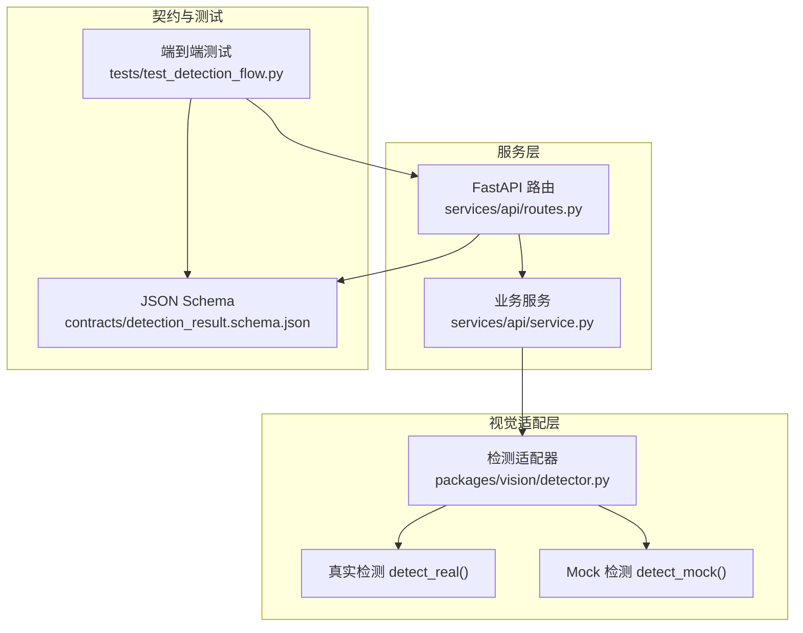
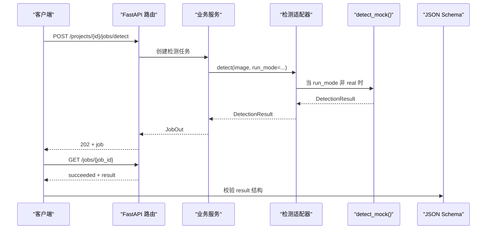
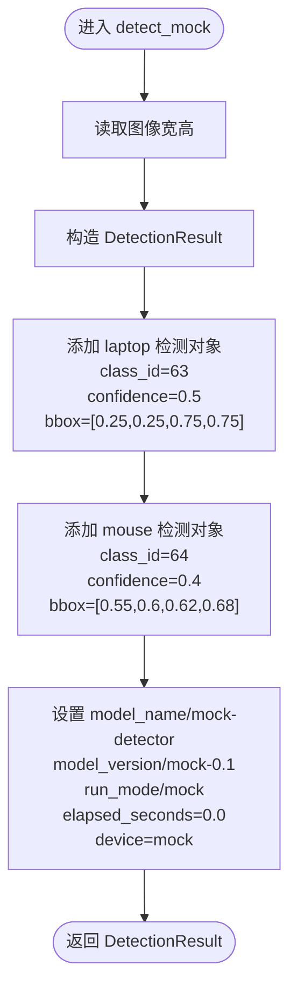
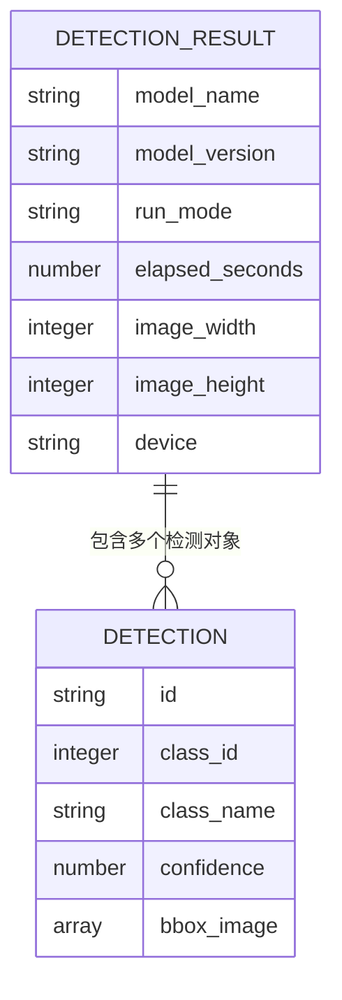
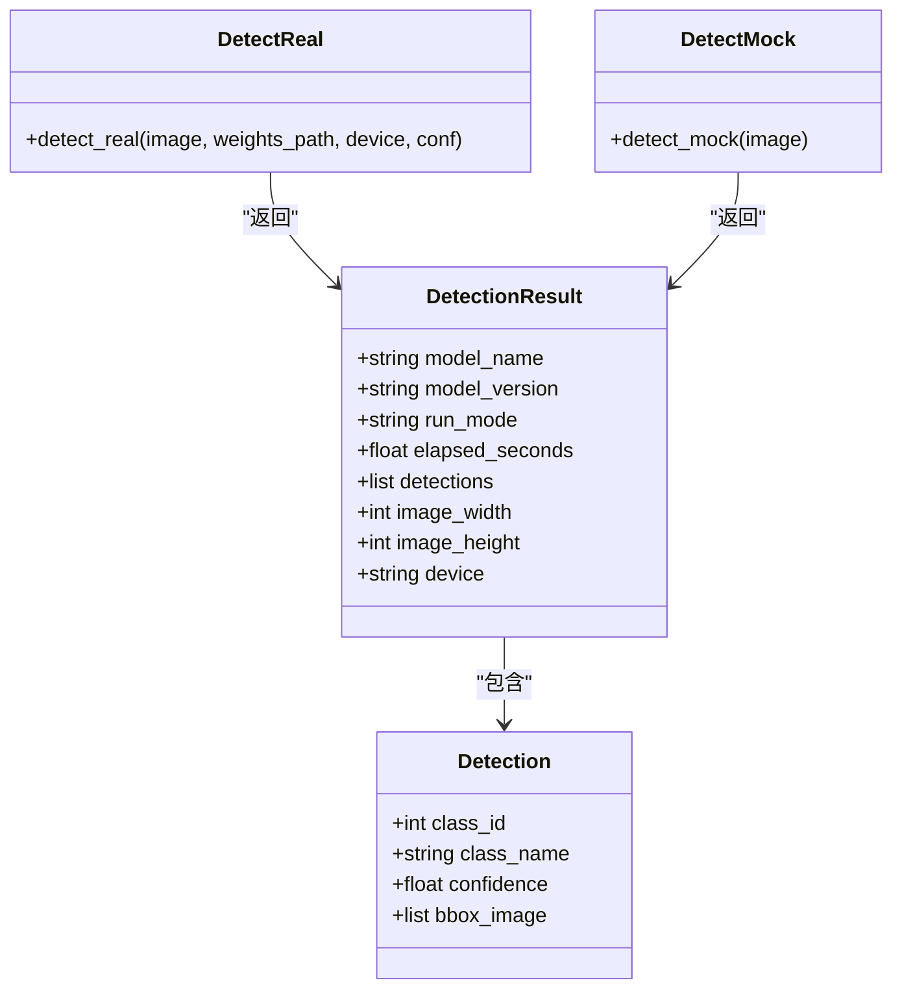
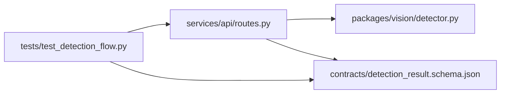

# Mock 检测器

<cite>
**本文引用的文件**   
- [detector.py](file://packages/vision/detector.py)
- [routes.py](file://services/api/routes.py)
- [test_detection_flow.py](file://tests/test_detection_flow.py)
- [detection_result.schema.json](file://contracts/detection_result.schema.json)
- [README.md](file://README.md)
</cite>

## 目录
1. [引言](#引言)
2. [项目结构中的位置](#项目结构中的位置)
3. [核心组件](#核心组件)
4. [架构总览](#架构总览)
5. [详细组件分析](#详细组件分析)
6. [依赖关系分析](#依赖关系分析)
7. [性能与确定性特征](#性能与确定性特征)
8. [使用指导](#使用指导)
9. [扩展方法](#扩展方法)
10. [故障排查](#故障排查)
11. [结论](#结论)

## 引言
Mock 检测器是桌面智能整理系统 AstraDesk 的“无 GPU 确定性检测适配器”。它的设计目的有三：
- 在无 GPU 或权重缺失环境下，提供稳定、可重复的检测输出，用于契约测试与演示。
- 保证 Mock 模式下的检测结果格式与真实检测完全一致，从而让前后端接口无需区分实现细节。
- 通过显式标注 `mock-detector` 与 `run_mode="mock"`，避免把演示数据误认为真实推理结果。

典型使用场景包括：
- 本地开发时快速验证前端叠框、任务状态机与错误处理流程。
- CI/CD 中运行契约测试，确保后端返回结构与 JSON Schema 一致。
- 演示环境展示端到端能力，而不依赖 YOLO 权重或 CUDA。

## 项目结构中的位置
Mock 检测器位于视觉适配层，统一入口为 `detect()`，内部根据运行模式分派到 `detect_real()` 或 `detect_mock()`。API 路由通过 `/api/v1/capabilities` 暴露当前是否处于 mock 模式，并在检测任务执行链路中复用同一检测适配器。

**图表来源**
- [routes.py:44-65](file://services/api/routes.py#L44-L65)
- [detector.py:104-128](file://packages/vision/detector.py#L104-L128)
- [detection_result.schema.json:1-65](file://contracts/detection_result.schema.json#L1-L65)
- [test_detection_flow.py:46-79](file://tests/test_detection_flow.py#L46-L79)

**章节来源**
- [README.md:33-76](file://README.md#L33-L76)
- [detector.py:1-10](file://packages/vision/detector.py#L1-L10)

## 核心组件
- `Detection`：单个检测对象的数据类，包含类别编号、类别名称、置信度与归一化边界框。
- `DetectionResult`：一次检测任务的完整结果，包含模型信息、运行模式、耗时、图像尺寸、设备信息与检测结果列表。
- `detect_mock(image)`：Mock 检测主函数，返回固定数量的模拟物体，并严格遵循坐标约定。
- `detect(image, run_mode, weights_path, device, conf)`：统一入口，按运行模式选择真实或 Mock 实现。

这些组件共同保证：无论走真实路径还是 Mock 路径，调用方拿到的都是同构的 `DetectionResult`。

**章节来源**
- [detector.py:26-47](file://packages/vision/detector.py#L26-L47)
- [detector.py:104-128](file://packages/vision/detector.py#L104-L128)

## 架构总览
Mock 检测器在系统中的职责边界如下：
- API 路由负责协议转换、任务调度与错误封装，不直接关心检测实现。
- 视觉适配层对外暴露统一的 `detect()` 接口；内部再分派到真实或 Mock 实现。
- 契约层通过 JSON Schema 约束检测结果字段类型、取值范围与坐标规范。
- 测试层同时校验 API 行为与 Schema 一致性，确保 Mock 结果不会破坏契约。

**图表来源**
- [routes.py:130-142](file://services/api/routes.py#L130-L142)
- [detector.py:124-128](file://packages/vision/detector.py#L124-L128)
- [detector.py:104-121](file://packages/vision/detector.py#L104-L121)
- [detection_result.schema.json:16-33](file://contracts/detection_result.schema.json#L16-L33)

## 详细组件分析

### `detect_mock()` 实现原理
`detect_mock()` 的核心目标是“确定性”和“契约兼容”：
- 输入为 PIL 图像，读取其宽高，但忽略图像内容。
- 固定返回两个检测对象：`laptop` 与 `mouse`。
- 所有坐标均为归一化值，满足 `[x1, y1, x2, y2] ∈ [0, 1]`。
- `model_name` 显式为 `mock-detector`，`model_version` 为 `mock-0.1`，`run_mode` 为 `mock`。
- `elapsed_seconds` 固定为 `0.0`，`device` 固定为 `mock`。
- `image_width` 与 `image_height` 来自输入图像，保持元信息一致性。

这种设计使 Mock 结果可用于：
- 前端叠框渲染（坐标合法）。
- 契约校验（字段齐全且类型正确）。
- 端到端流程验证（任务成功、ID 守恒、多次查询稳定）。

**图表来源**
- [detector.py:104-121](file://packages/vision/detector.py#L104-L121)

**章节来源**
- [detector.py:104-121](file://packages/vision/detector.py#L104-L121)

### 预定义检测对象的合理性
Mock 检测器预定义了两个常见桌面物体：
- `laptop`：占据图像中心区域，边界框从 `(0.25, 0.25)` 到 `(0.75, 0.75)`，表示一个居中、近似正方形的桌面主体。
- `mouse`：位于右下象限，边界框从 `(0.55, 0.6)` 到 `(0.62, 0.68)`，表示靠近鼠标垫位置的较小物体。

合理性依据：
- 坐标均在 `[0, 1]` 范围内，符合 PRD 坐标约定与 JSON Schema 约束。
- `laptop` 面积较大、`mouse` 面积较小，体现不同物体的空间分布差异。
- 置信度分别为 `0.5` 与 `0.4`，属于中等置信区间，便于前端展示置信度阈值筛选逻辑。
- 类别编号 `63`、`64` 与类别名 `laptop`、`mouse` 保持一致，便于契约测试断言。

**图表来源**
- [detector.py:26-47](file://packages/vision/detector.py#L26-L47)
- [detector.py:104-121](file://packages/vision/detector.py#L104-L121)
- [detection_result.schema.json:43-62](file://contracts/detection_result.schema.json#L43-L62)

**章节来源**
- [detector.py:104-121](file://packages/vision/detector.py#L104-L121)
- [detection_result.schema.json:44-62](file://contracts/detection_result.schema.json#L44-L62)

### 与真实检测器的结果格式一致性
真实检测器 `detect_real()` 将 YOLOv10 输出的原始坐标除以图像宽高，得到归一化坐标，并填充 `DetectionResult`。Mock 检测器同样返回 `DetectionResult`，并保持以下一致性：
- `model_name`、`model_version`、`run_mode`、`elapsed_seconds`、`image_width`、`image_height`、`device` 等元信息字段存在。
- `detections` 列表中的每个对象都包含 `class_id`、`class_name`、`confidence`、`bbox_image`。
- 坐标始终为归一化数组，长度固定为 4，取值范围 `[0, 1]`。
- JSON Schema 对 `result` 与 `detections` 的结构进行强约束，Mock 结果必须通过校验。

这保证了前后端接口无需针对 Mock 与真实模式分别维护两套数据结构。

**图表来源**
- [detector.py:26-47](file://packages/vision/detector.py#L26-L47)
- [detector.py:68-101](file://packages/vision/detector.py#L68-L101)
- [detector.py:104-121](file://packages/vision/detector.py#L104-L121)

**章节来源**
- [detector.py:68-101](file://packages/vision/detector.py#L68-L101)
- [detector.py:104-121](file://packages/vision/detector.py#L104-L121)
- [detection_result.schema.json:16-33](file://contracts/detection_result.schema.json#L16-L33)

## 依赖关系分析
- API 路由依赖 `packages.vision.detector`，并通过 `/api/v1/capabilities` 暴露当前运行模式与检测器能力。
- Mock 模式下，capabilities 返回 `mock-detector` 与 `mock-0.1`，与 `detect_mock()` 的输出一致。
- 测试用例断言 capabilities 的 `run_mode` 与 `model_name`，并验证检测任务返回的 `run_mode`、检测数量与契约一致性。
- JSON Schema 作为单一契约来源，约束检测结果字段类型、枚举值与坐标范围。

**图表来源**
- [routes.py:44-65](file://services/api/routes.py#L44-L65)
- [test_detection_flow.py:46-79](file://tests/test_detection_flow.py#L46-L79)
- [detection_result.schema.json:1-65](file://contracts/detection_result.schema.json#L1-L65)

**章节来源**
- [routes.py:44-65](file://services/api/routes.py#L44-L65)
- [test_detection_flow.py:46-79](file://tests/test_detection_flow.py#L46-L79)
- [detection_result.schema.json:1-65](file://contracts/detection_result.schema.json#L1-L65)

## 性能与确定性特征
- `detect_mock()` 不加载模型、不调用外部推理库，因此 `elapsed_seconds` 固定为 `0.0`。
- 输出完全由代码决定，不依赖随机数、时间戳或外部状态，具备强确定性。
- 每次调用返回相同数量的检测对象与相同坐标，适合回归测试与快照对比。
- 由于不涉及 GPU/CUDA，Mock 模式可在任意 Python 环境中运行。

**章节来源**
- [detector.py:104-121](file://packages/vision/detector.py#L104-L121)

## 使用指导

### 何时使用 Mock 模式
- 本地开发阶段，尚未准备 YOLO 权重或 GPU 环境。
- 运行契约测试、端到端测试或演示功能。
- 需要稳定、可重复的检测结果以验证前端叠框与任务状态机。

环境变量控制运行模式：
- `ASTRADESK_RUN_MODE=mock`：启用 Mock 模式。
- `ASTRADESK_RUN_MODE=real`：启用真实检测；若权重缺失则报告 `MODEL_UNAVAILABLE`，不静默回退 Mock。

**章节来源**
- [README.md:71-76](file://README.md#L71-L76)

### 如何验证 Mock 结果的准确性
- 检查 `/api/v1/capabilities` 返回的 `run_mode` 是否为 `mock`，`detector.model_name` 是否为 `mock-detector`。
- 发起检测任务后，等待状态变为 `succeeded`，并断言 `result.run_mode == "mock"`。
- 断言检测数量为 2，且包含 `laptop` 与 `mouse`。
- 使用 JSON Schema 校验整个任务结果，确保字段类型、枚举值与坐标范围合法。
- 多次查询同一任务，断言检测 ID 集合不变，满足接口层稳定性要求。

**章节来源**
- [test_detection_flow.py:46-79](file://tests/test_detection_flow.py#L46-L79)
- [detection_result.schema.json:16-33](file://contracts/detection_result.schema.json#L16-L33)

### 如何进行端到端测试
端到端测试覆盖以下流程：
1. 创建项目。
2. 上传图像资产。
3. 提交检测任务。
4. 轮询任务状态直至完成。
5. 校验返回结果符合契约。
6. 校验检测 ID 守恒。
7. 校验非法图像与不支持扩展名的拒绝行为。
8. 校验真实模式权重缺失时返回 `MODEL_UNAVAILABLE` 且不静默回退 Mock。

**章节来源**
- [test_detection_flow.py:55-126](file://tests/test_detection_flow.py#L55-L126)

## 扩展方法

### 添加更多模拟物体类型
可在 `detect_mock()` 中继续追加 `Detection` 对象，例如新增键盘、显示器等桌面物体。建议：
- 保持 `class_id` 唯一且语义清晰。
- 保持 `class_name` 与业务类别命名一致。
- 保持 `confidence` 在 `[0, 1]` 之间。
- 保持 `bbox_image` 四个值均在 `[0, 1]` 之间，且 `x1 < x2`、`y1 < y2`。

**章节来源**
- [detector.py:104-121](file://packages/vision/detector.py#L104-L121)
- [detection_result.schema.json:44-62](file://contracts/detection_result.schema.json#L44-L62)

### 调整检测参数
- 可通过修改 `detect_mock()` 中的置信度与坐标，模拟不同阈值或不同摆放场景。
- 若希望 Mock 模式也支持可调置信度，可在统一入口 `detect()` 中增加参数传递，并在 Mock 分支中过滤低置信度结果。
- 注意：任何改动都应同步更新契约测试，确保 JSON Schema 仍被满足。

**章节来源**
- [detector.py:124-128](file://packages/vision/detector.py#L124-L128)
- [test_detection_flow.py:55-79](file://tests/test_detection_flow.py#L55-L79)

### 扩展 Mock 能力声明
若未来 Mock 检测器支持更多特性，应同步更新 `/api/v1/capabilities` 返回的 `features` 列表，并在测试中断言新特性可用。

**章节来源**
- [routes.py:51-65](file://services/api/routes.py#L51-L65)

## 故障排查

### 常见问题与定位方式
- **Mock 模式未生效**：检查环境变量 `ASTRADESK_RUN_MODE` 是否为 `mock`；查看 `/api/v1/health` 与 `/api/v1/capabilities` 的 `run_mode`。
- **检测结果为空**：确认任务状态是否为 `succeeded`；检查 Mock 分支是否被调用；核对 `detect()` 的分派逻辑。
- **契约校验失败**：检查 `bbox_image` 是否越界、`confidence` 是否在 `[0, 1]`、`run_mode` 是否为 `mock` 或 `real`。
- **真实模式报错 MODEL_UNAVAILABLE**：这是预期行为，表示权重或依赖缺失；不应静默回退 Mock。

**章节来源**
- [README.md:71-76](file://README.md#L71-L76)
- [test_detection_flow.py:113-126](file://tests/test_detection_flow.py#L113-L126)
- [detection_result.schema.json:16-33](file://contracts/detection_result.schema.json#L16-L33)

### 调试建议
- 优先运行契约测试与端到端测试，确认 Mock 模式基础链路正常。
- 使用 `/api/v1/capabilities` 快速判断当前检测器能力。
- 使用 JSON Schema 校验工具对任务结果进行离线校验。
- 如需观察坐标分布，可将 `bbox_image` 映射到前端画布，验证 `laptop` 居中、`mouse` 靠右下的布局是否符合预期。

**章节来源**
- [test_detection_flow.py:46-79](file://tests/test_detection_flow.py#L46-L79)
- [routes.py:44-65](file://services/api/routes.py#L44-L65)

## 结论
Mock 检测器以最小依赖、最大确定性为目标，为 AstraDesk 提供了稳定的检测适配能力。它通过固定输出、显式标注与严格契约校验，确保：
- 无 GPU 环境可正常运行。
- 契约测试与演示功能可靠。
- 前后端接口不因实现切换而改变数据结构。
- 真实模式与 Mock 模式在调用方视角下保持一致。

在后续演进中，Mock 检测器可作为扩展点，逐步增强模拟场景、能力声明与参数配置，同时始终以 JSON Schema 为契约锚点，保证系统稳定性与可测试性。