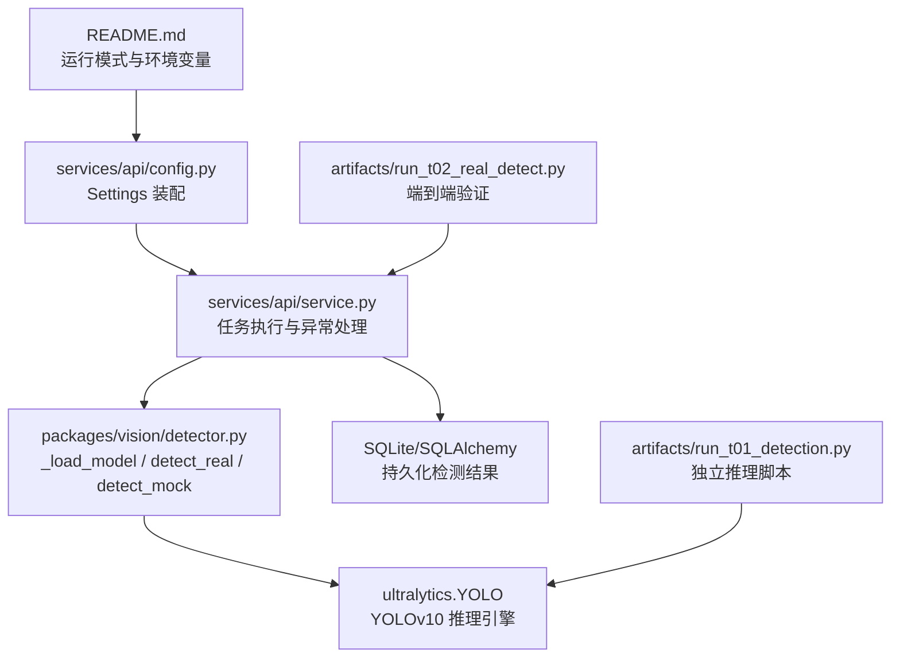
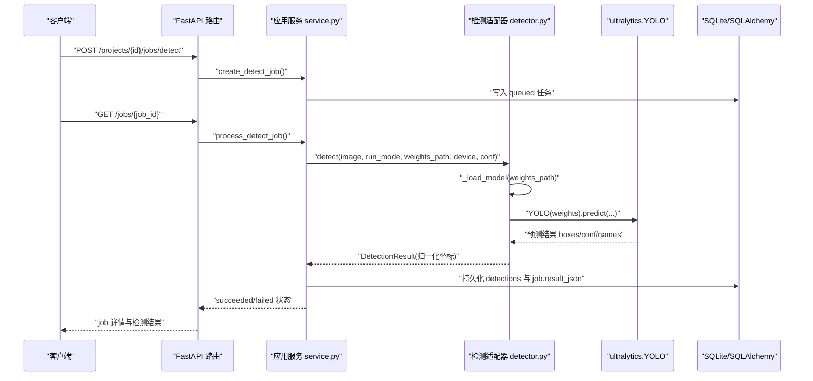
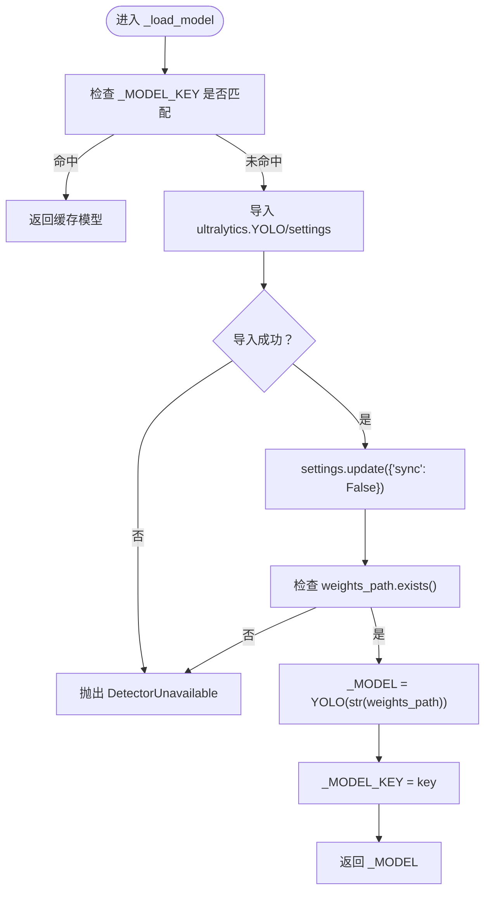
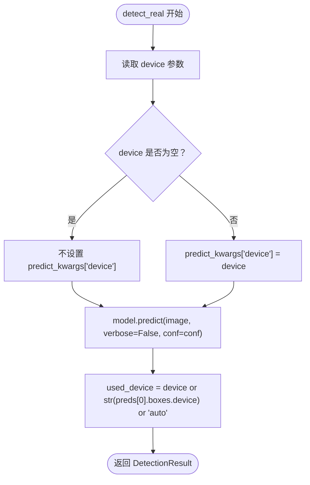
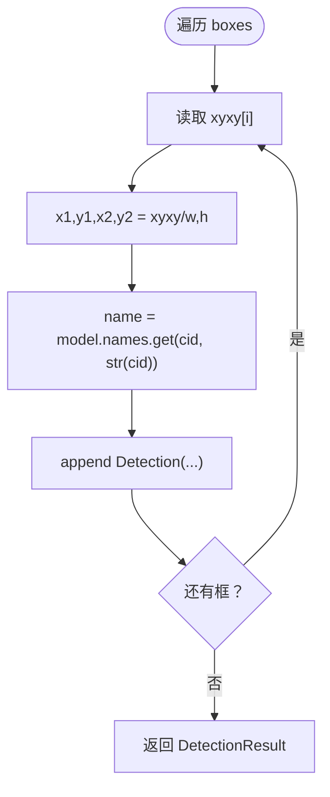
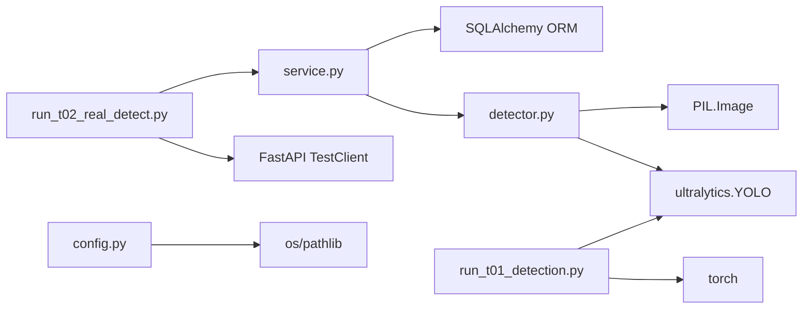

# YOLOv10 集成

<cite>
**本文引用的文件**   
- [README.md](file://README.md)
- [detector.py](file://packages/vision/detector.py)
- [config.py](file://services/api/config.py)
- [service.py](file://services/api/service.py)
- [run_t01_detection.py](file://artifacts/run_t01_detection.py)
- [run_t02_real_detect.py](file://artifacts/run_t02_real_detect.py)
</cite>

## 目录
1. [引言](#引言)
2. [项目结构](#项目结构)
3. [核心组件](#核心组件)
4. [架构总览](#架构总览)
5. [详细组件分析](#详细组件分析)
6. [依赖关系分析](#依赖关系分析)
7. [性能与内存管理](#性能与内存管理)
8. [部署指南](#部署指南)
9. [调用示例](#调用示例)
10. [故障排查](#故障排查)
11. [结论](#结论)

## 引言
本技术文档面向在 AstraDesk 项目中集成 YOLOv10 检测能力的开发者，聚焦以下目标：
- 解释模型加载函数 `_load_model()` 的完整流程，包括依赖检查、权重验证、Ultralytics YOLO 初始化配置。
- 说明 GPU/CPU 设备选择机制、`device` 参数的作用与自动设备检测逻辑。
- 梳理推理参数配置，包括置信度阈值 `conf`、`verbose`、性能优化选项。
- 解析检测结果后处理流程：边界框坐标归一化、类别名称映射、置信度过滤。
- 说明模型缓存机制的优势与内存管理策略。
- 提供权重准备、环境安装、基准测试方法与端到端调用示例。
- 给出常见错误排查指南，确保 real 模式下不静默回退 mock。

## 项目结构
AstraDesk 将视觉检测能力封装在 `packages/vision`，API 服务位于 `services/api`，并通过环境变量驱动运行模式与检测参数。关键路径如下：
- `packages/vision/detector.py`：YOLOv10 检测适配器，包含 `_load_model()`、`detect_real()`、`detect_mock()`、统一入口 `detect()`。
- `services/api/config.py`：从环境变量装配 Settings，决定 run_mode、权重路径、设备、置信度等。
- `services/api/service.py`：业务服务层，负责任务执行、异常处理、结果持久化，并调用 detector.detect()。
- `artifacts/run_t01_detection.py`：独立脚本，直接调用 ultralytics YOLO 做真实推理与证据保存。
- `artifacts/run_t02_real_detect.py`：端到端验证脚本，通过 FastAPI TestClient 走完整 API 栈进行真实检测。
- `README.md`：运行模式、环境变量、依赖安装与启动命令说明。

**图表来源**
- [README.md:33-47](file://README.md#L33-L47)
- [config.py:39-60](file://services/api/config.py#L39-L60)
- [service.py:132-179](file://services/api/service.py#L132-L179)
- [detector.py:50-128](file://packages/vision/detector.py#L50-L128)
- [run_t01_detection.py:14-32](file://artifacts/run_t01_detection.py#L14-L32)
- [run_t02_real_detect.py:47-69](file://artifacts/run_t02_real_detect.py#L47-L69)

**章节来源**
- [README.md:8-24](file://README.md#L8-L24)
- [README.md:33-47](file://README.md#L33-L47)

## 核心组件
- 检测适配器（packages/vision/detector.py）
  - 提供 `_load_model()` 懒加载与进程内缓存。
  - 提供 `detect_real()` 真实推理与 `detect_mock()` 确定性 Mock。
  - 提供统一入口 `detect()`，按 run_mode 分派。
- 配置装配（services/api/config.py）
  - 从环境变量读取 run_mode、weights_path、detector_device、detector_conf。
  - 默认 mock，避免未配置时误触发真实模型或网络请求。
- 业务服务（services/api/service.py）
  - 创建/查询检测任务，调用 detector.detect()。
  - 捕获 DetectorUnavailable 并标记 MODEL_UNAVAILABLE，不静默回退。
  - 持久化检测结果到数据库，返回结构化 job 信息。

**章节来源**
- [detector.py:1-128](file://packages/vision/detector.py#L1-L128)
- [config.py:1-60](file://services/api/config.py#L1-L60)
- [service.py:132-179](file://services/api/service.py#L132-L179)

## 架构总览
下图展示从 API 路由到 YOLOv10 推理的完整调用链，以及错误处理与结果持久化的关键点。

**图表来源**
- [service.py:120-179](file://services/api/service.py#L120-L179)
- [detector.py:50-128](file://packages/vision/detector.py#L50-L128)

## 详细组件分析

### 模型加载流程：_load_model()
_load_model() 是 YOLOv10 模型的懒加载与缓存入口，核心职责包括：
- 依赖检查：尝试导入 ultralytics.YOLO 与 settings；若失败抛出 DetectorUnavailable。
- 权重验证：检查 weights_path 是否存在；不存在则抛出 DetectorUnavailable。
- Ultralytics 初始化配置：关闭遥测同步 settings.update({"sync": False})，避免被墙的网络请求。
- 进程内缓存：使用全局 _MODEL 与 _MODEL_KEY 缓存已加载模型，避免重复加载。

**图表来源**
- [detector.py:50-65](file://packages/vision/detector.py#L50-L65)

**章节来源**
- [detector.py:50-65](file://packages/vision/detector.py#L50-L65)

### 设备选择机制与自动检测
- 环境变量 ASTRADESK_DEVICE 为空字符串时，detector.detect_real() 不传入 device 参数，交由 ultralytics 自动选择 cuda/cpu。
- 当 ASTRADESK_DEVICE 非空（如 "cuda:0"），predict_kwargs 中显式设置 device。
- used_device 推导逻辑：优先使用传入 device，否则从 preds[0].boxes.device 获取，再 fallback 为 "auto"。

**图表来源**
- [detector.py:68-80](file://packages/vision/detector.py#L68-L80)

**章节来源**
- [detector.py:68-80](file://packages/vision/detector.py#L68-L80)
- [config.py:49-51](file://services/api/config.py#L49-L51)

### 推理参数配置
- 置信度阈值 conf：默认 0.25，可通过 ASTRADESK_DET_CONF 覆盖。
- verbose：固定为 False，减少输出干扰。
- 性能优化：
  - settings.update({"sync": False}) 关闭遥测/联网同步，避免网络阻塞。
  - 进程内模型缓存 _MODEL/_MODEL_KEY，避免 worker 每次调用重载。
  - 首次推理耗时包含模型加载时间，后续调用复用缓存。

**章节来源**
- [detector.py:56-64](file://packages/vision/detector.py#L56-L64)
- [detector.py:72-76](file://packages/vision/detector.py#L72-L76)
- [config.py:50-51](file://services/api/config.py#L50-L51)

### 检测结果后处理
detect_real() 对 ultralytics 返回的 boxes 进行后处理：
- 边界框坐标归一化：将 xyxy 像素坐标除以图像宽高 w/h，得到 0-1 范围 bbox_image。
- 类别名称映射：使用 model.names.get(cid, str(cid))，缺失类名时使用 class_id 字符串。
- 置信度过滤：当前实现未在后处理阶段过滤低置信度框；过滤由上层 conf 参数控制。
- 构造 Detection 对象：class_id、class_name、confidence、bbox_image。

**图表来源**
- [detector.py:82-91](file://packages/vision/detector.py#L82-L91)

**章节来源**
- [detector.py:82-91](file://packages/vision/detector.py#L82-L91)

### 模型缓存机制与内存管理
- 缓存键：以 weights_path 的字符串形式作为 _MODEL_KEY。
- 缓存命中：若 _MODEL 不为 None 且 _MODEL_KEY 匹配，直接返回缓存模型。
- 优势：
  - 避免重复加载权重，显著降低首次推理延迟。
  - 在多任务并发场景下减少显存抖动与 I/O 压力。
- 内存管理：
  - 进程级单例缓存，适合常驻进程（如 uvicorn worker）。
  - 若需释放显存，应重启进程或替换权重路径以失效缓存。

**章节来源**
- [detector.py:18-20](file://packages/vision/detector.py#L18-L20)
- [detector.py:52-65](file://packages/vision/detector.py#L52-L65)

## 依赖关系分析
- packages/vision/detector.py 依赖 ultralytics.YOLO 与 PIL.Image。
- services/api/service.py 依赖 packages.vision.detector、PIL.Image、SQLAlchemy ORM。
- services/api/config.py 依赖 os、pathlib，装配 Settings。
- artifacts/run_t01_detection.py 直接依赖 torch、ultralytics，用于独立推理验证。
- artifacts/run_t02_real_detect.py 依赖 FastAPI TestClient，走完整 API 栈验证。

**图表来源**
- [detector.py:11-18](file://packages/vision/detector.py#L11-L18)
- [service.py:14-24](file://services/api/service.py#L14-L24)
- [config.py:11-13](file://services/api/config.py#L11-L13)
- [run_t01_detection.py:11-14](file://artifacts/run_t01_detection.py#L11-L14)
- [run_t02_real_detect.py:22-26](file://artifacts/run_t02_real_detect.py#L22-L26)

**章节来源**
- [detector.py:11-18](file://packages/vision/detector.py#L11-L18)
- [service.py:14-24](file://services/api/service.py#L14-L24)
- [config.py:11-13](file://services/api/config.py#L11-L13)
- [run_t01_detection.py:11-14](file://artifacts/run_t01_detection.py#L11-L14)
- [run_t02_real_detect.py:22-26](file://artifacts/run_t02_real_detect.py#L22-L26)

## 性能与内存管理
- 首次推理耗时包含模型加载时间，后续调用复用缓存，显著提升吞吐。
- 关闭 sync 遥测可减少网络阻塞，提升稳定性。
- 显存峰值参考：文档记录本地 YOLOv10n 实测显存峰值约 56.6 MiB（见 README 与 ENVIRONMENT 文档）。
- 建议：
  - 生产环境启用 real 模式并预热模型（启动时调用一次 detect）。
  - 合理设置 conf 阈值以减少无效框数量。
  - 监控 GPU 显存占用，必要时重启 worker 释放缓存。

**章节来源**
- [detector.py:56-64](file://packages/vision/detector.py#L56-L64)
- [detector.py:75-77](file://packages/vision/detector.py#L75-L77)

## 部署指南
- 权重文件准备：
  - 放置 yolov10n.pt 至 weights/ 目录。
  - 通过 ASTRADESK_YOLO_WEIGHTS 指定权重路径。
- 环境依赖安装：
  - 安装 vision 依赖：pip install -e '.[vision]'。
  - 安装 torch + CUDA 版本匹配（WSL2 Ubuntu-24.04，CUDA 12.4）。
- 启动 API：
  - 设置 ASTRADESK_RUN_MODE=real。
  - 设置 ASTRADESK_YOLO_WEIGHTS=weights/yolov10n.pt。
  - 可选设置 ASTRADESK_DEVICE、ASTRADESK_DET_CONF。
- 性能基准测试方法：
  - 使用 artifacts/run_t01_detection.py 独立脚本测试单次推理耗时与显存。
  - 使用 artifacts/run_t02_real_detect.py 端到端验证 API 栈与结果持久化。

**章节来源**
- [README.md:33-47](file://README.md#L33-L47)
- [run_t01_detection.py:18-32](file://artifacts/run_t01_detection.py#L18-L32)
- [run_t02_real_detect.py:47-69](file://artifacts/run_t02_real_detect.py#L47-L69)

## 调用示例
- 独立推理脚本（T01）：
  - 直接加载 YOLOv10n 权重，在真实 val 图上执行 GPU 推理，保存标注图与 JSON 证据。
  - 关键步骤：设置 settings.sync=False，选择 device（cuda:0 或 cpu），调用 model.predict()。
- 端到端验证（T02）：
  - 通过 FastAPI TestClient 创建项目、上传图片、创建检测任务、查询结果。
  - 关键步骤：构造 Settings(run_mode="real", weights_path=WEIGHTS)，调用 create_app(settings)。

**章节来源**
- [run_t01_detection.py:14-32](file://artifacts/run_t01_detection.py#L14-L32)
- [run_t02_real_detect.py:47-69](file://artifacts/run_t02_real_detect.py#L47-L69)

## 故障排查
- 常见错误：
  - DetectorUnavailable：ultralytics 不可导入或权重文件缺失。
  - MODEL_UNAVAILABLE：real 模式下检测不可用，服务层捕获并标记失败，不静默回退 mock。
  - INVALID_IMAGE：不支持的文件类型或空文件。
  - JOB_NOT_FOUND：任务不存在。
- 排查步骤：
  - 检查 ASTRADESK_RUN_MODE 是否为 real。
  - 确认 ASTRADESK_YOLO_WEIGHTS 指向存在的权重文件。
  - 检查 ASTRADESK_DEVICE 是否正确（如 "cuda:0"）。
  - 查看 job.error_json 中的 code 与 message。
- 日志与证据：
  - artifacts/t01_detection/result.json 与 artifacts/t02_detect/result.json 提供推理证据。
  - 标注图 annotated.jpg 可用于可视化检测结果。

**章节来源**
- [detector.py:22-24](file://packages/vision/detector.py#L22-L24)
- [service.py:158-163](file://services/api/service.py#L158-L163)
- [service.py:182-186](file://services/api/service.py#L182-L186)

## 结论
本项目通过 packages/vision/detector.py 实现了 YOLOv10 的可靠集成，具备依赖检查、权重验证、设备自动选择、模型缓存与结果后处理能力。services/api/service.py 确保 real 模式下不静默回退 mock，并提供完整的任务生命周期管理与错误处理。结合 artifacts 中的独立脚本与端到端验证，开发者可快速完成部署、基准测试与问题定位。建议在生产环境中启用模型预热、合理配置 conf 与 device，并持续监控显存与性能指标。