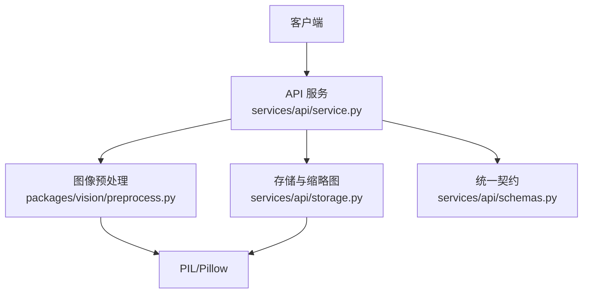
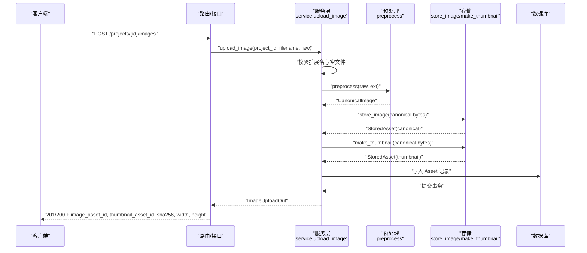
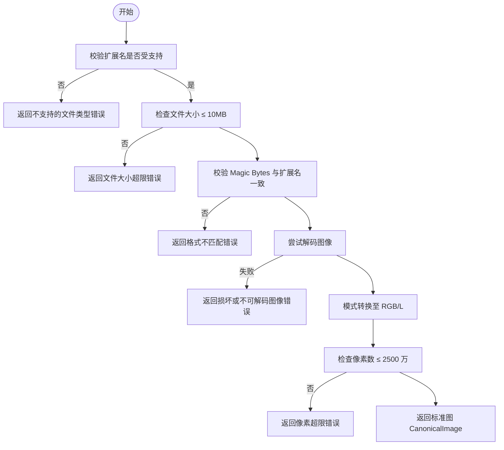
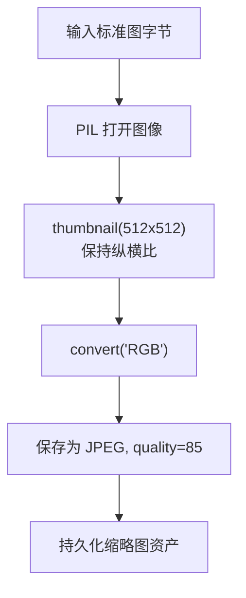
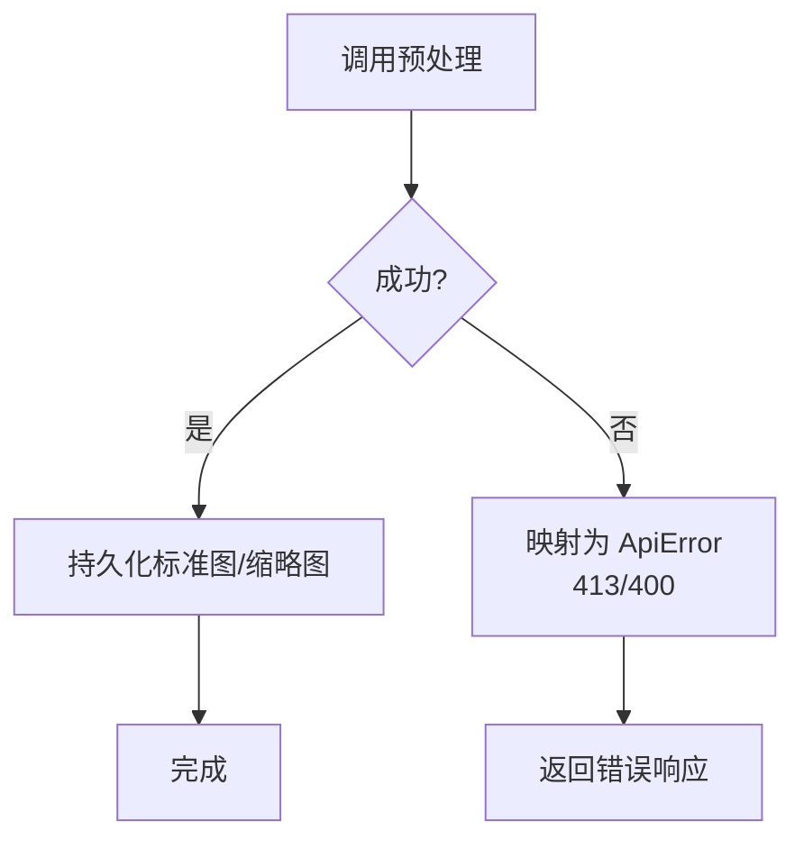
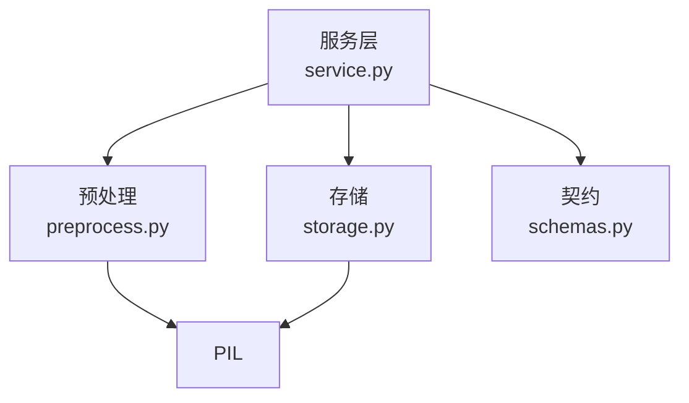

# 图像预处理

<cite>
**本文引用的文件**   
- [packages/vision/preprocess.py](file://packages/vision/preprocess.py)
- [services/api/service.py](file://services/api/service.py)
- [services/api/schemas.py](file://services/api/schemas.py)
- [services/api/storage.py](file://services/api/storage.py)
</cite>

## 目录
1. [引言](#引言)
2. [项目结构](#项目结构)
3. [核心组件](#核心组件)
4. [架构总览](#架构总览)
5. [详细组件分析](#详细组件分析)
6. [依赖关系分析](#依赖关系分析)
7. [性能与优化建议](#性能与优化建议)
8. [故障排查指南](#故障排查指南)
9. [结论](#结论)
10. [附录：示例与常见问题](#附录示例与常见问题)

## 引言
本技术文档聚焦于图像预处理模块，覆盖以下关键主题：
- 支持的图像格式（JPEG、PNG）与文件格式验证机制
- 图像尺寸限制与质量控制检查（损坏检测、格式兼容性、文件大小、像素上限）
- 标准化输出（方向校正、去元数据、标准图 canonical）
- 缩略图生成策略（最长边限制、保持纵横比）
- 预处理流水线设计与步骤依赖
- 错误处理与异常恢复（无效图像容错、降级策略）
- 性能优化建议（批量处理、内存管理、I/O 优化）
- 完整图像处理示例与常见问题解决方案

该模块位于视觉包中，由 API 服务层调用，负责将原始上传字节转换为可持久化的标准图与缩略图。

## 项目结构
与图像预处理直接相关的代码分布在以下位置：
- 视觉预处理实现：packages/vision/preprocess.py
- API 业务编排与错误映射：services/api/service.py
- 存储与缩略图生成：services/api/storage.py
- 统一响应/错误契约：services/api/schemas.py

**图表来源**
- [services/api/service.py:71-107](file://services/api/service.py#L71-L107)
- [packages/vision/preprocess.py:54-83](file://packages/vision/preprocess.py#L54-L83)
- [services/api/storage.py:32-60](file://services/api/storage.py#L32-L60)
- [services/api/schemas.py:57-64](file://services/api/schemas.py#L57-L64)

**章节来源**
- [packages/vision/preprocess.py:1-84](file://packages/vision/preprocess.py#L1-L84)
- [services/api/service.py:71-107](file://services/api/service.py#L71-L107)
- [services/api/storage.py:1-61](file://services/api/storage.py#L1-L61)
- [services/api/schemas.py:57-64](file://services/api/schemas.py#L57-L64)

## 核心组件
- CanonicalImage：表示方向校正、去元数据后的标准图对象，包含图像、宽高与格式字段。
- preprocess(raw, declared_ext)：输入原始字节与声明扩展名，执行校验、解码、EXIF 方向校正、模式转换、像素上限检查，返回 CanonicalImage。
- to_bytes(canonical, quality=90)：将标准图编码为字节，同时剥离 EXIF/元数据。
- storage.store_image(...)：将字节写入文件系统并记录资产信息（ID、路径、SHA256、宽高）。
- storage.make_thumbnail(...)：基于标准图生成缩略图（最长边限制），再持久化。
- service.upload_image(...)：编排上传流程，包括扩展名校验、调用预处理、持久化标准图与缩略图、数据库落库。

**章节来源**
- [packages/vision/preprocess.py:33-83](file://packages/vision/preprocess.py#L33-L83)
- [services/api/storage.py:18-60](file://services/api/storage.py#L18-L60)
- [services/api/service.py:71-107](file://services/api/service.py#L71-L107)

## 架构总览
图像上传与预处理的端到端流程如下：

**图表来源**
- [services/api/service.py:71-107](file://services/api/service.py#L71-L107)
- [packages/vision/preprocess.py:54-83](file://packages/vision/preprocess.py#L54-L83)
- [services/api/storage.py:32-60](file://services/api/storage.py#L32-L60)
- [services/api/schemas.py:57-64](file://services/api/schemas.py#L57-L64)

## 详细组件分析

### 图像格式支持与验证机制
- 支持格式：JPEG、PNG。
- 扩展名校验：在服务层对文件名后缀进行白名单校验，仅允许 jpg、jpeg、png。
- Magic Bytes 校验：在预处理层根据声明扩展名匹配文件头签名，拒绝伪装格式。
- 解码与损坏检测：使用 PIL 打开并加载图像，捕获无法识别或解码异常，视为损坏图像。
- 像素上限：单张图像像素数不超过 2500 万。
- 文件大小限制：单张图像不超过 10MB。

**图表来源**
- [services/api/service.py:37-41](file://services/api/service.py#L37-L41)
- [packages/vision/preprocess.py:43-76](file://packages/vision/preprocess.py#L43-L76)

**章节来源**
- [services/api/service.py:37-41](file://services/api/service.py#L37-L41)
- [packages/vision/preprocess.py:14-21](file://packages/vision/preprocess.py#L14-L21)
- [packages/vision/preprocess.py:43-76](file://packages/vision/preprocess.py#L43-L76)

### 图像尺寸调整与缩放算法
- 标准图 canonical：不进行尺寸缩放，保留原图宽高；仅做 EXIF 方向校正与模式转换。
- 缩略图 thumbnail：使用 PIL 的 thumbnail 方法，按最长边限制为 512 像素进行等比缩放，保持纵横比。
- 缩略图格式：固定为 JPEG，质量 85。
- 最大尺寸限制：标准图像素总数不超过 2500 万；超过则拒绝。

**图表来源**
- [services/api/storage.py:53-60](file://services/api/storage.py#L53-L60)

**章节来源**
- [packages/vision/preprocess.py:66-76](file://packages/vision/preprocess.py#L66-L76)
- [services/api/storage.py:53-60](file://services/api/storage.py#L53-L60)

### 像素值归一化处理
- 当前预处理阶段未对像素值进行数值归一化到 0-1 范围。
- 标准图以 PIL Image 对象形式存在，后续检测阶段可能按需进行归一化。
- 若需在前端或下游模型中使用 0-1 归一化，建议在消费端或检测器内部实现。

[本节为概念性说明，不涉及具体代码片段]

### 图像质量控制检查
- 损坏图像检测：解码失败抛出预处理错误。
- 格式兼容性验证：扩展名白名单 + Magic Bytes 双重校验。
- 文件大小限制：≤ 10MB。
- 像素上限：≤ 2500 万像素。
- 元数据处理：重存时去除 EXIF/元数据，得到标准图 canonical。

**章节来源**
- [packages/vision/preprocess.py:14-21](file://packages/vision/preprocess.py#L14-L21)
- [packages/vision/preprocess.py:54-83](file://packages/vision/preprocess.py#L54-L83)

### 预处理管道流水线设计
- 步骤顺序：
  1. 扩展名校验（服务层）
  2. 文件大小检查（预处理层）
  3. Magic Bytes 校验（预处理层）
  4. 解码与损坏检测（预处理层）
  5. EXIF 方向校正与模式转换（预处理层）
  6. 像素上限检查（预处理层）
  7. 标准图持久化（存储层）
  8. 缩略图生成与持久化（存储层）
  9. 数据库写入资产记录（服务层）
- 依赖关系：
  - 服务层依赖预处理层与存储层。
  - 预处理层依赖 PIL。
  - 存储层依赖 PIL 与文件系统。

**图表来源**
- [services/api/service.py:71-107](file://services/api/service.py#L71-L107)
- [packages/vision/preprocess.py:54-83](file://packages/vision/preprocess.py#L54-L83)
- [services/api/storage.py:32-60](file://services/api/storage.py#L32-L60)

**章节来源**
- [services/api/service.py:71-107](file://services/api/service.py#L71-L107)
- [packages/vision/preprocess.py:54-83](file://packages/vision/preprocess.py#L54-L83)
- [services/api/storage.py:32-60](file://services/api/storage.py#L32-L60)

### 错误处理与异常恢复机制
- 预处理错误：PreprocessError 携带 code 与 message，服务层将其映射为 ApiError，并根据消息内容选择 HTTP 状态码（如 413 用于大小/像素超限，400 用于其他无效图像）。
- 无效图像容错：解码失败、Magic Bytes 不匹配、扩展名不受支持均被拒绝。
- 降级策略：当前预处理阶段无自动降级；若模型不可用，检测任务会标记为 failed 并记录 MODEL_UNAVAILABLE，但不静默回退 mock。
- 重试策略：部分错误标记为可重试（retryable=true），供上层调度重试。

**图表来源**
- [services/api/service.py:81-85](file://services/api/service.py#L81-L85)
- [packages/vision/preprocess.py:24-31](file://packages/vision/preprocess.py#L24-L31)

**章节来源**
- [services/api/service.py:81-85](file://services/api/service.py#L81-L85)
- [packages/vision/preprocess.py:24-31](file://packages/vision/preprocess.py#L24-L31)

## 依赖关系分析
- 服务层依赖：
  - packages.vision.preprocess：提供图像预处理能力。
  - services.api.storage：提供文件存储与缩略图生成。
  - services.api.schemas：定义统一响应与错误对象。
- 外部依赖：
  - PIL/Pillow：图像解码、方向校正、缩略图生成。
  - 文件系统：存储标准图与缩略图。
  - 数据库：持久化资产与检测结果。

**图表来源**
- [services/api/service.py:1-24](file://services/api/service.py#L1-L24)
- [packages/vision/preprocess.py:1-15](file://packages/vision/preprocess.py#L1-L15)
- [services/api/storage.py:1-14](file://services/api/storage.py#L1-L14)
- [services/api/schemas.py:1-17](file://services/api/schemas.py#L1-L17)

**章节来源**
- [services/api/service.py:1-24](file://services/api/service.py#L1-L24)
- [packages/vision/preprocess.py:1-15](file://packages/vision/preprocess.py#L1-L15)
- [services/api/storage.py:1-14](file://services/api/storage.py#L1-L14)
- [services/api/schemas.py:1-17](file://services/api/schemas.py#L1-L17)

## 性能与优化建议
- 批量处理：
  - 服务端可对多张图片进行并发预处理与存储，注意控制并发度以避免内存峰值过高。
  - 数据库写入建议使用批量插入或事务合并，减少锁竞争。
- 内存管理：
  - 避免长时间持有大图像对象；在 to_bytes 后及时释放中间变量。
  - 缩略图生成尽量复用缓冲区，减少临时对象创建。
- I/O 优化：
  - 使用异步 I/O 或连接池提升磁盘与数据库吞吐。
  - 考虑对象存储（如 S3）替代本地文件系统，提高可扩展性与可靠性。
- 缓存策略：
  - 对相同 SHA256 的图像跳过重复存储与缩略图生成。
  - 对频繁访问的缩略图增加缓存层（如 Redis）。
- 模型与设备：
  - 检测阶段根据 run_mode 与 device 配置选择合适的后端，避免不必要的 GPU/CPU 切换开销。

[本节为通用指导，不涉及具体代码片段]

## 故障排查指南
- 常见错误与原因：
  - 不支持的文件类型：扩展名不在白名单内。
  - 文件大小超限：超过 10MB。
  - 像素超限：超过 2500 万像素。
  - 格式不匹配：Magic Bytes 与扩展名不一致。
  - 损坏或不可解码图像：PIL 解码失败。
- 定位步骤：
  1. 检查请求中的文件名后缀与服务层扩展名校验逻辑。
  2. 确认上传文件大小与像素数是否符合限制。
  3. 验证文件头签名是否与扩展名一致。
  4. 查看预处理抛出的 PreprocessError 的 code 与 message。
  5. 检查存储层是否正确生成缩略图与标准图。
- 恢复策略：
  - 对于可重试错误（如临时 I/O 问题），在上层调度中进行有限次重试。
  - 对于不可重试错误（如格式不匹配），提示用户更换文件或修正上传参数。

**章节来源**
- [services/api/service.py:81-85](file://services/api/service.py#L81-L85)
- [packages/vision/preprocess.py:24-31](file://packages/vision/preprocess.py#L24-L31)
- [packages/vision/preprocess.py:43-76](file://packages/vision/preprocess.py#L43-L76)

## 结论
图像预处理模块通过严格的格式与质量校验、标准化的方向校正与去元数据流程，确保上游检测与存储的稳定性和一致性。缩略图生成采用等比缩放与最长边限制，兼顾展示效果与存储成本。错误处理机制清晰，便于上层进行重试与降级决策。未来可在像素归一化、批量处理与缓存方面进一步优化，以提升整体性能与用户体验。

[本节为总结性内容，不涉及具体代码片段]

## 附录：示例与常见问题

### 完整图像处理示例
- 上传一张 JPEG 图像：
  - 前端发送 POST 请求，附带 project_id、filename（后缀 .jpg）、raw 字节。
  - 服务层校验扩展名与空文件，调用预处理。
  - 预处理执行大小、Magic、解码、EXIF、像素检查，返回 CanonicalImage。
  - 服务层持久化标准图与缩略图，写入数据库，返回 ImageUploadOut。
- 上传一张 PNG 图像：
  - 流程同上，但标准图格式为 PNG，缩略图仍为 JPEG。

**章节来源**
- [services/api/service.py:71-107](file://services/api/service.py#L71-L107)
- [services/api/schemas.py:57-64](file://services/api/schemas.py#L57-L64)

### 常见问题解决方案
- 问：为什么上传 PNG 后缩略图是 JPEG？
  - 答：缩略图固定为 JPEG 格式，质量 85，这是为了统一展示与压缩策略。
- 问：如何获取标准图的宽高？
  - 答：ImageUploadOut 中包含 canonical_width 与 canonical_height。
- 问：如何处理超大图像？
  - 答：超过 2500 万像素会被拒绝，建议先在前端或网关层进行尺寸限制。
- 问：如何避免重复存储相同图像？
  - 答：可利用 SHA256 去重，或在存储层增加指纹缓存。

**章节来源**
- [services/api/storage.py:53-60](file://services/api/storage.py#L53-L60)
- [services/api/schemas.py:57-64](file://services/api/schemas.py#L57-L64)
- [packages/vision/preprocess.py:14-21](file://packages/vision/preprocess.py#L14-L21)