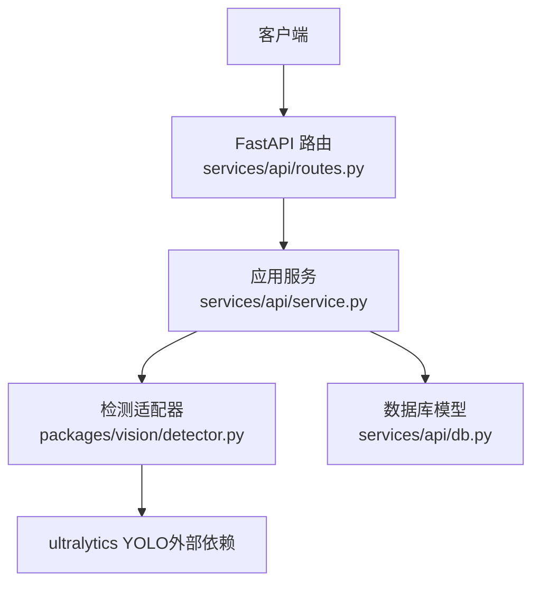
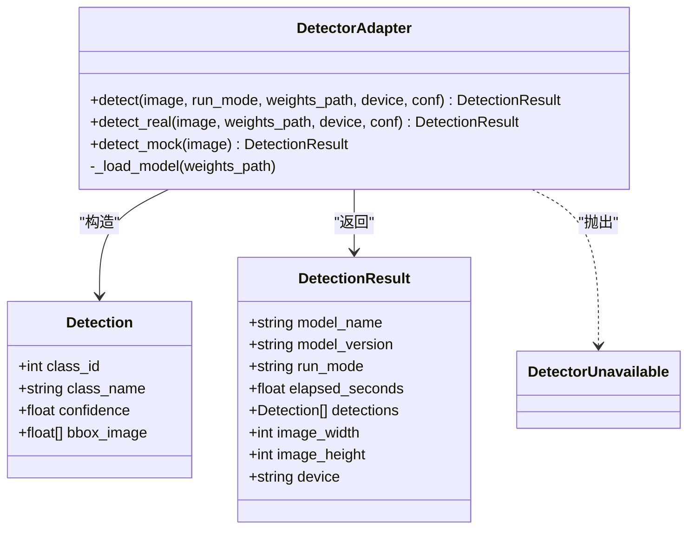
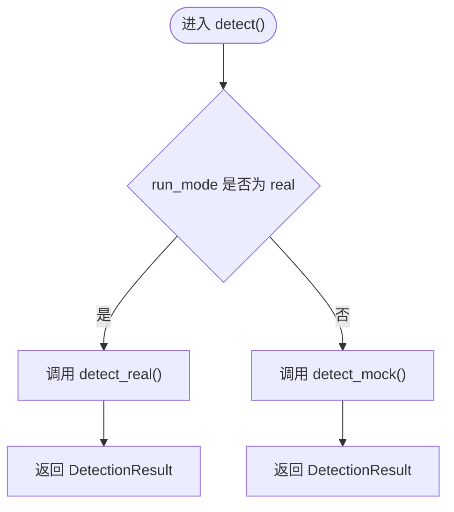
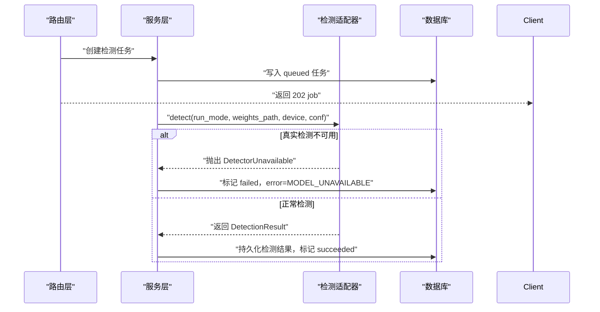
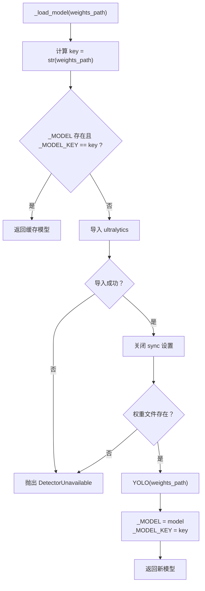
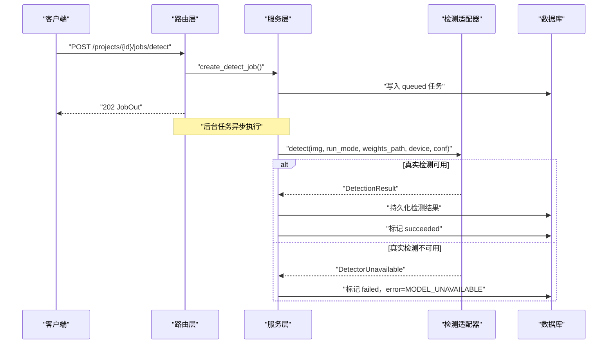
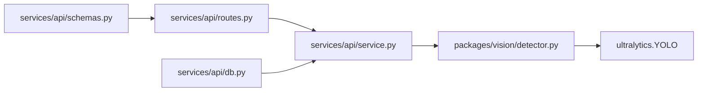

# 检测适配器模式

<cite>
**本文引用的文件**   
- [packages/vision/detector.py](file://packages/vision/detector.py)
- [services/api/service.py](file://services/api/service.py)
- [services/api/routes.py](file://services/api/routes.py)
- [services/api/schemas.py](file://services/api/schemas.py)
- [services/api/db.py](file://services/api/db.py)
</cite>

## 目录
1. [引言](#引言)
2. [项目结构定位](#项目结构定位)
3. [核心组件总览](#核心组件总览)
4. [架构总览](#架构总览)
5. [统一检测接口与数据模型](#统一检测接口与数据模型)
6. [运行模式与分派逻辑](#运行模式与分派逻辑)
7. [异常与错误处理机制](#异常与错误处理机制)
8. [进程内模型缓存机制](#进程内模型缓存机制)
9. [API 调用链与使用场景](#api-调用链与使用场景)
10. [扩展指南：新增检测算法适配器](#扩展指南新增检测算法适配器)
11. [依赖关系分析](#依赖关系分析)
12. [性能与稳定性建议](#性能与稳定性建议)
13. [故障排查清单](#故障排查清单)
14. [结论](#结论)

## 引言
AstraDesk 的检测子系统采用“检测适配器模式”：对外暴露统一的 `detect()` 入口，内部根据运行模式在真实 YOLOv10 检测与确定性 Mock 检测之间切换。该设计将底层视觉推理细节与上层 API、任务调度解耦，同时通过明确的异常类型和结果数据结构，保证契约稳定、可测试、可扩展。

## 项目结构定位
检测适配器位于视觉包中，被服务层以模块方式引用；API 路由仅负责协议转换，业务编排由服务层完成，检测结果最终持久化到 SQLite。

**图表来源**
- [services/api/routes.py:120-136](file://services/api/routes.py#L120-L136)
- [services/api/service.py:132-179](file://services/api/service.py#L132-L179)
- [packages/vision/detector.py:50-128](file://packages/vision/detector.py#L50-L128)
- [services/api/db.py:50-77](file://services/api/db.py#L50-L77)

**章节来源**
- [packages/vision/detector.py:1-128](file://packages/vision/detector.py#L1-L128)
- [services/api/service.py:1-237](file://services/api/service.py#L1-L237)
- [services/api/routes.py:1-143](file://services/api/routes.py#L1-L143)
- [services/api/db.py:1-92](file://services/api/db.py#L1-L92)

## 核心组件总览
- **Detection**：单个检测框的数据类，包含类别编号、类别名称、置信度和归一化图像坐标。
- **DetectionResult**：一次检测的完整输出，包含模型信息、运行模式、耗时、检测框列表、图像尺寸和设备信息。
- **DetectorUnavailable**：真实检测不可用时的专用异常，用于区分环境缺失与业务错误。
- **detect()**：统一入口，按 `run_mode` 分派到 `detect_real()` 或 `detect_mock()`。
- **detect_real()**：基于 ultralytics YOLOv10 的真实检测实现。
- **detect_mock()**：无 GPU 场景下的确定性 Mock 实现。
- **_load_model()**：懒加载并缓存 YOLO 模型，避免 worker 进程重复初始化。

**章节来源**
- [packages/vision/detector.py:22-47](file://packages/vision/detector.py#L22-L47)
- [packages/vision/detector.py:50-128](file://packages/vision/detector.py#L50-L128)

## 架构总览
检测适配器处于视觉推理层，向上为服务层提供稳定的检测能力，向下屏蔽 ultralytics 的具体实现差异。服务层负责任务状态机、资源读取、结果持久化和错误分类；路由层只承担 HTTP 协议职责。

**图表来源**
- [packages/vision/detector.py:22-47](file://packages/vision/detector.py#L22-L47)
- [packages/vision/detector.py:50-128](file://packages/vision/detector.py#L50-L128)

## 统一检测接口与数据模型

### Detection 数据类
- `class_id`：模型输出的类别编号。
- `class_name`：可读类别名，来自模型名称映射。
- `confidence`：检测置信度。
- `bbox_image`：归一化边界框 `[x1, y1, x2, y2]`，取值范围 0 到 1，左上角为原点。

该字段约定贯穿真实检测、Mock 检测、持久化和 API 响应，确保下游坐标还原与可视化一致。

### DetectionResult 数据类
- `model_name`：当前使用的检测模型标识，例如真实模式为 `yolov10n`，Mock 模式为 `mock-detector`。
- `model_version`：权重文件名或 Mock 版本标识。
- `run_mode`：运行模式，`real` 或 `mock`。
- `elapsed_seconds`：检测耗时。
- `detections`：检测框列表。
- `image_width` / `image_height`：输入图像宽高。
- `device`：实际使用设备，如 GPU 设备名或 `mock`。

**章节来源**
- [packages/vision/detector.py:26-47](file://packages/vision/detector.py#L26-L47)
- [packages/vision/detector.py:68-101](file://packages/vision/detector.py#L68-L101)
- [packages/vision/detector.py:104-121](file://packages/vision/detector.py#L104-L121)

## 运行模式与分派逻辑

### detect() 分派规则
- 当 `run_mode == "real"` 时，调用 `detect_real()`，走 ultralytics YOLOv10 真实推理。
- 其他情况（包括 `mock` 或其他未显式匹配值）均回退到 `detect_mock()`。

这意味着：
- 生产部署应明确设置 `run_mode="real"`。
- 测试、演示或无 GPU 环境可使用 `run_mode="mock"`。
- 非 `real` 的值不会报错，而是进入 Mock 路径，因此配置校验应在更上层完成。

**图表来源**
- [packages/vision/detector.py:124-128](file://packages/vision/detector.py#L124-L128)

**章节来源**
- [packages/vision/detector.py:124-128](file://packages/vision/detector.py#L124-L128)

## 异常与错误处理机制

### DetectorUnavailable 的用途
`DetectorUnavailable` 表示真实检测环境不可用，常见原因包括：
- 无法导入 `ultralytics`。
- 权重文件不存在。
- 模型初始化失败。

该异常不应被静默忽略，也不应自动降级为 Mock。服务层捕获后将其转换为业务错误码 `MODEL_UNAVAILABLE`，并将任务标记为 `failed`。

### 服务层错误分类
- `ApiError`：业务层错误，携带错误码、消息和是否可重试标志。
- `DetectorUnavailable`：基础设施/环境错误，映射为 `MODEL_UNAVAILABLE`。
- 其他异常：worker 边界统一捕获，记录为 `INTERNAL`，并根据策略标记是否可重试。

**图表来源**
- [services/api/routes.py:120-136](file://services/api/routes.py#L120-L136)
- [services/api/service.py:132-179](file://services/api/service.py#L132-L179)
- [packages/vision/detector.py:50-65](file://packages/vision/detector.py#L50-L65)

**章节来源**
- [packages/vision/detector.py:22-24](file://packages/vision/detector.py#L22-L24)
- [packages/vision/detector.py:50-65](file://packages/vision/detector.py#L50-L65)
- [services/api/service.py:132-186](file://services/api/service.py#L132-L186)

## 进程内模型缓存机制

### _MODEL 与 _MODEL_KEY
- `_MODEL`：进程级全局变量，保存已加载的 YOLO 模型实例。
- `_MODEL_KEY`：与权重路径对应的字符串键，用于判断是否需要重新加载。

### 缓存策略
1. 首次调用 `_load_model()` 时，尝试导入 `ultralytics`。
2. 若导入失败，抛出 `DetectorUnavailable`。
3. 关闭遥测同步设置，避免网络请求。
4. 检查权重文件是否存在，不存在则抛出 `DetectorUnavailable`。
5. 加载模型并赋值给 `_MODEL`，同时记录 `_MODEL_KEY`。
6. 后续相同权重路径直接复用 `_MODEL`，避免重复初始化。

### 性能优化考虑
- 避免 worker 每次检测都重新加载模型，显著降低首帧延迟。
- 通过权重路径作为缓存键，支持不同权重文件的隔离。
- 将外部依赖导入放在函数内部，减少模块加载时的副作用。

**图表来源**
- [packages/vision/detector.py:50-65](file://packages/vision/detector.py#L50-L65)

**章节来源**
- [packages/vision/detector.py:18-19](file://packages/vision/detector.py#L18-L19)
- [packages/vision/detector.py:50-65](file://packages/vision/detector.py#L50-L65)

## API 调用链与使用场景

### 健康检查与能力探测
- `/api/v1/health`：返回服务状态和当前运行模式。
- `/api/v1/capabilities`：探测检测器可用性；真实模式下会尝试加载模型，失败时返回 `available=false`。

### 检测任务流程
1. 客户端上传图像，服务层预处理并存储 canonical 与缩略图。
2. 客户端发起检测任务，服务层创建 `queued` 任务。
3. 后台任务执行 `process_detect_job()`，调用 `detector.detect()`。
4. 成功时持久化检测结果，任务状态变为 `succeeded`。
5. 失败时记录错误信息，任务状态变为 `failed`。

**图表来源**
- [services/api/routes.py:120-136](file://services/api/routes.py#L120-L136)
- [services/api/service.py:120-179](file://services/api/service.py#L120-L179)
- [packages/vision/detector.py:124-128](file://packages/vision/detector.py#L124-L128)

**章节来源**
- [services/api/routes.py:46-65](file://services/api/routes.py#L46-L65)
- [services/api/routes.py:120-143](file://services/api/routes.py#L120-L143)
- [services/api/service.py:120-179](file://services/api/service.py#L120-L179)

## 扩展指南：新增检测算法适配器

### 目标
在不破坏现有 API 的前提下，新增一种检测算法适配器，例如 OpenCV、ONNX Runtime 或自定义推理后端。

### 步骤
1. **定义新的检测实现函数**  
   新增类似 `detect_custom()` 的函数，接收 PIL 图像，返回 `DetectionResult`，并确保：
   - `bbox_image` 为归一化坐标。
   - `model_name`、`model_version`、`run_mode`、`device` 等字段语义清晰。
   - 环境缺失时抛出 `DetectorUnavailable`。

2. **扩展统一入口**  
   在 `detect()` 中增加新的运行模式分支，例如 `run_mode == "custom"` 时调用 `detect_custom()`。

3. **配置参数传递**  
   - 通过 `weights_path`、`device`、`conf` 等参数传入模型路径、设备和阈值。
   - 如需新增参数，优先通过函数签名传递，避免污染全局状态。
   - 若需要进程内缓存，参考 `_MODEL` 与 `_MODEL_KEY` 的模式，但建议使用更健壮的缓存键和服务生命周期管理。

4. **错误处理最佳实践**
   - 环境缺失：抛出 `DetectorUnavailable`。
   - 输入非法：在服务层转换为 `ApiError`。
   - 运行时异常：在 worker 边界统一捕获，记录为 `INTERNAL`，并标注是否可重试。
   - 不要静默降级：真实模式不可用时不得自动切换到 Mock。

5. **契约一致性**
   - 保持 `Detection` 与 `DetectionResult` 字段不变。
   - 保持 `bbox_image` 归一化约定。
   - 保持 `run_mode` 语义：`real` 表示真实推理，`mock` 表示确定性模拟。

6. **测试建议**
   - 为 Mock 模式编写契约测试。
   - 为真实模式准备最小权重文件和测试图像。
   - 验证 `capabilities` 接口能正确报告新适配器的可用性。

**章节来源**
- [packages/vision/detector.py:22-47](file://packages/vision/detector.py#L22-L47)
- [packages/vision/detector.py:50-128](file://packages/vision/detector.py#L50-L128)
- [services/api/service.py:132-186](file://services/api/service.py#L132-L186)

## 依赖关系分析

**图表来源**
- [packages/vision/detector.py:57-64](file://packages/vision/detector.py#L57-L64)
- [services/api/service.py:17-24](file://services/api/service.py#L17-L24)
- [services/api/routes.py:13-26](file://services/api/routes.py#L13-L26)
- [services/api/schemas.py:1-84](file://services/api/schemas.py#L1-L84)
- [services/api/db.py:1-92](file://services/api/db.py#L1-L92)

**章节来源**
- [packages/vision/detector.py:1-128](file://packages/vision/detector.py#L1-L128)
- [services/api/service.py:1-237](file://services/api/service.py#L1-L237)
- [services/api/routes.py:1-143](file://services/api/routes.py#L1-L143)
- [services/api/schemas.py:1-84](file://services/api/schemas.py#L1-L84)
- [services/api/db.py:1-92](file://services/api/db.py#L1-L92)

## 性能与稳定性建议
- **模型缓存**：保持 `_MODEL` 与 `_MODEL_KEY` 的懒加载策略，避免重复初始化。
- **设备选择**：优先使用显式 `device` 参数，否则从推理结果推断设备。
- **阈值调优**：通过 `conf` 控制置信度阈值，平衡召回率与误检率。
- **并发安全**：当前缓存为进程级全局变量，适合单 worker 场景；多 worker 部署需评估进程隔离与内存占用。
- **资源清理**：长驻进程应考虑模型卸载策略，防止内存持续增长。
- **监控指标**：利用 `elapsed_seconds`、`device`、`model_name`、`model_version` 构建检测性能看板。

[本节为通用性能建议，不直接分析具体代码行]

## 故障排查清单

### 常见问题
- **ultralytics 未安装**：`DetectorUnavailable` 提示无法导入。
- **权重文件缺失**：`DetectorUnavailable` 提示权重路径不存在。
- **GPU 不可用**：真实模式可能因设备问题初始化失败。
- **run_mode 配置错误**：非 `real` 值会进入 Mock 路径，导致结果不符合预期。
- **任务反复失败**：检查 error_json 中的 code 是否为 `MODEL_UNAVAILABLE` 或 `INTERNAL`。

### 排查步骤
1. 调用 `/api/v1/capabilities`，确认 `detector.available`。
2. 检查 `settings.run_mode` 是否为 `real`。
3. 检查 `settings.weights_path` 是否指向有效权重文件。
4. 查看 worker 日志中的 `DetectorUnavailable` 或 `INTERNAL` 错误。
5. 对 Mock 模式，确认 `model_name` 为 `mock-detector`，`run_mode` 为 `mock`。

**章节来源**
- [services/api/routes.py:51-65](file://services/api/routes.py#L51-L65)
- [services/api/service.py:158-163](file://services/api/service.py#L158-L163)
- [packages/vision/detector.py:50-65](file://packages/vision/detector.py#L50-L65)

## 结论
AstraDesk 的检测适配器模式通过统一入口、明确数据结构和专用异常类型，实现了真实检测与 Mock 检测的可插拔切换。该设计既保证了生产环境的稳定性，又提供了便捷的测试与演示能力。未来扩展新检测算法时，只需遵循现有契约并在统一入口中添加模式分支，即可在不影响上层 API 的前提下完成集成。