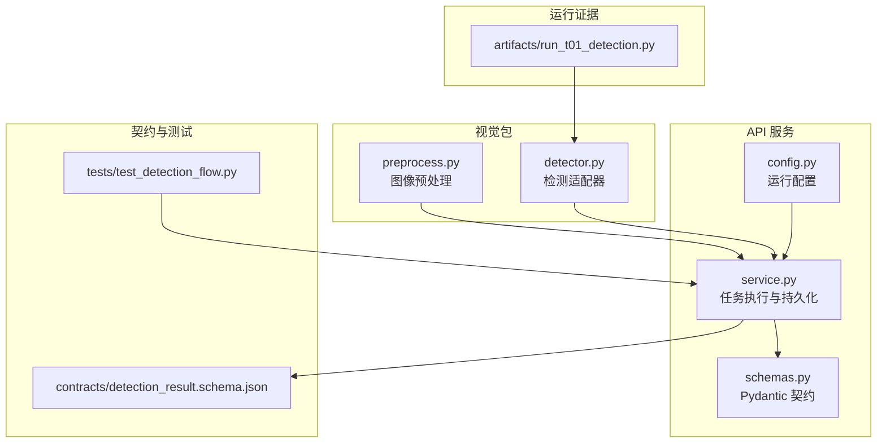
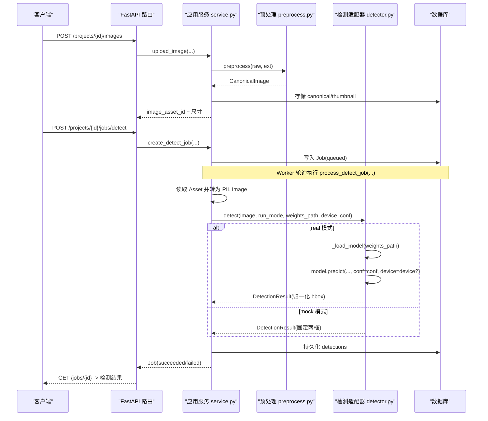
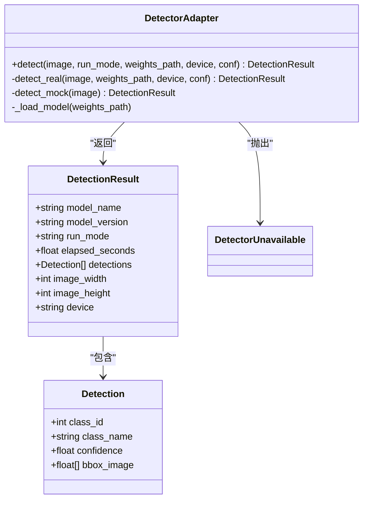
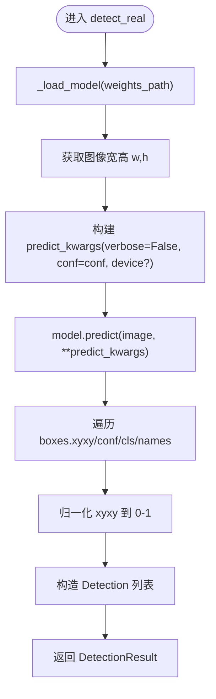
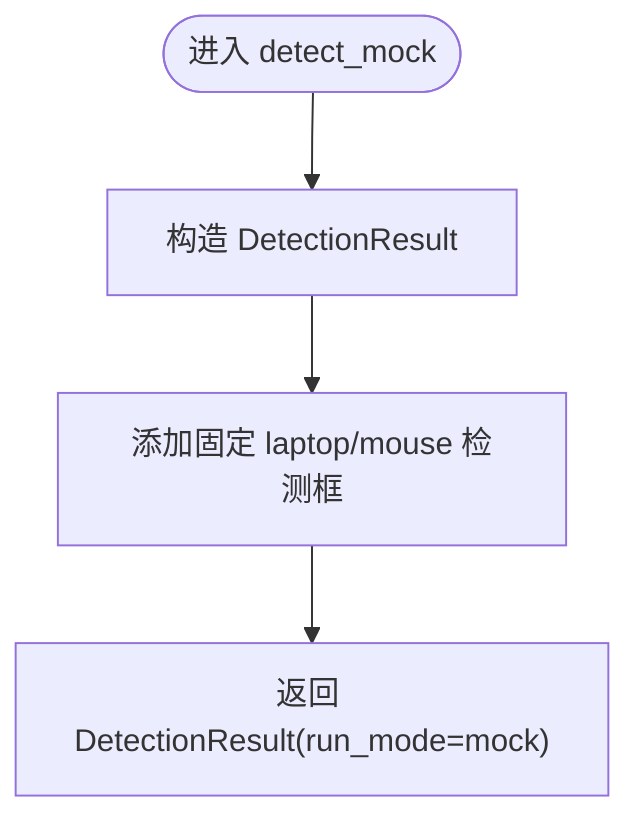
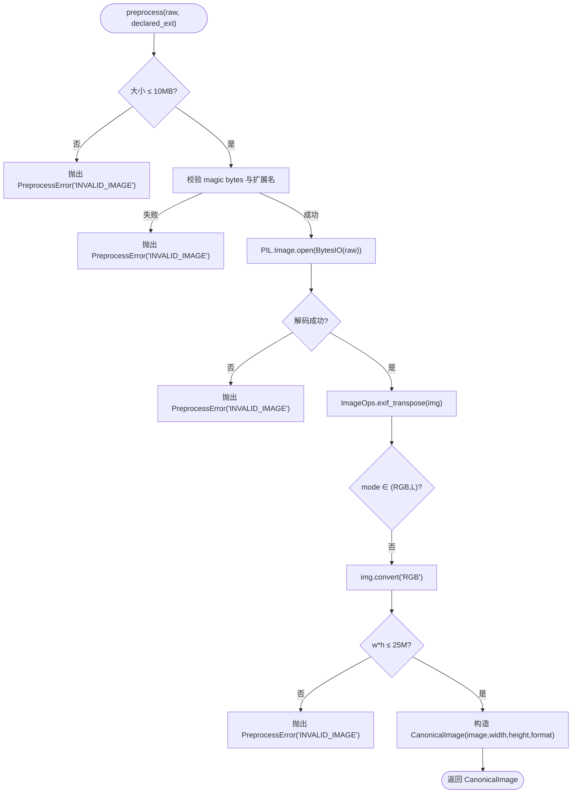
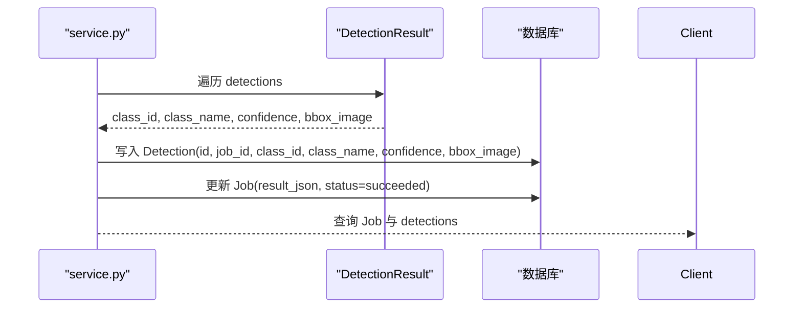
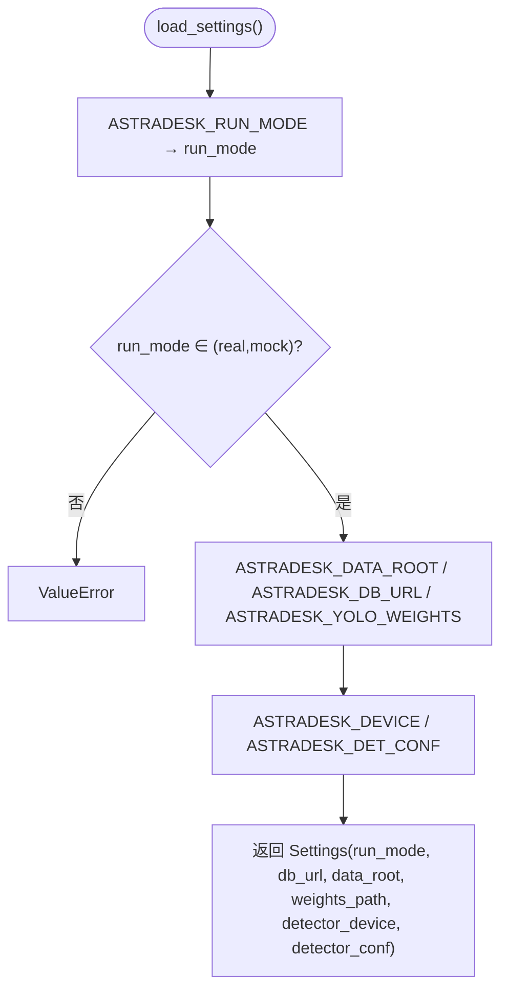
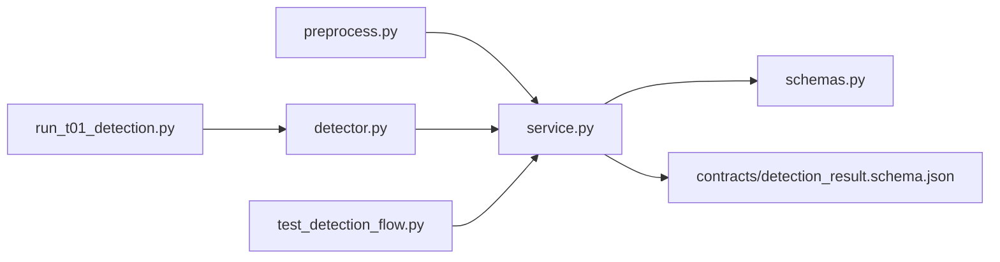

# 视觉检测模块

<cite>
**本文引用的文件**   
- [packages/vision/detector.py](file://packages/vision/detector.py)
- [packages/vision/preprocess.py](file://packages/vision/preprocess.py)
- [services/api/service.py](file://services/api/service.py)
- [services/api/config.py](file://services/api/config.py)
- [services/api/schemas.py](file://services/api/schemas.py)
- [tests/test_detection_flow.py](file://tests/test_detection_flow.py)
- [contracts/detection_result.schema.json](file://contracts/detection_result.schema.json)
- [artifacts/run_t01_detection.py](file://artifacts/run_t01_detection.py)
</cite>

## 目录
1. [引言](#引言)
2. [项目结构](#项目结构)
3. [核心组件](#核心组件)
4. [架构总览](#架构总览)
5. [详细组件分析](#详细组件分析)
6. [依赖关系分析](#依赖关系分析)
7. [性能与优化](#性能与优化)
8. [故障排查指南](#故障排查指南)
9. [结论](#结论)
10. [附录：扩展新检测算法](#附录扩展新检测算法)

## 引言
本技术文档聚焦 AstraDesk 的视觉检测模块，围绕“检测适配器模式”展开，解释统一检测接口、YOLOv10 真实检测器实现与 Mock 检测器的职责边界。文档同时覆盖 YOLOv10 模型集成方式（权重加载、设备选择、推理参数）、图像预处理流程、检测结果标准化处理、错误处理模式，以及如何在无 GPU 环境下通过 Mock 进行开发与测试。文末提供扩展新检测算法的实践指导，帮助读者在不破坏现有 API 契约的前提下接入新的检测后端。

## 项目结构
视觉检测相关代码主要分布在以下位置：
- `packages/vision/`：检测适配器与图像预处理。
- `services/api/`：应用服务层负责调度检测任务、持久化结果、暴露能力信息。
- `contracts/`：检测结果的 JSON Schema 契约，约束返回字段与坐标约定。
- `tests/`：端到端测试，覆盖 mock/real 模式、契约校验与错误路径。
- `artifacts/`：T01/T02 运行证据脚本与产物。

**图表来源**
- [packages/vision/preprocess.py:1-84](file://packages/vision/preprocess.py#L1-L84)
- [packages/vision/detector.py:1-129](file://packages/vision/detector.py#L1-L129)
- [services/api/config.py:1-61](file://services/api/config.py#L1-L61)
- [services/api/service.py:1-237](file://services/api/service.py#L1-L237)
- [services/api/schemas.py:1-84](file://services/api/schemas.py#L1-L84)
- [contracts/detection_result.schema.json:1-65](file://contracts/detection_result.schema.json#L1-L65)
- [tests/test_detection_flow.py:1-126](file://tests/test_detection_flow.py#L1-L126)
- [artifacts/run_t01_detection.py:1-79](file://artifacts/run_t01_detection.py#L1-L79)

**章节来源**
- [README.md:8-24](file://README.md#L8-L24)

## 核心组件
- 检测适配器：统一入口 `detect(image, run_mode, weights_path, device, conf)`，按运行模式分派到真实或 Mock 检测器。
- 真实检测器：基于 ultralytics YOLOv10，支持进程内模型缓存、设备选择、置信度阈值过滤、归一化坐标输出。
- Mock 检测器：确定性输出固定类别与框，用于无 GPU 环境与契约测试。
- 图像预处理：格式校验、EXIF 方向校正、尺寸与像素上限检查、去元数据标准图生成。
- 应用服务：创建检测任务、调用检测适配器、持久化检测结果、装配查询响应。
- 运行配置：从环境变量装配运行模式、权重路径、设备、置信度等参数。
- 契约约束：JSON Schema 定义检测任务返回结构与坐标约定；Pydantic 模型定义 API 输入输出。

**章节来源**
- [packages/vision/detector.py:1-129](file://packages/vision/detector.py#L1-L129)
- [packages/vision/preprocess.py:1-84](file://packages/vision/preprocess.py#L1-L84)
- [services/api/service.py:118-237](file://services/api/service.py#L118-L237)
- [services/api/config.py:1-61](file://services/api/config.py#L1-L61)
- [services/api/schemas.py:19-84](file://services/api/schemas.py#L19-L84)
- [contracts/detection_result.schema.json:1-65](file://contracts/detection_result.schema.json#L1-L65)

## 架构总览
检测流程从前端上传桌面图片开始，经过 API 路由与服务层，进入视觉包的预处理与检测适配器，最终将检测结果持久化并返回给调用方。

**图表来源**
- [services/api/service.py:71-187](file://services/api/service.py#L71-L187)
- [packages/vision/preprocess.py:54-84](file://packages/vision/preprocess.py#L54-L84)
- [packages/vision/detector.py:50-129](file://packages/vision/detector.py#L50-L129)

## 详细组件分析

### 检测适配器模式与统一接口
检测适配器通过统一入口函数 `detect` 屏蔽底层实现差异，对外暴露一致的 `DetectionResult` 数据结构。内部根据 `run_mode` 分派到 `detect_real` 或 `detect_mock`。

**图表来源**
- [packages/vision/detector.py:22-48](file://packages/vision/detector.py#L22-L48)
- [packages/vision/detector.py:50-129](file://packages/vision/detector.py#L50-L129)

关键点：
- 统一接口：`detect(image, run_mode, weights_path, device, conf)`。
- 真实检测器：`detect_real` 使用 ultralytics YOLOv10，支持设备与置信度参数。
- Mock 检测器：`detect_mock` 返回固定两个检测框，model_name 显式标注为 `mock-detector`。
- 异常类型：`DetectorUnavailable` 表示真实检测不可用，real 模式下不静默回退。

**章节来源**
- [packages/vision/detector.py:1-129](file://packages/vision/detector.py#L1-L129)

### YOLOv10 真实检测器实现
真实检测器负责加载 YOLOv10 模型、执行推理、解析预测结果并转换为归一化坐标。

**图表来源**
- [packages/vision/detector.py:50-101](file://packages/vision/detector.py#L50-L101)

要点：
- 模型懒加载与进程内缓存：避免 worker 每次调用重复加载。
- 关闭遥测同步：减少网络请求风险。
- 设备选择：若传入非空 device，则传递给推理；否则由后端自动选择。
- 置信度过滤：通过 `conf` 控制保留的检测框。
- 坐标归一化：将像素坐标除以图像宽高得到 0-1 范围。

**章节来源**
- [packages/vision/detector.py:50-101](file://packages/vision/detector.py#L50-L101)

### Mock 检测器与无 GPU 开发测试
Mock 检测器用于无 GPU 环境下的开发与测试，提供确定性输出，便于契约验证与端到端流程跑通。

**图表来源**
- [packages/vision/detector.py:104-121](file://packages/vision/detector.py#L104-L121)

特性：
- 固定类别与置信度：laptop 与 mouse，置信度分别为 0.5 与 0.4。
- 固定归一化框：确保多次调用结果一致。
- 明确标注：model_name 为 `mock-detector`，run_mode 为 `mock`。

**章节来源**
- [packages/vision/detector.py:104-121](file://packages/vision/detector.py#L104-L121)

### 图像预处理流程
图像预处理负责接收原始字节流，进行格式校验、EXIF 方向校正、尺寸与像素上限检查，并输出标准图对象。

**图表来源**
- [packages/vision/preprocess.py:43-76](file://packages/vision/preprocess.py#L43-L76)

重点：
- 拒绝伪装格式：magic bytes 与扩展名不一致直接拒绝。
- EXIF 方向校正：保证图像方向正确。
- 像素上限：防止超大图像导致内存压力。
- 去元数据：重存时剥离 EXIF 与元数据，得到标准图。

**章节来源**
- [packages/vision/preprocess.py:1-84](file://packages/vision/preprocess.py#L1-L84)

### 检测结果标准化与持久化
检测结果在应用服务层被标准化并持久化，随后通过查询接口返回。

**图表来源**
- [services/api/service.py:189-221](file://services/api/service.py#L189-L221)

说明：
- 坐标已归一化：bbox_image 为 `[x1,y1,x2,y2]`，值域 0-1。
- 稳定性：每个检测框生成稳定 id，避免重复写入。
- 契约一致性：返回结构符合 JSON Schema 与 Pydantic 模型。

**章节来源**
- [services/api/service.py:189-221](file://services/api/service.py#L189-L221)
- [contracts/detection_result.schema.json:1-65](file://contracts/detection_result.schema.json#L1-L65)
- [services/api/schemas.py:19-38](file://services/api/schemas.py#L19-L38)

### 运行配置与环境变量
运行配置从环境变量装配，默认采用 mock 模式以避免未配置时误触发真实模型。

**图表来源**
- [services/api/config.py:39-60](file://services/api/config.py#L39-L60)

注意：
- demo 模式等价于 mock。
- 设备为空字符串时，ultralytics 自动选择 cuda/cpu。
- 置信度默认 0.25。

**章节来源**
- [services/api/config.py:1-61](file://services/api/config.py#L1-L61)

## 依赖关系分析
视觉检测模块与 API 服务层之间的依赖如下：

**图表来源**
- [packages/vision/preprocess.py:1-84](file://packages/vision/preprocess.py#L1-L84)
- [packages/vision/detector.py:1-129](file://packages/vision/detector.py#L1-L129)
- [services/api/service.py:1-237](file://services/api/service.py#L1-L237)
- [services/api/schemas.py:1-84](file://services/api/schemas.py#L1-L84)
- [contracts/detection_result.schema.json:1-65](file://contracts/detection_result.schema.json#L1-L65)
- [tests/test_detection_flow.py:1-126](file://tests/test_detection_flow.py#L1-L126)
- [artifacts/run_t01_detection.py:1-79](file://artifacts/run_t01_detection.py#L1-L79)

耦合与内聚：
- 视觉包独立于 API 服务，仅通过统一接口暴露功能。
- API 服务负责业务编排与持久化，对视觉包低耦合。
- 契约层约束前后端数据格式，降低集成风险。

**章节来源**
- [services/api/service.py:1-237](file://services/api/service.py#L1-L237)
- [packages/vision/detector.py:1-129](file://packages/vision/detector.py#L1-L129)
- [packages/vision/preprocess.py:1-84](file://packages/vision/preprocess.py#L1-L84)

## 性能与优化
- 模型懒加载与进程内缓存：避免 worker 每次调用重复加载 YOLOv10 模型，显著降低启动开销。
- 关闭遥测同步：减少网络请求，提升稳定性。
- 设备选择策略：优先使用 CUDA；若未指定设备，由后端自动选择。
- 置信度阈值：通过 `ASTRADESK_DET_CONF` 调整，平衡召回与精度。
- 图像预处理限制：10MB 文件大小与 2500 万像素上限，防止内存溢出。
- 批量推理：当前为单图推理；未来可考虑批处理以提升吞吐。

[本节为通用性能讨论，不直接分析具体文件]

## 故障排查指南
常见错误与处理方式：
- 真实检测不可用：当缺少 ultralytics、权重文件或 GPU 时，抛出 `DetectorUnavailable`，real 模式下作业状态置为 failed，错误码 `MODEL_UNAVAILABLE`，不静默回退 mock。
- 图像预处理失败：包括文件过大、magic bytes 不匹配、损坏图像、像素超限，均抛出 `PreprocessError`，API 层映射为 `INVALID_IMAGE` 错误。
- 资产不存在：查询或操作不存在的 asset/project/job 时，返回对应 404 错误。
- 坐标转换错误：后端推导桌面框时若坐标非法，抛出 `CoordinateError`，映射为 422 错误。

建议排查步骤：
- 确认运行模式与权重路径配置是否正确。
- 检查图像格式与大小是否符合预处理要求。
- 查看作业错误信息中的 code 与 message，定位问题根因。
- 在无 GPU 环境中使用 mock 模式进行契约测试。

**章节来源**
- [packages/vision/detector.py:22-24](file://packages/vision/detector.py#L22-L24)
- [packages/vision/preprocess.py:24-31](file://packages/vision/preprocess.py#L24-L31)
- [services/api/service.py:158-163](file://services/api/service.py#L158-L163)
- [services/api/service.py:231-236](file://services/api/service.py#L231-L236)

## 结论
AstraDesk 的视觉检测模块通过检测适配器模式实现了真实 YOLOv10 检测与 Mock 检测的统一抽象，既满足生产环境的性能需求，又兼顾了无 GPU 环境下的开发与测试。图像预处理确保了输入质量与安全，检测结果标准化与契约约束保障了前后端数据一致性。通过环境变量灵活配置运行模式、权重路径、设备与置信度，系统具备良好的可扩展性与可维护性。

[本节为总结性内容，不直接分析具体文件]

## 附录：扩展新检测算法
若要接入新的检测算法（例如其他目标检测模型），请遵循以下步骤：

1. 实现适配器接口：
   - 新增一个检测函数，如 `detect_new(image, weights_path, device, conf)`，返回 `DetectionResult`。
   - 保持 `Detection` 与 `DetectionResult` 结构不变，确保下游兼容。

2. 注册到统一入口：
   - 在 `detect` 函数中增加对新运行模式的判断，或直接扩展分派逻辑。
   - 若希望作为独立模式，可在配置层新增运行模式枚举。

3. 定义配置参数：
   - 在 `Settings` 中添加新算法所需的参数（如模型路径、推理引擎、阈值等）。
   - 从环境变量装配这些参数，保持与现有配置风格一致。

4. 编写基准测试：
   - 参考 `artifacts/run_t01_detection.py`，记录推理耗时、显存占用、检测数量等指标。
   - 在单元测试中验证新检测器的输出结构与契约一致性。

5. 错误处理与日志：
   - 对于依赖缺失或权重不可用的情况，抛出明确的异常类型（如 `DetectorUnavailable`）。
   - 在 API 层捕获并转换为统一的错误对象，避免静默失败。

示例参考路径：
- 适配器接口与数据结构：[packages/vision/detector.py:26-48](file://packages/vision/detector.py#L26-L48)
- 真实检测器实现：[packages/vision/detector.py:68-101](file://packages/vision/detector.py#L68-L101)
- 配置装配：[services/api/config.py:39-60](file://services/api/config.py#L39-L60)
- 基准脚本：[artifacts/run_t01_detection.py:1-79](file://artifacts/run_t01_detection.py#L1-L79)

**章节来源**
- [packages/vision/detector.py:26-101](file://packages/vision/detector.py#L26-L101)
- [services/api/config.py:39-60](file://services/api/config.py#L39-L60)
- [artifacts/run_t01_detection.py:1-79](file://artifacts/run_t01_detection.py#L1-L79)