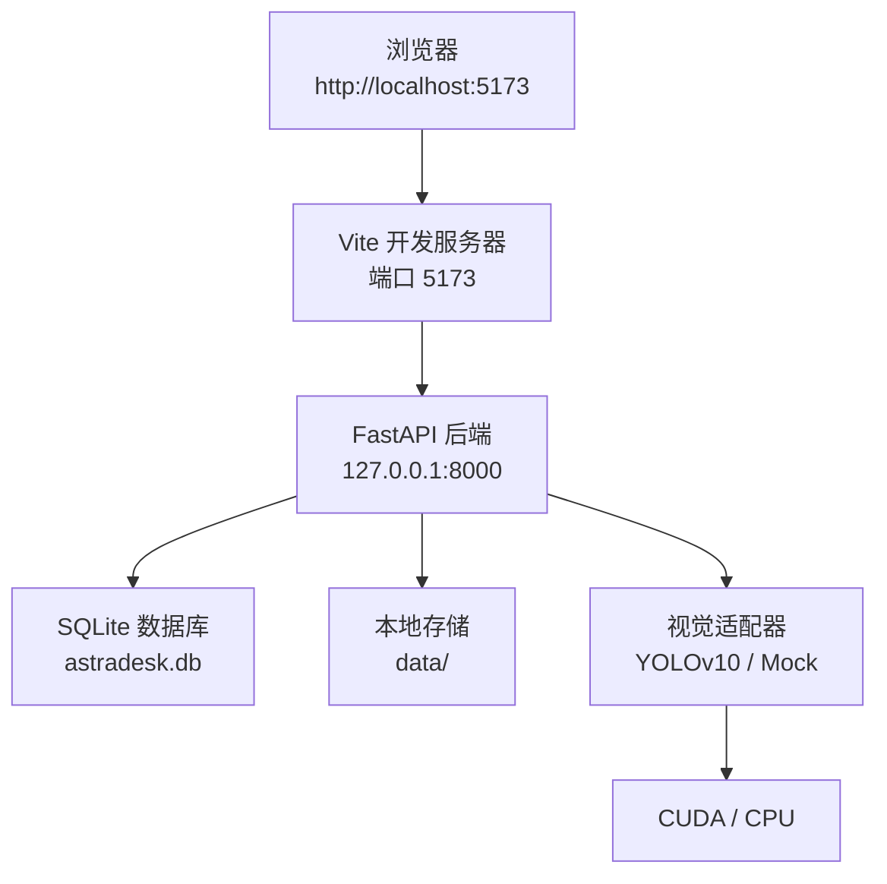

# 故障排查

<cite>
**本文引用的文件**   
- [README.md](file://README.md)
- [ENVIRONMENT.md](file://docs/ENVIRONMENT.md)
- [app.py](file://services\api\app.py)
- [config.py](file://services\api\config.py)
- [routes.py](file://services\api\routes.py)
- [service.py](file://services\api\service.py)
- [errors.py](file://services\api\errors.py)
- [vite.config.ts](file://apps\web\vite.config.ts)
- [api.ts](file://apps\web\src\api.ts)
- [probe_wsl.sh](file://artifacts\probe_wsl.sh)
- [start_api.sh](file://artifacts\start_api.sh)
- [run_t02_api.sh](file://artifacts\run_t02_api.sh)
- [probe_torch_cuda.py](file://artifacts\probe_torch_cuda.py)
</cite>

## 目录
1. [引言](#引言)
2. [项目结构与运行边界](#项目结构与运行边界)
3. [常见启动问题排查](#常见启动问题排查)
4. [运行时错误排查](#运行时错误排查)
5. [网络连接问题排查](#网络连接问题排查)
6. [性能问题诊断](#性能问题诊断)
7. [WSL2 环境特殊问题](#wsl2-环境特殊问题)
8. [故障排查工具与方法](#故障排查工具与方法)
9. [问题报告模板与社区支持](#问题报告模板与社区支持)
10. [结论](#结论)

## 引言
本指南面向 AstraDesk 的使用者与维护者，聚焦以下目标：
- 快速定位并解决启动阶段问题，包括端口占用、权限不足、依赖缺失。
- 处理运行时错误，尤其是 YOLOv10 模型加载失败、GPU 显存不足、图像处理异常。
- 排查前端到后端的网络问题，包括 CORS、API 超时、文件上传失败。
- 诊断响应缓慢、内存泄漏、CPU 使用率过高等性能问题。
- 在 WSL2 环境下处理 GPU 驱动、文件系统性能、网络配置等常见问题。
- 提供可复用的排查流程、命令示例、日志分析方法和问题报告模板。

AstraDesk 后端基于 FastAPI，默认监听 `127.0.0.1:8000`；前端开发服务器默认监听 `http://localhost:5173`，并通过 Vite 代理将 `/api` 请求转发到后端。真实检测模式需要 YOLOv10 权重和可用的 CUDA/GPU 环境；Mock 模式用于无 GPU 或契约测试。

**章节来源**
- [README.md:33-50](file://README.md#L33-L50)
- [README.md:71-77](file://README.md#L71-L77)
- [ENVIRONMENT.md:5-24](file://docs/ENVIRONMENT.md#L5-L24)

## 项目结构与运行边界
AstraDesk 的关键运行边界如下：
- 后端服务：`services.api.app:app`，由 uvicorn 启动。
- 路由前缀：`/api/v1`，包含健康检查、能力查询、项目、图像上传、检测任务等接口。
- 前端代理：Vite dev server 将 `/api` 代理到 `http://127.0.0.1:8000`。
- 运行模式：通过环境变量 `ASTRADESK_RUN_MODE` 控制 `real` 或 `mock`。
- 数据路径：`ASTRADESK_DATA_ROOT` 指向本地数据目录，默认在项目根 `data`。
- 模型权重：`ASTRADESK_YOLO_WEIGHTS` 指向 YOLOv10 权重文件。
- 设备与置信度：`ASTRADESK_DEVICE`、`ASTRADESK_DET_CONF` 控制推理设备与阈值。

**图表来源**
- [app.py:24-47](file://services\api\app.py#L24-L47)
- [routes.py:28-143](file://services\api\routes.py#L28-L143)
- [vite.config.ts:5-16](file://apps\web\vite.config.ts#L5-L16)

**章节来源**
- [README.md:8-24](file://README.md#L8-L24)
- [README.md:33-50](file://README.md#L33-L50)
- [config.py:15-60](file://services\api\config.py#L15-L60)

## 常见启动问题排查

### 端口占用
症状：
- 启动 uvicorn 时报端口被占用。
- 健康检查无法访问 `http://127.0.0.1:8000/api/v1/health`。

排查步骤：
1. 确认当前监听端口是否为 `8000`。
2. 查找占用端口的进程并终止。
3. 重新启动后端服务。
4. 若使用脚本启动，注意脚本中固定端口逻辑。

相关实现：
- 默认启动命令使用 `--port 8000`。
- 启动脚本 `start_api.sh` 固定监听 `127.0.0.1:8000`。
- T02 验证脚本 `run_t02_api.sh` 使用端口 `8123` 做隔离测试。

建议：
- 避免同时启动多个实例监听同一端口。
- 测试时使用不同端口，例如 `8123`，避免干扰主服务。

**章节来源**
- [README.md:40-47](file://README.md#L40-L47)
- [start_api.sh:8-9](file://artifacts\start_api.sh#L8-L9)
- [run_t02_api.sh:7-8](file://artifacts\run_t02_api.sh#L7-L8)

### 权限不足
症状：
- 无法写入 `data` 目录。
- 无法创建 SQLite 数据库文件。
- 无法保存图像资产或缩略图。

排查步骤：
1. 检查 `ASTRADESK_DATA_ROOT` 指向的目录是否存在且可写。
2. 检查当前用户对 `data` 目录的读写权限。
3. 检查磁盘剩余空间是否充足。
4. 若使用 WSL，确保 venv 位于 WSL 原生文件系统，避免跨系统慢 I/O。

相关实现：
- 应用启动时会创建 `settings.data_root`。
- 图像上传会写入 canonical 与 thumbnail 资产。
- 文档强调 venv 应放在 WSL 原生 ext4 分区。

建议：
- 使用 `~/venvs/astradesk` 作为 Python 虚拟环境。
- 避免把项目放在 `/mnt/d` 等 Windows 挂载盘上运行服务。

**章节来源**
- [app.py:24-28](file://services\api\app.py#L24-L28)
- [service.py:73-107](file://services\api\service.py#L73-L107)
- [README.md:26-31](file://README.md#L26-L31)
- [ENVIRONMENT.md:11-12](file://docs/ENVIRONMENT.md#L11-L12)

### 依赖缺失
症状：
- 导入 FastAPI、uvicorn、SQLAlchemy、Pillow、python-multipart 失败。
- 真实检测模式缺少 torch、ultralytics 导致模型加载失败。
- 前端安装依赖失败。

排查步骤：
1. 确认已激活正确的 Python venv。
2. 安装 API 依赖：`pip install -e '.[dev]'`。
3. 安装真实检测依赖：`pip install -e '.[vision]'`。
4. 前端执行 `npm install`。
5. 检查依赖锁文件 `locks/python.lock.txt`。

相关实现：
- README 明确 API 与 vision 依赖安装方式。
- ENVIRONMENT 记录已验证的后端依赖版本。

建议：
- 优先使用依赖锁文件保证环境一致性。
- 在 WSL 中安装 Python 依赖，在 Windows 中安装 Node 依赖。

**章节来源**
- [README.md:33-47](file://README.md#L33-L47)
- [ENVIRONMENT.md:21-23](file://docs/ENVIRONMENT.md#L21-L23)

## 运行时错误排查

### YOLOv10 模型加载失败
症状：
- 健康检查正常，但能力接口显示 detector 不可用。
- 检测任务状态变为 `failed`，错误码为 `MODEL_UNAVAILABLE`。
- 真实模式下未设置权重路径或权重文件不存在。

排查步骤：
1. 确认运行模式为 `real`。
2. 检查 `ASTRADESK_YOLO_WEIGHTS` 是否指向有效权重文件。
3. 检查权重文件是否存在且可读。
4. 调用 `/api/v1/capabilities` 查看 detector 可用性。
5. 检查日志中是否有模型加载异常。

相关实现：
- 能力接口尝试加载模型以判断可用性。
- 真实模式检测失败时返回 `MODEL_UNAVAILABLE`。
- 配置从环境变量读取权重路径。

建议：
- 首次真实检测前，先下载 YOLOv10n 权重到 `weights/yolov10n.pt`。
- 使用 mock 模式验证 API 链路，再切换到 real 模式。

**章节来源**
- [routes.py:51-65](file://services\api\routes.py#L51-L65)
- [service.py:132-163](file://services\api\service.py#L132-L163)
- [config.py:39-60](file://services\api\config.py#L39-L60)
- [README.md:71-77](file://README.md#L71-L77)

### GPU 显存不足
症状：
- PyTorch 能检测到 CUDA，但推理时报显存不足。
- GPU 总显存较小（如 6GB），大图像或高分辨率输入导致 OOM。
- 多进程或多实例同时推理加剧显存竞争。

排查步骤：
1. 使用 `torch.cuda.is_available()` 和 `nvidia-smi` 确认 GPU 可用。
2. 检查显存总量与已分配显存。
3. 降低图像分辨率或批量大小。
4. 调整 `ASTRADESK_DET_CONF` 减少检测结果数量。
5. 避免同时运行多个 GPU 密集型任务。

相关实现：
- 探测脚本输出 CUDA 可用性与显存信息。
- 文档记录 RTX 4050 Laptop 6GB 显存实测情况。
- 配置允许空设备字符串，让 ultralytics 自动选择 cuda/cpu。

建议：
- 小显存 GPU 优先使用轻量模型 yolov10n。
- 单实例运行，避免并发推理。
- 监控显存峰值，必要时降级为 CPU 推理。

**章节来源**
- [probe_torch_cuda.py:1-24](file://artifacts\probe_torch_cuda.py#L1-L24)
- [ENVIRONMENT.md:13-14](file://docs/ENVIRONMENT.md#L13-L14)
- [config.py:49-51](file://services\api\config.py#L49-L51)

### 图像处理异常
症状：
- 上传图像时报 `INVALID_IMAGE`。
- 图片格式不支持、文件为空、尺寸过大或像素过多。
- 预处理失败导致无法生成 canonical 或缩略图。

排查步骤：
1. 检查上传文件格式是否为 jpg、jpeg、png。
2. 检查文件大小是否超过限制。
3. 检查图像像素总数是否超过限制。
4. 查看后端日志中的预处理错误。
5. 使用标准图像重新上传。

相关实现：
- 上传接口校验扩展名、空文件、预处理错误。
- 预处理错误映射为 `INVALID_IMAGE`，部分错误返回 413。
- 支持 canonical 与 thumbnail 两种资产。

建议：
- 前端限制上传类型与大小。
- 服务端统一转换为 PNG/JPG 标准格式。
- 对超大图像进行压缩或裁剪后再上传。

**章节来源**
- [service.py:26-41](file://services\api\service.py#L26-L41)
- [service.py:73-107](file://services\api\service.py#L73-L107)

## 网络连接问题排查

### CORS 配置错误
症状：
- 前端控制台报跨域错误。
- 浏览器拒绝从 `http://localhost:5173` 访问后端。
- 仅开发环境出现，生产环境可能因反向代理配置不同而表现不同。

排查步骤：
1. 确认前端开发服务器地址为 `http://localhost:5173`。
2. 检查后端 CORS 是否允许该来源。
3. 检查浏览器开发者工具的网络面板。
4. 临时关闭浏览器安全策略仅用于调试，不建议长期启用。

相关实现：
- 后端注册 CORSMiddleware，允许 `http://localhost:5173` 与 `http://127.0.0.1:5173`。
- 允许所有方法与头，便于开发调试。

建议：
- 保持前端与后端同源或正确配置反向代理。
- 生产环境收紧 CORS 白名单。

**章节来源**
- [app.py:36-42](file://services\api\app.py#L36-L42)
- [vite.config.ts:7-14](file://apps\web\vite.config.ts#L7-L14)

### API 调用超时
症状：
- 前端轮询检测任务长时间无结果。
- curl 调用健康检查或能力接口超时。
- 后台任务执行缓慢或卡住。

排查步骤：
1. 直接访问后端健康检查接口。
2. 检查后端日志是否有异常或阻塞。
3. 检查检测任务状态是否为 `running` 或 `queued`。
4. 检查 worker 是否独立运行。
5. 缩短轮询间隔或增加最大重试次数。

相关实现：
- 前端 `pollJob` 默认每 800ms 轮询一次，最多 60 次。
- 检测任务通过 BackgroundTasks 异步执行。
- 健康检查返回运行模式。

建议：
- 大图像或复杂场景适当延长轮询时间。
- 使用独立 worker 轮询执行 queued 任务。
- 监控任务状态变化，避免无限轮询。

**章节来源**
- [api.ts:109-118](file://apps\web\src\api.ts#L109-L118)
- [routes.py:120-136](file://services\api\routes.py#L120-L136)
- [README.md:45-47](file://README.md#L45-L47)

### 文件上传失败
症状：
- 前端上传图像报错。
- 后端返回 `INVALID_IMAGE` 或 `ASSET_NOT_FOUND`。
- 文件内容损坏或路径不存在。

排查步骤：
1. 检查前端 FormData 是否正确构造。
2. 检查后端是否成功接收文件。
3. 检查图像预处理是否成功。
4. 检查资产路径是否存在。
5. 查看后端日志中的具体错误码。

相关实现：
- 前端使用 FormData 上传 file。
- 后端读取原始字节并预处理。
- 资产获取失败返回 404。

建议：
- 前端捕获上传错误并提示用户。
- 后端记录上传失败原因，便于排查。
- 对重复上传进行去重或覆盖策略。

**章节来源**
- [api.ts:85-91](file://apps\web\src\api.ts#L85-L91)
- [routes.py:100-115](file://services\api\routes.py#L100-L115)
- [service.py:73-107](file://services\api\service.py#L73-L107)

## 性能问题诊断

### 响应缓慢
症状：
- 健康检查响应快，但检测任务耗时很长。
- 前端轮询多次才得到结果。
- 大图像或高分辨率输入导致推理慢。

排查步骤：
1. 分别测量健康检查、图像上传、检测任务耗时。
2. 检查是否使用 GPU 推理。
3. 检查图像尺寸与像素数。
4. 检查磁盘 I/O 是否成为瓶颈。
5. 对比 mock 模式与 real 模式性能。

相关实现：
- 检测结果包含 `elapsed_seconds`。
- 真实模式依赖 YOLOv10 推理。
- mock 模式用于快速验证。

建议：
- 对大图进行缩放或裁剪。
- 使用 GPU 加速推理。
- 避免在同一实例中串行处理大量任务。

**章节来源**
- [service.py:168-177](file://services\api\service.py#L168-L177)
- [README.md:71-77](file://README.md#L71-L77)

### 内存泄漏
症状：
- 长时间运行后内存持续增长。
- 频繁上传图像后进程内存不释放。
- worker 执行多次后显存未回收。

排查步骤：
1. 观察进程 RSS 与 GPU 显存趋势。
2. 检查图像对象是否及时释放。
3. 检查数据库连接是否复用。
4. 检查是否有全局缓存未清理。
5. 重启服务验证是否恢复。

相关实现：
- 图像读取后转换为 RGB 并传入检测器。
- 会话工厂由 app.state.db 持有。
- 检测结果持久化后不再保留大图对象。

建议：
- 避免在服务中缓存大图。
- 定期重启 worker 或限制单次处理量。
- 监控显存与内存增长曲线。

**章节来源**
- [service.py:148-157](file://services\api\service.py#L148-L157)
- [app.py:16-33](file://services\api\app.py#L16-L33)

### CPU 使用率过高
症状：
- 非 GPU 环境下 CPU 占用高。
- 批量处理图像时 CPU 持续满载。
- 前端轮询造成额外负载。

排查步骤：
1. 确认是否使用 CPU 推理。
2. 检查是否并发过多任务。
3. 检查前端轮询频率。
4. 分析进程线程与调用栈。
5. 考虑限流或队列化任务。

相关实现：
- 配置允许空设备字符串，自动选择 cuda/cpu。
- BackgroundTasks 异步执行检测。
- 前端轮询间隔可调。

建议：
- 有 GPU 时优先使用 CUDA。
- 限制并发任务数。
- 调整前端轮询间隔，避免高频请求。

**章节来源**
- [config.py:49-51](file://services\api\config.py#L49-L51)
- [routes.py:130-136](file://services\api\routes.py#L130-L136)
- [api.ts:111-118](file://apps\web\src\api.ts#L111-L118)

## WSL2 环境特殊问题

### GPU 驱动问题
症状：
- `nvidia-smi` 在 WSL 中不可用或显示异常。
- PyTorch 报告 CUDA 不可用。
- GPU 计算矩阵乘法失败。

排查步骤：
1. 在 WSL 中运行 `nvidia-smi` 查看驱动与显存。
2. 运行 CUDA 探测脚本验证 PyTorch CUDA 能力。
3. 检查 Windows 侧 NVIDIA 驱动版本。
4. 确认 WSL2 内核与宿主驱动兼容。
5. 重启 WSL 或宿主机后重试。

相关实现：
- 探测脚本输出 CUDA 可用性与设备信息。
- 文档记录已验证的 CUDA 运行时与计算能力。

建议：
- 保持 Windows 驱动与 WSL2 内核更新。
- 使用官方推荐的 CUDA 版本组合。
- 若仅推理不需要 nvcc，避免安装完整 toolkit。

**章节来源**
- [probe_wsl.sh:13-16](file://artifacts\probe_wsl.sh#L13-L16)
- [probe_torch_cuda.py:1-24](file://artifacts\probe_torch_cuda.py#L1-L24)
- [ENVIRONMENT.md:13-14](file://docs/ENVIRONMENT.md#L13-L14)

### 文件系统性能
症状：
- 在 `/mnt/d` 上运行服务明显变慢。
- 图像上传、数据库写入延迟高。
- venv 安装在 Windows 挂载盘上导致 pip 慢。

排查步骤：
1. 检查项目是否位于 `/mnt/d`。
2. 检查 venv 是否位于 WSL 原生文件系统。
3. 检查磁盘剩余空间。
4. 迁移项目与 venv 到 WSL 原生目录。

相关实现：
- 文档明确 venv 应放在 WSL 原生 ext4。
- 启动脚本使用 `/mnt/d/AstraDesk`，需注意 I/O 性能。

建议：
- 将项目与 venv 移到 `~` 下 WSL 原生目录。
- 仅在 Windows 编辑代码，WSL 运行服务。
- 避免在跨文件系统路径上做频繁 I/O。

**章节来源**
- [README.md:26-31](file://README.md#L26-L31)
- [ENVIRONMENT.md:11-12](file://docs/ENVIRONMENT.md#L11-L12)
- [start_api.sh:3-6](file://artifacts\start_api.sh#L3-L6)

### 网络配置异常
症状：
- 前端无法通过 Vite 代理访问后端。
- curl 在 WSL 中访问 `127.0.0.1:8000` 失败。
- 代理配置未生效或目标地址错误。

排查步骤：
1. 确认 Vite 代理目标为 `http://127.0.0.1:8000`。
2. 确认后端监听地址为 `127.0.0.1`。
3. 检查防火墙或代理软件拦截。
4. 使用 curl 直接测试后端接口。
5. 检查浏览器开发者工具网络面板。

相关实现：
- Vite 配置 `/api` 代理到后端。
- 启动命令绑定 `127.0.0.1`。
- 启动脚本使用 `--noproxy '*'` 绕过代理。

建议：
- 开发环境保持前后端同机。
- 生产环境使用反向代理统一入口。
- 避免在 WSL 与 Windows 之间混用 localhost 语义差异。

**章节来源**
- [vite.config.ts:9-14](file://apps\web\vite.config.ts#L9-L14)
- [README.md:40-47](file://README.md#L40-L47)
- [start_api.sh:8-18](file://artifacts\start_api.sh#L8-L18)

## 故障排查工具与方法

### curl 测试
用途：
- 验证后端是否启动。
- 检查健康状态与能力。
- 模拟前端 API 调用。

常用命令：
- 健康检查：`curl http://127.0.0.1:8000/api/v1/health`
- 能力查询：`curl http://127.0.0.1:8000/api/v1/capabilities`
- 带超时与无代理：`curl -s --noproxy '*' -m 5 http://127.0.0.1:8000/api/v1/health`

参考：
- 启动脚本与健康检查集成。
- T02 验证脚本轮询健康接口。

**章节来源**
- [start_api.sh:11-18](file://artifacts\start_api.sh#L11-L18)
- [run_t02_api.sh:11-21](file://artifacts\run_t02_api.sh#L11-L21)

### 日志分析
用途：
- 定位启动失败原因。
- 查看模型加载、图像处理、数据库操作异常。
- 追踪请求 ID 与错误码。

方法：
- 查看 uvicorn 标准输出与错误输出。
- 查看 `/tmp/astradesk_api.log`。
- 关注 `ApiError` 返回的错误体结构。
- 使用 `request_id` 关联前后端日志。

相关实现：
- 启动脚本将日志重定向到 `/tmp/astradesk_api.log`。
- 错误处理器统一返回 `code`、`message`、`retryable`、`request_id`。

**章节来源**
- [start_api.sh:7-9](file://artifacts\start_api.sh#L7-L9)
- [errors.py:35-55](file://services\api\errors.py#L35-L55)

### 性能剖析工具
用途：
- 验证 CUDA 与 GPU 能力。
- 检查显存分配与计算正确性。
- 辅助定位内存与性能问题。

方法：
- 运行 CUDA 探测脚本输出 JSON。
- 使用 `nvidia-smi` 查看驱动与显存。
- 结合系统监控工具观察 CPU、内存、I/O。

参考：
- 探测脚本输出 torch 版本、CUDA 可用、设备名称、显存、矩阵乘法结果。
- 文档记录已验证的 PyTorch 与 CUDA 版本。

**章节来源**
- [probe_torch_cuda.py:1-24](file://artifacts\probe_torch_cuda.py#L1-L24)
- [ENVIRONMENT.md:13-14](file://docs/ENVIRONMENT.md#L13-L14)

### 环境探测脚本
用途：
- 快速收集 WSL 环境信息。
- 检查 Python、pip、venv、node、GPU、nvcc、磁盘。

方法：
- 运行 `artifacts/probe_wsl.sh`。
- 根据输出判断环境缺口。

**章节来源**
- [probe_wsl.sh:1-19](file://artifacts\probe_wsl.sh#L1-L19)

## 问题报告模板与社区支持

### 问题报告模板
提交问题时请尽量包含以下信息：
- 环境信息：操作系统、WSL 发行版、Python 版本、Node 版本、PyTorch 版本、CUDA 版本、GPU 型号与显存。
- 运行模式：`real` 或 `mock`。
- 关键环境变量：`ASTRADESK_RUN_MODE`、`ASTRADESK_YOLO_WEIGHTS`、`ASTRADESK_DATA_ROOT`、`ASTRADESK_DEVICE`、`ASTRADESK_DET_CONF`。
- 启动命令与端口。
- 错误现象：HTTP 状态码、错误码、错误消息、request_id。
- 日志片段：后端日志、浏览器控制台、curl 输出。
- 复现步骤：最小可复现命令或请求。
- 已尝试修复：端口切换、权限修改、依赖重装、驱动更新等。

参考字段：
- 错误体结构包含 `code`、`message`、`details`、`retryable`、`request_id`。
- 检测结果包含 `model_name`、`model_version`、`run_mode`、`device`、`elapsed_seconds`。

**章节来源**
- [errors.py:35-55](file://services\api\errors.py#L35-L55)
- [service.py:168-177](file://services\api\service.py#L168-L177)

### 社区支持渠道
- 仓库说明与进度见 README 与 docs。
- 环境与模型能力记录见 ENVIRONMENT.md。
- 契约样例与测试用例可用于回归验证。
- 若涉及外部凭据或远端服务，需按文档要求配置服务端环境变量。

建议：
- 先运行 mock 模式验证 API 链路。
- 再切换到 real 模式验证模型与环境。
- 使用 T02 脚本快速验证健康、能力与路由。

**章节来源**
- [README.md:1-8](file://README.md#L1-L8)
- [README.md:61-69](file://README.md#L61-L69)
- [ENVIRONMENT.md:1-4](file://docs/ENVIRONMENT.md#L1-L4)

## 结论
AstraDesk 的故障排查应以“环境基线 → 启动健康 → 能力检测 → 上传与推理 → 网络与性能”为主线。对于 WSL2 用户，重点确认 GPU 驱动、CUDA 运行时、文件系统位置与网络代理。对于真实检测问题，优先验证权重路径、运行模式与显存容量。对于网络问题，优先验证 CORS、Vite 代理与后端监听地址。通过 curl、日志、CUDA 探测脚本与环境探测脚本，可以快速定位大多数常见问题。